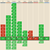

# <a href="https://herbertofury.github.io/INTA/" title="Open INTA official download or service page" aria-label="Open INTA official download or service page" data-inta-brand="app-inta"></a> [INTA Computer Services](https://herbertofury.github.io/INTA/)

<a href="https://herbertofury.github.io/INTA/" title="Open INTA official download or service page" aria-label="Open INTA official download or service page" data-inta-brand="app-inta"></a> [INTA](https://herbertofury.github.io/INTA/) is one technician ecosystem: <a href="https://herbertofury.github.io/INTA/" title="Open INTA official download or service page" aria-label="Open INTA official download or service page" data-inta-brand="app-inta"></a> [INTA Desktop](docs/ecosystem-development.md#inta-desktop), <a href="https://herbertofury.github.io/INTA/" title="Open INTA official download or service page" aria-label="Open INTA official download or service page" data-inta-brand="app-inta"></a> [INTA Mobile](docs/ecosystem-development.md#inta-mobile), <a href="https://github.com/Herbertofury/INTA/releases" title="Open INTA Rescue official download or service page" aria-label="Open INTA Rescue official download or service page" data-inta-brand="app-inta-rescue"></a> [INTA Rescue](docs/rescue.md), and <a href="https://herbertofury.github.io/INTA/" title="Open INTA official download or service page" aria-label="Open INTA official download or service page" data-inta-brand="app-inta"></a> [INTA Site](https://herbertofury.github.io/INTA/). Start with the [Tool Library](https://herbertofury.github.io/INTA/#tools), or choose a repair scenario below for an official tool and a step-by-step guide. See [product milestones and acceptance](docs/ecosystem-development.md) for native and shared development.

**[🧰 Open the workspace](https://herbertofury.github.io/INTA/)** · **[📚 Open the Wiki](https://github.com/Herbertofury/INTA/wiki)** · **[🗺️ Service map](https://herbertofury.github.io/INTA/#services)** · **[💾 Rescue media](https://github.com/Herbertofury/INTA/wiki/Rescue-Media)**

**Install a native app** · <a href="https://herbertofury.github.io/INTA/" title="Open INTA official download or service page" aria-label="Open INTA official download or service page" data-inta-brand="app-inta"></a> [INTA Desktop for Windows x64](https://github.com/Herbertofury/INTA/releases/tag/desktop-0.2-preview.2) · <a href="https://herbertofury.github.io/INTA/" title="Open INTA official download or service page" aria-label="Open INTA official download or service page" data-inta-brand="app-inta"></a> <a href="https://source.android.com/docs/security/bulletin" title="Open source.android.com official download or service page" aria-label="Open source.android.com official download or service page" data-inta-brand="site-source-android-com"></a> [INTA Mobile for Android](https://github.com/Herbertofury/INTA/releases/tag/mobile-0.2-preview.3)

<!-- INTA:QUICK-START:START -->

<a id="free-tools"></a>

## ⚡ What do you need to fix?

**Choose your problem for the first three actions.** Tool names open the official page; download links identify the file and platform. Each role has its own visible choice. Built-in features link to their instructions.

| Fix this | Choose the right tool · official page + exact action |
| --- | --- |
| **[🛡️ Remove viruses](https://github.com/Herbertofury/INTA/wiki/Remove-viruses)** | **On-demand cleanup:** **<a href="https://www.malwarebytes.com/mwb-download" title="Open Malwarebytes official download or service page" aria-label="Open Malwarebytes official download or service page" data-inta-brand="malwarebytes"></a> [Malwarebytes](https://www.malwarebytes.com/)** · **[Download Windows installer · EXE](https://downloads.malwarebytes.com/file/mb-windows)** (Free personal-use scans; business servicing rights differ.)<br>**Adware and hijackers:** **<a href="https://www.malwarebytes.com/adwcleaner" title="Open Malwarebytes AdwCleaner official download or service page" aria-label="Open Malwarebytes AdwCleaner official download or service page" data-inta-brand="adwcleaner"></a> [Malwarebytes AdwCleaner](https://www.malwarebytes.com/adwcleaner)** · **[Download Windows portable cleaner · EXE](https://adwcleaner.malwarebytes.com/adwcleaner?channel=release)** (Free for qualifying repair firms with ≤10 total staff; other business use needs rights.)<br>**Personal PC protection:** **<a href="https://www.bitdefender.com/en-us/consumer/free-antivirus" title="Open Bitdefender Antivirus Free official download or service page" aria-label="Open Bitdefender Antivirus Free official download or service page" data-inta-brand="bitdefender-free"></a> [Bitdefender Antivirus Free](https://www.bitdefender.com/en-us/consumer/free-antivirus)** · **[Download Windows antivirus · EXE](https://download.bitdefender.com/windows/installer/en-us/bitdefender_avfree.exe)** (Personal/non-commercial only; account required.)<br>**Portable second opinion:** **<a href="https://learn.microsoft.com/en-us/defender-endpoint/safety-scanner-download" title="Open Microsoft Safety Scanner official download or service page" aria-label="Open Microsoft Safety Scanner official download or service page" data-inta-brand="safety-scanner"></a> [Microsoft Safety Scanner](https://learn.microsoft.com/en-us/defender-endpoint/safety-scanner-download)** · **[Download Windows x64 scanner · EXE](https://go.microsoft.com/fwlink/?LinkId=212732)** (Free <a href="https://www.microsoft.com/" title="Open microsoft.com official download or service page" aria-label="Open microsoft.com official download or service page" data-inta-brand="site-www-microsoft-com"></a> [Microsoft](https://www.microsoft.com/) scanner; download expires after 10 days.)<br>**Scan outside [Windows](https://www.microsoft.com/windows):** **<a href="https://learn.microsoft.com/en-us/defender-endpoint/microsoft-defender-offline" title="Open Microsoft Defender Offline official download or service page" aria-label="Open Microsoft Defender Offline official download or service page" data-inta-brand="defender-offline"></a> [Microsoft Defender Offline](https://learn.microsoft.com/en-us/defender-endpoint/microsoft-defender-offline)** · **<a href="https://learn.microsoft.com/en-us/defender-endpoint/microsoft-defender-offline" title="Open Microsoft Defender Offline official download or service page" aria-label="Open Microsoft Defender Offline official download or service page" data-inta-brand="defender-offline"></a> [Run the built-in offline scan](https://learn.microsoft.com/en-us/defender-endpoint/microsoft-defender-offline)** (Included with supported [Windows](https://www.microsoft.com/windows)) |
| **[🔎 Check a suspicious file](https://github.com/Herbertofury/INTA/wiki/Check-a-suspicious-file)** | **File and URL reputation:** **<a href="https://www.virustotal.com/gui/home/upload" title="Open VirusTotal official download or service page" aria-label="Open VirusTotal official download or service page" data-inta-brand="virustotal"></a> [VirusTotal](https://www.virustotal.com/)** · **<a href="https://www.virustotal.com/gui/home/upload" title="Open VirusTotal official download or service page" aria-label="Open VirusTotal official download or service page" data-inta-brand="virustotal"></a> [Open online service](https://www.virustotal.com/gui/home/upload)** (Public web analysis; paid Google Threat Intelligence and separately entitled Private Scanning. Public API access has separate usage limits.)<br>**Independent multiscanner evidence:** **<a href="https://metadefender.com/" title="Open OPSWAT MetaDefender Cloud official download or service page" aria-label="Open OPSWAT MetaDefender Cloud official download or service page" data-inta-brand="metadefender-cloud"></a> [OPSWAT MetaDefender Cloud](https://metadefender.com/product/community)** · **<a href="https://metadefender.com/" title="Open OPSWAT MetaDefender Cloud official download or service page" aria-label="Open OPSWAT MetaDefender Cloud official download or service page" data-inta-brand="metadefender-cloud"></a> [Open online service](https://metadefender.com/)** (Free community access with quotas; paid plans add private scan and private processing options.) |
| **[🔗 Inspect a suspicious link](https://github.com/Herbertofury/INTA/wiki/Check-a-suspicious-link)** | **Redirects and page requests:** **<a href="https://urlscan.io/" title="Open urlscan.io official download or service page" aria-label="Open urlscan.io official download or service page" data-inta-brand="urlscan"></a> [urlscan.io](https://urlscan.io/)** · **<a href="https://urlscan.io/" title="Open urlscan.io official download or service page" aria-label="Open urlscan.io official download or service page" data-inta-brand="urlscan"></a> [Open online service](https://urlscan.io/)** (Free community service with quotas; paid plans add hunting, feeds and advanced capabilities.)<br>**Confirm the Google classification behind a browser warning.:** **<a href="https://transparencyreport.google.com/safe-browsing/search" title="Open Google Safe Browsing Site Status official download or service page" aria-label="Open Google Safe Browsing Site Status official download or service page" data-inta-brand="google-safe-browsing"></a> [Google Safe Browsing Site Status](https://safebrowsing.google.com/)** · **<a href="https://transparencyreport.google.com/safe-browsing/search" title="Open Google Safe Browsing Site Status official download or service page" aria-label="Open Google Safe Browsing Site Status official download or service page" data-inta-brand="google-safe-browsing"></a> [Open online service](https://transparencyreport.google.com/safe-browsing/search)** (Free public Site Status lookup; API products have separate terms.)<br>**Investigate a possible brand-impersonation or phishing landing page.:** **<a href="https://checkphish.bolster.ai/" title="Open CheckPhish official download or service page" aria-label="Open CheckPhish official download or service page" data-inta-brand="checkphish"></a> [CheckPhish](https://checkphish.bolster.ai/)** · **<a href="https://checkphish.bolster.ai/" title="Open CheckPhish official download or service page" aria-label="Open CheckPhish official download or service page" data-inta-brand="checkphish"></a> [Open online service](https://checkphish.bolster.ai/)** (Free initial URL scan; signup expands scans and API options; Bolster commercial plans are separate.) |
| **[🖨️ Fix a printer](https://github.com/Herbertofury/INTA/wiki/Fix-a-printer)** | **Printer diagnostic:** **<a href="https://support.microsoft.com/en-us/support/get-help/windows-troubleshooters" title="Open Windows Get Help official download or service page" aria-label="Open Windows Get Help official download or service page" data-inta-brand="get-help"></a> [Windows Get Help](https://support.microsoft.com/en-us/support/get-help/about-get-help)** · **<a href="https://support.microsoft.com/en-us/support/get-help/windows-troubleshooters" title="Open Windows Get Help official download or service page" aria-label="Open Windows Get Help official download or service page" data-inta-brand="get-help"></a> [Start the printer troubleshooter](https://aka.ms/PrinterConnection)** (Included with supported [Windows](https://www.microsoft.com/windows))<br>**Exact-model driver:** **<a href="https://support.microsoft.com/en-us/windows/hardware/drivers/update-drivers-through-device-manager-in-windows" title="Open Official OEM driver and firmware portals official download or service page" aria-label="Open Official OEM driver and firmware portals official download or service page" data-inta-brand="oem-drivers"></a> [Official OEM driver and firmware portals](https://support.microsoft.com/en-us/windows/hardware/drivers/update-drivers-through-device-manager-in-windows)** · **<a href="https://support.microsoft.com/en-us/windows/hardware/drivers/update-drivers-through-device-manager-in-windows" title="Open Official OEM driver and firmware portals official download or service page" aria-label="Open Official OEM driver and firmware portals official download or service page" data-inta-brand="oem-drivers"></a> [Find the correct printer driver](https://support.microsoft.com/en-us/windows/hardware/printer/download-and-install-the-latest-printer-drivers)** (Vendor downloads; match model, architecture and policy.)<br>**Find the printer IP:** **<a href="https://www.advanced-ip-scanner.com/download/" title="Open Advanced IP Scanner official download or service page" aria-label="Open Advanced IP Scanner official download or service page" data-inta-brand="advanced-ip-scanner"></a> [Advanced IP Scanner](https://www.advanced-ip-scanner.com/)** · **[Download Windows scanner · EXE](https://download.advanced-ip-scanner.com/download/files/Advanced_IP_Scanner_2.5.4594.1.exe)** (Free [Windows](https://www.microsoft.com/windows) tool; scan only an approved subnet.)<br>**Scanner and ADF test:** **<a href="https://www.naps2.com/download" title="Open NAPS2 official download or service page" aria-label="Open NAPS2 official download or service page" data-inta-brand="naps2"></a> [NAPS2](https://www.naps2.com/)** · **[Download Windows x64 portable · ZIP](https://github.com/cyanfish/naps2/releases/download/v8.6.1/naps2-8.6.1-win-x64.zip)** (Free and open source) |
| **[🌐 Fix internet](https://github.com/Herbertofury/INTA/wiki/Fix-internet)** | **Connection diagnostic:** **<a href="https://support.microsoft.com/en-us/support/get-help/windows-troubleshooters" title="Open Windows Get Help official download or service page" aria-label="Open Windows Get Help official download or service page" data-inta-brand="get-help"></a> [Windows Get Help](https://support.microsoft.com/en-us/support/get-help/about-get-help)** · **<a href="https://support.microsoft.com/en-us/support/get-help/windows-troubleshooters" title="Open Windows Get Help official download or service page" aria-label="Open Windows Get Help official download or service page" data-inta-brand="get-help"></a> [Open network troubleshooting](https://support.microsoft.com/en-us/windows/experience/connectivity-networking/fix-wi-fi-connection-issues-in-windows)** (Included with supported [Windows](https://www.microsoft.com/windows))<br>**DNS and port checks:** **<a href="https://github.com/PowerShell/PowerShell/releases/latest" title="Open PowerShell official download or service page" aria-label="Open PowerShell official download or service page" data-inta-brand="powershell"></a> [PowerShell](https://learn.microsoft.com/en-us/powershell/)** · **<a href="https://learn.microsoft.com/en-us/powershell/scripting/windows-powershell/starting-windows-powershell" title="Open Windows PowerShell 5.1 official download or service page" aria-label="Open Windows PowerShell 5.1 official download or service page" data-inta-brand="app-windows-powershell-51"></a> [Use Windows PowerShell 5.1](https://learn.microsoft.com/en-us/powershell/scripting/windows-powershell/starting-windows-powershell)** (Included with supported [Windows](https://www.microsoft.com/windows))<br>**HTTP and TLS check:** **<a href="https://curl.se/windows/" title="Open curl official download or service page" aria-label="Open curl official download or service page" data-inta-brand="curl"></a> [curl](https://curl.se/)** · **<a href="https://curl.se/windows/" title="Open curl official download or service page" aria-label="Open curl official download or service page" data-inta-brand="curl"></a> [Use the Windows-included curl.exe](https://curl.se/windows/microsoft.html)** (Included with supported [Windows](https://www.microsoft.com/windows)) |
| **[✉️ Fix email](https://github.com/Herbertofury/INTA/wiki/Fix-email)** | **Classic <a href="https://support.microsoft.com/outlook" title="Open Outlook official download or service page" aria-label="Open Outlook official download or service page" data-inta-brand="app-outlook"></a> [Outlook](https://support.microsoft.com/outlook) diagnostic:** **<a href="https://support.microsoft.com/en-us/support/get-help/windows-troubleshooters" title="Open Windows Get Help official download or service page" aria-label="Open Windows Get Help official download or service page" data-inta-brand="get-help"></a> [Windows Get Help](https://support.microsoft.com/en-us/support/get-help/about-get-help)** · **<a href="https://support.microsoft.com/outlook" title="Open Outlook official download or service page" aria-label="Open Outlook official download or service page" data-inta-brand="app-outlook"></a> [Choose a classic Outlook diagnostic](https://support.microsoft.com/en-us/support/get-help/classic-outlook-troubleshooters)** (Included diagnostics; email service licensing is separate.) |
| **[💾 Recover a failing drive](https://github.com/Herbertofury/INTA/wiki/Recover-a-failing-drive)** | **Image the failing source:** **<a href="https://www.system-rescue.org/Download/" title="Open SystemRescue official download or service page" aria-label="Open SystemRescue official download or service page" data-inta-brand="systemrescue"></a> [SystemRescue](https://www.system-rescue.org/)** · **<a href="https://www.system-rescue.org/Download/" title="Open SystemRescue official download or service page" aria-label="Open SystemRescue official download or service page" data-inta-brand="systemrescue"></a> [Download x64 rescue image · ISO](https://fastly-cdn.system-rescue.org/releases/13.03/systemrescue-13.03-amd64.iso)** (Free and open source)<br>**Inspect the working copy:** **<a href="https://www.cgsecurity.org/wiki/TestDisk_Download" title="Open TestDisk official download or service page" aria-label="Open TestDisk official download or service page" data-inta-brand="testdisk"></a> [TestDisk](https://www.cgsecurity.org/wiki/TestDisk)** · **[Download Windows x64 tools · ZIP](https://www.cgsecurity.org/testdisk-7.2.win64.zip)** (Free and open source)<br>**Recover file contents:** **<a href="https://www.cgsecurity.org/wiki/TestDisk_Download" title="Open PhotoRec official download or service page" aria-label="Open PhotoRec official download or service page" data-inta-brand="photorec"></a> [PhotoRec](https://www.cgsecurity.org/wiki/PhotoRec)** · **<a href="https://www.cgsecurity.org/wiki/TestDisk_Download" title="Open PhotoRec official download or service page" aria-label="Open PhotoRec official download or service page" data-inta-brand="photorec"></a> <a href="https://www.cgsecurity.org/wiki/TestDisk_Download" title="Open TestDisk official download or service page" aria-label="Open TestDisk official download or service page" data-inta-brand="testdisk"></a> [Download PhotoRec / TestDisk · ZIP](https://www.cgsecurity.org/testdisk-7.2.win64.zip)** (Free and open source) |
| **[📁 Recover deleted files](https://github.com/Herbertofury/INTA/wiki/Recover-deleted-files)** | **Recover by file signature:** **<a href="https://www.cgsecurity.org/wiki/TestDisk_Download" title="Open PhotoRec official download or service page" aria-label="Open PhotoRec official download or service page" data-inta-brand="photorec"></a> [PhotoRec](https://www.cgsecurity.org/wiki/PhotoRec)** · **<a href="https://www.cgsecurity.org/wiki/TestDisk_Download" title="Open PhotoRec official download or service page" aria-label="Open PhotoRec official download or service page" data-inta-brand="photorec"></a> <a href="https://www.cgsecurity.org/wiki/TestDisk_Download" title="Open TestDisk official download or service page" aria-label="Open TestDisk official download or service page" data-inta-brand="testdisk"></a> [Download PhotoRec / TestDisk · ZIP](https://www.cgsecurity.org/testdisk-7.2.win64.zip)** (Free and open source)<br>**Undelete supported files:** **<a href="https://www.cgsecurity.org/wiki/TestDisk_Download" title="Open TestDisk official download or service page" aria-label="Open TestDisk official download or service page" data-inta-brand="testdisk"></a> [TestDisk](https://www.cgsecurity.org/wiki/TestDisk)** · **[Download Windows x64 tools · ZIP](https://www.cgsecurity.org/testdisk-7.2.win64.zip)** (Free and open source) |
| **[🐢 Fix a slow PC](https://github.com/Herbertofury/INTA/wiki/Fix-a-slow-PC)** | **Find the busy process:** **<a href="https://learn.microsoft.com/en-us/sysinternals/downloads/process-explorer" title="Open Process Explorer official download or service page" aria-label="Open Process Explorer official download or service page" data-inta-brand="process-explorer"></a> [Process Explorer](https://learn.microsoft.com/en-us/sysinternals/downloads/process-explorer)** · **[Download Windows portable · ZIP](https://download.sysinternals.com/files/ProcessExplorer.zip)** (Free <a href="https://www.microsoft.com/" title="Open microsoft.com official download or service page" aria-label="Open microsoft.com official download or service page" data-inta-brand="site-www-microsoft-com"></a> [Microsoft](https://www.microsoft.com/) utility)<br>**Explain an I/O stall:** **<a href="https://learn.microsoft.com/en-us/sysinternals/downloads/procmon" title="Open Process Monitor official download or service page" aria-label="Open Process Monitor official download or service page" data-inta-brand="procmon"></a> [Process Monitor](https://learn.microsoft.com/en-us/sysinternals/downloads/procmon)** · **[Download Windows portable · ZIP](https://download.sysinternals.com/files/ProcessMonitor.zip)** (Free <a href="https://www.microsoft.com/" title="Open microsoft.com official download or service page" aria-label="Open microsoft.com official download or service page" data-inta-brand="site-www-microsoft-com"></a> [Microsoft](https://www.microsoft.com/) utility)<br>**Check storage warnings:** **<a href="https://crystalmark.info/en/download/" title="Open CrystalDiskInfo official download or service page" aria-label="Open CrystalDiskInfo official download or service page" data-inta-brand="crystaldiskinfo"></a> [CrystalDiskInfo](https://crystalmark.info/en/software/crystaldiskinfo/)** · **[Get Windows ZIP · 9.9.5](https://sourceforge.net/projects/crystaldiskinfo/files/9.9.5/CrystalDiskInfo9_9_5.zip/download)** (Free and open source)<br>**Complete diagnostic kit:** **<a href="https://learn.microsoft.com/en-us/sysinternals/downloads/sysinternals-suite" title="Open Microsoft Sysinternals Suite official download or service page" aria-label="Open Microsoft Sysinternals Suite official download or service page" data-inta-brand="sysinternals"></a> [Microsoft Sysinternals Suite](https://learn.microsoft.com/en-us/sysinternals/)** · **[Download Windows portable · ZIP](https://download.sysinternals.com/files/SysinternalsSuite.zip)** (Free <a href="https://www.microsoft.com/" title="Open microsoft.com official download or service page" aria-label="Open microsoft.com official download or service page" data-inta-brand="site-www-microsoft-com"></a> [Microsoft](https://www.microsoft.com/) utilities) |
| **[🖥️ Help remotely](https://github.com/Herbertofury/INTA/wiki/Help-remotely)** | **Attended [Windows](https://www.microsoft.com/windows) help:** **<a href="https://apps.microsoft.com/detail/9P7BP5VNWKX5" title="Open Microsoft Quick Assist official download or service page" aria-label="Open Microsoft Quick Assist official download or service page" data-inta-brand="quick-assist"></a> [Microsoft Quick Assist](https://learn.microsoft.com/en-us/windows/client-management/client-tools/quick-assist)** · **<a href="https://apps.microsoft.com/detail/9P7BP5VNWKX5" title="Open Microsoft Quick Assist official download or service page" aria-label="Open Microsoft Quick Assist official download or service page" data-inta-brand="quick-assist"></a> <a href="https://apps.microsoft.com/" title="Open Microsoft Store official download or service page" aria-label="Open Microsoft Store official download or service page" data-inta-brand="web-app-microsoft-store"></a> [Get Quick Assist in Microsoft Store](https://apps.microsoft.com/detail/9P7BP5VNWKX5)** (Included app; helper <a href="https://www.microsoft.com/" title="Open microsoft.com official download or service page" aria-label="Open microsoft.com official download or service page" data-inta-brand="site-www-microsoft-com"></a> [Microsoft](https://www.microsoft.com/) account required.)<br>**Cross-platform support:** **<a href="https://github.com/rustdesk/rustdesk/releases/latest" title="Open RustDesk official download or service page" aria-label="Open RustDesk official download or service page" data-inta-brand="rustdesk"></a> [RustDesk](https://rustdesk.com/)** · **[Download Windows x64 · EXE](https://github.com/rustdesk/rustdesk/releases/download/1.5.3/rustdesk-1.5.3-x86_64.exe)** (Open-source components; Pro and hosting costs vary.)<br>**Existing managed fleet:** **<a href="https://github.com/Ylianst/MeshCentral" title="Open MeshCentral official download or service page" aria-label="Open MeshCentral official download or service page" data-inta-brand="meshcentral"></a> [MeshCentral](https://meshcentral.com/)** · **<a href="https://github.com/Ylianst/MeshCentral" title="Open MeshCentral official download or service page" aria-label="Open MeshCentral official download or service page" data-inta-brand="meshcentral"></a> [Open server installation instructions](https://github.com/Ylianst/MeshCentral#installation)** (Open source; hosting and operation are separate.)<br>**<a href="https://www.kernel.org/" title="Open Linux official download or service page" aria-label="Open Linux official download or service page" data-inta-brand="app-linux"></a> [Linux](https://www.kernel.org/) remote client:** **<a href="https://www.remmina.org/how-to-install-remmina/" title="Open Remmina official download or service page" aria-label="Open Remmina official download or service page" data-inta-brand="remmina"></a> [Remmina](https://remmina.org/)** · **<a href="https://www.kernel.org/" title="Open Linux official download or service page" aria-label="Open Linux official download or service page" data-inta-brand="app-linux"></a> [Install Linux package · Flatpak or distribution](https://www.remmina.org/how-to-install-remmina/)** (Free and open source) |
| **[🔄 Fix Windows updates](https://github.com/Herbertofury/INTA/wiki/Fix-Windows-updates)** | **Update diagnostic:** **<a href="https://support.microsoft.com/en-us/support/get-help/windows-troubleshooters" title="Open Windows Get Help official download or service page" aria-label="Open Windows Get Help official download or service page" data-inta-brand="get-help"></a> [Windows Get Help](https://support.microsoft.com/en-us/support/get-help/about-get-help)** · **<a href="https://learn.microsoft.com/en-us/windows/deployment/update/" title="Open Windows Update official download or service page" aria-label="Open Windows Update official download or service page" data-inta-brand="app-windows-update"></a> [Open Windows Update troubleshooting](https://support.microsoft.com/en-us/windows/experience/windows-update-troubleshooter)** (Included with supported [Windows](https://www.microsoft.com/windows))<br>**Explain an upgrade rollback:** **<a href="https://learn.microsoft.com/en-us/windows/deployment/upgrade/setupdiag" title="Open SetupDiag official download or service page" aria-label="Open SetupDiag official download or service page" data-inta-brand="setupdiag"></a> [SetupDiag](https://learn.microsoft.com/en-us/windows/deployment/upgrade/setupdiag)** · **[Download Windows upgrade analyzer · EXE](https://go.microsoft.com/fwlink/?linkid=870142)** (Free <a href="https://www.microsoft.com/" title="Open microsoft.com official download or service page" aria-label="Open microsoft.com official download or service page" data-inta-brand="site-www-microsoft-com"></a> [Microsoft](https://www.microsoft.com/) diagnostic)<br>**[Component-store repair](https://github.com/Herbertofury/INTA/wiki/Job-windows-repair):** **<a href="https://learn.microsoft.com/en-us/windows-hardware/manufacture/desktop/repair-a-windows-image" title="Open DISM official download or service page" aria-label="Open DISM official download or service page" data-inta-brand="dism"></a> [DISM](https://learn.microsoft.com/en-us/windows-hardware/manufacture/desktop/repair-a-windows-image)** · **<a href="https://learn.microsoft.com/en-us/windows-hardware/manufacture/desktop/repair-a-windows-image" title="Open DISM official download or service page" aria-label="Open DISM official download or service page" data-inta-brand="dism"></a> [Open built-in repair instructions](https://learn.microsoft.com/en-us/windows-hardware/manufacture/desktop/repair-a-windows-image)** (Included with supported [Windows](https://www.microsoft.com/windows))<br>**Same-version reinstall:** **<a href="https://learn.microsoft.com/en-us/windows-hardware/manufacture/desktop/windows-recovery-environment--windows-re--technical-reference" title="Open Windows Recovery Environment official download or service page" aria-label="Open Windows Recovery Environment official download or service page" data-inta-brand="windows-recovery"></a> [Windows Recovery Environment](https://learn.microsoft.com/en-us/windows-hardware/manufacture/desktop/windows-recovery-environment--windows-re--technical-reference)** · **<a href="https://learn.microsoft.com/en-us/windows/deployment/update/" title="Open Windows Update official download or service page" aria-label="Open Windows Update official download or service page" data-inta-brand="app-windows-update"></a> [Reinstall current Windows via Windows Update](https://support.microsoft.com/en-us/windows/deployment/install-upgrade/fix-issues-by-reinstalling-the-current-version-of-windows)** (Included with supported [Windows](https://www.microsoft.com/windows)) |
| **[🧰 Repair Windows files](https://github.com/Herbertofury/INTA/wiki/Repair-Windows-files)** | **Repair component store:** **<a href="https://learn.microsoft.com/en-us/windows-hardware/manufacture/desktop/repair-a-windows-image" title="Open DISM official download or service page" aria-label="Open DISM official download or service page" data-inta-brand="dism"></a> [DISM](https://learn.microsoft.com/en-us/windows-hardware/manufacture/desktop/repair-a-windows-image)** · **<a href="https://learn.microsoft.com/en-us/windows-hardware/manufacture/desktop/repair-a-windows-image" title="Open DISM official download or service page" aria-label="Open DISM official download or service page" data-inta-brand="dism"></a> [Open built-in repair instructions](https://learn.microsoft.com/en-us/windows-hardware/manufacture/desktop/repair-a-windows-image)** (Included with supported [Windows](https://www.microsoft.com/windows))<br>**Verify protected files:** **<a href="https://learn.microsoft.com/en-us/windows-server/administration/windows-commands/sfc" title="Open System File Checker official download or service page" aria-label="Open System File Checker official download or service page" data-inta-brand="sfc"></a> [System File Checker](https://learn.microsoft.com/en-us/windows-server/administration/windows-commands/sfc)** · **<a href="https://learn.microsoft.com/en-us/windows-server/administration/windows-commands/sfc" title="Open System File Checker official download or service page" aria-label="Open System File Checker official download or service page" data-inta-brand="sfc"></a> [Open built-in system-file checks](https://learn.microsoft.com/en-us/windows-server/administration/windows-commands/sfc)** (Included with supported [Windows](https://www.microsoft.com/windows))<br>**Same-version reinstall:** **<a href="https://learn.microsoft.com/en-us/windows-hardware/manufacture/desktop/windows-recovery-environment--windows-re--technical-reference" title="Open Windows Recovery Environment official download or service page" aria-label="Open Windows Recovery Environment official download or service page" data-inta-brand="windows-recovery"></a> [Windows Recovery Environment](https://learn.microsoft.com/en-us/windows-hardware/manufacture/desktop/windows-recovery-environment--windows-re--technical-reference)** · **<a href="https://learn.microsoft.com/en-us/windows/deployment/update/" title="Open Windows Update official download or service page" aria-label="Open Windows Update official download or service page" data-inta-brand="app-windows-update"></a> [Reinstall current Windows via Windows Update](https://support.microsoft.com/en-us/windows/deployment/install-upgrade/fix-issues-by-reinstalling-the-current-version-of-windows)** (Included with supported [Windows](https://www.microsoft.com/windows)) |
| **[🚀 Fix a PC that will not boot](https://github.com/Herbertofury/INTA/wiki/Fix-a-PC-that-will-not-boot)** | **[Startup recovery](https://github.com/Herbertofury/INTA/wiki/Job-boot-recovery):** **<a href="https://learn.microsoft.com/en-us/windows-hardware/manufacture/desktop/windows-recovery-environment--windows-re--technical-reference" title="Open Windows Recovery Environment official download or service page" aria-label="Open Windows Recovery Environment official download or service page" data-inta-brand="windows-recovery"></a> [Windows Recovery Environment](https://learn.microsoft.com/en-us/windows-hardware/manufacture/desktop/windows-recovery-environment--windows-re--technical-reference)** · **<a href="https://learn.microsoft.com/en-us/windows-hardware/manufacture/desktop/windows-recovery-environment--windows-re--technical-reference" title="Open Windows Recovery Environment official download or service page" aria-label="Open Windows Recovery Environment official download or service page" data-inta-brand="windows-recovery"></a> [Open recovery instructions](https://learn.microsoft.com/en-us/windows-hardware/manufacture/desktop/windows-recovery-environment--windows-re--technical-reference)** (Included with supported [Windows](https://www.microsoft.com/windows))<br>**Trusted repair media:** **<a href="https://www.microsoft.com/software-download/windows11" title="Open Windows 11 installation media official download or service page" aria-label="Open Windows 11 installation media official download or service page" data-inta-brand="microsoft-windows11-media"></a> [Windows 11 installation media](https://www.microsoft.com/software-download/windows11)** · **<a href="https://www.microsoft.com/software-download/windows11" title="Open Windows 11 installation media official download or service page" aria-label="Open Windows 11 installation media official download or service page" data-inta-brand="microsoft-windows11-media"></a> [Download media creation tool · EXE](https://go.microsoft.com/fwlink/?linkid=2156295)** (Media is free; [Windows](https://www.microsoft.com/windows) licensing remains separate.)<br>**Preserve unstable storage:** **<a href="https://www.system-rescue.org/Download/" title="Open SystemRescue official download or service page" aria-label="Open SystemRescue official download or service page" data-inta-brand="systemrescue"></a> [SystemRescue](https://www.system-rescue.org/)** · **<a href="https://www.system-rescue.org/Download/" title="Open SystemRescue official download or service page" aria-label="Open SystemRescue official download or service page" data-inta-brand="systemrescue"></a> [Download x64 rescue image · ISO](https://fastly-cdn.system-rescue.org/releases/13.03/systemrescue-13.03-amd64.iso)** (Free and open source)<br>**Eligible widespread failure:** **<a href="https://learn.microsoft.com/en-us/windows/configuration/quick-machine-recovery/?tabs=csp" title="Open Quick machine recovery official download or service page" aria-label="Open Quick machine recovery official download or service page" data-inta-brand="quick-machine-recovery"></a> [Quick machine recovery](https://learn.microsoft.com/en-us/windows/configuration/quick-machine-recovery/?tabs=csp)** · **<a href="https://learn.microsoft.com/en-us/windows/configuration/quick-machine-recovery/?tabs=csp" title="Open Quick machine recovery official download or service page" aria-label="Open Quick machine recovery official download or service page" data-inta-brand="quick-machine-recovery"></a> [Check supported recovery setup](https://learn.microsoft.com/en-us/windows/configuration/quick-machine-recovery/?tabs=csp)** (Included on eligible, configured [Windows](https://www.microsoft.com/windows) devices.) |
| **[🧩 Diagnose crashes](https://github.com/Herbertofury/INTA/wiki/Diagnose-crashes)** | **Analyze a crash dump:** **<a href="https://learn.microsoft.com/en-us/windows-hardware/drivers/debugger/" title="Open WinDbg official download or service page" aria-label="Open WinDbg official download or service page" data-inta-brand="windbg"></a> [WinDbg](https://learn.microsoft.com/en-us/windows-hardware/drivers/debugger/)** · **[Download Windows debugger · APPINSTALLER](https://aka.ms/windbg/download)** (Free <a href="https://www.microsoft.com/" title="Open microsoft.com official download or service page" aria-label="Open microsoft.com official download or service page" data-inta-brand="site-www-microsoft-com"></a> [Microsoft](https://www.microsoft.com/) debugger)<br>**Test memory stability:** **<a href="https://www.memtest.org/#download" title="Open Memtest86+ official download or service page" aria-label="Open Memtest86+ official download or service page" data-inta-brand="memtest86plus"></a> [Memtest86+](https://www.memtest.org/)** · **<a href="https://www.memtest.org/#download" title="Open Memtest86+ official download or service page" aria-label="Open Memtest86+ official download or service page" data-inta-brand="memtest86plus"></a> [Download x64 memory-test ISO · ZIP](https://www.memtest.org/download/v9.00/mt86plus_9.00_x86_64.iso.zip)** (Free and open source)<br>**Observe temperatures:** **<a href="https://github.com/LibreHardwareMonitor/LibreHardwareMonitor/releases/latest" title="Open Libre Hardware Monitor official download or service page" aria-label="Open Libre Hardware Monitor official download or service page" data-inta-brand="libre-hardware-monitor"></a> [Libre Hardware Monitor](https://github.com/LibreHardwareMonitor/LibreHardwareMonitor)** · **[Download Windows portable · ZIP](https://github.com/LibreHardwareMonitor/LibreHardwareMonitor/releases/download/v0.9.6/LibreHardwareMonitor.zip)** (Free and open source) |
| **[📊 Free disk space](https://github.com/Herbertofury/INTA/wiki/Free-disk-space)** | **Free capacity map:** **<a href="https://github.com/windirstat/windirstat/releases/latest" title="Open WinDirStat official download or service page" aria-label="Open WinDirStat official download or service page" data-inta-brand="windirstat"></a> [WinDirStat](https://windirstat.net/)** · **[Download Windows x64 · MSI](https://github.com/windirstat/windirstat/releases/download/release/v2.9.3/WinDirStat-x64.msi)** (Free and open source)<br>**Licensed capacity analysis:** **<a href="https://diskanalyzer.com/download" title="Open WizTree official download or service page" aria-label="Open WizTree official download or service page" data-inta-brand="wiztree"></a> [WizTree](https://diskanalyzer.com/)** · **[Download Windows portable · ZIP](https://diskanalyzer.com/files/wiztree_4_34_portable.zip)** (Personal use is free; business use requires a license.) |
| **[🔁 Clone or move a drive](https://github.com/Herbertofury/INTA/wiki/Clone-or-move-a-drive)** | **Graphical image or clone:** **<a href="https://rescuezilla.com/download" title="Open Rescuezilla official download or service page" aria-label="Open Rescuezilla official download or service page" data-inta-brand="rescuezilla"></a> [Rescuezilla](https://rescuezilla.com/)** · **<a href="https://rescuezilla.com/download" title="Open Rescuezilla official download or service page" aria-label="Open Rescuezilla official download or service page" data-inta-brand="rescuezilla"></a> [Download x64 rescue image · ISO](https://github.com/rescuezilla/rescuezilla/releases/download/2.6.2/rescuezilla-2.6.2-64bit.resolute.iso)** (Free and open source)<br>**Advanced image workflow:** **<a href="https://clonezilla.org/downloads.php" title="Open Clonezilla official download or service page" aria-label="Open Clonezilla official download or service page" data-inta-brand="clonezilla"></a> [Clonezilla](https://clonezilla.org/)** · **<a href="https://clonezilla.org/downloads.php" title="Open Clonezilla official download or service page" aria-label="Open Clonezilla official download or service page" data-inta-brand="clonezilla"></a> [Get x64 rescue image · ISO](https://downloads.sourceforge.net/clonezilla/clonezilla-live-3.3.5-3-amd64.iso)** (Free and open source)<br>**Files-only migration:** **<a href="https://learn.microsoft.com/en-us/windows-server/administration/windows-commands/robocopy" title="Open Robocopy official download or service page" aria-label="Open Robocopy official download or service page" data-inta-brand="robocopy"></a> [Robocopy](https://learn.microsoft.com/en-us/windows-server/administration/windows-commands/robocopy)** · **<a href="https://learn.microsoft.com/en-us/windows-server/administration/windows-commands/robocopy" title="Open Robocopy official download or service page" aria-label="Open Robocopy official download or service page" data-inta-brand="robocopy"></a> [Open built-in copy instructions](https://learn.microsoft.com/en-us/windows-server/administration/windows-commands/robocopy)** (Included with supported [Windows](https://www.microsoft.com/windows)) |
| **[🗄️ Restore a file backup](https://github.com/Herbertofury/INTA/wiki/Restore-a-file-backup)** | **Restore a <a href="https://github.com/restic/restic/releases/latest" title="Open restic official download or service page" aria-label="Open restic official download or service page" data-inta-brand="restic"></a> [restic](https://restic.net/) repository:** **<a href="https://github.com/restic/restic/releases/latest" title="Open restic official download or service page" aria-label="Open restic official download or service page" data-inta-brand="restic"></a> [restic](https://restic.net/)** · **[Download Windows x64 · ZIP](https://github.com/restic/restic/releases/download/v0.20.0/restic_0.20.0_windows_amd64.zip)** (Free software; repository storage is separate.)<br>**Restore a <a href="https://kopia.io/docs/installation/" title="Open Kopia official download or service page" aria-label="Open Kopia official download or service page" data-inta-brand="kopia"></a> [Kopia](https://kopia.io/) snapshot:** **<a href="https://kopia.io/docs/installation/" title="Open Kopia official download or service page" aria-label="Open Kopia official download or service page" data-inta-brand="kopia"></a> [Kopia](https://kopia.io/)** · **[Download Windows desktop · ZIP](https://github.com/kopia/kopia/releases/download/v0.23.1/KopiaUI-0.23.1-win.zip)** (Free software; repository storage is separate.)<br>**Restore an agent backup:** **<a href="https://www.veeam.com/products/free/microsoft-windows" title="Open Veeam Agent for Microsoft Windows official download or service page" aria-label="Open Veeam Agent for Microsoft Windows official download or service page" data-inta-brand="veeam-agent"></a> [Veeam Agent for Microsoft Windows](https://www.veeam.com/products/free/microsoft-windows)** · **[Sign in for the Windows download](https://www.veeam.com/products/physical/windows-backup-recovery-download.html)** (Free edition exists; service-provider terms differ.) |
| **[🔌 Make a boot USB](https://github.com/Herbertofury/INTA/wiki/Make-a-boot-USB)** | **Write one official ISO:** **<a href="https://rufus.ie/#download" title="Open Rufus official download or service page" aria-label="Open Rufus official download or service page" data-inta-brand="rufus"></a> [Rufus](https://rufus.ie/)** · **[Download Windows x64 portable · EXE](https://github.com/pbatard/rufus/releases/download/v4.16/rufus-4.16p.exe)** (Free and open source)<br>**Maintain multiple ISOs:** **<a href="https://www.ventoy.net/en/download.html" title="Open Ventoy official download or service page" aria-label="Open Ventoy official download or service page" data-inta-brand="ventoy"></a> [Ventoy](https://www.ventoy.net/)** · **[Download Windows package · ZIP](https://github.com/ventoy/Ventoy/releases/download/v1.1.18/ventoy-1.1.18-windows.zip)** (Free and open source)<br>**Official [Windows](https://www.microsoft.com/windows) media:** **<a href="https://www.microsoft.com/software-download/windows11" title="Open Windows 11 installation media official download or service page" aria-label="Open Windows 11 installation media official download or service page" data-inta-brand="microsoft-windows11-media"></a> [Windows 11 installation media](https://www.microsoft.com/software-download/windows11)** · **<a href="https://www.microsoft.com/software-download/windows11" title="Open Windows 11 installation media official download or service page" aria-label="Open Windows 11 installation media official download or service page" data-inta-brand="microsoft-windows11-media"></a> [Download media creation tool · EXE](https://go.microsoft.com/fwlink/?linkid=2156295)** (Media is free; [Windows](https://www.microsoft.com/windows) licensing remains separate.)<br>**Ready recovery ISO:** **<a href="https://www.system-rescue.org/Download/" title="Open SystemRescue official download or service page" aria-label="Open SystemRescue official download or service page" data-inta-brand="systemrescue"></a> [SystemRescue](https://www.system-rescue.org/)** · **<a href="https://www.system-rescue.org/Download/" title="Open SystemRescue official download or service page" aria-label="Open SystemRescue official download or service page" data-inta-brand="systemrescue"></a> [Download x64 rescue image · ISO](https://fastly-cdn.system-rescue.org/releases/13.03/systemrescue-13.03-amd64.iso)** (Free and open source) |
| **[💻 Set up a new PC](https://github.com/Herbertofury/INTA/wiki/Set-up-a-new-PC)** | **Approved application setup:** **<a href="https://github.com/microsoft/winget-cli/releases/latest" title="Open Windows Package Manager (WinGet) official download or service page" aria-label="Open Windows Package Manager (WinGet) official download or service page" data-inta-brand="web-app-winget"></a> [WinGet](https://learn.microsoft.com/en-us/windows/package-manager/winget/)** · **<a href="https://github.com/microsoft/winget-cli/releases/latest" title="Open Windows Package Manager (WinGet) official download or service page" aria-label="Open Windows Package Manager (WinGet) official download or service page" data-inta-brand="web-app-winget"></a> [Download App Installer · MSIXBUNDLE](https://github.com/microsoft/winget-cli/releases/download/v1.29.380/Microsoft.DesktopAppInstaller_8wekyb3d8bbwe.msixbundle)** (Included App Installer; each app keeps its own license.)<br>**Model-specific drivers:** **<a href="https://support.microsoft.com/en-us/windows/hardware/drivers/update-drivers-through-device-manager-in-windows" title="Open Official OEM driver and firmware portals official download or service page" aria-label="Open Official OEM driver and firmware portals official download or service page" data-inta-brand="oem-drivers"></a> [Official OEM driver and firmware portals](https://support.microsoft.com/en-us/windows/hardware/drivers/update-drivers-through-device-manager-in-windows)** · **<a href="https://support.microsoft.com/en-us/windows/hardware/drivers/update-drivers-through-device-manager-in-windows" title="Open Official OEM driver and firmware portals official download or service page" aria-label="Open Official OEM driver and firmware portals official download or service page" data-inta-brand="oem-drivers"></a> [Find the correct driver source](https://support.microsoft.com/en-us/windows/hardware/drivers/update-drivers-through-device-manager-in-windows)** (Vendor downloads; support terms vary.)<br>**Move agreed user files:** **<a href="https://learn.microsoft.com/en-us/windows-server/administration/windows-commands/robocopy" title="Open Robocopy official download or service page" aria-label="Open Robocopy official download or service page" data-inta-brand="robocopy"></a> [Robocopy](https://learn.microsoft.com/en-us/windows-server/administration/windows-commands/robocopy)** · **<a href="https://learn.microsoft.com/en-us/windows-server/administration/windows-commands/robocopy" title="Open Robocopy official download or service page" aria-label="Open Robocopy official download or service page" data-inta-brand="robocopy"></a> [Open built-in copy instructions](https://learn.microsoft.com/en-us/windows-server/administration/windows-commands/robocopy)** (Included with supported [Windows](https://www.microsoft.com/windows)) |
| **[🛠️ Maintain a PC](https://github.com/Herbertofury/INTA/wiki/Maintain-a-PC)** | **Review app updates:** **<a href="https://github.com/microsoft/winget-cli/releases/latest" title="Open Windows Package Manager (WinGet) official download or service page" aria-label="Open Windows Package Manager (WinGet) official download or service page" data-inta-brand="web-app-winget"></a> [WinGet](https://learn.microsoft.com/en-us/windows/package-manager/winget/)** · **<a href="https://github.com/microsoft/winget-cli/releases/latest" title="Open Windows Package Manager (WinGet) official download or service page" aria-label="Open Windows Package Manager (WinGet) official download or service page" data-inta-brand="web-app-winget"></a> [Download App Installer · MSIXBUNDLE](https://github.com/microsoft/winget-cli/releases/download/v1.29.380/Microsoft.DesktopAppInstaller_8wekyb3d8bbwe.msixbundle)** (Included App Installer; each app keeps its own license.)<br>**Review storage health:** **<a href="https://crystalmark.info/en/download/" title="Open CrystalDiskInfo official download or service page" aria-label="Open CrystalDiskInfo official download or service page" data-inta-brand="crystaldiskinfo"></a> [CrystalDiskInfo](https://crystalmark.info/en/software/crystaldiskinfo/)** · **[Get Windows ZIP · 9.9.5](https://sourceforge.net/projects/crystaldiskinfo/files/9.9.5/CrystalDiskInfo9_9_5.zip/download)** (Free and open source)<br>**Explain capacity use:** **<a href="https://github.com/windirstat/windirstat/releases/latest" title="Open WinDirStat official download or service page" aria-label="Open WinDirStat official download or service page" data-inta-brand="windirstat"></a> [WinDirStat](https://windirstat.net/)** · **[Download Windows x64 · MSI](https://github.com/windirstat/windirstat/releases/download/release/v2.9.3/WinDirStat-x64.msi)** (Free and open source) |
| **[🧭 Start a repair](https://github.com/Herbertofury/INTA/wiki/Start-a-repair)** | No extra download needed · **[Open checklist](https://github.com/Herbertofury/INTA/wiki/Start-a-repair)** |
| **[🚨 Contain ransomware](https://github.com/Herbertofury/INTA/wiki/Contain-ransomware)** | No extra download needed · **[Open checklist](https://github.com/Herbertofury/INTA/wiki/Contain-ransomware)** |
| **[🏢 Recover an office outage](https://github.com/Herbertofury/INTA/wiki/Recover-an-office-outage)** | No extra download needed · **[Open checklist](https://github.com/Herbertofury/INTA/wiki/Recover-an-office-outage)** |
| **[🔐 Repair domain sign-in](https://github.com/Herbertofury/INTA/wiki/Repair-domain-sign-in)** | **Member secure-channel test:** **<a href="https://github.com/PowerShell/PowerShell/releases/latest" title="Open PowerShell official download or service page" aria-label="Open PowerShell official download or service page" data-inta-brand="powershell"></a> [PowerShell](https://learn.microsoft.com/en-us/powershell/)** · **<a href="https://learn.microsoft.com/en-us/powershell/scripting/windows-powershell/starting-windows-powershell" title="Open Windows PowerShell 5.1 official download or service page" aria-label="Open Windows PowerShell 5.1 official download or service page" data-inta-brand="app-windows-powershell-51"></a> [Use Windows PowerShell 5.1](https://learn.microsoft.com/en-us/powershell/scripting/windows-powershell/starting-windows-powershell)** (Included with supported [Windows](https://www.microsoft.com/windows)) |
| **[💡 Troubleshoot with AI](https://github.com/Herbertofury/INTA/wiki/Troubleshoot-with-AI)** | **Compare hypotheses:** **<a href="https://chatgpt.com/download/" title="Open ChatGPT official download or service page" aria-label="Open ChatGPT official download or service page" data-inta-brand="chatgpt"></a> [ChatGPT](https://chatgpt.com/)** · **<a href="https://chatgpt.com/download/" title="Open ChatGPT official download or service page" aria-label="Open ChatGPT official download or service page" data-inta-brand="chatgpt"></a> [Open ChatGPT](https://chatgpt.com/)** (Free tier available; account and organization limits apply.)<br>**Review a scoped script:** **<a href="https://github.com/openai/codex/releases/latest" title="Open OpenAI Codex CLI official download or service page" aria-label="Open OpenAI Codex CLI official download or service page" data-inta-brand="codex-cli"></a> [OpenAI Codex CLI](https://github.com/openai/codex)** · **[Download Windows x64 CLI · EXE](https://github.com/openai/codex/releases/download/rust-v0.172.0/codex-x86_64-pc-windows-msvc.exe)** (Open-source client; account/API usage terms apply.) |
| **[✅ Finish the job and hand over](https://github.com/Herbertofury/INTA/wiki/Finish-the-job-and-hand-over)** | No extra download needed · **[Open checklist](https://github.com/Herbertofury/INTA/wiki/Finish-the-job-and-hand-over)** |
| **[🔎 Find a file](https://github.com/Herbertofury/INTA/wiki/Find-a-file)** | **Find a local filename:** **<a href="https://www.voidtools.com/downloads/" title="Open Everything official download or service page" aria-label="Open Everything official download or service page" data-inta-brand="everything"></a> [Everything](https://www.voidtools.com/)** · **[Download Windows x64 EXE](https://www.voidtools.com/Everything-1.4.1.1032.x64-Setup.exe)** (Free desktop edition, including business use.)<br>**Licensed file search:** **<a href="https://antibody-software.com/wizfile/download" title="Open WizFile official download or service page" aria-label="Open WizFile official download or service page" data-inta-brand="wizfile"></a> [WizFile](https://antibody-software.com/wizfile/)** · **[Download Windows portable · ZIP](https://antibody-software.com/files/wizfile_3_15_portable.zip)** (Personal use is free; business use requires a license.) |
| **[🌐 Inspect network traffic](https://github.com/Herbertofury/INTA/wiki/Inspect-network-traffic)** | **Protocol evidence:** **<a href="https://www.wireshark.org/download.html" title="Open Wireshark official download or service page" aria-label="Open Wireshark official download or service page" data-inta-brand="wireshark"></a> [Wireshark](https://www.wireshark.org/)** · **[Download Windows x64 · EXE](https://2.na.dl.wireshark.org/win64/Wireshark-4.6.10-x64.exe)** (Free; [Windows](https://www.microsoft.com/windows) capture-driver terms apply.)<br>**HTTP/TLS comparison:** **<a href="https://curl.se/windows/" title="Open curl official download or service page" aria-label="Open curl official download or service page" data-inta-brand="curl"></a> [curl](https://curl.se/)** · **<a href="https://curl.se/windows/" title="Open curl official download or service page" aria-label="Open curl official download or service page" data-inta-brand="curl"></a> [Use the Windows-included curl.exe](https://curl.se/windows/microsoft.html)** (Included with supported [Windows](https://www.microsoft.com/windows))<br>**Path-loss comparison:** **<a href="https://github.com/traviscross/mtr" title="Open mtr official download or service page" aria-label="Open mtr official download or service page" data-inta-brand="mtr"></a> [mtr](https://www.bitwizard.nl/mtr/)** · **<a href="https://www.kernel.org/" title="Open Linux official download or service page" aria-label="Open Linux official download or service page" data-inta-brand="app-linux"></a> [Install a Linux/WSL distribution package](https://github.com/traviscross/mtr#using-mtr-on-windows)** (Free and open source) |
| **[🧪 Test memory](https://github.com/Herbertofury/INTA/wiki/Test-memory)** | **Bootable memory test:** **<a href="https://www.memtest.org/#download" title="Open Memtest86+ official download or service page" aria-label="Open Memtest86+ official download or service page" data-inta-brand="memtest86plus"></a> [Memtest86+](https://www.memtest.org/)** · **<a href="https://www.memtest.org/#download" title="Open Memtest86+ official download or service page" aria-label="Open Memtest86+ official download or service page" data-inta-brand="memtest86plus"></a> [Download x64 memory-test ISO · ZIP](https://www.memtest.org/download/v9.00/mt86plus_9.00_x86_64.iso.zip)** (Free and open source) |

Selection review: **2026-11-26** · [Complete tool directory](https://github.com/Herbertofury/INTA/wiki/Tool-Directory) · [Why these tools](https://github.com/Herbertofury/INTA/wiki/Free-Tool-Picks) · [Current tool choices](https://github.com/Herbertofury/INTA/wiki/Current-Tool-Choices)

## 🌐 Online tools: open a service and get a result

**[Browse all 125 online tools](https://herbertofury.github.io/INTA/#online)** · **[Online tools Wiki](https://github.com/Herbertofury/INTA/wiki/Online-Tools)**

| Your job | Open the right tools | First action |
| --- | --- | --- |
| **[Check a suspicious file](https://herbertofury.github.io/INTA/#online?task=check-file)** | <a href="https://www.virustotal.com/gui/home/upload" title="Open VirusTotal official download or service page" aria-label="Open VirusTotal official download or service page" data-inta-brand="virustotal"></a> [VirusTotal](https://www.virustotal.com/gui/home/upload) · <a href="https://metadefender.com/" title="Open OPSWAT MetaDefender Cloud official download or service page" aria-label="Open OPSWAT MetaDefender Cloud official download or service page" data-inta-brand="metadefender-cloud"></a> [OPSWAT MetaDefender Cloud](https://metadefender.com/) · <a href="https://app.any.run/" title="Open ANY.RUN official download or service page" aria-label="Open ANY.RUN official download or service page" data-inta-brand="anyrun"></a> [ANY.RUN](https://app.any.run/) · <a href="https://tria.ge/" title="Open Recorded Future Triage official download or service page" aria-label="Open Recorded Future Triage official download or service page" data-inta-brand="triage"></a> [Recorded Future Triage](https://tria.ge/) | Calculate the file hash locally and search for an existing report before sending file bytes to a service. |
| **[Inspect a suspicious link](https://herbertofury.github.io/INTA/#online?task=check-link)** | <a href="https://urlscan.io/" title="Open urlscan.io official download or service page" aria-label="Open urlscan.io official download or service page" data-inta-brand="urlscan"></a> [urlscan.io](https://urlscan.io/) · <a href="https://transparencyreport.google.com/safe-browsing/search" title="Open Google Safe Browsing Site Status official download or service page" aria-label="Open Google Safe Browsing Site Status official download or service page" data-inta-brand="google-safe-browsing"></a> [Google Safe Browsing Site Status](https://transparencyreport.google.com/safe-browsing/search) · <a href="https://checkphish.bolster.ai/" title="Open CheckPhish official download or service page" aria-label="Open CheckPhish official download or service page" data-inta-brand="checkphish"></a> [CheckPhish](https://checkphish.bolster.ai/) | Copy the destination as text and search existing reports; inspect the hostname before following a link. |
| **[Investigate an IP or domain](https://herbertofury.github.io/INTA/#online?task=check-ip)** | <a href="https://viz.greynoise.io/" title="Open GreyNoise Visualizer official download or service page" aria-label="Open GreyNoise Visualizer official download or service page" data-inta-brand="greynoise"></a> [GreyNoise Visualizer](https://viz.greynoise.io/) · <a href="https://www.abuseipdb.com/" title="Open AbuseIPDB official download or service page" aria-label="Open AbuseIPDB official download or service page" data-inta-brand="abuseipdb"></a> [AbuseIPDB](https://www.abuseipdb.com/) · <a href="https://platform.censys.io/" title="Open Censys Platform official download or service page" aria-label="Open Censys Platform official download or service page" data-inta-brand="censys"></a> [Censys Platform](https://platform.censys.io/) · <a href="https://www.shodan.io/" title="Open Shodan official download or service page" aria-label="Open Shodan official download or service page" data-inta-brand="shodan"></a> [Shodan](https://www.shodan.io/) | Look up the exact indicator and record when each source last observed it. |
| **[Diagnose email and DNS](https://herbertofury.github.io/INTA/#online?task=fix-email)** | <a href="https://toolbox.googleapps.com/apps/main/" title="Open Google Admin Toolbox official download or service page" aria-label="Open Google Admin Toolbox official download or service page" data-inta-brand="google-admin-toolbox"></a> [Google Admin Toolbox](https://toolbox.googleapps.com/apps/main/) · <a href="https://mxtoolbox.com/SuperTool.aspx" title="Open MXToolbox SuperTool official download or service page" aria-label="Open MXToolbox SuperTool official download or service page" data-inta-brand="mxtoolbox"></a> [MXToolbox SuperTool](https://mxtoolbox.com/SuperTool.aspx) · <a href="https://www.learndmarc.com/" title="Open LearnDMARC official download or service page" aria-label="Open LearnDMARC official download or service page" data-inta-brand="learndmarc"></a> [LearnDMARC](https://www.learndmarc.com/) · <a href="https://testconnectivity.microsoft.com/" title="Open Microsoft Remote Connectivity Analyzer official download or service page" aria-label="Open Microsoft Remote Connectivity Analyzer official download or service page" data-inta-brand="microsoft-remote-connectivity"></a> [Microsoft Remote Connectivity Analyzer](https://testconnectivity.microsoft.com/) · <a href="https://www.uriports.com/tools" title="Open URIports Web and Mail Validators official download or service page" aria-label="Open URIports Web and Mail Validators official download or service page" data-inta-brand="uriports-tools"></a> [URIports Web and Mail Validators](https://www.uriports.com/tools) · <a href="https://dns.google/" title="Open Google Public DNS Web Lookup official download or service page" aria-label="Open Google Public DNS Web Lookup official download or service page" data-inta-brand="google-public-dns"></a> [Google Public DNS Web Lookup](https://dns.google/) | Check the domain’s MX and TXT records, the full delivery error and the provider’s service status. |
| **[Check website security](https://herbertofury.github.io/INTA/#online?task=test-website)** | <a href="https://www.ssllabs.com/ssltest/" title="Open Qualys SSL Labs official download or service page" aria-label="Open Qualys SSL Labs official download or service page" data-inta-brand="ssl-labs"></a> [Qualys SSL Labs](https://www.ssllabs.com/ssltest/) · <a href="https://developer.mozilla.org/en-US/observatory" title="Open MDN HTTP Observatory official download or service page" aria-label="Open MDN HTTP Observatory official download or service page" data-inta-brand="mdn-observatory"></a> [MDN HTTP Observatory](https://developer.mozilla.org/en-US/observatory) · <a href="https://en.internet.nl/" title="Open Internet.nl official download or service page" aria-label="Open Internet.nl official download or service page" data-inta-brand="internet-nl"></a> [Internet.nl](https://en.internet.nl/) · <a href="https://securityheaders.com/" title="Open Security Headers official download or service page" aria-label="Open Security Headers official download or service page" data-inta-brand="securityheaders"></a> [Security Headers](https://securityheaders.com/) · <a href="https://letsdebug.net/" title="Open Let&#x27;s Debug official download or service page" aria-label="Open Let&#x27;s Debug official download or service page" data-inta-brand="lets-debug"></a> [Let's Debug](https://letsdebug.net/) · <a href="https://configurator.tlsref.org/" title="Open TLSRef TLS Configurator official download or service page" aria-label="Open TLSRef TLS Configurator official download or service page" data-inta-brand="tlsref-configurator"></a> [TLSRef TLS Configurator](https://configurator.tlsref.org/) · <a href="https://csp-evaluator.withgoogle.com/" title="Open CSP Evaluator official download or service page" aria-label="Open CSP Evaluator official download or service page" data-inta-brand="csp-evaluator"></a> [CSP Evaluator](https://csp-evaluator.withgoogle.com/) · <a href="https://crt.sh/" title="Open crt.sh Certificate Search official download or service page" aria-label="Open crt.sh Certificate Search official download or service page" data-inta-brand="crt-sh"></a> [crt.sh Certificate Search](https://crt.sh/) | Run a TLS and certificate check against the exact public hostname you maintain. |
| **[Find latency or an outage](https://herbertofury.github.io/INTA/#online?task=test-connection)** | <a href="https://speed.cloudflare.com/" title="Open Cloudflare Speed Test official download or service page" aria-label="Open Cloudflare Speed Test official download or service page" data-inta-brand="cloudflare-speed"></a> [Cloudflare Speed Test](https://speed.cloudflare.com/) · <a href="https://www.waveform.com/tools/bufferbloat" title="Open Waveform Bufferbloat Test official download or service page" aria-label="Open Waveform Bufferbloat Test official download or service page" data-inta-brand="waveform-bufferbloat"></a> [Waveform Bufferbloat Test](https://www.waveform.com/tools/bufferbloat) · <a href="https://globalping.io/" title="Open Globalping official download or service page" aria-label="Open Globalping official download or service page" data-inta-brand="globalping"></a> [Globalping](https://globalping.io/) · <a href="https://radar.cloudflare.com/" title="Open Cloudflare Radar official download or service page" aria-label="Open Cloudflare Radar official download or service page" data-inta-brand="cloudflare-radar"></a> [Cloudflare Radar](https://radar.cloudflare.com/) · <a href="https://one.one.one.one/help/" title="Open Cloudflare 1.1.1.1 Connection Check official download or service page" aria-label="Open Cloudflare 1.1.1.1 Connection Check official download or service page" data-inta-brand="cloudflare-dns-help"></a> [Cloudflare 1.1.1.1 Connection Check](https://one.one.one.one/help/) · <a href="https://speed.measurementlab.net/" title="Open M-Lab NDT Speed Test official download or service page" aria-label="Open M-Lab NDT Speed Test official download or service page" data-inta-brand="mlab-speed"></a> [M-Lab NDT Speed Test](https://speed.measurementlab.net/) · <a href="https://networktest.twilio.com/" title="Open Twilio WebRTC Diagnostics official download or service page" aria-label="Open Twilio WebRTC Diagnostics official download or service page" data-inta-brand="twilio-network-test"></a> [Twilio WebRTC Diagnostics](https://networktest.twilio.com/) · <a href="https://bgp.tools/" title="Open bgp.tools official download or service page" aria-label="Open bgp.tools official download or service page" data-inta-brand="bgp-tools"></a> [bgp.tools](https://bgp.tools/) · <a href="https://ioda.inetintel.cc.gatech.edu/dashboard/" title="Open IODA Internet Outage Dashboard official download or service page" aria-label="Open IODA Internet Outage Dashboard official download or service page" data-inta-brand="ioda"></a> [IODA Internet Outage Dashboard](https://ioda.inetintel.cc.gatech.edu/dashboard/) | Measure from one wired device and record idle latency, loaded latency, loss and the time of the symptom. |
| **[Prioritize a vulnerability](https://herbertofury.github.io/INTA/#online?task=prioritize-patches)** | <a href="https://www.cisa.gov/known-exploited-vulnerabilities-catalog" title="Open CISA Known Exploited Vulnerabilities official download or service page" aria-label="Open CISA Known Exploited Vulnerabilities official download or service page" data-inta-brand="cisa-kev"></a> [CISA Known Exploited Vulnerabilities](https://www.cisa.gov/known-exploited-vulnerabilities-catalog) · <a href="https://www.first.org/epss/data" title="Open FIRST EPSS official download or service page" aria-label="Open FIRST EPSS official download or service page" data-inta-brand="first-epss"></a> [FIRST EPSS](https://www.first.org/epss/data) · <a href="https://nvd.nist.gov/vuln/search" title="Open NIST National Vulnerability Database official download or service page" aria-label="Open NIST National Vulnerability Database official download or service page" data-inta-brand="nvd"></a> [NIST National Vulnerability Database](https://nvd.nist.gov/vuln/search) · <a href="https://osv.dev/list" title="Open OSV.dev official download or service page" aria-label="Open OSV.dev official download or service page" data-inta-brand="osv"></a> [OSV.dev](https://osv.dev/list) · <a href="https://endoflife.date/" title="Open endoflife.date official download or service page" aria-label="Open endoflife.date official download or service page" data-inta-brand="endoflife-date"></a> [endoflife.date](https://endoflife.date/) | Match the advisory to the installed product and exact version; check vendor remediation and prerequisites. |
| **[Improve a slow website](https://herbertofury.github.io/INTA/#online?task=improve-site)** | <a href="https://pagespeed.web.dev/" title="Open Google PageSpeed Insights official download or service page" aria-label="Open Google PageSpeed Insights official download or service page" data-inta-brand="pagespeed-insights"></a> [Google PageSpeed Insights](https://pagespeed.web.dev/) · <a href="https://www.webpagetest.org/" title="Open WebPageTest official download or service page" aria-label="Open WebPageTest official download or service page" data-inta-brand="webpagetest"></a> [WebPageTest](https://www.webpagetest.org/) · <a href="https://wave.webaim.org/" title="Open WAVE Web Accessibility Evaluation official download or service page" aria-label="Open WAVE Web Accessibility Evaluation official download or service page" data-inta-brand="wave-accessibility"></a> [WAVE Web Accessibility Evaluation](https://wave.webaim.org/) · <a href="https://squoosh.app/" title="Open Squoosh official download or service page" aria-label="Open Squoosh official download or service page" data-inta-brand="squoosh"></a> [Squoosh](https://squoosh.app/) · <a href="https://validator.w3.org/nu/" title="Open W3C Nu HTML Checker official download or service page" aria-label="Open W3C Nu HTML Checker official download or service page" data-inta-brand="w3c-html-checker"></a> [W3C Nu HTML Checker](https://validator.w3.org/nu/) · <a href="https://validator.w3.org/checklink" title="Open W3C Link Checker official download or service page" aria-label="Open W3C Link Checker official download or service page" data-inta-brand="w3c-link-checker"></a> [W3C Link Checker](https://validator.w3.org/checklink) · <a href="https://caniuse.com/" title="Open Can I use official download or service page" aria-label="Open Can I use official download or service page" data-inta-brand="caniuse"></a> [Can I use](https://caniuse.com/) | Test the exact affected page and device conditions; distinguish lab runs from available real-user measurements. |
| **[Decode and document evidence](https://herbertofury.github.io/INTA/#online?task=decode-and-document)** | <a href="https://gchq.github.io/CyberChef/" title="Open CyberChef official download or service page" aria-label="Open CyberChef official download or service page" data-inta-brand="cyberchef"></a> [CyberChef](https://gchq.github.io/CyberChef/) · <a href="https://regex101.com/" title="Open regex101 official download or service page" aria-label="Open regex101 official download or service page" data-inta-brand="regex101"></a> [regex101](https://regex101.com/) · <a href="https://app.diagrams.net/" title="Open draw.io official download or service page" aria-label="Open draw.io official download or service page" data-inta-brand="drawio"></a> [draw.io](https://app.diagrams.net/) · <a href="https://hoppscotch.io/" title="Open Hoppscotch official download or service page" aria-label="Open Hoppscotch official download or service page" data-inta-brand="hoppscotch"></a> [Hoppscotch](https://hoppscotch.io/) · <a href="https://it-tools.tech/" title="Open IT-Tools official download or service page" aria-label="Open IT-Tools official download or service page" data-inta-brand="it-tools"></a> [IT-Tools](https://it-tools.tech/) · <a href="https://vert.sh/" title="Open VERT official download or service page" aria-label="Open VERT official download or service page" data-inta-brand="vert"></a> [VERT](https://vert.sh/) · <a href="https://webhook.site/" title="Open Webhook.site official download or service page" aria-label="Open Webhook.site official download or service page" data-inta-brand="webhook-site"></a> [Webhook.site](https://webhook.site/) · <a href="https://pairdrop.net/" title="Open PairDrop official download or service page" aria-label="Open PairDrop official download or service page" data-inta-brand="pairdrop"></a> [PairDrop](https://pairdrop.net/) | Choose the operation for the question: decode a value, match a pattern, diagram a dependency or reproduce an API request. |
| **[Explain a blocked website](https://herbertofury.github.io/INTA/#online?task=resolve-blocked-site)** | <a href="https://urlfiltering.paloaltonetworks.com/" title="Open Palo Alto Networks Test A Site official download or service page" aria-label="Open Palo Alto Networks Test A Site official download or service page" data-inta-brand="paloalto-test-a-site"></a> [Palo Alto Networks Test A Site](https://urlfiltering.paloaltonetworks.com/) · <a href="https://www.fortiguard.com/webfilter" title="Open FortiGuard Web Filter Lookup official download or service page" aria-label="Open FortiGuard Web Filter Lookup official download or service page" data-inta-brand="fortiguard-webfilter"></a> [FortiGuard Web Filter Lookup](https://www.fortiguard.com/webfilter) · <a href="https://sitereview.bluecoat.com/index.html" title="Open Symantec WebPulse Site Review official download or service page" aria-label="Open Symantec WebPulse Site Review official download or service page" data-inta-brand="symantec-site-review"></a> [Symantec WebPulse Site Review](https://sitereview.bluecoat.com/index.html) · <a href="https://global.sitesafety.trendmicro.com/" title="Open Trend Micro Site Safety Center official download or service page" aria-label="Open Trend Micro Site Safety Center official download or service page" data-inta-brand="trendmicro-site-safety"></a> [Trend Micro Site Safety Center](https://global.sitesafety.trendmicro.com/) | Capture the exact public hostname, block time, security product and category from the block page or gateway log. |
| **[Investigate a Windows binary or driver](https://herbertofury.github.io/INTA/#online?task=inspect-windows-alert)** | <a href="https://www.loldrivers.io/" title="Open LOLDrivers official download or service page" aria-label="Open LOLDrivers official download or service page" data-inta-brand="loldrivers"></a> [LOLDrivers](https://www.loldrivers.io/) · <a href="https://lolbas-project.github.io/" title="Open LOLBAS official download or service page" aria-label="Open LOLBAS official download or service page" data-inta-brand="lolbas"></a> [LOLBAS](https://lolbas-project.github.io/) · <a href="https://www.virustotal.com/gui/home/upload" title="Open VirusTotal official download or service page" aria-label="Open VirusTotal official download or service page" data-inta-brand="virustotal"></a> [VirusTotal](https://www.virustotal.com/gui/home/upload) · <a href="https://d3fend.mitre.org/" title="Open MITRE D3FEND official download or service page" aria-label="Open MITRE D3FEND official download or service page" data-inta-brand="mitre-d3fend"></a> [MITRE D3FEND](https://d3fend.mitre.org/) | Preserve the exact file hash, signer, full path, command line, parent process and alert time from the affected endpoint. |
| **[Check a cloud service outage](https://herbertofury.github.io/INTA/#online?task=check-cloud-outage)** | <a href="https://status.cloud.microsoft/" title="Open Microsoft Service Health official download or service page" aria-label="Open Microsoft Service Health official download or service page" data-inta-brand="microsoft-service-health"></a> [Microsoft Service Health](https://status.cloud.microsoft/) · <a href="https://www.google.com/appsstatus/dashboard/" title="Open Google Workspace Status Dashboard official download or service page" aria-label="Open Google Workspace Status Dashboard official download or service page" data-inta-brand="google-workspace-status"></a> [Google Workspace Status Dashboard](https://www.google.com/appsstatus/dashboard/) · <a href="https://health.aws.amazon.com/health/status" title="Open AWS Health Dashboard official download or service page" aria-label="Open AWS Health Dashboard official download or service page" data-inta-brand="aws-health"></a> [AWS Health Dashboard](https://health.aws.amazon.com/health/status) · <a href="https://azure.status.microsoft/en-us/status" title="Open Azure Status official download or service page" aria-label="Open Azure Status official download or service page" data-inta-brand="azure-status"></a> [Azure Status](https://azure.status.microsoft/en-us/status) · <a href="https://status.cloud.google.com/" title="Open Google Cloud Service Health official download or service page" aria-label="Open Google Cloud Service Health official download or service page" data-inta-brand="google-cloud-status"></a> [Google Cloud Service Health](https://status.cloud.google.com/) · <a href="https://www.cloudflarestatus.com/" title="Open Cloudflare System Status official download or service page" aria-label="Open Cloudflare System Status official download or service page" data-inta-brand="cloudflare-status"></a> [Cloudflare System Status](https://www.cloudflarestatus.com/) · <a href="https://www.githubstatus.com/" title="Open GitHub Status official download or service page" aria-label="Open GitHub Status official download or service page" data-inta-brand="github-status"></a> [GitHub Status](https://www.githubstatus.com/) | Identify the failing provider, component and region, and compare the symptom time with the official incident timeline. |
| **[Fix a certificate renewal failure](https://herbertofury.github.io/INTA/#online?task=fix-certificate-issuance)** | <a href="https://letsdebug.net/" title="Open Let&#x27;s Debug official download or service page" aria-label="Open Let&#x27;s Debug official download or service page" data-inta-brand="lets-debug"></a> [Let's Debug](https://letsdebug.net/) · <a href="https://crt.sh/" title="Open crt.sh Certificate Search official download or service page" aria-label="Open crt.sh Certificate Search official download or service page" data-inta-brand="crt-sh"></a> [crt.sh Certificate Search](https://crt.sh/) · <a href="https://www.ssllabs.com/ssltest/" title="Open Qualys SSL Labs official download or service page" aria-label="Open Qualys SSL Labs official download or service page" data-inta-brand="ssl-labs"></a> [Qualys SSL Labs](https://www.ssllabs.com/ssltest/) · <a href="https://configurator.tlsref.org/" title="Open TLSRef TLS Configurator official download or service page" aria-label="Open TLSRef TLS Configurator official download or service page" data-inta-brand="tlsref-configurator"></a> [TLSRef TLS Configurator](https://configurator.tlsref.org/) | Read the ACME client failure and test the exact hostname with its actual HTTP-01, DNS-01 or TLS-ALPN-01 validation method. |

Service links open their official websites. Account, access and submission visibility are shown beside the tools in the directory.

<!-- INTA:QUICK-START:END -->

---

<a id="-what-are-you-fixing"></a>

## 🛠 Choose a job

| Your job | Open the guide | The result you are aiming for |
| --- | --- | --- |
| A new service request | [Intake & triage](https://github.com/Herbertofury/INTA/wiki/Job-intake-triage) | A clear problem, protected data and a testable outcome. |
| Suspected infection | [Malware removal](https://github.com/Herbertofury/INTA/wiki/Job-malware-removal) | Containment, purposeful scanning and a supported cleanup or rebuild decision. |
| Active ransomware | [Ransomware response](https://github.com/Herbertofury/INTA/wiki/Job-ransomware-response) | Containment, preserved evidence and a controlled recovery path. |
| A slow or unstable PC | [Slow PC](https://github.com/Herbertofury/INTA/wiki/Job-slow-pc) · [Hardware / BSOD](https://github.com/Herbertofury/INTA/wiki/Job-hardware-bsod) | An identified bottleneck or fault and a measured, repeatable fix. |
| Broken [Windows](https://www.microsoft.com/windows) or updates | [Windows repair](https://github.com/Herbertofury/INTA/wiki/Job-windows-repair) · [Updates](https://github.com/Herbertofury/INTA/wiki/Job-windows-update) | Correct servicing, healthy components and verified restart behavior. |
| A machine that will not boot | [Boot recovery](https://github.com/Herbertofury/INTA/wiki/Job-boot-recovery) | The right recovery environment and a data-conscious [boot repair](https://github.com/Herbertofury/INTA/wiki/Job-boot-recovery). |
| A failing disk or lost files | [Drive recovery](https://github.com/Herbertofury/INTA/wiki/Job-failing-drive) | Data preservation before filesystem repair attempts. |
| An SSD upgrade or restore | [Migration](https://github.com/Herbertofury/INTA/wiki/Job-disk-migration) · [Backup / restore](https://github.com/Herbertofury/INTA/wiki/Job-backup-restore) | A verified copy, successful boot and a real [restore test](https://github.com/Herbertofury/INTA/wiki/Job-backup-restore). |
| Connectivity or an outage | [Network / DNS](https://github.com/Herbertofury/INTA/wiki/Job-network-dns) · [Outage recovery](https://github.com/Herbertofury/INTA/wiki/Job-outage-recovery) | A traced failure boundary and service restored in dependency order. |
| Supporting someone remotely | [Remote support](https://github.com/Herbertofury/INTA/wiki/Job-remote-support) | The right attended or managed connection with a clear handoff. |
| Office and workplace issues | <a href="https://support.microsoft.com/outlook" title="Open Outlook official download or service page" aria-label="Open Outlook official download or service page" data-inta-brand="app-outlook"></a> [Outlook](https://github.com/Herbertofury/INTA/wiki/Job-outlook-email) · [Printers](https://github.com/Herbertofury/INTA/wiki/Job-printer-repair) · [AD trust](https://github.com/Herbertofury/INTA/wiki/Job-ad-trust) | Diagnosis at the correct device, account or service layer. |
| Preparing the next job | [New PC](https://github.com/Herbertofury/INTA/wiki/Job-new-pc) · [Maintenance](https://github.com/Herbertofury/INTA/wiki/Job-preventive-maintenance) · [USB media](https://github.com/Herbertofury/INTA/wiki/Job-boot-usb) | A ready kit and a machine that is ready for real use. |

**[Browse all 22 playbooks](https://github.com/Herbertofury/INTA/wiki/Playbooks)**

<a id="-a-home-for-the-whole-service-desk"></a>

## Service reference

<a href="https://herbertofury.github.io/INTA/" title="Open INTA official download or service page" aria-label="Open INTA official download or service page" data-inta-brand="app-inta"></a> [INTA](https://herbertofury.github.io/INTA/) brings its complete tool catalog, **22 job playbooks**, a library of named troubleshooting methods, official downloads, and practical field knowledge into one searchable workspace. It covers everyday [Windows](https://www.microsoft.com/windows) service, [malware removal](https://github.com/Herbertofury/INTA/wiki/Job-malware-removal), [remote support](https://github.com/Herbertofury/INTA/wiki/Job-remote-support), [hardware diagnostics](https://github.com/Herbertofury/INTA/wiki/Job-hardware-bsod), [data recovery](https://github.com/Herbertofury/INTA/wiki/Job-failing-drive), networking, boot media, backup, productivity and AI-assisted troubleshooting. Selected discoveries from **<a href="https://github.com/Herbertofury/Athena" title="Open Athena official download or service page" aria-label="Open Athena official download or service page" data-inta-brand="app-athena"></a> [Athena](https://github.com/Herbertofury/Athena)** retain their provenance and evaluation status.

The browser hub works online and as a single offline HTML file. The live [Wiki](https://github.com/Herbertofury/INTA/wiki) provides the same job guidance with a coordinated navigation system, job-specific <a href="https://mermaid.js.org/" title="Open Mermaid official download or service page" aria-label="Open Mermaid official download or service page" data-inta-brand="app-mermaid"></a> [Mermaid](https://mermaid.js.org/) decision diagrams, evidence checkpoints, linked tools, and a clear path to the next guide. <a href="https://github.com/Herbertofury/INTA/releases" title="Open INTA Rescue official download or service page" aria-label="Open INTA Rescue official download or service page" data-inta-brand="app-inta-rescue"></a> [INTA Rescue](https://github.com/Herbertofury/INTA/blob/main/docs/rescue.md) and its <a href="https://github.com/Herbertofury/INTA/blob/main/docs/rescue.md" title="Open Media Creator official download or service page" aria-label="Open Media Creator official download or service page" data-inta-brand="app-media-creator"></a> [Media Creator](https://github.com/Herbertofury/INTA/blob/main/docs/rescue.md) remain in this repository as the bootable recovery side of the toolkit.

<a id="-your-knowledge-desk"></a>

## Knowledge desk

| Open this | When it helps |
| --- | --- |
| [Decision desk](https://github.com/Herbertofury/INTA/wiki/Decision-Desk) | Turn a symptom into the right guide, with clear branches and linked next steps. |
| [Methods library](https://github.com/Herbertofury/INTA/wiki/Methods) | Learn reusable diagnostic approaches, when to choose them, and what proves they worked. |
| [Knowledge standards](https://github.com/Herbertofury/INTA/wiki/Knowledge-Standards) | Keep page layouts, direct links, emoji, diagrams, sources and verification consistent. |
| [Contribution guide](https://github.com/Herbertofury/INTA/wiki/Contribute) | Improve the canonical content and publish it across every surface. |
| [Templates](https://github.com/Herbertofury/INTA/wiki/Templates) | Start a tool recommendation, complete playbook, method note or evidence record. |
| [Continuous improvement](https://github.com/Herbertofury/INTA/wiki/Continuous-Improvement) | Follow the contribution priorities and the ongoing editorial workflow. |
| [Tool selection](https://github.com/Herbertofury/INTA/wiki/Tool-Selection) | Choose diagnostics, disk-space analysis, file search, or remote access for the job. |
| [Service evidence](https://github.com/Herbertofury/INTA/wiki/Service-Evidence) | Record scan coverage, session closure, and recovery acceptance. |
| [Interface design](https://github.com/Herbertofury/INTA/wiki/Interface-Design) | Maintain the compact professional layout and its source-informed design decisions. |

<a id="-your-workspace-with-the-useful-details-built-in"></a>

## Workspace capabilities

- **Search the complete catalog.** Filter by discipline, platform and kit level. Every matching tool remains available.
- **Choose with context.** Each tool has a best-use case, delivery type, platform details, pricing notes, official download, documentation and source.
- **Follow a real workflow.** Each guide includes prerequisites, ordered actions, verification, stop conditions and official references.
- **See the decision before taking action.** Every playbook includes its own branching <a href="https://mermaid.js.org/" title="Open Mermaid official download or service page" aria-label="Open Mermaid official download or service page" data-inta-brand="app-mermaid"></a> [Mermaid](https://mermaid.js.org/) diagram and a linked route legend, plus before/during/handoff evidence checkpoints.
- **Follow the name straight to the source.** A shared link registry covers tools, apps and named methods on every rendered mention. Build checks catch unlinked names and broken internal routes.
- **Make it yours.** Save favorite tools, keep checklist progress, switch dark/light themes, print a guide or export a <a href="https://github.github.com/gfm/" title="Open Markdown official download or service page" aria-label="Open Markdown official download or service page" data-inta-brand="app-markdown"></a> [Markdown](https://github.github.com/gfm/) checklist.
- **Take the entire hub offline.** Download the source archive and open `site/index.html`, or export an offline workspace in Resources. No application server or package installation is needed to read it.
- **Keep improving it.** Maintainer scripts generate the hub and Wiki from the same data. Issue forms collect tool recommendations and procedure corrections.

Saved tools and checklist progress live in your browser. Keep the actual customer ticket and evidence in the team's approved private system. External downloads, documentation and online AI still need a connection.

<a id="-the-toolkit"></a>

## Tool disciplines

| Discipline | Examples |
| --- | --- |
| [Malware removal](https://github.com/Herbertofury/INTA/wiki/Job-malware-removal) & protection | <a href="https://learn.microsoft.com/en-us/defender-endpoint/microsoft-defender-offline" title="Open Microsoft Defender Offline official download or service page" aria-label="Open Microsoft Defender Offline official download or service page" data-inta-brand="defender-offline"></a> [Defender Offline](https://learn.microsoft.com/en-us/defender-endpoint/microsoft-defender-offline), <a href="https://learn.microsoft.com/en-us/defender-endpoint/safety-scanner-download" title="Open Microsoft Safety Scanner official download or service page" aria-label="Open Microsoft Safety Scanner official download or service page" data-inta-brand="safety-scanner"></a> [Safety Scanner](https://learn.microsoft.com/en-us/defender-endpoint/safety-scanner-download), <a href="https://www.malwarebytes.com/mwb-download" title="Open Malwarebytes official download or service page" aria-label="Open Malwarebytes official download or service page" data-inta-brand="malwarebytes"></a> [Malwarebytes](https://www.malwarebytes.com/), <a href="https://www.malwarebytes.com/adwcleaner" title="Open Malwarebytes AdwCleaner official download or service page" aria-label="Open Malwarebytes AdwCleaner official download or service page" data-inta-brand="adwcleaner"></a> [AdwCleaner](https://www.malwarebytes.com/adwcleaner), <a href="https://www.sophos.com/en-us/products/hitmanpro" title="Open Sophos HitmanPro official download or service page" aria-label="Open Sophos HitmanPro official download or service page" data-inta-brand="hitmanpro"></a> [HitmanPro](https://www.sophos.com/en-us/products/hitmanpro), <a href="https://www.eset.com/us/home/online-scanner/" title="Open ESET Online Scanner official download or service page" aria-label="Open ESET Online Scanner official download or service page" data-inta-brand="eset-online-scanner"></a> [ESET Online Scanner](https://www.eset.com/us/home/online-scanner/), <a href="https://www.bitdefender.com/en-us/business/smb-products/business-security" title="Open Bitdefender GravityZone official download or service page" aria-label="Open Bitdefender GravityZone official download or service page" data-inta-brand="bitdefender-gravityzone"></a> [Bitdefender GravityZone](https://www.bitdefender.com/en-us/business/smb-products/business-security), <a href="https://www.clamav.net/downloads" title="Open ClamAV official download or service page" aria-label="Open ClamAV official download or service page" data-inta-brand="clamav"></a> [ClamAV](https://www.clamav.net/). |
| [Remote support](https://github.com/Herbertofury/INTA/wiki/Job-remote-support) | <a href="https://apps.microsoft.com/detail/9P7BP5VNWKX5" title="Open Microsoft Quick Assist official download or service page" aria-label="Open Microsoft Quick Assist official download or service page" data-inta-brand="quick-assist"></a> [Quick Assist](https://learn.microsoft.com/en-us/windows/client-management/client-tools/quick-assist), <a href="https://github.com/rustdesk/rustdesk/releases/latest" title="Open RustDesk official download or service page" aria-label="Open RustDesk official download or service page" data-inta-brand="rustdesk"></a> [RustDesk](https://rustdesk.com/), <a href="https://github.com/Ylianst/MeshCentral" title="Open MeshCentral official download or service page" aria-label="Open MeshCentral official download or service page" data-inta-brand="meshcentral"></a> [MeshCentral](https://meshcentral.com/), <a href="https://remotedesktop.google.com/support" title="Open Chrome Remote Desktop official download or service page" aria-label="Open Chrome Remote Desktop official download or service page" data-inta-brand="chrome-remote-desktop"></a> [Chrome Remote Desktop](https://remotedesktop.google.com/) and managed-service alternatives. |
| [Windows](https://www.microsoft.com/windows) diagnosis & repair | <a href="https://learn.microsoft.com/en-us/sysinternals/downloads/sysinternals-suite" title="Open Microsoft Sysinternals Suite official download or service page" aria-label="Open Microsoft Sysinternals Suite official download or service page" data-inta-brand="sysinternals"></a> [Sysinternals](https://learn.microsoft.com/en-us/sysinternals/), <a href="https://learn.microsoft.com/en-us/sysinternals/downloads/procmon" title="Open Process Monitor official download or service page" aria-label="Open Process Monitor official download or service page" data-inta-brand="procmon"></a> [Process Monitor](https://learn.microsoft.com/en-us/sysinternals/downloads/procmon), <a href="https://learn.microsoft.com/en-us/sysinternals/downloads/autoruns" title="Open Autoruns official download or service page" aria-label="Open Autoruns official download or service page" data-inta-brand="autoruns"></a> [Autoruns](https://learn.microsoft.com/en-us/sysinternals/downloads/autoruns), <a href="https://learn.microsoft.com/en-us/windows-hardware/get-started/adk-install" title="Open Windows Performance Toolkit official download or service page" aria-label="Open Windows Performance Toolkit official download or service page" data-inta-brand="windows-performance-toolkit"></a> [Windows Performance Toolkit](https://learn.microsoft.com/en-us/windows-hardware/test/wpt/) and official [Windows](https://www.microsoft.com/windows) recovery tools. |
| Storage & recovery | <a href="https://github.com/smartmontools/smartmontools/releases" title="Open smartmontools official download or service page" aria-label="Open smartmontools official download or service page" data-inta-brand="smartmontools"></a> [smartmontools](https://www.smartmontools.org/), <a href="https://gsmartcontrol.shaduri.dev/downloads" title="Open GSmartControl official download or service page" aria-label="Open GSmartControl official download or service page" data-inta-brand="gsmartcontrol"></a> [GSmartControl](https://gsmartcontrol.shaduri.dev/), <a href="https://crystalmark.info/en/download/" title="Open CrystalDiskInfo official download or service page" aria-label="Open CrystalDiskInfo official download or service page" data-inta-brand="crystaldiskinfo"></a> [CrystalDiskInfo](https://crystalmark.info/en/software/crystaldiskinfo/), <a href="https://ftp.gnu.org/gnu/ddrescue/" title="Open GNU ddrescue official download or service page" aria-label="Open GNU ddrescue official download or service page" data-inta-brand="ddrescue"></a> [GNU ddrescue](https://www.gnu.org/software/ddrescue/), <a href="https://www.cgsecurity.org/wiki/TestDisk_Download" title="Open TestDisk official download or service page" aria-label="Open TestDisk official download or service page" data-inta-brand="testdisk"></a> [TestDisk](https://www.cgsecurity.org/wiki/TestDisk) / <a href="https://www.cgsecurity.org/wiki/TestDisk_Download" title="Open PhotoRec official download or service page" aria-label="Open PhotoRec official download or service page" data-inta-brand="photorec"></a> [PhotoRec](https://www.cgsecurity.org/wiki/PhotoRec), imaging and backup tools. |
| Hardware & networking | Memory and [hardware diagnostics](https://github.com/Herbertofury/INTA/wiki/Job-hardware-bsod), <a href="https://www.wireshark.org/download.html" title="Open Wireshark official download or service page" aria-label="Open Wireshark official download or service page" data-inta-brand="wireshark"></a> [Wireshark](https://www.wireshark.org/), local [network diagnostics](https://github.com/Herbertofury/INTA/wiki/Job-network-dns) and monitoring. |
| Boot & service utilities | <a href="https://github.com/Herbertofury/INTA/releases" title="Open INTA Rescue official download or service page" aria-label="Open INTA Rescue official download or service page" data-inta-brand="app-inta-rescue"></a> [INTA Rescue](https://github.com/Herbertofury/INTA/blob/main/docs/rescue.md), <a href="https://www.ventoy.net/en/download.html" title="Open Ventoy official download or service page" aria-label="Open Ventoy official download or service page" data-inta-brand="ventoy"></a> [Ventoy](https://www.ventoy.net/), <a href="https://rufus.ie/#download" title="Open Rufus official download or service page" aria-label="Open Rufus official download or service page" data-inta-brand="rufus"></a> [Rufus](https://rufus.ie/), <a href="https://www.hirensbootcd.org/download/" title="Open Hiren&#x27;s BootCD PE official download or service page" aria-label="Open Hiren&#x27;s BootCD PE official download or service page" data-inta-brand="hirens-bootcd-pe"></a> [Hiren's BootCD PE](https://www.hirensbootcd.org/), <a href="https://www.system-rescue.org/Download/" title="Open SystemRescue official download or service page" aria-label="Open SystemRescue official download or service page" data-inta-brand="systemrescue"></a> [SystemRescue](https://www.system-rescue.org/) and <a href="https://rescuezilla.com/download" title="Open Rescuezilla official download or service page" aria-label="Open Rescuezilla official download or service page" data-inta-brand="rescuezilla"></a> [Rescuezilla](https://rescuezilla.com/). |
| AI & specialist research | <a href="https://chatgpt.com/download/" title="Open ChatGPT official download or service page" aria-label="Open ChatGPT official download or service page" data-inta-brand="chatgpt"></a> [ChatGPT](https://chatgpt.com/), <a href="https://github.com/openai/codex/releases/latest" title="Open OpenAI Codex CLI official download or service page" aria-label="Open OpenAI Codex CLI official download or service page" data-inta-brand="codex-cli"></a> [OpenAI Codex CLI](https://github.com/openai/codex), <a href="https://code.claude.com/docs/en/setup" title="Open Claude Code official download or service page" aria-label="Open Claude Code official download or service page" data-inta-brand="claude-code"></a> [Claude Code](https://code.claude.com/docs/en/overview), <a href="https://github.com/VirusTotal/yara-x/releases/latest" title="Open YARA-X official download or service page" aria-label="Open YARA-X official download or service page" data-inta-brand="yara-x"></a> [YARA-X](https://github.com/VirusTotal/yara-x), <a href="https://github.com/hasherezade/pe-sieve/releases/latest" title="Open PE-sieve official download or service page" aria-label="Open PE-sieve official download or service page" data-inta-brand="pe-sieve"></a> [PE-sieve](https://github.com/hasherezade/pe-sieve), <a href="https://github.com/hasherezade/hollows_hunter/releases/latest" title="Open HollowsHunter official download or service page" aria-label="Open HollowsHunter official download or service page" data-inta-brand="hollows-hunter"></a> [HollowsHunter](https://github.com/hasherezade/hollows_hunter) and carefully labeled <a href="https://github.com/Herbertofury/Athena" title="Open Athena official download or service page" aria-label="Open Athena official download or service page" data-inta-brand="app-athena"></a> [Athena](https://github.com/Herbertofury/Athena) candidates. |

**Core** means an everyday selection. **Specialist** means a specific advanced use. **Evaluate** means a research candidate awaiting the team's own validation. The catalog does not claim every entry is installed in the ISO or that every vendor tool has been runtime-tested by this project.

## 💾 <a href="https://github.com/Herbertofury/INTA/releases" title="Open INTA Rescue official download or service page" aria-label="Open INTA Rescue official download or service page" data-inta-brand="app-inta-rescue"></a> [INTA Rescue](https://github.com/Herbertofury/INTA/blob/main/docs/rescue.md) & <a href="https://github.com/Herbertofury/INTA/blob/main/docs/rescue.md" title="Open Media Creator official download or service page" aria-label="Open Media Creator official download or service page" data-inta-brand="app-media-creator"></a> [Media Creator](https://github.com/Herbertofury/INTA/blob/main/docs/rescue.md)

<a href="https://github.com/Herbertofury/INTA/releases" title="Open INTA Rescue official download or service page" aria-label="Open INTA Rescue official download or service page" data-inta-brand="app-inta-rescue"></a> [INTA Rescue](https://github.com/Herbertofury/INTA/blob/main/docs/rescue.md) is the separate x86-64 live recovery desktop for disk inspection, imaging, file recovery, hardware diagnosis and online AI assistance. The <a href="https://github.com/Herbertofury/INTA/blob/main/docs/rescue.md" title="Open Media Creator official download or service page" aria-label="Open Media Creator official download or service page" data-inta-brand="app-media-creator"></a> [Media Creator](https://github.com/Herbertofury/INTA/blob/main/docs/rescue.md) verifies release checksums, downloads or refreshes the ISO, copies it to a mounted <a href="https://www.ventoy.net/en/download.html" title="Open Ventoy official download or service page" aria-label="Open Ventoy official download or service page" data-inta-brand="ventoy"></a> [Ventoy](https://www.ventoy.net/) volume, and opens the official <a href="https://rufus.ie/#download" title="Open Rufus official download or service page" aria-label="Open Rufus official download or service page" data-inta-brand="rufus"></a> [Rufus](https://rufus.ie/)/<a href="https://www.ventoy.net/en/download.html" title="Open Ventoy official download or service page" aria-label="Open Ventoy official download or service page" data-inta-brand="ventoy"></a> [Ventoy](https://www.ventoy.net/) utilities.

**[Prepare rescue media](docs/rescue-media.md)** · **[Rescue build and usage guide](docs/rescue.md)** · **[Installed-image tool overview](docs/tools.md)** · **[Build and boot checks](https://github.com/Herbertofury/INTA/actions/workflows/rescue.yml)**

[Windows](https://www.microsoft.com/windows)-native applications need [Windows](https://www.microsoft.com/windows) or suitable [Windows](https://www.microsoft.com/windows) recovery media. Use the ISO's package manifest to see exactly what a particular image contains. BIOS/UEFI VM checks and physical hardware/Secure Boot verification are distinct evidence.

## 🌱 Stay current with a clear review trail

Use official publisher links at the point of service. The catalog records its editorial review date separately from tool versions. The on-demand upstream checker reports releases and unresolved checks without silently installing or promoting software:

```sh
python3 scripts/check-upstreams.py --output reports/upstreams.json
```

Command guide: <a href="https://www.python.org/" title="Open Python official download or service page" aria-label="Open Python official download or service page" data-inta-brand="app-python"></a> [Python](https://www.python.org/) runs the [upstream checker](scripts/check-upstreams.py) to produce a review report.

The existing weekly Rescue image build remains separate from hub publication. Documentation-only changes do not cancel an in-progress ISO build. **[Read the maintenance workflow](docs/maintaining-the-hub.md)**

The ongoing **Grow the <a href="https://herbertofury.github.io/INTA/" title="Open INTA official download or service page" aria-label="Open INTA official download or service page" data-inta-brand="app-inta"></a> [INTA](https://herbertofury.github.io/INTA/) Wiki** maintenance task runs on weekday mornings, around **8:00 a.m. America/Denver**. It researches meaningful improvements, follows the contribution rules, validates changes, and verifies publication. The task's run result is the evidence of what actually changed; a schedule by itself does not prove a contribution was completed.

<a id="-contribute-to-the-bench"></a>


## ⚡ Copy-ready technician commands

Every one of the 22 service playbooks now has at least one shell-labeled, copy-ready CMD, <a href="https://github.com/PowerShell/PowerShell/releases/latest" title="Open PowerShell official download or service page" aria-label="Open PowerShell official download or service page" data-inta-brand="powershell"></a> [PowerShell](https://learn.microsoft.com/en-us/powershell/) or <a href="https://www.kernel.org/" title="Open Linux official download or service page" aria-label="Open Linux official download or service page" data-inta-brand="app-linux"></a> [Linux](https://www.kernel.org/) diagnostic/action block, with purpose, safety guidance and an official reference. The hub copies text only; it never executes a command. Repairs remain conditional on the observed fault and are paired with verification and stop conditions.

- [Quick-command standards and safe workflows](docs/quick-commands.md)
- [All job playbooks](https://github.com/Herbertofury/INTA/wiki/Playbooks)


## Reputation, recommendations & source intelligence

Every catalog entry has a planned, auditable reputation profile: <a href="https://github.com/" title="Open GitHub official download or service page" aria-label="Open GitHub official download or service page" data-inta-brand="app-github"></a> [GitHub](https://github.com/) stars and maintenance signals where a verified repository exists; native ratings and review counts from professional review platforms; independent lab results; and recommendations from technical publications and practitioner communities. These remain separate evidence streams rather than an opaque blended score.

- [Tool reputation specification](docs/tool-reputation.md) — data model, evidence rules, ranking, deduplication, freshness, safeguards and acceptance criteria.
- [Reputation source registry](data/reputation-sources.json) — curated code forges, review platforms, technical publications, IT communities, independent labs, standards bodies and official documentation hubs.

The registry is a discovery and implementation baseline, not a claim that every provider is already integrated or every score has been collected. Missing, stale, unavailable and not-applicable values must remain explicit. Popularity is not technical quality, and a recommendation is only as strong as its source and context.


## Contribute

```sh
python3 scripts/build-hub.py
python3 -m unittest discover -s tests
python3 scripts/build-hub.py --check
python3 scripts/check-wiki.py
```

Command guide: <a href="https://www.python.org/" title="Open Python official download or service page" aria-label="Open Python official download or service page" data-inta-brand="app-python"></a> [Python](https://www.python.org/) runs the [builder](scripts/build-hub.py), [regression suite](tests/), and [complete Wiki audit](scripts/check-wiki.py).

Start with [CONTRIBUTING.md](CONTRIBUTING.md), [Knowledge Standards](docs/knowledge-standards.md), and [Interface Design](docs/interface-design.md). Edit the canonical catalogs, method definitions, layout data or authored guidance, regenerate the outputs, review the changed guidance and publish. The hub deploys through <a href="https://docs.github.com/en/pages" title="Open GitHub Pages official download or service page" aria-label="Open GitHub Pages official download or service page" data-inta-brand="app-github-pages"></a> [GitHub Pages](https://docs.github.com/en/pages); `scripts/publish-wiki.py` synchronizes the generated pages to the real Wiki with an authenticated maintainer <a href="https://git-scm.com/" title="Open Git official download or service page" aria-label="Open Git official download or service page" data-inta-brand="app-git"></a> [Git](https://git-scm.com/) session.

**[Suggest a tool or correction](https://github.com/Herbertofury/INTA/issues/new/choose)** · **[New technician orientation](docs/start-here.md)** · **[Intake & handoff template](docs/technician-handoff.md)**

---

**<a href="https://herbertofury.github.io/INTA/" title="Open INTA official download or service page" aria-label="Open INTA official download or service page" data-inta-brand="app-inta"></a> [INTA Computer Services](https://herbertofury.github.io/INTA/)** · Technical reference
Editorial review: **November 26, 2026**. Complete source and provenance remain in this repository.

## Copy-ready field commands

Specific-fix articles now support contextual <a href="https://github.com/PowerShell/PowerShell/releases/latest" title="Open PowerShell official download or service page" aria-label="Open PowerShell official download or service page" data-inta-brand="powershell"></a> [PowerShell](https://learn.microsoft.com/en-us/powershell/)/CMD/<a href="https://www.kernel.org/" title="Open Linux official download or service page" aria-label="Open Linux official download or service page" data-inta-brand="app-linux"></a> [Linux](https://www.kernel.org/) command cards with copy buttons, safety notes, and official references. See [Quick Commands](https://github.com/Herbertofury/INTA/wiki/Quick-Commands).


## ⚡ Command Center

<a href="https://herbertofury.github.io/INTA/" title="Open INTA official download or service page" aria-label="Open INTA official download or service page" data-inta-brand="app-inta"></a> [INTA](https://herbertofury.github.io/INTA/) now has a dedicated cross-platform [Command Center](https://herbertofury.github.io/INTA/#command-center) for searchable <a href="https://github.com/PowerShell/PowerShell/releases/latest" title="Open PowerShell official download or service page" aria-label="Open PowerShell official download or service page" data-inta-brand="powershell"></a> [PowerShell](https://learn.microsoft.com/en-us/powershell/), CMD and <a href="https://www.kernel.org/" title="Open Linux official download or service page" aria-label="Open Linux official download or service page" data-inta-brand="app-linux"></a> [Linux](https://www.kernel.org/) commands, copyable workflows, trusted technician toolkits, <a href="https://github.com/microsoft/winget-cli/releases/latest" title="Open Windows Package Manager (WinGet) official download or service page" aria-label="Open Windows Package Manager (WinGet) official download or service page" data-inta-brand="web-app-winget"></a> [WinGet](https://learn.microsoft.com/en-us/windows/package-manager/winget/)/<a href="https://chocolatey.org/install" title="Open Chocolatey CLI official download or service page" aria-label="Open Chocolatey CLI official download or service page" data-inta-brand="web-app-chocolatey"></a> [Chocolatey](https://chocolatey.org/install)/<a href="https://scoop.sh/" title="Open Scoop official download or service page" aria-label="Open Scoop official download or service page" data-inta-brand="web-app-scoop"></a> [Scoop](https://scoop.sh/) maintenance and OS-update paths. The canonical catalog is [data/command-center.json](data/command-center.json); the architecture and safety model are in [docs/command-center.md](docs/command-center.md).


**[⚡ Open Updates & Maintenance](https://herbertofury.github.io/INTA/#updates)** · **[Local Maintenance Agent](agent/README.md)** · **[Latest agent build](https://github.com/Herbertofury/INTA/actions/workflows/local-agent.yml)**
## 🔄 Updates & Maintenance Center

A dedicated [Updates & Maintenance Center](https://herbertofury.github.io/INTA/#updates) covers <a href="https://learn.microsoft.com/en-us/windows/deployment/update/" title="Open Windows Update official download or service page" aria-label="Open Windows Update official download or service page" data-inta-brand="app-windows-update"></a> [Windows Update](https://learn.microsoft.com/en-us/windows/deployment/update/), <a href="https://github.com/microsoft/winget-cli/releases/latest" title="Open Windows Package Manager (WinGet) official download or service page" aria-label="Open Windows Package Manager (WinGet) official download or service page" data-inta-brand="web-app-winget"></a> [WinGet](https://learn.microsoft.com/en-us/windows/package-manager/winget/), <a href="https://chocolatey.org/install" title="Open Chocolatey CLI official download or service page" aria-label="Open Chocolatey CLI official download or service page" data-inta-brand="web-app-chocolatey"></a> [Chocolatey](https://chocolatey.org/install), <a href="https://scoop.sh/" title="Open Scoop official download or service page" aria-label="Open Scoop official download or service page" data-inta-brand="web-app-scoop"></a> [Scoop](https://scoop.sh/), <a href="https://github.com/Devolutions/UniGetUI/releases/latest" title="Open UniGetUI official download or service page" aria-label="Open UniGetUI official download or service page" data-inta-brand="web-app-unigetui"></a> [UniGetUI](https://github.com/Devolutions/UniGetUI), <a href="https://ninite.com/pro" title="Open Ninite Pro official download or service page" aria-label="Open Ninite Pro official download or service page" data-inta-brand="web-app-ninite-pro"></a> [Ninite Pro](https://ninite.com/pro), <a href="https://apps.microsoft.com/" title="Open Microsoft Store official download or service page" aria-label="Open Microsoft Store official download or service page" data-inta-brand="web-app-microsoft-store"></a> [Microsoft Store](https://apps.microsoft.com/) and <a href="https://www.kernel.org/" title="Open Linux official download or service page" aria-label="Open Linux official download or service page" data-inta-brand="app-linux"></a> [Linux](https://www.kernel.org/) package managers. It includes preview-first update commands, repair/reinstall/uninstall actions, failed-update recovery workflows and mobile-responsive copy cards. The canonical source is [data/updates-center.json](data/updates-center.json); the local-agent boundary and recovery model are documented in [docs/updates-center.md](docs/updates-center.md).
