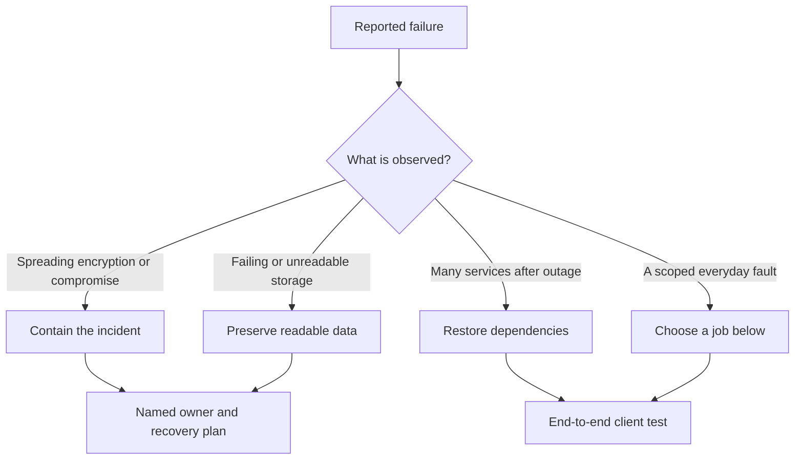

# 🧭 The technician decision desk

[Home](https://github.com/Herbertofury/INTA/wiki) › **Decision desk**

**Start with the symptom. Choose the next useful observation. Finish with the customer's task working.** This desk routes all 22 current jobs into their complete playbooks, without requiring you to choose a product first.

> [!TIP]
> If the scope is still unclear, open [structured intake and triage](https://github.com/Herbertofury/INTA/wiki/Job-intake-triage). Record the exact failing task, last known good state, affected users/devices and the next test.

## 🛟 First, choose the urgent branch

Diagram legend: [Incident containment](https://github.com/Herbertofury/INTA/wiki/Job-ransomware-response), [image-first recovery](https://github.com/Herbertofury/INTA/wiki/Job-failing-drive), [dependency-ordered outage recovery](https://github.com/Herbertofury/INTA/wiki/Job-outage-recovery), and [post-change acceptance](https://github.com/Herbertofury/INTA/wiki/Job-client-handoff). Diagram syntax:  [Mermaid](https://mermaid.js.org/intro/).

### Stop the situation getting worse

| What you see | First useful observation | Open the complete job | Proof to seek |
| --- | --- | --- | --- |
| Files are being encrypted or several systems look compromised. | Affected scope and whether spread is still active. | [Contain ransomware or wider compromise](https://github.com/Herbertofury/INTA/wiki/Job-ransomware-response) | Isolation, incident ownership and controlled recovery criteria. |
| A disk clicks, disappears or produces repeated read errors. | Source identity and whether unique data has a recoverable copy. | [Rescue a failing drive](https://github.com/Herbertofury/INTA/wiki/Job-failing-drive) | Preserved source, recorded unreadable areas and usable recovered data. |
| The office is down after a power interruption. | Power, network, identity and storage dependencies. | [Recover an office outage](https://github.com/Herbertofury/INTA/wiki/Job-outage-recovery) | A real workstation completes the business workflow. |
| The operating system cannot start. | The exact boot stage, error and recovery-key availability. | [Recover startup](https://github.com/Herbertofury/INTA/wiki/Job-boot-recovery) | Repeatable boot with data and required applications accessible. |

## 🔎 A slow, broken or unstable workstation

| What you see | First useful observation | Open the complete job | Proof to seek |
| --- | --- | --- | --- |
| The machine is slow, freezes or hitches. | The exact workload and resource behavior during the delay. | [Diagnose a slow PC](https://github.com/Herbertofury/INTA/wiki/Job-slow-pc) | Equivalent work improves without losing required functionality. |
| Pop-ups, redirects or suspicious software appear. | Protection status, detections and whether an account or wider incident is involved. | [Remove malware and browser hijackers](https://github.com/Herbertofury/INTA/wiki/Job-malware-removal) | Detections and exposure have documented outcomes; the original task works. |
| Built-in functions show corruption symptoms. | Disk health, servicing evidence and the intended installation. | [Repair component or system-file corruption](https://github.com/Herbertofury/INTA/wiki/Job-windows-repair) | Repair results and the affected function pass after restart. |
| An update repeatedly fails. | Exact update identity, error, restart state and available space. | [Repair a failing update](https://github.com/Herbertofury/INTA/wiki/Job-windows-update) | Installed build and update history agree; the usual workload works. |
| A crash, blue screen or overheating repeats. | Failure time, recent change and a reproducible trigger. | [Diagnose crashes and hardware](https://github.com/Herbertofury/INTA/wiki/Job-hardware-bsod) | The recorded scenario and relevant diagnostics have a clear outcome. |

## 🌐 Connections, accounts and office work

| What you see | First useful observation | Open the complete job | Proof to seek |
| --- | --- | --- | --- |
| Internet, names or a local service fail. | Whether the failure is link, address, name, transport or application-specific. | [Fix networking and DNS](https://github.com/Herbertofury/INTA/wiki/Job-network-dns) | The intended application path works and adjacent services remain healthy. |
| A user needs remote help. | Correct device, session type and recovery contact if access drops. | [Run a clean support session](https://github.com/Herbertofury/INTA/wiki/Job-remote-support) | The job is tested and temporary access is closed. |
| A workstation reports a domain trust failure. | Unique machine identity, domain connectivity and secure-channel result. | [Repair domain trust](https://github.com/Herbertofury/INTA/wiki/Job-ad-trust) | Fresh sign-in and required resources work with no duplicate identity. |
| Sending, receiving or a mailbox workflow fails. | Whether the service/account fails independently of the local client. | [Restore mail flow](https://github.com/Herbertofury/INTA/wiki/Job-outlook-email) | A message arrives, a reply returns and required local data remains accessible. |
| Printing fails or produces the wrong output. | Printer self-test, reachability and the affected queue/application. | [Restore the print path](https://github.com/Herbertofury/INTA/wiki/Job-printer-repair) | Internal and application output pass without breaking other queues. |

## 🗃 Prepare a change and prove recoverability

| What you need | First useful observation | Open the complete job | Proof to seek |
| --- | --- | --- | --- |
| Confidence in a backup. | Required data, recovery dependencies and a separate restore destination. | [Prove a backup can restore](https://github.com/Herbertofury/INTA/wiki/Job-backup-restore) | Restored files open with the expected permissions and application behavior. |
| A new disk or migration. | Source health, endpoint identities and a retained rollback. | [Clone or migrate a healthy system](https://github.com/Herbertofury/INTA/wiki/Job-disk-migration) | The destination works independently before the source is retired. |
| A dependable new workstation. | The employee's real tasks, application access and migration requirements. | [Set up a new workstation](https://github.com/Herbertofury/INTA/wiki/Job-new-pc) | Work, recovery, protection and backup are exercised. |
| A [rescue USB](https://github.com/Herbertofury/INTA/wiki/Job-boot-usb) ready for the bench. | Intended firmware/platform, verified images and the actual target USB. | [Build or refresh rescue media](https://github.com/Herbertofury/INTA/wiki/Job-boot-usb) | Image identity and actual boot evidence are recorded separately. |
| A worthwhile maintenance visit. | Actual health, update, protection and recovery gaps. | [Run preventive maintenance](https://github.com/Herbertofury/INTA/wiki/Job-preventive-maintenance) | Normal work passes; every deferred item has an owner. |

## 🤝 Open well, reason carefully, close clearly

| Moment | First useful observation | Open the complete job | Proof to seek |
| --- | --- | --- | --- |
| A new or unclear case. | Exact symptom, scope, data risk and expected result. | [Start with triage](https://github.com/Herbertofury/INTA/wiki/Job-intake-triage) | A justified next guide and a measurable success test. |
| Help interpreting a log or proposed command. | Minimal sanitized evidence and the real execution environment. | [Use an AI troubleshooting copilot](https://github.com/Herbertofury/INTA/wiki/Job-ai-triage) | The proposal is independently checked and the actual result supports the conclusion. |
| Repair completion or technician change. | Original task result, exact changes and remaining work. | [Close with a clear handoff](https://github.com/Herbertofury/INTA/wiki/Job-client-handoff) | Acceptance or an explicit owned continuation plan. |

## 🧰 Pick a purposeful kit

The playbook's recommended tools are the starting kit for that job. Open the [full Tool Directory](https://github.com/Herbertofury/INTA/wiki/Tool-Directory) when you need alternatives or an environment-specific option. Use [Methods](https://github.com/Herbertofury/INTA/wiki/Methods) to understand why a selected test is useful.

| Question | Useful first route |
| --- | --- |
| Which process owns the delay or locked file? |  [Process Explorer](https://learn.microsoft.com/en-us/sysinternals/downloads/process-explorer/) and the [performance guide](https://github.com/Herbertofury/INTA/wiki/Job-slow-pc). |
| What is touching this file or configuration? |  [Process Monitor](https://learn.microsoft.com/en-us/sysinternals/downloads/procmon) and a bounded reproduction. |
| Is the storage reporting a health problem? |  [CrystalDiskInfo](https://crystalmark.info/en/software/crystaldiskinfo/) or  [smartmontools](https://github.com/smartmontools/smartmontools), followed by the [recovery decision](https://github.com/Herbertofury/INTA/wiki/Job-failing-drive) if evidence warrants it. |
| Can this backup actually recover work? | [Restore verification](https://github.com/Herbertofury/INTA/wiki/Job-backup-restore) using the existing backup product. |
| Which remote option fits a one-time session? | [Attended remote support](https://github.com/Herbertofury/INTA/wiki/Job-remote-support), then  [Quick Assist](https://learn.microsoft.com/en-us/windows/client-management/client-tools/quick-assist) or the customer's approved platform. |

**➜ Continue:** [All playbooks](https://github.com/Herbertofury/INTA/wiki/Playbooks) · [Methods](https://github.com/Herbertofury/INTA/wiki/Methods) · [Tool Directory](https://github.com/Herbertofury/INTA/wiki/Tool-Directory) · [Service-record template](https://github.com/Herbertofury/INTA/wiki/Technician-Handoff)
