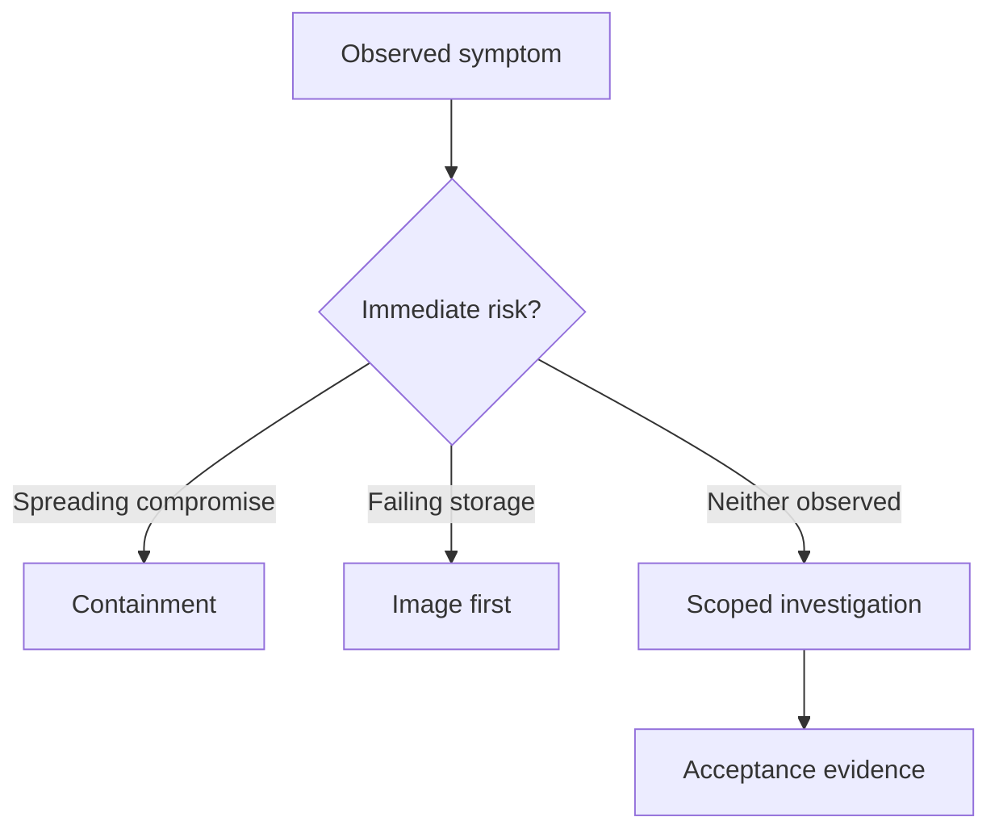

# ✨ Knowledge standards

[Home](https://github.com/Herbertofury/INTA/wiki) › [Contribute](https://github.com/Herbertofury/INTA/wiki/Contribute) › **Knowledge standards**

> [!IMPORTANT]
> Every page should answer three questions: **Where do I start? What do I do next? What evidence tells me it worked?** Visual polish supports those answers.

**Editorial review: November 26, 2026.** These are the durable authoring and implementation rules for the [technician hub](https://herbertofury.github.io/INTA/), its [live wiki](https://github.com/Herbertofury/INTA/wiki), and its offline build.

The owner's current visual direction is documented in [Interface Design](https://github.com/Herbertofury/INTA/wiki/Interface-Design): a compact professional workspace with neutral charcoal surfaces, restrained blue interaction accents, readable rows and document layouts. Wiki scenario and tool navigation uses bold clickable labels and meaningful emoji, with every destination visible without expanding a group. Put frequent service jobs and official tool links first. Keep direct links and decision diagrams while avoiding the previous green, oversized-card treatment.

## 🧭 1. One home, predictable paths

Use a stable page title, a short breadcrumb, a one-sentence purpose and an immediately useful entry point. Group guidance by the technician's job. Preserve the [Decision Desk](https://github.com/Herbertofury/INTA/wiki/Decision-Desk), [Playbooks](https://github.com/Herbertofury/INTA/wiki/Playbooks), [Tool Directory](https://github.com/Herbertofury/INTA/wiki/Tool-Directory) and [Methods](https://github.com/Herbertofury/INTA/wiki/Methods) as distinct, cross-linked ways into the same knowledge.

| Section signal | Use it for |
| --- | --- |
| 🧭 Choose | Situation, scope and the right route |
| 🛠 Work | The next concrete actions |
| 🧪 Prove | Expected results and acceptance evidence |
| 🛟 Recover | Stop conditions, fallback and escalation |
| 📚 Sources | Original documentation and evidence limits |
| ➜ Continue | A small set of useful next destinations |

Use icons consistently and sparingly. Do not substitute icon-only instructions for readable labels. Tables suit comparisons; numbered steps suit actions; callouts suit a decision that materially changes the plan. Avoid dense walls of decorative badges or repeated banners.

Every service scenario appears in the front-page answers. Name the problem in ordinary language, including **Remove viruses** and **Fix a printer**. Start the guide with exactly three practical actions, then retain its complete diagnosis, repair, verification and escalation procedure. Distinct cases receive stable dedicated Wiki answer pages, with links to their complete guides. Preserve existing guide anchors for compatibility, but do not depend on fragments to distinguish the answer reached from another page. Do not repeat lengthy selection notes in each Home row.

### Keep the working tools within reach

Every service job uses the shared [job workspace data](https://github.com/Herbertofury/INTA/blob/main/data/job-workspaces.json). Put its purpose-specific tools and useful official resources before the long procedure. Each tool offers its official page and exact acquisition action; each resource tells the user what to do after opening it. A printer job, for example, needs manufacturer driver finders, network discovery, queue inspection and output tests. A model-specific driver must be chosen for the actual device and operating system.

Use a visible **symptom → next action → expected result** table and observable completion checks. Retain the complete guide, commands, diagrams and fallback routes. In the application, a compact tool panel follows the working document on wide screens, with small-screen jump controls that leave the instructions readable.  [GitHub](https://github.com/) sanitizes custom styling, so the Wiki keeps the same kit at the top and offers an **Open working view** link.  [GitHub rendering pipeline](https://github.com/github/markup#github-markup).

## 🔗 2. Every named mention is a route

Every rendered occurrence of a known tool, application or named method must be linked, including repeated occurrences in the same paragraph, table, list or later section. Link a tool to its exact official product/download/documentation page; link a method to the canonical guide recorded in the [method registry](https://github.com/Herbertofury/INTA/blob/main/data/methods.json). Choose the destination that helps with that specific mention.

**Example:** Use  [Process Explorer](https://learn.microsoft.com/en-us/sysinternals/downloads/process-explorer/) to identify a process. Record the finding from  [Process Explorer](https://learn.microsoft.com/en-us/sysinternals/downloads/process-explorer/) before a [single-change experiment](https://github.com/Herbertofury/INTA/wiki/Job-slow-pc).

Keep these boundaries precise:

- Preserve a link that is already correct. Never create nested links or rewrite the text of a URL.
- Match the longest appropriate name first, with word boundaries. A product alias must be specific enough to identify that product. Ordinary words such as “everything,” “terminal,” “free,” “restore” or “windows” must not become accidental brand or method matches.
- A brand with several products needs the exact product name. An operating system, server product and consumer application are not interchangeable.
- Keep inline code, fenced commands, file paths, raw URLs and diagram labels syntactically intact. Immediately follow every code example or diagram with a concise legend linking the tools and named methods it contains.
- Keep headings stable and easy to navigate. Prefer task-focused headings without product names. When a named tool or method is necessary in a heading, use one correctly linked name and verify the resulting anchor; do not embed complicated link markup into navigation IDs.
- Use official downloads and canonical documents. Remove tracking parameters. Retain meaningful query parameters needed to identify the supported documentation version.

The [tool catalog](https://github.com/Herbertofury/INTA/blob/main/data/tools.json) and [method registry](https://github.com/Herbertofury/INTA/blob/main/data/methods.json) are the shared linking inputs. An automated linker helps enforce the rule, but author review still owns context, ambiguity and destination quality.

The [acquisition registry](https://github.com/Herbertofury/INTA/blob/main/data/tool-access.json) keeps a separate official product page and exact acquisition action for every tool. Observe the publisher's current link and check its response before marking it as a file; a filename-looking URL can still return an HTML page. Record platform, file format, evidence URL and review date. Retain stable publisher redirects where a final CDN address expires. Use honest labels for built-in, Store, account, web, package, source and release-selection routes. Never invent a universal installer for an account-specific support session. When one application offers several troubleshooters, the scenario must select the matching action ID.

## 🛠 3. Procedures must be executable by a person

Write each guide with an observable starting condition, relevant prerequisites, numbered actions, expected observations, a success test and an escalation route. Explain what a command reads or changes before showing it. Identify the actual target and environment; a command for a running installation may be wrong inside a recovery environment.

Use [structured intake and triage](https://github.com/Herbertofury/INTA/wiki/Job-intake-triage) to choose the guide. Use a [reproducible baseline](https://github.com/Herbertofury/INTA/wiki/Job-slow-pc) when claiming improvement and [post-change acceptance](https://github.com/Herbertofury/INTA/wiki/Job-client-handoff) before closure. If storage may be failing, route to [image-first recovery](https://github.com/Herbertofury/INTA/wiki/Job-failing-drive) before ordinary repair writes.

Do not build “try everything” command dumps. An action should either distinguish plausible causes, apply an evidenced repair, preserve recoverability, or verify the outcome. A failed test remains useful when its scope and result narrow the next decision.

## 🧩 4. Diagrams explain a real decision

Use  [Mermaid](https://mermaid.js.org/intro/) for branching decisions, dependencies, state changes and evidence flow. Keep each diagram focused on one relationship, with short labels and a top-down layout when branches would become wide. A small table is clearer for a simple list of tools.

Diagram legend: [Incident containment](https://github.com/Herbertofury/INTA/wiki/Job-ransomware-response), [image-first recovery](https://github.com/Herbertofury/INTA/wiki/Job-failing-drive), [structured intake and triage](https://github.com/Herbertofury/INTA/wiki/Job-intake-triage), and [post-change acceptance](https://github.com/Herbertofury/INTA/wiki/Job-client-handoff). Syntax:  [Mermaid flowcharts](https://mermaid.js.org/syntax/flowchart.html).

Do not add clickable diagram directives, HTML labels or per-diagram configuration. Put supporting details and linked destinations below the diagram. Keep labels readable in both themes and avoid relying on color alone. Inspect the real rendered output; syntactically valid source is not visual proof. Use the host's  [diagram guidance](https://docs.github.com/en/get-started/writing-on-github/working-with-advanced-formatting/creating-diagrams) to check supported syntax.

Follow the host's  [writing and formatting reference](https://docs.github.com/en/get-started/writing-on-github/getting-started-with-writing-and-formatting-on-github/basic-writing-and-formatting-syntax) for headings, lists, links and task lists. Wiki pages do not support footnotes, so place ordinary linked citations beside the relevant claim or in a clearly labeled source section. Keep blank lines around headings, lists, tables and fenced blocks.

## 🧪 5. Evidence levels stay separate

| Evidence | What may be claimed |
| --- | --- |
| Official documentation reviewed | The source documents the described capability and limits. |
| File acquired and identity checked | A specific artifact was obtained and matched the recorded identity check. |
| Static or build checks passed | The stated structural checks or build completed. |
| Workflow exercised | The stated user path worked in the recorded environment. |
| Comparative test completed | The measured difference applies to the recorded equivalent workload and conditions. |
| Promoted for routine use | The applicable compatibility, behavior, recovery and operating-cost gates passed. |

Do not move up this table by implication. A clean scan does not establish complete absence of compromise. A green disk indicator does not prove every sector is readable. A package in a build recipe does not prove it booted on physical hardware. A new version number does not establish that it is the best release for a client's job.

## 📅 6. Freshness is an editorial decision

Record the date of a real source review. Keep release publication date, retrieval date, editorial review date and runtime-test date distinct. [Manual freshness review](https://github.com/Herbertofury/INTA/wiki/Job-preventive-maintenance) requires checking the applicable release, platform, material behavior and known limitations. A successful HTTP response alone must not advance `reviewedAt` or create an invented version.

Use the catalog's core, specialist and evaluate tiers as workflow guidance. Research candidates remain clearly labeled until [stable-release promotion](https://github.com/Herbertofury/INTA/wiki/Job-preventive-maintenance) has adequate evidence. Preserve previous useful knowledge and provenance when an upstream moves or a product changes scope.

## 🗂 7. Canonical inputs produce every surface

Follow [Knowledge Organization](https://github.com/Herbertofury/INTA/wiki/Knowledge-Organization): one primary home per service guide, one catalog identity per tool, specific fixes inside their existing job, and one shared layout taxonomy. Maintain the [research queue](https://github.com/Herbertofury/INTA/wiki/Research-Queue) across every job and category. The [coverage and review report](https://github.com/Herbertofury/INTA/wiki/Knowledge-Health) exposes gaps and due dates; organization checks reject duplicate identities, unexplained duplicate official pages and missing relationships. Extend the right source before adding another page.

Edit the [tool catalog](https://github.com/Herbertofury/INTA/blob/main/data/tools.json), [job guides](https://github.com/Herbertofury/INTA/blob/main/data/jobs.json), [method registry](https://github.com/Herbertofury/INTA/blob/main/data/methods.json), authored [documentation](https://github.com/Herbertofury/INTA/tree/main/docs) or [portal source](https://github.com/Herbertofury/INTA/tree/main/portal). The [hub builder](https://github.com/Herbertofury/INTA/blob/main/scripts/build-hub.py) owns generated pages.

Preserve stable IDs and existing links. Add aliases deliberately and check collisions. A visual or performance change must retain all entries, fields, guides, search results, saved-item behavior, exports, offline content and accessibility. Do not introduce quantity caps, viewport virtualization or content culling to manufacture a speed claim. Use native text, layout and code assets unless the current request explicitly authorizes image generation.

## 🔒 8. Public knowledge, private case material

Reusable procedures, sanitized examples and source references belong in the public project. Customer identities, credentials, recovery keys, device identifiers, internal remote-management addresses and raw case evidence belong in the approved private service record. Use [the handoff template](https://github.com/Herbertofury/INTA/wiki/Technician-Handoff) to record references to private evidence instead of copying secrets into public pages.

## 🚀 9. Completion includes publication and readback

Follow [Contribute](https://github.com/Herbertofury/INTA/wiki/Contribute) and [Maintaining the Hub](https://github.com/Herbertofury/INTA/wiki/Maintaining-the-Hub). Verify the changed content and actual rendered path, preserve the source checkpoint, publish matching outputs and read back the live result. Keep the actual  [GitHub Wiki](https://docs.github.com/en/communities/documenting-your-project-with-wikis/adding-or-editing-wiki-pages) synchronized; a repository-side mirror alone is not publication. Save the complete deliverable to the project's connected  [Google Drive](https://drive.google.com/) location and verify the resulting identity.

Use [the contribution template](https://github.com/Herbertofury/INTA/wiki/Templates) to retain source revision, changed scope, proof, limits, publication locations and the exact next action. Required unfinished gates remain open. [Continuous Improvement](https://github.com/Herbertofury/INTA/wiki/Continuous-Improvement) governs repeat contributions without restarting settled work.

**➜ Continue:** [Decision Desk](https://github.com/Herbertofury/INTA/wiki/Decision-Desk) · [Contribution Guide](https://github.com/Herbertofury/INTA/wiki/Contribute) · [Templates](https://github.com/Herbertofury/INTA/wiki/Templates)

## ⚡ 10. Copy-ready commands are part of every job

Every playbook must include at least one practical command in the step where it belongs. Identify the shell, privilege, purpose, safety boundary and official reference. Give technicians a copy action, never automatic execution. Prefer read-only discovery first; present a repair only when the evidence, prerequisites and rollback path support it. Pair state-changing commands with a verification step and explicit stop conditions. Follow the [Quick Command Standards](https://github.com/Herbertofury/INTA/blob/main/docs/quick-commands.md).

## ⚡ Commands in specific-fix articles

Specific fixes should carry a copy-ready shell block whenever a real command materially shortens diagnosis, repair or verification. Keep the command attached to the exact symptom, with shell, purpose, safety boundary and official source. The app and Wiki must expose an accessible copy button; copying never executes. Do not force a command into GUI-only, physical or non- [Windows](https://www.microsoft.com/windows) cases where it adds no value. See [Quick Commands](https://github.com/Herbertofury/INTA/wiki/Quick-Commands).

## ⚡ Command Center standards

Commands should be searchable, shell-specific, copyable and source-backed. Separate read-only diagnostics from long-running scans, downloads, installs and system-changing repairs. Keep  [WinGet](https://learn.microsoft.com/en-us/windows/package-manager/winget/),  [Chocolatey](https://chocolatey.org/install),  [Scoop](https://scoop.sh/),  [Windows Update](https://learn.microsoft.com/en-us/windows/deployment/update/), Store updates and  [Linux](https://www.kernel.org/) package managers as distinct update channels. Preview package changes before applying them. The app must never execute a command merely because a guide was opened or a Copy control was clicked. See [Command Center](command-center.md).
