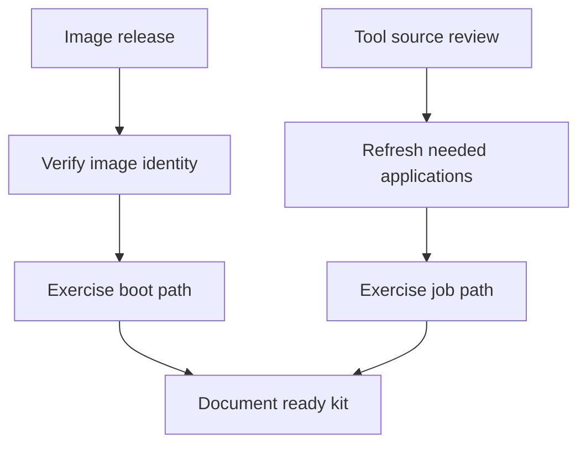

# 💽 Rescue media that is ready for the job

[Home](https://github.com/Herbertofury/INTA/wiki) › **Rescue media**

**Prepare the right environment, verify the exact image and test the path you will need at the bench.** See [build results](https://github.com/Herbertofury/INTA/actions) and the [boot-media preparation guide](https://github.com/Herbertofury/INTA/wiki/Job-boot-usb).

<!-- INTA:PRODUCT-RELEASES:START -->

## Current Recovery download

** [INTA Rescue Recovery](https://github.com/Herbertofury/INTA/releases/tag/rescue-recovery-20261128.2)** · x64 boot media · 2026-11-28.2 · **Stable**

[Recovery ISO (.iso)](https://github.com/Herbertofury/INTA/releases/download/rescue-recovery-20261128.2/inta-rescue-recovery-amd64.iso) ·  [Media Creator (.pyz)](https://github.com/Herbertofury/INTA/releases/download/rescue-recovery-20261128.2/INTA-Media-Creator.pyz) · [SHA-256 checksums](https://github.com/Herbertofury/INTA/releases/download/rescue-recovery-20261128.2/SHA256SUMS) · [ISO verification](https://github.com/Herbertofury/INTA/releases/download/rescue-recovery-20261128.2/verification.json)

Recovery only: runs offline for disk inspection, imaging and file recovery. No antivirus scanner or live Mobile control.

 [Media Creator](https://github.com/Herbertofury/INTA/blob/main/docs/rescue.md) runs on [Windows](https://www.microsoft.com/windows) or  [Linux](https://www.kernel.org/) with  [Python](https://www.python.org/) 3.11+ and Tk.

The release reports BIOS, UEFI, OVMF Secure Boot with enrolled keys and  [Ventoy](https://www.ventoy.net/) VM boots, and offline recovery with the synthetic source unchanged. Physical systems and USB controllers remain untested.

<!-- INTA:PRODUCT-RELEASES:END -->

## 🧭 Choose the environment

| Environment | Best fit | Boundary to check |
| --- | --- | --- |
|  [INTA Rescue Recovery](https://github.com/Herbertofury/INTA/blob/main/docs/rescue.md) | Offline drive inspection, imaging and file recovery. | Recovery edition; no antivirus scanner. Confirm the actual build and required hardware. |
|  [Windows Recovery Environment](https://learn.microsoft.com/en-us/windows-hardware/manufacture/desktop/windows-recovery-environment--windows-re--technical-reference) or  [Microsoft installation media](https://www.microsoft.com/software-download/windows11) | Supported [startup recovery](https://github.com/Herbertofury/INTA/wiki/Job-boot-recovery) and image servicing. | Match the installed system, encryption state and intended operation. |
|  [Hiren's BootCD PE](https://www.hirensbootcd.org/download/) | A familiar  [Windows PE](https://learn.microsoft.com/en-us/windows-hardware/manufacture/desktop/winpe-intro) utility environment. | Review the bundled software list and release age; individual tools may be older. |
|  [SystemRescue](https://www.system-rescue.org/Download/) | A specialist recovery environment with storage and administration tools. | Verify the selected release and the exact filesystem or hardware path needed. |
|  [Rescuezilla](https://rescuezilla.com/download) | A graphical disk-imaging and restore workflow. | Confirm source/destination direction and recovery compatibility. |
| Running [Windows](https://support.microsoft.com/windows) | [Remote support](https://github.com/Herbertofury/INTA/wiki/Job-remote-support), live process evidence, application fixes and normal endpoint maintenance. | Capture live evidence before a restart when it matters to the diagnosis. |

A catalog entry describes a useful option. It does not change that application's supported operating system or prove the application is bundled in an image. Use [the Tool Directory](https://github.com/Herbertofury/INTA/wiki/Tool-Directory) for suitability and the build's own manifest for actual contents.

## 🛠 Prepare the image and USB

### 1 · Open the media application

Use the ** [Media Creator](https://github.com/Herbertofury/INTA/blob/main/docs/rescue.md) (.pyz)** linked above, not an older copy from a source checkout. Check it against the SHA-256 list, then open it with  [Python](https://www.python.org/) 3.11+ and Tk on [Windows](https://www.microsoft.com/windows) or  [Linux](https://www.kernel.org/).

### 2 · Acquire a verified image

Choose **Download Recovery** in the Recovery row of the published utility, not **Download / update ISO** for the historical image. Or use the direct ISO link above. The utility verifies the published full SHA-256 before replacing the local image; verify a direct download against the same checksum file. Retain the exact release and verification result with the kit. See [publisher and checksum verification](https://github.com/Herbertofury/INTA/wiki/Job-boot-usb).

### 3 · Choose the intended layout

| Layout | Action | Check before writing |
| --- | --- | --- |
| Several rescue images on one USB | Initialize the intended drive with official  [Ventoy](https://www.ventoy.net/en/download.html), then use **Copy checked ISO** in  [INTA Media Creator](https://github.com/Herbertofury/INTA/blob/main/media/inta-media.py) and select its mounted data volume. | Initial  [Ventoy](https://www.ventoy.net/en/doc_start.html) installation can erase the selected device. Copying the verified image afterward preserves other images on the data volume. |
| One dedicated image | Open  [Rufus](https://rufus.ie/en/) from  [INTA Media Creator](https://github.com/Herbertofury/INTA/blob/main/media/inta-media.py) on [Windows](https://support.microsoft.com/windows), select the verified image and the intended USB. |  [Rufus](https://rufus.ie/en/) writes the device and erases its existing contents; confirm the target identity. |

 [INTA Media Creator](https://github.com/Herbertofury/INTA/blob/main/media/inta-media.py) coordinates the official upstream media utilities. Their bootloader behavior and firmware compatibility remain part of the chosen tool's operating boundary.

### 4 · Boot the actual kit

Use representative hardware and record firmware mode, keyboard, networking, storage visibility and access to a separate export destination.  [Secure Boot behavior](https://www.ventoy.net/en/doc_secure.html) is platform-specific. A virtual-machine check is useful evidence; physical hardware still needs the intended boot path exercised.

## 🔁 Keep both update lifecycles visible

Diagram legend: [Boot-media preparation](https://github.com/Herbertofury/INTA/wiki/Job-boot-usb), [publisher and checksum verification](https://github.com/Herbertofury/INTA/wiki/Job-boot-usb), [manual freshness review](https://github.com/Herbertofury/INTA/wiki/Job-preventive-maintenance), and [post-change acceptance](https://github.com/Herbertofury/INTA/wiki/Job-client-handoff). Syntax:  [Mermaid](https://mermaid.js.org/intro/).

An updated boot menu, a replaced image and a refreshed application are three different changes. Record which one occurred. The  [Hiren's BootCD PE contents page](https://www.hirensbootcd.org/download/) illustrates why a usable image can still contain older applications.

## 📖 Take the complete hub offline

Copy `site/index.html` to the  [Ventoy](https://www.ventoy.net/en/doc_start.html) data volume or a separate technician drive and open it in a browser. The catalog and checklists are embedded. External documentation, downloads and online AI services require a connection. Replace the HTML independently when you want a newer knowledge snapshot.

For the actual contents of a particular  [INTA Rescue](https://github.com/Herbertofury/INTA) image, use its package manifest and `/opt/inta-ai/package-lock.json`. The [base package recipe](https://github.com/Herbertofury/INTA/blob/main/live/package-lists/inta.list.chroot) describes requested packages. A browser link to  [ChatGPT](https://chatgpt.com/) is online access; it is not an offline model. Follow the [AI triage guide](https://github.com/Herbertofury/INTA/wiki/Job-ai-triage) when working with case evidence.

## 🧪 Bench readiness checklist

- [ ] Source and destination storage identities are verified by model, size and serial.
- [ ] Recovery writes and recovered files have a separate destination.
- [ ] Hibernated or dirty filesystems are handled through the appropriate [recovery guide](https://github.com/Herbertofury/INTA/wiki/Job-failing-drive) before writes.
- [ ]  [BitLocker recovery readiness](https://github.com/Herbertofury/INTA/wiki/Job-boot-recovery) is established where applicable.
- [ ] Required tools and detection data have their own freshness record.
- [ ] Important evidence can be exported before the live session shuts down.
- [ ] The offline knowledge copy opens and the needed hardware is visible.
- [ ] Online AI and remote sessions are signed out or closed before handoff.

## 📚 Original references

 [Ventoy installation and updates](https://www.ventoy.net/en/doc_start.html) ·  [Ventoy image checksums](https://www.ventoy.net/en/doc_checksum.html) ·  [Rufus](https://rufus.ie/en/) ·  [Microsoft installation media](https://www.microsoft.com/software-download/windows11) ·  [SystemRescue downloads](https://www.system-rescue.org/Download/) ·  [Rescuezilla downloads](https://rescuezilla.com/download)

**➜ Continue:** [Build a rescue USB](https://github.com/Herbertofury/INTA/wiki/Job-boot-usb) · [Decision Desk](https://github.com/Herbertofury/INTA/wiki/Decision-Desk) · [Backup and restore proof](https://github.com/Herbertofury/INTA/wiki/Job-backup-restore)
