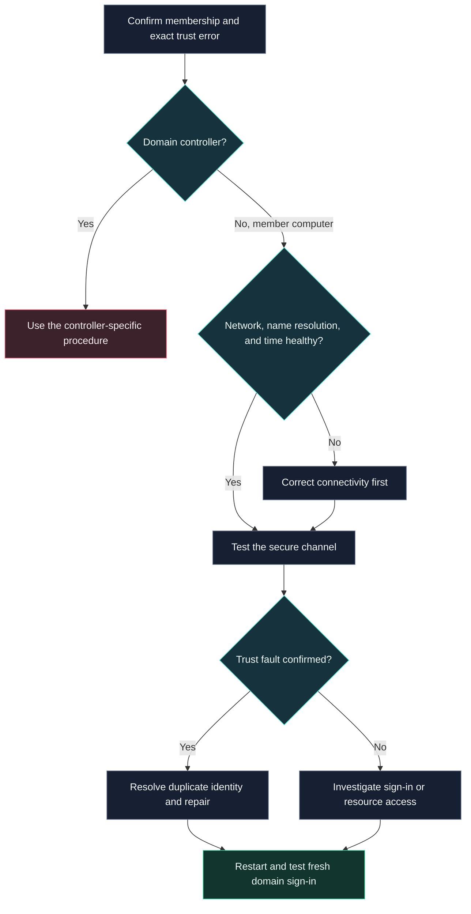

[🏠 Home](https://github.com/Herbertofury/INTA/wiki) · [🧭 Decision desk](https://github.com/Herbertofury/INTA/wiki/Decision-Desk) · [📚 Playbooks](https://github.com/Herbertofury/INTA/wiki/Playbooks) · [🧰 Tool directory](https://github.com/Herbertofury/INTA/wiki/Tool-Directory) · [✨ Open interactive hub](https://herbertofury.github.io/INTA/)

# 🔑 [Repair a workstation’s domain trust relationship](https://github.com/Herbertofury/INTA/wiki/Job-ad-trust)

Check connectivity, time, and computer identity before repairing a member computer’s secure channel.

| Work area | Experience | Plan your time | Workflow |
| --- | --- | --- | --- |
| Identity & business systems | Advanced | 20–60 min | 6 steps + acceptance |

**[▶ Open the interactive checklist](https://herbertofury.github.io/INTA/#job/ad-trust)** · [Decision route](#decision-route) · [Toolkit](#toolkit) · [Walkthrough](#walkthrough) · [Acceptance](#acceptance) · [Sources](#sources)

> [!TIP]
> **Your starting move:** Use this guide for an [Active Directory](https://learn.microsoft.com/en-us/windows-server/identity/ad-ds/get-started/virtual-dc/active-directory-domain-services-overview) member workstation or member server. Domain-controller trust repair needs its own procedure.

<a id="decision-route"></a>

## 🧭 Choose the right branch



**Diagram routes:** [Continue this workflow](#walkthrough) · [Acceptance checks](#acceptance) · [Fix internet, DNS, or local-network problems](network-dns.md) · [Set up a dependable new workstation](new-pc.md) · [Bring an office back after a power outage](outage-recovery.md)

| Checkpoint | What to carry forward |
| --- | --- |
| **Before changing anything** | Confirm a member computer, local fallback, and its unique identity. |
| **Keep during the job** | Connectivity, time, channel result, directory object, and repair evidence. |
| **Before handing back** | Fresh domain sign-in, policy, shares, and printers pass. |

<a id="toolkit"></a>

## 🧰 Build the right toolkit

Choose the tools that answer the case’s next question. Opening a tool is a separate decision from changing the customer’s system.

| Tool / official download | Use it for | Platform & access | Documentation |
| --- | --- | --- | --- |
| [Microsoft Sysinternals Suite](https://learn.microsoft.com/en-us/sysinternals/downloads/sysinternals-suite) | The core portable [Windows](https://www.microsoft.com/windows) troubleshooting kit. | [Windows](https://www.microsoft.com/windows); Free Microsoft utilities | [Open guide](https://learn.microsoft.com/en-us/sysinternals/downloads/) |

<a id="walkthrough"></a>

## 🪜 Work the case

Work in order, record the result of each step, and change route when the evidence calls for it.

<a id="step-01"></a>

### 01 · Confirm the exact failure

- [ ] Record the trust error, hostname, domain membership, recent rename/reimage/restore, and whether another device has reused the same computer account. Use a known local administrator or approved recovery access rather than repeatedly trying cached domain credentials.

<a id="step-02"></a>

### 02 · Verify the domain path

- [ ] Confirm the device uses the intended internal DNS, can reach its domain controllers, and has correct time. Check VPN requirements for offsite devices. If connectivity is broken, fix that first; a channel test cannot establish trust across a missing network path.

<a id="step-03"></a>

### 03 · Test without repairing

- [ ] Open [Windows](https://www.microsoft.com/windows) [PowerShell](https://learn.microsoft.com/en-us/powershell/) as administrator on the member computer and run the diagnostic command. Record the result and relevant NETLOGON events. Do not apply this cmdlet to a domain controller, where the result can be misleading.

**Command for the environment described above:**

```text
Test-ComputerSecureChannel -Verbose
```

**Command legend:** [Test-ComputerSecureChannel](https://learn.microsoft.com/en-us/powershell/module/microsoft.powershell.management/test-computersecurechannel?view=powershell-5.1) · [PowerShell](https://learn.microsoft.com/en-us/powershell/) · [Return to the step context](#step-03).

<a id="step-04"></a>

### 04 · Resolve conflicting computer identity

- [ ] Have the directory administrator inspect the computer object and recent changes. Give each active machine its own correct computer identity. Do not let two physical computers alternate using one cloned domain computer account, and do not delete the object until its dependencies are understood.

<a id="step-05"></a>

### 05 · Repair the confirmed secure-channel fault

- [ ] If the network is healthy and the correct computer object is established, the directory administrator can use the documented Test-ComputerSecureChannel repair flow with credentials that have the required rights. Keep credentials in the interactive prompt and plan the restart with the user.

<a id="step-06"></a>

### 06 · Validate from a fresh sign-in

- [ ] After the approved repair and restart, repeat the secure-channel test and perform a real domain sign-in. Check group policy, shares, printers, and business apps. If rejoin is needed, plan profile and local-access continuity before leaving the domain.

<a id="acceptance"></a>

## ✅ Prove the result

- [ ] The member computer’s secure-channel test succeeds.
- [ ] Fresh domain sign-in and required network resources work.
- [ ] No duplicate active computer identity remains.

> [!WARNING]
> **Pause this route and escalate when:**
> - The target is a domain controller.
> - DNS/time/connectivity is still broken or the computer account is ambiguous.
> - Local recovery access is not available before a membership change.

## 🔀 Continue with the evidence

| Next playbook | What it resolves |
| --- | --- |
| [Fix internet, DNS, or local-network problems](network-dns.md) | Locate the failing layer before resetting adapters or changing the whole network. |
| [Set up a dependable new workstation](new-pc.md) | Build a usable, recoverable workstation around the employee’s actual job. |
| [Bring an office back after a power outage](outage-recovery.md) | Restore dependencies in order and verify services before releasing the office back to work. |

Found a reusable improvement? [Contribute the correction](https://github.com/Herbertofury/INTA/wiki/Contribute) and include the test that proved it.

<a id="sources"></a>

## 🔎 Source trail

<details>
<summary>Official references and editorial review</summary>

- [Microsoft: Test-ComputerSecureChannel](https://learn.microsoft.com/en-us/powershell/module/microsoft.powershell.management/test-computersecurechannel?view=powershell-5.1)
- [Microsoft: broken trust relationship](https://learn.microsoft.com/en-us/troubleshoot/windows-server/windows-security/broken-trust-relationship-domain-joined-device-its-domain-secure-channel-issues)

Reviewed **2026-11-26**. Timing is a planning range. A successful command is evidence about that operation; acceptance belongs to the user’s original task.

</details>

---

**Source review: 2026-11-26.** Guidance review and tool release versions are separate. [Report a correction](https://github.com/Herbertofury/INTA/issues/new/choose) · [How we maintain this guide](https://github.com/Herbertofury/INTA/wiki/Knowledge-Standards)

[← All playbooks](README.md) · [Live Wiki](https://github.com/Herbertofury/INTA/wiki) · [Contribution guide](https://github.com/Herbertofury/INTA/blob/main/CONTRIBUTING.md)
