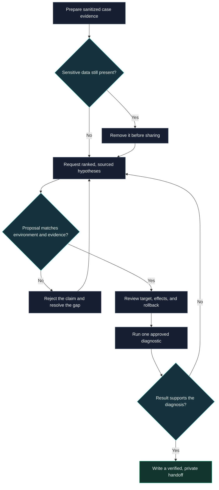

[🏠 Home](https://github.com/Herbertofury/INTA/wiki) · [🧭 Decision desk](https://github.com/Herbertofury/INTA/wiki/Decision-Desk) · [📚 Playbooks](https://github.com/Herbertofury/INTA/wiki/Playbooks) · [🧰 Tool directory](https://github.com/Herbertofury/INTA/wiki/Tool-Directory) · [✨ Open interactive hub](https://herbertofury.github.io/INTA/)

# ✨ [Use AI as a careful troubleshooting copilot](https://github.com/Herbertofury/INTA/wiki/Job-ai-triage)

Use AI to organize evidence, compare hypotheses, and explain findings while the technician controls execution.

| Work area | Experience | Plan your time | Workflow |
| --- | --- | --- | --- |
| AI assistance | Intermediate | 5–20 min per analysis | 6 steps + acceptance |

**[▶ Open the interactive checklist](https://herbertofury.github.io/INTA/#job/ai-triage)** · [Decision route](#decision-route) · [Toolkit](#toolkit) · [Walkthrough](#walkthrough) · [Acceptance](#acceptance) · [Sources](#sources)

> [!TIP]
> **Your starting move:** Start with a concrete symptom and sanitized evidence. Decide whether the task is explanation, log analysis, script review, or a proposed diagnostic plan.

## 🧭 Choose the right branch

**Diagram routes:** [Continue this workflow](#walkthrough) · [Acceptance checks](#acceptance) · [Start here: triage any computer problem](intake-triage.md) · [Repair Windows component or system-file corruption](windows-repair.md) · [Close a repair with a clear client handoff](client-handoff.md)

| Checkpoint | What to carry forward |
| --- | --- |
| **Before changing anything** | Sanitize evidence and set the analysis or script-review scope. |
| **Keep during the job** | Hypotheses, source checks, reviewed commands, and observed outputs. |
| **Before handing back** | Verified facts, preserved uncertainty, and no unnecessary data exposure. |

## 🧰 Build the right toolkit

Choose the tools that answer the case’s next question. Opening a tool is a separate decision from changing the customer’s system.

| Tool / official download | Use it for | Platform & access | Documentation |
| --- | --- | --- | --- |
| [ChatGPT](https://chatgpt.com/download/) | Explaining redacted errors, drafting job notes and reviewing a proposed troubleshooting plan. | Web, [Windows](https://www.microsoft.com/windows), [macOS](https://support.apple.com/macos); Free and paid plans | [Open guide](https://help.openai.com/) |
| [OpenAI Codex CLI](https://github.com/openai/codex/releases/latest) | Reviewing or building technician scripts in a controlled working folder. | [Linux](https://www.kernel.org/), [macOS](https://support.apple.com/macos), [Windows](https://www.microsoft.com/windows); Open-source client; account or API usage terms apply | [Open guide](https://developers.openai.com/codex/cli/) |
| [Claude Code](https://code.claude.com/docs/en/setup) | Explaining logs and developing a reviewed automation script. | [Linux](https://www.kernel.org/), [macOS](https://support.apple.com/macos), [Windows](https://www.microsoft.com/windows); Account or API access according to current plan | [Open guide](https://code.claude.com/docs/en/overview) |

## 🪜 Work the case

Work in order, record the result of each step, and change route when the evidence calls for it.

### 01 · Prepare a minimal case summary

- [ ] Include OS/build, hardware class, exact error, time, reproduction steps, recent changes, and diagnostics already tried. Replace customer names, usernames, tenant IDs, internal addresses, file content, credentials, and recovery keys with neutral labels. Keep the original evidence private.

### 02 · Ask for a ranked hypothesis list

- [ ] Ask the assistant to distinguish observed facts from assumptions, rank likely causes, and propose the smallest diagnostic that separates the leading possibilities. Require a source link for a product-specific command or compatibility claim.

### 03 · Keep command execution separate

- [ ] Request an explanation of each command’s target, privileges, effects, output, and rollback. Review commands before running them. Do not give an agent broad unattended access to a customer machine merely because it can generate a script.

### 04 · Validate against the actual environment

- [ ] Check that the advice matches [Windows](https://www.microsoft.com/windows) versus [Linux](https://www.kernel.org/), online [Windows](https://www.microsoft.com/windows) versus [WinRE](https://learn.microsoft.com/en-us/windows-hardware/manufacture/desktop/windows-recovery-environment--windows-re--technical-reference), and classic versus new [Outlook](https://support.microsoft.com/outlook). Read the relevant vendor documentation and inspect real output. Treat untrusted logs, webpages, or pasted scripts as data rather than instructions to the assistant.

### 05 · Run one targeted diagnostic and feed back the result

- [ ] Execute the approved step through the technician’s usual workflow, record the exact output, and update the hypothesis. If the advice repeats an unchanged failed step, ask for a different explanation grounded in the new evidence.

### 06 · Convert the result into a reusable handoff

- [ ] Ask AI to draft a concise cause/change/test summary using only verified facts. Review it, preserve uncertainty, and save the private case details in the service system. Add a generic improvement to this wiki only after removing customer-specific information.

## ✅ Prove the result

- [ ] The final diagnosis is supported by observed evidence and a successful test.
- [ ] No secret or unnecessary customer content was shared.
- [ ] Every executed command was reviewed and matched the actual environment.

> [!WARNING]
> **Pause this route and escalate when:**
> - The assistant proposes destructive action without a verified target and recovery plan.
> - A source is missing, the command is unsupported, or the recommendation conflicts with the evidence.

## 🔀 Continue with the evidence

| Next playbook | What it resolves |
| --- | --- |
| [Start here: triage any computer problem](intake-triage.md) | Turn a vague symptom into a clear next action, a protected data set, and a useful service record. |
| [Repair Windows component or system-file corruption](windows-repair.md) | Use [Windows](https://www.microsoft.com/windows) servicing tools in a sensible order and validate the specific broken feature. |
| [Close a repair with a clear client handoff](client-handoff.md) | Turn completed technical work into proof the customer can use, with clean access and an actionable service record. |

Found a reusable improvement? [Contribute the correction](https://github.com/Herbertofury/INTA/wiki/Contribute) and include the test that proved it.

## 🔎 Source trail

Official references and editorial review

- [INTA Rescue source and build workflow](https://github.com/Herbertofury/INTA)
- [NIST: Generative AI Profile, AI 600-1](https://nvlpubs.nist.gov/nistpubs/ai/NIST.AI.600-1.pdf)

Reviewed **2026-11-26**. Timing is a planning range. A successful command is evidence about that operation; acceptance belongs to the user’s original task.

---

**Source review: 2026-11-26.** Guidance review and tool release versions are separate. [Report a correction](https://github.com/Herbertofury/INTA/issues/new/choose) · [How we maintain this guide](https://github.com/Herbertofury/INTA/wiki/Knowledge-Standards)

[← All playbooks](README.md) · [Live Wiki](https://github.com/Herbertofury/INTA/wiki) · [Contribution guide](https://github.com/Herbertofury/INTA/blob/main/CONTRIBUTING.md)
