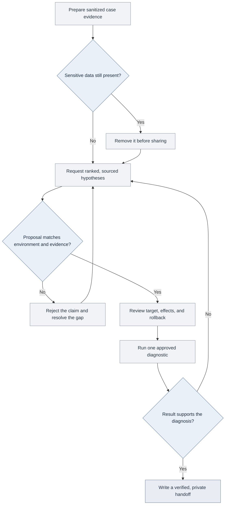

[INTA](https://github.com/Herbertofury/INTA/wiki) / [Decision desk](https://github.com/Herbertofury/INTA/wiki/Decision-Desk) · [Service map](https://github.com/Herbertofury/INTA/wiki/Service-Map) · [Playbooks](https://github.com/Herbertofury/INTA/wiki/Playbooks) · [Tools](https://github.com/Herbertofury/INTA/wiki/Tool-Directory) · [Methods](https://github.com/Herbertofury/INTA/wiki/Methods) · [Open hub](https://herbertofury.github.io/INTA/)

# [Use AI as a careful troubleshooting copilot](https://github.com/Herbertofury/INTA/wiki/Job-ai-triage)

Use AI to organize evidence, compare hypotheses, and explain findings while the technician controls execution.

**AI assistance** · Intermediate · 5–20 min per analysis · 6 steps

[Tools and useful links](#working-kit) · [Quick answer](#quick-answer) · [Next action](#next-action) · [Specific fixes](#specific-fixes) · [Decision route](#decision-route) · [Tools](#toolkit) · [Procedure](#walkthrough) · [Verification](#acceptance) · [Sources](#sources) · [Interactive checklist](https://herbertofury.github.io/INTA/#job/ai-triage)

## 🧰 Choose the tool for this job

Choose by the task shown in the first column. Each option includes its acquisition route and access boundary.

| Need | Official tool + exact action | Why this choice / access |
| --- | --- | --- |
| **Compare hypotheses** | **[ChatGPT](https://chatgpt.com/)** · **[Open ChatGPT](https://chatgpt.com/)** | Use approved redacted evidence to request competing explanations and one discriminating test. **Access:** Free tier available; account and organization limits apply. |
| **Review a scoped script** | **[OpenAI Codex CLI](https://github.com/openai/codex)** · **[Download Windows x64 CLI · EXE](https://github.com/openai/codex/releases/download/rust-v0.172.0/codex-x86_64-pc-windows-msvc.exe)** | Review or test an authorized code change inside a bounded workspace with execution controls. **Access:** Open-source client; account/API usage terms apply. |

**[Current selection evidence](https://github.com/Herbertofury/INTA/wiki/Current-Tool-Choices)**

## 🧰 Tools and links for this job

**[Open working view](https://herbertofury.github.io/INTA/#job/ai-triage)** · Keep the tool panel beside the instructions.

**First move:** Prepare the exact error, timing and environment with customer identities, credentials, internal addresses and file contents removed.

| Use this for | Official tool + exact action |
| --- | --- |
| Compare hypotheses and explain sanitized evidence. | **[ChatGPT](https://chatgpt.com/)** · [Official page](https://chatgpt.com/) · **[Open ChatGPT](https://chatgpt.com/)** |
| Review a scoped script or code change in an approved workspace. | **[OpenAI Codex CLI](https://github.com/openai/codex)** · [Official page](https://github.com/openai/codex) · **[Download Windows x64 CLI · EXE](https://github.com/openai/codex/releases/download/rust-v0.172.0/codex-x86_64-pc-windows-msvc.exe)** |
| Evaluate an approved package in a disposable desktop with network and shared-folder exposure explicitly configured. | **[Windows Sandbox](https://learn.microsoft.com/en-us/windows/security/application-security/application-isolation/windows-sandbox/)** · [Official page](https://learn.microsoft.com/en-us/windows/security/application-security/application-isolation/windows-sandbox/) · **[Enable Windows Sandbox](https://learn.microsoft.com/en-us/windows/security/application-security/application-isolation/windows-sandbox/windows-sandbox-install)** |
| Checking whether a revised diagnostic prompt handles a sanitized regression set correctly before relying on it in technician workflows. | **[promptfoo](https://www.promptfoo.dev/)** · [Official page](https://www.promptfoo.dev/) · **[Install CLI through npm · Node.js required](https://www.promptfoo.dev/docs/installation/)** |

### Prepare the case

| Open the exact resource | What to do there |
| --- | --- |
| **[ChatGPT data controls](https://help.openai.com/en/articles/7730893-data-controls-in-chatgpt)** | Check the approved account/workspace controls before sharing evidence. |

### Script review

| Open the exact resource | What to do there |
| --- | --- |
| **[Codex CLI documentation](https://developers.openai.com/codex/cli/)** | Use a defined workspace and review the proposed execution scope. |

### Verification

| Open the exact resource | What to do there |
| --- | --- |
| **[NIST generative-AI profile](https://nvlpubs.nist.gov/nistpubs/ai/NIST.AI.600-1.pdf)** | Check generated claims, sources and proposed actions against evidence. |

## ⚡ Quick answer

### 💡 Troubleshoot with AI

**Prepare a redacted error, timeline and environment summary that your organization permits you to share.**

1. Give [ChatGPT](https://chatgpt.com/) the observed symptoms and ask for competing causes with one reversible discriminating test.
2. Check the proposed action against the official documentation and the actual target before running it.
3. Record the observed result, reject unsupported guesses and confirm the fix with the original task.

**[ChatGPT](https://chatgpt.com/)** · [Official page](https://chatgpt.com/) · **[Open ChatGPT](https://chatgpt.com/)**

## 🧭 Match the symptom

| You see this | Do this next | You should get |
| --- | --- | --- |
| **The failure has several plausible causes** | Provide the sanitized reproduction and ask for ranked causes plus one small test that separates the leading possibilities. | The output distinguishes observations from assumptions and predicts a test result. |
| **The assistant proposes a command** | Check the exact target, shell, privileges, writes and rollback against the official product documentation before execution. | The technician understands and approves the scoped action. |
| **A test contradicts the proposed cause** | Return the exact sanitized result and require a revised hypothesis rather than repeating an unchanged failed action. | The next diagnostic follows the new evidence. |
| **The repair is ready to document** | Draft the cause/change/test note from verified observations, then review it before saving. | The handoff contains demonstrated facts and explicit remaining uncertainty. |

### ✅ Finish the job

- [ ] The original task passes a real test independent of the AI answer.
- [ ] Executed actions match the actual environment and no unnecessary private content was shared.

**Change route when:** The proposed action is destructive, unsupported or lacks a verified target. · The organization has not approved the intended data/account boundary.

### 🎯 Go straight to a specific fix

- **[Create a safe diagnostic excerpt](#fix-ai-redact-logs-before-sharing)** — A log or screenshot contains customer names, addresses, tokens or recovery information.
- **[Check a suggested command before running it](#fix-ai-command-does-not-match-the-machine)** — An AI answer supplies a command for a different shell, OS version or target.
- **[Keep a log or webpage from changing the task](#fix-ai-untrusted-instructions-inside-evidence)** — Retrieved content tells the assistant to ignore instructions, reveal secrets or run unrelated commands.

> [!NOTE]
> **Start here.** Start with a concrete symptom and sanitized evidence. Decide whether the task is explanation, log analysis, script review, or a proposed diagnostic plan.

## 🧭 Choose a route

**Route links:** [Continue this workflow](#walkthrough) · [Acceptance checks](#acceptance) · [Start here: triage any computer problem](intake-triage.md) · [Repair Windows component or system-file corruption](windows-repair.md) · [Close a repair with a clear client handoff](client-handoff.md)

| Checkpoint | What to carry forward |
| --- | --- |
| **Before changing anything** | Sanitize evidence and set the analysis or script-review scope. |
| **Keep during the job** | Hypotheses, source checks, reviewed commands, and observed outputs. |
| **Before handing back** | Verified facts, preserved uncertainty, and no unnecessary data exposure. |

## Recommended tools

Select a tool for the next diagnostic or repair step. Check its platform, access and licensing requirements before use.

| Tool / official page + download | Use it for | Platform & access | Documentation |
| --- | --- | --- | --- |
| **[ChatGPT](https://chatgpt.com/)** · [Official page](https://chatgpt.com/) · **[Open ChatGPT](https://chatgpt.com/)** | Compare hypotheses and explain sanitized evidence. | Web, [Windows](https://www.microsoft.com/windows), [macOS](https://support.apple.com/macos); Free and paid plans | [Open guide](https://help.openai.com/) |
| **[OpenAI Codex CLI](https://github.com/openai/codex)** · [Official page](https://github.com/openai/codex) · **[Download Windows x64 CLI · EXE](https://github.com/openai/codex/releases/download/rust-v0.172.0/codex-x86_64-pc-windows-msvc.exe)** | Review a scoped script or code change in an approved workspace. | [Linux](https://www.kernel.org/), [macOS](https://support.apple.com/macos), [Windows](https://www.microsoft.com/windows); Open-source client; account or API usage terms apply | [Open guide](https://developers.openai.com/codex/cli/) |
| **[Claude Code](https://code.claude.com/docs/en/overview)** · [Official page](https://code.claude.com/docs/en/overview) · **[Download Windows install script · CMD](https://claude.ai/install.cmd)** | Explaining logs and developing a reviewed automation script. | [Linux](https://www.kernel.org/), [macOS](https://support.apple.com/macos), [Windows](https://www.microsoft.com/windows); Account or API access according to current plan | [Open guide](https://code.claude.com/docs/en/overview) |
| **[Windows Sandbox](https://learn.microsoft.com/en-us/windows/security/application-security/application-isolation/windows-sandbox/)** · [Official page](https://learn.microsoft.com/en-us/windows/security/application-security/application-isolation/windows-sandbox/) · **[Enable Windows Sandbox](https://learn.microsoft.com/en-us/windows/security/application-security/application-isolation/windows-sandbox/windows-sandbox-install)** | Evaluate an approved package in a disposable desktop with network and shared-folder exposure explicitly configured. | [Windows](https://www.microsoft.com/windows); Included with supported [Windows](https://www.microsoft.com/windows) Pro, Enterprise and Education licensing; unavailable on Home | [Open guide](https://learn.microsoft.com/en-us/windows/security/application-security/application-isolation/windows-sandbox/windows-sandbox-configure-using-wsb-file) |
| **[promptfoo](https://www.promptfoo.dev/)** · [Official page](https://www.promptfoo.dev/) · **[Install CLI through npm · Node.js required](https://www.promptfoo.dev/docs/installation/)** | Checking whether a revised diagnostic prompt handles a sanitized regression set correctly before relying on it in technician workflows. | [Windows](https://www.microsoft.com/windows), [macOS](https://support.apple.com/macos), [Linux](https://www.kernel.org/); Free and open source under MIT license; configured model/API providers can charge separately | [Open guide](https://www.promptfoo.dev/docs/intro/) |

## Procedure

Work in order, record the result of each step, and change route when the evidence calls for it.

### 01 · Prepare a minimal case summary

- [ ] Include OS/build, hardware class, exact error, time, reproduction steps, recent changes, and diagnostics already tried. Replace customer names, usernames, tenant IDs, internal addresses, file content, credentials, and recovery keys with neutral labels. Keep the original evidence private.

### 02 · Ask for a ranked hypothesis list

- [ ] Ask the assistant to distinguish observed facts from assumptions, rank likely causes, and propose the smallest diagnostic that separates the leading possibilities. Require a source link for a product-specific command or compatibility claim.

### 03 · Keep command execution separate

- [ ] Request an explanation of each command’s target, privileges, effects, output, and rollback. Review commands before running them. Do not give an agent broad unattended access to a customer machine merely because it can generate a script.

### 04 · Validate against the actual environment

- [ ] Check that the advice matches [Windows](https://www.microsoft.com/windows) versus [Linux](https://www.kernel.org/), online [Windows](https://www.microsoft.com/windows) versus [WinRE](https://learn.microsoft.com/en-us/windows-hardware/manufacture/desktop/windows-recovery-environment--windows-re--technical-reference), and classic versus new [Outlook](https://support.microsoft.com/outlook). Read the relevant vendor documentation and inspect real output. Treat untrusted logs, webpages, or pasted scripts as data rather than instructions to the assistant.

### 05 · Run one targeted diagnostic and feed back the result

- [ ] Execute the approved step through the technician’s usual workflow, record the exact output, and update the hypothesis. If the advice repeats an unchanged failed step, ask for a different explanation grounded in the new evidence.

### 06 · Convert the result into a reusable handoff

- [ ] Ask AI to draft a concise cause/change/test summary using only verified facts. Review it, preserve uncertainty, and save the private case details in the service system. Add a generic improvement to this wiki only after removing customer-specific information.

## Verification

- [ ] The final diagnosis is supported by observed evidence and a successful test.
- [ ] No secret or unnecessary customer content was shared.
- [ ] Every executed command was reviewed and matched the actual environment.

> [!WARNING]
> **Pause this route and escalate when:**
> - The assistant proposes destructive action without a verified target and recovery plan.
> - A source is missing, the command is unsupported, or the recommendation conflicts with the evidence.

## 🎯 Specific fixes

Choose the case that matches the evidence. Each case gives a first action, a short procedure and a result to prove.

### Create a safe diagnostic excerpt

**Use when:** A log or screenshot contains customer names, addresses, tokens or recovery information.

**Start here:** Prepare a local copy and keep the original evidence in the approved private case record.

**[ChatGPT](https://chatgpt.com/)** · [Official page](https://chatgpt.com/) · **[Open ChatGPT](https://chatgpt.com/)**

**[Notepad++](https://notepad-plus-plus.org/)** · [Official page](https://notepad-plus-plus.org/) · **[Download Windows x64 portable · ZIP](https://github.com/notepad-plus-plus/notepad-plus-plus/releases/download/v8.9.9.1/npp.8.9.9.1.portable.x64.zip)**

1. Extract only the error, relevant timestamps and nonsecret configuration needed for the question; replace identifiers consistently so relationships remain understandable.
2. Review the excerpt for credentials, authorization headers, private paths and embedded file contents before sending it to an approved AI service.
3. Check the applicable workspace data controls and retain a private mapping only when the case needs it.

**Prove it worked:** The shared excerpt still supports diagnosis without exposing the original customer identity or secrets.

**If this does not resolve it:** If useful analysis requires restricted raw data, use an approved environment or specialist instead of assuming a privacy toggle makes disclosure acceptable.

**Official evidence:** [Source 1](https://help.openai.com/en/articles/7730893-data-controls-in-chatgpt) · [Source 2](https://openai.com/enterprise-privacy/) · Reviewed 2026-11-26

[Back to specific fixes](#specific-fixes) · [Full procedure](#walkthrough)

### Check a suggested command before running it

**Use when:** An AI answer supplies a command for a different shell, OS version or target.

**Start here:** Identify the actual shell/version and whether the command reads or changes state.

**[PowerShell](https://learn.microsoft.com/en-us/powershell/)** · [Official page](https://learn.microsoft.com/en-us/powershell/) · **[Download Windows x64 portable · ZIP](https://github.com/PowerShell/PowerShell/releases/download/v7.7.0/PowerShell-7.7.0-win-x64.zip)**

**[OpenAI Codex CLI](https://github.com/openai/codex)** · [Official page](https://github.com/openai/codex) · **[Download Windows x64 CLI · EXE](https://github.com/openai/codex/releases/download/rust-v0.172.0/codex-x86_64-pc-windows-msvc.exe)**

1. Use the exact publisher documentation and a read-only Get-Command/Get-Help check where appropriate to confirm the command and supported parameters.
2. Replace illustrative placeholders only after identifying the real target, privileges and rollback; do not paste an entire mixed command block.
3. Run the smallest approved diagnostic first and compare the output with the answer’s predicted result.

**Prove it worked:** The command is valid for the actual environment and its observed result supports the next action.

**If this does not resolve it:** If the tool is missing or the proposal includes unexplained destructive flags, stop and revise the plan rather than bypassing execution controls.

**Official evidence:** [Source 1](https://learn.microsoft.com/en-us/powershell/module/microsoft.powershell.core/get-command) · [Source 2](https://learn.microsoft.com/en-us/powershell/module/microsoft.powershell.core/get-help) · Reviewed 2026-11-26

[Back to specific fixes](#specific-fixes) · [Full procedure](#walkthrough)

### Keep a log or webpage from changing the task

**Use when:** Retrieved content tells the assistant to ignore instructions, reveal secrets or run unrelated commands.

**Start here:** Treat that text as untrusted evidence rather than authorization.

**[OpenAI Codex CLI](https://github.com/openai/codex)** · [Official page](https://github.com/openai/codex) · **[Download Windows x64 CLI · EXE](https://github.com/openai/codex/releases/download/rust-v0.172.0/codex-x86_64-pc-windows-msvc.exe)**

**[ChatGPT](https://chatgpt.com/)** · [Official page](https://chatgpt.com/) · **[Open ChatGPT](https://chatgpt.com/)**

1. State the diagnostic question and allowed data/action scope separately from the quoted log or webpage.
2. Keep code-agent filesystem, network and approval controls appropriate to the task; inspect proposed tool calls and diffs before granting broader access.
3. Verify the factual claim against a primary source and continue only the repair action supported by the actual user request.

**Prove it worked:** The investigation uses relevant evidence without following embedded instructions or exposing unrelated data.

**If this does not resolve it:** If the task cannot proceed within approved controls, preserve the finding and escalate the access requirement rather than weakening the boundary.

**Official evidence:** [Source 1](https://developers.openai.com/codex/security/) · [Source 2](https://platform.openai.com/docs/guides/safety-best-practices) · Reviewed 2026-11-26

[Back to specific fixes](#specific-fixes) · [Full procedure](#walkthrough)

## Related playbooks

| Next playbook | What it resolves |
| --- | --- |
| [Start here: triage any computer problem](intake-triage.md) | Turn a vague symptom into a clear next action, a protected data set, and a useful service record. |
| [Repair Windows component or system-file corruption](windows-repair.md) | Use [Windows](https://www.microsoft.com/windows) servicing tools in a sensible order and validate the specific broken feature. |
| [Close a repair with a clear client handoff](client-handoff.md) | Turn completed technical work into proof the customer can use, with clean access and an actionable service record. |

## Official sources

- [INTA Rescue source and build workflow](https://github.com/Herbertofury/INTA)
- [NIST: Generative AI Profile, AI 600-1](https://nvlpubs.nist.gov/nistpubs/ai/NIST.AI.600-1.pdf)

Reviewed **2026-11-26**. Timing is a planning range. A successful command is evidence about that operation; acceptance belongs to the user’s original task.

---

Editorial review: **2026-11-26** · [Review standard](https://github.com/Herbertofury/INTA/wiki/Knowledge-Standards) · [Suggest a correction](https://github.com/Herbertofury/INTA/issues/new/choose)

[← All playbooks](README.md) · [Live Wiki](https://github.com/Herbertofury/INTA/wiki) · [Contribution guide](https://github.com/Herbertofury/INTA/blob/main/CONTRIBUTING.md)
