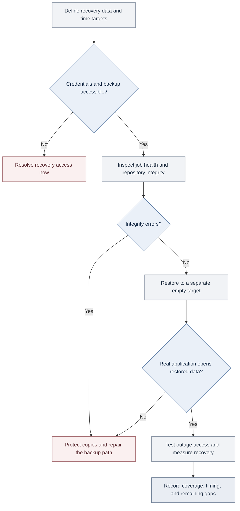

[INTA](https://github.com/Herbertofury/INTA/wiki) / [Decision desk](https://github.com/Herbertofury/INTA/wiki/Decision-Desk) · [Playbooks](https://github.com/Herbertofury/INTA/wiki/Playbooks) · [Tools](https://github.com/Herbertofury/INTA/wiki/Tool-Directory) · [Methods](https://github.com/Herbertofury/INTA/wiki/Methods) · [Open hub](https://herbertofury.github.io/INTA/)

# [Prove a backup can actually restore](https://github.com/Herbertofury/INTA/wiki/Job-backup-restore)

Validate recovery credentials, data integrity, application usability, and recovery time.

**Backup & continuity** · Intermediate · 30–90 min; full restore varies · 6 steps

[Quick answer](#quick-answer) · [Decision route](#decision-route) · [Tools](#toolkit) · [Procedure](#walkthrough) · [Verification](#acceptance) · [Sources](#sources) · [Interactive checklist](https://herbertofury.github.io/INTA/#job/backup-restore)

## ⚡ Quick answer

### 🗄️ Restore a file backup

**Identify the backup format, snapshot date and recoverable credentials before choosing the restore tool.**

1. For a [restic](https://restic.net/) repository, inspect snapshots and run the documented repository checks.
2. Restore the required snapshot or files to a separate destination using the scoped procedure.
3. Open representative files, check permissions and record the restored date and any missing data.

**[restic](https://restic.net/)** · [Official page](https://restic.net/) · **[Download Windows x64 · ZIP](https://github.com/restic/restic/releases/download/v0.20.0/restic_0.20.0_windows_amd64.zip)**

> [!NOTE]
> **Start here.** Identify what must be recovered, the acceptable data-loss window, and the target recovery time. A green backup status is only the starting point.

## 🧭 Choose a route

View the decision map and escalation routes

**Route links:** [Continue this workflow](#walkthrough) · [Acceptance checks](#acceptance) · [Clone a healthy system or migrate to a new SSD](disk-migration.md) · [Bring an office back after a power outage](outage-recovery.md) · [Contain ransomware or a wider compromise](ransomware-response.md) · [Run a useful workstation maintenance visit](preventive-maintenance.md)

| Checkpoint | What to carry forward |
| --- | --- |
| **Before changing anything** | Identify recovery credentials, unique data, and a separate test target. |
| **Keep during the job** | Snapshot, integrity result, restore log, elapsed time, and test evidence. |
| **Before handing back** | Real restored data opens and the outage path is usable. |

## Recommended tools

Select a tool for the next diagnostic or repair step. Check its platform, access and licensing requirements before use.

| Tool / official page + download | Use it for | Platform & access | Documentation |
| --- | --- | --- | --- |
| **[restic](https://restic.net/)** · [Official page](https://restic.net/) · **[Download Windows x64 · ZIP](https://github.com/restic/restic/releases/download/v0.20.0/restic_0.20.0_windows_amd64.zip)** | Repeatable file backups with explicit integrity and restore checks. | [Windows](https://www.microsoft.com/windows), [Linux](https://www.kernel.org/), [macOS](https://support.apple.com/macos); Free / open source | [Open guide](https://restic.readthedocs.io/en/stable/) |
| **[Veeam Agent for Microsoft Windows](https://www.veeam.com/products/free/microsoft-windows)** · [Official page](https://www.veeam.com/products/free/microsoft-windows) · **[Sign in for the Windows download](https://www.veeam.com/products/physical/windows-backup-recovery-download.html)** | Image backup and recovery media for a supported [Windows](https://www.microsoft.com/windows) endpoint. | [Windows](https://www.microsoft.com/windows); Free and paid editions; service-provider terms differ | [Open guide](https://helpcenter.veeam.com/docs/agentforwindows/userguide/overview.html) |
| **[Rescuezilla](https://rescuezilla.com/)** · [Official page](https://rescuezilla.com/) · **[Download x64 rescue image · ISO](https://github.com/rescuezilla/rescuezilla/releases/download/2.6.2/rescuezilla-2.6.2-64bit.resolute.iso)** | A visual bare-metal backup or restore workflow at the bench. | Bootable PC; Free / open source | [Open guide](https://rescuezilla.com/help) |

## Procedure

Work in order, record the result of each step, and change route when the evidence calls for it.

### 01 · Inventory the recovery set

- [ ] List protected devices, folders, application data, backup destination, retention, encryption keys, and the last successful job. Confirm the person covering an outage can obtain the credentials. Identify data that lives outside the usual Documents/Desktop folders.

### 02 · Inspect repository and job health

- [ ] Read recent backup logs, skipped-file reports, capacity, and retention errors. Use the product’s integrity check. For [restic](https://restic.net/), a normal check validates repository structure; reading and verifying stored data requires the additional data-check option and an appropriate maintenance window.

### 03 · Select a representative restore

- [ ] Choose a known snapshot and business-relevant files, including a large file and a format used by the client. Restore to an empty separate folder or isolated test machine. Avoid restoring directly over live files during a routine verification.

### 04 · Test the content with the real application

- [ ] Open documents, photos, archives, and business data in their intended applications. Check permissions and required metadata. For databases or server workloads, follow the application’s supported recovery procedure and confirm consistency, not just file presence.

### 05 · Exercise the outage path

- [ ] For system recovery, boot the recovery media in a test environment and confirm it can see the backup destination and required storage/network hardware. Measure restore time. Verify recovery still works when the original PC or ordinary sign-in method is unavailable.

### 06 · Record and resolve gaps

- [ ] Save the restore date, snapshot, scope, integrity result, elapsed time, and evidence in the private service record. Assign an owner to missing data, inaccessible keys, slow restore paths, or capacity problems. Keep backup copies isolated from ordinary endpoint write access where supported.

## Verification

- [ ] A real restore has completed to a separate target.
- [ ] Restored data opens correctly and required permissions work.
- [ ] Recovery keys, media, network access, and time expectations were tested.
- [ ] Any integrity or coverage gap has an owner and corrective action.

> [!WARNING]
> **Pause this route and escalate when:**
> - A repository check reports corruption or essential credentials are missing.
> - The restore plan would overwrite the only good copy or live production data.

## Related playbooks

| Next playbook | What it resolves |
| --- | --- |
| [Clone a healthy system or migrate to a new SSD](disk-migration.md) | Move a working system with clear source/destination control and a rollback copy. |
| [Bring an office back after a power outage](outage-recovery.md) | Restore dependencies in order and verify services before releasing the office back to work. |
| [Contain ransomware or a wider compromise](ransomware-response.md) | Stop spread, preserve useful evidence, and restore services through a clean recovery path. |
| [Run a useful workstation maintenance visit](preventive-maintenance.md) | Check security, updates, hardware, backups, and usability without unnecessary cleanup rituals. |

## Official sources

References and review notes

- [restic: repository consistency and integrity](https://restic.readthedocs.io/en/stable/045_working_with_repos.html)
- [restic: restore a backup](https://restic.readthedocs.io/en/stable/050_restore.html)

Reviewed **2026-11-26**. Timing is a planning range. A successful command is evidence about that operation; acceptance belongs to the user’s original task.

---

Editorial review: **2026-11-26** · [Review standard](https://github.com/Herbertofury/INTA/wiki/Knowledge-Standards) · [Suggest a correction](https://github.com/Herbertofury/INTA/issues/new/choose)

[← All playbooks](README.md) · [Live Wiki](https://github.com/Herbertofury/INTA/wiki) · [Contribution guide](https://github.com/Herbertofury/INTA/blob/main/CONTRIBUTING.md)
