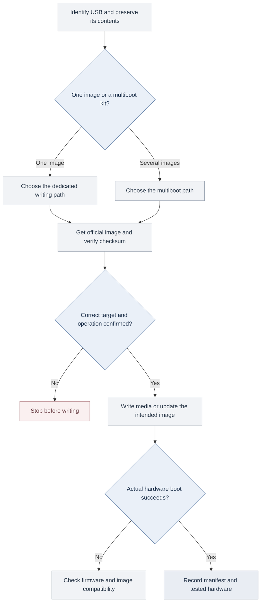

<a href="https://herbertofury.github.io/INTA/" title="Open INTA official download or service page" aria-label="Open INTA official download or service page" data-inta-brand="app-inta"></a> [INTA](https://github.com/Herbertofury/INTA/wiki) / [Decision desk](https://github.com/Herbertofury/INTA/wiki/Decision-Desk) · [Service map](https://github.com/Herbertofury/INTA/wiki/Service-Map) · [Playbooks](https://github.com/Herbertofury/INTA/wiki/Playbooks) · [Tools](https://github.com/Herbertofury/INTA/wiki/Tool-Directory) · [Methods](https://github.com/Herbertofury/INTA/wiki/Methods) · [Open hub](https://herbertofury.github.io/INTA/)

<a id="-build-and-refresh-a-technician-rescue-usb"></a>

# [Build and refresh a technician rescue USB](https://github.com/Herbertofury/INTA/wiki/Job-boot-usb)

Keep verified recovery images, <a href="https://www.microsoft.com/windows" title="Open Windows official download or service page" aria-label="Open Windows official download or service page" data-inta-brand="app-windows"></a> [Windows repair](https://github.com/Herbertofury/INTA/wiki/Job-windows-repair) media, and the <a href="https://herbertofury.github.io/INTA/" title="Open INTA official download or service page" aria-label="Open INTA official download or service page" data-inta-brand="app-inta"></a> [INTA](https://herbertofury.github.io/INTA/) knowledge hub ready for offline use.

**Recovery & boot** · Intermediate · 20–60 min plus downloads · 6 steps

[Tools and useful links](#working-kit) · [Quick answer](#quick-answer) · [Next action](#next-action) · [Specific fixes](#specific-fixes) · [Decision route](#decision-route) · [Tools](#toolkit) · [Procedure](#walkthrough) · [Verification](#acceptance) · [Sources](#sources) · [Interactive checklist](https://herbertofury.github.io/INTA/#job/boot-usb)

<a id="tool-choices"></a>

## 🧰 Choose the tool for this job

Choose by the task shown in the first column. Each option includes its acquisition route and access boundary.

| Need | Official tool + exact action | Why this choice / access |
| --- | --- | --- |
| **Write one official ISO** | **<a href="https://rufus.ie/#download" title="Open Rufus official download or service page" aria-label="Open Rufus official download or service page" data-inta-brand="rufus"></a> [Rufus](https://rufus.ie/)** · **<a href="https://www.microsoft.com/windows" title="Open Windows official download or service page" aria-label="Open Windows official download or service page" data-inta-brand="app-windows"></a> [Download Windows x64 portable · EXE](https://github.com/pbatard/rufus/releases/download/v4.16/rufus-4.16p.exe)** | Write the selected supported image to the verified USB and test the actual target boot. **Access:** Free and open source |
| **Maintain multiple ISOs** | **<a href="https://www.ventoy.net/en/download.html" title="Open Ventoy official download or service page" aria-label="Open Ventoy official download or service page" data-inta-brand="ventoy"></a> [Ventoy](https://www.ventoy.net/)** · **<a href="https://www.microsoft.com/windows" title="Open Windows official download or service page" aria-label="Open Windows official download or service page" data-inta-brand="app-windows"></a> [Download Windows package · ZIP](https://github.com/ventoy/Ventoy/releases/download/v1.1.18/ventoy-1.1.18-windows.zip)** | Install the multiboot loader on the verified USB and keep each image independently sourced and tested. **Access:** Free and open source |
| **Official <a href="https://www.microsoft.com/windows" title="Open Windows official download or service page" aria-label="Open Windows official download or service page" data-inta-brand="app-windows"></a> [Windows](https://www.microsoft.com/windows) media** | **<a href="https://www.microsoft.com/software-download/windows11" title="Open Windows 11 installation media official download or service page" aria-label="Open Windows 11 installation media official download or service page" data-inta-brand="microsoft-windows11-media"></a> [Windows 11 installation media](https://www.microsoft.com/software-download/windows11)** · **<a href="https://www.microsoft.com/software-download/windows11" title="Open Windows 11 installation media official download or service page" aria-label="Open Windows 11 installation media official download or service page" data-inta-brand="microsoft-windows11-media"></a> [Download media creation tool · EXE](https://go.microsoft.com/fwlink/?linkid=2156295)** | Obtain the supported <a href="https://www.microsoft.com/windows" title="Open Windows official download or service page" aria-label="Open Windows official download or service page" data-inta-brand="app-windows"></a> [Windows](https://www.microsoft.com/windows) installer or media-creation route for the target architecture. **Access:** Media is free; <a href="https://www.microsoft.com/windows" title="Open Windows official download or service page" aria-label="Open Windows official download or service page" data-inta-brand="app-windows"></a> [Windows](https://www.microsoft.com/windows) licensing remains separate. |
| **Ready recovery ISO** | **<a href="https://www.system-rescue.org/Download/" title="Open SystemRescue official download or service page" aria-label="Open SystemRescue official download or service page" data-inta-brand="systemrescue"></a> [SystemRescue](https://www.system-rescue.org/)** · **<a href="https://www.system-rescue.org/Download/" title="Open SystemRescue official download or service page" aria-label="Open SystemRescue official download or service page" data-inta-brand="systemrescue"></a> [Download x64 rescue image · ISO](https://fastly-cdn.system-rescue.org/releases/13.03/systemrescue-13.03-amd64.iso)** | Add an independent recovery environment when the job requires disk imaging or recovery. **Access:** Free and open source |

**[Current selection evidence](https://github.com/Herbertofury/INTA/wiki/Current-Tool-Choices)**

<a id="working-kit"></a>

## 🧰 Tools and links for this job

**[Open working view](https://herbertofury.github.io/INTA/#job/boot-usb)** · Keep the tool panel beside the instructions.

**First move:** Identify the USB by model, capacity and contents; copy off anything that must be kept before a write operation.

| Use this for | Official tool + exact action |
| --- | --- |
| Write one selected official ISO to the intended USB. | **<a href="https://rufus.ie/#download" title="Open Rufus official download or service page" aria-label="Open Rufus official download or service page" data-inta-brand="rufus"></a> [Rufus](https://rufus.ie/)** · <a href="https://rufus.ie/#download" title="Open Rufus official download or service page" aria-label="Open Rufus official download or service page" data-inta-brand="rufus"></a> [Official page](https://rufus.ie/) · **<a href="https://www.microsoft.com/windows" title="Open Windows official download or service page" aria-label="Open Windows official download or service page" data-inta-brand="app-windows"></a> [Download Windows x64 portable · EXE](https://github.com/pbatard/rufus/releases/download/v4.16/rufus-4.16p.exe)** |
| Maintain a verified multiboot collection. | **<a href="https://www.ventoy.net/en/download.html" title="Open Ventoy official download or service page" aria-label="Open Ventoy official download or service page" data-inta-brand="ventoy"></a> [Ventoy](https://www.ventoy.net/)** · <a href="https://www.ventoy.net/en/download.html" title="Open Ventoy official download or service page" aria-label="Open Ventoy official download or service page" data-inta-brand="ventoy"></a> [Official page](https://www.ventoy.net/) · **<a href="https://www.microsoft.com/windows" title="Open Windows official download or service page" aria-label="Open Windows official download or service page" data-inta-brand="app-windows"></a> [Download Windows package · ZIP](https://github.com/ventoy/Ventoy/releases/download/v1.1.18/ventoy-1.1.18-windows.zip)** |
| Obtain supported <a href="https://www.microsoft.com/windows" title="Open Windows official download or service page" aria-label="Open Windows official download or service page" data-inta-brand="app-windows"></a> [Windows repair](https://github.com/Herbertofury/INTA/wiki/Job-windows-repair)/install media. | **<a href="https://www.microsoft.com/software-download/windows11" title="Open Windows 11 installation media official download or service page" aria-label="Open Windows 11 installation media official download or service page" data-inta-brand="microsoft-windows11-media"></a> [Windows 11 installation media](https://www.microsoft.com/software-download/windows11)** · <a href="https://www.microsoft.com/software-download/windows11" title="Open Windows 11 installation media official download or service page" aria-label="Open Windows 11 installation media official download or service page" data-inta-brand="microsoft-windows11-media"></a> [Official page](https://www.microsoft.com/software-download/windows11) · **<a href="https://www.microsoft.com/software-download/windows11" title="Open Windows 11 installation media official download or service page" aria-label="Open Windows 11 installation media official download or service page" data-inta-brand="microsoft-windows11-media"></a> [Download media creation tool · EXE](https://go.microsoft.com/fwlink/?linkid=2156295)** |
| Provide an independent imaging and recovery environment. | **<a href="https://www.system-rescue.org/Download/" title="Open SystemRescue official download or service page" aria-label="Open SystemRescue official download or service page" data-inta-brand="systemrescue"></a> [SystemRescue](https://www.system-rescue.org/)** · <a href="https://www.system-rescue.org/Download/" title="Open SystemRescue official download or service page" aria-label="Open SystemRescue official download or service page" data-inta-brand="systemrescue"></a> [Official page](https://www.system-rescue.org/) · **<a href="https://www.system-rescue.org/Download/" title="Open SystemRescue official download or service page" aria-label="Open SystemRescue official download or service page" data-inta-brand="systemrescue"></a> [Download x64 rescue image · ISO](https://fastly-cdn.system-rescue.org/releases/13.03/systemrescue-13.03-amd64.iso)** |
| Starting an approved installer or rescue environment through network boot or remote virtual media when local media delivery is inconvenient. | **<a href="https://netboot.xyz/downloads/" title="Open netboot.xyz official download or service page" aria-label="Open netboot.xyz official download or service page" data-inta-brand="netbootxyz"></a> [netboot.xyz](https://netboot.xyz/)** · <a href="https://netboot.xyz/downloads/" title="Open netboot.xyz official download or service page" aria-label="Open netboot.xyz official download or service page" data-inta-brand="netbootxyz"></a> [Official page](https://netboot.xyz/) · **<a href="https://netboot.xyz/downloads/" title="Open netboot.xyz official download or service page" aria-label="Open netboot.xyz official download or service page" data-inta-brand="netbootxyz"></a> [Download PC network-boot image · ISO](https://github.com/netbootxyz/netboot.xyz/releases/download/3.0.3/netboot.xyz.iso)** |

### Create media

| Open the exact resource | What to do there |
| --- | --- |
| **<a href="https://rufus.ie/#download" title="Open Rufus official download or service page" aria-label="Open Rufus official download or service page" data-inta-brand="rufus"></a> [Rufus operation and firmware choices](https://github.com/pbatard/rufus/wiki/FAQ)** | Confirm image, target USB and the intended boot mode. |
| **<a href="https://www.ventoy.net/en/download.html" title="Open Ventoy official download or service page" aria-label="Open Ventoy official download or service page" data-inta-brand="ventoy"></a> [Ventoy install versus update](https://www.ventoy.net/en/doc_start.html)** | Distinguish a destructive install from updating existing media. |

### Verify media

| Open the exact resource | What to do there |
| --- | --- |
| **<a href="https://github.com/PowerShell/PowerShell/releases/latest" title="Open PowerShell official download or service page" aria-label="Open PowerShell official download or service page" data-inta-brand="powershell"></a> [Verify a selected file hash](https://learn.microsoft.com/en-us/powershell/module/microsoft.powershell.utility/get-filehash)** | Compare the exact downloaded image with its publisher’s checksum. |

### Boot compatibility

| Open the exact resource | What to do there |
| --- | --- |
| **<a href="https://www.ventoy.net/en/download.html" title="Open Ventoy official download or service page" aria-label="Open Ventoy official download or service page" data-inta-brand="ventoy"></a> [Ventoy Secure Boot instructions](https://www.ventoy.net/en/doc_secure.html)** | Review image/firmware support and recovery before changing keys or settings. |

<a id="quick-answer"></a>

## ⚡ Quick answer

<a id="quick-boot-usb"></a>

### 🔌 Make a boot USB

**Choose the official ISO and identify a USB drive that may be erased.**

1. Download the correct image and check its published checksum or signature where supplied.
2. In <a href="https://rufus.ie/#download" title="Open Rufus official download or service page" aria-label="Open Rufus official download or service page" data-inta-brand="rufus"></a> [Rufus](https://rufus.ie/), confirm the USB model and capacity, select the ISO and choose the target’s firmware-compatible options.
3. Write the USB, check the log and test that it boots before taking it to the client.

**<a href="https://rufus.ie/#download" title="Open Rufus official download or service page" aria-label="Open Rufus official download or service page" data-inta-brand="rufus"></a> [Rufus](https://rufus.ie/)** · <a href="https://rufus.ie/#download" title="Open Rufus official download or service page" aria-label="Open Rufus official download or service page" data-inta-brand="rufus"></a> [Official page](https://rufus.ie/) · **<a href="https://www.microsoft.com/windows" title="Open Windows official download or service page" aria-label="Open Windows official download or service page" data-inta-brand="app-windows"></a> [Download Windows x64 portable · EXE](https://github.com/pbatard/rufus/releases/download/v4.16/rufus-4.16p.exe)**

<a id="next-action"></a>

## 🧭 Match the symptom

| You see this | Do this next | You should get |
| --- | --- | --- |
| **Only one rescue or installation image is needed** | Use the official ISO and <a href="https://rufus.ie/#download" title="Open Rufus official download or service page" aria-label="Open Rufus official download or service page" data-inta-brand="rufus"></a> [Rufus](https://rufus.ie/); confirm the selected USB can be erased and choose firmware-compatible options. | The intended image is written to the correct device. |
| **Several verified images must stay on one USB** | Use the documented <a href="https://www.ventoy.net/en/download.html" title="Open Ventoy official download or service page" aria-label="Open Ventoy official download or service page" data-inta-brand="ventoy"></a> [Ventoy](https://www.ventoy.net/) install/update path and copy the checked images to its data partition. | The expected images appear in the boot menu. |
| **The publisher supplies a checksum** | Run Get-FileHash for the exact downloaded file and compare it with the official value before writing. | The calculated hash matches the trusted release record. |
| **Writing finished but the client may have unusual hardware** | Boot-test the intended firmware mode and verify keyboard, storage, network and the required recovery tool. | The actual service path works on representative hardware rather than only completing an image write. |

### ✅ Finish the job

- [ ] Image source, hash and release are recorded.
- [ ] The USB boots and detects the hardware required for the planned job.

**Change route when:** The target USB or its erase permission is uncertain. · A firmware/security change lacks the necessary recovery material.

### 🎯 Go straight to a specific fix

- **[Resolve a Secure Boot rejection deliberately](#fix-bootusb-secure-boot-blocks-rescue-menu)** — A prepared [rescue USB](https://github.com/Herbertofury/INTA/wiki/Job-boot-usb) is detected but its bootloader is rejected by Secure Boot.
- **[Choose media that can boot the target](#fix-bootusb-image-is-wrong-architecture)** — A rescue image works on an x64 PC but not on an ARM device.
- **[Handle an image larger than the USB filesystem limit](#fix-bootusb-large-iso-will-not-copy)** — Copying a large ISO or installation file fails even though the USB has enough total free space.

> [!NOTE]
> **Start here.** Choose a known USB drive and copy off anything that must be kept. Confirm its model, capacity, and contents before a media-writing operation.

<a id="decision-route"></a>

<a id="-choose-the-right-branch"></a>

## 🧭 Choose a route



**Route links:** [Continue this workflow](#walkthrough) · [Acceptance checks](#acceptance) · <a href="https://www.microsoft.com/windows" title="Open Windows official download or service page" aria-label="Open Windows official download or service page" data-inta-brand="app-windows"></a> [Recover a Windows PC that will not boot](boot-recovery.md) · [Rescue data from a failing or unreadable drive](failing-drive.md) · [Prove a backup can actually restore](backup-restore.md)

| Checkpoint | What to carry forward |
| --- | --- |
| **Before changing anything** | Identify the USB and save anything that must be retained. |
| **Keep during the job** | Official image, checksum, selected operation, and boot-test hardware. |
| **Before handing back** | Required tools and offline guide work on the actual boot path. |

<a id="toolkit"></a>

<a id="-build-the-right-toolkit"></a>

## Recommended tools

Select a tool for the next diagnostic or repair step. Check its platform, access and licensing requirements before use.

| Tool / official page + download | Use it for | Platform & access | Documentation |
| --- | --- | --- | --- |
| **<a href="https://rufus.ie/#download" title="Open Rufus official download or service page" aria-label="Open Rufus official download or service page" data-inta-brand="rufus"></a> [Rufus](https://rufus.ie/)** · <a href="https://rufus.ie/#download" title="Open Rufus official download or service page" aria-label="Open Rufus official download or service page" data-inta-brand="rufus"></a> [Official page](https://rufus.ie/) · **<a href="https://www.microsoft.com/windows" title="Open Windows official download or service page" aria-label="Open Windows official download or service page" data-inta-brand="app-windows"></a> [Download Windows x64 portable · EXE](https://github.com/pbatard/rufus/releases/download/v4.16/rufus-4.16p.exe)** | Write one selected official ISO to the intended USB. | <a href="https://www.microsoft.com/windows" title="Open Windows official download or service page" aria-label="Open Windows official download or service page" data-inta-brand="app-windows"></a> [Windows](https://www.microsoft.com/windows); Free / open source | <a href="https://rufus.ie/#download" title="Open Rufus official download or service page" aria-label="Open Rufus official download or service page" data-inta-brand="rufus"></a> [Open guide](https://github.com/pbatard/rufus/wiki/FAQ) |
| **<a href="https://www.ventoy.net/en/download.html" title="Open Ventoy official download or service page" aria-label="Open Ventoy official download or service page" data-inta-brand="ventoy"></a> [Ventoy](https://www.ventoy.net/)** · <a href="https://www.ventoy.net/en/download.html" title="Open Ventoy official download or service page" aria-label="Open Ventoy official download or service page" data-inta-brand="ventoy"></a> [Official page](https://www.ventoy.net/) · **<a href="https://www.microsoft.com/windows" title="Open Windows official download or service page" aria-label="Open Windows official download or service page" data-inta-brand="app-windows"></a> [Download Windows package · ZIP](https://github.com/ventoy/Ventoy/releases/download/v1.1.18/ventoy-1.1.18-windows.zip)** | Maintain a verified multiboot collection. | <a href="https://www.microsoft.com/windows" title="Open Windows official download or service page" aria-label="Open Windows official download or service page" data-inta-brand="app-windows"></a> [Windows](https://www.microsoft.com/windows), <a href="https://www.kernel.org/" title="Open Linux official download or service page" aria-label="Open Linux official download or service page" data-inta-brand="app-linux"></a> [Linux](https://www.kernel.org/); Free / open source | <a href="https://www.ventoy.net/en/download.html" title="Open Ventoy official download or service page" aria-label="Open Ventoy official download or service page" data-inta-brand="ventoy"></a> [Open guide](https://www.ventoy.net/en/doc_start.html) |
| **<a href="https://www.microsoft.com/software-download/windows11" title="Open Windows 11 installation media official download or service page" aria-label="Open Windows 11 installation media official download or service page" data-inta-brand="microsoft-windows11-media"></a> [Windows 11 installation media](https://www.microsoft.com/software-download/windows11)** · <a href="https://www.microsoft.com/software-download/windows11" title="Open Windows 11 installation media official download or service page" aria-label="Open Windows 11 installation media official download or service page" data-inta-brand="microsoft-windows11-media"></a> [Official page](https://www.microsoft.com/software-download/windows11) · **<a href="https://www.microsoft.com/software-download/windows11" title="Open Windows 11 installation media official download or service page" aria-label="Open Windows 11 installation media official download or service page" data-inta-brand="microsoft-windows11-media"></a> [Download media creation tool · EXE](https://go.microsoft.com/fwlink/?linkid=2156295)** | Obtain supported <a href="https://www.microsoft.com/windows" title="Open Windows official download or service page" aria-label="Open Windows official download or service page" data-inta-brand="app-windows"></a> [Windows repair](https://github.com/Herbertofury/INTA/wiki/Job-windows-repair)/install media. | <a href="https://www.microsoft.com/windows" title="Open Windows official download or service page" aria-label="Open Windows official download or service page" data-inta-brand="app-windows"></a> [Windows](https://www.microsoft.com/windows), Bootable PC; Download available; <a href="https://www.microsoft.com/windows" title="Open Windows official download or service page" aria-label="Open Windows official download or service page" data-inta-brand="app-windows"></a> [Windows](https://www.microsoft.com/windows) license required | <a href="https://www.microsoft.com/software-download/windows11" title="Open Windows 11 installation media official download or service page" aria-label="Open Windows 11 installation media official download or service page" data-inta-brand="microsoft-windows11-media"></a> [Open guide](https://www.microsoft.com/software-download/windows11) |
| **<a href="https://www.system-rescue.org/Download/" title="Open SystemRescue official download or service page" aria-label="Open SystemRescue official download or service page" data-inta-brand="systemrescue"></a> [SystemRescue](https://www.system-rescue.org/)** · <a href="https://www.system-rescue.org/Download/" title="Open SystemRescue official download or service page" aria-label="Open SystemRescue official download or service page" data-inta-brand="systemrescue"></a> [Official page](https://www.system-rescue.org/) · **<a href="https://www.system-rescue.org/Download/" title="Open SystemRescue official download or service page" aria-label="Open SystemRescue official download or service page" data-inta-brand="systemrescue"></a> [Download x64 rescue image · ISO](https://fastly-cdn.system-rescue.org/releases/13.03/systemrescue-13.03-amd64.iso)** | Provide an independent imaging and recovery environment. | Bootable PC; Free / open source | <a href="https://www.system-rescue.org/Download/" title="Open SystemRescue official download or service page" aria-label="Open SystemRescue official download or service page" data-inta-brand="systemrescue"></a> [Open guide](https://www.system-rescue.org/manual/) |
| **<a href="https://www.hirensbootcd.org/download/" title="Open Hiren&#x27;s BootCD PE official download or service page" aria-label="Open Hiren&#x27;s BootCD PE official download or service page" data-inta-brand="hirens-bootcd-pe"></a> [Hiren's BootCD PE](https://www.hirensbootcd.org/)** · <a href="https://www.hirensbootcd.org/download/" title="Open Hiren&#x27;s BootCD PE official download or service page" aria-label="Open Hiren&#x27;s BootCD PE official download or service page" data-inta-brand="hirens-bootcd-pe"></a> [Official page](https://www.hirensbootcd.org/) · **<a href="https://www.hirensbootcd.org/download/" title="Open Hiren&#x27;s BootCD PE official download or service page" aria-label="Open Hiren&#x27;s BootCD PE official download or service page" data-inta-brand="hirens-bootcd-pe"></a> [Download x64 rescue image · ISO](https://www.hirensbootcd.org/files/HBCD_PE_x64.iso)** | A familiar <a href="https://www.microsoft.com/windows" title="Open Windows official download or service page" aria-label="Open Windows official download or service page" data-inta-brand="app-windows"></a> [Windows](https://www.microsoft.com/windows)-oriented offline bench toolkit. | Bootable PC; Free distribution; bundled tools have individual terms | <a href="https://www.hirensbootcd.org/download/" title="Open Hiren&#x27;s BootCD PE official download or service page" aria-label="Open Hiren&#x27;s BootCD PE official download or service page" data-inta-brand="hirens-bootcd-pe"></a> [Open guide](https://www.hirensbootcd.org/howtos/) |
| **<a href="https://rescuezilla.com/download" title="Open Rescuezilla official download or service page" aria-label="Open Rescuezilla official download or service page" data-inta-brand="rescuezilla"></a> [Rescuezilla](https://rescuezilla.com/)** · <a href="https://rescuezilla.com/download" title="Open Rescuezilla official download or service page" aria-label="Open Rescuezilla official download or service page" data-inta-brand="rescuezilla"></a> [Official page](https://rescuezilla.com/) · **<a href="https://rescuezilla.com/download" title="Open Rescuezilla official download or service page" aria-label="Open Rescuezilla official download or service page" data-inta-brand="rescuezilla"></a> [Download x64 rescue image · ISO](https://github.com/rescuezilla/rescuezilla/releases/download/2.6.2/rescuezilla-2.6.2-64bit.resolute.iso)** | A visual bare-metal backup or restore workflow at the bench. | Bootable PC; Free / open source | <a href="https://rescuezilla.com/download" title="Open Rescuezilla official download or service page" aria-label="Open Rescuezilla official download or service page" data-inta-brand="rescuezilla"></a> [Open guide](https://rescuezilla.com/help) |
| **<a href="https://netboot.xyz/downloads/" title="Open netboot.xyz official download or service page" aria-label="Open netboot.xyz official download or service page" data-inta-brand="netbootxyz"></a> [netboot.xyz](https://netboot.xyz/)** · <a href="https://netboot.xyz/downloads/" title="Open netboot.xyz official download or service page" aria-label="Open netboot.xyz official download or service page" data-inta-brand="netbootxyz"></a> [Official page](https://netboot.xyz/) · **<a href="https://netboot.xyz/downloads/" title="Open netboot.xyz official download or service page" aria-label="Open netboot.xyz official download or service page" data-inta-brand="netbootxyz"></a> [Download PC network-boot image · ISO](https://github.com/netbootxyz/netboot.xyz/releases/download/3.0.3/netboot.xyz.iso)** | Starting an approved installer or rescue environment through network boot or remote virtual media when local media delivery is inconvenient. | Bootable PC, ARM64; Free and open source; project code uses Apache-2.0, and boot components and selected operating systems retain their own licenses | <a href="https://netboot.xyz/downloads/" title="Open netboot.xyz official download or service page" aria-label="Open netboot.xyz official download or service page" data-inta-brand="netbootxyz"></a> [Open guide](https://netboot.xyz/docs/) |

<a id="walkthrough"></a>

<a id="-work-the-case"></a>

## Procedure

Work in order, record the result of each step, and change route when the evidence calls for it.

<a id="step-01"></a>

### 01 · Choose the media strategy

- [ ] Use <a href="https://www.ventoy.net/en/download.html" title="Open Ventoy official download or service page" aria-label="Open Ventoy official download or service page" data-inta-brand="ventoy"></a> [Ventoy](https://www.ventoy.net/) for a multiboot collection that can be refreshed by copying ISO files, or <a href="https://rufus.ie/#download" title="Open Rufus official download or service page" aria-label="Open Rufus official download or service page" data-inta-brand="rufus"></a> [Rufus](https://rufus.ie/) for a dedicated image. Keep official <a href="https://www.microsoft.com/windows" title="Open Windows official download or service page" aria-label="Open Windows official download or service page" data-inta-brand="app-windows"></a> [Windows](https://www.microsoft.com/windows) media for <a href="https://learn.microsoft.com/en-us/windows-hardware/manufacture/desktop/windows-recovery-environment--windows-re--technical-reference" title="Open Windows Recovery Environment official download or service page" aria-label="Open Windows Recovery Environment official download or service page" data-inta-brand="windows-recovery"></a> [WinRE](https://learn.microsoft.com/en-us/windows-hardware/manufacture/desktop/windows-recovery-environment--windows-re--technical-reference) and <a href="https://www.microsoft.com/windows" title="Open Windows official download or service page" aria-label="Open Windows official download or service page" data-inta-brand="app-windows"></a> [Windows](https://www.microsoft.com/windows)-native repair alongside <a href="https://www.kernel.org/" title="Open Linux official download or service page" aria-label="Open Linux official download or service page" data-inta-brand="app-linux"></a> [Linux](https://www.kernel.org/)-based rescue tools. An ISO’s platform determines which tools run inside it.

<a id="step-02"></a>

### 02 · Download from the official source

- [ ] Use the catalog’s official download links and keep release notes and vendor checksums with each image. Use the <a href="https://github.com/Herbertofury/INTA/blob/main/docs/rescue.md" title="Open Media Creator official download or service page" aria-label="Open Media Creator official download or service page" data-inta-brand="app-media-creator"></a> [INTA Media Creator](https://github.com/Herbertofury/INTA/blob/main/docs/rescue.md) for its verified <a href="https://herbertofury.github.io/INTA/" title="Open INTA official download or service page" aria-label="Open INTA official download or service page" data-inta-brand="app-inta"></a> [INTA](https://herbertofury.github.io/INTA/) ISO download/update flow. A current boot environment does not guarantee every bundled third-party tool is current.

<a id="step-03"></a>

### 03 · Verify the bytes before writing

- [ ] Compare the local SHA-256 hash with the release’s published checksum using the exact file path. In <a href="https://github.com/PowerShell/PowerShell/releases/latest" title="Open PowerShell official download or service page" aria-label="Open PowerShell official download or service page" data-inta-brand="powershell"></a> [PowerShell](https://learn.microsoft.com/en-us/powershell/), select the downloaded ISO and run Get-FileHash for that file. The hash proves a match to the published value; also verify you obtained that value from the genuine release.

**<a href="https://github.com/PowerShell/PowerShell/releases/latest" title="Open PowerShell official download or service page" aria-label="Open PowerShell official download or service page" data-inta-brand="powershell"></a> [PowerShell](https://learn.microsoft.com/en-us/powershell/) · List disk number, model, serial, bus type and size so the correct removable target can be selected in the approved USB writer.:**

```text
Get-Disk | Format-Table Number,FriendlyName,SerialNumber,BusType,OperationalStatus,Size -AutoSize
```

> **Before running:** Read-only inventory. Physically confirm the USB device before selecting it in a destructive writer; do not use clean, format or partition commands from this diagnostic block.

**Official command reference:** <a href="https://www.microsoft.com/" title="Open microsoft.com official download or service page" aria-label="Open microsoft.com official download or service page" data-inta-brand="site-www-microsoft-com"></a> [Microsoft Get-Disk documentation](https://learn.microsoft.com/en-us/powershell/module/storage/get-disk)

**Command legend:** <a href="https://www.microsoft.com/" title="Open microsoft.com official download or service page" aria-label="Open microsoft.com official download or service page" data-inta-brand="site-www-microsoft-com"></a> [Microsoft Get-Disk documentation](https://learn.microsoft.com/en-us/powershell/module/storage/get-disk) · [Return to the step context](#step-03).

<a id="step-04"></a>

### 04 · Write or update the chosen device

- [ ] Installing <a href="https://www.ventoy.net/en/download.html" title="Open Ventoy official download or service page" aria-label="Open Ventoy official download or service page" data-inta-brand="ventoy"></a> [Ventoy](https://www.ventoy.net/) or writing with <a href="https://rufus.ie/#download" title="Open Rufus official download or service page" aria-label="Open Rufus official download or service page" data-inta-brand="rufus"></a> [Rufus](https://rufus.ie/) can erase the selected USB. Review the device identity before confirming. Use <a href="https://www.ventoy.net/en/download.html" title="Open Ventoy official download or service page" aria-label="Open Ventoy official download or service page" data-inta-brand="ventoy"></a> [Ventoy](https://www.ventoy.net/)’s Update operation for an existing <a href="https://www.ventoy.net/en/download.html" title="Open Ventoy official download or service page" aria-label="Open Ventoy official download or service page" data-inta-brand="ventoy"></a> [Ventoy](https://www.ventoy.net/) installation when intended, and copy refreshed verified ISOs to its data partition. Keep a rollback image until the new one boots.

<a id="step-05"></a>

### 05 · Test the actual boot path

- [ ] Boot the USB on a representative spare machine and confirm keyboard, display, storage, network, and recovery tools. Test the intended firmware mode. Read <a href="https://www.ventoy.net/en/download.html" title="Open Ventoy official download or service page" aria-label="Open Ventoy official download or service page" data-inta-brand="ventoy"></a> [Ventoy](https://www.ventoy.net/)’s current Secure Boot documentation before enrolling keys or changing firmware settings; firmware and image support must be proven on the target hardware.

<a id="step-06"></a>

### 06 · Keep an offline manifest and refresh on demand

- [ ] Record image name, source URL, release, hash, download date, and successful boot test. Include the <a href="https://herbertofury.github.io/INTA/" title="Open INTA official download or service page" aria-label="Open INTA official download or service page" data-inta-brand="app-inta"></a> [INTA](https://herbertofury.github.io/INTA/) offline hub and keep client evidence on a separate encrypted destination. Refresh before a service visit and re-verify changed images instead of assuming the old USB is current.

<a id="acceptance"></a>

<a id="-prove-the-result"></a>

## Verification

- [ ] Each image matches its official checksum where one is provided.
- [ ] The intended USB boots and can see required hardware.
- [ ] The offline hub and recovery destination are accessible.
- [ ] The manifest distinguishes downloaded, verified, and hardware-boot-tested images.

> [!WARNING]
> **Pause this route and escalate when:**
> - The target USB is ambiguous or contains the only copy of important data.
> - Secure Boot or encryption changes are proposed without a recovery plan.

<a id="specific-fixes"></a>

## 🎯 Specific fixes

Choose the case that matches the evidence. Each case gives a first action, a short procedure and a result to prove.

<a id="fix-bootusb-secure-boot-blocks-rescue-menu"></a>

### Resolve a Secure Boot rejection deliberately

**Use when:** A prepared [rescue USB](https://github.com/Herbertofury/INTA/wiki/Job-boot-usb) is detected but its bootloader is rejected by Secure Boot.

**Start here:** Record the exact firmware message and verify the USB image/publisher before changing firmware settings.

**<a href="https://www.ventoy.net/en/download.html" title="Open Ventoy official download or service page" aria-label="Open Ventoy official download or service page" data-inta-brand="ventoy"></a> [Ventoy](https://www.ventoy.net/)** · <a href="https://www.ventoy.net/en/download.html" title="Open Ventoy official download or service page" aria-label="Open Ventoy official download or service page" data-inta-brand="ventoy"></a> [Official page](https://www.ventoy.net/) · **<a href="https://www.microsoft.com/windows" title="Open Windows official download or service page" aria-label="Open Windows official download or service page" data-inta-brand="app-windows"></a> [Download Windows package · ZIP](https://github.com/ventoy/Ventoy/releases/download/v1.1.18/ventoy-1.1.18-windows.zip)**

**<a href="https://rufus.ie/#download" title="Open Rufus official download or service page" aria-label="Open Rufus official download or service page" data-inta-brand="rufus"></a> [Rufus](https://rufus.ie/)** · <a href="https://rufus.ie/#download" title="Open Rufus official download or service page" aria-label="Open Rufus official download or service page" data-inta-brand="rufus"></a> [Official page](https://rufus.ie/) · **<a href="https://www.microsoft.com/windows" title="Open Windows official download or service page" aria-label="Open Windows official download or service page" data-inta-brand="app-windows"></a> [Download Windows x64 portable · EXE](https://github.com/pbatard/rufus/releases/download/v4.16/rufus-4.16p.exe)**

1. Check the tool’s documented Secure Boot support and the device’s approved firmware policy.
2. If using <a href="https://www.ventoy.net/en/download.html" title="Open Ventoy official download or service page" aria-label="Open Ventoy official download or service page" data-inta-brand="ventoy"></a> [Ventoy](https://www.ventoy.net/), follow its current supported enrollment or compatibility procedure only with the owner’s authorization and verified files.
3. Boot-test the intended image and record the final security state along with storage/network access.

**Prove it worked:** The approved recovery environment boots through the documented trust path and required security settings are accounted for.

**If this does not resolve it:** Do not enroll an unverified key or disable Secure Boot as a universal troubleshooting step.

**Official evidence:** <a href="https://www.ventoy.net/" title="Open ventoy.net official download or service page" aria-label="Open ventoy.net official download or service page" data-inta-brand="site-www-ventoy-net"></a> [Source 1](https://www.ventoy.net/en/doc_secure.html) · <a href="https://rufus.ie/#download" title="Open Rufus official download or service page" aria-label="Open Rufus official download or service page" data-inta-brand="rufus"></a> [Source 2](https://github.com/pbatard/rufus/wiki/FAQ) · Reviewed 2026-11-26

[Back to specific fixes](#specific-fixes) · [Full procedure](#walkthrough)

<a id="fix-bootusb-image-is-wrong-architecture"></a>

### Choose media that can boot the target

**Use when:** A rescue image works on an x64 PC but not on an ARM device.

**Start here:** Check the target’s actual architecture before rewriting the same USB again.

**<a href="https://www.microsoft.com/software-download/windows11" title="Open Windows 11 installation media official download or service page" aria-label="Open Windows 11 installation media official download or service page" data-inta-brand="microsoft-windows11-media"></a> [Windows 11 installation media](https://www.microsoft.com/software-download/windows11)** · <a href="https://www.microsoft.com/software-download/windows11" title="Open Windows 11 installation media official download or service page" aria-label="Open Windows 11 installation media official download or service page" data-inta-brand="microsoft-windows11-media"></a> [Official page](https://www.microsoft.com/software-download/windows11) · **<a href="https://www.microsoft.com/software-download/windows11" title="Open Windows 11 installation media official download or service page" aria-label="Open Windows 11 installation media official download or service page" data-inta-brand="microsoft-windows11-media"></a> [Download media creation tool · EXE](https://go.microsoft.com/fwlink/?linkid=2156295)**

**<a href="https://support.microsoft.com/en-us/windows/hardware/drivers/update-drivers-through-device-manager-in-windows" title="Open Official OEM driver and firmware portals official download or service page" aria-label="Open Official OEM driver and firmware portals official download or service page" data-inta-brand="oem-drivers"></a> [Official OEM driver and firmware portals](https://support.microsoft.com/en-us/windows/hardware/drivers/update-drivers-through-device-manager-in-windows)** · <a href="https://support.microsoft.com/en-us/windows/hardware/drivers/update-drivers-through-device-manager-in-windows" title="Open Official OEM driver and firmware portals official download or service page" aria-label="Open Official OEM driver and firmware portals official download or service page" data-inta-brand="oem-drivers"></a> [Official page](https://support.microsoft.com/en-us/windows/hardware/drivers/update-drivers-through-device-manager-in-windows) · **<a href="https://support.microsoft.com/en-us/windows/hardware/drivers/update-drivers-through-device-manager-in-windows" title="Open Official OEM driver and firmware portals official download or service page" aria-label="Open Official OEM driver and firmware portals official download or service page" data-inta-brand="oem-drivers"></a> [Find the correct driver source](https://support.microsoft.com/en-us/windows/hardware/drivers/update-drivers-through-device-manager-in-windows)**

1. Choose the official image and boot tool that explicitly support the target architecture and firmware mode.
2. For <a href="https://www.microsoft.com/windows" title="Open Windows official download or service page" aria-label="Open Windows official download or service page" data-inta-brand="app-windows"></a> [Windows](https://www.microsoft.com/windows) ARM recovery, follow <a href="https://www.microsoft.com/" title="Open microsoft.com official download or service page" aria-label="Open microsoft.com official download or service page" data-inta-brand="site-www-microsoft-com"></a> [Microsoft](https://www.microsoft.com/)’s ARM64 media requirements and obtain required model-specific drivers.
3. Boot-test on the intended class of device and verify its storage and input devices before putting the USB into service.

**Prove it worked:** The recovery environment actually starts on the target architecture and can access the required hardware.

**If this does not resolve it:** An amd64/x64 rescue ISO is not universal ARM recovery media; use the device’s supported recovery route when an image is unavailable.

**Official evidence:** <a href="https://www.microsoft.com/" title="Open microsoft.com official download or service page" aria-label="Open microsoft.com official download or service page" data-inta-brand="site-www-microsoft-com"></a> [Source 1](https://www.microsoft.com/en-us/software-download/windows11arm64) · Reviewed 2026-11-26

[Back to specific fixes](#specific-fixes) · [Full procedure](#walkthrough)

<a id="fix-bootusb-large-iso-will-not-copy"></a>

### Handle an image larger than the USB filesystem limit

**Use when:** Copying a large ISO or installation file fails even though the USB has enough total free space.

**Start here:** Check the USB filesystem and the exact file size before deleting files or changing partitions.

**<a href="https://www.ventoy.net/en/download.html" title="Open Ventoy official download or service page" aria-label="Open Ventoy official download or service page" data-inta-brand="ventoy"></a> [Ventoy](https://www.ventoy.net/)** · <a href="https://www.ventoy.net/en/download.html" title="Open Ventoy official download or service page" aria-label="Open Ventoy official download or service page" data-inta-brand="ventoy"></a> [Official page](https://www.ventoy.net/) · **<a href="https://www.microsoft.com/windows" title="Open Windows official download or service page" aria-label="Open Windows official download or service page" data-inta-brand="app-windows"></a> [Download Windows package · ZIP](https://github.com/ventoy/Ventoy/releases/download/v1.1.18/ventoy-1.1.18-windows.zip)**

**<a href="https://rufus.ie/#download" title="Open Rufus official download or service page" aria-label="Open Rufus official download or service page" data-inta-brand="rufus"></a> [Rufus](https://rufus.ie/)** · <a href="https://rufus.ie/#download" title="Open Rufus official download or service page" aria-label="Open Rufus official download or service page" data-inta-brand="rufus"></a> [Official page](https://rufus.ie/) · **<a href="https://www.microsoft.com/windows" title="Open Windows official download or service page" aria-label="Open Windows official download or service page" data-inta-brand="app-windows"></a> [Download Windows x64 portable · EXE](https://github.com/pbatard/rufus/releases/download/v4.16/rufus-4.16p.exe)**

1. Distinguish a filesystem’s single-file limit from total capacity; use the media tool’s documented layout rather than manually forcing a random format.
2. For a supported multiboot workflow, use <a href="https://www.ventoy.net/en/download.html" title="Open Ventoy official download or service page" aria-label="Open Ventoy official download or service page" data-inta-brand="ventoy"></a> [Ventoy](https://www.ventoy.net/)’s documented data-partition filesystem support; for a single image, let <a href="https://rufus.ie/#download" title="Open Rufus official download or service page" aria-label="Open Rufus official download or service page" data-inta-brand="rufus"></a> [Rufus](https://rufus.ie/) prepare the supported boot layout.
3. Verify the written/copied image and boot-test it in the intended UEFI/Secure Boot configuration.

**Prove it worked:** The complete image fits and boots on the intended machine, not merely on the preparation PC.

**If this does not resolve it:** Formatting or installing the boot manager can erase the USB; stop if the target device or retained files are uncertain.

**Official evidence:** <a href="https://www.ventoy.net/en/download.html" title="Open Ventoy official download or service page" aria-label="Open Ventoy official download or service page" data-inta-brand="ventoy"></a> [Source 1](https://www.ventoy.net/en/doc_disk_layout.html) · <a href="https://rufus.ie/#download" title="Open Rufus official download or service page" aria-label="Open Rufus official download or service page" data-inta-brand="rufus"></a> [Source 2](https://github.com/pbatard/rufus/wiki/FAQ) · Reviewed 2026-11-26

[Back to specific fixes](#specific-fixes) · [Full procedure](#walkthrough)


<a id="-continue-with-the-evidence"></a>

## Related playbooks

| Next playbook | What it resolves |
| --- | --- |
| <a href="https://www.microsoft.com/windows" title="Open Windows official download or service page" aria-label="Open Windows official download or service page" data-inta-brand="app-windows"></a> [Recover a Windows PC that will not boot](boot-recovery.md) | Separate firmware, storage, encryption, and <a href="https://www.microsoft.com/windows" title="Open Windows official download or service page" aria-label="Open Windows official download or service page" data-inta-brand="app-windows"></a> [Windows](https://www.microsoft.com/windows) startup faults before changing the boot configuration. |
| [Rescue data from a failing or unreadable drive](failing-drive.md) | Preserve the source, create a recoverable image, and perform recovery on a copy. |
| [Prove a backup can actually restore](backup-restore.md) | Validate recovery credentials, data integrity, application usability, and recovery time. |

<a id="sources"></a>

<a id="-source-trail"></a>

## Official sources

- <a href="https://www.ventoy.net/en/download.html" title="Open Ventoy official download or service page" aria-label="Open Ventoy official download or service page" data-inta-brand="ventoy"></a> [Ventoy: install and update](https://www.ventoy.net/en/doc_start.html)
- <a href="https://www.ventoy.net/en/download.html" title="Open Ventoy official download or service page" aria-label="Open Ventoy official download or service page" data-inta-brand="ventoy"></a> [Ventoy: verify image checksums](https://www.ventoy.net/en/doc_checksum.html)
- <a href="https://www.ventoy.net/en/download.html" title="Open Ventoy official download or service page" aria-label="Open Ventoy official download or service page" data-inta-brand="ventoy"></a> [Ventoy: Secure Boot behavior](https://www.ventoy.net/en/doc_secure.html)
- <a href="https://github.com/Herbertofury/INTA/releases" title="Open INTA Rescue official download or service page" aria-label="Open INTA Rescue official download or service page" data-inta-brand="app-inta-rescue"></a> [INTA Rescue source and build workflow](https://github.com/Herbertofury/INTA)

Reviewed **2026-11-26**. Timing is a planning range. A successful command is evidence about that operation; acceptance belongs to the user’s original task.


---

Editorial review: **2026-11-26** · [Review standard](https://github.com/Herbertofury/INTA/wiki/Knowledge-Standards) · [Suggest a correction](https://github.com/Herbertofury/INTA/issues/new/choose)

[← All playbooks](README.md) · [Live Wiki](https://github.com/Herbertofury/INTA/wiki) · [Contribution guide](https://github.com/Herbertofury/INTA/blob/main/CONTRIBUTING.md)
