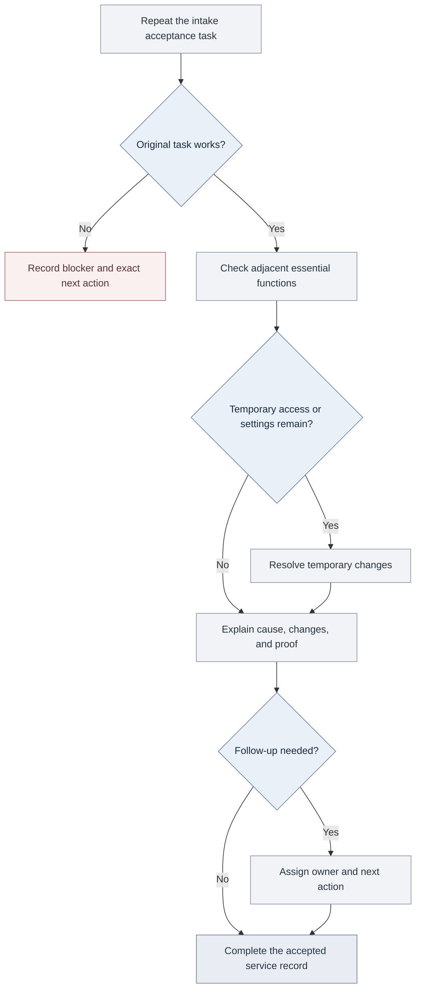

<a href="https://herbertofury.github.io/INTA/" title="Open INTA official download or service page" aria-label="Open INTA official download or service page" data-inta-brand="app-inta"></a> [INTA](https://github.com/Herbertofury/INTA/wiki) / [Decision desk](https://github.com/Herbertofury/INTA/wiki/Decision-Desk) · [Service map](https://github.com/Herbertofury/INTA/wiki/Service-Map) · [Playbooks](https://github.com/Herbertofury/INTA/wiki/Playbooks) · [Tools](https://github.com/Herbertofury/INTA/wiki/Tool-Directory) · [Methods](https://github.com/Herbertofury/INTA/wiki/Methods) · [Open hub](https://herbertofury.github.io/INTA/)

<a id="-close-a-repair-with-a-clear-client-handoff"></a>

# [Close a repair with a clear client handoff](https://github.com/Herbertofury/INTA/wiki/Job-client-handoff)

Turn completed technical work into proof the customer can use, with clean access and an actionable service record.

**Getting started** · Starter · 10–20 min · 15 steps

[Tools and useful links](#working-kit) · [Quick answer](#quick-answer) · [Next action](#next-action) · [Specific fixes](#specific-fixes) · [Decision route](#decision-route) · [Tools](#toolkit) · [Procedure](#walkthrough) · [Verification](#acceptance) · [Sources](#sources) · [Interactive checklist](https://herbertofury.github.io/INTA/#job/client-handoff)

**[Open the dedicated nine-step Checklist tab](https://herbertofury.github.io/INTA/#checklist)**

<a id="working-kit"></a>

## 🧰 Tools and links for this job

**[Open working view](https://herbertofury.github.io/INTA/#job/client-handoff)** · Keep the tool panel beside the instructions.

**First move:** Repeat the original requested task with the user before declaring the repair complete.

| Use this for | Official tool + exact action |
| --- | --- |
| Comparing a saved configuration with the changed version or checking a copied folder before accepting a repair or migration. | **<a href="https://winmerge.org/downloads/index.php" title="Open WinMerge official download or service page" aria-label="Open WinMerge official download or service page" data-inta-brand="winmerge"></a> [WinMerge](https://winmerge.org/)** · <a href="https://winmerge.org/downloads/index.php" title="Open WinMerge official download or service page" aria-label="Open WinMerge official download or service page" data-inta-brand="winmerge"></a> [Official page](https://winmerge.org/) · **<a href="https://www.microsoft.com/windows" title="Open Windows official download or service page" aria-label="Open Windows official download or service page" data-inta-brand="app-windows"></a> [Download Windows x64 portable · ZIP](https://github.com/WinMerge/winmerge/releases/download/v2.16.60/winmerge-2.16.60-x64-exe.zip)** |

### Close the case

| Open the exact resource | What to do there |
| --- | --- |
| **[Technician handoff template](https://github.com/Herbertofury/INTA/wiki/Technician-Handoff)** | Record cause, changes, tests, limits and ownership. |
| **[Service acceptance evidence](https://github.com/Herbertofury/INTA/wiki/Service-Evidence)** | Record observations rather than a generic “fixed” status. |

### Case handling

| Open the exact resource | What to do there |
| --- | --- |
| **[Public knowledge and private case material](https://github.com/Herbertofury/INTA/wiki/Knowledge-Standards)** | Keep credentials, recovery keys and customer evidence in the private record. |

<a id="quick-answer"></a>

## ⚡ Quick answer

<a id="quick-complete-a-handoff"></a>

### ✅ Finish the job and hand over

**Repeat the original user task and collect acceptance evidence before closing the case.**

1. Verify the requested outcome and record any remaining issue or agreed limitation.
2. Remove temporary access and case-only tools; record changes and private recovery references in the handoff template.
3. Confirm user acceptance, the next owner and any follow-up date.

**No extra download needed.** Follow the checklist below.

<a id="next-action"></a>

## 🧭 Match the symptom

| You see this | Do this next | You should get |
| --- | --- | --- |
| **The repair looks successful** | Have the user perform the original task and record its actual result, including required peripherals or shared access. | The acceptance evidence matches the requested outcome. |
| **Temporary remote access or one-case tools remain** | End temporary sessions, remove case-only access settings and confirm approved persistent management still works. | The device has no unplanned temporary access or monitoring. |
| **Some work is deferred or uncertain** | Record the exact remaining symptom, next action, owner and follow-up time. | Another technician can continue without repeating completed diagnostics. |
| **Recovery information must be handed over** | Store the approved private reference and confirm the authorized owner can retrieve it; do not paste the secret into the public wiki. | The recovery path is usable without exposing credentials. |

### ✅ Finish the job

- [ ] The user accepts the demonstrated result or explicitly recorded limitation.
- [ ] Changes, recovery references and follow-up ownership are complete.

**Change route when:** The original task still fails or acceptance cannot be demonstrated. · Temporary access or required recovery ownership remains unresolved.

### 🎯 Go straight to a specific fix

- **[Prove the repair under the real user account](#fix-handoff-admin-works-user-denied)** — The technician can open a repaired or restored file, but the normal user gets Access denied.
- **[Make recovery information retrievable](#fix-handoff-recovery-record-cannot-be-found)** — Encryption works, but the owner cannot locate the recovery record during handoff.
- **[Remove access that was only for this repair](#fix-handoff-temporary-support-app-persists)** — A temporary support program or unattended setting still starts after the case ends.

> [!NOTE]
> **Start here.** Return to the acceptance test written at intake. A completed checklist is useful only when the customer’s original task works.

<a id="decision-route"></a>

<a id="-choose-the-right-branch"></a>

## 🧭 Choose a route



**Route links:** [Continue this workflow](#walkthrough) · [Acceptance checks](#acceptance) · [Start here: triage any computer problem](intake-triage.md) · [Prove a backup can actually restore](backup-restore.md) · [Run a useful workstation maintenance visit](preventive-maintenance.md)

| Checkpoint | What to carry forward |
| --- | --- |
| **Before changing anything** | Return to the original acceptance test and retained rollback. |
| **Keep during the job** | Verified change summary, evidence, residual issues, and user response. |
| **Before handing back** | Acceptance recorded, temporary access closed, and follow-up owned. |

<a id="toolkit"></a>

<a id="-build-the-right-toolkit"></a>

## Recommended tools

Select a tool for the next diagnostic or repair step. Check its platform, access and licensing requirements before use.

| Tool / official page + download | Use it for | Platform & access | Documentation |
| --- | --- | --- | --- |
| **<a href="https://winmerge.org/downloads/index.php" title="Open WinMerge official download or service page" aria-label="Open WinMerge official download or service page" data-inta-brand="winmerge"></a> [WinMerge](https://winmerge.org/)** · <a href="https://winmerge.org/downloads/index.php" title="Open WinMerge official download or service page" aria-label="Open WinMerge official download or service page" data-inta-brand="winmerge"></a> [Official page](https://winmerge.org/) · **<a href="https://www.microsoft.com/windows" title="Open Windows official download or service page" aria-label="Open Windows official download or service page" data-inta-brand="app-windows"></a> [Download Windows x64 portable · ZIP](https://github.com/WinMerge/winmerge/releases/download/v2.16.60/winmerge-2.16.60-x64-exe.zip)** | Comparing a saved configuration with the changed version or checking a copied folder before accepting a repair or migration. | <a href="https://www.microsoft.com/windows" title="Open Windows official download or service page" aria-label="Open Windows official download or service page" data-inta-brand="app-windows"></a> [Windows](https://www.microsoft.com/windows); Free and open source under GPL-2.0-or-later | <a href="https://winmerge.org/downloads/index.php" title="Open WinMerge official download or service page" aria-label="Open WinMerge official download or service page" data-inta-brand="winmerge"></a> [Open guide](https://manual.winmerge.org/en/) |

<a id="walkthrough"></a>

<a id="-work-the-case"></a>

## Procedure

Work in order, record the result of each step, and change route when the evidence calls for it.

<a id="step-closeout-protect"></a>

### 01 · Protect data and establish the baseline

- [ ] Record the original failure and acceptance test. Confirm a recent backup and open a sample restored file. If storage may be failing, stop writes, updates, and scans; stage recovery before maintenance.

- [Backup and restore](backup-restore.md)
- [Failing drive triage](failing-drive.md)

<a id="step-closeout-threats"></a>

### 02 · Contain and remove malware

- [ ] If compromise is active or suspected, isolate first and follow the incident process. Review the active antivirus, run the appropriate scan, verify disposition, and escalate recurring detections. Fix browser notification spam at its exact origin, not by wiping the browser.

- [Malware playbook](malware-removal.md)
- [Ransomware response](ransomware-response.md)
- <a href="https://support.microsoft.com/en-us/windows/security/windows-security/windows-security-app-overview" title="Open Windows Security official download or service page" aria-label="Open Windows Security official download or service page" data-inta-brand="app-windows-security"></a> [Windows Security](https://support.microsoft.com/en-us/defender/troubleshoot-problems-with-detecting-and-removing-malware)

<a id="step-closeout-updates"></a>

### 03 · Patch <a href="https://www.microsoft.com/windows" title="Open Windows official download or service page" aria-label="Open Windows official download or service page" data-inta-brand="app-windows"></a> [Windows](https://www.microsoft.com/windows) and the apps in use

- [ ] Once the machine is safe to use, apply supported <a href="https://www.microsoft.com/windows" title="Open Windows official download or service page" aria-label="Open Windows official download or service page" data-inta-brand="app-windows"></a> [Windows](https://www.microsoft.com/windows) and approved app security updates. Save work and restart as needed. Recheck update history, pending restart, and the important apps. Avoid forcing an unsupported <a href="https://www.microsoft.com/windows" title="Open Windows official download or service page" aria-label="Open Windows official download or service page" data-inta-brand="app-windows"></a> [Windows](https://www.microsoft.com/windows) upgrade.

- <a href="https://learn.microsoft.com/en-us/windows/deployment/update/" title="Open Windows Update official download or service page" aria-label="Open Windows Update official download or service page" data-inta-brand="app-windows-update"></a> [Windows Update playbook](windows-update.md)
- <a href="https://github.com/microsoft/winget-cli/releases/latest" title="Open Windows Package Manager (WinGet) official download or service page" aria-label="Open Windows Package Manager (WinGet) official download or service page" data-inta-brand="web-app-winget"></a> [WinGet](https://learn.microsoft.com/en-us/windows/package-manager/winget/) · <a href="https://github.com/microsoft/winget-cli/releases/latest" title="Open Windows Package Manager (WinGet) official download or service page" aria-label="Open Windows Package Manager (WinGet) official download or service page" data-inta-brand="web-app-winget"></a> [Official page](https://learn.microsoft.com/en-us/windows/package-manager/winget/) · **<a href="https://github.com/microsoft/winget-cli/releases/latest" title="Open Windows Package Manager (WinGet) official download or service page" aria-label="Open Windows Package Manager (WinGet) official download or service page" data-inta-brand="web-app-winget"></a> [Download App Installer · MSIXBUNDLE](https://github.com/microsoft/winget-cli/releases/download/v1.29.380/Microsoft.DesktopAppInstaller_8wekyb3d8bbwe.msixbundle)**

<a id="step-closeout-drivers"></a>

### 04 · Review drivers and BIOS / UEFI

- [ ] Update drivers only when applicable, from <a href="https://learn.microsoft.com/en-us/windows/deployment/update/" title="Open Windows Update official download or service page" aria-label="Open Windows Update official download or service page" data-inta-brand="app-windows-update"></a> [Windows Update](https://learn.microsoft.com/en-us/windows/deployment/update/) or the exact device OEM. Flash firmware only for a relevant fix, security advisory, or component requirement. Match model and revision, use stable AC power, confirm recovery key availability and follow the OEM encryption procedure. Verify boot, target version, and encryption afterward.

- <a href="https://support.microsoft.com/en-us/windows/hardware/drivers/update-drivers-through-device-manager-in-windows" title="Open Official OEM driver and firmware portals official download or service page" aria-label="Open Official OEM driver and firmware portals official download or service page" data-inta-brand="oem-drivers"></a> [OEM driver support](https://support.microsoft.com/en-us/windows/hardware/drivers/update-drivers-through-device-manager-in-windows) · <a href="https://support.microsoft.com/en-us/windows/hardware/drivers/update-drivers-through-device-manager-in-windows" title="Open Official OEM driver and firmware portals official download or service page" aria-label="Open Official OEM driver and firmware portals official download or service page" data-inta-brand="oem-drivers"></a> [Official page](https://support.microsoft.com/en-us/windows/hardware/drivers/update-drivers-through-device-manager-in-windows) · **<a href="https://support.microsoft.com/en-us/windows/hardware/drivers/update-drivers-through-device-manager-in-windows" title="Open Official OEM driver and firmware portals official download or service page" aria-label="Open Official OEM driver and firmware portals official download or service page" data-inta-brand="oem-drivers"></a> [Find the correct driver source](https://support.microsoft.com/en-us/windows/hardware/drivers/update-drivers-through-device-manager-in-windows)**
- <a href="https://support.microsoft.com/" title="Open support.microsoft.com official download or service page" aria-label="Open support.microsoft.com official download or service page" data-inta-brand="site-support-microsoft-com"></a> [Driver update guidance](https://support.microsoft.com/en-gb/windows/hardware/drivers/automatically-get-recommended-and-updated-hardware-drivers)
- <a href="https://learn.microsoft.com/en-us/windows/security/operating-system-security/data-protection/bitlocker/" title="Open BitLocker official download or service page" aria-label="Open BitLocker official download or service page" data-inta-brand="app-bitlocker"></a> [BitLocker and firmware](https://learn.microsoft.com/en-us/troubleshoot/windows-client/windows-security/suspend-bitlocker-protection-non-Microsoft-updates)

<a id="step-closeout-tune"></a>

### 05 · Optimize and verify a measurable gain

- [ ] Measure the original bottleneck. Make targeted, reversible changes; retest the same workload. Free only approved space and preserve user files, security controls, and rollback data. Make minimum space for updates earlier only when required.

- [Performance playbook](slow-pc.md)
- <a href="https://mangodisk.app/download" title="Open MangoDisk official download or service page" aria-label="Open MangoDisk official download or service page" data-inta-brand="app-mangodisk"></a> [MangoDisk official page](https://mangodisk.app/)
- <a href="https://www.microsoft.com/windows" title="Open Windows official download or service page" aria-label="Open Windows official download or service page" data-inta-brand="app-windows"></a> [Download Windows installer · EXE](https://github.com/harry0703/MangoDisk/releases/download/v2.1.1/MangoDisk-2.1.1-windows.exe)

<a id="step-closeout-verify"></a>

### 06 · Restart and prove the original fix

- [ ] Retest the original task under the user’s normal account. Check boot, network, required peripherals and apps, backup access, and the active antivirus. Record the evidence, not just that a command ran.

- [Network checks](network-dns.md)
- [Printer checks](printer-repair.md)
- <a href="https://support.microsoft.com/" title="Open support.microsoft.com official download or service page" aria-label="Open support.microsoft.com official download or service page" data-inta-brand="site-support-microsoft-com"></a> [Recovery options](https://support.microsoft.com/en-us/windows/experience/backup-recovery/recovery-options-in-windows)

**<a href="https://github.com/PowerShell/PowerShell/releases/latest" title="Open PowerShell official download or service page" aria-label="Open PowerShell official download or service page" data-inta-brand="powershell"></a> [PowerShell](https://learn.microsoft.com/en-us/powershell/) · Collect OS/build and recent hotfix inventory to support a technician handoff and maintenance record.:**

```text
Get-ComputerInfo | Select-Object WindowsProductName,WindowsVersion,OsBuildNumber,OsArchitecture,CsSystemType
Get-HotFix | Sort-Object InstalledOn -Descending | Select-Object -First 10 HotFixID,InstalledOn,Description
```

> **Before running:** Read-only inventory. Keep customer names, serials, installed-software lists and raw logs in the approved private ticket.

**Official command reference:** <a href="https://www.microsoft.com/" title="Open microsoft.com official download or service page" aria-label="Open microsoft.com official download or service page" data-inta-brand="site-www-microsoft-com"></a> [Microsoft Get-ComputerInfo documentation](https://learn.microsoft.com/en-us/powershell/module/microsoft.powershell.management/get-computerinfo)

**Command legend:** <a href="https://www.microsoft.com/" title="Open microsoft.com official download or service page" aria-label="Open microsoft.com official download or service page" data-inta-brand="site-www-microsoft-com"></a> [Microsoft Get-ComputerInfo documentation](https://learn.microsoft.com/en-us/powershell/module/microsoft.powershell.management/get-computerinfo) · [Return to the step context](#step-closeout-verify).

<a id="step-closeout-clean"></a>

### 07 · Remove job tools and temporary access

- [ ] Use <a href="https://herbertofury.github.io/INTA/" title="Open INTA official download or service page" aria-label="Open INTA official download or service page" data-inta-brand="app-inta"></a> [INTA](https://herbertofury.github.io/INTA/) Clean Handoff. Disconnect remote sessions and retire job-owned access, tools and files only. Keep the approved active antivirus, earlier apps, verified settings and repairs, and client-owned outputs. Recheck protection afterward.

- [Remote support playbook](remote-support.md)

<a id="step-closeout-billing"></a>

### 08 · Record hours and draft the invoice

- [ ] Confirm billable time, agreed rate and any excluded waiting time. Use the timer from a separate device for BIOS or reboot work, save the editable draft privately, and review the invoice rather than sending automatically.

- <a href="https://www.kimai.org/en/download.html" title="Open Kimai official download or service page" aria-label="Open Kimai official download or service page" data-inta-brand="app-kimai"></a> [Kimai official page](https://www.kimai.org/)
- <a href="https://www.kimai.org/en/download.html" title="Open Kimai official download or service page" aria-label="Open Kimai official download or service page" data-inta-brand="app-kimai"></a> [Self-hosted setup](https://www.kimai.org/en/download.html)
- <a href="https://www.libreoffice.org/download/" title="Open LibreOffice official download or service page" aria-label="Open LibreOffice official download or service page" data-inta-brand="app-libreoffice"></a> [LibreOffice official page](https://www.libreoffice.org/download/)
- <a href="https://www.microsoft.com/windows" title="Open Windows official download or service page" aria-label="Open Windows official download or service page" data-inta-brand="app-windows"></a> [Download Windows x64 · MSI](https://download.documentfoundation.org/libreoffice/stable/26.8.3/win/x86_64/LibreOffice_26.8.3_Win_x86-64.msi)

<a id="step-closeout-handoff"></a>

### 09 · Hand back the computer and record what remains

- [ ] Explain what changed, what passed, and anything deferred. Record versions, rollback, evidence, and who owns the next action in the private ticket. Do not record passwords or recovery keys here.

- [Private handoff template](https://github.com/Herbertofury/INTA/wiki/Technician-Handoff)

<a id="step-01"></a>

<a id="01--retest-the-original-job-with-the-user"></a>

### 10 · Retest the original job with the user

- [ ] Have the user repeat the failing action with real, representative data. Compare the result with the intake baseline. Record unresolved symptoms honestly rather than hiding them behind a successful diagnostic command.

<a id="step-02"></a>

<a id="02--check-adjacent-essentials"></a>

### 11 · Check adjacent essentials

- [ ] Verify restart, network, email, printing, security health, backup state, and any feature touched by the repair. Confirm restored files open and that no temporary setting changed a normal workflow.

<a id="step-03"></a>

<a id="03--remove-temporary-access-and-artifacts"></a>

### 12 · Remove temporary access and artifacts

- [ ] End support sessions, remove case-specific temporary agents if appropriate, and return diagnostic logging to the intended level. Keep required evidence in the private service record; remove credentials and sensitive captures from temporary work areas according to the agreed handling process.

<a id="step-04"></a>

<a id="04--explain-the-result-in-plain-language"></a>

### 13 · Explain the result in plain language

- [ ] Tell the user what caused the problem, what changed, and what they should notice. Distinguish confirmed causes from likely causes. Include any action they must take, such as signing in, storing a recovery key, or scheduling hardware replacement.

<a id="step-05"></a>

<a id="05--record-rollback-and-follow-up"></a>

### 14 · Record rollback and follow-up

- [ ] Document changed versions/settings, recovery images or backups, tested tasks, remaining issues, and who owns them. Give the next technician the exact next action and the failed routes that should not be repeated.

<a id="step-06"></a>

<a id="06--complete-the-private-handoff-record"></a>

### 15 · Complete the private handoff record

- [ ] Use the intake/handoff template linked from this wiki. Keep customer names, serials, network details, credentials, and case evidence in the approved private system. The public wiki holds reusable methods only.

<a id="acceptance"></a>

<a id="-prove-the-result"></a>

## Verification

- [ ] The user accepts the tested result or an explicit remaining-work plan.
- [ ] Temporary access is closed and the normal configuration is restored.
- [ ] The service record contains changes, proof, rollback, and next actions.

> [!WARNING]
> **Pause this route and escalate when:**
> - The original symptom still reproduces without a clear next step.
> - Temporary access or sensitive evidence is left in an uncontrolled location.

<a id="specific-fixes"></a>

## 🎯 Specific fixes

Choose the case that matches the evidence. Each case gives a first action, a short procedure and a result to prove.

<a id="fix-handoff-admin-works-user-denied"></a>

### Prove the repair under the real user account

**Use when:** The technician can open a repaired or restored file, but the normal user gets Access denied.

**Start here:** Reproduce the exact task under the intended standard-user account.

**<a href="https://github.com/PowerShell/PowerShell/releases/latest" title="Open PowerShell official download or service page" aria-label="Open PowerShell official download or service page" data-inta-brand="powershell"></a> [PowerShell](https://learn.microsoft.com/en-us/powershell/)** · <a href="https://github.com/PowerShell/PowerShell/releases/latest" title="Open PowerShell official download or service page" aria-label="Open PowerShell official download or service page" data-inta-brand="powershell"></a> [Official page](https://learn.microsoft.com/en-us/powershell/) · **<a href="https://www.microsoft.com/windows" title="Open Windows official download or service page" aria-label="Open Windows official download or service page" data-inta-brand="app-windows"></a> [Download Windows x64 portable · ZIP](https://github.com/PowerShell/PowerShell/releases/download/v7.7.0/PowerShell-7.7.0-win-x64.zip)**

1. Compare the intended path and file ownership/permissions with a working equivalent; use a read-only permissions view before changing ACLs.
2. Correct only the identified ownership or access issue through the approved application/share/file owner.
3. Have the user reopen, edit and save an agreed test item without elevation.

**Prove it worked:** The user’s actual workflow succeeds with the intended limited permissions.

**If this does not resolve it:** Do not grant Everyone full control or make the user an administrator to hide a permission fault.

**Official evidence:** <a href="https://learn.microsoft.com/en-us/windows-server/" title="Open Windows Server official download or service page" aria-label="Open Windows Server official download or service page" data-inta-brand="app-windows-server"></a> [Source 1](https://learn.microsoft.com/en-us/windows-server/administration/windows-commands/icacls) · Reviewed 2026-11-26

[Back to specific fixes](#specific-fixes) · [Full procedure](#walkthrough)

<a id="fix-handoff-recovery-record-cannot-be-found"></a>

### Make recovery information retrievable

**Use when:** Encryption works, but the owner cannot locate the recovery record during handoff.

**Start here:** Identify the approved account or organization store that should hold the recovery key.

1. Use a separate trusted device to verify that the authorized owner can reach the relevant recovery record and match the device/key identity.
2. If the key is not backed up, follow the supported key-backup procedure using the approved destination.
3. Record the private retrieval reference and responsible owner without copying the secret into the public wiki or ordinary handoff text.

**Prove it worked:** The authorized owner can retrieve the correct recovery material independently of the repaired PC.

**If this does not resolve it:** If retrieval cannot be demonstrated, leave that recovery gap explicitly open rather than claiming the machine is fully recoverable.

**Official evidence:** <a href="https://support.microsoft.com/" title="Open support.microsoft.com official download or service page" aria-label="Open support.microsoft.com official download or service page" data-inta-brand="site-support-microsoft-com"></a> [Source 1](https://support.microsoft.com/en-us/windows/security/encryption/back-up-your-bitlocker-recovery-key) · <a href="https://support.microsoft.com/" title="Open support.microsoft.com official download or service page" aria-label="Open support.microsoft.com official download or service page" data-inta-brand="site-support-microsoft-com"></a> [Source 2](https://support.microsoft.com/en-us/windows/security/encryption/find-your-bitlocker-recovery-key) · Reviewed 2026-11-26

[Back to specific fixes](#specific-fixes) · [Full procedure](#walkthrough)

<a id="fix-handoff-temporary-support-app-persists"></a>

### Remove access that was only for this repair

**Use when:** A temporary support program or unattended setting still starts after the case ends.

**Start here:** Compare the current installation/access state with the agreed end state for this device.

**<a href="https://github.com/rustdesk/rustdesk/releases/latest" title="Open RustDesk official download or service page" aria-label="Open RustDesk official download or service page" data-inta-brand="rustdesk"></a> [RustDesk](https://rustdesk.com/)** · <a href="https://github.com/rustdesk/rustdesk/releases/latest" title="Open RustDesk official download or service page" aria-label="Open RustDesk official download or service page" data-inta-brand="rustdesk"></a> [Official page](https://rustdesk.com/) · **<a href="https://www.microsoft.com/windows" title="Open Windows official download or service page" aria-label="Open Windows official download or service page" data-inta-brand="app-windows"></a> [Download Windows x64 · EXE](https://github.com/rustdesk/rustdesk/releases/download/1.5.3/rustdesk-1.5.3-x86_64.exe)**

**<a href="https://github.com/Ylianst/MeshCentral" title="Open MeshCentral official download or service page" aria-label="Open MeshCentral official download or service page" data-inta-brand="meshcentral"></a> [MeshCentral](https://meshcentral.com/)** · <a href="https://github.com/Ylianst/MeshCentral" title="Open MeshCentral official download or service page" aria-label="Open MeshCentral official download or service page" data-inta-brand="meshcentral"></a> [Official page](https://meshcentral.com/) · **<a href="https://github.com/Ylianst/MeshCentral" title="Open MeshCentral official download or service page" aria-label="Open MeshCentral official download or service page" data-inta-brand="meshcentral"></a> [Open server installation instructions](https://github.com/Ylianst/MeshCentral#installation)**

1. End all case-only sessions and remove the temporary unattended credential or enrollment through that product’s supported controls.
2. Uninstall a case-only client when appropriate; keep the organization’s approved persistent management agent intact.
3. Restart if required and verify that the temporary access is gone while approved support and the repaired task still work.

**Prove it worked:** Remaining access has an explicit owner and purpose; one-case access no longer functions.

**If this does not resolve it:** If the temporary and managed deployments cannot be distinguished, involve the management owner before removing agents or services.

**Official evidence:** <a href="https://support.microsoft.com/" title="Open support.microsoft.com official download or service page" aria-label="Open support.microsoft.com official download or service page" data-inta-brand="site-support-microsoft-com"></a> [Source 1](https://support.microsoft.com/en-us/windows/apps/uninstall-or-remove-apps-and-programs-in-windows) · <a href="https://rustdesk.com/" title="Open rustdesk.com official download or service page" aria-label="Open rustdesk.com official download or service page" data-inta-brand="site-rustdesk-com"></a> [Source 2](https://rustdesk.com/docs/en/client/) · <a href="https://github.com/Ylianst/MeshCentral" title="Open MeshCentral official download or service page" aria-label="Open MeshCentral official download or service page" data-inta-brand="meshcentral"></a> [Source 3](https://github.com/Ylianst/MeshCentral) · Reviewed 2026-11-26

[Back to specific fixes](#specific-fixes) · [Full procedure](#walkthrough)


<a id="-continue-with-the-evidence"></a>

## Related playbooks

| Next playbook | What it resolves |
| --- | --- |
| [Start here: triage any computer problem](intake-triage.md) | Turn a vague symptom into a clear next action, a protected data set, and a useful service record. |
| [Prove a backup can actually restore](backup-restore.md) | Validate recovery credentials, data integrity, application usability, and recovery time. |
| [Run a useful workstation maintenance visit](preventive-maintenance.md) | Check security, updates, hardware, backups, and usability without unnecessary cleanup rituals. |

<a id="sources"></a>

<a id="-source-trail"></a>

## Official sources

- <a href="https://www.microsoft.com/" title="Open microsoft.com official download or service page" aria-label="Open microsoft.com official download or service page" data-inta-brand="site-www-microsoft-com"></a> <a href="https://www.microsoft.com/windows" title="Open Windows official download or service page" aria-label="Open Windows official download or service page" data-inta-brand="app-windows"></a> [Microsoft: recovery options in Windows](https://support.microsoft.com/en-us/windows/experience/backup-recovery/recovery-options-in-windows)

Reviewed **2026-11-26**. Timing is a planning range. A successful command is evidence about that operation; acceptance belongs to the user’s original task.


---

Editorial review: **2026-11-26** · [Review standard](https://github.com/Herbertofury/INTA/wiki/Knowledge-Standards) · [Suggest a correction](https://github.com/Herbertofury/INTA/issues/new/choose)

[← All playbooks](README.md) · [Live Wiki](https://github.com/Herbertofury/INTA/wiki) · [Contribution guide](https://github.com/Herbertofury/INTA/blob/main/CONTRIBUTING.md)
