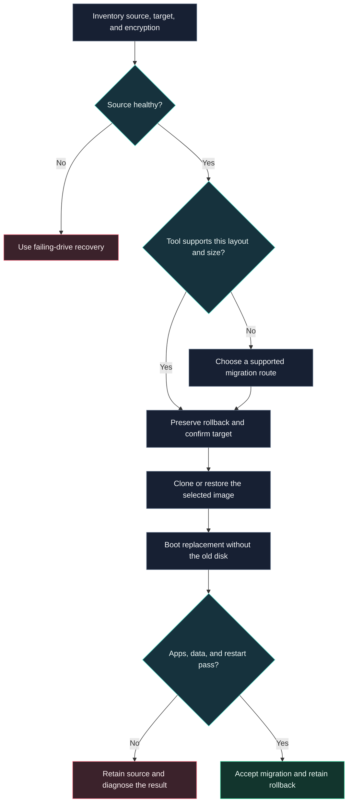

[🏠 Home](https://github.com/Herbertofury/INTA/wiki) · [🧭 Decision desk](https://github.com/Herbertofury/INTA/wiki/Decision-Desk) · [📚 Playbooks](https://github.com/Herbertofury/INTA/wiki/Playbooks) · [🧰 Tool directory](https://github.com/Herbertofury/INTA/wiki/Tool-Directory) · [✨ Open interactive hub](https://herbertofury.github.io/INTA/)

# ↗️ [Clone a healthy system or migrate to a new SSD](https://github.com/Herbertofury/INTA/wiki/Job-disk-migration)

Move a working system with clear source/destination control and a rollback copy.

| Work area | Experience | Plan your time | Workflow |
| --- | --- | --- | --- |
| Storage & recovery | Intermediate | 45–180 min | 6 steps + acceptance |

**[▶ Open the interactive checklist](https://herbertofury.github.io/INTA/#job/disk-migration)** · [Decision route](#decision-route) · [Toolkit](#toolkit) · [Walkthrough](#walkthrough) · [Acceptance](#acceptance) · [Sources](#sources)

> [!TIP]
> **Your starting move:** Verify the source drive is healthy. A failing drive needs the recovery workflow instead of an ordinary clone.

## 🧭 Choose the right branch

**Diagram routes:** [Continue this workflow](#walkthrough) · [Acceptance checks](#acceptance) · [Rescue data from a failing or unreadable drive](failing-drive.md) · [Prove a backup can actually restore](backup-restore.md) · [Set up a dependable new workstation](new-pc.md) · [Close a repair with a clear client handoff](client-handoff.md)

| Checkpoint | What to carry forward |
| --- | --- |
| **Before changing anything** | Keep the healthy source and a verified independent backup. |
| **Keep during the job** | Source/target identities, supported layout, copy log, and boot device. |
| **Before handing back** | Replacement boots alone and the business workload passes. |

## 🧰 Build the right toolkit

Choose the tools that answer the case’s next question. Opening a tool is a separate decision from changing the customer’s system.

| Tool / official download | Use it for | Platform & access | Documentation |
| --- | --- | --- | --- |
| [Rescuezilla](https://rescuezilla.com/download) | A visual bare-metal backup or restore workflow at the bench. | Bootable PC; Free / open source | [Open guide](https://rescuezilla.com/help) |
| [Clonezilla](https://clonezilla.org/downloads.php) | Capturing or restoring a supported disk image with a repeatable procedure. | Bootable PC, [Linux](https://www.kernel.org/); Free / open source | [Open guide](https://clonezilla.org/clonezilla-live-doc.php) |
| [CrystalDiskInfo](https://crystalmark.info/en/download/) | First-pass HDD and SSD health inspection in [Windows](https://www.microsoft.com/windows). | [Windows](https://www.microsoft.com/windows); Free / open source | [Open guide](https://crystalmark.info/en/software/crystaldiskinfo/) |
| [WinGet](https://github.com/microsoft/winget-cli/releases/latest) | Repeatable application setup and individually reviewed updates. | [Windows](https://www.microsoft.com/windows); Free / open source | [Open guide](https://learn.microsoft.com/en-us/windows/package-manager/winget/) |

## 🪜 Work the case

Work in order, record the result of each step, and change route when the evidence calls for it.

### 01 · Inventory before the move

- [ ] Record source and destination model/serial/capacity, firmware mode, partition layout, encryption, and the applications that must survive. Confirm the chosen tool supports the filesystem and intended target size. Shrinking to a smaller drive needs a specifically supported procedure.

### 02 · Create an independent rollback

- [ ] Make a verified file backup and save recovery-key access. Export application inventory and record licenses or sign-in requirements through the client’s approved process. Keep the old drive intact until the new system is accepted.

### 03 · Prepare the destination and media

- [ ] Use current trusted rescue media and connect stable power. Disconnect unrelated removable storage where practical. Match source and target by serial number, not only the drive letter or position in a list; cloning overwrites the selected target.

### 04 · Perform and verify the copy

- [ ] Use the imaging application’s supported clone or image/restore workflow. Review the source, target, partition plan, and confirmation screen before committing. Keep the operation log and use the tool’s image verification feature when creating an image.

### 05 · Boot the replacement on its own

- [ ] For the first boot, disconnect or otherwise isolate the original system disk so you can prove the replacement is the actual boot device. Resolve any driver or boot-mode issue through supported vendor guidance. Check encryption state after the migration.

### 06 · Validate applications and rollback readiness

- [ ] Test the real business files, sign-in, network, printers, backup, and restart. Confirm usable capacity and partition layout. Retain the original drive or image for the agreed acceptance window; erase it only through a separately authorized disposal task.

## ✅ Prove the result

- [ ] The new drive boots independently.
- [ ] Required data, applications, peripherals, and backup pass the client’s tests.
- [ ] The old source remains usable as a rollback until acceptance.

> [!WARNING]
> **Pause this route and escalate when:**
> - The source exhibits I/O errors or unhealthy behavior.
> - The selected tool cannot support the target size or partition/encryption layout.

## 🔀 Continue with the evidence

| Next playbook | What it resolves |
| --- | --- |
| [Rescue data from a failing or unreadable drive](failing-drive.md) | Preserve the source, create a recoverable image, and perform recovery on a copy. |
| [Prove a backup can actually restore](backup-restore.md) | Validate recovery credentials, data integrity, application usability, and recovery time. |
| [Set up a dependable new workstation](new-pc.md) | Build a usable, recoverable workstation around the employee’s actual job. |
| [Close a repair with a clear client handoff](client-handoff.md) | Turn completed technical work into proof the customer can use, with clean access and an actionable service record. |

Found a reusable improvement? [Contribute the correction](https://github.com/Herbertofury/INTA/wiki/Contribute) and include the test that proved it.

## 🔎 Source trail

Official references and editorial review

- [Clonezilla: imaging and clone walkthroughs](https://clonezilla.org/clonezilla-live-doc.php)
- [Microsoft: recovery options in Windows](https://support.microsoft.com/en-us/windows/experience/backup-recovery/recovery-options-in-windows)
- [Microsoft: WinGet export](https://learn.microsoft.com/en-us/windows/package-manager/winget/export)

Reviewed **2026-11-26**. Timing is a planning range. A successful command is evidence about that operation; acceptance belongs to the user’s original task.

---

**Source review: 2026-11-26.** Guidance review and tool release versions are separate. [Report a correction](https://github.com/Herbertofury/INTA/issues/new/choose) · [How we maintain this guide](https://github.com/Herbertofury/INTA/wiki/Knowledge-Standards)

[← All playbooks](README.md) · [Live Wiki](https://github.com/Herbertofury/INTA/wiki) · [Contribution guide](https://github.com/Herbertofury/INTA/blob/main/CONTRIBUTING.md)
