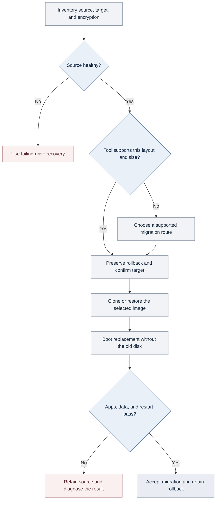

[INTA](https://github.com/Herbertofury/INTA/wiki) / [Decision desk](https://github.com/Herbertofury/INTA/wiki/Decision-Desk) · [Playbooks](https://github.com/Herbertofury/INTA/wiki/Playbooks) · [Tools](https://github.com/Herbertofury/INTA/wiki/Tool-Directory) · [Methods](https://github.com/Herbertofury/INTA/wiki/Methods) · [Open hub](https://herbertofury.github.io/INTA/)

# [Clone a healthy system or migrate to a new SSD](https://github.com/Herbertofury/INTA/wiki/Job-disk-migration)

Move a working system with clear source/destination control and a rollback copy.

**Storage & recovery** · Intermediate · 45–180 min · 6 steps

[Tools and useful links](#working-kit) · [Quick answer](#quick-answer) · [Next action](#next-action) · [Decision route](#decision-route) · [Tools](#toolkit) · [Procedure](#walkthrough) · [Verification](#acceptance) · [Sources](#sources) · [Interactive checklist](https://herbertofury.github.io/INTA/#job/disk-migration)

## 🧰 Tools and links for this job

**[Open working view](https://herbertofury.github.io/INTA/#job/disk-migration)** · Keep the tool panel beside the instructions.

**First move:** Identify every disk by model, serial and capacity. Confirm the source is healthy, backed up and the chosen destination may be overwritten.

| Use this for | Official tool + exact action |
| --- | --- |
| Graphical image or clone workflow for healthy storage. | **[Rescuezilla](https://rescuezilla.com/)** · [Official page](https://rescuezilla.com/) · **[Download x64 rescue image · ISO](https://github.com/rescuezilla/rescuezilla/releases/download/2.6.2/rescuezilla-2.6.2-64bit.resolute.iso)** |
| Copy approved file trees with an inspectable log. | **[Robocopy](https://learn.microsoft.com/en-us/windows-server/administration/windows-commands/robocopy)** · [Official page](https://learn.microsoft.com/en-us/windows-server/administration/windows-commands/robocopy) · **[Open built-in copy instructions](https://learn.microsoft.com/en-us/windows-server/administration/windows-commands/robocopy)** |
| Inventory and reapply approved application packages. | **[WinGet](https://learn.microsoft.com/en-us/windows/package-manager/winget/)** · [Official page](https://learn.microsoft.com/en-us/windows/package-manager/winget/) · **[Download App Installer · MSIXBUNDLE](https://github.com/microsoft/winget-cli/releases/download/v1.29.380/Microsoft.DesktopAppInstaller_8wekyb3d8bbwe.msixbundle)** |

### Choose the move

| Open the exact resource | What to do there |
| --- | --- |
| **[Rescuezilla migration limitations](https://rescuezilla.com/help)** | Plan smaller-disk restores and preserve an unmodified backup. |

### File migration

| Open the exact resource | What to do there |
| --- | --- |
| **[Robocopy reference](https://learn.microsoft.com/en-us/windows-server/administration/windows-commands/robocopy)** | Review source, destination and copy flags before execution. |

### Application setup

| Open the exact resource | What to do there |
| --- | --- |
| **[WinGet export](https://learn.microsoft.com/en-us/windows/package-manager/winget/export)** | Export supported application identities for later review. |
| **[WinGet import](https://learn.microsoft.com/en-us/windows/package-manager/winget/import)** | Review and install approved packages; user data is separate. |

## ⚡ Quick answer

### 🔁 Clone or move a drive

**Confirm a healthy source, a verified backup and a destination large enough for the selected clone or restore.**

1. Boot [Rescuezilla](https://rescuezilla.com/) from a separate USB and identify every source and destination by model, serial and size.
2. Choose the intended clone or image operation; confirm the destination may be overwritten before starting.
3. Boot the destination alone and verify files, applications, encryption recovery and backup operation.

**[Rescuezilla](https://rescuezilla.com/)** · [Official page](https://rescuezilla.com/) · **[Download x64 rescue image · ISO](https://github.com/rescuezilla/rescuezilla/releases/download/2.6.2/rescuezilla-2.6.2-64bit.resolute.iso)**

## 🧭 Match the symptom

| You see this | Do this next | You should get |
| --- | --- | --- |
| **The source shows read errors or instability** | Change route to [image-first recovery](https://github.com/Herbertofury/INTA/wiki/Job-failing-drive) rather than treating the operation as routine migration. | The source is preserved before intensive copy or resize work. |
| **The destination is smaller than the source layout** | Check the tool’s supported geometry and create a rollback image before any separately planned resize. | The target layout fits by evidence, not merely by free-space assumptions. |
| **A complete healthy drive must be moved** | Boot [Rescuezilla](https://rescuezilla.com/), verify source/destination identities, then confirm the deliberate clone or restore operation. | The operation completes and the destination can be booted by itself. |
| **Only approved files need moving** | Choose exact source and destination folders, review [Robocopy](https://learn.microsoft.com/en-us/windows-server/administration/windows-commands/robocopy) flags and retain its result log; do not use a mirror/delete option by default. | Expected files, timestamps and access are verified at the new location. |
| **The copied system is ready for release** | Boot with the old disk disconnected and test sign-in, applications, encryption recovery and backup. | The new system works independently and the old disk remains the agreed rollback copy. |

### ✅ Finish the job

- [ ] The destination boots independently or the copied file set passes application checks.
- [ ] Required access, recovery material and backup work on the destination.

**Change route when:** Source/destination identity or erase permission is ambiguous. · Storage failure or incompatible target geometry makes the planned migration unsafe.

> [!NOTE]
> **Start here.** Verify the source drive is healthy. A failing drive needs the recovery workflow instead of an ordinary clone.

## 🧭 Choose a route

**Route links:** [Continue this workflow](#walkthrough) · [Acceptance checks](#acceptance) · [Rescue data from a failing or unreadable drive](failing-drive.md) · [Prove a backup can actually restore](backup-restore.md) · [Set up a dependable new workstation](new-pc.md) · [Close a repair with a clear client handoff](client-handoff.md)

| Checkpoint | What to carry forward |
| --- | --- |
| **Before changing anything** | Keep the healthy source and a verified independent backup. |
| **Keep during the job** | Source/target identities, supported layout, copy log, and boot device. |
| **Before handing back** | Replacement boots alone and the business workload passes. |

## Recommended tools

Select a tool for the next diagnostic or repair step. Check its platform, access and licensing requirements before use.

| Tool / official page + download | Use it for | Platform & access | Documentation |
| --- | --- | --- | --- |
| **[Rescuezilla](https://rescuezilla.com/)** · [Official page](https://rescuezilla.com/) · **[Download x64 rescue image · ISO](https://github.com/rescuezilla/rescuezilla/releases/download/2.6.2/rescuezilla-2.6.2-64bit.resolute.iso)** | Graphical image or clone workflow for healthy storage. | Bootable PC; Free / open source | [Open guide](https://rescuezilla.com/help) |
| **[Robocopy](https://learn.microsoft.com/en-us/windows-server/administration/windows-commands/robocopy)** · [Official page](https://learn.microsoft.com/en-us/windows-server/administration/windows-commands/robocopy) · **[Open built-in copy instructions](https://learn.microsoft.com/en-us/windows-server/administration/windows-commands/robocopy)** | Copy approved file trees with an inspectable log. | [Windows](https://www.microsoft.com/windows); Included with [Windows](https://www.microsoft.com/windows) | [Open guide](https://learn.microsoft.com/en-us/windows-server/administration/windows-commands/robocopy) |
| **[WinGet](https://learn.microsoft.com/en-us/windows/package-manager/winget/)** · [Official page](https://learn.microsoft.com/en-us/windows/package-manager/winget/) · **[Download App Installer · MSIXBUNDLE](https://github.com/microsoft/winget-cli/releases/download/v1.29.380/Microsoft.DesktopAppInstaller_8wekyb3d8bbwe.msixbundle)** | Inventory and reapply approved application packages. | [Windows](https://www.microsoft.com/windows); Free / open source | [Open guide](https://learn.microsoft.com/en-us/windows/package-manager/winget/) |
| **[Clonezilla](https://clonezilla.org/)** · [Official page](https://clonezilla.org/) · **[Get x64 rescue image · ISO](https://downloads.sourceforge.net/clonezilla/clonezilla-live-3.3.5-3-amd64.iso)** | Capturing or restoring a supported disk image with a repeatable procedure. | Bootable PC, [Linux](https://www.kernel.org/); Free / open source | [Open guide](https://clonezilla.org/clonezilla-live-doc.php) |
| **[CrystalDiskInfo](https://crystalmark.info/en/software/crystaldiskinfo/)** · [Official page](https://crystalmark.info/en/software/crystaldiskinfo/) · **[Get Windows ZIP · 9.9.5](https://sourceforge.net/projects/crystaldiskinfo/files/9.9.5/CrystalDiskInfo9_9_5.zip/download)** | First-pass HDD and SSD health inspection in [Windows](https://www.microsoft.com/windows). | [Windows](https://www.microsoft.com/windows); Free / open source | [Open guide](https://crystalmark.info/en/software/crystaldiskinfo/) |

## Procedure

Work in order, record the result of each step, and change route when the evidence calls for it.

### 01 · Inventory before the move

- [ ] Record source and destination model/serial/capacity, firmware mode, partition layout, encryption, and the applications that must survive. Confirm the chosen tool supports the filesystem and intended target size. Shrinking to a smaller drive needs a specifically supported procedure.

### 02 · Create an independent rollback

- [ ] Make a verified file backup and save recovery-key access. Export application inventory and record licenses or sign-in requirements through the client’s approved process. Keep the old drive intact until the new system is accepted.

### 03 · Prepare the destination and media

- [ ] Use current trusted rescue media and connect stable power. Disconnect unrelated removable storage where practical. Match source and target by serial number, not only the drive letter or position in a list; cloning overwrites the selected target.

### 04 · Perform and verify the copy

- [ ] Use the imaging application’s supported clone or image/restore workflow. Review the source, target, partition plan, and confirmation screen before committing. Keep the operation log and use the tool’s image verification feature when creating an image.

### 05 · Boot the replacement on its own

- [ ] For the first boot, disconnect or otherwise isolate the original system disk so you can prove the replacement is the actual boot device. Resolve any driver or boot-mode issue through supported vendor guidance. Check encryption state after the migration.

### 06 · Validate applications and rollback readiness

- [ ] Test the real business files, sign-in, network, printers, backup, and restart. Confirm usable capacity and partition layout. Retain the original drive or image for the agreed acceptance window; erase it only through a separately authorized disposal task.

## Verification

- [ ] The new drive boots independently.
- [ ] Required data, applications, peripherals, and backup pass the client’s tests.
- [ ] The old source remains usable as a rollback until acceptance.

> [!WARNING]
> **Pause this route and escalate when:**
> - The source exhibits I/O errors or unhealthy behavior.
> - The selected tool cannot support the target size or partition/encryption layout.

## Related playbooks

| Next playbook | What it resolves |
| --- | --- |
| [Rescue data from a failing or unreadable drive](failing-drive.md) | Preserve the source, create a recoverable image, and perform recovery on a copy. |
| [Prove a backup can actually restore](backup-restore.md) | Validate recovery credentials, data integrity, application usability, and recovery time. |
| [Set up a dependable new workstation](new-pc.md) | Build a usable, recoverable workstation around the employee’s actual job. |
| [Close a repair with a clear client handoff](client-handoff.md) | Turn completed technical work into proof the customer can use, with clean access and an actionable service record. |

## Official sources

- [Clonezilla: imaging and clone walkthroughs](https://clonezilla.org/clonezilla-live-doc.php)
- [Microsoft: recovery options in Windows](https://support.microsoft.com/en-us/windows/experience/backup-recovery/recovery-options-in-windows)
- [Microsoft: WinGet export](https://learn.microsoft.com/en-us/windows/package-manager/winget/export)

Reviewed **2026-11-26**. Timing is a planning range. A successful command is evidence about that operation; acceptance belongs to the user’s original task.

---

Editorial review: **2026-11-26** · [Review standard](https://github.com/Herbertofury/INTA/wiki/Knowledge-Standards) · [Suggest a correction](https://github.com/Herbertofury/INTA/issues/new/choose)

[← All playbooks](README.md) · [Live Wiki](https://github.com/Herbertofury/INTA/wiki) · [Contribution guide](https://github.com/Herbertofury/INTA/blob/main/CONTRIBUTING.md)
