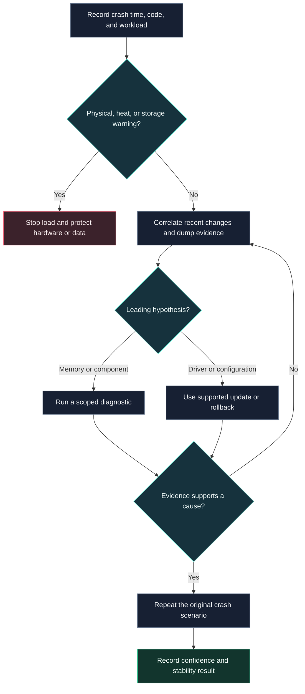

[🏠 Home](https://github.com/Herbertofury/INTA/wiki) · [🧭 Decision desk](https://github.com/Herbertofury/INTA/wiki/Decision-Desk) · [📚 Playbooks](https://github.com/Herbertofury/INTA/wiki/Playbooks) · [🧰 Tool directory](https://github.com/Herbertofury/INTA/wiki/Tool-Directory) · [✨ Open interactive hub](https://herbertofury.github.io/INTA/)

# 🔬 [Diagnose crashes, blue screens, and overheating](https://github.com/Herbertofury/INTA/wiki/Job-hardware-bsod)

Correlate crash evidence with memory, storage, temperature, power, and driver changes.

| Work area | Experience | Plan your time | Workflow |
| --- | --- | --- | --- |
| Hardware | Advanced | 30–120 min plus extended tests | 6 steps + acceptance |

**[▶ Open the interactive checklist](https://herbertofury.github.io/INTA/#job/hardware-bsod)** · [Decision route](#decision-route) · [Toolkit](#toolkit) · [Walkthrough](#walkthrough) · [Acceptance](#acceptance) · [Sources](#sources)

> [!TIP]
> **Your starting move:** Record the exact stop code, timestamp, workload, recent hardware/driver changes, and whether the machine restarted or lost power.

## 🧭 Choose the right branch

**Diagram routes:** [Continue this workflow](#walkthrough) · [Acceptance checks](#acceptance) · [Diagnose a slow, freezing, or hitching PC](slow-pc.md) · [Rescue data from a failing or unreadable drive](failing-drive.md) · [Recover a Windows PC that will not boot](boot-recovery.md) · [Prove a backup can actually restore](backup-restore.md)

| Checkpoint | What to carry forward |
| --- | --- |
| **Before changing anything** | Protect data before reproducing failure or stressing components. |
| **Keep during the job** | Stop code, dump, temperatures, configuration, and diagnostic duration. |
| **Before handing back** | Original scenario, restart, sleep, and required devices are stable. |

## 🧰 Build the right toolkit

Choose the tools that answer the case’s next question. Opening a tool is a separate decision from changing the customer’s system.

| Tool / official download | Use it for | Platform & access | Documentation |
| --- | --- | --- | --- |
| [HWiNFO](https://www.hwinfo.com/download/) | Investigating temperatures, clocks, power and component identity. | [Windows](https://www.microsoft.com/windows); Pro license for commercial use of 64/ARM64 editions | [Open guide](https://www.hwinfo.com/licenses/) |
| [Memtest86+](https://www.memtest.org/#download) | Investigating memory instability and repeatable hardware errors. | Bootable PC; Free / open source | [Open guide](https://github.com/memtest86plus/memtest86plus) |
| [CrystalDiskInfo](https://crystalmark.info/en/download/) | First-pass HDD and SSD health inspection in [Windows](https://www.microsoft.com/windows). | [Windows](https://www.microsoft.com/windows); Free / open source | [Open guide](https://crystalmark.info/en/software/crystaldiskinfo/) |
| [Microsoft Sysinternals Suite](https://learn.microsoft.com/en-us/sysinternals/downloads/sysinternals-suite) | The core portable [Windows](https://www.microsoft.com/windows) troubleshooting kit. | [Windows](https://www.microsoft.com/windows); Free Microsoft utilities | [Open guide](https://learn.microsoft.com/en-us/sysinternals/downloads/) |
| [WinDbg](https://learn.microsoft.com/en-us/windows-hardware/drivers/debugger/) | Interpreting a crash dump when basic event logs do not establish the cause. | [Windows](https://www.microsoft.com/windows); Free Microsoft tool | [Open guide](https://learn.microsoft.com/en-us/windows-hardware/drivers/debugger/) |

## 🪜 Work the case

Work in order, record the result of each step, and change route when the evidence calls for it.

### 01 · Capture evidence before repeated testing

- [ ] Save the stop code, [Reliability Monitor](https://learn.microsoft.com/en-us/windows-server/administration/windows-commands/perfmon) history, relevant events, and available crash dump in the private case. Note the dump’s sensitivity because it may contain user data. A named module is a clue that still needs context.

### 02 · Check basic stability

- [ ] Inspect cooling, dust, fans, physical connections, and any changed overclock or memory profile. Review temperatures under the normal failing workload. If a recent tuning change correlates with the issue, return it to the documented supported baseline before stress testing.

### 03 · Rule out storage problems

- [ ] Inspect storage health and I/O errors before filesystem repairs or long benchmarks. A disappearing or unhealthy drive moves to [data recovery](https://github.com/Herbertofury/INTA/wiki/Job-failing-drive). Keep the user’s data safe before intentionally reproducing a crash.

### 04 · Test one hypothesis at a time

- [ ] Use bootable memory diagnostics for suspected RAM and the hardware vendor’s diagnostics for the relevant component. Stop a stress test if temperatures or behavior become abnormal. Record test configuration and duration; one clean test does not prove every intermittent fault absent.

### 05 · Investigate the driver or power path

- [ ] Compare the failure with the installation timeline and use an OEM-supported driver update or rollback when evidence supports it. Review dumps with an appropriate debugger for persistent crashes. Event ID 41 records an unclean shutdown and must not be treated as a complete power-supply diagnosis.

### 06 · Recreate the original workload

- [ ] After the targeted fix, repeat the real application or idle/sleep/resume scenario that failed. Verify restart, sleep, peripherals, and normal temperatures. Record the cause confidence, replaced component or driver, and remaining monitoring instructions.

## ✅ Prove the result

- [ ] The original crash scenario no longer reproduces during the defined test.
- [ ] Relevant diagnostics and configuration are recorded.
- [ ] Normal temperatures, storage health, and required devices are confirmed.

> [!WARNING]
> **Pause this route and escalate when:**
> - Cooling failure, electrical damage, or storage deterioration appears.
> - A proposed test risks unbacked-up data or production availability.

## 🔀 Continue with the evidence

| Next playbook | What it resolves |
| --- | --- |
| [Diagnose a slow, freezing, or hitching PC](slow-pc.md) | Find the actual bottleneck and prove the improvement with the same workload. |
| [Rescue data from a failing or unreadable drive](failing-drive.md) | Preserve the source, create a recoverable image, and perform recovery on a copy. |
| [Recover a Windows PC that will not boot](boot-recovery.md) | Separate firmware, storage, encryption, and [Windows](https://www.microsoft.com/windows) startup faults before changing the boot configuration. |
| [Prove a backup can actually restore](backup-restore.md) | Validate recovery credentials, data integrity, application usability, and recovery time. |

Found a reusable improvement? [Contribute the correction](https://github.com/Herbertofury/INTA/wiki/Contribute) and include the test that proved it.

## 🔎 Source trail

Official references and editorial review

- [Microsoft: stop code and bug check troubleshooting](https://learn.microsoft.com/en-us/windows/client-management/troubleshoot-stop-errors)
- [Microsoft: interpreting Kernel-Power Event ID 41](https://learn.microsoft.com/en-us/troubleshoot/windows-client/performance/event-id-41-restart)

Reviewed **2026-11-26**. Timing is a planning range. A successful command is evidence about that operation; acceptance belongs to the user’s original task.

---

**Source review: 2026-11-26.** Guidance review and tool release versions are separate. [Report a correction](https://github.com/Herbertofury/INTA/issues/new/choose) · [How we maintain this guide](https://github.com/Herbertofury/INTA/wiki/Knowledge-Standards)

[← All playbooks](README.md) · [Live Wiki](https://github.com/Herbertofury/INTA/wiki) · [Contribution guide](https://github.com/Herbertofury/INTA/blob/main/CONTRIBUTING.md)
