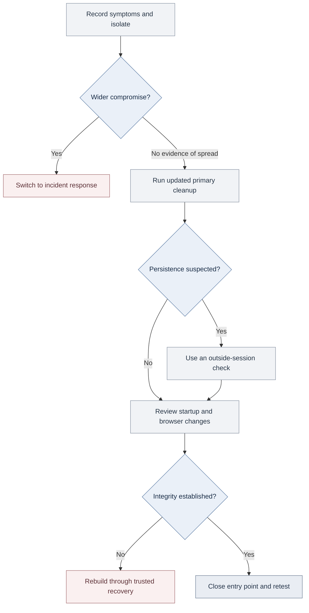

[INTA](https://github.com/Herbertofury/INTA/wiki) / [Decision desk](https://github.com/Herbertofury/INTA/wiki/Decision-Desk) · [Service map](https://github.com/Herbertofury/INTA/wiki/Service-Map) · [Playbooks](https://github.com/Herbertofury/INTA/wiki/Playbooks) · [Tools](https://github.com/Herbertofury/INTA/wiki/Tool-Directory) · [Methods](https://github.com/Herbertofury/INTA/wiki/Methods) · [Open hub](https://herbertofury.github.io/INTA/)

# [Remove malware and browser hijackers](https://github.com/Herbertofury/INTA/wiki/Job-malware-removal)

A measured cleanup workflow for a single [Windows](https://www.microsoft.com/windows) endpoint, with a separate path for a wider compromise.

**Security** · Intermediate · 45–120 min plus scanning · 9 steps

[Tools and useful links](#working-kit) · [Quick answer](#quick-answer) · [Next action](#next-action) · [Specific fixes](#specific-fixes) · [Decision route](#decision-route) · [Tools](#toolkit) · [Procedure](#walkthrough) · [Verification](#acceptance) · [Sources](#sources) · [Interactive checklist](https://herbertofury.github.io/INTA/#job/malware-removal)

## 🧰 Choose the tool for this job

Choose by the task shown in the first column. Each option includes its acquisition route and access boundary.

| Need | Official tool + exact action | Why this choice / access |
| --- | --- | --- |
| **On-demand cleanup** | **[Malwarebytes](https://www.malwarebytes.com/)** · **[Download Windows installer · EXE](https://downloads.malwarebytes.com/file/mb-windows)** | Use an available Free Quick or Custom Scan for broad cleanup on an eligible personal device. **Access:** Free personal-use scans; business servicing rights differ. |
| **Adware and hijackers** | **[Malwarebytes AdwCleaner](https://www.malwarebytes.com/adwcleaner)** · **[Download Windows portable cleaner · EXE](https://adwcleaner.malwarebytes.com/adwcleaner?channel=release)** | Target adware, unwanted software and browser hijackers, then review findings before quarantine. **Access:** Free for qualifying repair firms with ≤10 total staff; other business use needs rights. |
| **Personal PC protection** | **[Bitdefender Antivirus Free](https://www.bitdefender.com/en-us/consumer/free-antivirus)** · **[Download Windows setup · EXE](https://download.bitdefender.com/windows/installer/en-us/bitdefender_avfree.exe)** | Choose it as the single ongoing antivirus on an eligible personal [Windows](https://www.microsoft.com/windows) PC. **Access:** Personal/non-commercial only; account required. |
| **Portable second opinion** | **[Microsoft Safety Scanner](https://learn.microsoft.com/en-us/defender-endpoint/safety-scanner-download)** · **[Download Windows x64 scanner · EXE](https://go.microsoft.com/fwlink/?LinkId=212732)** | Download a fresh standalone scanner for a logged on-demand check without replacing existing protection. **Access:** Free Microsoft scanner; download expires after 10 days. |
| **Scan outside [Windows](https://www.microsoft.com/windows)** | **[Microsoft Defender Offline](https://learn.microsoft.com/en-us/defender-endpoint/microsoft-defender-offline)** · **[Run the built-in offline scan](https://learn.microsoft.com/en-us/defender-endpoint/microsoft-defender-offline)** | Use the built-in offline scan when persistence warrants it and the supported platform and recovery prerequisites are met. **Access:** Included with supported [Windows](https://www.microsoft.com/windows) |

**[Current selection evidence](https://github.com/Herbertofury/INTA/wiki/Current-Tool-Choices)**

## 🧰 Tools and links for this job

**[Open working view](https://herbertofury.github.io/INTA/#job/malware-removal)** · Keep the tool panel beside the instructions.

**First move:** If encryption, privileged-account compromise or multiple affected devices are present, isolate and use the incident route. Otherwise record detections and keep one real-time protection product.

| Use this for | Official tool + exact action |
| --- | --- |
| Use an available Free Quick or Custom Scan for broad cleanup on an eligible personal device. | **[Malwarebytes](https://www.malwarebytes.com/)** · [Official page](https://www.malwarebytes.com/) · **[Download Windows installer · EXE](https://downloads.malwarebytes.com/file/mb-windows)** |
| Focused adware and browser-hijacker cleanup. | **[Malwarebytes AdwCleaner](https://www.malwarebytes.com/adwcleaner)** · [Official page](https://www.malwarebytes.com/adwcleaner) · **[Download Windows portable cleaner · EXE](https://adwcleaner.malwarebytes.com/adwcleaner?channel=release)** |
| Choose it as the single ongoing antivirus on an eligible personal [Windows](https://www.microsoft.com/windows) PC. | **[Bitdefender Antivirus Free](https://www.bitdefender.com/en-us/consumer/free-antivirus)** · [Official page](https://www.bitdefender.com/en-us/consumer/free-antivirus) · **[Download Windows setup · EXE](https://download.bitdefender.com/windows/installer/en-us/bitdefender_avfree.exe)** |
| Fresh on-demand scan and a readable result log. | **[Microsoft Safety Scanner](https://learn.microsoft.com/en-us/defender-endpoint/safety-scanner-download)** · [Official page](https://learn.microsoft.com/en-us/defender-endpoint/safety-scanner-download) · **[Download Windows x64 scanner · EXE](https://go.microsoft.com/fwlink/?LinkId=212732)** |
| Inspect evidence-backed startup persistence. | **[Autoruns](https://learn.microsoft.com/en-us/sysinternals/downloads/autoruns)** · [Official page](https://learn.microsoft.com/en-us/sysinternals/downloads/autoruns) · **[Download Windows portable · ZIP](https://download.sysinternals.com/files/Autoruns.zip)** |
| Offline scan when the documented platform and recovery requirements are met. | **[Microsoft Defender Offline](https://learn.microsoft.com/en-us/defender-endpoint/microsoft-defender-offline)** · [Official page](https://learn.microsoft.com/en-us/defender-endpoint/microsoft-defender-offline) · **[Run the built-in offline scan](https://learn.microsoft.com/en-us/defender-endpoint/microsoft-defender-offline)** |
| Use existing endpoint telemetry for investigation; plan new deployment after active evidence-preservation needs are resolved. | **[Sysmon](https://learn.microsoft.com/en-us/sysinternals/downloads/sysmon)** · [Official page](https://learn.microsoft.com/en-us/sysinternals/downloads/sysmon) · **[Download Windows monitoring tools · ZIP](https://download.sysinternals.com/files/Sysmon.zip)** |

### Run and verify

| Open the exact resource | What to do there |
| --- | --- |
| **[Safety Scanner results and expiry](https://learn.microsoft.com/en-us/defender-endpoint/safety-scanner-download)** | Read the completion result and %SYSTEMROOT%\debug\msert.log. |
| **[AdwCleaner scan and review](https://help.malwarebytes.com/hc/en-us/articles/31589231147035-Scan-and-clean-a-device-with-AdwCleaner)** | Review detected items before cleanup and retain the report. |

### Escalation

| Open the exact resource | What to do there |
| --- | --- |
| **[Contain ransomware or a wider compromise](https://github.com/Herbertofury/INTA/wiki/Contain-ransomware)** | Use the incident route for active encryption, lateral spread or privileged-account compromise. |
| **[Defender Offline requirements](https://learn.microsoft.com/en-us/defender-endpoint/microsoft-defender-offline)** | Check platform, primary antivirus, [WinRE](https://learn.microsoft.com/en-us/windows-hardware/manufacture/desktop/windows-recovery-environment--windows-re--technical-reference) and [BitLocker](https://learn.microsoft.com/en-us/windows/security/operating-system-security/data-protection/bitlocker/) preparation. |
| **[Trusted reinstall procedure](https://support.microsoft.com/en-us/windows/deployment/install-upgrade/reinstall-windows-with-the-installation-media)** | Preserve required evidence and data before a clean installation. |

## ⚡ Quick answer

### 🛡️ Remove viruses

**Disconnect a suspected compromised PC from the network before scanning; use the [incident guide](https://github.com/Herbertofury/INTA/wiki/Contain-ransomware) if encryption is spreading.**

1. Record the symptoms, isolate affected connections and keep a single approved real-time protector.
2. Choose an authorized on-demand scan: [Malwarebytes](https://www.malwarebytes.com/) Free Quick/Custom Scan on an eligible personal PC, [AdwCleaner](https://www.malwarebytes.com/adwcleaner) for qualifying adware cleanup, or a fresh [Microsoft Safety Scanner](https://learn.microsoft.com/en-us/defender-endpoint/safety-scanner-download) Full scan.
3. Save the scan log, review remaining symptoms and persistence, then follow the guide’s cleanup or rebuild decision.

**[Microsoft Safety Scanner](https://learn.microsoft.com/en-us/defender-endpoint/safety-scanner-download)** · [Official page](https://learn.microsoft.com/en-us/defender-endpoint/safety-scanner-download) · **[Download Windows x64 scanner · EXE](https://go.microsoft.com/fwlink/?LinkId=212732)**

## 🧭 Match the symptom

| You see this | Do this next | You should get |
| --- | --- | --- |
| **The installed protection reports a threat** | Update through an approved channel, run its full scan and quarantine identified detections; retain the report. | The run has a completion state and a recorded action for every detection. |
| **Adware, unwanted extensions or browser redirection dominate** | Run [AdwCleaner](https://www.malwarebytes.com/adwcleaner), review its proposed changes and restore the intended browser extensions, search and notification settings. | The original browser task works and unwanted behavior does not return after restart. |
| **A second on-demand check is needed** | Download a fresh [Microsoft Safety Scanner](https://learn.microsoft.com/en-us/defender-endpoint/safety-scanner-download) from a clean PC, run a Full scan and read the detailed log. | Completed coverage, detections and unresolved items are recorded; a cancelled run is not marked clean. |
| **The same detection returns after reboot** | Inspect the relevant [Autoruns](https://learn.microsoft.com/en-us/sysinternals/downloads/autoruns) entry and documented offline-scan prerequisites; use the rebuild decision if integrity remains uncertain. | The persistence cause is explained or a clean recovery plan replaces repeated scanner loops. |

### ✅ Finish the job

- [ ] Protection is healthy after reboot and there are no unresolved detections.
- [ ] The original task and browser behavior remain correct.
- [ ] Compromised accounts and sessions have a separate documented resolution.

**Change route when:** Ransomware, lateral spread or privileged access is suspected. · Detections recur or scan coverage and system integrity cannot be established.

### 🎯 Go straight to a specific fix

- **[Stop website notification popups](#fix-malware-browser-notification-popups)** — Desktop alerts claim the PC is infected, but the alerts identify a browser or website sender.
- **[Undo an accidental allowed-threat decision](#fix-malware-allowed-threat-keeps-returning)** — A known detection was allowed earlier and the same item remains present.
- **[Find why the offline scan never runs](#fix-malware-offline-scan-does-not-start)** — The offline-scan request returns to [Windows](https://www.microsoft.com/windows) without a documented completed scan.

> [!NOTE]
> **Start here.** Check for active encryption, credential theft, unusual administrator accounts, or more affected machines before treating this as a routine cleanup.

## 🧭 Choose a route

**Route links:** [Continue this workflow](#walkthrough) · [Acceptance checks](#acceptance) · [Contain ransomware or a wider compromise](ransomware-response.md) · [Build and refresh a technician rescue USB](boot-usb.md) · [Close a repair with a clear client handoff](client-handoff.md)

| Checkpoint | What to carry forward |
| --- | --- |
| **Before changing anything** | Record symptoms; decide whether this is a single-endpoint cleanup. |
| **Keep during the job** | Detection names, scan versions, quarantine, persistence, and account findings. |
| **Before handing back** | Healthy protection, stable settings, and tested original work. |

## Recommended tools

Select a tool for the next diagnostic or repair step. Check its platform, access and licensing requirements before use.

| Tool / official page + download | Use it for | Platform & access | Documentation |
| --- | --- | --- | --- |
| **[Microsoft Safety Scanner](https://learn.microsoft.com/en-us/defender-endpoint/safety-scanner-download)** · [Official page](https://learn.microsoft.com/en-us/defender-endpoint/safety-scanner-download) · **[Download Windows x64 scanner · EXE](https://go.microsoft.com/fwlink/?LinkId=212732)** | Fresh on-demand scan and a readable result log. | [Windows](https://www.microsoft.com/windows); Free download | [Open guide](https://learn.microsoft.com/en-us/defender-endpoint/safety-scanner-download) |
| **[Malwarebytes AdwCleaner](https://www.malwarebytes.com/adwcleaner)** · [Official page](https://www.malwarebytes.com/adwcleaner) · **[Download Windows portable cleaner · EXE](https://adwcleaner.malwarebytes.com/adwcleaner?channel=release)** | Focused adware and browser-hijacker cleanup. | [Windows](https://www.microsoft.com/windows); Free for personal use and qualifying repair shops with at most 10 aggregate staff; other business rights differ | [Open guide](https://help.malwarebytes.com/hc/en-us/articles/31589231147035-Scan-and-clean-a-device-with-AdwCleaner) |
| **[Autoruns](https://learn.microsoft.com/en-us/sysinternals/downloads/autoruns)** · [Official page](https://learn.microsoft.com/en-us/sysinternals/downloads/autoruns) · **[Download Windows portable · ZIP](https://download.sysinternals.com/files/Autoruns.zip)** | Inspect evidence-backed startup persistence. | [Windows](https://www.microsoft.com/windows); Free Microsoft utility | [Open guide](https://learn.microsoft.com/en-us/sysinternals/downloads/autoruns) |
| **[Microsoft Defender Offline](https://learn.microsoft.com/en-us/defender-endpoint/microsoft-defender-offline)** · [Official page](https://learn.microsoft.com/en-us/defender-endpoint/microsoft-defender-offline) · **[Run the built-in offline scan](https://learn.microsoft.com/en-us/defender-endpoint/microsoft-defender-offline)** | Offline scan when the documented platform and recovery requirements are met. | [Windows](https://www.microsoft.com/windows); Included with supported [Windows](https://www.microsoft.com/windows) | [Open guide](https://learn.microsoft.com/en-us/defender-endpoint/microsoft-defender-offline) |
| **[Microsoft Sysinternals Suite](https://learn.microsoft.com/en-us/sysinternals/)** · [Official page](https://learn.microsoft.com/en-us/sysinternals/) · **[Download Windows portable · ZIP](https://download.sysinternals.com/files/SysinternalsSuite.zip)** | The core portable [Windows](https://www.microsoft.com/windows) troubleshooting kit. | [Windows](https://www.microsoft.com/windows); Free Microsoft utilities | [Open guide](https://learn.microsoft.com/en-us/sysinternals/downloads/) |
| **[Malwarebytes](https://www.malwarebytes.com/)** · [Official page](https://www.malwarebytes.com/) · **[Download Windows installer · EXE](https://downloads.malwarebytes.com/file/mb-windows)** | Use an available Free Quick or Custom Scan for broad cleanup on an eligible personal device. | [Windows](https://www.microsoft.com/windows), [macOS](https://support.apple.com/macos); Free personal-use Quick/Custom scans; paid Threat Scan and real-time protection; servicing/business rights differ | [Open guide](https://help.malwarebytes.com/hc/en-us/articles/49849786059035-Free-vs-Paid-Malwarebytes-Security-features) |
| **[Sysmon](https://learn.microsoft.com/en-us/sysinternals/downloads/sysmon)** · [Official page](https://learn.microsoft.com/en-us/sysinternals/downloads/sysmon) · **[Download Windows monitoring tools · ZIP](https://download.sysinternals.com/files/Sysmon.zip)** | Use existing endpoint telemetry for investigation; plan new deployment after active evidence-preservation needs are resolved. | [Windows](https://www.microsoft.com/windows), [Windows Server](https://learn.microsoft.com/en-us/windows-server/); Free proprietary Microsoft utility under [Sysinternals](https://learn.microsoft.com/en-us/sysinternals/) terms; redistribution and commercial software hosting are restricted | [Open guide](https://learn.microsoft.com/en-us/sysinternals/downloads/sysmon) |
| **[Bitdefender Antivirus Free](https://www.bitdefender.com/en-us/consumer/free-antivirus)** · [Official page](https://www.bitdefender.com/en-us/consumer/free-antivirus) · **[Download Windows setup · EXE](https://download.bitdefender.com/windows/installer/en-us/bitdefender_avfree.exe)** | Choose it as the single ongoing antivirus on an eligible personal [Windows](https://www.microsoft.com/windows) PC. | [Windows](https://www.microsoft.com/windows); Free for personal or non-commercial use; Bitdefender account required | [Open guide](https://www.bitdefender.com/en-us/consumer/free-antivirus) |

## Procedure

Work in order, record the result of each step, and change route when the evidence calls for it.

### 01 · Contain and preserve the story

- [ ] Disconnect the affected endpoint from ordinary network access if compromise is suspected. Record detection names, paths, timestamps, symptoms, and recent downloads. Use a clean device for account changes. If business systems or multiple endpoints are involved, switch to the [incident-response guide](https://github.com/Herbertofury/INTA/wiki/Job-ransomware-response).

### 02 · Choose the cleanup, incident or rebuild path

- [ ] Keep an isolated, understood browser or unwanted-software case on the routine-cleanup path. Move active encryption, privileged-account compromise or multiple affected devices to the incident owner. If detections recur, the entry point remains open or the trusted system baseline cannot be established, preserve the findings and prepare a clean rebuild; do not keep cycling scanners as a substitute for a recovery decision.

### 03 · Prepare trustworthy scanners

- [ ] Get tools from the official links on a clean computer and verify signatures where available. Keep one managed real-time antivirus product; use any second-opinion scanner as an on-demand tool. Download a fresh [Safety Scanner](https://learn.microsoft.com/en-us/defender-endpoint/safety-scanner-download) for the case because its package expires after 10 days.

### 04 · Run the primary cleanup

- [ ] Update the installed endpoint protection through a controlled connection or approved update channel, run its full scan, and preserve the results. Quarantine identified threats rather than manually deleting unfamiliar files. Reboot when the product requests it and record its post-reboot status.

### 05 · Use an offline or focused second check

- [ ] If persistence is suspected, save work, make the [BitLocker](https://learn.microsoft.com/en-us/windows/security/operating-system-security/data-protection/bitlocker/) recovery key available, and run [Microsoft Defender Offline](https://learn.microsoft.com/en-us/defender-endpoint/microsoft-defender-offline) from [Windows Security](https://support.microsoft.com/en-us/windows/security/windows-security/windows-security-app-overview) > Virus & threat protection > Scan options on a supported system. For unwanted browser software, use [AdwCleaner](https://www.malwarebytes.com/adwcleaner) and inspect proposed changes before applying them. Check the actual platform first: [Microsoft Defender Offline](https://learn.microsoft.com/en-us/defender-endpoint/microsoft-defender-offline) does not support [Windows](https://www.microsoft.com/windows) on ARM or [Windows Server](https://learn.microsoft.com/en-us/windows-server/). Its update path requires [Microsoft Defender Antivirus](https://learn.microsoft.com/en-us/defender-endpoint/microsoft-defender-antivirus-windows) as the primary antivirus, and the recovery environment must be available. Follow the documented [BitLocker](https://learn.microsoft.com/en-us/windows/security/operating-system-security/data-protection/bitlocker/) preparation and verify protection is restored afterward.

### 06 · Reconcile findings with scan coverage

- [ ] Perform [scan coverage reconciliation](https://github.com/Herbertofury/INTA/wiki/Job-malware-removal) for every run: record product and engine or intelligence version where exposed, scan mode, scope, start/end time, completion or cancellation, inaccessible areas, detections and disposition. Retain the product report; [Microsoft Safety Scanner](https://learn.microsoft.com/en-us/defender-endpoint/safety-scanner-download) writes detailed results to %SYSTEMROOT%\debug\msert.log. A timeout, blocked scan or unscanned location remains incomplete even when no threat is reported. Reconcile repeated detections with the specific path, item and action rather than declaring a clean result from the headline alone.

### 07 · Review persistence and accounts

- [ ] Use [Autoruns](https://learn.microsoft.com/en-us/sysinternals/downloads/autoruns) to inspect startup items and verify suspicious publishers, locations, and signatures. Review browser extensions, notification permissions, proxy settings, and unexpected remote-access agents. Disable only entries tied to evidence, retain an export, and avoid uploading client files to public scanners.

### 08 · Close the entry point and retest

- [ ] Patch the affected software, restore the intended browser/search settings, and remove unwanted software. From a known-clean device, rotate affected credentials and revoke suspect sessions as appropriate. If you cannot establish system integrity, rebuild from trusted media and restore validated data.

### 09 · Prepare and prove a trusted rebuild when required

- [ ] Use [clean rebuild acceptance](https://github.com/Herbertofury/INTA/wiki/Job-malware-removal) when system integrity cannot be established. Before any destructive installation, identify the exact target, preserve required evidence and usable data, obtain recovery material through the approved store, and agree on the data/application restoration scope. Create installation media from the official source on a known-clean device and follow the clean-install procedure. Reinstall applications from trusted sources, restore validated data deliberately, update the system and endpoint protection, and prove the original customer task. Document unresolved account exposure separately; a reinstalled endpoint does not reset stolen credentials or revoke cloud sessions. Use [Service Evidence](https://github.com/Herbertofury/INTA/wiki/Service-Evidence) for the before-wipe and return-to-service checks.

## Verification

- [ ] The primary security product is healthy and updated after reboot.
- [ ] Follow-up scans and [persistence review](https://github.com/Herbertofury/INTA/wiki/Job-malware-removal) show no unresolved detections.
- [ ] The user can complete the original task and browser settings remain stable.
- [ ] Any account exposure has a documented response, not only a clean scan.
- [ ] Each scan has a completion state, scope, findings and explicit coverage limits; incomplete work is not recorded as clean.
- [ ] If rebuilt, the target, preserved data/evidence, trusted media, restored applications, endpoint health and customer task test are recorded.
- [ ] Reconnection and restored data have been assessed against the original entry point; credentials and cloud sessions have a separate resolution owner.

> [!WARNING]
> **Pause this route and escalate when:**
> - Ransomware, privileged account compromise, or lateral spread is suspected.
> - New detections reappear after cleanup or the trusted baseline cannot be established.

## 🎯 Specific fixes

Choose the case that matches the evidence. Each case gives a first action, a short procedure and a result to prove.

### Stop website notification popups

**Use when:** Desktop alerts claim the PC is infected, but the alerts identify a browser or website sender.

**Start here:** Record the sender and close the alert without opening its link.

1. In [Microsoft Edge](https://www.microsoft.com/edge) open Settings > Privacy, search, and services > Site permissions > All sites; choose the unwanted site and select See more.
2. Set that site’s Notifications permission to Block; inspect related extensions and recent downloads if the alerts began with an installation.
3. Retest with the browser restarted. Use the malware route if executable detections, persistence or other compromise evidence remains.

**Prove it worked:** The unwanted site can no longer send notifications and normal browsing still works.

**If this does not resolve it:** If the sender is not the browser, or alerts persist after permission removal, identify the actual installed application before removing anything.

**Official evidence:** [Source 1](https://support.microsoft.com/en-us/edge/manage-website-notifications-in-microsoft-edge) · Reviewed 2026-11-26

[Back to specific fixes](#specific-fixes) · [Full procedure](#walkthrough)

### Undo an accidental allowed-threat decision

**Use when:** A known detection was allowed earlier and the same item remains present.

**Start here:** Open [Windows Security](https://support.microsoft.com/en-us/windows/security/windows-security/windows-security-app-overview) > Virus & threat protection and review the exact detection and its earlier disposition.

1. With the authorized administrator available, check Protection history and Allowed threats for the matching item; distinguish an allowed action from quarantine or a failed remediation.
2. For a confirmed accidental allowance, choose the supported Don’t allow action, update the active protection and rescan the affected scope.
3. Record the new disposition and whether the file or startup entry returns after restart.

**Prove it worked:** The unintended allowance is removed and the confirmed threat has a recorded remediation result.

**If this does not resolve it:** If policy controls the setting or the detection recurs, involve the managed protection owner and investigate the entry point rather than adding exclusions.

**Official evidence:** [Source 1](https://support.microsoft.com/en-us/windows/security/windows-security/protection-history-in-the-windows-security-app) · Reviewed 2026-11-26

[Back to specific fixes](#specific-fixes) · [Full procedure](#walkthrough)

### Find why the offline scan never runs

**Use when:** The offline-scan request returns to [Windows](https://www.microsoft.com/windows) without a documented completed scan.

**Start here:** Check the device platform and the [Microsoft Defender Offline](https://learn.microsoft.com/en-us/defender-endpoint/microsoft-defender-offline) prerequisites before requesting another restart.

**[Microsoft Defender Offline](https://learn.microsoft.com/en-us/defender-endpoint/microsoft-defender-offline)** · [Official page](https://learn.microsoft.com/en-us/defender-endpoint/microsoft-defender-offline) · **[Run the built-in offline scan](https://learn.microsoft.com/en-us/defender-endpoint/microsoft-defender-offline)**

**[Windows Recovery Environment](https://learn.microsoft.com/en-us/windows-hardware/manufacture/desktop/windows-recovery-environment--windows-re--technical-reference)** · [Official page](https://learn.microsoft.com/en-us/windows-hardware/manufacture/desktop/windows-recovery-environment--windows-re--technical-reference) · **[Open recovery instructions](https://learn.microsoft.com/en-us/windows-hardware/manufacture/desktop/windows-recovery-environment--windows-re--technical-reference)**

1. Confirm the supported [Windows](https://www.microsoft.com/windows) edition/architecture, the required primary antivirus state and availability of the [BitLocker](https://learn.microsoft.com/en-us/windows/security/operating-system-security/data-protection/bitlocker/) recovery key.
2. Run reagentc /info from an elevated local [Windows](https://www.microsoft.com/windows) session to inspect recovery-environment status; do not publish recovery configuration or credentials.
3. Resolve the documented prerequisite with the device owner, then request the offline scan through [Windows Security](https://support.microsoft.com/en-us/windows/security/windows-security/windows-security-app-overview) and review the resulting protection history.

**Prove it worked:** The offline environment actually runs and a result can be tied to that scan attempt.

**If this does not resolve it:** Do not treat an ordinary reboot as a clean scan. Unsupported platforms or a broken recovery environment need the appropriate supported recovery route.

**Official evidence:** [Source 1](https://learn.microsoft.com/en-us/defender-endpoint/microsoft-defender-offline) · [Source 2](https://learn.microsoft.com/en-us/windows-hardware/manufacture/desktop/reagentc-command-line-options) · Reviewed 2026-11-26

[Back to specific fixes](#specific-fixes) · [Full procedure](#walkthrough)

## Related playbooks

| Next playbook | What it resolves |
| --- | --- |
| [Contain ransomware or a wider compromise](ransomware-response.md) | Stop spread, preserve useful evidence, and restore services through a clean recovery path. |
| [Build and refresh a technician rescue USB](boot-usb.md) | Keep verified recovery images, [Windows repair](https://github.com/Herbertofury/INTA/wiki/Job-windows-repair) media, and the INTA knowledge hub ready for offline use. |
| [Close a repair with a clear client handoff](client-handoff.md) | Turn completed technical work into proof the customer can use, with clean access and an actionable service record. |

## Official sources

- [Microsoft Safety Scanner](https://learn.microsoft.com/en-us/defender-endpoint/safety-scanner-download)
- [Microsoft Defender Offline](https://learn.microsoft.com/en-us/defender-endpoint/microsoft-defender-offline)
- [Microsoft Sysinternals: Autoruns](https://learn.microsoft.com/en-us/sysinternals/downloads/autoruns)
- [Microsoft: recovery options for suspected malware](https://support.microsoft.com/en-us/windows/experience/backup-recovery/recovery-options-in-windows)
- [Microsoft: reinstall with installation media](https://support.microsoft.com/en-us/windows/deployment/install-upgrade/reinstall-windows-with-the-installation-media)
- [CISA: #StopRansomware Guide, recovery checklist](https://www.cisa.gov/sites/default/files/2025-03/StopRansomware-Guide%20508.pdf)
- [ATHENA: findings, coverage and explicit resource ownership](https://github.com/Herbertofury/Athena/blob/7d529423b52d3cc6104ce7469eec358f5dc9b9ac/engineering/docs/windows-endpoint-security.md)
- [INTA: Service Evidence](https://github.com/Herbertofury/INTA/wiki/Service-Evidence)

Reviewed **2026-11-26**. Timing is a planning range. A successful command is evidence about that operation; acceptance belongs to the user’s original task.

---

Editorial review: **2026-11-26** · [Review standard](https://github.com/Herbertofury/INTA/wiki/Knowledge-Standards) · [Suggest a correction](https://github.com/Herbertofury/INTA/issues/new/choose)

[← All playbooks](README.md) · [Live Wiki](https://github.com/Herbertofury/INTA/wiki) · [Contribution guide](https://github.com/Herbertofury/INTA/blob/main/CONTRIBUTING.md)
