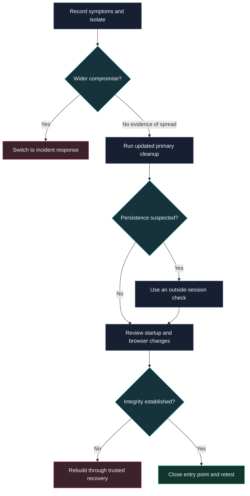

[🏠 Home](https://github.com/Herbertofury/INTA/wiki) · [🧭 Decision desk](https://github.com/Herbertofury/INTA/wiki/Decision-Desk) · [📚 Playbooks](https://github.com/Herbertofury/INTA/wiki/Playbooks) · [🧰 Tool directory](https://github.com/Herbertofury/INTA/wiki/Tool-Directory) · [✨ Open interactive hub](https://herbertofury.github.io/INTA/)

# 🛡️ [Remove malware and browser hijackers](https://github.com/Herbertofury/INTA/wiki/Job-malware-removal)

A measured cleanup workflow for a single [Windows](https://www.microsoft.com/windows) endpoint, with a separate path for a wider compromise.

| Work area | Experience | Plan your time | Workflow |
| --- | --- | --- | --- |
| Security | Intermediate | 45–120 min plus scanning | 6 steps + acceptance |

**[▶ Open the interactive checklist](https://herbertofury.github.io/INTA/#job/malware-removal)** · [Decision route](#decision-route) · [Toolkit](#toolkit) · [Walkthrough](#walkthrough) · [Acceptance](#acceptance) · [Sources](#sources)

> [!TIP]
> **Your starting move:** Check for active encryption, credential theft, unusual administrator accounts, or more affected machines before treating this as a routine cleanup.

## 🧭 Choose the right branch

**Diagram routes:** [Continue this workflow](#walkthrough) · [Acceptance checks](#acceptance) · [Contain ransomware or a wider compromise](ransomware-response.md) · [Build and refresh a technician rescue USB](boot-usb.md) · [Close a repair with a clear client handoff](client-handoff.md)

| Checkpoint | What to carry forward |
| --- | --- |
| **Before changing anything** | Record symptoms; decide whether this is a single-endpoint cleanup. |
| **Keep during the job** | Detection names, scan versions, quarantine, persistence, and account findings. |
| **Before handing back** | Healthy protection, stable settings, and tested original work. |

## 🧰 Build the right toolkit

Choose the tools that answer the case’s next question. Opening a tool is a separate decision from changing the customer’s system.

| Tool / official download | Use it for | Platform & access | Documentation |
| --- | --- | --- | --- |
| [Microsoft Defender Offline](https://learn.microsoft.com/en-us/defender-endpoint/microsoft-defender-offline) | Persistent malware that may interfere with an ordinary scan. | [Windows](https://www.microsoft.com/windows); Included with supported [Windows](https://www.microsoft.com/windows) | [Open guide](https://learn.microsoft.com/en-us/defender-endpoint/microsoft-defender-offline) |
| [Microsoft Safety Scanner](https://learn.microsoft.com/en-us/defender-endpoint/safety-scanner-download) | A fresh Microsoft second-opinion scan without installing another resident antivirus. | [Windows](https://www.microsoft.com/windows); Free download | [Open guide](https://learn.microsoft.com/en-us/defender-endpoint/safety-scanner-download) |
| [Malwarebytes AdwCleaner](https://www.malwarebytes.com/adwcleaner) | Unexpected browser redirects, pop-ups and bundled unwanted software. | [Windows](https://www.microsoft.com/windows); Free tool | [Open guide](https://help.malwarebytes.com/hc/en-us/articles/31589231147035-Scan-and-clean-a-device-with-AdwCleaner) |
| [Microsoft Sysinternals Suite](https://learn.microsoft.com/en-us/sysinternals/downloads/sysinternals-suite) | The core portable [Windows](https://www.microsoft.com/windows) troubleshooting kit. | [Windows](https://www.microsoft.com/windows); Free Microsoft utilities | [Open guide](https://learn.microsoft.com/en-us/sysinternals/downloads/) |
| [Malwarebytes](https://www.malwarebytes.com/mwb-download) | An additional malware assessment after the primary endpoint product. | [Windows](https://www.microsoft.com/windows), [macOS](https://support.apple.com/macos); Free scan options; paid protection and business products | [Open guide](https://www.malwarebytes.com/free-tools) |

## 🪜 Work the case

Work in order, record the result of each step, and change route when the evidence calls for it.

### 01 · Contain and preserve the story

- [ ] Disconnect the affected endpoint from ordinary network access if compromise is suspected. Record detection names, paths, timestamps, symptoms, and recent downloads. Use a clean device for account changes. If business systems or multiple endpoints are involved, switch to the [incident-response guide](https://github.com/Herbertofury/INTA/wiki/Job-ransomware-response).

### 02 · Prepare trustworthy scanners

- [ ] Get tools from the official links on a clean computer and verify signatures where available. Keep one managed real-time antivirus product; use any second-opinion scanner as an on-demand tool. Download a fresh [Safety Scanner](https://learn.microsoft.com/en-us/defender-endpoint/safety-scanner-download) for the case because its package expires after 10 days.

### 03 · Run the primary cleanup

- [ ] Update the installed endpoint protection through a controlled connection or approved update channel, run its full scan, and preserve the results. Quarantine identified threats rather than manually deleting unfamiliar files. Reboot when the product requests it and record its post-reboot status.

### 04 · Use an offline or focused second check

- [ ] If persistence is suspected, save work, make the [BitLocker](https://learn.microsoft.com/en-us/windows/security/operating-system-security/data-protection/bitlocker/) recovery key available, and run [Microsoft Defender Offline](https://learn.microsoft.com/en-us/defender-endpoint/microsoft-defender-offline) from [Windows Security](https://support.microsoft.com/en-us/windows/security/windows-security/windows-security-app-overview) > Virus & threat protection > Scan options on a supported system. For unwanted browser software, use [AdwCleaner](https://www.malwarebytes.com/adwcleaner) and inspect proposed changes before applying them.

### 05 · Review persistence and accounts

- [ ] Use [Autoruns](https://learn.microsoft.com/en-us/sysinternals/downloads/autoruns) to inspect startup items and verify suspicious publishers, locations, and signatures. Review browser extensions, notification permissions, proxy settings, and unexpected remote-access agents. Disable only entries tied to evidence, retain an export, and avoid uploading client files to public scanners.

### 06 · Close the entry point and retest

- [ ] Patch the affected software, restore the intended browser/search settings, and remove unwanted software. From a known-clean device, rotate affected credentials and revoke suspect sessions as appropriate. If you cannot establish system integrity, rebuild from trusted media and restore validated data.

## ✅ Prove the result

- [ ] The primary security product is healthy and updated after reboot.
- [ ] Follow-up scans and [persistence review](https://github.com/Herbertofury/INTA/wiki/Job-malware-removal) show no unresolved detections.
- [ ] The user can complete the original task and browser settings remain stable.
- [ ] Any account exposure has a documented response, not only a clean scan.

> [!WARNING]
> **Pause this route and escalate when:**
> - Ransomware, privileged account compromise, or lateral spread is suspected.
> - New detections reappear after cleanup or the trusted baseline cannot be established.

## 🔀 Continue with the evidence

| Next playbook | What it resolves |
| --- | --- |
| [Contain ransomware or a wider compromise](ransomware-response.md) | Stop spread, preserve useful evidence, and restore services through a clean recovery path. |
| [Build and refresh a technician rescue USB](boot-usb.md) | Keep verified recovery images, [Windows repair](https://github.com/Herbertofury/INTA/wiki/Job-windows-repair) media, and the INTA knowledge hub ready for offline use. |
| [Close a repair with a clear client handoff](client-handoff.md) | Turn completed technical work into proof the customer can use, with clean access and an actionable service record. |

Found a reusable improvement? [Contribute the correction](https://github.com/Herbertofury/INTA/wiki/Contribute) and include the test that proved it.

## 🔎 Source trail

Official references and editorial review

- [Microsoft Safety Scanner](https://learn.microsoft.com/en-us/defender-endpoint/safety-scanner-download)
- [Microsoft Defender Offline](https://learn.microsoft.com/en-us/defender-endpoint/microsoft-defender-offline)
- [Microsoft Sysinternals: Autoruns](https://learn.microsoft.com/en-us/sysinternals/downloads/autoruns)

Reviewed **2026-11-26**. Timing is a planning range. A successful command is evidence about that operation; acceptance belongs to the user’s original task.

---

**Source review: 2026-11-26.** Guidance review and tool release versions are separate. [Report a correction](https://github.com/Herbertofury/INTA/issues/new/choose) · [How we maintain this guide](https://github.com/Herbertofury/INTA/wiki/Knowledge-Standards)

[← All playbooks](README.md) · [Live Wiki](https://github.com/Herbertofury/INTA/wiki) · [Contribution guide](https://github.com/Herbertofury/INTA/blob/main/CONTRIBUTING.md)
