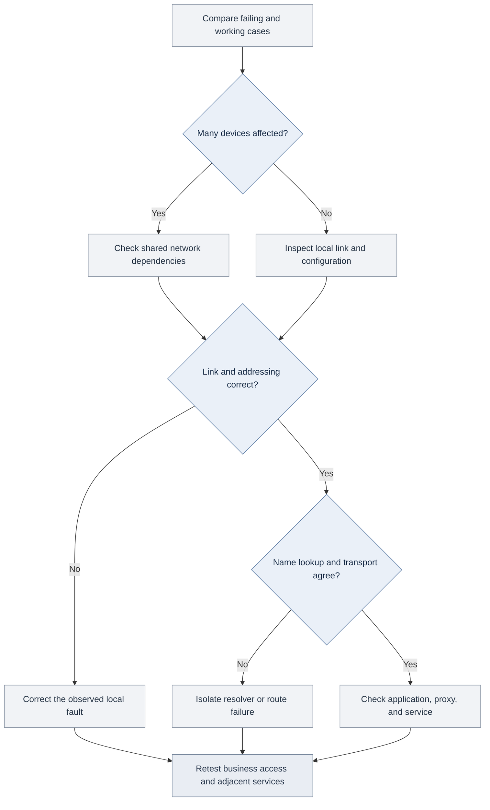

[INTA](https://github.com/Herbertofury/INTA/wiki) / [Decision desk](https://github.com/Herbertofury/INTA/wiki/Decision-Desk) · [Playbooks](https://github.com/Herbertofury/INTA/wiki/Playbooks) · [Tools](https://github.com/Herbertofury/INTA/wiki/Tool-Directory) · [Methods](https://github.com/Herbertofury/INTA/wiki/Methods) · [Open hub](https://herbertofury.github.io/INTA/)

<a id="-fix-internet-dns-or-local-network-problems"></a>

# [Fix internet, DNS, or local-network problems](https://github.com/Herbertofury/INTA/wiki/Job-network-dns)

Locate the failing layer before resetting adapters or changing the whole network.

**Networking** · Intermediate · 15–60 min · 6 steps

[Tools and useful links](#working-kit) · [Quick answer](#quick-answer) · [Next action](#next-action) · [Decision route](#decision-route) · [Tools](#toolkit) · [Procedure](#walkthrough) · [Verification](#acceptance) · [Sources](#sources) · [Interactive checklist](https://herbertofury.github.io/INTA/#job/network-dns)

<a id="working-kit"></a>

## 🧰 Tools and links for this job

**[Open working view](https://herbertofury.github.io/INTA/#job/network-dns)** · Keep the tool panel beside the instructions.

**First move:** Compare another device on the same network. Establish whether the fault affects this PC, one service, the VPN or the whole office.

| Use this for | Official tool + exact action |
| --- | --- |
| Run supported local connection diagnostics. | **[Windows Get Help](https://support.microsoft.com/en-us/support/get-help/about-get-help)** · [Official page](https://support.microsoft.com/en-us/support/get-help/about-get-help) · **[Open network troubleshooting](https://support.microsoft.com/en-us/windows/experience/connectivity-networking/fix-wi-fi-connection-issues-in-windows)** |
| Read IP, DNS and connection results on the affected PC. | **[PowerShell](https://learn.microsoft.com/en-us/powershell/)** · [Official page](https://learn.microsoft.com/en-us/powershell/) · **[Use Windows PowerShell 5.1](https://learn.microsoft.com/en-us/powershell/scripting/windows-powershell/starting-windows-powershell)** |
| Capture only a scoped unresolved protocol failure. | **[Wireshark](https://www.wireshark.org/)** · [Official page](https://www.wireshark.org/) · **[Download Windows x64 · EXE](https://2.na.dl.wireshark.org/win64/Wireshark-4.6.10-x64.exe)** |

### First checks

| Open the exact resource | What to do there |
| --- | --- |
| **[Windows network troubleshooting](https://support.microsoft.com/en-us/windows/experience/connectivity-networking/fix-wi-fi-connection-issues-in-windows)** | Work through local connection checks before a network reset. |

### Read-only diagnostics

| Open the exact resource | What to do there |
| --- | --- |
| **[Get-NetIPConfiguration](https://learn.microsoft.com/en-us/powershell/module/nettcpip/get-netipconfiguration)** | Read the active adapter, address, gateway and DNS servers. |
| **[Resolve-DnsName](https://learn.microsoft.com/en-us/powershell/module/dnsclient/resolve-dnsname)** | Test the actual failing service name. |
| **[Test-NetConnection](https://learn.microsoft.com/en-us/powershell/module/nettcpip/test-netconnection)** | Test the service’s documented TCP port. |

<a id="quick-answer"></a>

## ⚡ Quick answer

<a id="quick-fix-internet"></a>

### 🌐 Fix internet

**Check whether one device, one connection or the whole office has lost access.**

1. Check the cable or Wi-Fi connection and compare another device on the same network.
2. In [Windows Get Help](https://support.microsoft.com/en-us/support/get-help/about-get-help), search “connect to network and internet” and run [network diagnostics](https://github.com/Herbertofury/INTA/wiki/Job-network-dns).
3. Follow the relevant address, gateway or DNS branch, then retest the original site and business service.

**[Windows Get Help](https://support.microsoft.com/en-us/support/get-help/about-get-help)** · [Official page](https://support.microsoft.com/en-us/support/get-help/about-get-help) · **[Open network troubleshooting](https://support.microsoft.com/en-us/windows/experience/connectivity-networking/fix-wi-fi-connection-issues-in-windows)**

<a id="quick-inspect-network-traffic"></a>

### 🌐 Inspect network traffic

**Use packet capture only after basic link, address, gateway and DNS checks have narrowed the fault.**

1. Get authorization and choose the smallest interface, host and time window that can reproduce the issue.
2. Capture the failing request in [Wireshark](https://www.wireshark.org/) and inspect the relevant DNS or connection exchange.
3. Apply one evidenced fix, repeat the request and store the capture only in the private case record.

**[Wireshark](https://www.wireshark.org/)** · [Official page](https://www.wireshark.org/) · **[Download Windows x64 · EXE](https://2.na.dl.wireshark.org/win64/Wireshark-4.6.10-x64.exe)**

<a id="next-action"></a>

## 🧭 Match the symptom

| You see this | Do this next | You should get |
| --- | --- | --- |
| **Only this PC is disconnected** | Check cable/Wi-Fi state and run the Network and Internet diagnostic in [Windows Get Help](https://support.microsoft.com/en-us/support/get-help/about-get-help). | The active link is identified and the diagnostic has a specific result. |
| **The PC has no usable gateway or a self-assigned IPv4 address** | Run Get-NetIPConfiguration; compare the active adapter with the approved DHCP/network configuration. | The PC receives the intended address, gateway and DNS rather than an invented static setting. |
| **IP connectivity works but a hostname fails** | Run Resolve-DnsName for that service name and compare the configured DNS server with a working client. | The correct answer resolves or the faulty DNS dependency is identified. |
| **The name resolves but the application cannot connect** | Run Test-NetConnection for the target’s documented TCP port and compare a working path; a successful TCP test still needs the app test. | The evidence distinguishes blocked transport from an application or authentication failure. |
| **Many devices or only VPN users fail** | Use the shared-network or managed-VPN owner and preserve adapter, route and DNS settings before disruptive changes. | The shared dependency has a scoped repair plan and owner. |

### ✅ Finish the job

- [ ] The original site, share or application works by its normal hostname.
- [ ] Required VPN and business connectivity still work after the change.

**Change route when:** The fault is a shared outage or managed-policy issue outside local authority. · The next action would reset production networking without a recovery path.

> [!NOTE]
> **Start here.** Determine whether the problem affects one app, one device, one network segment, or every device. Capture the working and failing cases.

<a id="decision-route"></a>

<a id="-choose-the-right-branch"></a>

## 🧭 Choose a route



**Route links:** [Continue this workflow](#walkthrough) · [Acceptance checks](#acceptance) · [Bring an office back after a power outage](outage-recovery.md) · [Repair a workstation’s domain trust relationship](ad-trust.md) · [Start and finish a clean remote-support session](remote-support.md) · [Fix Outlook or email send/receive problems](outlook-email.md)

| Checkpoint | What to carry forward |
| --- | --- |
| **Before changing anything** | Record the current network settings and remote recovery path. |
| **Keep during the job** | Link, address, resolver, transport, and application comparisons. |
| **Before handing back** | The intended app, shares, printing, and remote access still work. |

<a id="toolkit"></a>

<a id="-build-the-right-toolkit"></a>

## Recommended tools

Select a tool for the next diagnostic or repair step. Check its platform, access and licensing requirements before use.

| Tool / official page + download | Use it for | Platform & access | Documentation |
| --- | --- | --- | --- |
| **[Windows Get Help](https://support.microsoft.com/en-us/support/get-help/about-get-help)** · [Official page](https://support.microsoft.com/en-us/support/get-help/about-get-help) · **[Open network troubleshooting](https://support.microsoft.com/en-us/windows/experience/connectivity-networking/fix-wi-fi-connection-issues-in-windows)** | Run supported local connection diagnostics. | [Windows](https://www.microsoft.com/windows); Included with supported [Windows](https://www.microsoft.com/windows); assisted support availability depends on the account and support agreement. | [Open guide](https://support.microsoft.com/en-us/support/get-help/windows-troubleshooters) |
| **[PowerShell](https://learn.microsoft.com/en-us/powershell/)** · [Official page](https://learn.microsoft.com/en-us/powershell/) · **[Use Windows PowerShell 5.1](https://learn.microsoft.com/en-us/powershell/scripting/windows-powershell/starting-windows-powershell)** | Read IP, DNS and connection results on the affected PC. | [Windows](https://www.microsoft.com/windows), [Linux](https://www.kernel.org/), [macOS](https://support.apple.com/macos); Free / open source | [Open guide](https://learn.microsoft.com/en-us/powershell/) |
| **[Wireshark](https://www.wireshark.org/)** · [Official page](https://www.wireshark.org/) · **[Download Windows x64 · EXE](https://2.na.dl.wireshark.org/win64/Wireshark-4.6.10-x64.exe)** | Capture only a scoped unresolved protocol failure. | [Windows](https://www.microsoft.com/windows), [Linux](https://www.kernel.org/), [macOS](https://support.apple.com/macos); Free / open source | [Open guide](https://www.wireshark.org/docs/) |
| **[iperf3](https://software.es.net/iperf/)** · [Official page](https://software.es.net/iperf/) · **[Download source · TAR.GZ](https://downloads.es.net/pub/iperf/iperf-3.22.1.tar.gz)** | Separating local network bandwidth limits from internet or application problems. | [Linux](https://www.kernel.org/), [macOS](https://support.apple.com/macos), FreeBSD; Free / open source | [Open guide](https://software.es.net/iperf/invoking.html) |
| **[Microsoft Sysinternals Suite](https://learn.microsoft.com/en-us/sysinternals/)** · [Official page](https://learn.microsoft.com/en-us/sysinternals/) · **[Download Windows portable · ZIP](https://download.sysinternals.com/files/SysinternalsSuite.zip)** | The core portable [Windows](https://www.microsoft.com/windows) troubleshooting kit. | [Windows](https://www.microsoft.com/windows); Free Microsoft utilities | [Open guide](https://learn.microsoft.com/en-us/sysinternals/downloads/) |

<a id="walkthrough"></a>

<a id="-work-the-case"></a>

## Procedure

Work in order, record the result of each step, and change route when the evidence calls for it.

<a id="step-01"></a>

### 01 · Check the physical and radio link

- [ ] Confirm power, cable, switch port, adapter link speed, Wi-Fi association, and signal. Try a known-good cable or port when the evidence points there. Record any recent router, VPN, adapter-driver, or firewall changes.

<a id="step-02"></a>

### 02 · Read the assigned configuration

- [ ] On [Windows](https://www.microsoft.com/windows), run the command below in [PowerShell](https://learn.microsoft.com/en-us/powershell/). Check address, subnet, default route, DNS servers, and DHCP source. Compare with a working device on the same intended network. On a domain network, preserve the organization’s DNS design; replacing internal DNS with a public resolver can break domain services.

**Command for the environment described above:**

```text
Get-NetIPConfiguration
```

**Command legend:** [Get-NetIPConfiguration](https://learn.microsoft.com/en-us/powershell/module/nettcpip/get-netipconfiguration) · [PowerShell](https://learn.microsoft.com/en-us/powershell/) · [Return to the step context](#step-02).

<a id="step-03"></a>

### 03 · Test reachability and name resolution separately

- [ ] Test the observed gateway, then an approved external destination, then the failing hostname. Use the actual gateway from the previous step. An unsuccessful ping alone does not prove an outage because ICMP may be filtered; compare the application’s required TCP connection. The [PowerShell](https://learn.microsoft.com/en-us/powershell/) command uses a public baseline hostname; repeat it with the actual failing hostname.

**Command for the environment described above:**

```text
Resolve-DnsName learn.microsoft.com
```

**Command legend:** [Resolve-DnsName](https://learn.microsoft.com/en-us/powershell/module/dnsclient/resolve-dnsname) · [PowerShell](https://learn.microsoft.com/en-us/powershell/) · [Return to the step context](#step-03).

<a id="step-04"></a>

### 04 · Narrow the application path

- [ ] Compare another browser or application and test with the approved VPN/proxy state. Check time, certificates, captive portal, and service-status information. Use a short, targeted [Wireshark](https://www.wireshark.org/) capture only when it can resolve a specific question, and keep the trace private.

<a id="step-05"></a>

### 05 · Repair only the identified layer

- [ ] Correct the proven DNS, DHCP, routing, adapter, or application configuration. Back up current settings before changes. Reserve network reset for cases that justify rebuilding adapters and settings; it may disrupt VPNs, virtual switches, and a remote-support session.

<a id="step-06"></a>

### 06 · Retest the business workflow

- [ ] Check the original site or app, local shares, printers, domain sign-in, and any VPN. For throughput questions, compare like-for-like endpoints and use upstream [iperf3](https://software.es.net/iperf/) on a supported [Linux](https://www.kernel.org/) or [macOS](https://support.apple.com/macos) system rather than assuming a [Windows](https://www.microsoft.com/windows) build is official.

<a id="acceptance"></a>

<a id="-prove-the-result"></a>

## Verification

- [ ] The failing application works using the intended network path.
- [ ] DNS, shares, printing, VPN, and [remote support](https://github.com/Herbertofury/INTA/wiki/Job-remote-support) still work.
- [ ] The change and its rollback are documented.

> [!WARNING]
> **Pause this route and escalate when:**
> - A remote-only network change would cut off the only recovery path.
> - The problem is a widespread outage or an active security incident.

<a id="-continue-with-the-evidence"></a>

## Related playbooks

| Next playbook | What it resolves |
| --- | --- |
| [Bring an office back after a power outage](outage-recovery.md) | Restore dependencies in order and verify services before releasing the office back to work. |
| [Repair a workstation’s domain trust relationship](ad-trust.md) | Check connectivity, time, and computer identity before repairing a member computer’s secure channel. |
| [Start and finish a clean remote-support session](remote-support.md) | Choose the right attended or managed tool and leave a clear, auditable handoff. |
| [Fix Outlook or email send/receive problems](outlook-email.md) | Separate service, authentication, mailbox, network, and local-client faults. |

<a id="sources"></a>

<a id="-source-trail"></a>

## Official sources

- [Microsoft: Wi-Fi connection troubleshooting](https://support.microsoft.com/en-us/windows/experience/connectivity-networking/fix-wi-fi-connection-issues-in-windows)
- [Microsoft: Windows troubleshooters](https://support.microsoft.com/en-us/support/get-help/windows-troubleshooters)
- [ESnet: iperf3 supported platforms and documentation](https://software.es.net/iperf/)

Reviewed **2026-11-26**. Timing is a planning range. A successful command is evidence about that operation; acceptance belongs to the user’s original task.


---

Editorial review: **2026-11-26** · [Review standard](https://github.com/Herbertofury/INTA/wiki/Knowledge-Standards) · [Suggest a correction](https://github.com/Herbertofury/INTA/issues/new/choose)

[← All playbooks](README.md) · [Live Wiki](https://github.com/Herbertofury/INTA/wiki) · [Contribution guide](https://github.com/Herbertofury/INTA/blob/main/CONTRIBUTING.md)
