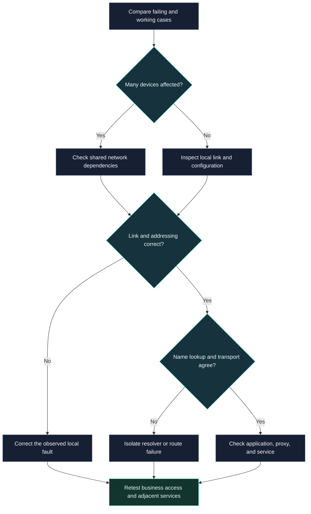

[🏠 Home](https://github.com/Herbertofury/INTA/wiki) · [🧭 Decision desk](https://github.com/Herbertofury/INTA/wiki/Decision-Desk) · [📚 Playbooks](https://github.com/Herbertofury/INTA/wiki/Playbooks) · [🧰 Tool directory](https://github.com/Herbertofury/INTA/wiki/Tool-Directory) · [✨ Open interactive hub](https://herbertofury.github.io/INTA/)

# 🌐 [Fix internet, DNS, or local-network problems](https://github.com/Herbertofury/INTA/wiki/Job-network-dns)

Locate the failing layer before resetting adapters or changing the whole network.

| Work area | Experience | Plan your time | Workflow |
| --- | --- | --- | --- |
| Networking | Intermediate | 15–60 min | 6 steps + acceptance |

**[▶ Open the interactive checklist](https://herbertofury.github.io/INTA/#job/network-dns)** · [Decision route](#decision-route) · [Toolkit](#toolkit) · [Walkthrough](#walkthrough) · [Acceptance](#acceptance) · [Sources](#sources)

> [!TIP]
> **Your starting move:** Determine whether the problem affects one app, one device, one network segment, or every device. Capture the working and failing cases.

<a id="decision-route"></a>

## 🧭 Choose the right branch



**Diagram routes:** [Continue this workflow](#walkthrough) · [Acceptance checks](#acceptance) · [Bring an office back after a power outage](outage-recovery.md) · [Repair a workstation’s domain trust relationship](ad-trust.md) · [Start and finish a clean remote-support session](remote-support.md) · [Fix Outlook or email send/receive problems](outlook-email.md)

| Checkpoint | What to carry forward |
| --- | --- |
| **Before changing anything** | Record the current network settings and remote recovery path. |
| **Keep during the job** | Link, address, resolver, transport, and application comparisons. |
| **Before handing back** | The intended app, shares, printing, and remote access still work. |

<a id="toolkit"></a>

## 🧰 Build the right toolkit

Choose the tools that answer the case’s next question. Opening a tool is a separate decision from changing the customer’s system.

| Tool / official download | Use it for | Platform & access | Documentation |
| --- | --- | --- | --- |
| [Wireshark](https://www.wireshark.org/download.html) | Explaining DNS, TCP and application-protocol failures from a bounded capture. | [Windows](https://www.microsoft.com/windows), [Linux](https://www.kernel.org/), [macOS](https://support.apple.com/macos); Free / open source | [Open guide](https://www.wireshark.org/docs/) |
| [iperf3](https://downloads.es.net/pub/iperf/) | Separating local network bandwidth limits from internet or application problems. | [Linux](https://www.kernel.org/), [macOS](https://support.apple.com/macos), FreeBSD; Free / open source | [Open guide](https://software.es.net/iperf/invoking.html) |
| [Microsoft Sysinternals Suite](https://learn.microsoft.com/en-us/sysinternals/downloads/sysinternals-suite) | The core portable [Windows](https://www.microsoft.com/windows) troubleshooting kit. | [Windows](https://www.microsoft.com/windows); Free Microsoft utilities | [Open guide](https://learn.microsoft.com/en-us/sysinternals/downloads/) |

<a id="walkthrough"></a>

## 🪜 Work the case

Work in order, record the result of each step, and change route when the evidence calls for it.

<a id="step-01"></a>

### 01 · Check the physical and radio link

- [ ] Confirm power, cable, switch port, adapter link speed, Wi-Fi association, and signal. Try a known-good cable or port when the evidence points there. Record any recent router, VPN, adapter-driver, or firewall changes.

<a id="step-02"></a>

### 02 · Read the assigned configuration

- [ ] On [Windows](https://www.microsoft.com/windows), run the command below in [PowerShell](https://learn.microsoft.com/en-us/powershell/). Check address, subnet, default route, DNS servers, and DHCP source. Compare with a working device on the same intended network. On a domain network, preserve the organization’s DNS design; replacing internal DNS with a public resolver can break domain services.

**Command for the environment described above:**

```text
Get-NetIPConfiguration
```

**Command legend:** [Get-NetIPConfiguration](https://learn.microsoft.com/en-us/powershell/module/nettcpip/get-netipconfiguration) · [PowerShell](https://learn.microsoft.com/en-us/powershell/) · [Return to the step context](#step-02).

<a id="step-03"></a>

### 03 · Test reachability and name resolution separately

- [ ] Test the observed gateway, then an approved external destination, then the failing hostname. Use the actual gateway from the previous step. An unsuccessful ping alone does not prove an outage because ICMP may be filtered; compare the application’s required TCP connection. The [PowerShell](https://learn.microsoft.com/en-us/powershell/) command uses a public baseline hostname; repeat it with the actual failing hostname.

**Command for the environment described above:**

```text
Resolve-DnsName learn.microsoft.com
```

**Command legend:** [Resolve-DnsName](https://learn.microsoft.com/en-us/powershell/module/dnsclient/resolve-dnsname) · [PowerShell](https://learn.microsoft.com/en-us/powershell/) · [Return to the step context](#step-03).

<a id="step-04"></a>

### 04 · Narrow the application path

- [ ] Compare another browser or application and test with the approved VPN/proxy state. Check time, certificates, captive portal, and service-status information. Use a short, targeted [Wireshark](https://www.wireshark.org/) capture only when it can resolve a specific question, and keep the trace private.

<a id="step-05"></a>

### 05 · Repair only the identified layer

- [ ] Correct the proven DNS, DHCP, routing, adapter, or application configuration. Back up current settings before changes. Reserve network reset for cases that justify rebuilding adapters and settings; it may disrupt VPNs, virtual switches, and a remote-support session.

<a id="step-06"></a>

### 06 · Retest the business workflow

- [ ] Check the original site or app, local shares, printers, domain sign-in, and any VPN. For throughput questions, compare like-for-like endpoints and use upstream [iperf3](https://software.es.net/iperf/) on a supported [Linux](https://www.kernel.org/) or [macOS](https://support.apple.com/macos) system rather than assuming a [Windows](https://www.microsoft.com/windows) build is official.

<a id="acceptance"></a>

## ✅ Prove the result

- [ ] The failing application works using the intended network path.
- [ ] DNS, shares, printing, VPN, and [remote support](https://github.com/Herbertofury/INTA/wiki/Job-remote-support) still work.
- [ ] The change and its rollback are documented.

> [!WARNING]
> **Pause this route and escalate when:**
> - A remote-only network change would cut off the only recovery path.
> - The problem is a widespread outage or an active security incident.

## 🔀 Continue with the evidence

| Next playbook | What it resolves |
| --- | --- |
| [Bring an office back after a power outage](outage-recovery.md) | Restore dependencies in order and verify services before releasing the office back to work. |
| [Repair a workstation’s domain trust relationship](ad-trust.md) | Check connectivity, time, and computer identity before repairing a member computer’s secure channel. |
| [Start and finish a clean remote-support session](remote-support.md) | Choose the right attended or managed tool and leave a clear, auditable handoff. |
| [Fix Outlook or email send/receive problems](outlook-email.md) | Separate service, authentication, mailbox, network, and local-client faults. |

Found a reusable improvement? [Contribute the correction](https://github.com/Herbertofury/INTA/wiki/Contribute) and include the test that proved it.

<a id="sources"></a>

## 🔎 Source trail

<details>
<summary>Official references and editorial review</summary>

- [Microsoft: Wi-Fi connection troubleshooting](https://support.microsoft.com/en-us/windows/experience/connectivity-networking/fix-wi-fi-connection-issues-in-windows)
- [Microsoft: Windows troubleshooters](https://support.microsoft.com/en-us/support/get-help/windows-troubleshooters)
- [ESnet: iperf3 supported platforms and documentation](https://software.es.net/iperf/)

Reviewed **2026-11-26**. Timing is a planning range. A successful command is evidence about that operation; acceptance belongs to the user’s original task.

</details>

---

**Source review: 2026-11-26.** Guidance review and tool release versions are separate. [Report a correction](https://github.com/Herbertofury/INTA/issues/new/choose) · [How we maintain this guide](https://github.com/Herbertofury/INTA/wiki/Knowledge-Standards)

[← All playbooks](README.md) · [Live Wiki](https://github.com/Herbertofury/INTA/wiki) · [Contribution guide](https://github.com/Herbertofury/INTA/blob/main/CONTRIBUTING.md)
