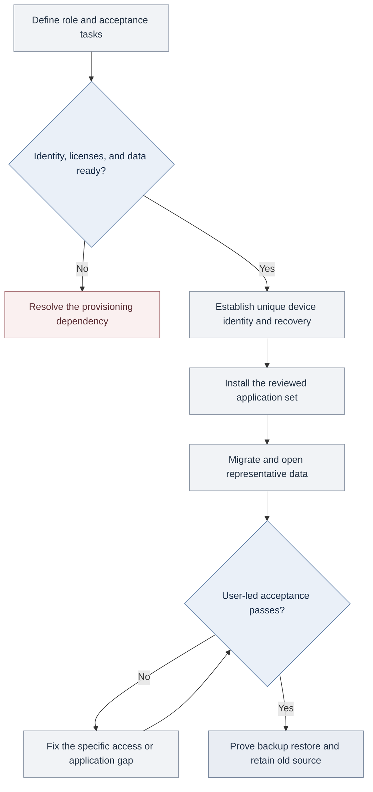

[INTA](https://github.com/Herbertofury/INTA/wiki) / [Decision desk](https://github.com/Herbertofury/INTA/wiki/Decision-Desk) · [Playbooks](https://github.com/Herbertofury/INTA/wiki/Playbooks) · [Tools](https://github.com/Herbertofury/INTA/wiki/Tool-Directory) · [Methods](https://github.com/Herbertofury/INTA/wiki/Methods) · [Open hub](https://herbertofury.github.io/INTA/)

# [Set up a dependable new workstation](https://github.com/Herbertofury/INTA/wiki/Job-new-pc)

Build a usable, recoverable workstation around the employee’s actual job.

**Deployment** · Intermediate · 60–180 min · 6 steps

[Quick answer](#quick-answer) · [Decision route](#decision-route) · [Tools](#toolkit) · [Procedure](#walkthrough) · [Verification](#acceptance) · [Sources](#sources) · [Interactive checklist](https://herbertofury.github.io/INTA/#job/new-pc)

## ⚡ Quick answer

### 💻 Set up a new PC

**Confirm the owner, approved applications, identity setup and recovery requirements before installing software.**

1. Complete the approved [Windows](https://www.microsoft.com/windows) and device-driver updates and check basic hardware operation.
2. Use [WinGet](https://learn.microsoft.com/en-us/windows/package-manager/winget/) for approved available packages, reviewing the package identity and each application’s license.
3. Verify sign-in, encryption recovery, backup and the user’s daily tasks before handoff.

**[WinGet](https://learn.microsoft.com/en-us/windows/package-manager/winget/)** · [Official page](https://learn.microsoft.com/en-us/windows/package-manager/winget/) · **[Download App Installer · MSIXBUNDLE](https://github.com/microsoft/winget-cli/releases/download/v1.29.380/Microsoft.DesktopAppInstaller_8wekyb3d8bbwe.msixbundle)**

> [!NOTE]
> **Start here.** Collect the job role, approved applications, identity/join requirements, data sources, printers, and acceptance tests before provisioning.

## 🧭 Choose a route

View the decision map and escalation routes

**Route links:** [Continue this workflow](#walkthrough) · [Acceptance checks](#acceptance) · [Clone a healthy system or migrate to a new SSD](disk-migration.md) · [Prove a backup can actually restore](backup-restore.md) · [Start and finish a clean remote-support session](remote-support.md) · [Close a repair with a clear client handoff](client-handoff.md)

| Checkpoint | What to carry forward |
| --- | --- |
| **Before changing anything** | Confirm the role, access, recovery keys, and retained migration source. |
| **Keep during the job** | Device baseline, app inventory, migrated data, and setup decisions. |
| **Before handing back** | Employee tasks, backup restore, encryption, and support access pass. |

## Recommended tools

Select a tool for the next diagnostic or repair step. Check its platform, access and licensing requirements before use.

| Tool / official page + download | Use it for | Platform & access | Documentation |
| --- | --- | --- | --- |
| **[WinGet](https://learn.microsoft.com/en-us/windows/package-manager/winget/)** · [Official page](https://learn.microsoft.com/en-us/windows/package-manager/winget/) · **[Download App Installer · MSIXBUNDLE](https://github.com/microsoft/winget-cli/releases/download/v1.29.380/Microsoft.DesktopAppInstaller_8wekyb3d8bbwe.msixbundle)** | Repeatable application setup and individually reviewed updates. | [Windows](https://www.microsoft.com/windows); Free / open source | [Open guide](https://learn.microsoft.com/en-us/windows/package-manager/winget/) |
| **[Microsoft PowerToys](https://learn.microsoft.com/en-us/windows/powertoys/)** · [Official page](https://learn.microsoft.com/en-us/windows/powertoys/) · **[Download Windows x64 setup · EXE](https://github.com/microsoft/PowerToys/releases/download/v0.102.3101/PowerToysUserSetup-0.102.3101.0-x64.exe)** | Making the technician workstation easier to navigate and operate. | [Windows](https://www.microsoft.com/windows); Free / open source | [Open guide](https://learn.microsoft.com/en-us/windows/powertoys/) |
| **[Veeam Agent for Microsoft Windows](https://www.veeam.com/products/free/microsoft-windows)** · [Official page](https://www.veeam.com/products/free/microsoft-windows) · **[Sign in for the Windows download](https://www.veeam.com/products/physical/windows-backup-recovery-download.html)** | Image backup and recovery media for a supported [Windows](https://www.microsoft.com/windows) endpoint. | [Windows](https://www.microsoft.com/windows); Free and paid editions; service-provider terms differ | [Open guide](https://helpcenter.veeam.com/docs/agentforwindows/userguide/overview.html) |
| **[RustDesk](https://rustdesk.com/)** · [Official page](https://rustdesk.com/) · **[Download Windows x64 · EXE](https://github.com/rustdesk/rustdesk/releases/download/1.5.3/rustdesk-1.5.3-x86_64.exe)** | A flexible remote-control option across mixed client platforms. | [Windows](https://www.microsoft.com/windows), [Linux](https://www.kernel.org/), [macOS](https://support.apple.com/macos); Open-source components; paid Server Pro features | [Open guide](https://rustdesk.com/docs/en/) |
| **[MeshCentral](https://meshcentral.com/)** · [Official page](https://meshcentral.com/) · **[Open server installation instructions](https://github.com/Ylianst/MeshCentral#installation)** | INTA-managed unattended support with its own server and device groups. | [Windows](https://www.microsoft.com/windows), [Linux](https://www.kernel.org/), [macOS](https://support.apple.com/macos); Free / open source; hosting has a cost | [Open guide](https://docs.meshcentral.com/) |

## Procedure

Work in order, record the result of each step, and change route when the evidence calls for it.

### 01 · Record the new device and baseline

- [ ] Capture model, serial, warranty, [Windows](https://www.microsoft.com/windows) edition/build, firmware, storage, and memory in the private asset record. Use the supported OS and vendor driver path. Confirm hardware compatibility before applying firmware or feature updates.

### 02 · Establish identity and recovery

- [ ] Give the device a unique approved name and join the intended management/domain system. Set up the employee’s standard account and approved administrative access. Configure encryption and verify recovery-key escrow through the organization’s chosen management system.

### 03 · Install the approved application set

- [ ] Use official installers or reviewed [WinGet](https://learn.microsoft.com/en-us/windows/package-manager/winget/) package IDs. An exported [WinGet](https://learn.microsoft.com/en-us/windows/package-manager/winget/) list can help migration, but unmatched apps, settings, licenses, and data still need separate handling. Review the package list before importing; do not blindly reproduce obsolete or unwanted software.

### 04 · Migrate and verify data

- [ ] Restore approved user data from a validated backup or migration source. Preserve folder structure and permissions, and open the client’s important files. Do not overwrite the source computer until the new device has passed acceptance.

### 05 · Finish the operational services

- [ ] Configure the single intended real-time security product, backup, printers, VPN, email, browser settings, and approved remote management. Confirm notifications and background jobs fit the employee’s working hours without disabling essential protection.

### 06 · Run a user-led acceptance session

- [ ] Have the employee sign in and complete the real tasks: open files, send and receive email, print, reach shared resources, and restart. Prove a small backup restore. Record any remaining app or access gap with an owner and due date.

## Verification

- [ ] The employee completes the agreed business tasks.
- [ ] Encryption recovery, backup restore, and approved [remote support](https://github.com/Herbertofury/INTA/wiki/Job-remote-support) are verified.
- [ ] The old source remains available until the migration is accepted.

> [!WARNING]
> **Pause this route and escalate when:**
> - Required licensing, access, recovery keys, or data sources are unresolved.
> - A migration action would destroy the only good source.

## Related playbooks

| Next playbook | What it resolves |
| --- | --- |
| [Clone a healthy system or migrate to a new SSD](disk-migration.md) | Move a working system with clear source/destination control and a rollback copy. |
| [Prove a backup can actually restore](backup-restore.md) | Validate recovery credentials, data integrity, application usability, and recovery time. |
| [Start and finish a clean remote-support session](remote-support.md) | Choose the right attended or managed tool and leave a clear, auditable handoff. |
| [Close a repair with a clear client handoff](client-handoff.md) | Turn completed technical work into proof the customer can use, with clean access and an actionable service record. |

## Official sources

References and review notes

- [Microsoft: WinGet export](https://learn.microsoft.com/en-us/windows/package-manager/winget/export)
- [Microsoft: WinGet import](https://learn.microsoft.com/en-us/windows/package-manager/winget/import)

Reviewed **2026-11-26**. Timing is a planning range. A successful command is evidence about that operation; acceptance belongs to the user’s original task.

---

Editorial review: **2026-11-26** · [Review standard](https://github.com/Herbertofury/INTA/wiki/Knowledge-Standards) · [Suggest a correction](https://github.com/Herbertofury/INTA/issues/new/choose)

[← All playbooks](README.md) · [Live Wiki](https://github.com/Herbertofury/INTA/wiki) · [Contribution guide](https://github.com/Herbertofury/INTA/blob/main/CONTRIBUTING.md)
