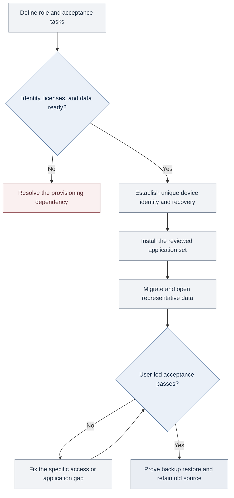

<a href="https://herbertofury.github.io/INTA/" title="Open INTA official download or service page" aria-label="Open INTA official download or service page" data-inta-brand="app-inta"></a> [INTA](https://github.com/Herbertofury/INTA/wiki) / [Decision desk](https://github.com/Herbertofury/INTA/wiki/Decision-Desk) · [Service map](https://github.com/Herbertofury/INTA/wiki/Service-Map) · [Playbooks](https://github.com/Herbertofury/INTA/wiki/Playbooks) · [Tools](https://github.com/Herbertofury/INTA/wiki/Tool-Directory) · [Methods](https://github.com/Herbertofury/INTA/wiki/Methods) · [Open hub](https://herbertofury.github.io/INTA/)

<a id="-set-up-a-dependable-new-workstation"></a>

# [Set up a dependable new workstation](https://github.com/Herbertofury/INTA/wiki/Job-new-pc)

Build a usable, recoverable workstation around the employee’s actual job.

**Deployment** · Intermediate · 60–180 min · 6 steps

[Tools and useful links](#working-kit) · [Quick answer](#quick-answer) · [Next action](#next-action) · [Specific fixes](#specific-fixes) · [Decision route](#decision-route) · [Tools](#toolkit) · [Procedure](#walkthrough) · [Verification](#acceptance) · [Sources](#sources) · [Interactive checklist](https://herbertofury.github.io/INTA/#job/new-pc)

<a id="tool-choices"></a>

## 🧰 Choose the tool for this job

Choose by the task shown in the first column. Each option includes its acquisition route and access boundary.

| Need | Official tool + exact action | Why this choice / access |
| --- | --- | --- |
| **Approved application setup** | **<a href="https://github.com/microsoft/winget-cli/releases/latest" title="Open Windows Package Manager (WinGet) official download or service page" aria-label="Open Windows Package Manager (WinGet) official download or service page" data-inta-brand="web-app-winget"></a> [WinGet](https://learn.microsoft.com/en-us/windows/package-manager/winget/)** · **<a href="https://github.com/microsoft/winget-cli/releases/latest" title="Open Windows Package Manager (WinGet) official download or service page" aria-label="Open Windows Package Manager (WinGet) official download or service page" data-inta-brand="web-app-winget"></a> [Download App Installer · MSIXBUNDLE](https://github.com/microsoft/winget-cli/releases/download/v1.29.380/Microsoft.DesktopAppInstaller_8wekyb3d8bbwe.msixbundle)** | Identify exact packages and sources before installing the agreed applications. **Access:** Included App Installer; each app keeps its own license. |
| **Model-specific drivers** | **<a href="https://support.microsoft.com/en-us/windows/hardware/drivers/update-drivers-through-device-manager-in-windows" title="Open Official OEM driver and firmware portals official download or service page" aria-label="Open Official OEM driver and firmware portals official download or service page" data-inta-brand="oem-drivers"></a> [Official OEM driver and firmware portals](https://support.microsoft.com/en-us/windows/hardware/drivers/update-drivers-through-device-manager-in-windows)** · **<a href="https://support.microsoft.com/en-us/windows/hardware/drivers/update-drivers-through-device-manager-in-windows" title="Open Official OEM driver and firmware portals official download or service page" aria-label="Open Official OEM driver and firmware portals official download or service page" data-inta-brand="oem-drivers"></a> [Find the correct driver source](https://support.microsoft.com/en-us/windows/hardware/drivers/update-drivers-through-device-manager-in-windows)** | Use the device manufacturer’s supported drivers and firmware for the exact model and OS. **Access:** Vendor downloads; support terms vary. |
| **Move agreed user files** | **<a href="https://learn.microsoft.com/en-us/windows-server/administration/windows-commands/robocopy" title="Open Robocopy official download or service page" aria-label="Open Robocopy official download or service page" data-inta-brand="robocopy"></a> [Robocopy](https://learn.microsoft.com/en-us/windows-server/administration/windows-commands/robocopy)** · **<a href="https://learn.microsoft.com/en-us/windows-server/administration/windows-commands/robocopy" title="Open Robocopy official download or service page" aria-label="Open Robocopy official download or service page" data-inta-brand="robocopy"></a> [Open built-in copy instructions](https://learn.microsoft.com/en-us/windows-server/administration/windows-commands/robocopy)** | Copy the approved data with an inspectable log and verify it as the target user. **Access:** Included with supported <a href="https://www.microsoft.com/windows" title="Open Windows official download or service page" aria-label="Open Windows official download or service page" data-inta-brand="app-windows"></a> [Windows](https://www.microsoft.com/windows) |

**[Current selection evidence](https://github.com/Herbertofury/INTA/wiki/Current-Tool-Choices)**

<a id="working-kit"></a>

## 🧰 Tools and links for this job

**[Open working view](https://herbertofury.github.io/INTA/#job/new-pc)** · Keep the tool panel beside the instructions.

**First move:** Confirm the owner, organization enrollment method, required apps and migrated data. Check Settings > System > About for the actual <a href="https://www.microsoft.com/windows" title="Open Windows official download or service page" aria-label="Open Windows official download or service page" data-inta-brand="app-windows"></a> [Windows](https://www.microsoft.com/windows) version and architecture.

| Use this for | Official tool + exact action |
| --- | --- |
| Identify and install approved application packages. | **<a href="https://github.com/microsoft/winget-cli/releases/latest" title="Open Windows Package Manager (WinGet) official download or service page" aria-label="Open Windows Package Manager (WinGet) official download or service page" data-inta-brand="web-app-winget"></a> [WinGet](https://learn.microsoft.com/en-us/windows/package-manager/winget/)** · <a href="https://github.com/microsoft/winget-cli/releases/latest" title="Open Windows Package Manager (WinGet) official download or service page" aria-label="Open Windows Package Manager (WinGet) official download or service page" data-inta-brand="web-app-winget"></a> [Official page](https://learn.microsoft.com/en-us/windows/package-manager/winget/) · **<a href="https://github.com/microsoft/winget-cli/releases/latest" title="Open Windows Package Manager (WinGet) official download or service page" aria-label="Open Windows Package Manager (WinGet) official download or service page" data-inta-brand="web-app-winget"></a> [Download App Installer · MSIXBUNDLE](https://github.com/microsoft/winget-cli/releases/download/v1.29.380/Microsoft.DesktopAppInstaller_8wekyb3d8bbwe.msixbundle)** |
| Use the exact device vendor’s supported drivers and firmware. | **<a href="https://support.microsoft.com/en-us/windows/hardware/drivers/update-drivers-through-device-manager-in-windows" title="Open Official OEM driver and firmware portals official download or service page" aria-label="Open Official OEM driver and firmware portals official download or service page" data-inta-brand="oem-drivers"></a> [Official OEM driver and firmware portals](https://support.microsoft.com/en-us/windows/hardware/drivers/update-drivers-through-device-manager-in-windows)** · <a href="https://support.microsoft.com/en-us/windows/hardware/drivers/update-drivers-through-device-manager-in-windows" title="Open Official OEM driver and firmware portals official download or service page" aria-label="Open Official OEM driver and firmware portals official download or service page" data-inta-brand="oem-drivers"></a> [Official page](https://support.microsoft.com/en-us/windows/hardware/drivers/update-drivers-through-device-manager-in-windows) · **<a href="https://support.microsoft.com/en-us/windows/hardware/drivers/update-drivers-through-device-manager-in-windows" title="Open Official OEM driver and firmware portals official download or service page" aria-label="Open Official OEM driver and firmware portals official download or service page" data-inta-brand="oem-drivers"></a> [Find the correct driver source](https://support.microsoft.com/en-us/windows/hardware/drivers/update-drivers-through-device-manager-in-windows)** |
| Move only the agreed files with a reviewed copy plan. | **<a href="https://learn.microsoft.com/en-us/windows-server/administration/windows-commands/robocopy" title="Open Robocopy official download or service page" aria-label="Open Robocopy official download or service page" data-inta-brand="robocopy"></a> [Robocopy](https://learn.microsoft.com/en-us/windows-server/administration/windows-commands/robocopy)** · <a href="https://learn.microsoft.com/en-us/windows-server/administration/windows-commands/robocopy" title="Open Robocopy official download or service page" aria-label="Open Robocopy official download or service page" data-inta-brand="robocopy"></a> [Official page](https://learn.microsoft.com/en-us/windows-server/administration/windows-commands/robocopy) · **<a href="https://learn.microsoft.com/en-us/windows-server/administration/windows-commands/robocopy" title="Open Robocopy official download or service page" aria-label="Open Robocopy official download or service page" data-inta-brand="robocopy"></a> [Open built-in copy instructions](https://learn.microsoft.com/en-us/windows-server/administration/windows-commands/robocopy)** |
| Evaluate an approved package in a disposable desktop with network and shared-folder exposure explicitly configured. | **<a href="https://learn.microsoft.com/en-us/windows/security/application-security/application-isolation/windows-sandbox/windows-sandbox-install" title="Open Windows Sandbox official download or service page" aria-label="Open Windows Sandbox official download or service page" data-inta-brand="windows-sandbox"></a> [Windows Sandbox](https://learn.microsoft.com/en-us/windows/security/application-security/application-isolation/windows-sandbox/)** · <a href="https://learn.microsoft.com/en-us/windows/security/application-security/application-isolation/windows-sandbox/windows-sandbox-install" title="Open Windows Sandbox official download or service page" aria-label="Open Windows Sandbox official download or service page" data-inta-brand="windows-sandbox"></a> [Official page](https://learn.microsoft.com/en-us/windows/security/application-security/application-isolation/windows-sandbox/) · **<a href="https://learn.microsoft.com/en-us/windows/security/application-security/application-isolation/windows-sandbox/windows-sandbox-install" title="Open Windows Sandbox official download or service page" aria-label="Open Windows Sandbox official download or service page" data-inta-brand="windows-sandbox"></a> [Enable Windows Sandbox](https://learn.microsoft.com/en-us/windows/security/application-security/application-isolation/windows-sandbox/windows-sandbox-install)** |
| Synchronize an explicitly chosen healthy-data folder between approved machines; keep an independent backup. | **<a href="https://syncthing.net/downloads/" title="Open Syncthing official download or service page" aria-label="Open Syncthing official download or service page" data-inta-brand="syncthing"></a> [Syncthing](https://syncthing.net/)** · <a href="https://syncthing.net/downloads/" title="Open Syncthing official download or service page" aria-label="Open Syncthing official download or service page" data-inta-brand="syncthing"></a> [Official page](https://syncthing.net/) · **<a href="https://www.microsoft.com/windows" title="Open Windows official download or service page" aria-label="Open Windows official download or service page" data-inta-brand="app-windows"></a> [Download Windows x64 · ZIP](https://github.com/syncthing/syncthing/releases/download/v2.1.7/syncthing-windows-amd64-v2.1.7.zip)** |
| Starting an approved installer or rescue environment through network boot or remote virtual media when local media delivery is inconvenient. | **<a href="https://netboot.xyz/downloads/" title="Open netboot.xyz official download or service page" aria-label="Open netboot.xyz official download or service page" data-inta-brand="netbootxyz"></a> [netboot.xyz](https://netboot.xyz/)** · <a href="https://netboot.xyz/downloads/" title="Open netboot.xyz official download or service page" aria-label="Open netboot.xyz official download or service page" data-inta-brand="netbootxyz"></a> [Official page](https://netboot.xyz/) · **<a href="https://netboot.xyz/downloads/" title="Open netboot.xyz official download or service page" aria-label="Open netboot.xyz official download or service page" data-inta-brand="netbootxyz"></a> [Download PC network-boot image · ISO](https://github.com/netbootxyz/netboot.xyz/releases/download/3.0.3/netboot.xyz.iso)** |
| Establishing recoverable, per-device administrator access during managed workstation setup and support planning. | **<a href="https://learn.microsoft.com/en-us/windows-server/identity/laps/laps-overview" title="Open Windows LAPS official download or service page" aria-label="Open Windows LAPS official download or service page" data-inta-brand="windows-laps"></a> [Windows LAPS](https://learn.microsoft.com/en-us/windows-server/identity/laps/laps-overview)** · <a href="https://learn.microsoft.com/en-us/windows-server/identity/laps/laps-overview" title="Open Windows LAPS official download or service page" aria-label="Open Windows LAPS official download or service page" data-inta-brand="windows-laps"></a> [Official page](https://learn.microsoft.com/en-us/windows-server/identity/laps/laps-overview) · **<a href="https://learn.microsoft.com/en-us/windows-server/identity/laps/laps-overview" title="Open Windows LAPS official download or service page" aria-label="Open Windows LAPS official download or service page" data-inta-brand="windows-laps"></a> [Configure built-in administrator password management](https://learn.microsoft.com/en-us/windows-server/identity/laps/laps-overview)** |

### Applications

| Open the exact resource | What to do there |
| --- | --- |
| **<a href="https://github.com/microsoft/winget-cli/releases/latest" title="Open Windows Package Manager (WinGet) official download or service page" aria-label="Open Windows Package Manager (WinGet) official download or service page" data-inta-brand="web-app-winget"></a> [WinGet package identification and install](https://learn.microsoft.com/en-us/windows/package-manager/winget/install)** | Review the exact package and source before installing. |
| **<a href="https://github.com/microsoft/winget-cli/releases/latest" title="Open Windows Package Manager (WinGet) official download or service page" aria-label="Open Windows Package Manager (WinGet) official download or service page" data-inta-brand="web-app-winget"></a> [WinGet import review](https://learn.microsoft.com/en-us/windows/package-manager/winget/import)** | Reapply an approved inventory; licenses and user data remain separate. |

### Device readiness

| Open the exact resource | What to do there |
| --- | --- |
| **<a href="https://www.microsoft.com/windows" title="Open Windows official download or service page" aria-label="Open Windows official download or service page" data-inta-brand="app-windows"></a> [Supported Windows driver updates](https://support.microsoft.com/en-us/windows/hardware/drivers/update-drivers-through-device-manager-in-windows)** | Use <a href="https://learn.microsoft.com/en-us/windows/deployment/update/" title="Open Windows Update official download or service page" aria-label="Open Windows Update official download or service page" data-inta-brand="app-windows-update"></a> [Windows Update](https://learn.microsoft.com/en-us/windows/deployment/update/) and the correct device/manufacturer route. |

### Handoff

| Open the exact resource | What to do there |
| --- | --- |
| **[Workstation acceptance sheet](https://github.com/Herbertofury/INTA/wiki/Technician-Handoff)** | Record identity, encryption recovery, backup and daily-task proof. |

### Shared storage

| Open the exact resource | What to do there |
| --- | --- |
| **<a href="https://learn.microsoft.com/en-us/windows-server/" title="Open Windows Server official download or service page" aria-label="Open Windows Server official download or service page" data-inta-brand="app-windows-server"></a> [Current SMB signing requirements](https://learn.microsoft.com/en-us/windows-server/storage/file-server/smb-signing)** | Match the client edition and server signing/account support before changing a share. |

<a id="quick-answer"></a>

## ⚡ Quick answer

<a id="quick-set-up-a-new-pc"></a>

### 💻 Set up a new PC

**Confirm the owner, approved applications, identity setup and recovery requirements before installing software.**

1. Complete the approved <a href="https://www.microsoft.com/windows" title="Open Windows official download or service page" aria-label="Open Windows official download or service page" data-inta-brand="app-windows"></a> [Windows](https://www.microsoft.com/windows) and device-driver updates and check basic hardware operation.
2. Use <a href="https://github.com/microsoft/winget-cli/releases/latest" title="Open Windows Package Manager (WinGet) official download or service page" aria-label="Open Windows Package Manager (WinGet) official download or service page" data-inta-brand="web-app-winget"></a> [WinGet](https://learn.microsoft.com/en-us/windows/package-manager/winget/) for approved available packages, reviewing the package identity and each application’s license.
3. Verify sign-in, encryption recovery, backup and the user’s daily tasks before handoff.

**<a href="https://github.com/microsoft/winget-cli/releases/latest" title="Open Windows Package Manager (WinGet) official download or service page" aria-label="Open Windows Package Manager (WinGet) official download or service page" data-inta-brand="web-app-winget"></a> [WinGet](https://learn.microsoft.com/en-us/windows/package-manager/winget/)** · <a href="https://github.com/microsoft/winget-cli/releases/latest" title="Open Windows Package Manager (WinGet) official download or service page" aria-label="Open Windows Package Manager (WinGet) official download or service page" data-inta-brand="web-app-winget"></a> [Official page](https://learn.microsoft.com/en-us/windows/package-manager/winget/) · **<a href="https://github.com/microsoft/winget-cli/releases/latest" title="Open Windows Package Manager (WinGet) official download or service page" aria-label="Open Windows Package Manager (WinGet) official download or service page" data-inta-brand="web-app-winget"></a> [Download App Installer · MSIXBUNDLE](https://github.com/microsoft/winget-cli/releases/download/v1.29.380/Microsoft.DesktopAppInstaller_8wekyb3d8bbwe.msixbundle)**

<a id="next-action"></a>

## 🧭 Match the symptom

| You see this | Do this next | You should get |
| --- | --- | --- |
| **The device is new or has a fresh installation** | Complete the approved enrollment and <a href="https://www.microsoft.com/windows" title="Open Windows official download or service page" aria-label="Open Windows official download or service page" data-inta-brand="app-windows"></a> [Windows](https://www.microsoft.com/windows)/OEM updates, then check <a href="https://support.microsoft.com/en-us/windows/hardware/drivers/update-drivers-through-device-manager-in-windows" title="Open Device Manager official download or service page" aria-label="Open Device Manager official download or service page" data-inta-brand="app-device-manager"></a> [Device Manager](https://support.microsoft.com/en-us/windows/hardware/drivers/update-drivers-through-device-manager-in-windows) for unresolved devices. | The intended identity and basic hardware work without unexplained device faults. |
| **Approved applications must be installed** | Use <a href="https://github.com/microsoft/winget-cli/releases/latest" title="Open Windows Package Manager (WinGet) official download or service page" aria-label="Open Windows Package Manager (WinGet) official download or service page" data-inta-brand="web-app-winget"></a> [WinGet](https://learn.microsoft.com/en-us/windows/package-manager/winget/) search/show to confirm package identity and review installation or the approved import list. | Each required app launches with the correct license and user context. |
| **Data comes from the previous device** | Copy the agreed data using the migration plan and test representative files in their real applications. | The user can access the expected files without relying on the old device. |
| **Setup is nearly complete** | Verify encryption recovery storage, a backup restore, printing and the user’s daily workflow before handoff. | The workstation is usable and recoverable, with acceptance evidence recorded. |

### ✅ Finish the job

- [ ] The owner can sign in and complete the agreed daily tasks.
- [ ] Recovery material and a tested backup are accessible through the approved private process.

**Change route when:** Enrollment, licensing or recovery ownership is unclear. · Migration would endanger the only copy of user data.

### 🎯 Go straight to a specific fix

- **[Restore network access during device setup](#fix-newpc-network-missing-during-setup)** — A newly installed PC has no working network adapter during <a href="https://www.microsoft.com/windows" title="Open Windows official download or service page" aria-label="Open Windows official download or service page" data-inta-brand="app-windows"></a> [Windows](https://www.microsoft.com/windows) setup.
- **[Make the package manager available to the user](#fix-newpc-winget-not-found)** — The <a href="https://github.com/microsoft/winget-cli/releases/latest" title="Open Windows Package Manager (WinGet) official download or service page" aria-label="Open Windows Package Manager (WinGet) official download or service page" data-inta-brand="web-app-winget"></a> [winget](https://learn.microsoft.com/en-us/windows/package-manager/winget/) command is not recognized on a newly prepared supported <a href="https://www.microsoft.com/windows" title="Open Windows official download or service page" aria-label="Open Windows official download or service page" data-inta-brand="app-windows"></a> [Windows](https://www.microsoft.com/windows) PC.
- **[Confirm the intended organization device state](#fix-newpc-registered-is-not-joined)** — A work account is present, but the device does not receive expected management or sign-in behavior.
- **[Connect a new PC to a compatible authenticated share](#fix-newpc-nas-share-signing-compatibility)** — A replacement or upgraded PC rejects a NAS share that an older PC can still access.

> [!NOTE]
> **Start here.** Collect the job role, approved applications, identity/join requirements, data sources, printers, and acceptance tests before provisioning.

<a id="decision-route"></a>

<a id="-choose-the-right-branch"></a>

## 🧭 Choose a route



**Route links:** [Continue this workflow](#walkthrough) · [Acceptance checks](#acceptance) · [Clone a healthy system or migrate to a new SSD](disk-migration.md) · [Prove a backup can actually restore](backup-restore.md) · [Start and finish a clean remote-support session](remote-support.md) · [Close a repair with a clear client handoff](client-handoff.md)

| Checkpoint | What to carry forward |
| --- | --- |
| **Before changing anything** | Confirm the role, access, recovery keys, and retained migration source. |
| **Keep during the job** | Device baseline, app inventory, migrated data, and setup decisions. |
| **Before handing back** | Employee tasks, backup restore, encryption, and support access pass. |

<a id="toolkit"></a>

<a id="-build-the-right-toolkit"></a>

## Recommended tools

Select a tool for the next diagnostic or repair step. Check its platform, access and licensing requirements before use.

| Tool / official page + download | Use it for | Platform & access | Documentation |
| --- | --- | --- | --- |
| **<a href="https://github.com/microsoft/winget-cli/releases/latest" title="Open Windows Package Manager (WinGet) official download or service page" aria-label="Open Windows Package Manager (WinGet) official download or service page" data-inta-brand="web-app-winget"></a> [WinGet](https://learn.microsoft.com/en-us/windows/package-manager/winget/)** · <a href="https://github.com/microsoft/winget-cli/releases/latest" title="Open Windows Package Manager (WinGet) official download or service page" aria-label="Open Windows Package Manager (WinGet) official download or service page" data-inta-brand="web-app-winget"></a> [Official page](https://learn.microsoft.com/en-us/windows/package-manager/winget/) · **<a href="https://github.com/microsoft/winget-cli/releases/latest" title="Open Windows Package Manager (WinGet) official download or service page" aria-label="Open Windows Package Manager (WinGet) official download or service page" data-inta-brand="web-app-winget"></a> [Download App Installer · MSIXBUNDLE](https://github.com/microsoft/winget-cli/releases/download/v1.29.380/Microsoft.DesktopAppInstaller_8wekyb3d8bbwe.msixbundle)** | Identify and install approved application packages. | <a href="https://www.microsoft.com/windows" title="Open Windows official download or service page" aria-label="Open Windows official download or service page" data-inta-brand="app-windows"></a> [Windows](https://www.microsoft.com/windows); Free / open source | <a href="https://github.com/microsoft/winget-cli/releases/latest" title="Open Windows Package Manager (WinGet) official download or service page" aria-label="Open Windows Package Manager (WinGet) official download or service page" data-inta-brand="web-app-winget"></a> [Open guide](https://learn.microsoft.com/en-us/windows/package-manager/winget/) |
| **<a href="https://support.microsoft.com/en-us/windows/hardware/drivers/update-drivers-through-device-manager-in-windows" title="Open Official OEM driver and firmware portals official download or service page" aria-label="Open Official OEM driver and firmware portals official download or service page" data-inta-brand="oem-drivers"></a> [Official OEM driver and firmware portals](https://support.microsoft.com/en-us/windows/hardware/drivers/update-drivers-through-device-manager-in-windows)** · <a href="https://support.microsoft.com/en-us/windows/hardware/drivers/update-drivers-through-device-manager-in-windows" title="Open Official OEM driver and firmware portals official download or service page" aria-label="Open Official OEM driver and firmware portals official download or service page" data-inta-brand="oem-drivers"></a> [Official page](https://support.microsoft.com/en-us/windows/hardware/drivers/update-drivers-through-device-manager-in-windows) · **<a href="https://support.microsoft.com/en-us/windows/hardware/drivers/update-drivers-through-device-manager-in-windows" title="Open Official OEM driver and firmware portals official download or service page" aria-label="Open Official OEM driver and firmware portals official download or service page" data-inta-brand="oem-drivers"></a> [Find the correct driver source](https://support.microsoft.com/en-us/windows/hardware/drivers/update-drivers-through-device-manager-in-windows)** | Use the exact device vendor’s supported drivers and firmware. | <a href="https://www.microsoft.com/windows" title="Open Windows official download or service page" aria-label="Open Windows official download or service page" data-inta-brand="app-windows"></a> [Windows](https://www.microsoft.com/windows), <a href="https://www.kernel.org/" title="Open Linux official download or service page" aria-label="Open Linux official download or service page" data-inta-brand="app-linux"></a> [Linux](https://www.kernel.org/), <a href="https://support.apple.com/macos" title="Open macOS official download or service page" aria-label="Open macOS official download or service page" data-inta-brand="app-macos"></a> [macOS](https://support.apple.com/macos); Vendor downloads; support terms vary | <a href="https://support.microsoft.com/en-us/windows/hardware/drivers/update-drivers-through-device-manager-in-windows" title="Open Official OEM driver and firmware portals official download or service page" aria-label="Open Official OEM driver and firmware portals official download or service page" data-inta-brand="oem-drivers"></a> [Open guide](https://support.microsoft.com/en-us/windows/hardware/drivers/update-drivers-through-device-manager-in-windows) |
| **<a href="https://learn.microsoft.com/en-us/windows-server/administration/windows-commands/robocopy" title="Open Robocopy official download or service page" aria-label="Open Robocopy official download or service page" data-inta-brand="robocopy"></a> [Robocopy](https://learn.microsoft.com/en-us/windows-server/administration/windows-commands/robocopy)** · <a href="https://learn.microsoft.com/en-us/windows-server/administration/windows-commands/robocopy" title="Open Robocopy official download or service page" aria-label="Open Robocopy official download or service page" data-inta-brand="robocopy"></a> [Official page](https://learn.microsoft.com/en-us/windows-server/administration/windows-commands/robocopy) · **<a href="https://learn.microsoft.com/en-us/windows-server/administration/windows-commands/robocopy" title="Open Robocopy official download or service page" aria-label="Open Robocopy official download or service page" data-inta-brand="robocopy"></a> [Open built-in copy instructions](https://learn.microsoft.com/en-us/windows-server/administration/windows-commands/robocopy)** | Move only the agreed files with a reviewed copy plan. | <a href="https://www.microsoft.com/windows" title="Open Windows official download or service page" aria-label="Open Windows official download or service page" data-inta-brand="app-windows"></a> [Windows](https://www.microsoft.com/windows); Included with <a href="https://www.microsoft.com/windows" title="Open Windows official download or service page" aria-label="Open Windows official download or service page" data-inta-brand="app-windows"></a> [Windows](https://www.microsoft.com/windows) | <a href="https://learn.microsoft.com/en-us/windows-server/administration/windows-commands/robocopy" title="Open Robocopy official download or service page" aria-label="Open Robocopy official download or service page" data-inta-brand="robocopy"></a> [Open guide](https://learn.microsoft.com/en-us/windows-server/administration/windows-commands/robocopy) |
| **<a href="https://github.com/microsoft/PowerToys/releases/latest" title="Open Microsoft PowerToys official download or service page" aria-label="Open Microsoft PowerToys official download or service page" data-inta-brand="powertoys"></a> [Microsoft PowerToys](https://learn.microsoft.com/en-us/windows/powertoys/)** · <a href="https://github.com/microsoft/PowerToys/releases/latest" title="Open Microsoft PowerToys official download or service page" aria-label="Open Microsoft PowerToys official download or service page" data-inta-brand="powertoys"></a> [Official page](https://learn.microsoft.com/en-us/windows/powertoys/) · **<a href="https://www.microsoft.com/windows" title="Open Windows official download or service page" aria-label="Open Windows official download or service page" data-inta-brand="app-windows"></a> [Download Windows x64 setup · EXE](https://github.com/microsoft/PowerToys/releases/download/v0.102.3101/PowerToysUserSetup-0.102.3101.0-x64.exe)** | Making the technician workstation easier to navigate and operate. | <a href="https://www.microsoft.com/windows" title="Open Windows official download or service page" aria-label="Open Windows official download or service page" data-inta-brand="app-windows"></a> [Windows](https://www.microsoft.com/windows); Free / open source | <a href="https://github.com/microsoft/PowerToys/releases/latest" title="Open Microsoft PowerToys official download or service page" aria-label="Open Microsoft PowerToys official download or service page" data-inta-brand="powertoys"></a> [Open guide](https://learn.microsoft.com/en-us/windows/powertoys/) |
| **<a href="https://www.veeam.com/products/free/microsoft-windows" title="Open Veeam Agent for Microsoft Windows official download or service page" aria-label="Open Veeam Agent for Microsoft Windows official download or service page" data-inta-brand="veeam-agent"></a> [Veeam Agent for Microsoft Windows](https://www.veeam.com/products/free/microsoft-windows)** · <a href="https://www.veeam.com/products/free/microsoft-windows" title="Open Veeam Agent for Microsoft Windows official download or service page" aria-label="Open Veeam Agent for Microsoft Windows official download or service page" data-inta-brand="veeam-agent"></a> [Official page](https://www.veeam.com/products/free/microsoft-windows) · **<a href="https://www.microsoft.com/windows" title="Open Windows official download or service page" aria-label="Open Windows official download or service page" data-inta-brand="app-windows"></a> [Sign in for the Windows download](https://www.veeam.com/products/physical/windows-backup-recovery-download.html)** | Image backup and recovery media for a supported <a href="https://www.microsoft.com/windows" title="Open Windows official download or service page" aria-label="Open Windows official download or service page" data-inta-brand="app-windows"></a> [Windows](https://www.microsoft.com/windows) endpoint. | <a href="https://www.microsoft.com/windows" title="Open Windows official download or service page" aria-label="Open Windows official download or service page" data-inta-brand="app-windows"></a> [Windows](https://www.microsoft.com/windows); Free and paid editions; service-provider terms differ | <a href="https://www.veeam.com/products/free/microsoft-windows" title="Open Veeam Agent for Microsoft Windows official download or service page" aria-label="Open Veeam Agent for Microsoft Windows official download or service page" data-inta-brand="veeam-agent"></a> [Open guide](https://helpcenter.veeam.com/docs/agentforwindows/userguide/overview.html) |
| **<a href="https://github.com/rustdesk/rustdesk/releases/latest" title="Open RustDesk official download or service page" aria-label="Open RustDesk official download or service page" data-inta-brand="rustdesk"></a> [RustDesk](https://rustdesk.com/)** · <a href="https://github.com/rustdesk/rustdesk/releases/latest" title="Open RustDesk official download or service page" aria-label="Open RustDesk official download or service page" data-inta-brand="rustdesk"></a> [Official page](https://rustdesk.com/) · **<a href="https://www.microsoft.com/windows" title="Open Windows official download or service page" aria-label="Open Windows official download or service page" data-inta-brand="app-windows"></a> [Download Windows x64 · EXE](https://github.com/rustdesk/rustdesk/releases/download/1.5.3/rustdesk-1.5.3-x86_64.exe)** | A flexible remote-control option across mixed client platforms. | <a href="https://www.microsoft.com/windows" title="Open Windows official download or service page" aria-label="Open Windows official download or service page" data-inta-brand="app-windows"></a> [Windows](https://www.microsoft.com/windows), <a href="https://www.kernel.org/" title="Open Linux official download or service page" aria-label="Open Linux official download or service page" data-inta-brand="app-linux"></a> [Linux](https://www.kernel.org/), <a href="https://support.apple.com/macos" title="Open macOS official download or service page" aria-label="Open macOS official download or service page" data-inta-brand="app-macos"></a> [macOS](https://support.apple.com/macos); Open-source components; paid Server Pro features | <a href="https://github.com/rustdesk/rustdesk/releases/latest" title="Open RustDesk official download or service page" aria-label="Open RustDesk official download or service page" data-inta-brand="rustdesk"></a> [Open guide](https://rustdesk.com/docs/en/) |
| **<a href="https://github.com/Ylianst/MeshCentral" title="Open MeshCentral official download or service page" aria-label="Open MeshCentral official download or service page" data-inta-brand="meshcentral"></a> [MeshCentral](https://meshcentral.com/)** · <a href="https://github.com/Ylianst/MeshCentral" title="Open MeshCentral official download or service page" aria-label="Open MeshCentral official download or service page" data-inta-brand="meshcentral"></a> [Official page](https://meshcentral.com/) · **<a href="https://github.com/Ylianst/MeshCentral" title="Open MeshCentral official download or service page" aria-label="Open MeshCentral official download or service page" data-inta-brand="meshcentral"></a> [Open server installation instructions](https://github.com/Ylianst/MeshCentral#installation)** | <a href="https://herbertofury.github.io/INTA/" title="Open INTA official download or service page" aria-label="Open INTA official download or service page" data-inta-brand="app-inta"></a> [INTA](https://herbertofury.github.io/INTA/)-managed unattended support with its own server and device groups. | <a href="https://www.microsoft.com/windows" title="Open Windows official download or service page" aria-label="Open Windows official download or service page" data-inta-brand="app-windows"></a> [Windows](https://www.microsoft.com/windows), <a href="https://www.kernel.org/" title="Open Linux official download or service page" aria-label="Open Linux official download or service page" data-inta-brand="app-linux"></a> [Linux](https://www.kernel.org/), <a href="https://support.apple.com/macos" title="Open macOS official download or service page" aria-label="Open macOS official download or service page" data-inta-brand="app-macos"></a> [macOS](https://support.apple.com/macos); Free / open source; hosting has a cost | <a href="https://github.com/Ylianst/MeshCentral" title="Open MeshCentral official download or service page" aria-label="Open MeshCentral official download or service page" data-inta-brand="meshcentral"></a> [Open guide](https://docs.meshcentral.com/) |
| **<a href="https://learn.microsoft.com/en-us/windows/security/application-security/application-isolation/windows-sandbox/windows-sandbox-install" title="Open Windows Sandbox official download or service page" aria-label="Open Windows Sandbox official download or service page" data-inta-brand="windows-sandbox"></a> [Windows Sandbox](https://learn.microsoft.com/en-us/windows/security/application-security/application-isolation/windows-sandbox/)** · <a href="https://learn.microsoft.com/en-us/windows/security/application-security/application-isolation/windows-sandbox/windows-sandbox-install" title="Open Windows Sandbox official download or service page" aria-label="Open Windows Sandbox official download or service page" data-inta-brand="windows-sandbox"></a> [Official page](https://learn.microsoft.com/en-us/windows/security/application-security/application-isolation/windows-sandbox/) · **<a href="https://learn.microsoft.com/en-us/windows/security/application-security/application-isolation/windows-sandbox/windows-sandbox-install" title="Open Windows Sandbox official download or service page" aria-label="Open Windows Sandbox official download or service page" data-inta-brand="windows-sandbox"></a> [Enable Windows Sandbox](https://learn.microsoft.com/en-us/windows/security/application-security/application-isolation/windows-sandbox/windows-sandbox-install)** | Evaluate an approved package in a disposable desktop with network and shared-folder exposure explicitly configured. | <a href="https://www.microsoft.com/windows" title="Open Windows official download or service page" aria-label="Open Windows official download or service page" data-inta-brand="app-windows"></a> [Windows](https://www.microsoft.com/windows); Included with supported <a href="https://www.microsoft.com/windows" title="Open Windows official download or service page" aria-label="Open Windows official download or service page" data-inta-brand="app-windows"></a> [Windows](https://www.microsoft.com/windows) Pro, Enterprise and Education licensing; unavailable on Home | <a href="https://learn.microsoft.com/en-us/windows/security/application-security/application-isolation/windows-sandbox/windows-sandbox-install" title="Open Windows Sandbox official download or service page" aria-label="Open Windows Sandbox official download or service page" data-inta-brand="windows-sandbox"></a> [Open guide](https://learn.microsoft.com/en-us/windows/security/application-security/application-isolation/windows-sandbox/windows-sandbox-configure-using-wsb-file) |
| **<a href="https://syncthing.net/downloads/" title="Open Syncthing official download or service page" aria-label="Open Syncthing official download or service page" data-inta-brand="syncthing"></a> [Syncthing](https://syncthing.net/)** · <a href="https://syncthing.net/downloads/" title="Open Syncthing official download or service page" aria-label="Open Syncthing official download or service page" data-inta-brand="syncthing"></a> [Official page](https://syncthing.net/) · **<a href="https://www.microsoft.com/windows" title="Open Windows official download or service page" aria-label="Open Windows official download or service page" data-inta-brand="app-windows"></a> [Download Windows x64 · ZIP](https://github.com/syncthing/syncthing/releases/download/v2.1.7/syncthing-windows-amd64-v2.1.7.zip)** | Synchronize an explicitly chosen healthy-data folder between approved machines; keep an independent backup. | <a href="https://www.microsoft.com/windows" title="Open Windows official download or service page" aria-label="Open Windows official download or service page" data-inta-brand="app-windows"></a> [Windows](https://www.microsoft.com/windows), <a href="https://support.apple.com/macos" title="Open macOS official download or service page" aria-label="Open macOS official download or service page" data-inta-brand="app-macos"></a> [macOS](https://support.apple.com/macos), <a href="https://www.kernel.org/" title="Open Linux official download or service page" aria-label="Open Linux official download or service page" data-inta-brand="app-linux"></a> [Linux](https://www.kernel.org/), BSD; Free and open source under MPL-2.0 | <a href="https://syncthing.net/downloads/" title="Open Syncthing official download or service page" aria-label="Open Syncthing official download or service page" data-inta-brand="syncthing"></a> [Open guide](https://docs.syncthing.net/) |
| **<a href="https://netboot.xyz/downloads/" title="Open netboot.xyz official download or service page" aria-label="Open netboot.xyz official download or service page" data-inta-brand="netbootxyz"></a> [netboot.xyz](https://netboot.xyz/)** · <a href="https://netboot.xyz/downloads/" title="Open netboot.xyz official download or service page" aria-label="Open netboot.xyz official download or service page" data-inta-brand="netbootxyz"></a> [Official page](https://netboot.xyz/) · **<a href="https://netboot.xyz/downloads/" title="Open netboot.xyz official download or service page" aria-label="Open netboot.xyz official download or service page" data-inta-brand="netbootxyz"></a> [Download PC network-boot image · ISO](https://github.com/netbootxyz/netboot.xyz/releases/download/3.0.3/netboot.xyz.iso)** | Starting an approved installer or rescue environment through network boot or remote virtual media when local media delivery is inconvenient. | Bootable PC, ARM64; Free and open source; project code uses Apache-2.0, and boot components and selected operating systems retain their own licenses | <a href="https://netboot.xyz/downloads/" title="Open netboot.xyz official download or service page" aria-label="Open netboot.xyz official download or service page" data-inta-brand="netbootxyz"></a> [Open guide](https://netboot.xyz/docs/) |
| **<a href="https://learn.microsoft.com/en-us/windows-server/identity/laps/laps-overview" title="Open Windows LAPS official download or service page" aria-label="Open Windows LAPS official download or service page" data-inta-brand="windows-laps"></a> [Windows LAPS](https://learn.microsoft.com/en-us/windows-server/identity/laps/laps-overview)** · <a href="https://learn.microsoft.com/en-us/windows-server/identity/laps/laps-overview" title="Open Windows LAPS official download or service page" aria-label="Open Windows LAPS official download or service page" data-inta-brand="windows-laps"></a> [Official page](https://learn.microsoft.com/en-us/windows-server/identity/laps/laps-overview) · **<a href="https://learn.microsoft.com/en-us/windows-server/identity/laps/laps-overview" title="Open Windows LAPS official download or service page" aria-label="Open Windows LAPS official download or service page" data-inta-brand="windows-laps"></a> [Configure built-in administrator password management](https://learn.microsoft.com/en-us/windows-server/identity/laps/laps-overview)** | Establishing recoverable, per-device administrator access during managed workstation setup and support planning. | <a href="https://www.microsoft.com/windows" title="Open Windows official download or service page" aria-label="Open Windows official download or service page" data-inta-brand="app-windows"></a> [Windows](https://www.microsoft.com/windows), <a href="https://learn.microsoft.com/en-us/windows-server/" title="Open Windows Server official download or service page" aria-label="Open Windows Server official download or service page" data-inta-brand="app-windows-server"></a> [Windows Server](https://learn.microsoft.com/en-us/windows-server/); Included with supported <a href="https://www.microsoft.com/windows" title="Open Windows official download or service page" aria-label="Open Windows official download or service page" data-inta-brand="app-windows"></a> [Windows](https://www.microsoft.com/windows); directory prerequisites, licensing and retrieval permissions still apply | <a href="https://learn.microsoft.com/en-us/windows-server/identity/laps/laps-overview" title="Open Windows LAPS official download or service page" aria-label="Open Windows LAPS official download or service page" data-inta-brand="windows-laps"></a> [Open guide](https://learn.microsoft.com/en-us/windows-server/identity/laps/laps-overview) |

<a id="walkthrough"></a>

<a id="-work-the-case"></a>

## Procedure

Work in order, record the result of each step, and change route when the evidence calls for it.

<a id="step-01"></a>

### 01 · Record the new device and baseline

- [ ] Capture model, serial, warranty, <a href="https://www.microsoft.com/windows" title="Open Windows official download or service page" aria-label="Open Windows official download or service page" data-inta-brand="app-windows"></a> [Windows](https://www.microsoft.com/windows) edition/build, firmware, storage, and memory in the private asset record. Use the supported OS and vendor driver path. Confirm hardware compatibility before applying firmware or feature updates.

**<a href="https://github.com/PowerShell/PowerShell/releases/latest" title="Open PowerShell official download or service page" aria-label="Open PowerShell official download or service page" data-inta-brand="powershell"></a> [PowerShell](https://learn.microsoft.com/en-us/powershell/) · Record <a href="https://www.microsoft.com/windows" title="Open Windows official download or service page" aria-label="Open Windows official download or service page" data-inta-brand="app-windows"></a> [Windows](https://www.microsoft.com/windows) edition, build and architecture, then list package-manager-managed applications.:**

```text
Get-ComputerInfo | Select-Object CsName,WindowsProductName,WindowsVersion,OsBuildNumber,CsSystemType
winget list
```

> **Before running:** Read-only inventory. Review output before attaching it to a ticket because installed software can reveal business context.

**Official command reference:** <a href="https://www.microsoft.com/" title="Open microsoft.com official download or service page" aria-label="Open microsoft.com official download or service page" data-inta-brand="site-www-microsoft-com"></a> [Microsoft Get-ComputerInfo documentation](https://learn.microsoft.com/en-us/powershell/module/microsoft.powershell.management/get-computerinfo)

**Command legend:** <a href="https://www.microsoft.com/" title="Open microsoft.com official download or service page" aria-label="Open microsoft.com official download or service page" data-inta-brand="site-www-microsoft-com"></a> [Microsoft Get-ComputerInfo documentation](https://learn.microsoft.com/en-us/powershell/module/microsoft.powershell.management/get-computerinfo) · [Return to the step context](#step-01).

<a id="step-02"></a>

### 02 · Establish identity and recovery

- [ ] Give the device a unique approved name and join the intended management/domain system. Set up the employee’s standard account and approved administrative access. Configure encryption and verify recovery-key escrow through the organization’s chosen management system.

<a id="step-03"></a>

### 03 · Install the approved application set

- [ ] Use official installers or reviewed <a href="https://github.com/microsoft/winget-cli/releases/latest" title="Open Windows Package Manager (WinGet) official download or service page" aria-label="Open Windows Package Manager (WinGet) official download or service page" data-inta-brand="web-app-winget"></a> [WinGet](https://learn.microsoft.com/en-us/windows/package-manager/winget/) package IDs. An exported <a href="https://github.com/microsoft/winget-cli/releases/latest" title="Open Windows Package Manager (WinGet) official download or service page" aria-label="Open Windows Package Manager (WinGet) official download or service page" data-inta-brand="web-app-winget"></a> [WinGet](https://learn.microsoft.com/en-us/windows/package-manager/winget/) list can help migration, but unmatched apps, settings, licenses, and data still need separate handling. Review the package list before importing; do not blindly reproduce obsolete or unwanted software.

<a id="step-04"></a>

### 04 · Migrate and verify data

- [ ] Restore approved user data from a validated backup or migration source. Preserve folder structure and permissions, and open the client’s important files. Do not overwrite the source computer until the new device has passed acceptance.

<a id="step-05"></a>

### 05 · Finish the operational services

- [ ] Configure the single intended real-time security product, backup, printers, VPN, email, browser settings, and approved remote management. Confirm notifications and background jobs fit the employee’s working hours without disabling essential protection.

<a id="step-06"></a>

### 06 · Run a user-led acceptance session

- [ ] Have the employee sign in and complete the real tasks: open files, send and receive email, print, reach shared resources, and restart. Prove a small backup restore. Record any remaining app or access gap with an owner and due date.

<a id="acceptance"></a>

<a id="-prove-the-result"></a>

## Verification

- [ ] The employee completes the agreed business tasks.
- [ ] Encryption recovery, backup restore, and approved [remote support](https://github.com/Herbertofury/INTA/wiki/Job-remote-support) are verified.
- [ ] The old source remains available until the migration is accepted.

> [!WARNING]
> **Pause this route and escalate when:**
> - Required licensing, access, recovery keys, or data sources are unresolved.
> - A migration action would destroy the only good source.

<a id="specific-fixes"></a>

## 🎯 Specific fixes

Choose the case that matches the evidence. Each case gives a first action, a short procedure and a result to prove.

<a id="fix-newpc-network-missing-during-setup"></a>

### Restore network access during device setup

**Use when:** A newly installed PC has no working network adapter during <a href="https://www.microsoft.com/windows" title="Open Windows official download or service page" aria-label="Open Windows official download or service page" data-inta-brand="app-windows"></a> [Windows](https://www.microsoft.com/windows) setup.

**Start here:** Identify the exact device model and architecture from the hardware record.

**<a href="https://support.microsoft.com/en-us/windows/hardware/drivers/update-drivers-through-device-manager-in-windows" title="Open Official OEM driver and firmware portals official download or service page" aria-label="Open Official OEM driver and firmware portals official download or service page" data-inta-brand="oem-drivers"></a> [Official OEM driver and firmware portals](https://support.microsoft.com/en-us/windows/hardware/drivers/update-drivers-through-device-manager-in-windows)** · <a href="https://support.microsoft.com/en-us/windows/hardware/drivers/update-drivers-through-device-manager-in-windows" title="Open Official OEM driver and firmware portals official download or service page" aria-label="Open Official OEM driver and firmware portals official download or service page" data-inta-brand="oem-drivers"></a> [Official page](https://support.microsoft.com/en-us/windows/hardware/drivers/update-drivers-through-device-manager-in-windows) · **<a href="https://support.microsoft.com/en-us/windows/hardware/drivers/update-drivers-through-device-manager-in-windows" title="Open Official OEM driver and firmware portals official download or service page" aria-label="Open Official OEM driver and firmware portals official download or service page" data-inta-brand="oem-drivers"></a> [Find the correct driver source](https://support.microsoft.com/en-us/windows/hardware/drivers/update-drivers-through-device-manager-in-windows)**

**<a href="https://www.microsoft.com/software-download/windows11" title="Open Windows 11 installation media official download or service page" aria-label="Open Windows 11 installation media official download or service page" data-inta-brand="microsoft-windows11-media"></a> [Windows 11 installation media](https://www.microsoft.com/software-download/windows11)** · <a href="https://www.microsoft.com/software-download/windows11" title="Open Windows 11 installation media official download or service page" aria-label="Open Windows 11 installation media official download or service page" data-inta-brand="microsoft-windows11-media"></a> [Official page](https://www.microsoft.com/software-download/windows11) · **<a href="https://www.microsoft.com/software-download/windows11" title="Open Windows 11 installation media official download or service page" aria-label="Open Windows 11 installation media official download or service page" data-inta-brand="microsoft-windows11-media"></a> [Download media creation tool · EXE](https://go.microsoft.com/fwlink/?linkid=2156295)**

1. Check the physical connection and try an approved supported Ethernet path if available.
2. From a trusted working PC, obtain the exact OEM network driver and follow <a href="https://www.microsoft.com/" title="Open microsoft.com official download or service page" aria-label="Open microsoft.com official download or service page" data-inta-brand="site-www-microsoft-com"></a> [Microsoft](https://www.microsoft.com/)’s documented setup-time driver installation route.
3. Complete the intended organization enrollment after connectivity returns and verify the adapter in <a href="https://support.microsoft.com/en-us/windows/hardware/drivers/update-drivers-through-device-manager-in-windows" title="Open Device Manager official download or service page" aria-label="Open Device Manager official download or service page" data-inta-brand="app-device-manager"></a> [Device Manager](https://support.microsoft.com/en-us/windows/hardware/drivers/update-drivers-through-device-manager-in-windows).

**Prove it worked:** The PC reaches the intended setup/enrollment service through a supported network adapter.

**If this does not resolve it:** Do not use account-bypass scripts or random driver bundles to conceal an unresolved network or enrollment problem.

**Official evidence:** <a href="https://support.microsoft.com/" title="Open support.microsoft.com official download or service page" aria-label="Open support.microsoft.com official download or service page" data-inta-brand="site-support-microsoft-com"></a> [Source 1](https://support.microsoft.com/en-us/windows/experience/connectivity-networking/get-connected-when-setting-up-your-windows-device) · Reviewed 2026-11-26

[Back to specific fixes](#specific-fixes) · [Full procedure](#walkthrough)

<a id="fix-newpc-winget-not-found"></a>

### Make the package manager available to the user

**Use when:** The <a href="https://github.com/microsoft/winget-cli/releases/latest" title="Open Windows Package Manager (WinGet) official download or service page" aria-label="Open Windows Package Manager (WinGet) official download or service page" data-inta-brand="web-app-winget"></a> [winget](https://learn.microsoft.com/en-us/windows/package-manager/winget/) command is not recognized on a newly prepared supported <a href="https://www.microsoft.com/windows" title="Open Windows official download or service page" aria-label="Open Windows official download or service page" data-inta-brand="app-windows"></a> [Windows](https://www.microsoft.com/windows) PC.

**Start here:** Check the supported <a href="https://www.microsoft.com/windows" title="Open Windows official download or service page" aria-label="Open Windows official download or service page" data-inta-brand="app-windows"></a> [Windows](https://www.microsoft.com/windows) version, current user sign-in and App Installer availability.

**<a href="https://github.com/microsoft/winget-cli/releases/latest" title="Open Windows Package Manager (WinGet) official download or service page" aria-label="Open Windows Package Manager (WinGet) official download or service page" data-inta-brand="web-app-winget"></a> [WinGet](https://learn.microsoft.com/en-us/windows/package-manager/winget/)** · <a href="https://github.com/microsoft/winget-cli/releases/latest" title="Open Windows Package Manager (WinGet) official download or service page" aria-label="Open Windows Package Manager (WinGet) official download or service page" data-inta-brand="web-app-winget"></a> [Official page](https://learn.microsoft.com/en-us/windows/package-manager/winget/) · **<a href="https://github.com/microsoft/winget-cli/releases/latest" title="Open Windows Package Manager (WinGet) official download or service page" aria-label="Open Windows Package Manager (WinGet) official download or service page" data-inta-brand="web-app-winget"></a> [Download App Installer · MSIXBUNDLE](https://github.com/microsoft/winget-cli/releases/download/v1.29.380/Microsoft.DesktopAppInstaller_8wekyb3d8bbwe.msixbundle)**

1. Use <a href="https://www.microsoft.com/" title="Open microsoft.com official download or service page" aria-label="Open microsoft.com official download or service page" data-inta-brand="site-www-microsoft-com"></a> [Microsoft](https://www.microsoft.com/)’s documented <a href="https://github.com/microsoft/winget-cli/releases/latest" title="Open Windows Package Manager (WinGet) official download or service page" aria-label="Open Windows Package Manager (WinGet) official download or service page" data-inta-brand="web-app-winget"></a> [Windows Package Manager](https://github.com/microsoft/winget-cli/releases/latest) installation/registration path; on supported desktop <a href="https://www.microsoft.com/windows" title="Open Windows official download or service page" aria-label="Open Windows official download or service page" data-inta-brand="app-windows"></a> [Windows](https://www.microsoft.com/windows) it is supplied through App Installer.
2. Update or repair the approved App Installer deployment through its supported source and open a fresh user terminal.
3. Run <a href="https://github.com/microsoft/winget-cli/releases/latest" title="Open Windows Package Manager (WinGet) official download or service page" aria-label="Open Windows Package Manager (WinGet) official download or service page" data-inta-brand="web-app-winget"></a> [winget](https://learn.microsoft.com/en-us/windows/package-manager/winget/) --info, then inspect one approved package before starting the workstation’s application install list.

#### ⚡ Quick commands

**Check <a href="https://github.com/microsoft/winget-cli/releases/latest" title="Open Windows Package Manager (WinGet) official download or service page" aria-label="Open Windows Package Manager (WinGet) official download or service page" data-inta-brand="web-app-winget"></a> [WinGet](https://learn.microsoft.com/en-us/windows/package-manager/winget/) availability and package sources** · <a href="https://github.com/PowerShell/PowerShell/releases/latest" title="Open PowerShell official download or service page" aria-label="Open PowerShell official download or service page" data-inta-brand="powershell"></a> [PowerShell](https://learn.microsoft.com/en-us/powershell/)

Check whether App Installer exposes <a href="https://github.com/microsoft/winget-cli/releases/latest" title="Open Windows Package Manager (WinGet) official download or service page" aria-label="Open Windows Package Manager (WinGet) official download or service page" data-inta-brand="web-app-winget"></a> [WinGet](https://learn.microsoft.com/en-us/windows/package-manager/winget/) and whether the package sources are configured.

```powershell
Get-Command winget.exe -ErrorAction SilentlyContinue
winget --info
winget source list
```

> **Before running:** Read-only diagnostic. Review output before sharing; redact device names, user names, IP addresses, serial numbers and other customer-identifying details.

**Official reference:** <a href="https://www.microsoft.com/" title="Open microsoft.com official download or service page" aria-label="Open microsoft.com official download or service page" data-inta-brand="site-www-microsoft-com"></a> <a href="https://github.com/microsoft/winget-cli/releases/latest" title="Open Windows Package Manager (WinGet) official download or service page" aria-label="Open Windows Package Manager (WinGet) official download or service page" data-inta-brand="web-app-winget"></a> [Microsoft Windows Package Manager](https://learn.microsoft.com/en-us/windows/package-manager/winget/)


**Prove it worked:** The actual user can invoke <a href="https://github.com/microsoft/winget-cli/releases/latest" title="Open Windows Package Manager (WinGet) official download or service page" aria-label="Open Windows Package Manager (WinGet) official download or service page" data-inta-brand="web-app-winget"></a> [WinGet](https://learn.microsoft.com/en-us/windows/package-manager/winget/) and its configured sources are the intended ones.

**If this does not resolve it:** If store access is managed or the platform is unsupported, use the organization’s deployment route instead of downloading a random replacement executable.

**Official evidence:** <a href="https://github.com/microsoft/winget-cli/releases/latest" title="Open Windows Package Manager (WinGet) official download or service page" aria-label="Open Windows Package Manager (WinGet) official download or service page" data-inta-brand="web-app-winget"></a> [Source 1](https://learn.microsoft.com/en-us/windows/package-manager/winget/) · Reviewed 2026-11-26

[Back to specific fixes](#specific-fixes) · [Full procedure](#walkthrough)

<a id="fix-newpc-registered-is-not-joined"></a>

### Confirm the intended organization device state

**Use when:** A work account is present, but the device does not receive expected management or sign-in behavior.

**Start here:** Compare the intended enrollment/join design with Settings > Accounts > Access work or school.

1. Distinguish adding an account to an app, registering a device and joining it to the organization’s directory.
2. Have the device-management owner verify the device record and required enrollment path before disconnecting or rejoining anything.
3. After the supported correction, test the intended user sign-in, policy delivery and required managed application.

**Prove it worked:** The device has the expected identity and management state, with a real policy/application result.

**If this does not resolve it:** Do not remove the only working account or destroy the user profile to force a different enrollment state.

**Official evidence:** <a href="https://learn.microsoft.com/" title="Open learn.microsoft.com official download or service page" aria-label="Open learn.microsoft.com official download or service page" data-inta-brand="site-learn-microsoft-com"></a> [Source 1](https://learn.microsoft.com/en-us/entra/identity/devices/concept-device-registration) · <a href="https://learn.microsoft.com/" title="Open learn.microsoft.com official download or service page" aria-label="Open learn.microsoft.com official download or service page" data-inta-brand="site-learn-microsoft-com"></a> [Source 2](https://learn.microsoft.com/en-us/entra/identity/devices/concept-directory-join) · Reviewed 2026-11-26

[Back to specific fixes](#specific-fixes) · [Full procedure](#walkthrough)

<a id="fix-newpc-nas-share-signing-compatibility"></a>

### Connect a new PC to a compatible authenticated share

**Use when:** A replacement or upgraded PC rejects a NAS share that an older PC can still access.

**Start here:** Record the exact share error, <a href="https://www.microsoft.com/windows" title="Open Windows official download or service page" aria-label="Open Windows official download or service page" data-inta-brand="app-windows"></a> [Windows](https://www.microsoft.com/windows) edition/build and whether the NAS is using a named account or guest access.

**<a href="https://github.com/PowerShell/PowerShell/releases/latest" title="Open PowerShell official download or service page" aria-label="Open PowerShell official download or service page" data-inta-brand="powershell"></a> [PowerShell](https://learn.microsoft.com/en-us/powershell/)** · <a href="https://github.com/PowerShell/PowerShell/releases/latest" title="Open PowerShell official download or service page" aria-label="Open PowerShell official download or service page" data-inta-brand="powershell"></a> [Official page](https://learn.microsoft.com/en-us/powershell/) · **<a href="https://www.microsoft.com/windows" title="Open Windows official download or service page" aria-label="Open Windows official download or service page" data-inta-brand="app-windows"></a> [Download Windows x64 portable · ZIP](https://github.com/PowerShell/PowerShell/releases/download/v7.7.0/PowerShell-7.7.0-win-x64.zip)**

1. Compare the device with current SMB signing requirements; <a href="https://www.microsoft.com/windows/windows-11" title="Open Windows 11 official download or service page" aria-label="Open Windows 11 official download or service page" data-inta-brand="app-windows11"></a> [Windows 11](https://www.microsoft.com/windows/windows-11) 24H2 Pro, Enterprise and Education require signing by default.
2. Inspect the NAS's supported SMB configuration and firmware. Enable supported signing and use an authorized named account for the share.
3. Reconnect through the intended server name and verify both share and filesystem permissions for the real user.
4. Open, save and reopen a test file in the intended work location, then test the actual application.

**Prove it worked:** The authorized user can complete the required file workflow over a supported authenticated connection.

**If this does not resolve it:** If the appliance cannot support the required protocol/signing, plan its supported update or replacement with the owner; a generic client-security downgrade is not a compatibility repair.

**Official evidence:** <a href="https://learn.microsoft.com/en-us/windows-server/" title="Open Windows Server official download or service page" aria-label="Open Windows Server official download or service page" data-inta-brand="app-windows-server"></a> [Source 1](https://learn.microsoft.com/en-us/windows-server/storage/file-server/smb-signing) · Reviewed 2026-11-26

[Back to specific fixes](#specific-fixes) · [Full procedure](#walkthrough)


<a id="-continue-with-the-evidence"></a>

## Related playbooks

| Next playbook | What it resolves |
| --- | --- |
| [Clone a healthy system or migrate to a new SSD](disk-migration.md) | Move a working system with clear source/destination control and a rollback copy. |
| [Prove a backup can actually restore](backup-restore.md) | Validate recovery credentials, data integrity, application usability, and recovery time. |
| [Start and finish a clean remote-support session](remote-support.md) | Choose the right attended or managed tool and leave a clear, auditable handoff. |
| [Close a repair with a clear client handoff](client-handoff.md) | Turn completed technical work into proof the customer can use, with clean access and an actionable service record. |

<a id="sources"></a>

<a id="-source-trail"></a>

## Official sources

- <a href="https://www.microsoft.com/" title="Open microsoft.com official download or service page" aria-label="Open microsoft.com official download or service page" data-inta-brand="site-www-microsoft-com"></a> <a href="https://github.com/microsoft/winget-cli/releases/latest" title="Open Windows Package Manager (WinGet) official download or service page" aria-label="Open Windows Package Manager (WinGet) official download or service page" data-inta-brand="web-app-winget"></a> [Microsoft: WinGet export](https://learn.microsoft.com/en-us/windows/package-manager/winget/export)
- <a href="https://www.microsoft.com/" title="Open microsoft.com official download or service page" aria-label="Open microsoft.com official download or service page" data-inta-brand="site-www-microsoft-com"></a> <a href="https://github.com/microsoft/winget-cli/releases/latest" title="Open Windows Package Manager (WinGet) official download or service page" aria-label="Open Windows Package Manager (WinGet) official download or service page" data-inta-brand="web-app-winget"></a> [Microsoft: WinGet import](https://learn.microsoft.com/en-us/windows/package-manager/winget/import)

Reviewed **2026-11-26**. Timing is a planning range. A successful command is evidence about that operation; acceptance belongs to the user’s original task.


---

Editorial review: **2026-11-26** · [Review standard](https://github.com/Herbertofury/INTA/wiki/Knowledge-Standards) · [Suggest a correction](https://github.com/Herbertofury/INTA/issues/new/choose)

[← All playbooks](README.md) · [Live Wiki](https://github.com/Herbertofury/INTA/wiki) · [Contribution guide](https://github.com/Herbertofury/INTA/blob/main/CONTRIBUTING.md)
