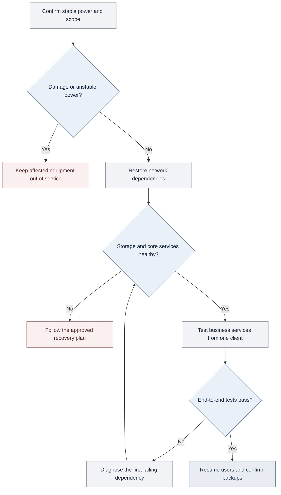

<a href="https://herbertofury.github.io/INTA/" title="Open INTA official download or service page" aria-label="Open INTA official download or service page" data-inta-brand="app-inta"></a> [INTA](https://github.com/Herbertofury/INTA/wiki) / [Decision desk](https://github.com/Herbertofury/INTA/wiki/Decision-Desk) · [Service map](https://github.com/Herbertofury/INTA/wiki/Service-Map) · [Playbooks](https://github.com/Herbertofury/INTA/wiki/Playbooks) · [Tools](https://github.com/Herbertofury/INTA/wiki/Tool-Directory) · [Methods](https://github.com/Herbertofury/INTA/wiki/Methods) · [Open hub](https://herbertofury.github.io/INTA/)

<a id="-bring-an-office-back-after-a-power-outage"></a>

# [Bring an office back after a power outage](https://github.com/Herbertofury/INTA/wiki/Job-outage-recovery)

Restore dependencies in order and verify services before releasing the office back to work.

**Backup & continuity** · Advanced · 30–120 min; infrastructure varies · 6 steps

[Tools and useful links](#working-kit) · [Quick answer](#quick-answer) · [Next action](#next-action) · [Specific fixes](#specific-fixes) · [Decision route](#decision-route) · [Tools](#toolkit) · [Procedure](#walkthrough) · [Verification](#acceptance) · [Sources](#sources) · [Interactive checklist](https://herbertofury.github.io/INTA/#job/outage-recovery)

<a id="working-kit"></a>

## 🧰 Tools and links for this job

**[Open working view](https://herbertofury.github.io/INTA/#job/outage-recovery)** · Keep the tool panel beside the instructions.

**First move:** Confirm safe power and identify the affected service. Assign one recovery owner before restarting shared systems.

| Use this for | Official tool + exact action |
| --- | --- |
| Inspect recovered [Windows](https://www.microsoft.com/windows) services and connection state. | **<a href="https://github.com/PowerShell/PowerShell/releases/latest" title="Open PowerShell official download or service page" aria-label="Open PowerShell official download or service page" data-inta-brand="powershell"></a> [PowerShell](https://learn.microsoft.com/en-us/powershell/)** · <a href="https://github.com/PowerShell/PowerShell/releases/latest" title="Open PowerShell official download or service page" aria-label="Open PowerShell official download or service page" data-inta-brand="powershell"></a> [Official page](https://learn.microsoft.com/en-us/powershell/) · **<a href="https://learn.microsoft.com/en-us/powershell/scripting/windows-powershell/starting-windows-powershell" title="Open Windows PowerShell 5.1 official download or service page" aria-label="Open Windows PowerShell 5.1 official download or service page" data-inta-brand="app-windows-powershell-51"></a> [Use Windows PowerShell 5.1](https://learn.microsoft.com/en-us/powershell/scripting/windows-powershell/starting-windows-powershell)** |
| Check for a matching cloud remedy on eligible, configured devices with a widespread startup failure. | **<a href="https://learn.microsoft.com/en-us/windows/configuration/quick-machine-recovery/?tabs=csp" title="Open Quick machine recovery official download or service page" aria-label="Open Quick machine recovery official download or service page" data-inta-brand="quick-machine-recovery"></a> [Quick machine recovery](https://learn.microsoft.com/en-us/windows/configuration/quick-machine-recovery/?tabs=csp)** · <a href="https://learn.microsoft.com/en-us/windows/configuration/quick-machine-recovery/?tabs=csp" title="Open Quick machine recovery official download or service page" aria-label="Open Quick machine recovery official download or service page" data-inta-brand="quick-machine-recovery"></a> [Official page](https://learn.microsoft.com/en-us/windows/configuration/quick-machine-recovery/?tabs=csp) · **<a href="https://learn.microsoft.com/en-us/windows/configuration/quick-machine-recovery/?tabs=csp" title="Open Quick machine recovery official download or service page" aria-label="Open Quick machine recovery official download or service page" data-inta-brand="quick-machine-recovery"></a> [Check supported recovery setup](https://learn.microsoft.com/en-us/windows/configuration/quick-machine-recovery/?tabs=csp)** |
| Separating DNS, TCP, TLS and HTTP failures when a web service or application endpoint is unreachable. | **<a href="https://curl.se/windows/" title="Open curl official download or service page" aria-label="Open curl official download or service page" data-inta-brand="curl"></a> [curl](https://curl.se/)** · <a href="https://curl.se/windows/" title="Open curl official download or service page" aria-label="Open curl official download or service page" data-inta-brand="curl"></a> [Official page](https://curl.se/) · **<a href="https://curl.se/windows/" title="Open curl official download or service page" aria-label="Open curl official download or service page" data-inta-brand="curl"></a> [Use the Windows-included curl.exe](https://curl.se/windows/microsoft.html)** |
| Comparing a reproducible path problem from a <a href="https://www.kernel.org/" title="Open Linux official download or service page" aria-label="Open Linux official download or service page" data-inta-brand="app-linux"></a> [Linux](https://www.kernel.org/) or <a href="https://support.apple.com/macos" title="Open macOS official download or service page" aria-label="Open macOS official download or service page" data-inta-brand="app-macos"></a> [macOS](https://support.apple.com/macos) bench, or [Windows](https://www.microsoft.com/windows) through WSL. | **<a href="https://github.com/traviscross/mtr" title="Open mtr official download or service page" aria-label="Open mtr official download or service page" data-inta-brand="mtr"></a> [mtr](https://www.bitwizard.nl/mtr/)** · <a href="https://github.com/traviscross/mtr" title="Open mtr official download or service page" aria-label="Open mtr official download or service page" data-inta-brand="mtr"></a> [Official page](https://www.bitwizard.nl/mtr/) · **<a href="https://www.kernel.org/" title="Open Linux official download or service page" aria-label="Open Linux official download or service page" data-inta-brand="app-linux"></a> [Install a Linux/WSL distribution package](https://github.com/traviscross/mtr#using-mtr-on-windows)** |

### Find the failure

| Open the exact resource | What to do there |
| --- | --- |
| **<a href="https://learn.microsoft.com/" title="Open learn.microsoft.com official download or service page" aria-label="Open learn.microsoft.com official download or service page" data-inta-brand="site-learn-microsoft-com"></a> [Interpret unexpected-restart evidence](https://learn.microsoft.com/en-us/troubleshoot/windows-client/performance/event-id-41-restart)** | Event 41 alone does not identify the shutdown cause. |

### Shared endpoint failures

| Open the exact resource | What to do there |
| --- | --- |
| **<a href="https://learn.microsoft.com/en-us/windows/configuration/quick-machine-recovery/?tabs=csp" title="Open Quick machine recovery official download or service page" aria-label="Open Quick machine recovery official download or service page" data-inta-brand="quick-machine-recovery"></a> [Quick machine recovery — conditional](https://learn.microsoft.com/en-us/windows/configuration/quick-machine-recovery/?tabs=csp)** | [Windows 11](https://www.microsoft.com/windows/windows-11) 24H2 build 26100.4700 or later; verify policy, network access and a matching remedy. Enterprise defaults can be off. |

### Restore service

| Open the exact resource | What to do there |
| --- | --- |
| **[Verify a backup restore](https://github.com/Herbertofury/INTA/wiki/Job-backup-restore)** | Prove the recovery point and actual restored application. |

### Case record

| Open the exact resource | What to do there |
| --- | --- |
| **[Record owners and outstanding faults](https://github.com/Herbertofury/INTA/wiki/Technician-Handoff)** | Keep the service timeline and next actions in the private record. |

### Power recovery

| Open the exact resource | What to do there |
| --- | --- |
| **<a href="https://www.dell.com/support/" title="Open Dell official download or service page" aria-label="Open Dell official download or service page" data-inta-brand="web-dell"></a> [Dell power-restoration behavior](https://dl.dell.com/manuals/common/dell-emc-remote-wake-up-config-dell-client-cmd-suite.pdf)** | Use the exact model manual to plan AC Recovery and a controlled verification. |

<a id="quick-answer"></a>

## ⚡ Quick answer

<a id="quick-recover-an-outage"></a>

### 🏢 Recover an office outage

**Confirm safe power and the affected business services, then assign one recovery owner.**

1. Check power, UPS status and network reachability without repeatedly cycling unstable equipment.
2. Restore dependencies in the guide’s order: network, storage, identity and the affected application services.
3. Test a real user workflow and backup status, then record the outage timeline and remaining faults.

**No extra download needed.** Follow the checklist below.

<a id="next-action"></a>

## 🧭 Match the symptom

| You see this | Do this next | You should get |
| --- | --- | --- |
| **Power or hardware is visibly unsafe** | Stop repeated power cycling and involve the qualified power or hardware owner. | The equipment can be energized safely or remains isolated for repair. |
| **Network is back but storage or hosts are not ready** | Inspect the relevant console and storage status before starting dependent workloads; do not initialize or format missing volumes. | The required storage and host resources are stable before application recovery. |
| **Identity or DNS is unavailable** | Restore the approved identity/network dependencies in the site runbook, then test name resolution and sign-in from a client. | The user can authenticate and reach the required service names. |
| **Services show running but users still cannot work** | Test the actual application and its data/share/database dependency from a normal user session. | A real transaction or equivalent business task succeeds. |
| **Many supported [Windows 11](https://www.microsoft.com/windows/windows-11) endpoints fail at startup** | Check the common change and whether <a href="https://learn.microsoft.com/en-us/windows/configuration/quick-machine-recovery/?tabs=csp" title="Open Quick machine recovery official download or service page" aria-label="Open Quick machine recovery official download or service page" data-inta-brand="quick-machine-recovery"></a> [Quick machine recovery](https://learn.microsoft.com/en-us/windows/configuration/quick-machine-recovery/?tabs=csp) is enabled and applicable; use the normal recovery plan if no remedy is available. | A verified remedy or a controlled rollback is chosen without assuming cloud recovery will succeed. |

### ✅ Finish the job

- [ ] Critical user workflows succeed from the affected network.
- [ ] Backup operation and remaining infrastructure alarms have been checked.
- [ ] The timeline, cause evidence and follow-up owner are recorded.

**Change route when:** Storage/RAID damage, unsafe power or active compromise changes the recovery route. · The required restore would overwrite the only recovery copy.

### 🎯 Go straight to a specific fix

- **[Read an unexpected-restart event correctly](#fix-outage-event-41-is-not-the-cause)** — Event 41 appears after a power outage or unexplained restart.
- **[Recover a dependent service in the right order](#fix-outage-one-service-did-not-recover)** — The server is running after power restoration but one business service remains unavailable.
- **[Restore a share after the server returns](#fix-outage-share-unavailable-after-restart)** — The server responds, but a previously working file share or mapped drive does not.
- **[Explain a desktop that stays off when power returns](#fix-outage-desktop-stays-off-after-ac-return)** — Power and networking have returned, but an otherwise working desktop did not start automatically.

> [!NOTE]
> **Start here.** Confirm power is stable and establish which devices and services are down. Use the site’s private dependency diagram and recovery plan.

<a id="decision-route"></a>

<a id="-choose-the-right-branch"></a>

## 🧭 Choose a route



**Route links:** [Continue this workflow](#walkthrough) · [Acceptance checks](#acceptance) · [Fix internet, DNS, or local-network problems](network-dns.md) · [Diagnose crashes, blue screens, and overheating](hardware-bsod.md) · [Prove a backup can actually restore](backup-restore.md) · [Close a repair with a clear client handoff](client-handoff.md)

| Checkpoint | What to carry forward |
| --- | --- |
| **Before changing anything** | Confirm stable power and use the private dependency plan. |
| **Keep during the job** | Alarms, startup order, outage timeline, and client-side service tests. |
| **Before handing back** | Business services, backup jobs, and remote management are healthy. |

<a id="toolkit"></a>

<a id="-build-the-right-toolkit"></a>

## Recommended tools

Select a tool for the next diagnostic or repair step. Check its platform, access and licensing requirements before use.

| Tool / official page + download | Use it for | Platform & access | Documentation |
| --- | --- | --- | --- |
| **<a href="https://github.com/PowerShell/PowerShell/releases/latest" title="Open PowerShell official download or service page" aria-label="Open PowerShell official download or service page" data-inta-brand="powershell"></a> [PowerShell](https://learn.microsoft.com/en-us/powershell/)** · <a href="https://github.com/PowerShell/PowerShell/releases/latest" title="Open PowerShell official download or service page" aria-label="Open PowerShell official download or service page" data-inta-brand="powershell"></a> [Official page](https://learn.microsoft.com/en-us/powershell/) · **<a href="https://learn.microsoft.com/en-us/powershell/scripting/windows-powershell/starting-windows-powershell" title="Open Windows PowerShell 5.1 official download or service page" aria-label="Open Windows PowerShell 5.1 official download or service page" data-inta-brand="app-windows-powershell-51"></a> [Use Windows PowerShell 5.1](https://learn.microsoft.com/en-us/powershell/scripting/windows-powershell/starting-windows-powershell)** | Inspect recovered [Windows](https://www.microsoft.com/windows) services and connection state. | [Windows](https://www.microsoft.com/windows), <a href="https://www.kernel.org/" title="Open Linux official download or service page" aria-label="Open Linux official download or service page" data-inta-brand="app-linux"></a> [Linux](https://www.kernel.org/), <a href="https://support.apple.com/macos" title="Open macOS official download or service page" aria-label="Open macOS official download or service page" data-inta-brand="app-macos"></a> [macOS](https://support.apple.com/macos); Free / open source | <a href="https://github.com/PowerShell/PowerShell/releases/latest" title="Open PowerShell official download or service page" aria-label="Open PowerShell official download or service page" data-inta-brand="powershell"></a> [Open guide](https://learn.microsoft.com/en-us/powershell/) |
| **<a href="https://learn.microsoft.com/en-us/windows/configuration/quick-machine-recovery/?tabs=csp" title="Open Quick machine recovery official download or service page" aria-label="Open Quick machine recovery official download or service page" data-inta-brand="quick-machine-recovery"></a> [Quick machine recovery](https://learn.microsoft.com/en-us/windows/configuration/quick-machine-recovery/?tabs=csp)** · <a href="https://learn.microsoft.com/en-us/windows/configuration/quick-machine-recovery/?tabs=csp" title="Open Quick machine recovery official download or service page" aria-label="Open Quick machine recovery official download or service page" data-inta-brand="quick-machine-recovery"></a> [Official page](https://learn.microsoft.com/en-us/windows/configuration/quick-machine-recovery/?tabs=csp) · **<a href="https://learn.microsoft.com/en-us/windows/configuration/quick-machine-recovery/?tabs=csp" title="Open Quick machine recovery official download or service page" aria-label="Open Quick machine recovery official download or service page" data-inta-brand="quick-machine-recovery"></a> [Check supported recovery setup](https://learn.microsoft.com/en-us/windows/configuration/quick-machine-recovery/?tabs=csp)** | Check for a matching cloud remedy on eligible, configured devices with a widespread startup failure. | [Windows 11](https://www.microsoft.com/windows/windows-11), [Windows Server](https://learn.microsoft.com/en-us/windows-server/) 2025; Included with supported [Windows](https://www.microsoft.com/windows); availability depends on release, edition and management policy | <a href="https://learn.microsoft.com/en-us/windows/configuration/quick-machine-recovery/?tabs=csp" title="Open Quick machine recovery official download or service page" aria-label="Open Quick machine recovery official download or service page" data-inta-brand="quick-machine-recovery"></a> [Open guide](https://learn.microsoft.com/en-us/windows/configuration/quick-machine-recovery/?tabs=csp) |
| **<a href="https://github.com/smartmontools/smartmontools/releases" title="Open smartmontools official download or service page" aria-label="Open smartmontools official download or service page" data-inta-brand="smartmontools"></a> [smartmontools](https://www.smartmontools.org/)** · <a href="https://github.com/smartmontools/smartmontools/releases" title="Open smartmontools official download or service page" aria-label="Open smartmontools official download or service page" data-inta-brand="smartmontools"></a> [Official page](https://www.smartmontools.org/) · **[Download Windows setup · EXE](https://github.com/smartmontools/smartmontools/releases/download/RELEASE_7_5/smartmontools-7.5.win32-setup.exe)** | Reading SMART and NVMe health from a rescue environment or supported host OS. | <a href="https://www.kernel.org/" title="Open Linux official download or service page" aria-label="Open Linux official download or service page" data-inta-brand="app-linux"></a> [Linux](https://www.kernel.org/), [Windows](https://www.microsoft.com/windows), <a href="https://support.apple.com/macos" title="Open macOS official download or service page" aria-label="Open macOS official download or service page" data-inta-brand="app-macos"></a> [macOS](https://support.apple.com/macos); Free / open source | <a href="https://github.com/smartmontools/smartmontools/releases" title="Open smartmontools official download or service page" aria-label="Open smartmontools official download or service page" data-inta-brand="smartmontools"></a> [Open guide](https://github.com/smartmontools/smartmontools) |
| **<a href="https://learn.microsoft.com/en-us/sysinternals/downloads/sysinternals-suite" title="Open Microsoft Sysinternals Suite official download or service page" aria-label="Open Microsoft Sysinternals Suite official download or service page" data-inta-brand="sysinternals"></a> [Microsoft Sysinternals Suite](https://learn.microsoft.com/en-us/sysinternals/)** · <a href="https://learn.microsoft.com/en-us/sysinternals/downloads/sysinternals-suite" title="Open Microsoft Sysinternals Suite official download or service page" aria-label="Open Microsoft Sysinternals Suite official download or service page" data-inta-brand="sysinternals"></a> [Official page](https://learn.microsoft.com/en-us/sysinternals/) · **[Download Windows portable · ZIP](https://download.sysinternals.com/files/SysinternalsSuite.zip)** | The core portable [Windows](https://www.microsoft.com/windows) troubleshooting kit. | [Windows](https://www.microsoft.com/windows); Free <a href="https://www.microsoft.com/" title="Open microsoft.com official download or service page" aria-label="Open microsoft.com official download or service page" data-inta-brand="site-www-microsoft-com"></a> [Microsoft](https://www.microsoft.com/) utilities | <a href="https://learn.microsoft.com/en-us/sysinternals/downloads/sysinternals-suite" title="Open Microsoft Sysinternals Suite official download or service page" aria-label="Open Microsoft Sysinternals Suite official download or service page" data-inta-brand="sysinternals"></a> [Open guide](https://learn.microsoft.com/en-us/sysinternals/downloads/) |
| **<a href="https://curl.se/windows/" title="Open curl official download or service page" aria-label="Open curl official download or service page" data-inta-brand="curl"></a> [curl](https://curl.se/)** · <a href="https://curl.se/windows/" title="Open curl official download or service page" aria-label="Open curl official download or service page" data-inta-brand="curl"></a> [Official page](https://curl.se/) · **<a href="https://curl.se/windows/" title="Open curl official download or service page" aria-label="Open curl official download or service page" data-inta-brand="curl"></a> [Use the Windows-included curl.exe](https://curl.se/windows/microsoft.html)** | Separating DNS, TCP, TLS and HTTP failures when a web service or application endpoint is unreachable. | [Windows](https://www.microsoft.com/windows), <a href="https://support.apple.com/macos" title="Open macOS official download or service page" aria-label="Open macOS official download or service page" data-inta-brand="app-macos"></a> [macOS](https://support.apple.com/macos), <a href="https://www.kernel.org/" title="Open Linux official download or service page" aria-label="Open Linux official download or service page" data-inta-brand="app-linux"></a> [Linux](https://www.kernel.org/); Free and open source; the <a href="https://curl.se/windows/" title="Open curl official download or service page" aria-label="Open curl official download or service page" data-inta-brand="curl"></a> [curl](https://curl.se/) license permits commercial projects | <a href="https://curl.se/windows/" title="Open curl official download or service page" aria-label="Open curl official download or service page" data-inta-brand="curl"></a> [Open guide](https://curl.se/docs/manpage.html) |
| **<a href="https://github.com/traviscross/mtr" title="Open mtr official download or service page" aria-label="Open mtr official download or service page" data-inta-brand="mtr"></a> [mtr](https://www.bitwizard.nl/mtr/)** · <a href="https://github.com/traviscross/mtr" title="Open mtr official download or service page" aria-label="Open mtr official download or service page" data-inta-brand="mtr"></a> [Official page](https://www.bitwizard.nl/mtr/) · **<a href="https://www.kernel.org/" title="Open Linux official download or service page" aria-label="Open Linux official download or service page" data-inta-brand="app-linux"></a> [Install a Linux/WSL distribution package](https://github.com/traviscross/mtr#using-mtr-on-windows)** | Comparing a reproducible path problem from a <a href="https://www.kernel.org/" title="Open Linux official download or service page" aria-label="Open Linux official download or service page" data-inta-brand="app-linux"></a> [Linux](https://www.kernel.org/) or <a href="https://support.apple.com/macos" title="Open macOS official download or service page" aria-label="Open macOS official download or service page" data-inta-brand="app-macos"></a> [macOS](https://support.apple.com/macos) bench, or [Windows](https://www.microsoft.com/windows) through WSL. | <a href="https://www.kernel.org/" title="Open Linux official download or service page" aria-label="Open Linux official download or service page" data-inta-brand="app-linux"></a> [Linux](https://www.kernel.org/), <a href="https://support.apple.com/macos" title="Open macOS official download or service page" aria-label="Open macOS official download or service page" data-inta-brand="app-macos"></a> [macOS](https://support.apple.com/macos), [Windows](https://www.microsoft.com/windows) (WSL); Free and open source under GPL-2.0 | <a href="https://github.com/traviscross/mtr" title="Open mtr official download or service page" aria-label="Open mtr official download or service page" data-inta-brand="mtr"></a> [Open guide](https://github.com/traviscross/mtr) |

<a id="walkthrough"></a>

<a id="-work-the-case"></a>

## Procedure

Work in order, record the result of each step, and change route when the evidence calls for it.

<a id="step-01"></a>

### 01 · Check the physical environment

- [ ] Inspect UPS status, breakers, power strips, equipment alarms, and visible damage. Keep equipment with electrical damage, liquid exposure, or repeated power cycling out of service. Record the approximate outage and shutdown times from available logs.

<a id="step-02"></a>

### 02 · Restore the network foundation

- [ ] Bring up the internet handoff, firewall/router, switches, and wireless infrastructure in the site’s documented dependency order. Wait for each to reach a healthy state, then verify local link, addressing, routing, and name resolution before starting application tests.

**<a href="https://github.com/PowerShell/PowerShell/releases/latest" title="Open PowerShell official download or service page" aria-label="Open PowerShell official download or service page" data-inta-brand="powershell"></a> [PowerShell](https://learn.microsoft.com/en-us/powershell/) · Capture adapter link state and key network/service status after power is restored.:**

```text
Get-NetAdapter | Format-Table Name,Status,LinkSpeed -AutoSize
Get-Service -Name Dhcp,Dnscache,Netlogon,LanmanServer -ErrorAction SilentlyContinue | Format-Table Name,Status,StartType -AutoSize
```

> **Before running:** Read-only diagnostic. Confirm upstream power, switch, router and ISP state before restarting shared services.

**Official command reference:** <a href="https://www.microsoft.com/" title="Open microsoft.com official download or service page" aria-label="Open microsoft.com official download or service page" data-inta-brand="site-www-microsoft-com"></a> [Microsoft Get-Service documentation](https://learn.microsoft.com/en-us/powershell/module/microsoft.powershell.management/get-service)

**Command legend:** <a href="https://www.microsoft.com/" title="Open microsoft.com official download or service page" aria-label="Open microsoft.com official download or service page" data-inta-brand="site-www-microsoft-com"></a> [Microsoft Get-Service documentation](https://learn.microsoft.com/en-us/powershell/module/microsoft.powershell.management/get-service) · [Return to the step context](#step-02).

<a id="step-03"></a>

### 03 · Recover storage and core services

- [ ] Check storage controllers and arrays for degraded state before normal workload resumes. Bring up required hypervisors, storage, identity/DNS/DHCP, and dependent services in their actual site order. Avoid repeated hard resets of a server performing recovery or consistency work.

<a id="step-04"></a>

### 04 · Validate applications from one workstation

- [ ] Use one known-good client to test domain sign-in, shared folders, printing, email, and each critical line-of-business application. An open server console or a successful ping does not prove the business service is healthy.

<a id="step-05"></a>

### 05 · Review shutdown and recovery evidence

- [ ] Inspect UPS logs and relevant event logs. Kernel-Power Event ID 41 indicates [Windows](https://www.microsoft.com/windows) did not shut down cleanly; it does not by itself identify the power supply or the original cause. Correlate the event with other evidence before replacing parts.

<a id="step-06"></a>

### 06 · Resume operations and verify backups

- [ ] Release workstations in a controlled order, confirm time synchronization and remote management, and check that backup jobs resume. Record any disk repairs, degraded components, interrupted transactions, and remaining follow-up with the designated service owner.

<a id="acceptance"></a>

<a id="-prove-the-result"></a>

## Verification

- [ ] Network, identity, storage, and business applications pass end-to-end tests.
- [ ] No degraded storage or critical recovery alarm is left unassigned.
- [ ] Backups and remote access have resumed.
- [ ] Users can complete their actual work from a client workstation.

> [!WARNING]
> **Pause this route and escalate when:**
> - Power is unstable or equipment shows physical/electrical damage.
> - Storage is degraded, rebuilding, or producing new errors without an approved recovery plan.

<a id="specific-fixes"></a>

## 🎯 Specific fixes

Choose the case that matches the evidence. Each case gives a first action, a short procedure and a result to prove.

<a id="fix-outage-event-41-is-not-the-cause"></a>

### Read an unexpected-restart event correctly

**Use when:** Event 41 appears after a power outage or unexplained restart.

**Start here:** Match the event time with the actual outage and user report.

**<a href="https://learn.microsoft.com/en-us/windows-hardware/drivers/debugger/" title="Open WinDbg official download or service page" aria-label="Open WinDbg official download or service page" data-inta-brand="windbg"></a> [WinDbg](https://learn.microsoft.com/en-us/windows-hardware/drivers/debugger/)** · <a href="https://learn.microsoft.com/en-us/windows-hardware/drivers/debugger/" title="Open WinDbg official download or service page" aria-label="Open WinDbg official download or service page" data-inta-brand="windbg"></a> [Official page](https://learn.microsoft.com/en-us/windows-hardware/drivers/debugger/) · **[Download Windows debugger · APPINSTALLER](https://aka.ms/windbg/download)**

1. Inspect the event’s bug-check information and nearby system events; Event 41 records an unclean shutdown, not a single proven cause.
2. Check power/UPS and hardware evidence when there is no useful bug check; follow the crash-dump route when a stop code and dump exist.
3. After the scoped correction, observe a normal shutdown/startup and the affected business service.

#### ⚡ Quick commands

**Inspect shutdown and bugcheck events** · <a href="https://github.com/PowerShell/PowerShell/releases/latest" title="Open PowerShell official download or service page" aria-label="Open PowerShell official download or service page" data-inta-brand="powershell"></a> [PowerShell](https://learn.microsoft.com/en-us/powershell/)

Correlate unexpected shutdown events with the outage timeline; event 41 reports an unclean shutdown, not its root cause.

```powershell
Get-WinEvent -FilterHashtable @{LogName='System'; Id=41,6008,1001} -MaxEvents 40 | Select-Object TimeCreated,Id,ProviderName,Message | Format-List
```

> **Before running:** Read-only diagnostic. Review output before sharing; redact device names, user names, IP addresses, serial numbers and other customer-identifying details.

**Official reference:** <a href="https://www.microsoft.com/" title="Open microsoft.com official download or service page" aria-label="Open microsoft.com official download or service page" data-inta-brand="site-www-microsoft-com"></a> [Microsoft Get-WinEvent](https://learn.microsoft.com/en-us/powershell/module/microsoft.powershell.diagnostics/get-winevent)


**Prove it worked:** The case distinguishes a recorded unclean shutdown from evidence for power, hardware or software cause.

**If this does not resolve it:** Stop repeated power cycling when storage, electrical safety or thermal symptoms appear.

**Official evidence:** <a href="https://learn.microsoft.com/" title="Open learn.microsoft.com official download or service page" aria-label="Open learn.microsoft.com official download or service page" data-inta-brand="site-learn-microsoft-com"></a> [Source 1](https://learn.microsoft.com/en-us/troubleshoot/windows-client/performance/event-id-41-restart) · Reviewed 2026-11-26

[Back to specific fixes](#specific-fixes) · [Full procedure](#walkthrough)

<a id="fix-outage-one-service-did-not-recover"></a>

### Recover a dependent service in the right order

**Use when:** The server is running after power restoration but one business service remains unavailable.

**Start here:** Identify the exact service name and its required dependencies before restarting anything.

**<a href="https://github.com/PowerShell/PowerShell/releases/latest" title="Open PowerShell official download or service page" aria-label="Open PowerShell official download or service page" data-inta-brand="powershell"></a> [PowerShell](https://learn.microsoft.com/en-us/powershell/)** · <a href="https://github.com/PowerShell/PowerShell/releases/latest" title="Open PowerShell official download or service page" aria-label="Open PowerShell official download or service page" data-inta-brand="powershell"></a> [Official page](https://learn.microsoft.com/en-us/powershell/) · **<a href="https://learn.microsoft.com/en-us/powershell/scripting/windows-powershell/starting-windows-powershell" title="Open Windows PowerShell 5.1 official download or service page" aria-label="Open Windows PowerShell 5.1 official download or service page" data-inta-brand="app-windows-powershell-51"></a> [Use Windows PowerShell 5.1](https://learn.microsoft.com/en-us/powershell/scripting/windows-powershell/starting-windows-powershell)**

1. Open Services or use the read-only Get-Service view to inspect state and required/dependent services.
2. Review service-start events and verify storage, DNS, identity and any database dependency before the approved start/restart.
3. Test the real user operation from a client and retain the service error if it stops again.

**Prove it worked:** The service stays running because its dependencies work, and the business transaction succeeds.

**If this does not resolve it:** Do not mass-start or repeatedly restart every service. Recurring termination needs the application or infrastructure owner.

**Official evidence:** <a href="https://github.com/PowerShell/PowerShell/releases/latest" title="Open PowerShell official download or service page" aria-label="Open PowerShell official download or service page" data-inta-brand="powershell"></a> [Source 1](https://learn.microsoft.com/en-us/powershell/module/microsoft.powershell.management/get-service?view=powershell-5.1) · Reviewed 2026-11-26

[Back to specific fixes](#specific-fixes) · [Full procedure](#walkthrough)

<a id="fix-outage-share-unavailable-after-restart"></a>

### Restore a share after the server returns

**Use when:** The server responds, but a previously working file share or mapped drive does not.

**Start here:** Test the approved share by its normal hostname from an affected user session.

**<a href="https://github.com/PowerShell/PowerShell/releases/latest" title="Open PowerShell official download or service page" aria-label="Open PowerShell official download or service page" data-inta-brand="powershell"></a> [PowerShell](https://learn.microsoft.com/en-us/powershell/)** · <a href="https://github.com/PowerShell/PowerShell/releases/latest" title="Open PowerShell official download or service page" aria-label="Open PowerShell official download or service page" data-inta-brand="powershell"></a> [Official page](https://learn.microsoft.com/en-us/powershell/) · **<a href="https://learn.microsoft.com/en-us/powershell/scripting/windows-powershell/starting-windows-powershell" title="Open Windows PowerShell 5.1 official download or service page" aria-label="Open Windows PowerShell 5.1 official download or service page" data-inta-brand="app-windows-powershell-51"></a> [Use Windows PowerShell 5.1](https://learn.microsoft.com/en-us/powershell/scripting/windows-powershell/starting-windows-powershell)**

1. Separate name resolution, the required SMB connection and authentication; compare with a working client and the server’s service state.
2. Check whether the backing volume and intended share are available and whether the original permissions remain intact.
3. Repair the proven dependency, then open and save an agreed test file as the actual user.

**Prove it worked:** The normal share path works with the intended permissions and data, not only with an administrator account.

**If this does not resolve it:** Do not expose the share broadly or enable obsolete SMB versions as a generic outage workaround.

**Official evidence:** [Source 1](https://learn.microsoft.com/en-us/windows-server/storage/file-server/troubleshoot/troubleshooting-smb) · Reviewed 2026-11-26

[Back to specific fixes](#specific-fixes) · [Full procedure](#walkthrough)

<a id="fix-outage-desktop-stays-off-after-ac-return"></a>

### Explain a desktop that stays off when power returns

**Use when:** Power and networking have returned, but an otherwise working desktop did not start automatically.

**Start here:** Check that the device can start normally with its power button before treating automatic restart as a [Windows](https://www.microsoft.com/windows) fault.

**<a href="https://support.microsoft.com/en-us/windows/hardware/drivers/update-drivers-through-device-manager-in-windows" title="Open Official OEM driver and firmware portals official download or service page" aria-label="Open Official OEM driver and firmware portals official download or service page" data-inta-brand="oem-drivers"></a> [Official OEM driver and firmware portals](https://support.microsoft.com/en-us/windows/hardware/drivers/update-drivers-through-device-manager-in-windows)** · <a href="https://support.microsoft.com/en-us/windows/hardware/drivers/update-drivers-through-device-manager-in-windows" title="Open Official OEM driver and firmware portals official download or service page" aria-label="Open Official OEM driver and firmware portals official download or service page" data-inta-brand="oem-drivers"></a> [Official page](https://support.microsoft.com/en-us/windows/hardware/drivers/update-drivers-through-device-manager-in-windows) · **<a href="https://support.microsoft.com/en-us/windows/hardware/drivers/update-drivers-through-device-manager-in-windows" title="Open Official OEM driver and firmware portals official download or service page" aria-label="Open Official OEM driver and firmware portals official download or service page" data-inta-brand="oem-drivers"></a> [Find the correct driver source](https://support.microsoft.com/en-us/windows/hardware/drivers/update-drivers-through-device-manager-in-windows)**

1. Look up the exact model's firmware power-recovery setting and record its current value.
2. <a href="https://www.dell.com/support/" title="Open Dell official download or service page" aria-label="Open Dell official download or service page" data-inta-brand="web-dell"></a> [Dell](https://www.dell.com/support/) documents AC Recovery choices such as Power Off, Power On and Last Power State; names and availability on other models must come from their manuals.
3. Choose the required behavior with the site owner and coordinate it with UPS shutdown and service startup order.
4. Verify the selected behavior during a controlled maintenance test after a clean shutdown and saved work, then test the dependent business service.

**Prove it worked:** The actual machine behaves as agreed after restored power and its required service returns in the correct order.

**If this does not resolve it:** If the device does not start from its button or shows hardware error indicators, move to the model-specific power/POST diagnosis before changing recovery policy.

**Official evidence:** <a href="https://www.dell.com/support/" title="Open dl.dell.com official download or service page" aria-label="Open dl.dell.com official download or service page" data-inta-brand="site-dl-dell-com"></a> [Source 1](https://dl.dell.com/manuals/common/dell-emc-remote-wake-up-config-dell-client-cmd-suite.pdf) · Reviewed 2026-11-26

[Back to specific fixes](#specific-fixes) · [Full procedure](#walkthrough)


<a id="-continue-with-the-evidence"></a>

## Related playbooks

| Next playbook | What it resolves |
| --- | --- |
| [Fix internet, DNS, or local-network problems](network-dns.md) | Locate the failing layer before resetting adapters or changing the whole network. |
| [Diagnose crashes, blue screens, and overheating](hardware-bsod.md) | Correlate crash evidence with memory, storage, temperature, power, and driver changes. |
| [Prove a backup can actually restore](backup-restore.md) | Validate recovery credentials, data integrity, application usability, and recovery time. |
| [Close a repair with a clear client handoff](client-handoff.md) | Turn completed technical work into proof the customer can use, with clean access and an actionable service record. |

<a id="sources"></a>

<a id="-source-trail"></a>

## Official sources

- <a href="https://www.microsoft.com/" title="Open microsoft.com official download or service page" aria-label="Open microsoft.com official download or service page" data-inta-brand="site-www-microsoft-com"></a> [Microsoft: interpreting Kernel-Power Event ID 41](https://learn.microsoft.com/en-us/troubleshoot/windows-client/performance/event-id-41-restart)
- <a href="https://github.com/restic/restic/releases/latest" title="Open restic official download or service page" aria-label="Open restic official download or service page" data-inta-brand="restic"></a> [restic: repository consistency and integrity](https://restic.readthedocs.io/en/stable/045_working_with_repos.html)

Reviewed **2026-11-26**. Timing is a planning range. A successful command is evidence about that operation; acceptance belongs to the user’s original task.


---

Editorial review: **2026-11-26** · [Review standard](https://github.com/Herbertofury/INTA/wiki/Knowledge-Standards) · [Suggest a correction](https://github.com/Herbertofury/INTA/issues/new/choose)

[← All playbooks](README.md) · [Live Wiki](https://github.com/Herbertofury/INTA/wiki) · [Contribution guide](https://github.com/Herbertofury/INTA/blob/main/CONTRIBUTING.md)
