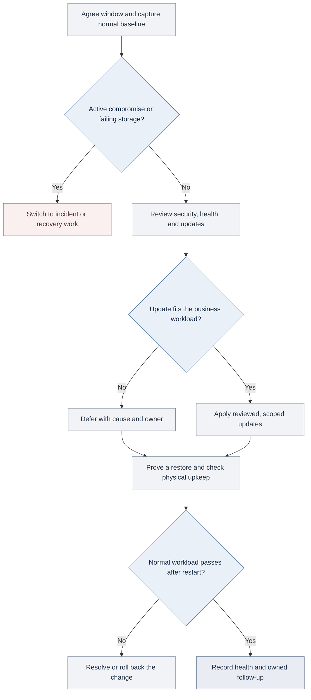
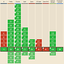

<a href="https://herbertofury.github.io/INTA/" title="Open INTA official download or service page" aria-label="Open INTA official download or service page" data-inta-brand="app-inta"></a> [INTA](https://github.com/Herbertofury/INTA/wiki) / [Decision desk](https://github.com/Herbertofury/INTA/wiki/Decision-Desk) · [Service map](https://github.com/Herbertofury/INTA/wiki/Service-Map) · [Playbooks](https://github.com/Herbertofury/INTA/wiki/Playbooks) · [Tools](https://github.com/Herbertofury/INTA/wiki/Tool-Directory) · [Methods](https://github.com/Herbertofury/INTA/wiki/Methods) · [Open hub](https://herbertofury.github.io/INTA/)

<a id="-run-a-useful-workstation-maintenance-visit"></a>

# [Run a useful workstation maintenance visit](https://github.com/Herbertofury/INTA/wiki/Job-preventive-maintenance)

Check security, updates, hardware, backups, and usability without unnecessary cleanup rituals.

**Maintenance** · Intermediate · 30–60 min · 6 steps

[Tools and useful links](#working-kit) · [Quick answer](#quick-answer) · [Next action](#next-action) · [Specific fixes](#specific-fixes) · [Decision route](#decision-route) · [Tools](#toolkit) · [Procedure](#walkthrough) · [Verification](#acceptance) · [Sources](#sources) · [Interactive checklist](https://herbertofury.github.io/INTA/#job/preventive-maintenance)

<a id="tool-choices"></a>

## 🧰 Choose the tool for this job

Choose by the task shown in the first column. Each option includes its acquisition route and access boundary.

| Need | Official tool + exact action | Why this choice / access |
| --- | --- | --- |
| **Review app updates** | **<a href="https://github.com/microsoft/winget-cli/releases/latest" title="Open Windows Package Manager (WinGet) official download or service page" aria-label="Open Windows Package Manager (WinGet) official download or service page" data-inta-brand="web-app-winget"></a> [WinGet](https://learn.microsoft.com/en-us/windows/package-manager/winget/)** · **<a href="https://github.com/microsoft/winget-cli/releases/latest" title="Open Windows Package Manager (WinGet) official download or service page" aria-label="Open Windows Package Manager (WinGet) official download or service page" data-inta-brand="web-app-winget"></a> [Download App Installer · MSIXBUNDLE](https://github.com/microsoft/winget-cli/releases/download/v1.29.380/Microsoft.DesktopAppInstaller_8wekyb3d8bbwe.msixbundle)** | Review package identity, source and available upgrades before approved changes. **Access:** Included App Installer; each app keeps its own license. |
| **Review storage health** | **<a href="https://crystalmark.info/en/download/" title="Open CrystalDiskInfo official download or service page" aria-label="Open CrystalDiskInfo official download or service page" data-inta-brand="crystaldiskinfo"></a> [CrystalDiskInfo](https://crystalmark.info/en/software/crystaldiskinfo/)** · **<a href="https://www.microsoft.com/windows" title="Open Windows official download or service page" aria-label="Open Windows official download or service page" data-inta-brand="app-windows"></a> [Get Windows ZIP · 9.9.5](https://sourceforge.net/projects/crystaldiskinfo/files/9.9.5/CrystalDiskInfo9_9_5.zip/download)** | Check supported health indicators and route new warnings to recovery before cleanup. **Access:** Free and open source |
| **Explain capacity use** | **<a href="https://github.com/windirstat/windirstat/releases/latest" title="Open WinDirStat official download or service page" aria-label="Open WinDirStat official download or service page" data-inta-brand="windirstat"></a> [WinDirStat](https://windirstat.net/)** · **<a href="https://www.microsoft.com/windows" title="Open Windows official download or service page" aria-label="Open Windows official download or service page" data-inta-brand="app-windows"></a> [Download Windows x64 · MSI](https://github.com/windirstat/windirstat/releases/download/release/v2.9.3/WinDirStat-x64.msi)** | Identify where space went on healthy storage without assuming large files are disposable. **Access:** Free and open source |

**[Current selection evidence](https://github.com/Herbertofury/INTA/wiki/Current-Tool-Choices)**

<a id="working-kit"></a>

## 🧰 Tools and links for this job

**[Open working view](https://herbertofury.github.io/INTA/#job/preventive-maintenance)** · Keep the tool panel beside the instructions.

**First move:** Agree the maintenance window and identify the user’s current problem. Verify a usable backup before changes.

| Use this for | Official tool + exact action |
| --- | --- |
| List and review application upgrades. | **<a href="https://github.com/microsoft/winget-cli/releases/latest" title="Open Windows Package Manager (WinGet) official download or service page" aria-label="Open Windows Package Manager (WinGet) official download or service page" data-inta-brand="web-app-winget"></a> [WinGet](https://learn.microsoft.com/en-us/windows/package-manager/winget/)** · <a href="https://github.com/microsoft/winget-cli/releases/latest" title="Open Windows Package Manager (WinGet) official download or service page" aria-label="Open Windows Package Manager (WinGet) official download or service page" data-inta-brand="web-app-winget"></a> [Official page](https://learn.microsoft.com/en-us/windows/package-manager/winget/) · **<a href="https://github.com/microsoft/winget-cli/releases/latest" title="Open Windows Package Manager (WinGet) official download or service page" aria-label="Open Windows Package Manager (WinGet) official download or service page" data-inta-brand="web-app-winget"></a> [Download App Installer · MSIXBUNDLE](https://github.com/microsoft/winget-cli/releases/download/v1.29.380/Microsoft.DesktopAppInstaller_8wekyb3d8bbwe.msixbundle)** |
| Review storage warnings before cleanup. | **<a href="https://crystalmark.info/en/download/" title="Open CrystalDiskInfo official download or service page" aria-label="Open CrystalDiskInfo official download or service page" data-inta-brand="crystaldiskinfo"></a> [CrystalDiskInfo](https://crystalmark.info/en/software/crystaldiskinfo/)** · <a href="https://crystalmark.info/en/download/" title="Open CrystalDiskInfo official download or service page" aria-label="Open CrystalDiskInfo official download or service page" data-inta-brand="crystaldiskinfo"></a> [Official page](https://crystalmark.info/en/software/crystaldiskinfo/) · **<a href="https://www.microsoft.com/windows" title="Open Windows official download or service page" aria-label="Open Windows official download or service page" data-inta-brand="app-windows"></a> [Get Windows ZIP · 9.9.5](https://sourceforge.net/projects/crystaldiskinfo/files/9.9.5/CrystalDiskInfo9_9_5.zip/download)** |
| Find capacity use on a healthy drive. | **<a href="https://github.com/windirstat/windirstat/releases/latest" title="Open WinDirStat official download or service page" aria-label="Open WinDirStat official download or service page" data-inta-brand="windirstat"></a> [WinDirStat](https://windirstat.net/)** · <a href="https://github.com/windirstat/windirstat/releases/latest" title="Open WinDirStat official download or service page" aria-label="Open WinDirStat official download or service page" data-inta-brand="windirstat"></a> [Official page](https://windirstat.net/) · **<a href="https://www.microsoft.com/windows" title="Open Windows official download or service page" aria-label="Open Windows official download or service page" data-inta-brand="app-windows"></a> [Download Windows x64 · MSI](https://github.com/windirstat/windirstat/releases/download/release/v2.9.3/WinDirStat-x64.msi)** |
| Locate a named local file or log without unnecessary cleanup. | **<a href="https://www.voidtools.com/downloads/" title="Open Everything official download or service page" aria-label="Open Everything official download or service page" data-inta-brand="everything"></a> [Everything](https://www.voidtools.com/)** · <a href="https://www.voidtools.com/downloads/" title="Open Everything official download or service page" aria-label="Open Everything official download or service page" data-inta-brand="everything"></a> [Official page](https://www.voidtools.com/) · **<a href="https://www.microsoft.com/windows" title="Open Windows official download or service page" aria-label="Open Windows official download or service page" data-inta-brand="app-windows"></a> [Download Windows x64 EXE](https://www.voidtools.com/Everything-1.4.1.1032.x64-Setup.exe)** |
| Collecting battery and sleep evidence before changing hardware or power policy. | **<a href="https://learn.microsoft.com/en-us/windows-hardware/design/device-experiences/powercfg-command-line-options" title="Open powercfg official download or service page" aria-label="Open powercfg official download or service page" data-inta-brand="powercfg"></a> [powercfg](https://learn.microsoft.com/en-us/windows-hardware/design/device-experiences/powercfg-command-line-options)** · <a href="https://learn.microsoft.com/en-us/windows-hardware/design/device-experiences/powercfg-command-line-options" title="Open powercfg official download or service page" aria-label="Open powercfg official download or service page" data-inta-brand="powercfg"></a> [Official page](https://learn.microsoft.com/en-us/windows-hardware/design/device-experiences/powercfg-command-line-options) · **<a href="https://learn.microsoft.com/en-us/windows-hardware/design/device-experiences/powercfg-command-line-options" title="Open powercfg official download or service page" aria-label="Open powercfg official download or service page" data-inta-brand="powercfg"></a> [Open built-in battery and sleep diagnostics](https://learn.microsoft.com/en-us/windows-hardware/design/device-experiences/powercfg-command-line-options)** |
| Establishing recoverable, per-device administrator access during managed workstation setup and support planning. | **<a href="https://learn.microsoft.com/en-us/windows-server/identity/laps/laps-overview" title="Open Windows LAPS official download or service page" aria-label="Open Windows LAPS official download or service page" data-inta-brand="windows-laps"></a> [Windows LAPS](https://learn.microsoft.com/en-us/windows-server/identity/laps/laps-overview)** · <a href="https://learn.microsoft.com/en-us/windows-server/identity/laps/laps-overview" title="Open Windows LAPS official download or service page" aria-label="Open Windows LAPS official download or service page" data-inta-brand="windows-laps"></a> [Official page](https://learn.microsoft.com/en-us/windows-server/identity/laps/laps-overview) · **<a href="https://learn.microsoft.com/en-us/windows-server/identity/laps/laps-overview" title="Open Windows LAPS official download or service page" aria-label="Open Windows LAPS official download or service page" data-inta-brand="windows-laps"></a> [Configure built-in administrator password management](https://learn.microsoft.com/en-us/windows-server/identity/laps/laps-overview)** |
| Use existing endpoint telemetry for investigation; plan new deployment after active evidence-preservation needs are resolved. | **<a href="https://learn.microsoft.com/en-us/sysinternals/downloads/sysmon" title="Open Sysmon official download or service page" aria-label="Open Sysmon official download or service page" data-inta-brand="sysmon"></a> [Sysmon](https://learn.microsoft.com/en-us/sysinternals/downloads/sysmon)** · <a href="https://learn.microsoft.com/en-us/sysinternals/downloads/sysmon" title="Open Sysmon official download or service page" aria-label="Open Sysmon official download or service page" data-inta-brand="sysmon"></a> [Official page](https://learn.microsoft.com/en-us/sysinternals/downloads/sysmon) · **<a href="https://www.microsoft.com/windows" title="Open Windows official download or service page" aria-label="Open Windows official download or service page" data-inta-brand="app-windows"></a> [Download Windows monitoring tools · ZIP](https://download.sysinternals.com/files/Sysmon.zip)** |
| Use the supported file-search workflow when its filters and the technician’s license fit the task. | **<a href="https://antibody-software.com/wizfile/download" title="Open WizFile official download or service page" aria-label="Open WizFile official download or service page" data-inta-brand="wizfile"></a> [WizFile](https://antibody-software.com/wizfile/)** · <a href="https://antibody-software.com/wizfile/download" title="Open WizFile official download or service page" aria-label="Open WizFile official download or service page" data-inta-brand="wizfile"></a> [Official page](https://antibody-software.com/wizfile/) · **<a href="https://www.microsoft.com/windows" title="Open Windows official download or service page" aria-label="Open Windows official download or service page" data-inta-brand="app-windows"></a> [Download Windows portable · ZIP](https://antibody-software.com/files/wizfile_3_15_portable.zip)** |
| TLS and certificate configuration | **<a href="https://www.ssllabs.com/ssltest/" title="Open Qualys SSL Labs official download or service page" aria-label="Open Qualys SSL Labs official download or service page" data-inta-brand="ssl-labs"></a> [Qualys SSL Labs](https://www.ssllabs.com/)** · <a href="https://www.ssllabs.com/ssltest/" title="Open Qualys SSL Labs official download or service page" aria-label="Open Qualys SSL Labs official download or service page" data-inta-brand="ssl-labs"></a> [Official page](https://www.ssllabs.com/) · **<a href="https://www.ssllabs.com/ssltest/" title="Open Qualys SSL Labs official download or service page" aria-label="Open Qualys SSL Labs official download or service page" data-inta-brand="ssl-labs"></a> [Open online service](https://www.ssllabs.com/ssltest/)** |
| HTTP security configuration | **<a href="https://developer.mozilla.org/en-US/observatory" title="Open MDN HTTP Observatory official download or service page" aria-label="Open MDN HTTP Observatory official download or service page" data-inta-brand="mdn-observatory"></a> [MDN HTTP Observatory](https://developer.mozilla.org/en-US/observatory)** · <a href="https://developer.mozilla.org/en-US/observatory" title="Open MDN HTTP Observatory official download or service page" aria-label="Open MDN HTTP Observatory official download or service page" data-inta-brand="mdn-observatory"></a> [Official page](https://developer.mozilla.org/en-US/observatory) · **<a href="https://developer.mozilla.org/en-US/observatory" title="Open MDN HTTP Observatory official download or service page" aria-label="Open MDN HTTP Observatory official download or service page" data-inta-brand="mdn-observatory"></a> [Open online service](https://developer.mozilla.org/en-US/observatory)** |
| Check a domain across web and mail standards in one report, including DNS and transport dependencies. | **<a href="https://en.internet.nl/" title="Open Internet.nl official download or service page" aria-label="Open Internet.nl official download or service page" data-inta-brand="internet-nl"></a> [Internet.nl](https://en.internet.nl/)** · <a href="https://en.internet.nl/" title="Open Internet.nl official download or service page" aria-label="Open Internet.nl official download or service page" data-inta-brand="internet-nl"></a> [Official page](https://en.internet.nl/) · **<a href="https://en.internet.nl/" title="Open Internet.nl official download or service page" aria-label="Open Internet.nl official download or service page" data-inta-brand="internet-nl"></a> [Open online service](https://en.internet.nl/)** |
| Spot missing response headers and inspect redirects during a web-server change. | **<a href="https://securityheaders.com/" title="Open Security Headers official download or service page" aria-label="Open Security Headers official download or service page" data-inta-brand="securityheaders"></a> [Security Headers](https://securityheaders.com/)** · <a href="https://securityheaders.com/" title="Open Security Headers official download or service page" aria-label="Open Security Headers official download or service page" data-inta-brand="securityheaders"></a> [Official page](https://securityheaders.com/) · **<a href="https://securityheaders.com/" title="Open Security Headers official download or service page" aria-label="Open Security Headers official download or service page" data-inta-brand="securityheaders"></a> [Open online service](https://securityheaders.com/)** |
| Confirmed exploited vulnerabilities | **<a href="https://www.cisa.gov/known-exploited-vulnerabilities-catalog" title="Open CISA Known Exploited Vulnerabilities official download or service page" aria-label="Open CISA Known Exploited Vulnerabilities official download or service page" data-inta-brand="cisa-kev"></a> [CISA Known Exploited Vulnerabilities](https://www.cisa.gov/known-exploited-vulnerabilities-catalog)** · <a href="https://www.cisa.gov/known-exploited-vulnerabilities-catalog" title="Open CISA Known Exploited Vulnerabilities official download or service page" aria-label="Open CISA Known Exploited Vulnerabilities official download or service page" data-inta-brand="cisa-kev"></a> [Official page](https://www.cisa.gov/known-exploited-vulnerabilities-catalog) · **<a href="https://www.cisa.gov/known-exploited-vulnerabilities-catalog" title="Open CISA Known Exploited Vulnerabilities official download or service page" aria-label="Open CISA Known Exploited Vulnerabilities official download or service page" data-inta-brand="cisa-kev"></a> [Open online service](https://www.cisa.gov/known-exploited-vulnerabilities-catalog)** |
| Daily exploitation likelihood | **<a href="https://www.first.org/epss/data" title="Open FIRST EPSS official download or service page" aria-label="Open FIRST EPSS official download or service page" data-inta-brand="first-epss"></a> [FIRST EPSS](https://www.first.org/epss/)** · <a href="https://www.first.org/epss/data" title="Open FIRST EPSS official download or service page" aria-label="Open FIRST EPSS official download or service page" data-inta-brand="first-epss"></a> [Official page](https://www.first.org/epss/) · **<a href="https://www.first.org/epss/data" title="Open FIRST EPSS official download or service page" aria-label="Open FIRST EPSS official download or service page" data-inta-brand="first-epss"></a> [Open online service](https://www.first.org/epss/data)** |
| Check the exact CVE and affected product range before choosing a patch. | **<a href="https://nvd.nist.gov/vuln/search" title="Open NIST National Vulnerability Database official download or service page" aria-label="Open NIST National Vulnerability Database official download or service page" data-inta-brand="nvd"></a> [NIST National Vulnerability Database](https://nvd.nist.gov/)** · <a href="https://nvd.nist.gov/vuln/search" title="Open NIST National Vulnerability Database official download or service page" aria-label="Open NIST National Vulnerability Database official download or service page" data-inta-brand="nvd"></a> [Official page](https://nvd.nist.gov/) · **<a href="https://nvd.nist.gov/vuln/search" title="Open NIST National Vulnerability Database official download or service page" aria-label="Open NIST National Vulnerability Database official download or service page" data-inta-brand="nvd"></a> [Open online service](https://nvd.nist.gov/vuln/search)** |
| Determine whether a particular dependency version is affected and which fix applies. | **<a href="https://osv.dev/list" title="Open OSV.dev official download or service page" aria-label="Open OSV.dev official download or service page" data-inta-brand="osv"></a> [OSV.dev](https://osv.dev/)** · <a href="https://osv.dev/list" title="Open OSV.dev official download or service page" aria-label="Open OSV.dev official download or service page" data-inta-brand="osv"></a> [Official page](https://osv.dev/) · **<a href="https://osv.dev/list" title="Open OSV.dev official download or service page" aria-label="Open OSV.dev official download or service page" data-inta-brand="osv"></a> [Open online service](https://osv.dev/list)** |
| Prioritize website performance fixes while separating current lab results from historical visitor experience. | **<a href="https://pagespeed.web.dev/" title="Open Google PageSpeed Insights official download or service page" aria-label="Open Google PageSpeed Insights official download or service page" data-inta-brand="pagespeed-insights"></a> [Google PageSpeed Insights](https://pagespeed.web.dev/)** · <a href="https://pagespeed.web.dev/" title="Open Google PageSpeed Insights official download or service page" aria-label="Open Google PageSpeed Insights official download or service page" data-inta-brand="pagespeed-insights"></a> [Official page](https://pagespeed.web.dev/) · **<a href="https://pagespeed.web.dev/" title="Open Google PageSpeed Insights official download or service page" aria-label="Open Google PageSpeed Insights official download or service page" data-inta-brand="pagespeed-insights"></a> [Open online service](https://pagespeed.web.dev/)** |
| Identify slow requests and rendering delays under repeatable browser and network conditions. | **<a href="https://www.webpagetest.org/" title="Open WebPageTest official download or service page" aria-label="Open WebPageTest official download or service page" data-inta-brand="webpagetest"></a> [WebPageTest](https://www.webpagetest.org/)** · <a href="https://www.webpagetest.org/" title="Open WebPageTest official download or service page" aria-label="Open WebPageTest official download or service page" data-inta-brand="webpagetest"></a> [Official page](https://www.webpagetest.org/) · **<a href="https://www.webpagetest.org/" title="Open WebPageTest official download or service page" aria-label="Open WebPageTest official download or service page" data-inta-brand="webpagetest"></a> [Open online service](https://www.webpagetest.org/)** |
| Find missing labels, contrast issues and structural problems in a public page. | **<a href="https://wave.webaim.org/" title="Open WAVE Web Accessibility Evaluation official download or service page" aria-label="Open WAVE Web Accessibility Evaluation official download or service page" data-inta-brand="wave-accessibility"></a> [WAVE Web Accessibility Evaluation](https://wave.webaim.org/)** · <a href="https://wave.webaim.org/" title="Open WAVE Web Accessibility Evaluation official download or service page" aria-label="Open WAVE Web Accessibility Evaluation official download or service page" data-inta-brand="wave-accessibility"></a> [Official page](https://wave.webaim.org/) · **<a href="https://wave.webaim.org/" title="Open WAVE Web Accessibility Evaluation official download or service page" aria-label="Open WAVE Web Accessibility Evaluation official download or service page" data-inta-brand="wave-accessibility"></a> [Open online service](https://wave.webaim.org/)** |
| Reduce screenshot and web-image size while checking text and visual detail. | **<a href="https://squoosh.app/" title="Open Squoosh official download or service page" aria-label="Open Squoosh official download or service page" data-inta-brand="squoosh"></a> [Squoosh](https://squoosh.app/)** · <a href="https://squoosh.app/" title="Open Squoosh official download or service page" aria-label="Open Squoosh official download or service page" data-inta-brand="squoosh"></a> [Official page](https://squoosh.app/) · **<a href="https://squoosh.app/" title="Open Squoosh official download or service page" aria-label="Open Squoosh official download or service page" data-inta-brand="squoosh"></a> [Open online service](https://squoosh.app/)** |

### Updates

| Open the exact resource | What to do there |
| --- | --- |
| **<a href="https://github.com/microsoft/winget-cli/releases/latest" title="Open Windows Package Manager (WinGet) official download or service page" aria-label="Open Windows Package Manager (WinGet) official download or service page" data-inta-brand="web-app-winget"></a> [Review WinGet upgrades](https://learn.microsoft.com/en-us/windows/package-manager/winget/upgrade)** | List available changes and select approved packages. |

### Recovery

| Open the exact resource | What to do there |
| --- | --- |
| **[Test the existing backup](https://github.com/Herbertofury/INTA/wiki/Job-backup-restore)** | Restore a representative item to a separate folder. |

### Find retained files

| Open the exact resource | What to do there |
| --- | --- |
| **<a href="https://www.voidtools.com/downloads/" title="Open Everything official download or service page" aria-label="Open Everything official download or service page" data-inta-brand="everything"></a> [Everything desktop search guidance](https://www.voidtools.com/support/everything/)** | Limit indexing/search to approved local locations. |

### Handoff

| Open the exact resource | What to do there |
| --- | --- |
| **[Record changes and deferred work](https://github.com/Herbertofury/INTA/wiki/Technician-Handoff)** | Capture the observed result and follow-up owner. |

### Firmware readiness

| Open the exact resource | What to do there |
| --- | --- |
| **<a href="https://learn.microsoft.com/en-us/windows/security/operating-system-security/data-protection/bitlocker/" title="Open BitLocker official download or service page" aria-label="Open BitLocker official download or service page" data-inta-brand="app-bitlocker"></a> [BitLocker and firmware maintenance](https://learn.microsoft.com/en-us/troubleshoot/windows-client/windows-security/bitlocker-recovery-known-issues)** | Prepare recovery access and verify protection resumes after firmware changes. |

### Online working tools

| Open the exact resource | What to do there |
| --- | --- |
| **[Check website security](https://herbertofury.github.io/INTA/#online?task=test-website)** | Combine complementary configuration tests for a public site. |
| **[Prioritize a vulnerability](https://herbertofury.github.io/INTA/#online?task=prioritize-patches)** | Combine affected-version evidence, known exploitation and likely exploitation without treating them as the same metric. |
| **[Improve a slow website](https://herbertofury.github.io/INTA/#online?task=improve-site)** | Turn performance and accessibility reports into changes with a visible user result. |

<a id="quick-answer"></a>

## ⚡ Quick answer

<a id="quick-maintain-a-pc"></a>

### 🛠️ Maintain a PC

**Agree a maintenance window and confirm the backup can restore files before changing software.**

1. Check storage health, free space, protection status and a representative backup restore.
2. Review available <a href="https://www.microsoft.com/windows" title="Open Windows official download or service page" aria-label="Open Windows official download or service page" data-inta-brand="app-windows"></a> [Windows](https://www.microsoft.com/windows) and application updates; use <a href="https://github.com/microsoft/winget-cli/releases/latest" title="Open Windows Package Manager (WinGet) official download or service page" aria-label="Open Windows Package Manager (WinGet) official download or service page" data-inta-brand="web-app-winget"></a> [WinGet](https://learn.microsoft.com/en-us/windows/package-manager/winget/) only for approved package changes.
3. Reboot in the agreed window, retest essential tasks and record the versions and remaining issues.

**<a href="https://github.com/microsoft/winget-cli/releases/latest" title="Open Windows Package Manager (WinGet) official download or service page" aria-label="Open Windows Package Manager (WinGet) official download or service page" data-inta-brand="web-app-winget"></a> [WinGet](https://learn.microsoft.com/en-us/windows/package-manager/winget/)** · <a href="https://github.com/microsoft/winget-cli/releases/latest" title="Open Windows Package Manager (WinGet) official download or service page" aria-label="Open Windows Package Manager (WinGet) official download or service page" data-inta-brand="web-app-winget"></a> [Official page](https://learn.microsoft.com/en-us/windows/package-manager/winget/) · **<a href="https://github.com/microsoft/winget-cli/releases/latest" title="Open Windows Package Manager (WinGet) official download or service page" aria-label="Open Windows Package Manager (WinGet) official download or service page" data-inta-brand="web-app-winget"></a> [Download App Installer · MSIXBUNDLE](https://github.com/microsoft/winget-cli/releases/download/v1.29.380/Microsoft.DesktopAppInstaller_8wekyb3d8bbwe.msixbundle)**

<a id="quick-find-a-file"></a>

### 🔎 Find a file

**Search by the known filename or extension in approved local folders.**

1. Open the <a href="https://www.voidtools.com/downloads/" title="Open Everything official download or service page" aria-label="Open Everything official download or service page" data-inta-brand="everything"></a> [Everything](https://www.voidtools.com/) desktop app and limit indexing to the locations needed for this case.
2. Search a distinctive part of the name, then check the result’s path and modification time.
3. Open the correct file and remove any temporary case-only indexing settings.

**<a href="https://www.voidtools.com/downloads/" title="Open Everything official download or service page" aria-label="Open Everything official download or service page" data-inta-brand="everything"></a> [Everything](https://www.voidtools.com/)** · <a href="https://www.voidtools.com/downloads/" title="Open Everything official download or service page" aria-label="Open Everything official download or service page" data-inta-brand="everything"></a> [Official page](https://www.voidtools.com/) · **<a href="https://www.microsoft.com/windows" title="Open Windows official download or service page" aria-label="Open Windows official download or service page" data-inta-brand="app-windows"></a> [Download Windows x64 EXE](https://www.voidtools.com/Everything-1.4.1.1032.x64-Setup.exe)**

<a id="next-action"></a>

## 🧭 Match the symptom

| You see this | Do this next | You should get |
| --- | --- | --- |
| **The device has recurring failures or storage warnings** | Check <a href="https://learn.microsoft.com/en-us/windows-server/administration/windows-commands/perfmon" title="Open Reliability Monitor official download or service page" aria-label="Open Reliability Monitor official download or service page" data-inta-brand="app-reliability-monitor"></a> [Reliability Monitor](https://learn.microsoft.com/en-us/windows-server/administration/windows-commands/perfmon) and drive health; move actual faults to their repair or recovery guide before routine maintenance. | The maintenance plan is based on observed faults rather than cleanup rituals. |
| **Application updates are available** | Run <a href="https://github.com/microsoft/winget-cli/releases/latest" title="Open Windows Package Manager (WinGet) official download or service page" aria-label="Open Windows Package Manager (WinGet) official download or service page" data-inta-brand="web-app-winget"></a> [winget](https://learn.microsoft.com/en-us/windows/package-manager/winget/) upgrade to list them, review compatibility and update only the approved packages in the maintenance window. | The selected versions are installed and any planned restart is completed. |
| **A full disk or missing local file is the concern** | Use <a href="https://github.com/windirstat/windirstat/releases/latest" title="Open WinDirStat official download or service page" aria-label="Open WinDirStat official download or service page" data-inta-brand="windirstat"></a> [WinDirStat](https://windirstat.net/) for capacity or <a href="https://www.voidtools.com/downloads/" title="Open Everything official download or service page" aria-label="Open Everything official download or service page" data-inta-brand="everything"></a> [Everything](https://www.voidtools.com/) for a filename; confirm ownership and retention before deleting or moving anything. | The relevant path is identified and any approved cleanup has a measured result. |
| **Backup jobs report success** | Restore a representative item to a separate location and open it with the intended application. | The backup is demonstrably usable, with its recovery point recorded. |
| **Changes are complete** | Restart as planned and repeat the user’s main app, network, printing and backup checks. | Normal work succeeds and all deferred issues have owners. |

### ✅ Finish the job

- [ ] Protection, hardware health and backup restoration have been checked.
- [ ] The normal workload works after maintenance and restart.
- [ ] Each unresolved item has an explicit next action and owner.

**Change route when:** Storage failure or active compromise changes the service route. · An unplanned critical workload would be interrupted.

### 🎯 Go straight to a specific fix

- **[Use the supported optimization for the drive type](#fix-maintenance-optimize-the-right-media)** — A maintenance request proposes repeatedly defragmenting or cleaning every drive.
- **[Update an app missing from the package-manager list](#fix-maintenance-package-not-in-upgrade-list)** — An installed program is outdated but does not appear as a normal <a href="https://github.com/microsoft/winget-cli/releases/latest" title="Open Windows Package Manager (WinGet) official download or service page" aria-label="Open Windows Package Manager (WinGet) official download or service page" data-inta-brand="web-app-winget"></a> [WinGet](https://learn.microsoft.com/en-us/windows/package-manager/winget/) upgrade.
- **[Resume a stalled cloud-sync workflow](#fix-maintenance-onedrive-sync-is-paused)** — New files remain on one PC and the <a href="https://www.microsoft.com/microsoft-365/onedrive/online-cloud-storage" title="Open OneDrive official download or service page" aria-label="Open OneDrive official download or service page" data-inta-brand="app-onedrive"></a> [OneDrive](https://www.microsoft.com/microsoft-365/onedrive/online-cloud-storage) icon shows paused or an error state.
- **[Find an operating system outside its support plan](#fix-maintenance-check-os-support-state)** — The device is usable but its installed <a href="https://www.microsoft.com/windows" title="Open Windows official download or service page" aria-label="Open Windows official download or service page" data-inta-brand="app-windows"></a> [Windows](https://www.microsoft.com/windows) release may no longer receive the required updates.
- **[Keep firmware maintenance recoverable on an encrypted PC](#fix-maintenance-firmware-bitlocker-resume)** — A planned firmware or TPM update may change the measured startup environment.
- **[A new CVE needs a practical patch decision](#fix-online-cve-priority)** — A vulnerability alert arrives without confirming the affected version or actual exposure.
- **[A website has a certificate or security-header problem](#fix-online-website-configuration)** — A browser warns about a site or an external configuration test identifies a weakness.

> [!NOTE]
> **Start here.** Agree on the maintenance window and identify the user’s current pain points. Preserve a baseline of the system’s normal work.

<a id="decision-route"></a>

<a id="-choose-the-right-branch"></a>

## 🧭 Choose a route



**Route links:** [Continue this workflow](#walkthrough) · [Acceptance checks](#acceptance) · [Diagnose a slow, freezing, or hitching PC](slow-pc.md) · <a href="https://learn.microsoft.com/en-us/windows/deployment/update/" title="Open Windows Update official download or service page" aria-label="Open Windows Update official download or service page" data-inta-brand="app-windows-update"></a> [Fix a failing Windows update](windows-update.md) · [Prove a backup can actually restore](backup-restore.md) · [Close a repair with a clear client handoff](client-handoff.md)

| Checkpoint | What to carry forward |
| --- | --- |
| **Before changing anything** | Agree the window and preserve normal-workload evidence. |
| **Keep during the job** | Health findings, reviewed updates, restore result, and deferred changes. |
| **Before handing back** | Normal work passes after restart and every open item has an owner. |

<a id="toolkit"></a>

<a id="-build-the-right-toolkit"></a>

## Recommended tools

Select a tool for the next diagnostic or repair step. Check its platform, access and licensing requirements before use.

| Tool / official page + download | Use it for | Platform & access | Documentation |
| --- | --- | --- | --- |
| **<a href="https://github.com/microsoft/winget-cli/releases/latest" title="Open Windows Package Manager (WinGet) official download or service page" aria-label="Open Windows Package Manager (WinGet) official download or service page" data-inta-brand="web-app-winget"></a> [WinGet](https://learn.microsoft.com/en-us/windows/package-manager/winget/)** · <a href="https://github.com/microsoft/winget-cli/releases/latest" title="Open Windows Package Manager (WinGet) official download or service page" aria-label="Open Windows Package Manager (WinGet) official download or service page" data-inta-brand="web-app-winget"></a> [Official page](https://learn.microsoft.com/en-us/windows/package-manager/winget/) · **<a href="https://github.com/microsoft/winget-cli/releases/latest" title="Open Windows Package Manager (WinGet) official download or service page" aria-label="Open Windows Package Manager (WinGet) official download or service page" data-inta-brand="web-app-winget"></a> [Download App Installer · MSIXBUNDLE](https://github.com/microsoft/winget-cli/releases/download/v1.29.380/Microsoft.DesktopAppInstaller_8wekyb3d8bbwe.msixbundle)** | List and review application upgrades. | <a href="https://www.microsoft.com/windows" title="Open Windows official download or service page" aria-label="Open Windows official download or service page" data-inta-brand="app-windows"></a> [Windows](https://www.microsoft.com/windows); Free / open source | <a href="https://github.com/microsoft/winget-cli/releases/latest" title="Open Windows Package Manager (WinGet) official download or service page" aria-label="Open Windows Package Manager (WinGet) official download or service page" data-inta-brand="web-app-winget"></a> [Open guide](https://learn.microsoft.com/en-us/windows/package-manager/winget/) |
| **<a href="https://crystalmark.info/en/download/" title="Open CrystalDiskInfo official download or service page" aria-label="Open CrystalDiskInfo official download or service page" data-inta-brand="crystaldiskinfo"></a> [CrystalDiskInfo](https://crystalmark.info/en/software/crystaldiskinfo/)** · <a href="https://crystalmark.info/en/download/" title="Open CrystalDiskInfo official download or service page" aria-label="Open CrystalDiskInfo official download or service page" data-inta-brand="crystaldiskinfo"></a> [Official page](https://crystalmark.info/en/software/crystaldiskinfo/) · **<a href="https://www.microsoft.com/windows" title="Open Windows official download or service page" aria-label="Open Windows official download or service page" data-inta-brand="app-windows"></a> [Get Windows ZIP · 9.9.5](https://sourceforge.net/projects/crystaldiskinfo/files/9.9.5/CrystalDiskInfo9_9_5.zip/download)** | Review storage warnings before cleanup. | <a href="https://www.microsoft.com/windows" title="Open Windows official download or service page" aria-label="Open Windows official download or service page" data-inta-brand="app-windows"></a> [Windows](https://www.microsoft.com/windows); Free / open source | <a href="https://crystalmark.info/en/download/" title="Open CrystalDiskInfo official download or service page" aria-label="Open CrystalDiskInfo official download or service page" data-inta-brand="crystaldiskinfo"></a> [Open guide](https://crystalmark.info/en/software/crystaldiskinfo/) |
| **<a href="https://github.com/windirstat/windirstat/releases/latest" title="Open WinDirStat official download or service page" aria-label="Open WinDirStat official download or service page" data-inta-brand="windirstat"></a> [WinDirStat](https://windirstat.net/)** · <a href="https://github.com/windirstat/windirstat/releases/latest" title="Open WinDirStat official download or service page" aria-label="Open WinDirStat official download or service page" data-inta-brand="windirstat"></a> [Official page](https://windirstat.net/) · **<a href="https://www.microsoft.com/windows" title="Open Windows official download or service page" aria-label="Open Windows official download or service page" data-inta-brand="app-windows"></a> [Download Windows x64 · MSI](https://github.com/windirstat/windirstat/releases/download/release/v2.9.3/WinDirStat-x64.msi)** | Find capacity use on a healthy drive. | <a href="https://www.microsoft.com/windows" title="Open Windows official download or service page" aria-label="Open Windows official download or service page" data-inta-brand="app-windows"></a> [Windows](https://www.microsoft.com/windows); Free / open source | <a href="https://github.com/windirstat/windirstat/releases/latest" title="Open WinDirStat official download or service page" aria-label="Open WinDirStat official download or service page" data-inta-brand="windirstat"></a> [Open guide](https://github.com/windirstat/windirstat) |
| **<a href="https://www.voidtools.com/downloads/" title="Open Everything official download or service page" aria-label="Open Everything official download or service page" data-inta-brand="everything"></a> [Everything](https://www.voidtools.com/)** · <a href="https://www.voidtools.com/downloads/" title="Open Everything official download or service page" aria-label="Open Everything official download or service page" data-inta-brand="everything"></a> [Official page](https://www.voidtools.com/) · **<a href="https://www.microsoft.com/windows" title="Open Windows official download or service page" aria-label="Open Windows official download or service page" data-inta-brand="app-windows"></a> [Download Windows x64 EXE](https://www.voidtools.com/Everything-1.4.1.1032.x64-Setup.exe)** | Locate a named local file or log without unnecessary cleanup. | <a href="https://www.microsoft.com/windows" title="Open Windows official download or service page" aria-label="Open Windows official download or service page" data-inta-brand="app-windows"></a> [Windows](https://www.microsoft.com/windows); Freeware | <a href="https://www.voidtools.com/downloads/" title="Open Everything official download or service page" aria-label="Open Everything official download or service page" data-inta-brand="everything"></a> [Open guide](https://www.voidtools.com/support/everything/) |
| **<a href="https://www.hwinfo.com/download/" title="Open HWiNFO official download or service page" aria-label="Open HWiNFO official download or service page" data-inta-brand="hwinfo"></a> [HWiNFO](https://www.hwinfo.com/)** · <a href="https://www.hwinfo.com/download/" title="Open HWiNFO official download or service page" aria-label="Open HWiNFO official download or service page" data-inta-brand="hwinfo"></a> [Official page](https://www.hwinfo.com/) · **<a href="https://www.microsoft.com/windows" title="Open Windows official download or service page" aria-label="Open Windows official download or service page" data-inta-brand="app-windows"></a> [Download Windows x64 EXE](https://www.hwinfo.com/files/hwi64_860.exe)** | Investigating temperatures, clocks, power and component identity. | <a href="https://www.microsoft.com/windows" title="Open Windows official download or service page" aria-label="Open Windows official download or service page" data-inta-brand="app-windows"></a> [Windows](https://www.microsoft.com/windows); Pro license for commercial use of 64/ARM64 editions | <a href="https://www.hwinfo.com/download/" title="Open HWiNFO official download or service page" aria-label="Open HWiNFO official download or service page" data-inta-brand="hwinfo"></a> [Open guide](https://www.hwinfo.com/licenses/) |
| **<a href="https://learn.microsoft.com/en-us/sysinternals/downloads/sysinternals-suite" title="Open Microsoft Sysinternals Suite official download or service page" aria-label="Open Microsoft Sysinternals Suite official download or service page" data-inta-brand="sysinternals"></a> [Microsoft Sysinternals Suite](https://learn.microsoft.com/en-us/sysinternals/)** · <a href="https://learn.microsoft.com/en-us/sysinternals/downloads/sysinternals-suite" title="Open Microsoft Sysinternals Suite official download or service page" aria-label="Open Microsoft Sysinternals Suite official download or service page" data-inta-brand="sysinternals"></a> [Official page](https://learn.microsoft.com/en-us/sysinternals/) · **<a href="https://www.microsoft.com/windows" title="Open Windows official download or service page" aria-label="Open Windows official download or service page" data-inta-brand="app-windows"></a> [Download Windows portable · ZIP](https://download.sysinternals.com/files/SysinternalsSuite.zip)** | The core portable <a href="https://www.microsoft.com/windows" title="Open Windows official download or service page" aria-label="Open Windows official download or service page" data-inta-brand="app-windows"></a> [Windows](https://www.microsoft.com/windows) troubleshooting kit. | <a href="https://www.microsoft.com/windows" title="Open Windows official download or service page" aria-label="Open Windows official download or service page" data-inta-brand="app-windows"></a> [Windows](https://www.microsoft.com/windows); Free <a href="https://www.microsoft.com/" title="Open microsoft.com official download or service page" aria-label="Open microsoft.com official download or service page" data-inta-brand="site-www-microsoft-com"></a> [Microsoft](https://www.microsoft.com/) utilities | <a href="https://learn.microsoft.com/en-us/sysinternals/downloads/sysinternals-suite" title="Open Microsoft Sysinternals Suite official download or service page" aria-label="Open Microsoft Sysinternals Suite official download or service page" data-inta-brand="sysinternals"></a> [Open guide](https://learn.microsoft.com/en-us/sysinternals/downloads/) |
| **<a href="https://www.veeam.com/products/free/microsoft-windows" title="Open Veeam Agent for Microsoft Windows official download or service page" aria-label="Open Veeam Agent for Microsoft Windows official download or service page" data-inta-brand="veeam-agent"></a> [Veeam Agent for Microsoft Windows](https://www.veeam.com/products/free/microsoft-windows)** · <a href="https://www.veeam.com/products/free/microsoft-windows" title="Open Veeam Agent for Microsoft Windows official download or service page" aria-label="Open Veeam Agent for Microsoft Windows official download or service page" data-inta-brand="veeam-agent"></a> [Official page](https://www.veeam.com/products/free/microsoft-windows) · **<a href="https://www.microsoft.com/windows" title="Open Windows official download or service page" aria-label="Open Windows official download or service page" data-inta-brand="app-windows"></a> [Sign in for the Windows download](https://www.veeam.com/products/physical/windows-backup-recovery-download.html)** | Image backup and recovery media for a supported <a href="https://www.microsoft.com/windows" title="Open Windows official download or service page" aria-label="Open Windows official download or service page" data-inta-brand="app-windows"></a> [Windows](https://www.microsoft.com/windows) endpoint. | <a href="https://www.microsoft.com/windows" title="Open Windows official download or service page" aria-label="Open Windows official download or service page" data-inta-brand="app-windows"></a> [Windows](https://www.microsoft.com/windows); Free and paid editions; service-provider terms differ | <a href="https://www.veeam.com/products/free/microsoft-windows" title="Open Veeam Agent for Microsoft Windows official download or service page" aria-label="Open Veeam Agent for Microsoft Windows official download or service page" data-inta-brand="veeam-agent"></a> [Open guide](https://helpcenter.veeam.com/docs/agentforwindows/userguide/overview.html) |
| **<a href="https://diskanalyzer.com/download" title="Open WizTree official download or service page" aria-label="Open WizTree official download or service page" data-inta-brand="wiztree"></a> [WizTree](https://diskanalyzer.com/)** · <a href="https://diskanalyzer.com/download" title="Open WizTree official download or service page" aria-label="Open WizTree official download or service page" data-inta-brand="wiztree"></a> [Official page](https://diskanalyzer.com/) · **<a href="https://www.microsoft.com/windows" title="Open Windows official download or service page" aria-label="Open Windows official download or service page" data-inta-brand="app-windows"></a> [Download Windows portable · ZIP](https://diskanalyzer.com/files/wiztree_4_34_portable.zip)** | Finding the folders and files responsible for a capacity problem before selecting an approved cleanup. | <a href="https://www.microsoft.com/windows" title="Open Windows official download or service page" aria-label="Open Windows official download or service page" data-inta-brand="app-windows"></a> [Windows](https://www.microsoft.com/windows), <a href="https://support.apple.com/macos" title="Open macOS official download or service page" aria-label="Open macOS official download or service page" data-inta-brand="app-macos"></a> [macOS](https://support.apple.com/macos), <a href="https://www.kernel.org/" title="Open Linux official download or service page" aria-label="Open Linux official download or service page" data-inta-brand="app-linux"></a> [Linux](https://www.kernel.org/); Free for personal use; commercial supporter or enterprise license required by business site and staff size. | <a href="https://diskanalyzer.com/download" title="Open WizTree official download or service page" aria-label="Open WizTree official download or service page" data-inta-brand="wiztree"></a> [Open guide](https://diskanalyzer.com/about) |
| **<a href="https://antibody-software.com/wizfile/download" title="Open WizFile official download or service page" aria-label="Open WizFile official download or service page" data-inta-brand="wizfile"></a> [WizFile](https://antibody-software.com/wizfile/)** · <a href="https://antibody-software.com/wizfile/download" title="Open WizFile official download or service page" aria-label="Open WizFile official download or service page" data-inta-brand="wizfile"></a> [Official page](https://antibody-software.com/wizfile/) · **<a href="https://www.microsoft.com/windows" title="Open Windows official download or service page" aria-label="Open Windows official download or service page" data-inta-brand="app-windows"></a> [Download Windows portable · ZIP](https://antibody-software.com/files/wizfile_3_15_portable.zip)** | Use the supported file-search workflow when its filters and the technician’s license fit the task. | <a href="https://www.microsoft.com/windows" title="Open Windows official download or service page" aria-label="Open Windows official download or service page" data-inta-brand="app-windows"></a> [Windows](https://www.microsoft.com/windows); Free for personal use; commercial supporter or enterprise license required by business site and staff size. | <a href="https://antibody-software.com/wizfile/download" title="Open WizFile official download or service page" aria-label="Open WizFile official download or service page" data-inta-brand="wizfile"></a> [Open guide](https://antibody-software.com/wizfile/quick-start) |
| **<a href="https://learn.microsoft.com/en-us/windows-hardware/design/device-experiences/powercfg-command-line-options" title="Open powercfg official download or service page" aria-label="Open powercfg official download or service page" data-inta-brand="powercfg"></a> [powercfg](https://learn.microsoft.com/en-us/windows-hardware/design/device-experiences/powercfg-command-line-options)** · <a href="https://learn.microsoft.com/en-us/windows-hardware/design/device-experiences/powercfg-command-line-options" title="Open powercfg official download or service page" aria-label="Open powercfg official download or service page" data-inta-brand="powercfg"></a> [Official page](https://learn.microsoft.com/en-us/windows-hardware/design/device-experiences/powercfg-command-line-options) · **<a href="https://learn.microsoft.com/en-us/windows-hardware/design/device-experiences/powercfg-command-line-options" title="Open powercfg official download or service page" aria-label="Open powercfg official download or service page" data-inta-brand="powercfg"></a> [Open built-in battery and sleep diagnostics](https://learn.microsoft.com/en-us/windows-hardware/design/device-experiences/powercfg-command-line-options)** | Collecting battery and sleep evidence before changing hardware or power policy. | <a href="https://www.microsoft.com/windows" title="Open Windows official download or service page" aria-label="Open Windows official download or service page" data-inta-brand="app-windows"></a> [Windows](https://www.microsoft.com/windows); Included with <a href="https://www.microsoft.com/windows" title="Open Windows official download or service page" aria-label="Open Windows official download or service page" data-inta-brand="app-windows"></a> [Windows](https://www.microsoft.com/windows) | <a href="https://learn.microsoft.com/en-us/windows-hardware/design/device-experiences/powercfg-command-line-options" title="Open powercfg official download or service page" aria-label="Open powercfg official download or service page" data-inta-brand="powercfg"></a> [Open guide](https://learn.microsoft.com/en-us/windows-hardware/design/device-experiences/powercfg-command-line-options) |
| **<a href="https://learn.microsoft.com/en-us/windows-server/identity/laps/laps-overview" title="Open Windows LAPS official download or service page" aria-label="Open Windows LAPS official download or service page" data-inta-brand="windows-laps"></a> [Windows LAPS](https://learn.microsoft.com/en-us/windows-server/identity/laps/laps-overview)** · <a href="https://learn.microsoft.com/en-us/windows-server/identity/laps/laps-overview" title="Open Windows LAPS official download or service page" aria-label="Open Windows LAPS official download or service page" data-inta-brand="windows-laps"></a> [Official page](https://learn.microsoft.com/en-us/windows-server/identity/laps/laps-overview) · **<a href="https://learn.microsoft.com/en-us/windows-server/identity/laps/laps-overview" title="Open Windows LAPS official download or service page" aria-label="Open Windows LAPS official download or service page" data-inta-brand="windows-laps"></a> [Configure built-in administrator password management](https://learn.microsoft.com/en-us/windows-server/identity/laps/laps-overview)** | Establishing recoverable, per-device administrator access during managed workstation setup and support planning. | <a href="https://www.microsoft.com/windows" title="Open Windows official download or service page" aria-label="Open Windows official download or service page" data-inta-brand="app-windows"></a> [Windows](https://www.microsoft.com/windows), <a href="https://learn.microsoft.com/en-us/windows-server/" title="Open Windows Server official download or service page" aria-label="Open Windows Server official download or service page" data-inta-brand="app-windows-server"></a> [Windows Server](https://learn.microsoft.com/en-us/windows-server/); Included with supported <a href="https://www.microsoft.com/windows" title="Open Windows official download or service page" aria-label="Open Windows official download or service page" data-inta-brand="app-windows"></a> [Windows](https://www.microsoft.com/windows); directory prerequisites, licensing and retrieval permissions still apply | <a href="https://learn.microsoft.com/en-us/windows-server/identity/laps/laps-overview" title="Open Windows LAPS official download or service page" aria-label="Open Windows LAPS official download or service page" data-inta-brand="windows-laps"></a> [Open guide](https://learn.microsoft.com/en-us/windows-server/identity/laps/laps-overview) |
| **<a href="https://learn.microsoft.com/en-us/sysinternals/downloads/sysmon" title="Open Sysmon official download or service page" aria-label="Open Sysmon official download or service page" data-inta-brand="sysmon"></a> [Sysmon](https://learn.microsoft.com/en-us/sysinternals/downloads/sysmon)** · <a href="https://learn.microsoft.com/en-us/sysinternals/downloads/sysmon" title="Open Sysmon official download or service page" aria-label="Open Sysmon official download or service page" data-inta-brand="sysmon"></a> [Official page](https://learn.microsoft.com/en-us/sysinternals/downloads/sysmon) · **<a href="https://www.microsoft.com/windows" title="Open Windows official download or service page" aria-label="Open Windows official download or service page" data-inta-brand="app-windows"></a> [Download Windows monitoring tools · ZIP](https://download.sysinternals.com/files/Sysmon.zip)** | Use existing endpoint telemetry for investigation; plan new deployment after active evidence-preservation needs are resolved. | <a href="https://www.microsoft.com/windows" title="Open Windows official download or service page" aria-label="Open Windows official download or service page" data-inta-brand="app-windows"></a> [Windows](https://www.microsoft.com/windows), <a href="https://learn.microsoft.com/en-us/windows-server/" title="Open Windows Server official download or service page" aria-label="Open Windows Server official download or service page" data-inta-brand="app-windows-server"></a> [Windows Server](https://learn.microsoft.com/en-us/windows-server/); Free proprietary <a href="https://www.microsoft.com/" title="Open microsoft.com official download or service page" aria-label="Open microsoft.com official download or service page" data-inta-brand="site-www-microsoft-com"></a> [Microsoft](https://www.microsoft.com/) utility under <a href="https://learn.microsoft.com/en-us/sysinternals/downloads/sysinternals-suite" title="Open Microsoft Sysinternals Suite official download or service page" aria-label="Open Microsoft Sysinternals Suite official download or service page" data-inta-brand="sysinternals"></a> [Sysinternals](https://learn.microsoft.com/en-us/sysinternals/) terms; redistribution and commercial software hosting are restricted | <a href="https://learn.microsoft.com/en-us/sysinternals/downloads/sysmon" title="Open Sysmon official download or service page" aria-label="Open Sysmon official download or service page" data-inta-brand="sysmon"></a> [Open guide](https://learn.microsoft.com/en-us/sysinternals/downloads/sysmon) |
| **<a href="https://www.ssllabs.com/ssltest/" title="Open Qualys SSL Labs official download or service page" aria-label="Open Qualys SSL Labs official download or service page" data-inta-brand="ssl-labs"></a> [Qualys SSL Labs](https://www.ssllabs.com/)** · <a href="https://www.ssllabs.com/ssltest/" title="Open Qualys SSL Labs official download or service page" aria-label="Open Qualys SSL Labs official download or service page" data-inta-brand="ssl-labs"></a> [Official page](https://www.ssllabs.com/) · **<a href="https://www.ssllabs.com/ssltest/" title="Open Qualys SSL Labs official download or service page" aria-label="Open Qualys SSL Labs official download or service page" data-inta-brand="ssl-labs"></a> [Open online service](https://www.ssllabs.com/ssltest/)** | TLS and certificate configuration | Web browser; Free public server test | <a href="https://www.ssllabs.com/ssltest/" title="Open Qualys SSL Labs official download or service page" aria-label="Open Qualys SSL Labs official download or service page" data-inta-brand="ssl-labs"></a> [Open guide](https://www.ssllabs.com/ssltest/) |
| **<a href="https://developer.mozilla.org/en-US/observatory" title="Open MDN HTTP Observatory official download or service page" aria-label="Open MDN HTTP Observatory official download or service page" data-inta-brand="mdn-observatory"></a> [MDN HTTP Observatory](https://developer.mozilla.org/en-US/observatory)** · <a href="https://developer.mozilla.org/en-US/observatory" title="Open MDN HTTP Observatory official download or service page" aria-label="Open MDN HTTP Observatory official download or service page" data-inta-brand="mdn-observatory"></a> [Official page](https://developer.mozilla.org/en-US/observatory) · **<a href="https://developer.mozilla.org/en-US/observatory" title="Open MDN HTTP Observatory official download or service page" aria-label="Open MDN HTTP Observatory official download or service page" data-inta-brand="mdn-observatory"></a> [Open online service](https://developer.mozilla.org/en-US/observatory)** | HTTP security configuration | Web browser; Free public checker | <a href="https://developer.mozilla.org/en-US/observatory" title="Open MDN HTTP Observatory official download or service page" aria-label="Open MDN HTTP Observatory official download or service page" data-inta-brand="mdn-observatory"></a> [Open guide](https://developer.mozilla.org/en-US/observatory/docs/faq) |
| **<a href="https://en.internet.nl/" title="Open Internet.nl official download or service page" aria-label="Open Internet.nl official download or service page" data-inta-brand="internet-nl"></a> [Internet.nl](https://en.internet.nl/)** · <a href="https://en.internet.nl/" title="Open Internet.nl official download or service page" aria-label="Open Internet.nl official download or service page" data-inta-brand="internet-nl"></a> [Official page](https://en.internet.nl/) · **<a href="https://en.internet.nl/" title="Open Internet.nl official download or service page" aria-label="Open Internet.nl official download or service page" data-inta-brand="internet-nl"></a> [Open online service](https://en.internet.nl/)** | Check a domain across web and mail standards in one report, including DNS and transport dependencies. | Web browser; Public individual-domain tests; separate batch service | <a href="https://en.internet.nl/" title="Open Internet.nl official download or service page" aria-label="Open Internet.nl official download or service page" data-inta-brand="internet-nl"></a> [Open guide](https://internet.nl/faqs/) |
| **<a href="https://securityheaders.com/" title="Open Security Headers official download or service page" aria-label="Open Security Headers official download or service page" data-inta-brand="securityheaders"></a> [Security Headers](https://securityheaders.com/)** · <a href="https://securityheaders.com/" title="Open Security Headers official download or service page" aria-label="Open Security Headers official download or service page" data-inta-brand="securityheaders"></a> [Official page](https://securityheaders.com/) · **<a href="https://securityheaders.com/" title="Open Security Headers official download or service page" aria-label="Open Security Headers official download or service page" data-inta-brand="securityheaders"></a> [Open online service](https://securityheaders.com/)** | Spot missing response headers and inspect redirects during a web-server change. | Web browser; Public browser checker; API access is separate | <a href="https://securityheaders.com/" title="Open Security Headers official download or service page" aria-label="Open Security Headers official download or service page" data-inta-brand="securityheaders"></a> [Open guide](https://securityheaders.com/faq/) |
| **<a href="https://www.cisa.gov/known-exploited-vulnerabilities-catalog" title="Open CISA Known Exploited Vulnerabilities official download or service page" aria-label="Open CISA Known Exploited Vulnerabilities official download or service page" data-inta-brand="cisa-kev"></a> [CISA Known Exploited Vulnerabilities](https://www.cisa.gov/known-exploited-vulnerabilities-catalog)** · <a href="https://www.cisa.gov/known-exploited-vulnerabilities-catalog" title="Open CISA Known Exploited Vulnerabilities official download or service page" aria-label="Open CISA Known Exploited Vulnerabilities official download or service page" data-inta-brand="cisa-kev"></a> [Official page](https://www.cisa.gov/known-exploited-vulnerabilities-catalog) · **<a href="https://www.cisa.gov/known-exploited-vulnerabilities-catalog" title="Open CISA Known Exploited Vulnerabilities official download or service page" aria-label="Open CISA Known Exploited Vulnerabilities official download or service page" data-inta-brand="cisa-kev"></a> [Open online service](https://www.cisa.gov/known-exploited-vulnerabilities-catalog)** | Confirmed exploited vulnerabilities | Web browser; Free public catalog, CSV and JSON; official <a href="https://github.com/" title="Open GitHub official download or service page" aria-label="Open GitHub official download or service page" data-inta-brand="app-github"></a> [GitHub](https://github.com/) mirror available. | <a href="https://www.cisa.gov/known-exploited-vulnerabilities-catalog" title="Open CISA Known Exploited Vulnerabilities official download or service page" aria-label="Open CISA Known Exploited Vulnerabilities official download or service page" data-inta-brand="cisa-kev"></a> [Open guide](https://github.com/cisagov/kev-data) |
| **<a href="https://www.first.org/epss/data" title="Open FIRST EPSS official download or service page" aria-label="Open FIRST EPSS official download or service page" data-inta-brand="first-epss"></a> [FIRST EPSS](https://www.first.org/epss/)** · <a href="https://www.first.org/epss/data" title="Open FIRST EPSS official download or service page" aria-label="Open FIRST EPSS official download or service page" data-inta-brand="first-epss"></a> [Official page](https://www.first.org/epss/) · **<a href="https://www.first.org/epss/data" title="Open FIRST EPSS official download or service page" aria-label="Open FIRST EPSS official download or service page" data-inta-brand="first-epss"></a> [Open online service](https://www.first.org/epss/data)** | Daily exploitation likelihood | Web browser; Free daily data and API; no registration. | <a href="https://www.first.org/epss/data" title="Open FIRST EPSS official download or service page" aria-label="Open FIRST EPSS official download or service page" data-inta-brand="first-epss"></a> [Open guide](https://www.first.org/epss/) |
| **<a href="https://nvd.nist.gov/vuln/search" title="Open NIST National Vulnerability Database official download or service page" aria-label="Open NIST National Vulnerability Database official download or service page" data-inta-brand="nvd"></a> [NIST National Vulnerability Database](https://nvd.nist.gov/)** · <a href="https://nvd.nist.gov/vuln/search" title="Open NIST National Vulnerability Database official download or service page" aria-label="Open NIST National Vulnerability Database official download or service page" data-inta-brand="nvd"></a> [Official page](https://nvd.nist.gov/) · **<a href="https://nvd.nist.gov/vuln/search" title="Open NIST National Vulnerability Database official download or service page" aria-label="Open NIST National Vulnerability Database official download or service page" data-inta-brand="nvd"></a> [Open online service](https://nvd.nist.gov/vuln/search)** | Check the exact CVE and affected product range before choosing a patch. | Web browser; Free public search; API access has separate rate-limit guidance. | <a href="https://nvd.nist.gov/vuln/search" title="Open NIST National Vulnerability Database official download or service page" aria-label="Open NIST National Vulnerability Database official download or service page" data-inta-brand="nvd"></a> [Open guide](https://nvd.nist.gov/general/FAQ-Sections/CVE-FAQs) |
| **<a href="https://osv.dev/list" title="Open OSV.dev official download or service page" aria-label="Open OSV.dev official download or service page" data-inta-brand="osv"></a> [OSV.dev](https://osv.dev/)** · <a href="https://osv.dev/list" title="Open OSV.dev official download or service page" aria-label="Open OSV.dev official download or service page" data-inta-brand="osv"></a> [Official page](https://osv.dev/) · **<a href="https://osv.dev/list" title="Open OSV.dev official download or service page" aria-label="Open OSV.dev official download or service page" data-inta-brand="osv"></a> [Open online service](https://osv.dev/list)** | Determine whether a particular dependency version is affected and which fix applies. | Web browser; Free public database and API; optional scanner is a separate local tool. | <a href="https://osv.dev/list" title="Open OSV.dev official download or service page" aria-label="Open OSV.dev official download or service page" data-inta-brand="osv"></a> [Open guide](https://google.github.io/osv.dev/) |
| **<a href="https://pagespeed.web.dev/" title="Open Google PageSpeed Insights official download or service page" aria-label="Open Google PageSpeed Insights official download or service page" data-inta-brand="pagespeed-insights"></a> [Google PageSpeed Insights](https://pagespeed.web.dev/)** · <a href="https://pagespeed.web.dev/" title="Open Google PageSpeed Insights official download or service page" aria-label="Open Google PageSpeed Insights official download or service page" data-inta-brand="pagespeed-insights"></a> [Official page](https://pagespeed.web.dev/) · **<a href="https://pagespeed.web.dev/" title="Open Google PageSpeed Insights official download or service page" aria-label="Open Google PageSpeed Insights official download or service page" data-inta-brand="pagespeed-insights"></a> [Open online service](https://pagespeed.web.dev/)** | Prioritize website performance fixes while separating current lab results from historical visitor experience. | Web browser; Public browser analyzer; API has separate quotas | <a href="https://pagespeed.web.dev/" title="Open Google PageSpeed Insights official download or service page" aria-label="Open Google PageSpeed Insights official download or service page" data-inta-brand="pagespeed-insights"></a> [Open guide](https://developers.google.com/speed/docs/insights/v5/about) |
| **<a href="https://www.webpagetest.org/" title="Open WebPageTest official download or service page" aria-label="Open WebPageTest official download or service page" data-inta-brand="webpagetest"></a> [WebPageTest](https://www.webpagetest.org/)** · <a href="https://www.webpagetest.org/" title="Open WebPageTest official download or service page" aria-label="Open WebPageTest official download or service page" data-inta-brand="webpagetest"></a> [Official page](https://www.webpagetest.org/) · **<a href="https://www.webpagetest.org/" title="Open WebPageTest official download or service page" aria-label="Open WebPageTest official download or service page" data-inta-brand="webpagetest"></a> [Open online service](https://www.webpagetest.org/)** | Identify slow requests and rendering delays under repeatable browser and network conditions. | Web browser; Free Starter account advertises 150 monthly test runs; paid professional features | <a href="https://www.webpagetest.org/" title="Open WebPageTest official download or service page" aria-label="Open WebPageTest official download or service page" data-inta-brand="webpagetest"></a> [Open guide](https://www.logicmonitor.com/webpagetest) |
| **<a href="https://wave.webaim.org/" title="Open WAVE Web Accessibility Evaluation official download or service page" aria-label="Open WAVE Web Accessibility Evaluation official download or service page" data-inta-brand="wave-accessibility"></a> [WAVE Web Accessibility Evaluation](https://wave.webaim.org/)** · <a href="https://wave.webaim.org/" title="Open WAVE Web Accessibility Evaluation official download or service page" aria-label="Open WAVE Web Accessibility Evaluation official download or service page" data-inta-brand="wave-accessibility"></a> [Official page](https://wave.webaim.org/) · **<a href="https://wave.webaim.org/" title="Open WAVE Web Accessibility Evaluation official download or service page" aria-label="Open WAVE Web Accessibility Evaluation official download or service page" data-inta-brand="wave-accessibility"></a> [Open online service](https://wave.webaim.org/)** | Find missing labels, contrast issues and structural problems in a public page. | Web browser; Public single-page checker; subscription API and standalone engine are separate | <a href="https://wave.webaim.org/" title="Open WAVE Web Accessibility Evaluation official download or service page" aria-label="Open WAVE Web Accessibility Evaluation official download or service page" data-inta-brand="wave-accessibility"></a> [Open guide](https://wave.webaim.org/help) |
| **<a href="https://squoosh.app/" title="Open Squoosh official download or service page" aria-label="Open Squoosh official download or service page" data-inta-brand="squoosh"></a> [Squoosh](https://squoosh.app/)** · <a href="https://squoosh.app/" title="Open Squoosh official download or service page" aria-label="Open Squoosh official download or service page" data-inta-brand="squoosh"></a> [Official page](https://squoosh.app/) · **<a href="https://squoosh.app/" title="Open Squoosh official download or service page" aria-label="Open Squoosh official download or service page" data-inta-brand="squoosh"></a> [Open online service](https://squoosh.app/)** | Reduce screenshot and web-image size while checking text and visual detail. | Web browser; Free open-source browser application. | <a href="https://squoosh.app/" title="Open Squoosh official download or service page" aria-label="Open Squoosh official download or service page" data-inta-brand="squoosh"></a> [Open guide](https://github.com/GoogleChromeLabs/squoosh) |
| **<a href="https://msrc.microsoft.com/update-guide/" title="Open Microsoft Security Update Guide official download or service page" aria-label="Open Microsoft Security Update Guide official download or service page" data-inta-brand="msrc-update-guide"></a> [Microsoft Security Update Guide](https://www.microsoft.com/en-us/msrc)** · <a href="https://msrc.microsoft.com/update-guide/" title="Open Microsoft Security Update Guide official download or service page" aria-label="Open Microsoft Security Update Guide official download or service page" data-inta-brand="msrc-update-guide"></a> [Official page](https://www.microsoft.com/en-us/msrc) · **<a href="https://msrc.microsoft.com/update-guide/" title="Open Microsoft Security Update Guide official download or service page" aria-label="Open Microsoft Security Update Guide official download or service page" data-inta-brand="msrc-update-guide"></a> [Open online service](https://msrc.microsoft.com/update-guide/)** | Match a <a href="https://www.microsoft.com/" title="Open microsoft.com official download or service page" aria-label="Open microsoft.com official download or service page" data-inta-brand="site-www-microsoft-com"></a> [Microsoft](https://www.microsoft.com/) CVE to the exact installed product, fixed build and applicable update. | Web browser; Free public security-update reference and API. | <a href="https://msrc.microsoft.com/update-guide/" title="Open Microsoft Security Update Guide official download or service page" aria-label="Open Microsoft Security Update Guide official download or service page" data-inta-brand="msrc-update-guide"></a> [Open guide](https://www.microsoft.com/en-us/msrc/faqs-security-update-guide) |
| **<a href="https://d3fend.mitre.org/" title="Open MITRE D3FEND official download or service page" aria-label="Open MITRE D3FEND official download or service page" data-inta-brand="mitre-d3fend"></a> [MITRE D3FEND](https://d3fend.mitre.org/)** · <a href="https://d3fend.mitre.org/" title="Open MITRE D3FEND official download or service page" aria-label="Open MITRE D3FEND official download or service page" data-inta-brand="mitre-d3fend"></a> [Official page](https://d3fend.mitre.org/) · **<a href="https://d3fend.mitre.org/" title="Open MITRE D3FEND official download or service page" aria-label="Open MITRE D3FEND official download or service page" data-inta-brand="mitre-d3fend"></a> [Open online service](https://d3fend.mitre.org/)** | Turn an observed attack technique into concrete defensive countermeasure candidates. | Web browser; Free public knowledge graph and browser reference tools. | <a href="https://d3fend.mitre.org/" title="Open MITRE D3FEND official download or service page" aria-label="Open MITRE D3FEND official download or service page" data-inta-brand="mitre-d3fend"></a> [Open guide](https://d3fend.mitre.org/) |
| **<a href="https://letsdebug.net/" title="Open Let&#x27;s Debug official download or service page" aria-label="Open Let&#x27;s Debug official download or service page" data-inta-brand="lets-debug"></a> [Let's Debug](https://letsdebug.net/)** · <a href="https://letsdebug.net/" title="Open Let&#x27;s Debug official download or service page" aria-label="Open Let&#x27;s Debug official download or service page" data-inta-brand="lets-debug"></a> [Official page](https://letsdebug.net/) · **<a href="https://letsdebug.net/" title="Open Let&#x27;s Debug official download or service page" aria-label="Open Let&#x27;s Debug official download or service page" data-inta-brand="lets-debug"></a> [Open online service](https://letsdebug.net/)** | Find the reason a Let’s Encrypt certificate cannot be issued or renewed. | Web browser; Free public diagnostics; open-source project | <a href="https://letsdebug.net/" title="Open Let&#x27;s Debug official download or service page" aria-label="Open Let&#x27;s Debug official download or service page" data-inta-brand="lets-debug"></a> [Open guide](https://github.com/letsdebug/letsdebug) |
| **<a href="https://configurator.tlsref.org/" title="Open TLSRef TLS Configurator official download or service page" aria-label="Open TLSRef TLS Configurator official download or service page" data-inta-brand="tlsref-configurator"></a> [TLSRef TLS Configurator](https://configurator.tlsref.org/)** · <a href="https://configurator.tlsref.org/" title="Open TLSRef TLS Configurator official download or service page" aria-label="Open TLSRef TLS Configurator official download or service page" data-inta-brand="tlsref-configurator"></a> [Official page](https://configurator.tlsref.org/) · **<a href="https://configurator.tlsref.org/" title="Open TLSRef TLS Configurator official download or service page" aria-label="Open TLSRef TLS Configurator official download or service page" data-inta-brand="tlsref-configurator"></a> [Open online service](https://configurator.tlsref.org/)** | Turn a TLS finding into a configuration appropriate for the actual server and supported clients. | Web browser; Free public configurator; open-source project | <a href="https://configurator.tlsref.org/" title="Open TLSRef TLS Configurator official download or service page" aria-label="Open TLSRef TLS Configurator official download or service page" data-inta-brand="tlsref-configurator"></a> [Open guide](https://docs.tlsref.org/) |
| **<a href="https://csp-evaluator.withgoogle.com/" title="Open CSP Evaluator official download or service page" aria-label="Open CSP Evaluator official download or service page" data-inta-brand="csp-evaluator"></a> [CSP Evaluator](https://csp-evaluator.withgoogle.com/)** · <a href="https://csp-evaluator.withgoogle.com/" title="Open CSP Evaluator official download or service page" aria-label="Open CSP Evaluator official download or service page" data-inta-brand="csp-evaluator"></a> [Official page](https://csp-evaluator.withgoogle.com/) · **<a href="https://csp-evaluator.withgoogle.com/" title="Open CSP Evaluator official download or service page" aria-label="Open CSP Evaluator official download or service page" data-inta-brand="csp-evaluator"></a> [Open online service](https://csp-evaluator.withgoogle.com/)** | Review the actual CSP response header when an application has a weak policy or a script-loading failure. | Web browser; Free public tool; open-source library | <a href="https://csp-evaluator.withgoogle.com/" title="Open CSP Evaluator official download or service page" aria-label="Open CSP Evaluator official download or service page" data-inta-brand="csp-evaluator"></a> [Open guide](https://github.com/google/csp-evaluator) |
| **<a href="https://crt.sh/" title="Open crt.sh Certificate Search official download or service page" aria-label="Open crt.sh Certificate Search official download or service page" data-inta-brand="crt-sh"></a> [crt.sh Certificate Search](https://crt.sh/)** · <a href="https://crt.sh/" title="Open crt.sh Certificate Search official download or service page" aria-label="Open crt.sh Certificate Search official download or service page" data-inta-brand="crt-sh"></a> [Official page](https://crt.sh/) · **<a href="https://crt.sh/" title="Open crt.sh Certificate Search official download or service page" aria-label="Open crt.sh Certificate Search official download or service page" data-inta-brand="crt-sh"></a> [Open online service](https://crt.sh/)** | Investigate certificate issuance history and unexpected names before inspecting the live TLS endpoint. | Web browser; Free public certificate search | <a href="https://crt.sh/" title="Open crt.sh Certificate Search official download or service page" aria-label="Open crt.sh Certificate Search official download or service page" data-inta-brand="crt-sh"></a> [Open guide](https://crt.sh/) |
| **<a href="https://endoflife.date/" title="Open endoflife.date official download or service page" aria-label="Open endoflife.date official download or service page" data-inta-brand="endoflife-date"></a> [endoflife.date](https://endoflife.date/)** · <a href="https://endoflife.date/" title="Open endoflife.date official download or service page" aria-label="Open endoflife.date official download or service page" data-inta-brand="endoflife-date"></a> [Official page](https://endoflife.date/) · **<a href="https://endoflife.date/" title="Open endoflife.date official download or service page" aria-label="Open endoflife.date official download or service page" data-inta-brand="endoflife-date"></a> [Open online service](https://endoflife.date/)** | Identify unsupported software or an approaching maintenance deadline before planning updates and replacements. | Web browser; Free public lifecycle reference and API | <a href="https://endoflife.date/" title="Open endoflife.date official download or service page" aria-label="Open endoflife.date official download or service page" data-inta-brand="endoflife-date"></a> [Open guide](https://github.com/endoflife-date/endoflife.date) |
| **<a href="https://validator.w3.org/nu/" title="Open W3C Nu HTML Checker official download or service page" aria-label="Open W3C Nu HTML Checker official download or service page" data-inta-brand="w3c-html-checker"></a> [W3C Nu HTML Checker](https://validator.w3.org/nu/)** · <a href="https://validator.w3.org/nu/" title="Open W3C Nu HTML Checker official download or service page" aria-label="Open W3C Nu HTML Checker official download or service page" data-inta-brand="w3c-html-checker"></a> [Official page](https://validator.w3.org/nu/) · **<a href="https://validator.w3.org/nu/" title="Open W3C Nu HTML Checker official download or service page" aria-label="Open W3C Nu HTML Checker official download or service page" data-inta-brand="w3c-html-checker"></a> [Open online service](https://validator.w3.org/nu/)** | Locate malformed HTML behind inconsistent browser behavior before changing layout or application logic. | Web browser; Free public checker; local execution available | <a href="https://validator.w3.org/nu/" title="Open W3C Nu HTML Checker official download or service page" aria-label="Open W3C Nu HTML Checker official download or service page" data-inta-brand="w3c-html-checker"></a> [Open guide](https://validator.w3.org/nu/about.html) |
| **<a href="https://validator.w3.org/checklink" title="Open W3C Link Checker official download or service page" aria-label="Open W3C Link Checker official download or service page" data-inta-brand="w3c-link-checker"></a> [W3C Link Checker](https://validator.w3.org/checklink)** · <a href="https://validator.w3.org/checklink" title="Open W3C Link Checker official download or service page" aria-label="Open W3C Link Checker official download or service page" data-inta-brand="w3c-link-checker"></a> [Official page](https://validator.w3.org/checklink) · **<a href="https://validator.w3.org/checklink" title="Open W3C Link Checker official download or service page" aria-label="Open W3C Link Checker official download or service page" data-inta-brand="w3c-link-checker"></a> [Open online service](https://validator.w3.org/checklink)** | Find the actual broken navigation or resource destination after a site migration or documentation change. | Web browser; Free public link checker | <a href="https://validator.w3.org/checklink" title="Open W3C Link Checker official download or service page" aria-label="Open W3C Link Checker official download or service page" data-inta-brand="w3c-link-checker"></a> [Open guide](https://validator.w3.org/checklink) |
| **<a href="https://caniuse.com/" title="Open Can I use official download or service page" aria-label="Open Can I use official download or service page" data-inta-brand="caniuse"></a> [Can I use](https://caniuse.com/)** · <a href="https://caniuse.com/" title="Open Can I use official download or service page" aria-label="Open Can I use official download or service page" data-inta-brand="caniuse"></a> [Official page](https://caniuse.com/) · **<a href="https://caniuse.com/" title="Open Can I use official download or service page" aria-label="Open Can I use official download or service page" data-inta-brand="caniuse"></a> [Open online service](https://caniuse.com/)** | Explain why a UI, media format or browser API behaves differently on a customer’s actual browser version. | Web browser; Free public support tables; optional supporter features | <a href="https://caniuse.com/" title="Open Can I use official download or service page" aria-label="Open Can I use official download or service page" data-inta-brand="caniuse"></a> [Open guide](https://caniuse.com/ciu/about) |

<a id="walkthrough"></a>

<a id="-work-the-case"></a>

## Procedure

Work in order, record the result of each step, and change route when the evidence calls for it.

<a id="step-01"></a>

### 01 · Review health and recurring failures

- [ ] Check <a href="https://learn.microsoft.com/en-us/windows-server/administration/windows-commands/perfmon" title="Open Reliability Monitor official download or service page" aria-label="Open Reliability Monitor official download or service page" data-inta-brand="app-reliability-monitor"></a> [Reliability Monitor](https://learn.microsoft.com/en-us/windows-server/administration/windows-commands/perfmon), storage health, available capacity, temperatures, and recent support history. Separate actionable errors from harmless noise. Investigate symptoms that affect the user before scheduling broad changes.

<a id="step-02"></a>

### 02 · Verify protection and access

- [ ] Confirm the intended real-time security product is healthy and current, firewall policy is intact, and approved remote-management access belongs to the right people. Review unwanted startup apps and browser extensions with the user; remove only what is understood.

<a id="step-03"></a>

### 03 · Review updates before applying them

- [ ] Check <a href="https://www.microsoft.com/windows" title="Open Windows official download or service page" aria-label="Open Windows official download or service page" data-inta-brand="app-windows"></a> [Windows](https://www.microsoft.com/windows) and application updates, reboot requirements, vendor advisories, and line-of-business compatibility. <a href="https://github.com/microsoft/winget-cli/releases/latest" title="Open Windows Package Manager (WinGet) official download or service page" aria-label="Open Windows Package Manager (WinGet) official download or service page" data-inta-brand="web-app-winget"></a> [WinGet](https://learn.microsoft.com/en-us/windows/package-manager/winget/) with no target lists available upgrades; review that list and update the intended packages rather than blindly upgrading every application during production work.

**<a href="https://github.com/PowerShell/PowerShell/releases/latest" title="Open PowerShell official download or service page" aria-label="Open PowerShell official download or service page" data-inta-brand="powershell"></a> [PowerShell](https://learn.microsoft.com/en-us/powershell/) · Review free volume space and discover package-manager updates before deciding what to apply.:**

```text
Get-Volume | Select-Object DriveLetter,FileSystem,HealthStatus,SizeRemaining,Size
winget upgrade
```

> **Before running:** Read-only inventory and update discovery; <a href="https://github.com/microsoft/winget-cli/releases/latest" title="Open Windows Package Manager (WinGet) official download or service page" aria-label="Open Windows Package Manager (WinGet) official download or service page" data-inta-brand="web-app-winget"></a> [winget](https://learn.microsoft.com/en-us/windows/package-manager/winget/) upgrade without an ID lists available upgrades and does not install them.

**Official command reference:** <a href="https://github.com/microsoft/winget-cli/releases/latest" title="Open Windows Package Manager (WinGet) official download or service page" aria-label="Open Windows Package Manager (WinGet) official download or service page" data-inta-brand="web-app-winget"></a> [Microsoft WinGet upgrade documentation](https://learn.microsoft.com/en-us/windows/package-manager/winget/upgrade)

**Command legend:** <a href="https://github.com/microsoft/winget-cli/releases/latest" title="Open Windows Package Manager (WinGet) official download or service page" aria-label="Open Windows Package Manager (WinGet) official download or service page" data-inta-brand="web-app-winget"></a> [Microsoft WinGet upgrade documentation](https://learn.microsoft.com/en-us/windows/package-manager/winget/upgrade) · [Return to the step context](#step-03).

<a id="step-04"></a>

### 04 · Check backups through a restore

- [ ] Read backup logs and capacity, then restore a small representative item to a separate folder. Confirm recovery-key access and that a coworker can follow the recovery path. If the backup is not restorable, treat that as a repair task with an owner.

<a id="step-05"></a>

### 05 · Handle storage and physical upkeep

- [ ] Use the system’s supported storage cleanup controls after reviewing what will be removed. Preserve downloads, local mail, and application data that may be unique. Clean physical dust using the device’s service guidance; avoid registry cleaners and indiscriminate driver-updater bundles. Use <a href="https://diskanalyzer.com/download" title="Open WizTree official download or service page" aria-label="Open WizTree official download or service page" data-inta-brand="wiztree"></a> [WizTree](https://diskanalyzer.com/) to explain capacity use and <a href="https://antibody-software.com/wizfile/download" title="Open WizFile official download or service page" aria-label="Open WizFile official download or service page" data-inta-brand="wizfile"></a> [WizFile](https://antibody-software.com/wizfile/) to locate a specific retained file or log before cleanup. Compare the proposed deletion with the owner's retention needs and the available backup. Recheck free space and the original workload afterward; exit <a href="https://antibody-software.com/wizfile/download" title="Open WizFile official download or service page" aria-label="Open WizFile official download or service page" data-inta-brand="wizfile"></a> [WizFile](https://antibody-software.com/wizfile/) and remove any one-case startup setting so a temporary visit does not leave unplanned monitoring.

<a id="step-06"></a>

### 06 · Retest and schedule only real follow-up

- [ ] After the planned restart, test the user’s main applications, network, printers, backup, and remote access. Record versions and changes, measurable improvements, deferred work, and hardware replacement recommendations based on evidence.

<a id="acceptance"></a>

<a id="-prove-the-result"></a>

## Verification

- [ ] Security, updates, backup restore, and hardware health were reviewed.
- [ ] The normal workload works after maintenance and restart.
- [ ] Every deferred or failed item has an owner and next action.
- [ ] Storage cleanup has an explained target, retention decision and observed result; temporary search or capture utilities are closed.

> [!WARNING]
> **Pause this route and escalate when:**
> - The maintenance would interrupt an unplanned critical workload.
> - Storage failure or active compromise changes the job into recovery or [incident response](https://github.com/Herbertofury/INTA/wiki/Job-ransomware-response).

<a id="specific-fixes"></a>

## 🎯 Specific fixes

Choose the case that matches the evidence. Each case gives a first action, a short procedure and a result to prove.

<a id="fix-maintenance-optimize-the-right-media"></a>

### Use the supported optimization for the drive type

**Use when:** A maintenance request proposes repeatedly defragmenting or cleaning every drive.

**Start here:** Check drive health and open Defragment and Optimize Drives to identify the media type and current status.

**<a href="https://crystalmark.info/en/download/" title="Open CrystalDiskInfo official download or service page" aria-label="Open CrystalDiskInfo official download or service page" data-inta-brand="crystaldiskinfo"></a> [CrystalDiskInfo](https://crystalmark.info/en/software/crystaldiskinfo/)** · <a href="https://crystalmark.info/en/download/" title="Open CrystalDiskInfo official download or service page" aria-label="Open CrystalDiskInfo official download or service page" data-inta-brand="crystaldiskinfo"></a> [Official page](https://crystalmark.info/en/software/crystaldiskinfo/) · **<a href="https://www.microsoft.com/windows" title="Open Windows official download or service page" aria-label="Open Windows official download or service page" data-inta-brand="app-windows"></a> [Get Windows ZIP · 9.9.5](https://sourceforge.net/projects/crystaldiskinfo/files/9.9.5/CrystalDiskInfo9_9_5.zip/download)**

1. Use <a href="https://www.microsoft.com/windows" title="Open Windows official download or service page" aria-label="Open Windows official download or service page" data-inta-brand="app-windows"></a> [Windows](https://www.microsoft.com/windows)’ supported optimization for that media and review the scheduled state rather than applying an HDD-style routine to every device.
2. Investigate low free space or real I/O faults separately; optimization is not a repair for a failing drive.
3. Retest the user’s workload and retain the observed health/performance result.

#### ⚡ Quick commands

**Identify volume and physical media type** · <a href="https://github.com/PowerShell/PowerShell/releases/latest" title="Open PowerShell official download or service page" aria-label="Open PowerShell official download or service page" data-inta-brand="powershell"></a> [PowerShell](https://learn.microsoft.com/en-us/powershell/)

Inspect volume layout and physical media type before choosing Optimize-Volume behavior.

```powershell
Get-Volume | Select-Object DriveLetter,FileSystem,HealthStatus,SizeRemaining,Size
Get-PhysicalDisk | Format-Table FriendlyName,MediaType,HealthStatus,OperationalStatus -AutoSize
Get-Command Optimize-Volume -Syntax
```

> **Before running:** Read-only inventory. Do not force defragmentation on an unknown or failing device; <a href="https://www.microsoft.com/windows" title="Open Windows official download or service page" aria-label="Open Windows official download or service page" data-inta-brand="app-windows"></a> [Windows](https://www.microsoft.com/windows) chooses an optimization appropriate to the media type.

**Official reference:** <a href="https://www.microsoft.com/" title="Open microsoft.com official download or service page" aria-label="Open microsoft.com official download or service page" data-inta-brand="site-www-microsoft-com"></a> [Microsoft Optimize-Volume](https://learn.microsoft.com/en-us/powershell/module/storage/optimize-volume)


**Prove it worked:** The appropriate maintenance completes without disguising an unresolved storage fault.

**If this does not resolve it:** Stop write-heavy maintenance if the disk disconnects, reports I/O errors or contains the only unprotected data copy.

**Official evidence:** <a href="https://support.microsoft.com/" title="Open support.microsoft.com official download or service page" aria-label="Open support.microsoft.com official download or service page" data-inta-brand="site-support-microsoft-com"></a> [Source 1](https://support.microsoft.com/en-us/windows/experience/storage-filemanagement/defragment-optimize-your-data-drives-in-windows) · Reviewed 2026-11-26

[Back to specific fixes](#specific-fixes) · [Full procedure](#walkthrough)

<a id="fix-maintenance-package-not-in-upgrade-list"></a>

### Update an app missing from the package-manager list

**Use when:** An installed program is outdated but does not appear as a normal <a href="https://github.com/microsoft/winget-cli/releases/latest" title="Open Windows Package Manager (WinGet) official download or service page" aria-label="Open Windows Package Manager (WinGet) official download or service page" data-inta-brand="web-app-winget"></a> [WinGet](https://learn.microsoft.com/en-us/windows/package-manager/winget/) upgrade.

**Start here:** Identify the publisher, installed version and how the application was originally deployed.

**<a href="https://github.com/microsoft/winget-cli/releases/latest" title="Open Windows Package Manager (WinGet) official download or service page" aria-label="Open Windows Package Manager (WinGet) official download or service page" data-inta-brand="web-app-winget"></a> [WinGet](https://learn.microsoft.com/en-us/windows/package-manager/winget/)** · <a href="https://github.com/microsoft/winget-cli/releases/latest" title="Open Windows Package Manager (WinGet) official download or service page" aria-label="Open Windows Package Manager (WinGet) official download or service page" data-inta-brand="web-app-winget"></a> [Official page](https://learn.microsoft.com/en-us/windows/package-manager/winget/) · **<a href="https://github.com/microsoft/winget-cli/releases/latest" title="Open Windows Package Manager (WinGet) official download or service page" aria-label="Open Windows Package Manager (WinGet) official download or service page" data-inta-brand="web-app-winget"></a> [Download App Installer · MSIXBUNDLE](https://github.com/microsoft/winget-cli/releases/download/v1.29.380/Microsoft.DesktopAppInstaller_8wekyb3d8bbwe.msixbundle)**

1. Inspect the package match and configured source; distinguish an unknown version, pinned package or unmanaged installer from a fully current app.
2. Use the approved exact package or publisher update mechanism and respect organization deployment policy.
3. Launch the app, check the resulting version and test its important file/workflow before considering the update complete.

**Prove it worked:** The identified application is updated through its intended source and still works for the user.

**If this does not resolve it:** Do not force every unknown package or bypass a pin without understanding the compatibility or management reason.

**Official evidence:** <a href="https://github.com/microsoft/winget-cli/releases/latest" title="Open Windows Package Manager (WinGet) official download or service page" aria-label="Open Windows Package Manager (WinGet) official download or service page" data-inta-brand="web-app-winget"></a> [Source 1](https://learn.microsoft.com/en-us/windows/package-manager/winget/upgrade) · <a href="https://github.com/microsoft/winget-cli/releases/latest" title="Open Windows Package Manager (WinGet) official download or service page" aria-label="Open Windows Package Manager (WinGet) official download or service page" data-inta-brand="web-app-winget"></a> [Source 2](https://learn.microsoft.com/en-us/windows/package-manager/winget/pinning) · Reviewed 2026-11-26

[Back to specific fixes](#specific-fixes) · [Full procedure](#walkthrough)

<a id="fix-maintenance-onedrive-sync-is-paused"></a>

### Resume a stalled cloud-sync workflow

**Use when:** New files remain on one PC and the <a href="https://www.microsoft.com/microsoft-365/onedrive/online-cloud-storage" title="Open OneDrive official download or service page" aria-label="Open OneDrive official download or service page" data-inta-brand="app-onedrive"></a> [OneDrive](https://www.microsoft.com/microsoft-365/onedrive/online-cloud-storage) icon shows paused or an error state.

**Start here:** Open the sync client’s activity/status view and identify the actual pause or error.

1. Resume synchronization through the supported control when it is simply paused; for errors, resolve the named account, storage, filename or connectivity issue.
2. Wait for the relevant file’s completed state and verify the expected version through the intended cloud account or another authorized device.
3. Keep backup/retention checks separate because synchronization can propagate deletion or unwanted changes.

**Prove it worked:** The expected file version reaches the intended account and the client no longer reports an unresolved sync state.

**If this does not resolve it:** Do not unlink, reset or delete the local folder before accounting for unsynced local-only files.

**Official evidence:** <a href="https://support.microsoft.com/" title="Open support.microsoft.com official download or service page" aria-label="Open support.microsoft.com official download or service page" data-inta-brand="site-support-microsoft-com"></a> [Source 1](https://support.microsoft.com/en-us/onedrive/how-to-pause-and-resume-onedrive-sync) · <a href="https://support.microsoft.com/" title="Open support.microsoft.com official download or service page" aria-label="Open support.microsoft.com official download or service page" data-inta-brand="site-support-microsoft-com"></a> [Source 2](https://support.microsoft.com/en-us/onedrive/fix-onedrive-sync-problems) · Reviewed 2026-11-26

[Back to specific fixes](#specific-fixes) · [Full procedure](#walkthrough)

<a id="fix-maintenance-check-os-support-state"></a>

### Find an operating system outside its support plan

**Use when:** The device is usable but its installed <a href="https://www.microsoft.com/windows" title="Open Windows official download or service page" aria-label="Open Windows official download or service page" data-inta-brand="app-windows"></a> [Windows](https://www.microsoft.com/windows) release may no longer receive the required updates.

**Start here:** Record the exact edition, version and build from Settings > System > About.

**<a href="https://support.microsoft.com/en-us/support/get-help/windows-troubleshooters" title="Open Windows Get Help official download or service page" aria-label="Open Windows Get Help official download or service page" data-inta-brand="get-help"></a> [Windows Get Help](https://support.microsoft.com/en-us/support/get-help/about-get-help)** · <a href="https://support.microsoft.com/en-us/support/get-help/windows-troubleshooters" title="Open Windows Get Help official download or service page" aria-label="Open Windows Get Help official download or service page" data-inta-brand="get-help"></a> [Official page](https://support.microsoft.com/en-us/support/get-help/about-get-help) · **<a href="https://www.microsoft.com/windows" title="Open Windows official download or service page" aria-label="Open Windows official download or service page" data-inta-brand="app-windows"></a> [Open Windows troubleshooters](https://support.microsoft.com/en-us/support/get-help/windows-troubleshooters)**

**<a href="https://www.microsoft.com/software-download/windows11" title="Open Windows 11 installation media official download or service page" aria-label="Open Windows 11 installation media official download or service page" data-inta-brand="microsoft-windows11-media"></a> [Windows 11 installation media](https://www.microsoft.com/software-download/windows11)** · <a href="https://www.microsoft.com/software-download/windows11" title="Open Windows 11 installation media official download or service page" aria-label="Open Windows 11 installation media official download or service page" data-inta-brand="microsoft-windows11-media"></a> [Official page](https://www.microsoft.com/software-download/windows11) · **<a href="https://www.microsoft.com/software-download/windows11" title="Open Windows 11 installation media official download or service page" aria-label="Open Windows 11 installation media official download or service page" data-inta-brand="microsoft-windows11-media"></a> [Download media creation tool · EXE](https://go.microsoft.com/fwlink/?linkid=2156295)**

1. Check the current official lifecycle/release-health information for that release and the organization’s recorded servicing or ESU entitlement.
2. Separate missing monthly updates from an unsupported feature release or an absent extended-security plan.
3. Document the approved upgrade/replacement route, application compatibility checks and backup/rollback requirements.

**Prove it worked:** The maintenance record states the real support position and a concrete owner/date for any needed transition.

**If this does not resolve it:** Do not label every older installation safe merely because <a href="https://learn.microsoft.com/en-us/windows/deployment/update/" title="Open Windows Update official download or service page" aria-label="Open Windows Update official download or service page" data-inta-brand="app-windows-update"></a> [Windows Update](https://learn.microsoft.com/en-us/windows/deployment/update/) says no updates are available.

**Official evidence:** <a href="https://learn.microsoft.com/" title="Open learn.microsoft.com official download or service page" aria-label="Open learn.microsoft.com official download or service page" data-inta-brand="site-learn-microsoft-com"></a> [Source 1](https://learn.microsoft.com/en-us/windows/release-health/) · <a href="https://learn.microsoft.com/" title="Open learn.microsoft.com official download or service page" aria-label="Open learn.microsoft.com official download or service page" data-inta-brand="site-learn-microsoft-com"></a> [Source 2](https://learn.microsoft.com/en-us/windows/whats-new/extended-security-updates) · Reviewed 2026-11-26

[Back to specific fixes](#specific-fixes) · [Full procedure](#walkthrough)

<a id="fix-maintenance-firmware-bitlocker-resume"></a>

### Keep firmware maintenance recoverable on an encrypted PC

**Use when:** A planned firmware or TPM update may change the measured startup environment.

**Start here:** Verify the matching <a href="https://learn.microsoft.com/en-us/windows/security/operating-system-security/data-protection/bitlocker/" title="Open BitLocker official download or service page" aria-label="Open BitLocker official download or service page" data-inta-brand="app-bitlocker"></a> [BitLocker](https://learn.microsoft.com/en-us/windows/security/operating-system-security/data-protection/bitlocker/) recovery information is retrievable from another device before starting the vendor update.

**<a href="https://support.microsoft.com/en-us/windows/hardware/drivers/update-drivers-through-device-manager-in-windows" title="Open Official OEM driver and firmware portals official download or service page" aria-label="Open Official OEM driver and firmware portals official download or service page" data-inta-brand="oem-drivers"></a> [Official OEM driver and firmware portals](https://support.microsoft.com/en-us/windows/hardware/drivers/update-drivers-through-device-manager-in-windows)** · <a href="https://support.microsoft.com/en-us/windows/hardware/drivers/update-drivers-through-device-manager-in-windows" title="Open Official OEM driver and firmware portals official download or service page" aria-label="Open Official OEM driver and firmware portals official download or service page" data-inta-brand="oem-drivers"></a> [Official page](https://support.microsoft.com/en-us/windows/hardware/drivers/update-drivers-through-device-manager-in-windows) · **<a href="https://support.microsoft.com/en-us/windows/hardware/drivers/update-drivers-through-device-manager-in-windows" title="Open Official OEM driver and firmware portals official download or service page" aria-label="Open Official OEM driver and firmware portals official download or service page" data-inta-brand="oem-drivers"></a> [Find the correct driver source](https://support.microsoft.com/en-us/windows/hardware/drivers/update-drivers-through-device-manager-in-windows)**

**<a href="https://github.com/PowerShell/PowerShell/releases/latest" title="Open PowerShell official download or service page" aria-label="Open PowerShell official download or service page" data-inta-brand="powershell"></a> [PowerShell](https://learn.microsoft.com/en-us/powershell/)** · <a href="https://github.com/PowerShell/PowerShell/releases/latest" title="Open PowerShell official download or service page" aria-label="Open PowerShell official download or service page" data-inta-brand="powershell"></a> [Official page](https://learn.microsoft.com/en-us/powershell/) · **<a href="https://www.microsoft.com/windows" title="Open Windows official download or service page" aria-label="Open Windows official download or service page" data-inta-brand="app-windows"></a> [Download Windows x64 portable · ZIP](https://github.com/PowerShell/PowerShell/releases/download/v7.7.0/PowerShell-7.7.0-win-x64.zip)**

1. Follow the actual device manufacturer's prerequisites and identify whether its update handles <a href="https://learn.microsoft.com/en-us/windows/security/operating-system-security/data-protection/bitlocker/" title="Open BitLocker official download or service page" aria-label="Open BitLocker official download or service page" data-inta-brand="app-bitlocker"></a> [BitLocker](https://learn.microsoft.com/en-us/windows/security/operating-system-security/data-protection/bitlocker/) suspension automatically.
2. When manual suspension is required, use the documented <a href="https://learn.microsoft.com/en-us/windows/security/operating-system-security/data-protection/bitlocker/" title="Open BitLocker official download or service page" aria-label="Open BitLocker official download or service page" data-inta-brand="app-bitlocker"></a> [BitLocker](https://learn.microsoft.com/en-us/windows/security/operating-system-security/data-protection/bitlocker/) workflow and an appropriate reboot count for the update. Multiple firmware restarts may outlast a one-reboot suspension.
3. Keep physical control of the device through the maintenance window and finish the firmware process on stable power.
4. Resume <a href="https://learn.microsoft.com/en-us/windows/security/operating-system-security/data-protection/bitlocker/" title="Open BitLocker official download or service page" aria-label="Open BitLocker official download or service page" data-inta-brand="app-bitlocker"></a> [BitLocker](https://learn.microsoft.com/en-us/windows/security/operating-system-security/data-protection/bitlocker/) when the supported procedure requires it, verify protection is active, and test a normal restart plus the original workload.

**Prove it worked:** The intended firmware is installed, normal startup succeeds, and <a href="https://learn.microsoft.com/en-us/windows/security/operating-system-security/data-protection/bitlocker/" title="Open BitLocker official download or service page" aria-label="Open BitLocker official download or service page" data-inta-brand="app-bitlocker"></a> [BitLocker](https://learn.microsoft.com/en-us/windows/security/operating-system-security/data-protection/bitlocker/) protection is active again.

**If this does not resolve it:** If recovery appears, use the matching recorded key and inspect the actual boot/firmware change; do not clear the TPM as a generic fix.

**Official evidence:** <a href="https://learn.microsoft.com/" title="Open learn.microsoft.com official download or service page" aria-label="Open learn.microsoft.com official download or service page" data-inta-brand="site-learn-microsoft-com"></a> [Source 1](https://learn.microsoft.com/en-us/troubleshoot/windows-client/windows-security/bitlocker-recovery-known-issues) · Reviewed 2026-11-26

[Back to specific fixes](#specific-fixes) · [Full procedure](#walkthrough)

<a id="fix-online-cve-priority"></a>

### A new CVE needs a practical patch decision

**Use when:** A vulnerability alert arrives without confirming the affected version or actual exposure.

**Start here:** Match the advisory to the installed product and exact version; check vendor remediation and prerequisites.

**<a href="https://www.cisa.gov/known-exploited-vulnerabilities-catalog" title="Open CISA Known Exploited Vulnerabilities official download or service page" aria-label="Open CISA Known Exploited Vulnerabilities official download or service page" data-inta-brand="cisa-kev"></a> [CISA Known Exploited Vulnerabilities](https://www.cisa.gov/known-exploited-vulnerabilities-catalog)** · <a href="https://www.cisa.gov/known-exploited-vulnerabilities-catalog" title="Open CISA Known Exploited Vulnerabilities official download or service page" aria-label="Open CISA Known Exploited Vulnerabilities official download or service page" data-inta-brand="cisa-kev"></a> [Official page](https://www.cisa.gov/known-exploited-vulnerabilities-catalog) · **<a href="https://www.cisa.gov/known-exploited-vulnerabilities-catalog" title="Open CISA Known Exploited Vulnerabilities official download or service page" aria-label="Open CISA Known Exploited Vulnerabilities official download or service page" data-inta-brand="cisa-kev"></a> [Open online service](https://www.cisa.gov/known-exploited-vulnerabilities-catalog)**

**<a href="https://www.first.org/epss/data" title="Open FIRST EPSS official download or service page" aria-label="Open FIRST EPSS official download or service page" data-inta-brand="first-epss"></a> [FIRST EPSS](https://www.first.org/epss/)** · <a href="https://www.first.org/epss/data" title="Open FIRST EPSS official download or service page" aria-label="Open FIRST EPSS official download or service page" data-inta-brand="first-epss"></a> [Official page](https://www.first.org/epss/) · **<a href="https://www.first.org/epss/data" title="Open FIRST EPSS official download or service page" aria-label="Open FIRST EPSS official download or service page" data-inta-brand="first-epss"></a> [Open online service](https://www.first.org/epss/data)**

**<a href="https://nvd.nist.gov/vuln/search" title="Open NIST National Vulnerability Database official download or service page" aria-label="Open NIST National Vulnerability Database official download or service page" data-inta-brand="nvd"></a> [NIST National Vulnerability Database](https://nvd.nist.gov/)** · <a href="https://nvd.nist.gov/vuln/search" title="Open NIST National Vulnerability Database official download or service page" aria-label="Open NIST National Vulnerability Database official download or service page" data-inta-brand="nvd"></a> [Official page](https://nvd.nist.gov/) · **<a href="https://nvd.nist.gov/vuln/search" title="Open NIST National Vulnerability Database official download or service page" aria-label="Open NIST National Vulnerability Database official download or service page" data-inta-brand="nvd"></a> [Open online service](https://nvd.nist.gov/vuln/search)**

**<a href="https://osv.dev/list" title="Open OSV.dev official download or service page" aria-label="Open OSV.dev official download or service page" data-inta-brand="osv"></a> [OSV.dev](https://osv.dev/)** · <a href="https://osv.dev/list" title="Open OSV.dev official download or service page" aria-label="Open OSV.dev official download or service page" data-inta-brand="osv"></a> [Official page](https://osv.dev/) · **<a href="https://osv.dev/list" title="Open OSV.dev official download or service page" aria-label="Open OSV.dev official download or service page" data-inta-brand="osv"></a> [Open online service](https://osv.dev/list)**

1. Match the advisory to the installed product and exact version; check vendor remediation and prerequisites.
2. Check known exploitation and current probability alongside severity and actual exposure.
3. Apply the applicable vendor fix in a recovery-ready window, then verify the version and the service’s original workload.

**Prove it worked:** The advisory matches the asset, the decision records exploitation and exposure context, and remediation is verified on the actual workload.

**If this does not resolve it:** If no fixed supported build is available, use the vendor’s documented mitigation and track the exact affected version until a verified fix exists.

**Official evidence:** <a href="https://www.cisa.gov/known-exploited-vulnerabilities-catalog" title="Open CISA Known Exploited Vulnerabilities official download or service page" aria-label="Open CISA Known Exploited Vulnerabilities official download or service page" data-inta-brand="cisa-kev"></a> [Source 1](https://github.com/cisagov/kev-data) · <a href="https://www.first.org/epss/data" title="Open FIRST EPSS official download or service page" aria-label="Open FIRST EPSS official download or service page" data-inta-brand="first-epss"></a> [Source 2](https://www.first.org/epss/) · <a href="https://nvd.nist.gov/vuln/search" title="Open NIST National Vulnerability Database official download or service page" aria-label="Open NIST National Vulnerability Database official download or service page" data-inta-brand="nvd"></a> [Source 3](https://nvd.nist.gov/) · <a href="https://osv.dev/list" title="Open OSV.dev official download or service page" aria-label="Open OSV.dev official download or service page" data-inta-brand="osv"></a> [Source 4](https://osv.dev/) · Reviewed 2026-11-26

[Back to specific fixes](#specific-fixes) · [Full procedure](#walkthrough)

<a id="fix-online-website-configuration"></a>

### A website has a certificate or security-header problem

**Use when:** A browser warns about a site or an external configuration test identifies a weakness.

**Start here:** Run a TLS and certificate check against the exact public hostname you maintain.

**<a href="https://www.ssllabs.com/ssltest/" title="Open Qualys SSL Labs official download or service page" aria-label="Open Qualys SSL Labs official download or service page" data-inta-brand="ssl-labs"></a> [Qualys SSL Labs](https://www.ssllabs.com/)** · <a href="https://www.ssllabs.com/ssltest/" title="Open Qualys SSL Labs official download or service page" aria-label="Open Qualys SSL Labs official download or service page" data-inta-brand="ssl-labs"></a> [Official page](https://www.ssllabs.com/) · **<a href="https://www.ssllabs.com/ssltest/" title="Open Qualys SSL Labs official download or service page" aria-label="Open Qualys SSL Labs official download or service page" data-inta-brand="ssl-labs"></a> [Open online service](https://www.ssllabs.com/ssltest/)**

**<a href="https://developer.mozilla.org/en-US/observatory" title="Open MDN HTTP Observatory official download or service page" aria-label="Open MDN HTTP Observatory official download or service page" data-inta-brand="mdn-observatory"></a> [MDN HTTP Observatory](https://developer.mozilla.org/en-US/observatory)** · <a href="https://developer.mozilla.org/en-US/observatory" title="Open MDN HTTP Observatory official download or service page" aria-label="Open MDN HTTP Observatory official download or service page" data-inta-brand="mdn-observatory"></a> [Official page](https://developer.mozilla.org/en-US/observatory) · **<a href="https://developer.mozilla.org/en-US/observatory" title="Open MDN HTTP Observatory official download or service page" aria-label="Open MDN HTTP Observatory official download or service page" data-inta-brand="mdn-observatory"></a> [Open online service](https://developer.mozilla.org/en-US/observatory)**

**<a href="https://en.internet.nl/" title="Open Internet.nl official download or service page" aria-label="Open Internet.nl official download or service page" data-inta-brand="internet-nl"></a> [Internet.nl](https://en.internet.nl/)** · <a href="https://en.internet.nl/" title="Open Internet.nl official download or service page" aria-label="Open Internet.nl official download or service page" data-inta-brand="internet-nl"></a> [Official page](https://en.internet.nl/) · **<a href="https://en.internet.nl/" title="Open Internet.nl official download or service page" aria-label="Open Internet.nl official download or service page" data-inta-brand="internet-nl"></a> [Open online service](https://en.internet.nl/)**

**<a href="https://securityheaders.com/" title="Open Security Headers official download or service page" aria-label="Open Security Headers official download or service page" data-inta-brand="securityheaders"></a> [Security Headers](https://securityheaders.com/)** · <a href="https://securityheaders.com/" title="Open Security Headers official download or service page" aria-label="Open Security Headers official download or service page" data-inta-brand="securityheaders"></a> [Official page](https://securityheaders.com/) · **<a href="https://securityheaders.com/" title="Open Security Headers official download or service page" aria-label="Open Security Headers official download or service page" data-inta-brand="securityheaders"></a> [Open online service](https://securityheaders.com/)**

1. Run a TLS and certificate check against the exact public hostname you maintain.
2. Inspect <a href="https://securityheaders.com/" title="Open Security Headers official download or service page" aria-label="Open Security Headers official download or service page" data-inta-brand="securityheaders"></a> [security headers](https://securityheaders.com/) and internet configuration separately; map each finding to its server or application owner.
3. Apply a targeted change, rerun the matching check, and verify sign-in, embeds and the normal user journey still work.

**Prove it worked:** The failing certificate or header check improves and normal sign-in, content loading and integrations still work.

**If this does not resolve it:** If the result differs by hostname or region, compare the CDN and origin configurations before applying another change.

**Official evidence:** <a href="https://www.ssllabs.com/ssltest/" title="Open Qualys SSL Labs official download or service page" aria-label="Open Qualys SSL Labs official download or service page" data-inta-brand="ssl-labs"></a> [Source 1](https://www.ssllabs.com/ssltest/) · <a href="https://developer.mozilla.org/en-US/observatory" title="Open MDN HTTP Observatory official download or service page" aria-label="Open MDN HTTP Observatory official download or service page" data-inta-brand="mdn-observatory"></a> [Source 2](https://developer.mozilla.org/en-US/observatory) · <a href="https://en.internet.nl/" title="Open Internet.nl official download or service page" aria-label="Open Internet.nl official download or service page" data-inta-brand="internet-nl"></a> [Source 3](https://en.internet.nl/) · <a href="https://securityheaders.com/" title="Open Security Headers official download or service page" aria-label="Open Security Headers official download or service page" data-inta-brand="securityheaders"></a> [Source 4](https://securityheaders.com/) · Reviewed 2026-11-26

[Back to specific fixes](#specific-fixes) · [Full procedure](#walkthrough)


<a id="-continue-with-the-evidence"></a>

## Related playbooks

| Next playbook | What it resolves |
| --- | --- |
| [Diagnose a slow, freezing, or hitching PC](slow-pc.md) | Find the actual bottleneck and prove the improvement with the same workload. |
| <a href="https://learn.microsoft.com/en-us/windows/deployment/update/" title="Open Windows Update official download or service page" aria-label="Open Windows Update official download or service page" data-inta-brand="app-windows-update"></a> [Fix a failing Windows update](windows-update.md) | Diagnose the update code, servicing state, and available space before broad reset scripts. |
| [Prove a backup can actually restore](backup-restore.md) | Validate recovery credentials, data integrity, application usability, and recovery time. |
| [Close a repair with a clear client handoff](client-handoff.md) | Turn completed technical work into proof the customer can use, with clean access and an actionable service record. |

<a id="sources"></a>

<a id="-source-trail"></a>

## Official sources

- <a href="https://www.microsoft.com/" title="Open microsoft.com official download or service page" aria-label="Open microsoft.com official download or service page" data-inta-brand="site-www-microsoft-com"></a> <a href="https://github.com/microsoft/winget-cli/releases/latest" title="Open Windows Package Manager (WinGet) official download or service page" aria-label="Open Windows Package Manager (WinGet) official download or service page" data-inta-brand="web-app-winget"></a> [Microsoft: WinGet upgrade](https://learn.microsoft.com/en-us/windows/package-manager/winget/upgrade)
- <a href="https://github.com/restic/restic/releases/latest" title="Open restic official download or service page" aria-label="Open restic official download or service page" data-inta-brand="restic"></a> [restic: restore a backup](https://restic.readthedocs.io/en/stable/050_restore.html)
- <a href="https://www.microsoft.com/" title="Open microsoft.com official download or service page" aria-label="Open microsoft.com official download or service page" data-inta-brand="site-www-microsoft-com"></a> <a href="https://learn.microsoft.com/en-us/sysinternals/downloads/sysinternals-suite" title="Open Microsoft Sysinternals Suite official download or service page" aria-label="Open Microsoft Sysinternals Suite official download or service page" data-inta-brand="sysinternals"></a> [Microsoft: Sysinternals Suite](https://learn.microsoft.com/en-us/sysinternals/downloads/sysinternals-suite)
- <a href="https://diskanalyzer.com/download" title="Open WizTree official download or service page" aria-label="Open WizTree official download or service page" data-inta-brand="wiztree"></a> [WizTree: disk-space analysis and export](https://diskanalyzer.com/about)
- <a href="https://antibody-software.com/wizfile/download" title="Open WizFile official download or service page" aria-label="Open WizFile official download or service page" data-inta-brand="wizfile"></a> [WizFile: search filters and shutdown](https://antibody-software.com/wizfile/quick-start)

Reviewed **2026-11-26**. Timing is a planning range. A successful command is evidence about that operation; acceptance belongs to the user’s original task.


---

Editorial review: **2026-11-26** · [Review standard](https://github.com/Herbertofury/INTA/wiki/Knowledge-Standards) · [Suggest a correction](https://github.com/Herbertofury/INTA/issues/new/choose)

[← All playbooks](README.md) · [Live Wiki](https://github.com/Herbertofury/INTA/wiki) · [Contribution guide](https://github.com/Herbertofury/INTA/blob/main/CONTRIBUTING.md)
