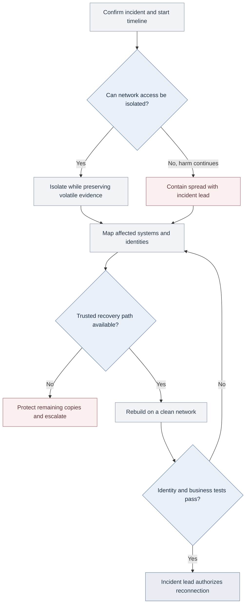

<a href="https://herbertofury.github.io/INTA/" title="Open INTA official download or service page" aria-label="Open INTA official download or service page" data-inta-brand="app-inta"></a> [INTA](https://github.com/Herbertofury/INTA/wiki) / [Decision desk](https://github.com/Herbertofury/INTA/wiki/Decision-Desk) · [Service map](https://github.com/Herbertofury/INTA/wiki/Service-Map) · [Playbooks](https://github.com/Herbertofury/INTA/wiki/Playbooks) · [Tools](https://github.com/Herbertofury/INTA/wiki/Tool-Directory) · [Methods](https://github.com/Herbertofury/INTA/wiki/Methods) · [Open hub](https://herbertofury.github.io/INTA/)

<a id="-contain-ransomware-or-a-wider-compromise"></a>

# [Contain ransomware or a wider compromise](https://github.com/Herbertofury/INTA/wiki/Job-ransomware-response)

Stop spread, preserve useful evidence, and restore services through a clean recovery path.

**Security** · Advanced · Immediate triage; recovery varies · 6 steps

[Tools and useful links](#working-kit) · [Quick answer](#quick-answer) · [Next action](#next-action) · [Specific fixes](#specific-fixes) · [Decision route](#decision-route) · [Tools](#toolkit) · [Procedure](#walkthrough) · [Verification](#acceptance) · [Sources](#sources) · [Interactive checklist](https://herbertofury.github.io/INTA/#job/ransomware-response)

<a id="working-kit"></a>

## 🧰 Tools and links for this job

**[Open working view](https://herbertofury.github.io/INTA/#job/ransomware-response)** · Keep the tool panel beside the instructions.

**First move:** Disconnect affected network access and contact the incident lead through a clean channel. Do not attach backups to the affected environment.

| Use this for | Official tool + exact action |
| --- | --- |
| Use existing endpoint telemetry for investigation; plan new deployment after active evidence-preservation needs are resolved. | **<a href="https://learn.microsoft.com/en-us/sysinternals/downloads/sysmon" title="Open Sysmon official download or service page" aria-label="Open Sysmon official download or service page" data-inta-brand="sysmon"></a> [Sysmon](https://learn.microsoft.com/en-us/sysinternals/downloads/sysmon)** · <a href="https://learn.microsoft.com/en-us/sysinternals/downloads/sysmon" title="Open Sysmon official download or service page" aria-label="Open Sysmon official download or service page" data-inta-brand="sysmon"></a> [Official page](https://learn.microsoft.com/en-us/sysinternals/downloads/sysmon) · **<a href="https://www.microsoft.com/windows" title="Open Windows official download or service page" aria-label="Open Windows official download or service page" data-inta-brand="app-windows"></a> [Download Windows monitoring tools · ZIP](https://download.sysinternals.com/files/Sysmon.zip)** |
| A quick ransomware-family identification and a pointer toward known recovery information. | **<a href="https://id-ransomware.malwarehunterteam.com/" title="Open ID Ransomware official download or service page" aria-label="Open ID Ransomware official download or service page" data-inta-brand="id-ransomware"></a> [ID Ransomware](https://id-ransomware.malwarehunterteam.com/)** · <a href="https://id-ransomware.malwarehunterteam.com/" title="Open ID Ransomware official download or service page" aria-label="Open ID Ransomware official download or service page" data-inta-brand="id-ransomware"></a> [Official page](https://id-ransomware.malwarehunterteam.com/) · **<a href="https://id-ransomware.malwarehunterteam.com/" title="Open ID Ransomware official download or service page" aria-label="Open ID Ransomware official download or service page" data-inta-brand="id-ransomware"></a> [Open online service](https://id-ransomware.malwarehunterteam.com/)** |
| Finding the correct public recovery utility after isolating an encrypted system and preserving the original files. | **<a href="https://www.nomoreransom.org/crypto-sheriff.php?lang=en" title="Open No More Ransom Crypto Sheriff official download or service page" aria-label="Open No More Ransom Crypto Sheriff official download or service page" data-inta-brand="no-more-ransom"></a> [No More Ransom Crypto Sheriff](https://www.nomoreransom.org/en/index.html)** · <a href="https://www.nomoreransom.org/crypto-sheriff.php?lang=en" title="Open No More Ransom Crypto Sheriff official download or service page" aria-label="Open No More Ransom Crypto Sheriff official download or service page" data-inta-brand="no-more-ransom"></a> [Official page](https://www.nomoreransom.org/en/index.html) · **<a href="https://www.nomoreransom.org/crypto-sheriff.php?lang=en" title="Open No More Ransom Crypto Sheriff official download or service page" aria-label="Open No More Ransom Crypto Sheriff official download or service page" data-inta-brand="no-more-ransom"></a> [Open online service](https://www.nomoreransom.org/crypto-sheriff.php?lang=en)** |
| Correlating a known hash with malware-family evidence and research reports without uploading an unknown document. | **<a href="https://bazaar.abuse.ch/browse/" title="Open MalwareBazaar official download or service page" aria-label="Open MalwareBazaar official download or service page" data-inta-brand="malwarebazaar"></a> [MalwareBazaar](https://bazaar.abuse.ch/)** · <a href="https://bazaar.abuse.ch/browse/" title="Open MalwareBazaar official download or service page" aria-label="Open MalwareBazaar official download or service page" data-inta-brand="malwarebazaar"></a> [Official page](https://bazaar.abuse.ch/) · **<a href="https://bazaar.abuse.ch/browse/" title="Open MalwareBazaar official download or service page" aria-label="Open MalwareBazaar official download or service page" data-inta-brand="malwarebazaar"></a> [Open online service](https://bazaar.abuse.ch/browse/)** |
| Checking whether a connection, domain or hash from endpoint/network logs matches reported malware infrastructure. | **<a href="https://threatfox.abuse.ch/browse/" title="Open ThreatFox official download or service page" aria-label="Open ThreatFox official download or service page" data-inta-brand="threatfox"></a> [ThreatFox](https://threatfox.abuse.ch/)** · <a href="https://threatfox.abuse.ch/browse/" title="Open ThreatFox official download or service page" aria-label="Open ThreatFox official download or service page" data-inta-brand="threatfox"></a> [Official page](https://threatfox.abuse.ch/) · **<a href="https://threatfox.abuse.ch/browse/" title="Open ThreatFox official download or service page" aria-label="Open ThreatFox official download or service page" data-inta-brand="threatfox"></a> [Open online service](https://threatfox.abuse.ch/browse/)** |

### [Incident response](https://github.com/Herbertofury/INTA/wiki/Job-ransomware-response)

| Open the exact resource | What to do there |
| --- | --- |
| **<a href="https://www.cisa.gov/" title="Open cisa.gov official download or service page" aria-label="Open cisa.gov official download or service page" data-inta-brand="site-www-cisa-gov"></a> [CISA ransomware response checklist](https://www.cisa.gov/sites/default/files/2025-03/StopRansomware-Guide%20508.pdf)** | Isolation, evidence preservation and recovery priorities. |
| **<a href="https://www.microsoft.com/" title="Open microsoft.com official download or service page" aria-label="Open microsoft.com official download or service page" data-inta-brand="site-www-microsoft-com"></a> [Microsoft incident-response approach](https://learn.microsoft.com/en-us/security/ransomware/incident-response-playbook-dart-ransomware-approach)** | Scope compromised systems, identities and recovery dependencies. |

### Recovery

| Open the exact resource | What to do there |
| --- | --- |
| **[Recovery acceptance evidence](https://github.com/Herbertofury/INTA/wiki/Service-Evidence)** | Record clean media, restored data and return-to-service proof. |

<a id="quick-answer"></a>

## ⚡ Quick answer

<a id="quick-contain-ransomware"></a>

### 🚨 Contain ransomware

**Isolate affected connections and alert the incident owner immediately if files are being encrypted or compromise is spreading.**

1. Disconnect affected systems from networks and protect reachable backups without destroying useful evidence.
2. Preserve the timeline, ransom note and available logs privately; scope affected accounts and systems with the incident owner.
3. Follow the incident plan for credential containment, clean rebuild and verified restoration before reconnecting.

**No extra download needed.** Follow the checklist below.

<a id="next-action"></a>

## 🧭 Match the symptom

| You see this | Do this next | You should get |
| --- | --- | --- |
| **Files are being encrypted or several endpoints are affected** | Isolate network links or the affected switch segment with the incident lead; keep isolated devices powered when feasible for evidence. | Spread is contained and the action time and affected scope are recorded. |
| **Isolation is impossible and damage continues** | Have the incident lead decide whether shutdown is necessary, recording the loss of volatile evidence. | Continuing harm is stopped with an explicit evidence tradeoff. |
| **Backups appear reachable from compromised systems** | Separate their access path and inspect recovery copies from a known-clean administration device. | At least one usable recovery copy is protected from the incident. |
| **A team is ready to restore services** | Agree dependency order, rebuild affected systems from trusted media and test restored business tasks before reconnection. | The incident lead has evidence for release, including account/session containment. |

### ✅ Finish the job

- [ ] Affected systems and identities have a documented scope and owner.
- [ ] Clean restoration passes the actual business workflow.
- [ ] The incident lead authorizes reconnection and records remaining unknowns.

**Change route when:** An action would overwrite evidence or the only recovery copy. · Identity compromise or infrastructure recovery exceeds the responder’s authority or capability.

### 🎯 Go straight to a specific fix

- **[Protect backups before testing a restore](#fix-ransomware-protect-recovery-copies)** — Compromised machines can still reach the backup destination or its administration account.
- **[Contain stolen account access as well as the PC](#fix-ransomware-compromised-admin-account)** — The incident involves privileged credentials, suspicious sessions or activity on more than one device.
- **[Evaluate a decryptor without risking the evidence](#fix-ransomware-test-decryptor-on-copies)** — A supposed decryptor is offered for the observed ransomware family.

> [!NOTE]
> **Start here.** Treat live encryption, ransom notes, or several compromised systems as an incident. Start a private incident timeline and contact the designated incident lead.

<a id="decision-route"></a>

<a id="-choose-the-right-branch"></a>

## 🧭 Choose a route



**Route links:** [Continue this workflow](#walkthrough) · [Acceptance checks](#acceptance) · [Remove malware and browser hijackers](malware-removal.md) · [Prove a backup can actually restore](backup-restore.md) · [Bring an office back after a power outage](outage-recovery.md) · [Close a repair with a clear client handoff](client-handoff.md)

| Checkpoint | What to carry forward |
| --- | --- |
| **Before changing anything** | Isolate spread and protect evidence and recovery copies. |
| **Keep during the job** | Private incident timeline, affected assets, identities, and preserved logs. |
| **Before handing back** | Validated clean services and incident-lead approval to reconnect. |

<a id="toolkit"></a>

<a id="-build-the-right-toolkit"></a>

## Recommended tools

Select a tool for the next diagnostic or repair step. Check its platform, access and licensing requirements before use.

| Tool / official page + download | Use it for | Platform & access | Documentation |
| --- | --- | --- | --- |
| **<a href="https://learn.microsoft.com/en-us/sysinternals/downloads/sysinternals-suite" title="Open Microsoft Sysinternals Suite official download or service page" aria-label="Open Microsoft Sysinternals Suite official download or service page" data-inta-brand="sysinternals"></a> [Microsoft Sysinternals Suite](https://learn.microsoft.com/en-us/sysinternals/)** · <a href="https://learn.microsoft.com/en-us/sysinternals/downloads/sysinternals-suite" title="Open Microsoft Sysinternals Suite official download or service page" aria-label="Open Microsoft Sysinternals Suite official download or service page" data-inta-brand="sysinternals"></a> [Official page](https://learn.microsoft.com/en-us/sysinternals/) · **<a href="https://www.microsoft.com/windows" title="Open Windows official download or service page" aria-label="Open Windows official download or service page" data-inta-brand="app-windows"></a> [Download Windows portable · ZIP](https://download.sysinternals.com/files/SysinternalsSuite.zip)** | The core portable <a href="https://www.microsoft.com/windows" title="Open Windows official download or service page" aria-label="Open Windows official download or service page" data-inta-brand="app-windows"></a> [Windows](https://www.microsoft.com/windows) troubleshooting kit. | <a href="https://www.microsoft.com/windows" title="Open Windows official download or service page" aria-label="Open Windows official download or service page" data-inta-brand="app-windows"></a> [Windows](https://www.microsoft.com/windows); Free <a href="https://www.microsoft.com/" title="Open microsoft.com official download or service page" aria-label="Open microsoft.com official download or service page" data-inta-brand="site-www-microsoft-com"></a> [Microsoft](https://www.microsoft.com/) utilities | <a href="https://learn.microsoft.com/en-us/sysinternals/downloads/sysinternals-suite" title="Open Microsoft Sysinternals Suite official download or service page" aria-label="Open Microsoft Sysinternals Suite official download or service page" data-inta-brand="sysinternals"></a> [Open guide](https://learn.microsoft.com/en-us/sysinternals/downloads/) |
| **<a href="https://www.wireshark.org/download.html" title="Open Wireshark official download or service page" aria-label="Open Wireshark official download or service page" data-inta-brand="wireshark"></a> [Wireshark](https://www.wireshark.org/)** · <a href="https://www.wireshark.org/download.html" title="Open Wireshark official download or service page" aria-label="Open Wireshark official download or service page" data-inta-brand="wireshark"></a> [Official page](https://www.wireshark.org/) · **<a href="https://www.microsoft.com/windows" title="Open Windows official download or service page" aria-label="Open Windows official download or service page" data-inta-brand="app-windows"></a> [Download Windows x64 · EXE](https://2.na.dl.wireshark.org/win64/Wireshark-4.6.10-x64.exe)** | Explaining DNS, TCP and application-protocol failures from a bounded capture. | <a href="https://www.microsoft.com/windows" title="Open Windows official download or service page" aria-label="Open Windows official download or service page" data-inta-brand="app-windows"></a> [Windows](https://www.microsoft.com/windows), <a href="https://www.kernel.org/" title="Open Linux official download or service page" aria-label="Open Linux official download or service page" data-inta-brand="app-linux"></a> [Linux](https://www.kernel.org/), <a href="https://support.apple.com/macos" title="Open macOS official download or service page" aria-label="Open macOS official download or service page" data-inta-brand="app-macos"></a> [macOS](https://support.apple.com/macos); Free / open source | <a href="https://www.wireshark.org/download.html" title="Open Wireshark official download or service page" aria-label="Open Wireshark official download or service page" data-inta-brand="wireshark"></a> [Open guide](https://www.wireshark.org/docs/) |
| **<a href="https://learn.microsoft.com/en-us/sysinternals/downloads/sysmon" title="Open Sysmon official download or service page" aria-label="Open Sysmon official download or service page" data-inta-brand="sysmon"></a> [Sysmon](https://learn.microsoft.com/en-us/sysinternals/downloads/sysmon)** · <a href="https://learn.microsoft.com/en-us/sysinternals/downloads/sysmon" title="Open Sysmon official download or service page" aria-label="Open Sysmon official download or service page" data-inta-brand="sysmon"></a> [Official page](https://learn.microsoft.com/en-us/sysinternals/downloads/sysmon) · **<a href="https://www.microsoft.com/windows" title="Open Windows official download or service page" aria-label="Open Windows official download or service page" data-inta-brand="app-windows"></a> [Download Windows monitoring tools · ZIP](https://download.sysinternals.com/files/Sysmon.zip)** | Use existing endpoint telemetry for investigation; plan new deployment after active evidence-preservation needs are resolved. | <a href="https://www.microsoft.com/windows" title="Open Windows official download or service page" aria-label="Open Windows official download or service page" data-inta-brand="app-windows"></a> [Windows](https://www.microsoft.com/windows), <a href="https://learn.microsoft.com/en-us/windows-server/" title="Open Windows Server official download or service page" aria-label="Open Windows Server official download or service page" data-inta-brand="app-windows-server"></a> [Windows Server](https://learn.microsoft.com/en-us/windows-server/); Free proprietary <a href="https://www.microsoft.com/" title="Open microsoft.com official download or service page" aria-label="Open microsoft.com official download or service page" data-inta-brand="site-www-microsoft-com"></a> [Microsoft](https://www.microsoft.com/) utility under <a href="https://learn.microsoft.com/en-us/sysinternals/downloads/sysinternals-suite" title="Open Microsoft Sysinternals Suite official download or service page" aria-label="Open Microsoft Sysinternals Suite official download or service page" data-inta-brand="sysinternals"></a> [Sysinternals](https://learn.microsoft.com/en-us/sysinternals/) terms; redistribution and commercial software hosting are restricted | <a href="https://learn.microsoft.com/en-us/sysinternals/downloads/sysmon" title="Open Sysmon official download or service page" aria-label="Open Sysmon official download or service page" data-inta-brand="sysmon"></a> [Open guide](https://learn.microsoft.com/en-us/sysinternals/downloads/sysmon) |
| **<a href="https://id-ransomware.malwarehunterteam.com/" title="Open ID Ransomware official download or service page" aria-label="Open ID Ransomware official download or service page" data-inta-brand="id-ransomware"></a> [ID Ransomware](https://id-ransomware.malwarehunterteam.com/)** · <a href="https://id-ransomware.malwarehunterteam.com/" title="Open ID Ransomware official download or service page" aria-label="Open ID Ransomware official download or service page" data-inta-brand="id-ransomware"></a> [Official page](https://id-ransomware.malwarehunterteam.com/) · **<a href="https://id-ransomware.malwarehunterteam.com/" title="Open ID Ransomware official download or service page" aria-label="Open ID Ransomware official download or service page" data-inta-brand="id-ransomware"></a> [Open online service](https://id-ransomware.malwarehunterteam.com/)** | A quick ransomware-family identification and a pointer toward known recovery information. | Web browser; Free public service. | <a href="https://id-ransomware.malwarehunterteam.com/" title="Open ID Ransomware official download or service page" aria-label="Open ID Ransomware official download or service page" data-inta-brand="id-ransomware"></a> [Open guide](https://id-ransomware.malwarehunterteam.com/) |
| **<a href="https://www.nomoreransom.org/crypto-sheriff.php?lang=en" title="Open No More Ransom Crypto Sheriff official download or service page" aria-label="Open No More Ransom Crypto Sheriff official download or service page" data-inta-brand="no-more-ransom"></a> [No More Ransom Crypto Sheriff](https://www.nomoreransom.org/en/index.html)** · <a href="https://www.nomoreransom.org/crypto-sheriff.php?lang=en" title="Open No More Ransom Crypto Sheriff official download or service page" aria-label="Open No More Ransom Crypto Sheriff official download or service page" data-inta-brand="no-more-ransom"></a> [Official page](https://www.nomoreransom.org/en/index.html) · **<a href="https://www.nomoreransom.org/crypto-sheriff.php?lang=en" title="Open No More Ransom Crypto Sheriff official download or service page" aria-label="Open No More Ransom Crypto Sheriff official download or service page" data-inta-brand="no-more-ransom"></a> [Open online service](https://www.nomoreransom.org/crypto-sheriff.php?lang=en)** | Finding the correct public recovery utility after isolating an encrypted system and preserving the original files. | Web browser; Free identification resources and supported decryptor links. | <a href="https://www.nomoreransom.org/crypto-sheriff.php?lang=en" title="Open No More Ransom Crypto Sheriff official download or service page" aria-label="Open No More Ransom Crypto Sheriff official download or service page" data-inta-brand="no-more-ransom"></a> [Open guide](https://www.nomoreransom.org/en/ransomware-qa.html) |
| **<a href="https://bazaar.abuse.ch/browse/" title="Open MalwareBazaar official download or service page" aria-label="Open MalwareBazaar official download or service page" data-inta-brand="malwarebazaar"></a> [MalwareBazaar](https://bazaar.abuse.ch/)** · <a href="https://bazaar.abuse.ch/browse/" title="Open MalwareBazaar official download or service page" aria-label="Open MalwareBazaar official download or service page" data-inta-brand="malwarebazaar"></a> [Official page](https://bazaar.abuse.ch/) · **<a href="https://bazaar.abuse.ch/browse/" title="Open MalwareBazaar official download or service page" aria-label="Open MalwareBazaar official download or service page" data-inta-brand="malwarebazaar"></a> [Open online service](https://bazaar.abuse.ch/browse/)** | Correlating a known hash with malware-family evidence and research reports without uploading an unknown document. | Web browser; Free public database; commercial automation may require an enhanced API subscription. | <a href="https://bazaar.abuse.ch/browse/" title="Open MalwareBazaar official download or service page" aria-label="Open MalwareBazaar official download or service page" data-inta-brand="malwarebazaar"></a> [Open guide](https://bazaar.abuse.ch/faq/) |
| **<a href="https://threatfox.abuse.ch/browse/" title="Open ThreatFox official download or service page" aria-label="Open ThreatFox official download or service page" data-inta-brand="threatfox"></a> [ThreatFox](https://threatfox.abuse.ch/)** · <a href="https://threatfox.abuse.ch/browse/" title="Open ThreatFox official download or service page" aria-label="Open ThreatFox official download or service page" data-inta-brand="threatfox"></a> [Official page](https://threatfox.abuse.ch/) · **<a href="https://threatfox.abuse.ch/browse/" title="Open ThreatFox official download or service page" aria-label="Open ThreatFox official download or service page" data-inta-brand="threatfox"></a> [Open online service](https://threatfox.abuse.ch/browse/)** | Checking whether a connection, domain or hash from endpoint/network logs matches reported malware infrastructure. | Web browser; Free community web access; commercial API usage may need the enhanced subscription. | <a href="https://threatfox.abuse.ch/browse/" title="Open ThreatFox official download or service page" aria-label="Open ThreatFox official download or service page" data-inta-brand="threatfox"></a> [Open guide](https://threatfox.abuse.ch/faq/) |

<a id="walkthrough"></a>

<a id="-work-the-case"></a>

## Procedure

Work in order, record the result of each step, and change route when the evidence calls for it.

<a id="step-01"></a>

### 01 · Isolate affected systems

- [ ] Disconnect affected network links or isolate the relevant switch ports and wireless access. Coordinate the action with the incident lead so essential services are understood. Do not connect backup media or use the compromised endpoint for routine communications.

<a id="step-02"></a>

### 02 · Preserve evidence without allowing spread

- [ ] Keep the device powered on after network isolation when feasible so trained responders can capture volatile evidence. If isolation is impossible and harm is continuing, containment may require shutdown. Record the decision, visible symptoms, time, and who acted.

**<a href="https://github.com/PowerShell/PowerShell/releases/latest" title="Open PowerShell official download or service page" aria-label="Open PowerShell official download or service page" data-inta-brand="powershell"></a> [PowerShell](https://learn.microsoft.com/en-us/powershell/) · Record adapter state and endpoint protection status without changing connectivity or security settings.:**

```text
Get-NetAdapter | Format-Table Name,Status,LinkSpeed -AutoSize
Get-MpComputerStatus | Select-Object AMServiceEnabled,AntivirusEnabled,RealTimeProtectionEnabled
```

> **Before running:** Read-only triage. Do not use this as a substitute for incident-lead-directed containment.

**Official command reference:** <a href="https://www.microsoft.com/" title="Open microsoft.com official download or service page" aria-label="Open microsoft.com official download or service page" data-inta-brand="site-www-microsoft-com"></a> <a href="https://github.com/PowerShell/PowerShell/releases/latest" title="Open PowerShell official download or service page" aria-label="Open PowerShell official download or service page" data-inta-brand="powershell"></a> [Microsoft NetAdapter PowerShell documentation](https://learn.microsoft.com/en-us/powershell/module/netadapter/get-netadapter)

**Command legend:** <a href="https://www.microsoft.com/" title="Open microsoft.com official download or service page" aria-label="Open microsoft.com official download or service page" data-inta-brand="site-www-microsoft-com"></a> <a href="https://github.com/PowerShell/PowerShell/releases/latest" title="Open PowerShell official download or service page" aria-label="Open PowerShell official download or service page" data-inta-brand="powershell"></a> [Microsoft NetAdapter PowerShell documentation](https://learn.microsoft.com/en-us/powershell/module/netadapter/get-netadapter) · [Return to the step context](#step-02).

<a id="step-03"></a>

### 03 · Map the impact

- [ ] List affected devices, identities, remote-access services, shares, cloud accounts, and backup systems. Preserve relevant logs before retention expires. Keep an untouched copy of original evidence and work from copies; do not run a broad cleanup that destroys the investigation trail.

<a id="step-04"></a>

### 04 · Protect the recovery environment

- [ ] Use a known-clean administrative device and a separate recovery network. Verify backup availability without exposing backups to the affected environment. Coordinate credential resets, session revocation, and remote-access restrictions with the incident lead so the attacker does not retain access.

<a id="step-05"></a>

### 05 · Rebuild in dependency order

- [ ] Restore identity, network, storage, and critical business services according to the agreed recovery plan. Rebuild affected systems from trusted images where required. Scan and validate restored data, close the identified entry point, and prevent old vulnerable configurations from being reintroduced.

<a id="step-06"></a>

### 06 · Rejoin only after explicit acceptance

- [ ] Test critical workflows in the clean recovery environment and monitor for recurrence. The incident lead decides when systems may reconnect and when the incident is closed. Record remaining unknowns, recovery gaps, owners, and follow-up actions.

<a id="acceptance"></a>

<a id="-prove-the-result"></a>

## Verification

- [ ] Affected systems are isolated and the incident timeline is complete.
- [ ] Recovery uses known-clean systems and validated backups.
- [ ] Compromised identities and the initial entry point have been addressed.
- [ ] Critical workflows pass and the incident lead authorizes reconnection.

> [!WARNING]
> **Pause this route and escalate when:**
> - You are about to destroy evidence or overwrite the only recovery copy.
> - The scope or identity compromise is beyond the current technician’s response capability.

<a id="specific-fixes"></a>

## 🎯 Specific fixes

Choose the case that matches the evidence. Each case gives a first action, a short procedure and a result to prove.

<a id="fix-ransomware-protect-recovery-copies"></a>

### Protect backups before testing a restore

**Use when:** Compromised machines can still reach the backup destination or its administration account.

**Start here:** Have the incident lead separate backup access from the affected systems using a known-clean administration path.

1. Identify offline, immutable or otherwise isolated recovery copies and record their dates without attaching them to an affected endpoint.
2. Check whether the backup account or repository was modified during the incident; preserve access logs and the incident timeline.
3. Restore a selected pre-incident sample into an isolated clean environment and test the actual data before planning production recovery.

**Prove it worked:** A usable recovery point is demonstrated and remains outside the attacker’s current access path.

**If this does not resolve it:** If the backup system or administrative identity is also compromised, involve the incident and backup owners before changing retention or deleting snapshots.

**Official evidence:** <a href="https://www.cisa.gov/" title="Open cisa.gov official download or service page" aria-label="Open cisa.gov official download or service page" data-inta-brand="site-www-cisa-gov"></a> [Source 1](https://www.cisa.gov/sites/default/files/2025-03/StopRansomware-Guide%20508.pdf) · Reviewed 2026-11-26

[Back to specific fixes](#specific-fixes) · [Full procedure](#walkthrough)

<a id="fix-ransomware-compromised-admin-account"></a>

### Contain stolen account access as well as the PC

**Use when:** The incident involves privileged credentials, suspicious sessions or activity on more than one device.

**Start here:** Use a known-clean device and have the identity administrator identify the affected account and scope.

1. Preserve relevant sign-in and audit evidence before applying the organization’s account containment procedure.
2. Use the supported identity response to block or secure the account, reset credentials and revoke applicable sessions; review unauthorized authentication methods and app access.
3. Recheck access and sign-in activity from a clean session while endpoint containment continues.

**Prove it worked:** The account has an evidenced containment state and unauthorized access paths are addressed separately from endpoint rebuilding.

**If this does not resolve it:** A password change alone is not a complete incident release. Escalate if administrators, federation or multiple identities are affected.

**Official evidence:** <a href="https://learn.microsoft.com/" title="Open learn.microsoft.com official download or service page" aria-label="Open learn.microsoft.com official download or service page" data-inta-brand="site-learn-microsoft-com"></a> [Source 1](https://learn.microsoft.com/en-us/entra/identity/users/users-revoke-access) · <a href="https://learn.microsoft.com/" title="Open learn.microsoft.com official download or service page" aria-label="Open learn.microsoft.com official download or service page" data-inta-brand="site-learn-microsoft-com"></a> [Source 2](https://learn.microsoft.com/en-us/defender-office-365/responding-to-a-compromised-email-account) · Reviewed 2026-11-26

[Back to specific fixes](#specific-fixes) · [Full procedure](#walkthrough)

<a id="fix-ransomware-test-decryptor-on-copies"></a>

### Evaluate a decryptor without risking the evidence

**Use when:** A supposed decryptor is offered for the observed ransomware family.

**Start here:** Preserve the ransom note and encrypted originals, and check the family against the official No More Ransom resources.

1. Use only the matched vendor/project instructions; a similar ransom-note name is not proof that a decryptor supports the exact variant.
2. In a known-clean, isolated recovery environment, prepare separate copies of representative encrypted files and any required original/encrypted pairs.
3. Test the supported decryptor on those copies and open recovered files in their real applications before considering wider use.

**Prove it worked:** The test demonstrates usable files for the exact supported variant while original evidence remains intact.

**If this does not resolve it:** If the variant is unsupported, files remain corrupt or a website asks for unapproved payment/credentials, stop and continue the incident-led restore plan.

**Official evidence:** <a href="https://www.nomoreransom.org/" title="Open nomoreransom.org official download or service page" aria-label="Open nomoreransom.org official download or service page" data-inta-brand="site-www-nomoreransom-org"></a> [Source 1](https://www.nomoreransom.org/en/decryption-tools.html) · <a href="https://www.cisa.gov/" title="Open cisa.gov official download or service page" aria-label="Open cisa.gov official download or service page" data-inta-brand="site-www-cisa-gov"></a> [Source 2](https://www.cisa.gov/sites/default/files/2025-03/StopRansomware-Guide%20508.pdf) · Reviewed 2026-11-26

[Back to specific fixes](#specific-fixes) · [Full procedure](#walkthrough)


<a id="-continue-with-the-evidence"></a>

## Related playbooks

| Next playbook | What it resolves |
| --- | --- |
| [Remove malware and browser hijackers](malware-removal.md) | A measured cleanup workflow for a single <a href="https://www.microsoft.com/windows" title="Open Windows official download or service page" aria-label="Open Windows official download or service page" data-inta-brand="app-windows"></a> [Windows](https://www.microsoft.com/windows) endpoint, with a separate path for a wider compromise. |
| [Prove a backup can actually restore](backup-restore.md) | Validate recovery credentials, data integrity, application usability, and recovery time. |
| [Bring an office back after a power outage](outage-recovery.md) | Restore dependencies in order and verify services before releasing the office back to work. |
| [Close a repair with a clear client handoff](client-handoff.md) | Turn completed technical work into proof the customer can use, with clean access and an actionable service record. |

<a id="sources"></a>

<a id="-source-trail"></a>

## Official sources

- <a href="https://www.cisa.gov/" title="Open cisa.gov official download or service page" aria-label="Open cisa.gov official download or service page" data-inta-brand="site-www-cisa-gov"></a> [CISA and MS-ISAC: ransomware response guide](https://www.cisa.gov/sites/default/files/publications/CISA_MS-ISAC_Ransomware%20Guide_S508C_.pdf)
- <a href="https://www.microsoft.com/" title="Open microsoft.com official download or service page" aria-label="Open microsoft.com official download or service page" data-inta-brand="site-www-microsoft-com"></a> [Microsoft: incident response ransomware approach](https://learn.microsoft.com/en-us/security/compass/incident-response-playbook-dart-ransomware-approach)
- <a href="https://www.microsoft.com/" title="Open microsoft.com official download or service page" aria-label="Open microsoft.com official download or service page" data-inta-brand="site-www-microsoft-com"></a> [Microsoft: ransomware investigation and recovery](https://learn.microsoft.com/en-us/defender-xdr/playbook-responding-ransomware-m365-defender)

Reviewed **2026-11-26**. Timing is a planning range. A successful command is evidence about that operation; acceptance belongs to the user’s original task.


---

Editorial review: **2026-11-26** · [Review standard](https://github.com/Herbertofury/INTA/wiki/Knowledge-Standards) · [Suggest a correction](https://github.com/Herbertofury/INTA/issues/new/choose)

[← All playbooks](README.md) · [Live Wiki](https://github.com/Herbertofury/INTA/wiki) · [Contribution guide](https://github.com/Herbertofury/INTA/blob/main/CONTRIBUTING.md)
