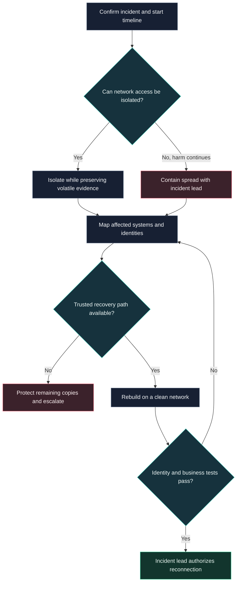

[🏠 Home](https://github.com/Herbertofury/INTA/wiki) · [🧭 Decision desk](https://github.com/Herbertofury/INTA/wiki/Decision-Desk) · [📚 Playbooks](https://github.com/Herbertofury/INTA/wiki/Playbooks) · [🧰 Tool directory](https://github.com/Herbertofury/INTA/wiki/Tool-Directory) · [✨ Open interactive hub](https://herbertofury.github.io/INTA/)

# 🚨 [Contain ransomware or a wider compromise](https://github.com/Herbertofury/INTA/wiki/Job-ransomware-response)

Stop spread, preserve useful evidence, and restore services through a clean recovery path.

| Work area | Experience | Plan your time | Workflow |
| --- | --- | --- | --- |
| Security | Advanced | Immediate triage; recovery varies | 6 steps + acceptance |

**[▶ Open the interactive checklist](https://herbertofury.github.io/INTA/#job/ransomware-response)** · [Decision route](#decision-route) · [Toolkit](#toolkit) · [Walkthrough](#walkthrough) · [Acceptance](#acceptance) · [Sources](#sources)

> [!TIP]
> **Your starting move:** Treat live encryption, ransom notes, or several compromised systems as an incident. Start a private incident timeline and contact the designated incident lead.

## 🧭 Choose the right branch

**Diagram routes:** [Continue this workflow](#walkthrough) · [Acceptance checks](#acceptance) · [Remove malware and browser hijackers](malware-removal.md) · [Prove a backup can actually restore](backup-restore.md) · [Bring an office back after a power outage](outage-recovery.md) · [Close a repair with a clear client handoff](client-handoff.md)

| Checkpoint | What to carry forward |
| --- | --- |
| **Before changing anything** | Isolate spread and protect evidence and recovery copies. |
| **Keep during the job** | Private incident timeline, affected assets, identities, and preserved logs. |
| **Before handing back** | Validated clean services and incident-lead approval to reconnect. |

## 🧰 Build the right toolkit

Choose the tools that answer the case’s next question. Opening a tool is a separate decision from changing the customer’s system.

| Tool / official download | Use it for | Platform & access | Documentation |
| --- | --- | --- | --- |
| [Microsoft Sysinternals Suite](https://learn.microsoft.com/en-us/sysinternals/downloads/sysinternals-suite) | The core portable [Windows](https://www.microsoft.com/windows) troubleshooting kit. | [Windows](https://www.microsoft.com/windows); Free Microsoft utilities | [Open guide](https://learn.microsoft.com/en-us/sysinternals/downloads/) |
| [Wireshark](https://www.wireshark.org/download.html) | Explaining DNS, TCP and application-protocol failures from a bounded capture. | [Windows](https://www.microsoft.com/windows), [Linux](https://www.kernel.org/), [macOS](https://support.apple.com/macos); Free / open source | [Open guide](https://www.wireshark.org/docs/) |

## 🪜 Work the case

Work in order, record the result of each step, and change route when the evidence calls for it.

### 01 · Isolate affected systems

- [ ] Disconnect affected network links or isolate the relevant switch ports and wireless access. Coordinate the action with the incident lead so essential services are understood. Do not connect backup media or use the compromised endpoint for routine communications.

### 02 · Preserve evidence without allowing spread

- [ ] Keep the device powered on after network isolation when feasible so trained responders can capture volatile evidence. If isolation is impossible and harm is continuing, containment may require shutdown. Record the decision, visible symptoms, time, and who acted.

### 03 · Map the impact

- [ ] List affected devices, identities, remote-access services, shares, cloud accounts, and backup systems. Preserve relevant logs before retention expires. Keep an untouched copy of original evidence and work from copies; do not run a broad cleanup that destroys the investigation trail.

### 04 · Protect the recovery environment

- [ ] Use a known-clean administrative device and a separate recovery network. Verify backup availability without exposing backups to the affected environment. Coordinate credential resets, session revocation, and remote-access restrictions with the incident lead so the attacker does not retain access.

### 05 · Rebuild in dependency order

- [ ] Restore identity, network, storage, and critical business services according to the agreed recovery plan. Rebuild affected systems from trusted images where required. Scan and validate restored data, close the identified entry point, and prevent old vulnerable configurations from being reintroduced.

### 06 · Rejoin only after explicit acceptance

- [ ] Test critical workflows in the clean recovery environment and monitor for recurrence. The incident lead decides when systems may reconnect and when the incident is closed. Record remaining unknowns, recovery gaps, owners, and follow-up actions.

## ✅ Prove the result

- [ ] Affected systems are isolated and the incident timeline is complete.
- [ ] Recovery uses known-clean systems and validated backups.
- [ ] Compromised identities and the initial entry point have been addressed.
- [ ] Critical workflows pass and the incident lead authorizes reconnection.

> [!WARNING]
> **Pause this route and escalate when:**
> - You are about to destroy evidence or overwrite the only recovery copy.
> - The scope or identity compromise is beyond the current technician’s response capability.

## 🔀 Continue with the evidence

| Next playbook | What it resolves |
| --- | --- |
| [Remove malware and browser hijackers](malware-removal.md) | A measured cleanup workflow for a single [Windows](https://www.microsoft.com/windows) endpoint, with a separate path for a wider compromise. |
| [Prove a backup can actually restore](backup-restore.md) | Validate recovery credentials, data integrity, application usability, and recovery time. |
| [Bring an office back after a power outage](outage-recovery.md) | Restore dependencies in order and verify services before releasing the office back to work. |
| [Close a repair with a clear client handoff](client-handoff.md) | Turn completed technical work into proof the customer can use, with clean access and an actionable service record. |

Found a reusable improvement? [Contribute the correction](https://github.com/Herbertofury/INTA/wiki/Contribute) and include the test that proved it.

## 🔎 Source trail

Official references and editorial review

- [CISA and MS-ISAC: ransomware response guide](https://www.cisa.gov/sites/default/files/publications/CISA_MS-ISAC_Ransomware%20Guide_S508C_.pdf)
- [Microsoft: incident response ransomware approach](https://learn.microsoft.com/en-us/security/compass/incident-response-playbook-dart-ransomware-approach)
- [Microsoft: ransomware investigation and recovery](https://learn.microsoft.com/en-us/defender-xdr/playbook-responding-ransomware-m365-defender)

Reviewed **2026-11-26**. Timing is a planning range. A successful command is evidence about that operation; acceptance belongs to the user’s original task.

---

**Source review: 2026-11-26.** Guidance review and tool release versions are separate. [Report a correction](https://github.com/Herbertofury/INTA/issues/new/choose) · [How we maintain this guide](https://github.com/Herbertofury/INTA/wiki/Knowledge-Standards)

[← All playbooks](README.md) · [Live Wiki](https://github.com/Herbertofury/INTA/wiki) · [Contribution guide](https://github.com/Herbertofury/INTA/blob/main/CONTRIBUTING.md)
