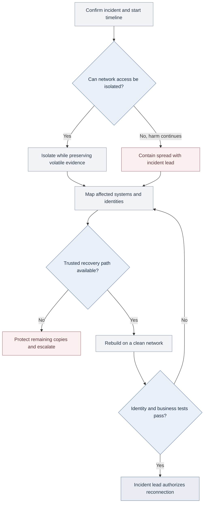

[INTA](https://github.com/Herbertofury/INTA/wiki) / [Decision desk](https://github.com/Herbertofury/INTA/wiki/Decision-Desk) · [Playbooks](https://github.com/Herbertofury/INTA/wiki/Playbooks) · [Tools](https://github.com/Herbertofury/INTA/wiki/Tool-Directory) · [Methods](https://github.com/Herbertofury/INTA/wiki/Methods) · [Open hub](https://herbertofury.github.io/INTA/)

# [Contain ransomware or a wider compromise](https://github.com/Herbertofury/INTA/wiki/Job-ransomware-response)

Stop spread, preserve useful evidence, and restore services through a clean recovery path.

**Security** · Advanced · Immediate triage; recovery varies · 6 steps

[Tools and useful links](#working-kit) · [Quick answer](#quick-answer) · [Next action](#next-action) · [Decision route](#decision-route) · [Tools](#toolkit) · [Procedure](#walkthrough) · [Verification](#acceptance) · [Sources](#sources) · [Interactive checklist](https://herbertofury.github.io/INTA/#job/ransomware-response)

## 🧰 Tools and links for this job

**[Open working view](https://herbertofury.github.io/INTA/#job/ransomware-response)** · Keep the tool panel beside the instructions.

**First move:** Disconnect affected network access and contact the incident lead through a clean channel. Do not attach backups to the affected environment.

### [Incident response](https://github.com/Herbertofury/INTA/wiki/Job-ransomware-response)

| Open the exact resource | What to do there |
| --- | --- |
| **[CISA ransomware response checklist](https://www.cisa.gov/sites/default/files/2025-03/StopRansomware-Guide%20508.pdf)** | Isolation, evidence preservation and recovery priorities. |
| **[Microsoft incident-response approach](https://learn.microsoft.com/en-us/security/ransomware/incident-response-playbook-dart-ransomware-approach)** | Scope compromised systems, identities and recovery dependencies. |

### Recovery

| Open the exact resource | What to do there |
| --- | --- |
| **[Recovery acceptance evidence](https://github.com/Herbertofury/INTA/wiki/Service-Evidence)** | Record clean media, restored data and return-to-service proof. |

## ⚡ Quick answer

### 🚨 Contain ransomware

**Isolate affected connections and alert the incident owner immediately if files are being encrypted or compromise is spreading.**

1. Disconnect affected systems from networks and protect reachable backups without destroying useful evidence.
2. Preserve the timeline, ransom note and available logs privately; scope affected accounts and systems with the incident owner.
3. Follow the incident plan for credential containment, clean rebuild and verified restoration before reconnecting.

**No extra download needed.** Follow the checklist below.

## 🧭 Match the symptom

| You see this | Do this next | You should get |
| --- | --- | --- |
| **Files are being encrypted or several endpoints are affected** | Isolate network links or the affected switch segment with the incident lead; keep isolated devices powered when feasible for evidence. | Spread is contained and the action time and affected scope are recorded. |
| **Isolation is impossible and damage continues** | Have the incident lead decide whether shutdown is necessary, recording the loss of volatile evidence. | Continuing harm is stopped with an explicit evidence tradeoff. |
| **Backups appear reachable from compromised systems** | Separate their access path and inspect recovery copies from a known-clean administration device. | At least one usable recovery copy is protected from the incident. |
| **A team is ready to restore services** | Agree dependency order, rebuild affected systems from trusted media and test restored business tasks before reconnection. | The incident lead has evidence for release, including account/session containment. |

### ✅ Finish the job

- [ ] Affected systems and identities have a documented scope and owner.
- [ ] Clean restoration passes the actual business workflow.
- [ ] The incident lead authorizes reconnection and records remaining unknowns.

**Change route when:** An action would overwrite evidence or the only recovery copy. · Identity compromise or infrastructure recovery exceeds the responder’s authority or capability.

> [!NOTE]
> **Start here.** Treat live encryption, ransom notes, or several compromised systems as an incident. Start a private incident timeline and contact the designated incident lead.

## 🧭 Choose a route

**Route links:** [Continue this workflow](#walkthrough) · [Acceptance checks](#acceptance) · [Remove malware and browser hijackers](malware-removal.md) · [Prove a backup can actually restore](backup-restore.md) · [Bring an office back after a power outage](outage-recovery.md) · [Close a repair with a clear client handoff](client-handoff.md)

| Checkpoint | What to carry forward |
| --- | --- |
| **Before changing anything** | Isolate spread and protect evidence and recovery copies. |
| **Keep during the job** | Private incident timeline, affected assets, identities, and preserved logs. |
| **Before handing back** | Validated clean services and incident-lead approval to reconnect. |

## Recommended tools

Select a tool for the next diagnostic or repair step. Check its platform, access and licensing requirements before use.

| Tool / official page + download | Use it for | Platform & access | Documentation |
| --- | --- | --- | --- |
| **[Microsoft Sysinternals Suite](https://learn.microsoft.com/en-us/sysinternals/)** · [Official page](https://learn.microsoft.com/en-us/sysinternals/) · **[Download Windows portable · ZIP](https://download.sysinternals.com/files/SysinternalsSuite.zip)** | The core portable [Windows](https://www.microsoft.com/windows) troubleshooting kit. | [Windows](https://www.microsoft.com/windows); Free Microsoft utilities | [Open guide](https://learn.microsoft.com/en-us/sysinternals/downloads/) |
| **[Wireshark](https://www.wireshark.org/)** · [Official page](https://www.wireshark.org/) · **[Download Windows x64 · EXE](https://2.na.dl.wireshark.org/win64/Wireshark-4.6.10-x64.exe)** | Explaining DNS, TCP and application-protocol failures from a bounded capture. | [Windows](https://www.microsoft.com/windows), [Linux](https://www.kernel.org/), [macOS](https://support.apple.com/macos); Free / open source | [Open guide](https://www.wireshark.org/docs/) |

## Procedure

Work in order, record the result of each step, and change route when the evidence calls for it.

### 01 · Isolate affected systems

- [ ] Disconnect affected network links or isolate the relevant switch ports and wireless access. Coordinate the action with the incident lead so essential services are understood. Do not connect backup media or use the compromised endpoint for routine communications.

### 02 · Preserve evidence without allowing spread

- [ ] Keep the device powered on after network isolation when feasible so trained responders can capture volatile evidence. If isolation is impossible and harm is continuing, containment may require shutdown. Record the decision, visible symptoms, time, and who acted.

### 03 · Map the impact

- [ ] List affected devices, identities, remote-access services, shares, cloud accounts, and backup systems. Preserve relevant logs before retention expires. Keep an untouched copy of original evidence and work from copies; do not run a broad cleanup that destroys the investigation trail.

### 04 · Protect the recovery environment

- [ ] Use a known-clean administrative device and a separate recovery network. Verify backup availability without exposing backups to the affected environment. Coordinate credential resets, session revocation, and remote-access restrictions with the incident lead so the attacker does not retain access.

### 05 · Rebuild in dependency order

- [ ] Restore identity, network, storage, and critical business services according to the agreed recovery plan. Rebuild affected systems from trusted images where required. Scan and validate restored data, close the identified entry point, and prevent old vulnerable configurations from being reintroduced.

### 06 · Rejoin only after explicit acceptance

- [ ] Test critical workflows in the clean recovery environment and monitor for recurrence. The incident lead decides when systems may reconnect and when the incident is closed. Record remaining unknowns, recovery gaps, owners, and follow-up actions.

## Verification

- [ ] Affected systems are isolated and the incident timeline is complete.
- [ ] Recovery uses known-clean systems and validated backups.
- [ ] Compromised identities and the initial entry point have been addressed.
- [ ] Critical workflows pass and the incident lead authorizes reconnection.

> [!WARNING]
> **Pause this route and escalate when:**
> - You are about to destroy evidence or overwrite the only recovery copy.
> - The scope or identity compromise is beyond the current technician’s response capability.

## Related playbooks

| Next playbook | What it resolves |
| --- | --- |
| [Remove malware and browser hijackers](malware-removal.md) | A measured cleanup workflow for a single [Windows](https://www.microsoft.com/windows) endpoint, with a separate path for a wider compromise. |
| [Prove a backup can actually restore](backup-restore.md) | Validate recovery credentials, data integrity, application usability, and recovery time. |
| [Bring an office back after a power outage](outage-recovery.md) | Restore dependencies in order and verify services before releasing the office back to work. |
| [Close a repair with a clear client handoff](client-handoff.md) | Turn completed technical work into proof the customer can use, with clean access and an actionable service record. |

## Official sources

- [CISA and MS-ISAC: ransomware response guide](https://www.cisa.gov/sites/default/files/publications/CISA_MS-ISAC_Ransomware%20Guide_S508C_.pdf)
- [Microsoft: incident response ransomware approach](https://learn.microsoft.com/en-us/security/compass/incident-response-playbook-dart-ransomware-approach)
- [Microsoft: ransomware investigation and recovery](https://learn.microsoft.com/en-us/defender-xdr/playbook-responding-ransomware-m365-defender)

Reviewed **2026-11-26**. Timing is a planning range. A successful command is evidence about that operation; acceptance belongs to the user’s original task.

---

Editorial review: **2026-11-26** · [Review standard](https://github.com/Herbertofury/INTA/wiki/Knowledge-Standards) · [Suggest a correction](https://github.com/Herbertofury/INTA/issues/new/choose)

[← All playbooks](README.md) · [Live Wiki](https://github.com/Herbertofury/INTA/wiki) · [Contribution guide](https://github.com/Herbertofury/INTA/blob/main/CONTRIBUTING.md)
