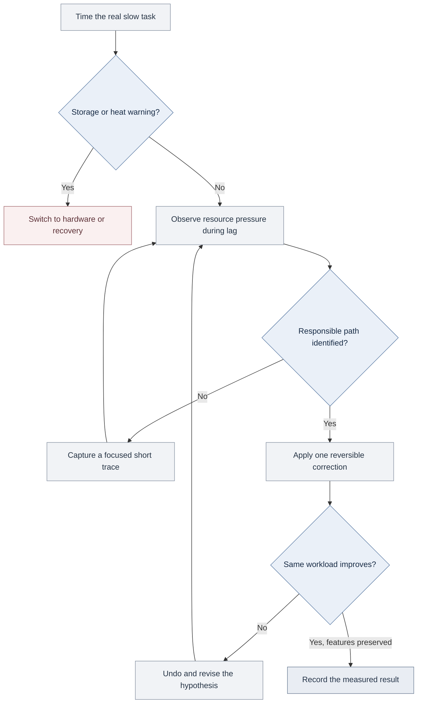

<a href="https://herbertofury.github.io/INTA/" title="Open INTA official download or service page" aria-label="Open INTA official download or service page" data-inta-brand="app-inta"></a> [INTA](https://github.com/Herbertofury/INTA/wiki) / [Decision desk](https://github.com/Herbertofury/INTA/wiki/Decision-Desk) · [Service map](https://github.com/Herbertofury/INTA/wiki/Service-Map) · [Playbooks](https://github.com/Herbertofury/INTA/wiki/Playbooks) · [Tools](https://github.com/Herbertofury/INTA/wiki/Tool-Directory) · [Methods](https://github.com/Herbertofury/INTA/wiki/Methods) · [Open hub](https://herbertofury.github.io/INTA/)

<a id="-diagnose-a-slow-freezing-or-hitching-pc"></a>

# [Diagnose a slow, freezing, or hitching PC](https://github.com/Herbertofury/INTA/wiki/Job-slow-pc)

Find the actual bottleneck and prove the improvement with the same workload.

**<a href="https://www.microsoft.com/windows" title="Open Windows official download or service page" aria-label="Open Windows official download or service page" data-inta-brand="app-windows"></a> [Windows](https://www.microsoft.com/windows) & performance** · Intermediate · 20–60 min · 6 steps

[Tools and useful links](#working-kit) · [Quick answer](#quick-answer) · [Next action](#next-action) · [Specific fixes](#specific-fixes) · [Decision route](#decision-route) · [Tools](#toolkit) · [Procedure](#walkthrough) · [Verification](#acceptance) · [Sources](#sources) · [Interactive checklist](https://herbertofury.github.io/INTA/#job/slow-pc)

<a id="tool-choices"></a>

## 🧰 Choose the tool for this job

Choose by the task shown in the first column. Each option includes its acquisition route and access boundary.

| Need | Official tool + exact action | Why this choice / access |
| --- | --- | --- |
| **Find the busy process** | **<a href="https://learn.microsoft.com/en-us/sysinternals/downloads/process-explorer" title="Open Process Explorer official download or service page" aria-label="Open Process Explorer official download or service page" data-inta-brand="process-explorer"></a> [Process Explorer](https://learn.microsoft.com/en-us/sysinternals/downloads/process-explorer)** · **<a href="https://www.microsoft.com/windows" title="Open Windows official download or service page" aria-label="Open Windows official download or service page" data-inta-brand="app-windows"></a> [Download Windows portable · ZIP](https://download.sysinternals.com/files/ProcessExplorer.zip)** | Identify the process responsible for sustained CPU, memory or handle pressure before changing software. **Access:** Free <a href="https://www.microsoft.com/" title="Open microsoft.com official download or service page" aria-label="Open microsoft.com official download or service page" data-inta-brand="site-www-microsoft-com"></a> [Microsoft](https://www.microsoft.com/) utility |
| **Explain an I/O stall** | **<a href="https://learn.microsoft.com/en-us/sysinternals/downloads/procmon" title="Open Process Monitor official download or service page" aria-label="Open Process Monitor official download or service page" data-inta-brand="procmon"></a> [Process Monitor](https://learn.microsoft.com/en-us/sysinternals/downloads/procmon)** · **<a href="https://www.microsoft.com/windows" title="Open Windows official download or service page" aria-label="Open Windows official download or service page" data-inta-brand="app-windows"></a> [Download Windows portable · ZIP](https://download.sysinternals.com/files/ProcessMonitor.zip)** | Capture a short filtered trace of the reproducible file or registry delay. **Access:** Free <a href="https://www.microsoft.com/" title="Open microsoft.com official download or service page" aria-label="Open microsoft.com official download or service page" data-inta-brand="site-www-microsoft-com"></a> [Microsoft](https://www.microsoft.com/) utility |
| **Check storage warnings** | **<a href="https://crystalmark.info/en/download/" title="Open CrystalDiskInfo official download or service page" aria-label="Open CrystalDiskInfo official download or service page" data-inta-brand="crystaldiskinfo"></a> [CrystalDiskInfo](https://crystalmark.info/en/software/crystaldiskinfo/)** · **<a href="https://www.microsoft.com/windows" title="Open Windows official download or service page" aria-label="Open Windows official download or service page" data-inta-brand="app-windows"></a> [Get Windows ZIP · 9.9.5](https://sourceforge.net/projects/crystaldiskinfo/files/9.9.5/CrystalDiskInfo9_9_5.zip/download)** | Check supported drive-health indicators before ordinary performance repair or stress tests. **Access:** Free and open source |
| **Complete diagnostic kit** | **<a href="https://learn.microsoft.com/en-us/sysinternals/downloads/sysinternals-suite" title="Open Microsoft Sysinternals Suite official download or service page" aria-label="Open Microsoft Sysinternals Suite official download or service page" data-inta-brand="sysinternals"></a> [Microsoft Sysinternals Suite](https://learn.microsoft.com/en-us/sysinternals/)** · **<a href="https://www.microsoft.com/windows" title="Open Windows official download or service page" aria-label="Open Windows official download or service page" data-inta-brand="app-windows"></a> [Download Windows portable · ZIP](https://download.sysinternals.com/files/SysinternalsSuite.zip)** | Keep the full utility suite available when the next evidence-backed branch needs another component. **Access:** Free <a href="https://www.microsoft.com/" title="Open microsoft.com official download or service page" aria-label="Open microsoft.com official download or service page" data-inta-brand="site-www-microsoft-com"></a> [Microsoft](https://www.microsoft.com/) utilities |

**[Current selection evidence](https://github.com/Herbertofury/INTA/wiki/Current-Tool-Choices)**

<a id="working-kit"></a>

## 🧰 Tools and links for this job

**[Open working view](https://herbertofury.github.io/INTA/#job/slow-pc)** · Keep the tool panel beside the instructions.

**First move:** Time one slow action. Press Ctrl+Shift+Esc and watch CPU, memory and disk while reproducing it; check drive health before a heavy scan.

| Use this for | Official tool + exact action |
| --- | --- |
| Identify the busy process and its owner. | **<a href="https://learn.microsoft.com/en-us/sysinternals/downloads/process-explorer" title="Open Process Explorer official download or service page" aria-label="Open Process Explorer official download or service page" data-inta-brand="process-explorer"></a> [Process Explorer](https://learn.microsoft.com/en-us/sysinternals/downloads/process-explorer)** · <a href="https://learn.microsoft.com/en-us/sysinternals/downloads/process-explorer" title="Open Process Explorer official download or service page" aria-label="Open Process Explorer official download or service page" data-inta-brand="process-explorer"></a> [Official page](https://learn.microsoft.com/en-us/sysinternals/downloads/process-explorer) · **<a href="https://www.microsoft.com/windows" title="Open Windows official download or service page" aria-label="Open Windows official download or service page" data-inta-brand="app-windows"></a> [Download Windows portable · ZIP](https://download.sysinternals.com/files/ProcessExplorer.zip)** |
| Capture a short, filtered file or registry stall. | **<a href="https://learn.microsoft.com/en-us/sysinternals/downloads/procmon" title="Open Process Monitor official download or service page" aria-label="Open Process Monitor official download or service page" data-inta-brand="procmon"></a> [Process Monitor](https://learn.microsoft.com/en-us/sysinternals/downloads/procmon)** · <a href="https://learn.microsoft.com/en-us/sysinternals/downloads/procmon" title="Open Process Monitor official download or service page" aria-label="Open Process Monitor official download or service page" data-inta-brand="procmon"></a> [Official page](https://learn.microsoft.com/en-us/sysinternals/downloads/procmon) · **<a href="https://www.microsoft.com/windows" title="Open Windows official download or service page" aria-label="Open Windows official download or service page" data-inta-brand="app-windows"></a> [Download Windows portable · ZIP](https://download.sysinternals.com/files/ProcessMonitor.zip)** |
| Explain capacity use on healthy storage. | **<a href="https://github.com/windirstat/windirstat/releases/latest" title="Open WinDirStat official download or service page" aria-label="Open WinDirStat official download or service page" data-inta-brand="windirstat"></a> [WinDirStat](https://windirstat.net/)** · <a href="https://github.com/windirstat/windirstat/releases/latest" title="Open WinDirStat official download or service page" aria-label="Open WinDirStat official download or service page" data-inta-brand="windirstat"></a> [Official page](https://windirstat.net/) · **<a href="https://www.microsoft.com/windows" title="Open Windows official download or service page" aria-label="Open Windows official download or service page" data-inta-brand="app-windows"></a> [Download Windows x64 · MSI](https://github.com/windirstat/windirstat/releases/download/release/v2.9.3/WinDirStat-x64.msi)** |
| Separate storage warnings from ordinary software lag. | **<a href="https://crystalmark.info/en/download/" title="Open CrystalDiskInfo official download or service page" aria-label="Open CrystalDiskInfo official download or service page" data-inta-brand="crystaldiskinfo"></a> [CrystalDiskInfo](https://crystalmark.info/en/software/crystaldiskinfo/)** · <a href="https://crystalmark.info/en/download/" title="Open CrystalDiskInfo official download or service page" aria-label="Open CrystalDiskInfo official download or service page" data-inta-brand="crystaldiskinfo"></a> [Official page](https://crystalmark.info/en/software/crystaldiskinfo/) · **<a href="https://www.microsoft.com/windows" title="Open Windows official download or service page" aria-label="Open Windows official download or service page" data-inta-brand="app-windows"></a> [Get Windows ZIP · 9.9.5](https://sourceforge.net/projects/crystaldiskinfo/files/9.9.5/CrystalDiskInfo9_9_5.zip/download)** |
| Collecting battery and sleep evidence before changing hardware or power policy. | **<a href="https://learn.microsoft.com/en-us/windows-hardware/design/device-experiences/powercfg-command-line-options" title="Open powercfg official download or service page" aria-label="Open powercfg official download or service page" data-inta-brand="powercfg"></a> [powercfg](https://learn.microsoft.com/en-us/windows-hardware/design/device-experiences/powercfg-command-line-options)** · <a href="https://learn.microsoft.com/en-us/windows-hardware/design/device-experiences/powercfg-command-line-options" title="Open powercfg official download or service page" aria-label="Open powercfg official download or service page" data-inta-brand="powercfg"></a> [Official page](https://learn.microsoft.com/en-us/windows-hardware/design/device-experiences/powercfg-command-line-options) · **<a href="https://learn.microsoft.com/en-us/windows-hardware/design/device-experiences/powercfg-command-line-options" title="Open powercfg official download or service page" aria-label="Open powercfg official download or service page" data-inta-brand="powercfg"></a> [Open built-in battery and sleep diagnostics](https://learn.microsoft.com/en-us/windows-hardware/design/device-experiences/powercfg-command-line-options)** |
| Measure a reproducible storage-performance problem on healthy media with a bounded test file. | **<a href="https://github.com/microsoft/diskspd/releases" title="Open DiskSpd official download or service page" aria-label="Open DiskSpd official download or service page" data-inta-brand="diskspd"></a> [DiskSpd](https://github.com/microsoft/diskspd)** · <a href="https://github.com/microsoft/diskspd/releases" title="Open DiskSpd official download or service page" aria-label="Open DiskSpd official download or service page" data-inta-brand="diskspd"></a> [Official page](https://github.com/microsoft/diskspd) · **<a href="https://www.microsoft.com/windows" title="Open Windows official download or service page" aria-label="Open Windows official download or service page" data-inta-brand="app-windows"></a> [Download Windows x64/ARM64 tools · ZIP](https://github.com/microsoft/diskspd/releases/download/v2.3/DiskSpd.ZIP)** |
| Keep the full utility suite available when the next evidence-backed branch needs another component. | **<a href="https://learn.microsoft.com/en-us/sysinternals/downloads/sysinternals-suite" title="Open Microsoft Sysinternals Suite official download or service page" aria-label="Open Microsoft Sysinternals Suite official download or service page" data-inta-brand="sysinternals"></a> [Microsoft Sysinternals Suite](https://learn.microsoft.com/en-us/sysinternals/)** · <a href="https://learn.microsoft.com/en-us/sysinternals/downloads/sysinternals-suite" title="Open Microsoft Sysinternals Suite official download or service page" aria-label="Open Microsoft Sysinternals Suite official download or service page" data-inta-brand="sysinternals"></a> [Official page](https://learn.microsoft.com/en-us/sysinternals/) · **<a href="https://www.microsoft.com/windows" title="Open Windows official download or service page" aria-label="Open Windows official download or service page" data-inta-brand="app-windows"></a> [Download Windows portable · ZIP](https://download.sysinternals.com/files/SysinternalsSuite.zip)** |
| Use its supported disk analysis when the technician has the appropriate commercial entitlement. | **<a href="https://diskanalyzer.com/download" title="Open WizTree official download or service page" aria-label="Open WizTree official download or service page" data-inta-brand="wiztree"></a> [WizTree](https://diskanalyzer.com/)** · <a href="https://diskanalyzer.com/download" title="Open WizTree official download or service page" aria-label="Open WizTree official download or service page" data-inta-brand="wiztree"></a> [Official page](https://diskanalyzer.com/) · **<a href="https://www.microsoft.com/windows" title="Open Windows official download or service page" aria-label="Open Windows official download or service page" data-inta-brand="app-windows"></a> [Download Windows portable · ZIP](https://diskanalyzer.com/files/wiztree_4_34_portable.zip)** |

### Find the cause

| Open the exact resource | What to do there |
| --- | --- |
| **<a href="https://learn.microsoft.com/en-us/sysinternals/downloads/process-explorer" title="Open Process Explorer official download or service page" aria-label="Open Process Explorer official download or service page" data-inta-brand="process-explorer"></a> [Process Explorer usage](https://learn.microsoft.com/en-us/sysinternals/downloads/process-explorer)** | Inspect the exact process before stopping or changing it. |
| **<a href="https://learn.microsoft.com/en-us/sysinternals/downloads/procmon" title="Open Process Monitor official download or service page" aria-label="Open Process Monitor official download or service page" data-inta-brand="procmon"></a> [Process Monitor filtering](https://learn.microsoft.com/en-us/sysinternals/downloads/procmon)** | Limit capture to the affected process and interval. |

### Advanced

| Open the exact resource | What to do there |
| --- | --- |
| **<a href="https://www.microsoft.com/windows" title="Open Windows official download or service page" aria-label="Open Windows official download or service page" data-inta-brand="app-windows"></a> [Windows performance tracing](https://learn.microsoft.com/en-us/windows-hardware/test/wpt/)** | Use a measured trace when ordinary process views do not explain the delay. |

<a id="quick-answer"></a>

## ⚡ Quick answer

<a id="quick-slow-pc"></a>

### 🐢 Fix a slow PC

**Reproduce one slow task and check storage health before applying cleanup or startup changes.**

1. Use <a href="https://learn.microsoft.com/en-us/sysinternals/downloads/process-explorer" title="Open Process Explorer official download or service page" aria-label="Open Process Explorer official download or service page" data-inta-brand="process-explorer"></a> [Process Explorer](https://learn.microsoft.com/en-us/sysinternals/downloads/process-explorer) to identify the CPU, memory or I/O bottleneck during that task.
2. Inspect the relevant process or startup entry with <a href="https://learn.microsoft.com/en-us/sysinternals/downloads/sysinternals-suite" title="Open Microsoft Sysinternals Suite official download or service page" aria-label="Open Microsoft Sysinternals Suite official download or service page" data-inta-brand="sysinternals"></a> [Microsoft Sysinternals Suite](https://learn.microsoft.com/en-us/sysinternals/) and make one justified change.
3. Repeat the same task and compare its duration, resource use and responsiveness.

**<a href="https://learn.microsoft.com/en-us/sysinternals/downloads/sysinternals-suite" title="Open Microsoft Sysinternals Suite official download or service page" aria-label="Open Microsoft Sysinternals Suite official download or service page" data-inta-brand="sysinternals"></a> [Microsoft Sysinternals Suite](https://learn.microsoft.com/en-us/sysinternals/)** · <a href="https://learn.microsoft.com/en-us/sysinternals/downloads/sysinternals-suite" title="Open Microsoft Sysinternals Suite official download or service page" aria-label="Open Microsoft Sysinternals Suite official download or service page" data-inta-brand="sysinternals"></a> [Official page](https://learn.microsoft.com/en-us/sysinternals/) · **<a href="https://www.microsoft.com/windows" title="Open Windows official download or service page" aria-label="Open Windows official download or service page" data-inta-brand="app-windows"></a> [Download Windows portable · ZIP](https://download.sysinternals.com/files/SysinternalsSuite.zip)**

<a id="quick-disk-space"></a>

### 📊 Free disk space

**Confirm the disk is healthy and choose the drive to inspect before deleting any files.**

1. Scan that drive with <a href="https://github.com/windirstat/windirstat/releases/latest" title="Open WinDirStat official download or service page" aria-label="Open WinDirStat official download or service page" data-inta-brand="windirstat"></a> [WinDirStat](https://windirstat.net/) and identify the largest folders and file types.
2. Confirm ownership and recovery options, then remove only approved files or application-managed caches.
3. Recheck free space and open the affected application to confirm it still works.

**<a href="https://github.com/windirstat/windirstat/releases/latest" title="Open WinDirStat official download or service page" aria-label="Open WinDirStat official download or service page" data-inta-brand="windirstat"></a> [WinDirStat](https://windirstat.net/)** · <a href="https://github.com/windirstat/windirstat/releases/latest" title="Open WinDirStat official download or service page" aria-label="Open WinDirStat official download or service page" data-inta-brand="windirstat"></a> [Official page](https://windirstat.net/) · **<a href="https://www.microsoft.com/windows" title="Open Windows official download or service page" aria-label="Open Windows official download or service page" data-inta-brand="app-windows"></a> [Download Windows x64 · MSI](https://github.com/windirstat/windirstat/releases/download/release/v2.9.3/WinDirStat-x64.msi)**

<a id="next-action"></a>

## 🧭 Match the symptom

| You see this | Do this next | You should get |
| --- | --- | --- |
| **CPU stays high during the slow task** | Sort by CPU in <a href="https://support.microsoft.com/en-us/windows/experience/system-configuration-tools-in-windows" title="Open Task Manager official download or service page" aria-label="Open Task Manager official download or service page" data-inta-brand="app-task-manager"></a> [Task Manager](https://support.microsoft.com/en-us/windows/experience/system-configuration-tools-in-windows); inspect the identified process in <a href="https://learn.microsoft.com/en-us/sysinternals/downloads/process-explorer" title="Open Process Explorer official download or service page" aria-label="Open Process Explorer official download or service page" data-inta-brand="process-explorer"></a> [Process Explorer](https://learn.microsoft.com/en-us/sysinternals/downloads/process-explorer) and check its image path and owner. | One process or service correlates with the delay. |
| **Memory pressure rises as responsiveness falls** | Check <a href="https://support.microsoft.com/en-us/windows/experience/system-configuration-tools-in-windows" title="Open Task Manager official download or service page" aria-label="Open Task Manager official download or service page" data-inta-brand="app-task-manager"></a> [Task Manager](https://support.microsoft.com/en-us/windows/experience/system-configuration-tools-in-windows) > Performance > Memory, then close an agreed nonessential workload and repeat the task. | The before/after result distinguishes workload pressure from another cause. |
| **Disk activity stalls the system** | Check health first; on stable media use a short <a href="https://learn.microsoft.com/en-us/sysinternals/downloads/procmon" title="Open Process Monitor official download or service page" aria-label="Open Process Monitor official download or service page" data-inta-brand="procmon"></a> [Process Monitor](https://learn.microsoft.com/en-us/sysinternals/downloads/procmon) capture filtered to the affected process and path. | The slow I/O path is identified, or failing storage is routed to recovery. |
| **The healthy system drive is nearly full** | Use <a href="https://github.com/windirstat/windirstat/releases/latest" title="Open WinDirStat official download or service page" aria-label="Open WinDirStat official download or service page" data-inta-brand="windirstat"></a> [WinDirStat](https://windirstat.net/) to identify the largest owned folders; remove only approved content through supported cleanup controls. | Free space improves and the original application still works. |
| **Only a task using a share or online service is slow** | Compare an approved local equivalent and follow the network guide for the remote dependency. | The evidence separates local performance from service or network latency. |

### ✅ Finish the job

- [ ] The same workload has a recorded before/after result.
- [ ] The improvement survives restart without breaking protection, backup or required apps.

**Change route when:** Drive disconnects, read errors or physical damage appear. · A proposed optimization disables required functionality without evidence.

### 🎯 Go straight to a specific fix

- **[Separate useful cache from memory pressure](#fix-slow-pc-standby-memory-is-not-a-leak)** — A PC shows high memory use and someone proposes a RAM-cleaning utility.
- **[Find the optional app delaying sign-in](#fix-slow-pc-startup-app-delay)** — The desktop appears quickly but the user must wait before starting normal work.
- **[Find what an app is waiting for](#fix-slow-pc-filter-a-short-io-trace)** — One application freezes while disk or network-file activity continues.
- **[Explain a laptop that slows down on battery](#fix-slow-pc-only-on-battery)** — The same application is responsive on AC power but slow when unplugged.

> [!NOTE]
> **Start here.** Reproduce the exact slow action and measure it before changing anything. Ask whether the slowdown began after an update, new drive, app, or security product.

<a id="decision-route"></a>

<a id="-choose-the-right-branch"></a>

## 🧭 Choose a route



**Route links:** [Continue this workflow](#walkthrough) · [Acceptance checks](#acceptance) · [Rescue data from a failing or unreadable drive](failing-drive.md) · [Diagnose crashes, blue screens, and overheating](hardware-bsod.md) · <a href="https://www.microsoft.com/windows" title="Open Windows official download or service page" aria-label="Open Windows official download or service page" data-inta-brand="app-windows"></a> [Repair Windows component or system-file corruption](windows-repair.md) · [Run a useful workstation maintenance visit](preventive-maintenance.md)

| Checkpoint | What to carry forward |
| --- | --- |
| **Before changing anything** | Save a comparable baseline and check storage health. |
| **Keep during the job** | Workload timings, resource evidence, trace scope, and one change at a time. |
| **Before handing back** | Repeatable improvement with all required functions retained. |

<a id="toolkit"></a>

<a id="-build-the-right-toolkit"></a>

## Recommended tools

Select a tool for the next diagnostic or repair step. Check its platform, access and licensing requirements before use.

| Tool / official page + download | Use it for | Platform & access | Documentation |
| --- | --- | --- | --- |
| **<a href="https://learn.microsoft.com/en-us/sysinternals/downloads/process-explorer" title="Open Process Explorer official download or service page" aria-label="Open Process Explorer official download or service page" data-inta-brand="process-explorer"></a> [Process Explorer](https://learn.microsoft.com/en-us/sysinternals/downloads/process-explorer)** · <a href="https://learn.microsoft.com/en-us/sysinternals/downloads/process-explorer" title="Open Process Explorer official download or service page" aria-label="Open Process Explorer official download or service page" data-inta-brand="process-explorer"></a> [Official page](https://learn.microsoft.com/en-us/sysinternals/downloads/process-explorer) · **<a href="https://www.microsoft.com/windows" title="Open Windows official download or service page" aria-label="Open Windows official download or service page" data-inta-brand="app-windows"></a> [Download Windows portable · ZIP](https://download.sysinternals.com/files/ProcessExplorer.zip)** | Identify the busy process and its owner. | <a href="https://www.microsoft.com/windows" title="Open Windows official download or service page" aria-label="Open Windows official download or service page" data-inta-brand="app-windows"></a> [Windows](https://www.microsoft.com/windows); Free <a href="https://www.microsoft.com/" title="Open microsoft.com official download or service page" aria-label="Open microsoft.com official download or service page" data-inta-brand="site-www-microsoft-com"></a> [Microsoft](https://www.microsoft.com/) utility | <a href="https://learn.microsoft.com/en-us/sysinternals/downloads/process-explorer" title="Open Process Explorer official download or service page" aria-label="Open Process Explorer official download or service page" data-inta-brand="process-explorer"></a> [Open guide](https://learn.microsoft.com/en-us/sysinternals/downloads/process-explorer) |
| **<a href="https://learn.microsoft.com/en-us/sysinternals/downloads/procmon" title="Open Process Monitor official download or service page" aria-label="Open Process Monitor official download or service page" data-inta-brand="procmon"></a> [Process Monitor](https://learn.microsoft.com/en-us/sysinternals/downloads/procmon)** · <a href="https://learn.microsoft.com/en-us/sysinternals/downloads/procmon" title="Open Process Monitor official download or service page" aria-label="Open Process Monitor official download or service page" data-inta-brand="procmon"></a> [Official page](https://learn.microsoft.com/en-us/sysinternals/downloads/procmon) · **<a href="https://www.microsoft.com/windows" title="Open Windows official download or service page" aria-label="Open Windows official download or service page" data-inta-brand="app-windows"></a> [Download Windows portable · ZIP](https://download.sysinternals.com/files/ProcessMonitor.zip)** | Capture a short, filtered file or registry stall. | <a href="https://www.microsoft.com/windows" title="Open Windows official download or service page" aria-label="Open Windows official download or service page" data-inta-brand="app-windows"></a> [Windows](https://www.microsoft.com/windows); Free <a href="https://www.microsoft.com/" title="Open microsoft.com official download or service page" aria-label="Open microsoft.com official download or service page" data-inta-brand="site-www-microsoft-com"></a> [Microsoft](https://www.microsoft.com/) utility | <a href="https://learn.microsoft.com/en-us/sysinternals/downloads/procmon" title="Open Process Monitor official download or service page" aria-label="Open Process Monitor official download or service page" data-inta-brand="procmon"></a> [Open guide](https://learn.microsoft.com/en-us/sysinternals/downloads/procmon) |
| **<a href="https://github.com/windirstat/windirstat/releases/latest" title="Open WinDirStat official download or service page" aria-label="Open WinDirStat official download or service page" data-inta-brand="windirstat"></a> [WinDirStat](https://windirstat.net/)** · <a href="https://github.com/windirstat/windirstat/releases/latest" title="Open WinDirStat official download or service page" aria-label="Open WinDirStat official download or service page" data-inta-brand="windirstat"></a> [Official page](https://windirstat.net/) · **<a href="https://www.microsoft.com/windows" title="Open Windows official download or service page" aria-label="Open Windows official download or service page" data-inta-brand="app-windows"></a> [Download Windows x64 · MSI](https://github.com/windirstat/windirstat/releases/download/release/v2.9.3/WinDirStat-x64.msi)** | Explain capacity use on healthy storage. | <a href="https://www.microsoft.com/windows" title="Open Windows official download or service page" aria-label="Open Windows official download or service page" data-inta-brand="app-windows"></a> [Windows](https://www.microsoft.com/windows); Free / open source | <a href="https://github.com/windirstat/windirstat/releases/latest" title="Open WinDirStat official download or service page" aria-label="Open WinDirStat official download or service page" data-inta-brand="windirstat"></a> [Open guide](https://github.com/windirstat/windirstat) |
| **<a href="https://crystalmark.info/en/download/" title="Open CrystalDiskInfo official download or service page" aria-label="Open CrystalDiskInfo official download or service page" data-inta-brand="crystaldiskinfo"></a> [CrystalDiskInfo](https://crystalmark.info/en/software/crystaldiskinfo/)** · <a href="https://crystalmark.info/en/download/" title="Open CrystalDiskInfo official download or service page" aria-label="Open CrystalDiskInfo official download or service page" data-inta-brand="crystaldiskinfo"></a> [Official page](https://crystalmark.info/en/software/crystaldiskinfo/) · **<a href="https://www.microsoft.com/windows" title="Open Windows official download or service page" aria-label="Open Windows official download or service page" data-inta-brand="app-windows"></a> [Get Windows ZIP · 9.9.5](https://sourceforge.net/projects/crystaldiskinfo/files/9.9.5/CrystalDiskInfo9_9_5.zip/download)** | Separate storage warnings from ordinary software lag. | <a href="https://www.microsoft.com/windows" title="Open Windows official download or service page" aria-label="Open Windows official download or service page" data-inta-brand="app-windows"></a> [Windows](https://www.microsoft.com/windows); Free / open source | <a href="https://crystalmark.info/en/download/" title="Open CrystalDiskInfo official download or service page" aria-label="Open CrystalDiskInfo official download or service page" data-inta-brand="crystaldiskinfo"></a> [Open guide](https://crystalmark.info/en/software/crystaldiskinfo/) |
| **<a href="https://learn.microsoft.com/en-us/sysinternals/downloads/sysinternals-suite" title="Open Microsoft Sysinternals Suite official download or service page" aria-label="Open Microsoft Sysinternals Suite official download or service page" data-inta-brand="sysinternals"></a> [Microsoft Sysinternals Suite](https://learn.microsoft.com/en-us/sysinternals/)** · <a href="https://learn.microsoft.com/en-us/sysinternals/downloads/sysinternals-suite" title="Open Microsoft Sysinternals Suite official download or service page" aria-label="Open Microsoft Sysinternals Suite official download or service page" data-inta-brand="sysinternals"></a> [Official page](https://learn.microsoft.com/en-us/sysinternals/) · **<a href="https://www.microsoft.com/windows" title="Open Windows official download or service page" aria-label="Open Windows official download or service page" data-inta-brand="app-windows"></a> [Download Windows portable · ZIP](https://download.sysinternals.com/files/SysinternalsSuite.zip)** | Keep the full utility suite available when the next evidence-backed branch needs another component. | <a href="https://www.microsoft.com/windows" title="Open Windows official download or service page" aria-label="Open Windows official download or service page" data-inta-brand="app-windows"></a> [Windows](https://www.microsoft.com/windows); Free <a href="https://www.microsoft.com/" title="Open microsoft.com official download or service page" aria-label="Open microsoft.com official download or service page" data-inta-brand="site-www-microsoft-com"></a> [Microsoft](https://www.microsoft.com/) utilities | <a href="https://learn.microsoft.com/en-us/sysinternals/downloads/sysinternals-suite" title="Open Microsoft Sysinternals Suite official download or service page" aria-label="Open Microsoft Sysinternals Suite official download or service page" data-inta-brand="sysinternals"></a> [Open guide](https://learn.microsoft.com/en-us/sysinternals/downloads/) |
| **<a href="https://www.hwinfo.com/download/" title="Open HWiNFO official download or service page" aria-label="Open HWiNFO official download or service page" data-inta-brand="hwinfo"></a> [HWiNFO](https://www.hwinfo.com/)** · <a href="https://www.hwinfo.com/download/" title="Open HWiNFO official download or service page" aria-label="Open HWiNFO official download or service page" data-inta-brand="hwinfo"></a> [Official page](https://www.hwinfo.com/) · **<a href="https://www.microsoft.com/windows" title="Open Windows official download or service page" aria-label="Open Windows official download or service page" data-inta-brand="app-windows"></a> [Download Windows x64 EXE](https://www.hwinfo.com/files/hwi64_860.exe)** | Investigating temperatures, clocks, power and component identity. | <a href="https://www.microsoft.com/windows" title="Open Windows official download or service page" aria-label="Open Windows official download or service page" data-inta-brand="app-windows"></a> [Windows](https://www.microsoft.com/windows); Pro license for commercial use of 64/ARM64 editions | <a href="https://www.hwinfo.com/download/" title="Open HWiNFO official download or service page" aria-label="Open HWiNFO official download or service page" data-inta-brand="hwinfo"></a> [Open guide](https://www.hwinfo.com/licenses/) |
| **<a href="https://learn.microsoft.com/en-us/windows-hardware/get-started/adk-install" title="Open Windows Performance Toolkit official download or service page" aria-label="Open Windows Performance Toolkit official download or service page" data-inta-brand="windows-performance-toolkit"></a> [Windows Performance Toolkit](https://learn.microsoft.com/en-us/windows-hardware/test/wpt/)** · <a href="https://learn.microsoft.com/en-us/windows-hardware/get-started/adk-install" title="Open Windows Performance Toolkit official download or service page" aria-label="Open Windows Performance Toolkit official download or service page" data-inta-brand="windows-performance-toolkit"></a> [Official page](https://learn.microsoft.com/en-us/windows-hardware/test/wpt/) · **<a href="https://www.microsoft.com/windows" title="Open Windows official download or service page" aria-label="Open Windows official download or service page" data-inta-brand="app-windows"></a> [Download Windows ADK setup · EXE](https://go.microsoft.com/fwlink/?linkid=2289980)** | Investigating intermittent CPU, storage or application responsiveness problems with evidence. | <a href="https://www.microsoft.com/windows" title="Open Windows official download or service page" aria-label="Open Windows official download or service page" data-inta-brand="app-windows"></a> [Windows](https://www.microsoft.com/windows); Free <a href="https://www.microsoft.com/" title="Open microsoft.com official download or service page" aria-label="Open microsoft.com official download or service page" data-inta-brand="site-www-microsoft-com"></a> [Microsoft](https://www.microsoft.com/) toolkit | <a href="https://learn.microsoft.com/en-us/windows-hardware/get-started/adk-install" title="Open Windows Performance Toolkit official download or service page" aria-label="Open Windows Performance Toolkit official download or service page" data-inta-brand="windows-performance-toolkit"></a> [Open guide](https://learn.microsoft.com/en-us/windows-hardware/test/wpt/) |
| **<a href="https://diskanalyzer.com/download" title="Open WizTree official download or service page" aria-label="Open WizTree official download or service page" data-inta-brand="wiztree"></a> [WizTree](https://diskanalyzer.com/)** · <a href="https://diskanalyzer.com/download" title="Open WizTree official download or service page" aria-label="Open WizTree official download or service page" data-inta-brand="wiztree"></a> [Official page](https://diskanalyzer.com/) · **<a href="https://www.microsoft.com/windows" title="Open Windows official download or service page" aria-label="Open Windows official download or service page" data-inta-brand="app-windows"></a> [Download Windows portable · ZIP](https://diskanalyzer.com/files/wiztree_4_34_portable.zip)** | Use its supported disk analysis when the technician has the appropriate commercial entitlement. | <a href="https://www.microsoft.com/windows" title="Open Windows official download or service page" aria-label="Open Windows official download or service page" data-inta-brand="app-windows"></a> [Windows](https://www.microsoft.com/windows), <a href="https://support.apple.com/macos" title="Open macOS official download or service page" aria-label="Open macOS official download or service page" data-inta-brand="app-macos"></a> [macOS](https://support.apple.com/macos), <a href="https://www.kernel.org/" title="Open Linux official download or service page" aria-label="Open Linux official download or service page" data-inta-brand="app-linux"></a> [Linux](https://www.kernel.org/); Free for personal use; commercial supporter or enterprise license required by business site and staff size. | <a href="https://diskanalyzer.com/download" title="Open WizTree official download or service page" aria-label="Open WizTree official download or service page" data-inta-brand="wiztree"></a> [Open guide](https://diskanalyzer.com/about) |
| **<a href="https://antibody-software.com/wizfile/download" title="Open WizFile official download or service page" aria-label="Open WizFile official download or service page" data-inta-brand="wizfile"></a> [WizFile](https://antibody-software.com/wizfile/)** · <a href="https://antibody-software.com/wizfile/download" title="Open WizFile official download or service page" aria-label="Open WizFile official download or service page" data-inta-brand="wizfile"></a> [Official page](https://antibody-software.com/wizfile/) · **<a href="https://www.microsoft.com/windows" title="Open Windows official download or service page" aria-label="Open Windows official download or service page" data-inta-brand="app-windows"></a> [Download Windows portable · ZIP](https://antibody-software.com/files/wizfile_3_15_portable.zip)** | Locating a known file, log or recently changed group of files without guessing its folder. | <a href="https://www.microsoft.com/windows" title="Open Windows official download or service page" aria-label="Open Windows official download or service page" data-inta-brand="app-windows"></a> [Windows](https://www.microsoft.com/windows); Free for personal use; commercial supporter or enterprise license required by business site and staff size. | <a href="https://antibody-software.com/wizfile/download" title="Open WizFile official download or service page" aria-label="Open WizFile official download or service page" data-inta-brand="wizfile"></a> [Open guide](https://antibody-software.com/wizfile/quick-start) |
| **<a href="https://learn.microsoft.com/en-us/windows-hardware/design/device-experiences/powercfg-command-line-options" title="Open powercfg official download or service page" aria-label="Open powercfg official download or service page" data-inta-brand="powercfg"></a> [powercfg](https://learn.microsoft.com/en-us/windows-hardware/design/device-experiences/powercfg-command-line-options)** · <a href="https://learn.microsoft.com/en-us/windows-hardware/design/device-experiences/powercfg-command-line-options" title="Open powercfg official download or service page" aria-label="Open powercfg official download or service page" data-inta-brand="powercfg"></a> [Official page](https://learn.microsoft.com/en-us/windows-hardware/design/device-experiences/powercfg-command-line-options) · **<a href="https://learn.microsoft.com/en-us/windows-hardware/design/device-experiences/powercfg-command-line-options" title="Open powercfg official download or service page" aria-label="Open powercfg official download or service page" data-inta-brand="powercfg"></a> [Open built-in battery and sleep diagnostics](https://learn.microsoft.com/en-us/windows-hardware/design/device-experiences/powercfg-command-line-options)** | Collecting battery and sleep evidence before changing hardware or power policy. | <a href="https://www.microsoft.com/windows" title="Open Windows official download or service page" aria-label="Open Windows official download or service page" data-inta-brand="app-windows"></a> [Windows](https://www.microsoft.com/windows); Included with <a href="https://www.microsoft.com/windows" title="Open Windows official download or service page" aria-label="Open Windows official download or service page" data-inta-brand="app-windows"></a> [Windows](https://www.microsoft.com/windows) | <a href="https://learn.microsoft.com/en-us/windows-hardware/design/device-experiences/powercfg-command-line-options" title="Open powercfg official download or service page" aria-label="Open powercfg official download or service page" data-inta-brand="powercfg"></a> [Open guide](https://learn.microsoft.com/en-us/windows-hardware/design/device-experiences/powercfg-command-line-options) |
| **<a href="https://github.com/microsoft/diskspd/releases" title="Open DiskSpd official download or service page" aria-label="Open DiskSpd official download or service page" data-inta-brand="diskspd"></a> [DiskSpd](https://github.com/microsoft/diskspd)** · <a href="https://github.com/microsoft/diskspd/releases" title="Open DiskSpd official download or service page" aria-label="Open DiskSpd official download or service page" data-inta-brand="diskspd"></a> [Official page](https://github.com/microsoft/diskspd) · **<a href="https://www.microsoft.com/windows" title="Open Windows official download or service page" aria-label="Open Windows official download or service page" data-inta-brand="app-windows"></a> [Download Windows x64/ARM64 tools · ZIP](https://github.com/microsoft/diskspd/releases/download/v2.3/DiskSpd.ZIP)** | Measure a reproducible storage-performance problem on healthy media with a bounded test file. | <a href="https://www.microsoft.com/windows" title="Open Windows official download or service page" aria-label="Open Windows official download or service page" data-inta-brand="app-windows"></a> [Windows](https://www.microsoft.com/windows), <a href="https://learn.microsoft.com/en-us/windows-server/" title="Open Windows Server official download or service page" aria-label="Open Windows Server official download or service page" data-inta-brand="app-windows-server"></a> [Windows Server](https://learn.microsoft.com/en-us/windows-server/); Free and open source under MIT license | <a href="https://github.com/microsoft/diskspd/releases" title="Open DiskSpd official download or service page" aria-label="Open DiskSpd official download or service page" data-inta-brand="diskspd"></a> [Open guide](https://github.com/microsoft/diskspd/wiki) |

<a id="walkthrough"></a>

<a id="-work-the-case"></a>

## Procedure

Work in order, record the result of each step, and change route when the evidence calls for it.

<a id="step-01"></a>

### 01 · Capture a repeatable baseline

- [ ] Time sign-in and the specific failing task separately. Note AC power, current applications, storage connections, network state, and background updates. Repeat the same short workload after each change so an apparent improvement is comparable.

**CMD or <a href="https://github.com/PowerShell/PowerShell/releases/latest" title="Open PowerShell official download or service page" aria-label="Open PowerShell official download or service page" data-inta-brand="powershell"></a> [PowerShell](https://learn.microsoft.com/en-us/powershell/) · Open <a href="https://learn.microsoft.com/en-us/windows-server/administration/windows-commands/perfmon" title="Open Resource Monitor official download or service page" aria-label="Open Resource Monitor official download or service page" data-inta-brand="app-resource-monitor"></a> [Resource Monitor](https://learn.microsoft.com/en-us/windows-server/administration/windows-commands/perfmon) and inspect CPU, memory, disk and network activity while reproducing the slowdown.:**

```text
resmon
```

> **Before running:** Read-only diagnostic.

**Official command reference:** <a href="https://www.microsoft.com/" title="Open microsoft.com official download or service page" aria-label="Open microsoft.com official download or service page" data-inta-brand="site-www-microsoft-com"></a> <a href="https://learn.microsoft.com/en-us/windows-server/administration/windows-commands/perfmon" title="Open Resource Monitor official download or service page" aria-label="Open Resource Monitor official download or service page" data-inta-brand="app-resource-monitor"></a> [Microsoft Resource Monitor command](https://learn.microsoft.com/en-us/windows-server/administration/windows-commands/resmon)

**Command legend:** <a href="https://www.microsoft.com/" title="Open microsoft.com official download or service page" aria-label="Open microsoft.com official download or service page" data-inta-brand="site-www-microsoft-com"></a> <a href="https://learn.microsoft.com/en-us/windows-server/administration/windows-commands/perfmon" title="Open Resource Monitor official download or service page" aria-label="Open Resource Monitor official download or service page" data-inta-brand="app-resource-monitor"></a> [Microsoft Resource Monitor command](https://learn.microsoft.com/en-us/windows-server/administration/windows-commands/resmon) · [Return to the step context](#step-01).

<a id="step-02"></a>

### 02 · Inspect pressure while the lag happens

- [ ] Use <a href="https://support.microsoft.com/en-us/windows/experience/system-configuration-tools-in-windows" title="Open Task Manager official download or service page" aria-label="Open Task Manager official download or service page" data-inta-brand="app-task-manager"></a> [Task Manager](https://support.microsoft.com/en-us/windows/experience/system-configuration-tools-in-windows) or <a href="https://learn.microsoft.com/en-us/windows-server/administration/windows-commands/perfmon" title="Open Resource Monitor official download or service page" aria-label="Open Resource Monitor official download or service page" data-inta-brand="app-resource-monitor"></a> [Resource Monitor](https://learn.microsoft.com/en-us/windows-server/administration/windows-commands/perfmon) to identify CPU, committed memory, disk response, and network pressure. A high percentage alone is not a diagnosis: correlate it with the lag and the responsible process, path, or service.

**CMD or <a href="https://github.com/PowerShell/PowerShell/releases/latest" title="Open PowerShell official download or service page" aria-label="Open PowerShell official download or service page" data-inta-brand="powershell"></a> [PowerShell](https://learn.microsoft.com/en-us/powershell/) · Open <a href="https://learn.microsoft.com/en-us/windows-server/administration/windows-commands/perfmon" title="Open Resource Monitor official download or service page" aria-label="Open Resource Monitor official download or service page" data-inta-brand="app-resource-monitor"></a> [Resource Monitor](https://learn.microsoft.com/en-us/windows-server/administration/windows-commands/perfmon) while reproducing the slowdown to identify the pressured resource.:**

```text
resmon
```

> **Before running:** Read-only diagnostic.

**Official command reference:** <a href="https://www.microsoft.com/" title="Open microsoft.com official download or service page" aria-label="Open microsoft.com official download or service page" data-inta-brand="site-www-microsoft-com"></a> <a href="https://learn.microsoft.com/en-us/windows-server/administration/windows-commands/perfmon" title="Open Resource Monitor official download or service page" aria-label="Open Resource Monitor official download or service page" data-inta-brand="app-resource-monitor"></a> [Microsoft Resource Monitor command](https://learn.microsoft.com/en-us/windows-server/administration/windows-commands/resmon)

**Command legend:** <a href="https://www.microsoft.com/" title="Open microsoft.com official download or service page" aria-label="Open microsoft.com official download or service page" data-inta-brand="site-www-microsoft-com"></a> <a href="https://learn.microsoft.com/en-us/windows-server/administration/windows-commands/perfmon" title="Open Resource Monitor official download or service page" aria-label="Open Resource Monitor official download or service page" data-inta-brand="app-resource-monitor"></a> [Microsoft Resource Monitor command](https://learn.microsoft.com/en-us/windows-server/administration/windows-commands/resmon) · [Return to the step context](#step-02).

<a id="step-03"></a>

### 03 · Check storage and hardware first

- [ ] Review drive health and temperatures. If a disk disappears, clicks, reports I/O errors, or stalls the system when accessed, stop repair scans and use the failing-drive guide. Check a suspect external drive separately after outstanding writes have finished; preserve the user’s files. For a healthy drive with a capacity problem, use <a href="https://diskanalyzer.com/download" title="Open WizTree official download or service page" aria-label="Open WizTree official download or service page" data-inta-brand="wiztree"></a> [WizTree](https://diskanalyzer.com/) to identify the largest folders and distinguish allocation from the specific files the user needs. Use <a href="https://antibody-software.com/wizfile/download" title="Open WizFile official download or service page" aria-label="Open WizFile official download or service page" data-inta-brand="wizfile"></a> [WizFile](https://antibody-software.com/wizfile/) when the question is where a named file, log or recently changed file lives. Neither lookup proves that an item should be deleted; record the owner and retention need before using supported cleanup controls.

<a id="step-04"></a>

### 04 · Trace the responsible application

- [ ] Use <a href="https://learn.microsoft.com/en-us/sysinternals/downloads/process-explorer" title="Open Process Explorer official download or service page" aria-label="Open Process Explorer official download or service page" data-inta-brand="process-explorer"></a> [Process Explorer](https://learn.microsoft.com/en-us/sysinternals/downloads/process-explorer) for process detail and a short, filtered <a href="https://learn.microsoft.com/en-us/sysinternals/downloads/procmon" title="Open Process Monitor official download or service page" aria-label="Open Process Monitor official download or service page" data-inta-brand="procmon"></a> [Process Monitor](https://learn.microsoft.com/en-us/sysinternals/downloads/procmon) capture for file or registry stalls. Capture only the affected interval, stop recording, and save the trace privately. Inspect missing paths, repeated failures, or excessive work before choosing a fix. <a href="https://learn.microsoft.com/en-us/sysinternals/downloads/sysinternals-suite" title="Open Microsoft Sysinternals Suite official download or service page" aria-label="Open Microsoft Sysinternals Suite official download or service page" data-inta-brand="sysinternals"></a> [Microsoft Sysinternals Suite](https://learn.microsoft.com/en-us/sysinternals/) supplies these process and I/O diagnostics; it answers a different question from a disk-space treemap or filename lookup.

<a id="step-05"></a>

### 05 · Apply one reversible correction

- [ ] Fix the observed cause: a failing device, incompatible driver, misconfigured backup, unwanted startup app, or software regression. Use vendor-supported settings. Do not apply blanket registry cleaners, remove needed services, or disable endpoint protection simply to improve a benchmark.

<a id="step-06"></a>

### 06 · Measure and keep the evidence

- [ ] Repeat the baseline workload with the same data and conditions. Check functionality, responsiveness, and resource use together. Restore changes that did not help and record the measured before/after result plus anything still reproducible.

<a id="acceptance"></a>

<a id="-prove-the-result"></a>

## Verification

- [ ] The original task is measurably faster or the root cause is clearly identified.
- [ ] Required applications, protection, backup, and peripherals still work.
- [ ] The improvement survives a restart and the normal user workload.
- [ ] If capacity or file location was part of the problem, the identified path, ownership decision and before/after free-space or task result are recorded.

> [!WARNING]
> **Pause this route and escalate when:**
> - Storage-health symptoms appear during testing.
> - A proposed optimization removes required functionality or only hides the symptom.

<a id="specific-fixes"></a>

## 🎯 Specific fixes

Choose the case that matches the evidence. Each case gives a first action, a short procedure and a result to prove.

<a id="fix-slow-pc-standby-memory-is-not-a-leak"></a>

### Separate useful cache from memory pressure

**Use when:** A PC shows high memory use and someone proposes a RAM-cleaning utility.

**Start here:** Reproduce the slowdown while watching <a href="https://support.microsoft.com/en-us/windows/experience/system-configuration-tools-in-windows" title="Open Task Manager official download or service page" aria-label="Open Task Manager official download or service page" data-inta-brand="app-task-manager"></a> [Task Manager](https://support.microsoft.com/en-us/windows/experience/system-configuration-tools-in-windows) > Performance > Memory.

**<a href="https://learn.microsoft.com/en-us/sysinternals/downloads/rammap" title="Open RAMMap official download or service page" aria-label="Open RAMMap official download or service page" data-inta-brand="rammap"></a> [RAMMap](https://learn.microsoft.com/en-us/sysinternals/downloads/rammap)** · <a href="https://learn.microsoft.com/en-us/sysinternals/downloads/rammap" title="Open RAMMap official download or service page" aria-label="Open RAMMap official download or service page" data-inta-brand="rammap"></a> [Official page](https://learn.microsoft.com/en-us/sysinternals/downloads/rammap) · **<a href="https://www.microsoft.com/windows" title="Open Windows official download or service page" aria-label="Open Windows official download or service page" data-inta-brand="app-windows"></a> [Download Windows portable · ZIP](https://download.sysinternals.com/files/RAMMap.zip)**

**<a href="https://learn.microsoft.com/en-us/sysinternals/downloads/process-explorer" title="Open Process Explorer official download or service page" aria-label="Open Process Explorer official download or service page" data-inta-brand="process-explorer"></a> [Process Explorer](https://learn.microsoft.com/en-us/sysinternals/downloads/process-explorer)** · <a href="https://learn.microsoft.com/en-us/sysinternals/downloads/process-explorer" title="Open Process Explorer official download or service page" aria-label="Open Process Explorer official download or service page" data-inta-brand="process-explorer"></a> [Official page](https://learn.microsoft.com/en-us/sysinternals/downloads/process-explorer) · **<a href="https://www.microsoft.com/windows" title="Open Windows official download or service page" aria-label="Open Windows official download or service page" data-inta-brand="app-windows"></a> [Download Windows portable · ZIP](https://download.sysinternals.com/files/ProcessExplorer.zip)**

1. Compare available memory and committed memory with the workload; use <a href="https://learn.microsoft.com/en-us/sysinternals/downloads/rammap" title="Open RAMMap official download or service page" aria-label="Open RAMMap official download or service page" data-inta-brand="rammap"></a> [RAMMap](https://learn.microsoft.com/en-us/sysinternals/downloads/rammap) to distinguish active usage from standby/file-cache pages.
2. Close one agreed nonessential application and repeat the same task, keeping the before/after observations.
3. If one process grows repeatedly without releasing memory, collect its identity and reproduction for the application owner rather than routinely emptying caches.

#### ⚡ Quick commands

**Capture memory pressure and top working sets** · <a href="https://github.com/PowerShell/PowerShell/releases/latest" title="Open PowerShell official download or service page" aria-label="Open PowerShell official download or service page" data-inta-brand="powershell"></a> [PowerShell](https://learn.microsoft.com/en-us/powershell/)

Compare available memory and top processes while the slowdown is occurring.

```powershell
Get-CimInstance Win32_OperatingSystem | Select-Object TotalVisibleMemorySize,FreePhysicalMemory,TotalVirtualMemorySize,FreeVirtualMemory
Get-Process | Sort-Object WorkingSet64 -Descending | Select-Object -First 15 ProcessName,Id,@{N='WorkingSetMiB';E={[math]::Round($_.WorkingSet64/1MB,1)}}
resmon
```

> **Before running:** Read-only diagnostic. Review output before sharing; redact device names, user names, IP addresses, serial numbers and other customer-identifying details.

**Official reference:** <a href="https://www.microsoft.com/" title="Open microsoft.com official download or service page" aria-label="Open microsoft.com official download or service page" data-inta-brand="site-www-microsoft-com"></a> [Microsoft Get-Process](https://learn.microsoft.com/en-us/powershell/module/microsoft.powershell.diagnostics/get-process)


**Prove it worked:** The evidence identifies actual workload pressure or a growing process, rather than treating every cached page as lost RAM.

**If this does not resolve it:** If memory pressure does not correlate with the delay, return to CPU, storage and network evidence.

**Official evidence:** <a href="https://learn.microsoft.com/en-us/sysinternals/downloads/rammap" title="Open RAMMap official download or service page" aria-label="Open RAMMap official download or service page" data-inta-brand="rammap"></a> [Source 1](https://learn.microsoft.com/en-us/sysinternals/downloads/rammap) · Reviewed 2026-11-26

[Back to specific fixes](#specific-fixes) · [Full procedure](#walkthrough)

<a id="fix-slow-pc-startup-app-delay"></a>

### Find the optional app delaying sign-in

**Use when:** The desktop appears quickly but the user must wait before starting normal work.

**Start here:** Time the same sign-in-to-ready task before making changes.

**<a href="https://learn.microsoft.com/en-us/sysinternals/downloads/autoruns" title="Open Autoruns official download or service page" aria-label="Open Autoruns official download or service page" data-inta-brand="autoruns"></a> [Autoruns](https://learn.microsoft.com/en-us/sysinternals/downloads/autoruns)** · <a href="https://learn.microsoft.com/en-us/sysinternals/downloads/autoruns" title="Open Autoruns official download or service page" aria-label="Open Autoruns official download or service page" data-inta-brand="autoruns"></a> [Official page](https://learn.microsoft.com/en-us/sysinternals/downloads/autoruns) · **<a href="https://www.microsoft.com/windows" title="Open Windows official download or service page" aria-label="Open Windows official download or service page" data-inta-brand="app-windows"></a> [Download Windows portable · ZIP](https://download.sysinternals.com/files/Autoruns.zip)**

1. Open <a href="https://support.microsoft.com/en-us/windows/experience/system-configuration-tools-in-windows" title="Open Task Manager official download or service page" aria-label="Open Task Manager official download or service page" data-inta-brand="app-task-manager"></a> [Task Manager](https://support.microsoft.com/en-us/windows/experience/system-configuration-tools-in-windows) > Startup apps and record enabled entries and their reported impact.
2. Disable one agreed optional item, keeping required security, accessibility and managed-support software in place, then repeat the same restart/sign-in test.
3. Keep only the evidenced change, and re-enable entries that did not improve the measured task.

#### ⚡ Quick commands

**Open startup impact and capture boot timing** · <a href="https://github.com/PowerShell/PowerShell/releases/latest" title="Open PowerShell official download or service page" aria-label="Open PowerShell official download or service page" data-inta-brand="powershell"></a> [PowerShell](https://learn.microsoft.com/en-us/powershell/)

Open <a href="https://support.microsoft.com/en-us/windows/experience/system-configuration-tools-in-windows" title="Open Task Manager official download or service page" aria-label="Open Task Manager official download or service page" data-inta-brand="app-task-manager"></a> [Task Manager](https://support.microsoft.com/en-us/windows/experience/system-configuration-tools-in-windows)'s Startup Apps page and <a href="https://learn.microsoft.com/en-us/windows-server/administration/windows-commands/perfmon" title="Open Reliability Monitor official download or service page" aria-label="Open Reliability Monitor official download or service page" data-inta-brand="app-reliability-monitor"></a> [Reliability Monitor](https://learn.microsoft.com/en-us/windows-server/administration/windows-commands/perfmon) to correlate slow sign-in with startup changes.

```powershell
Start-Process 'ms-settings:startupapps'
perfmon /rel
```

> **Before running:** Opens <a href="https://www.microsoft.com/windows" title="Open Windows official download or service page" aria-label="Open Windows official download or service page" data-inta-brand="app-windows"></a> [Windows](https://www.microsoft.com/windows) utilities and reads diagnostic history. Do not disable security, backup, management or accessibility services as a performance shortcut.

**Official reference:** <a href="https://www.microsoft.com/" title="Open microsoft.com official download or service page" aria-label="Open microsoft.com official download or service page" data-inta-brand="site-www-microsoft-com"></a> <a href="https://learn.microsoft.com/en-us/troubleshoot/windows-server/support-tools/troubleshoot-issues-performance-monitor" title="Open Performance Monitor official download or service page" aria-label="Open Performance Monitor official download or service page" data-inta-brand="app-performance-monitor"></a> [Microsoft Performance Monitor](https://learn.microsoft.com/en-us/windows-server/administration/windows-commands/perfmon)


**Prove it worked:** The user’s real ready-to-work time improves and required background functions still run.

**If this does not resolve it:** If delays occur before sign-in or persist with the candidate disabled, investigate boot, domain, storage or profile dependencies.

**Official evidence:** <a href="https://support.microsoft.com/" title="Open support.microsoft.com official download or service page" aria-label="Open support.microsoft.com official download or service page" data-inta-brand="site-support-microsoft-com"></a> [Source 1](https://support.microsoft.com/en-us/windows/experience/startup-boot/configure-startup-applications-in-windows) · Reviewed 2026-11-26

[Back to specific fixes](#specific-fixes) · [Full procedure](#walkthrough)

<a id="fix-slow-pc-filter-a-short-io-trace"></a>

### Find what an app is waiting for

**Use when:** One application freezes while disk or network-file activity continues.

**Start here:** Check storage health before recording a short trace on healthy storage.

**<a href="https://learn.microsoft.com/en-us/sysinternals/downloads/procmon" title="Open Process Monitor official download or service page" aria-label="Open Process Monitor official download or service page" data-inta-brand="procmon"></a> [Process Monitor](https://learn.microsoft.com/en-us/sysinternals/downloads/procmon)** · <a href="https://learn.microsoft.com/en-us/sysinternals/downloads/procmon" title="Open Process Monitor official download or service page" aria-label="Open Process Monitor official download or service page" data-inta-brand="procmon"></a> [Official page](https://learn.microsoft.com/en-us/sysinternals/downloads/procmon) · **<a href="https://www.microsoft.com/windows" title="Open Windows official download or service page" aria-label="Open Windows official download or service page" data-inta-brand="app-windows"></a> [Download Windows portable · ZIP](https://download.sysinternals.com/files/ProcessMonitor.zip)**

**<a href="https://crystalmark.info/en/download/" title="Open CrystalDiskInfo official download or service page" aria-label="Open CrystalDiskInfo official download or service page" data-inta-brand="crystaldiskinfo"></a> [CrystalDiskInfo](https://crystalmark.info/en/software/crystaldiskinfo/)** · <a href="https://crystalmark.info/en/download/" title="Open CrystalDiskInfo official download or service page" aria-label="Open CrystalDiskInfo official download or service page" data-inta-brand="crystaldiskinfo"></a> [Official page](https://crystalmark.info/en/software/crystaldiskinfo/) · **<a href="https://www.microsoft.com/windows" title="Open Windows official download or service page" aria-label="Open Windows official download or service page" data-inta-brand="app-windows"></a> [Get Windows ZIP · 9.9.5](https://sourceforge.net/projects/crystaldiskinfo/files/9.9.5/CrystalDiskInfo9_9_5.zip/download)**

1. In <a href="https://learn.microsoft.com/en-us/sysinternals/downloads/procmon" title="Open Process Monitor official download or service page" aria-label="Open Process Monitor official download or service page" data-inta-brand="procmon"></a> [Process Monitor](https://learn.microsoft.com/en-us/sysinternals/downloads/procmon), filter to the affected process and reproduce the pause once; stop capture immediately afterward.
2. Compare the pause time with repeated file, registry or network-path operations and their durations; a single ACCESS DENIED or NAME NOT FOUND is not automatically the cause.
3. Test the specific blocked path or dependency, then repeat the same application action with the scoped correction.

#### ⚡ Quick commands

**Find and launch <a href="https://learn.microsoft.com/en-us/sysinternals/downloads/procmon" title="Open Process Monitor official download or service page" aria-label="Open Process Monitor official download or service page" data-inta-brand="procmon"></a> [Process Monitor](https://learn.microsoft.com/en-us/sysinternals/downloads/procmon) from the <a href="https://learn.microsoft.com/en-us/sysinternals/downloads/sysinternals-suite" title="Open Microsoft Sysinternals Suite official download or service page" aria-label="Open Microsoft Sysinternals Suite official download or service page" data-inta-brand="sysinternals"></a> [Sysinternals Suite](https://learn.microsoft.com/en-us/sysinternals/)** · <a href="https://github.com/PowerShell/PowerShell/releases/latest" title="Open PowerShell official download or service page" aria-label="Open PowerShell official download or service page" data-inta-brand="powershell"></a> [PowerShell](https://learn.microsoft.com/en-us/powershell/)

Check for the portable <a href="https://learn.microsoft.com/en-us/sysinternals/downloads/procmon" title="Open Process Monitor official download or service page" aria-label="Open Process Monitor official download or service page" data-inta-brand="procmon"></a> [Procmon](https://learn.microsoft.com/en-us/sysinternals/downloads/procmon) executable in the technician toolbox and open the official download page if it is not present.

```powershell
$candidates = @('$env:ProgramFiles\SysinternalsSuite\Procmon64.exe', '$env:LOCALAPPDATA\INTA Toolbox\SysinternalsSuite\Procmon64.exe', '$env:USERPROFILE\Downloads\SysinternalsSuite\Procmon64.exe') | ForEach-Object { [Environment]::ExpandEnvironmentVariables($_) }
$procmon = $candidates | Where-Object { Test-Path $_ } | Select-Object -First 1
if ($procmon) { Start-Process $procmon } else { Start-Process 'https://learn.microsoft.com/en-us/sysinternals/downloads/procmon' }
```

> **Before running:** <a href="https://learn.microsoft.com/en-us/sysinternals/downloads/procmon" title="Open Process Monitor official download or service page" aria-label="Open Process Monitor official download or service page" data-inta-brand="procmon"></a> [Process Monitor](https://learn.microsoft.com/en-us/sysinternals/downloads/procmon) can capture paths, process names and user activity. Use a short, narrowly filtered trace; store it privately and sanitize before sharing. The command does not download or execute an unverified binary.

**Official reference:** <a href="https://www.microsoft.com/" title="Open microsoft.com official download or service page" aria-label="Open microsoft.com official download or service page" data-inta-brand="site-www-microsoft-com"></a> <a href="https://learn.microsoft.com/en-us/sysinternals/downloads/procmon" title="Open Process Monitor official download or service page" aria-label="Open Process Monitor official download or service page" data-inta-brand="procmon"></a> [Microsoft Process Monitor](https://learn.microsoft.com/en-us/sysinternals/downloads/procmon)


**Prove it worked:** A particular wait or repeated failing operation correlates with the freeze and the corrected task is measurably better.

**If this does not resolve it:** Escalate an unresolved trace to the application owner with a private, bounded capture; stop tracing if the disk becomes unstable.

**Official evidence:** <a href="https://learn.microsoft.com/en-us/sysinternals/downloads/procmon" title="Open Process Monitor official download or service page" aria-label="Open Process Monitor official download or service page" data-inta-brand="procmon"></a> [Source 1](https://learn.microsoft.com/en-us/sysinternals/downloads/procmon) · Reviewed 2026-11-26

[Back to specific fixes](#specific-fixes) · [Full procedure](#walkthrough)

<a id="fix-slow-pc-only-on-battery"></a>

### Explain a laptop that slows down on battery

**Use when:** The same application is responsive on AC power but slow when unplugged.

**Start here:** Repeat a short, identical workload on the approved charger and on battery.

**<a href="https://support.microsoft.com/en-us/windows/hardware/drivers/update-drivers-through-device-manager-in-windows" title="Open Official OEM driver and firmware portals official download or service page" aria-label="Open Official OEM driver and firmware portals official download or service page" data-inta-brand="oem-drivers"></a> [Official OEM driver and firmware portals](https://support.microsoft.com/en-us/windows/hardware/drivers/update-drivers-through-device-manager-in-windows)** · <a href="https://support.microsoft.com/en-us/windows/hardware/drivers/update-drivers-through-device-manager-in-windows" title="Open Official OEM driver and firmware portals official download or service page" aria-label="Open Official OEM driver and firmware portals official download or service page" data-inta-brand="oem-drivers"></a> [Official page](https://support.microsoft.com/en-us/windows/hardware/drivers/update-drivers-through-device-manager-in-windows) · **<a href="https://support.microsoft.com/en-us/windows/hardware/drivers/update-drivers-through-device-manager-in-windows" title="Open Official OEM driver and firmware portals official download or service page" aria-label="Open Official OEM driver and firmware portals official download or service page" data-inta-brand="oem-drivers"></a> [Find the correct driver source](https://support.microsoft.com/en-us/windows/hardware/drivers/update-drivers-through-device-manager-in-windows)**

**<a href="https://github.com/LibreHardwareMonitor/LibreHardwareMonitor/releases/latest" title="Open Libre Hardware Monitor official download or service page" aria-label="Open Libre Hardware Monitor official download or service page" data-inta-brand="libre-hardware-monitor"></a> [Libre Hardware Monitor](https://github.com/LibreHardwareMonitor/LibreHardwareMonitor)** · <a href="https://github.com/LibreHardwareMonitor/LibreHardwareMonitor/releases/latest" title="Open Libre Hardware Monitor official download or service page" aria-label="Open Libre Hardware Monitor official download or service page" data-inta-brand="libre-hardware-monitor"></a> [Official page](https://github.com/LibreHardwareMonitor/LibreHardwareMonitor) · **<a href="https://www.microsoft.com/windows" title="Open Windows official download or service page" aria-label="Open Windows official download or service page" data-inta-brand="app-windows"></a> [Download Windows portable · ZIP](https://github.com/LibreHardwareMonitor/LibreHardwareMonitor/releases/download/v0.9.6/LibreHardwareMonitor.zip)**

1. Inspect Settings > System > Power & battery for the active power mode and energy-saving state.
2. Check whether the charger is recognized and suitable for the model; record any low-power or charging warning.
3. Choose an approved power mode for the workload and retest without disabling thermal or battery protections.

#### ⚡ Quick commands

**Generate a battery health report** · <a href="https://github.com/PowerShell/PowerShell/releases/latest" title="Open PowerShell official download or service page" aria-label="Open PowerShell official download or service page" data-inta-brand="powershell"></a> [PowerShell](https://learn.microsoft.com/en-us/powershell/) (Run as Administrator)

Create a <a href="https://www.microsoft.com/windows" title="Open Windows official download or service page" aria-label="Open Windows official download or service page" data-inta-brand="app-windows"></a> [Windows](https://www.microsoft.com/windows) battery report to compare design capacity, full-charge capacity and recent usage.

```powershell
powercfg /batteryreport /output "$env:USERPROFILE\Desktop\battery-report.html"
Start-Process "$env:USERPROFILE\Desktop\battery-report.html"
```

> **Before running:** Writes an HTML report to the specified path. Review it locally; the report may include device and usage history. Do not infer battery failure from one metric alone.

**Official reference:** <a href="https://www.microsoft.com/" title="Open microsoft.com official download or service page" aria-label="Open microsoft.com official download or service page" data-inta-brand="site-www-microsoft-com"></a> <a href="https://learn.microsoft.com/en-us/windows-hardware/design/device-experiences/powercfg-command-line-options" title="Open powercfg official download or service page" aria-label="Open powercfg official download or service page" data-inta-brand="powercfg"></a> [Microsoft powercfg command-line options](https://learn.microsoft.com/en-us/windows-hardware/design/device-experiences/powercfg-command-line-options)


**Prove it worked:** The performance difference is tied to an observed power state, charger issue or policy rather than an unexplained cleanup change.

**If this does not resolve it:** If performance drops while hot or on a correctly rated charger, investigate cooling, battery condition or firmware using the exact OEM guidance.

**Official evidence:** <a href="https://support.microsoft.com/" title="Open support.microsoft.com official download or service page" aria-label="Open support.microsoft.com official download or service page" data-inta-brand="site-support-microsoft-com"></a> [Source 1](https://support.microsoft.com/en-us/windows/experience/change-the-power-mode-for-your-windows-pc) · Reviewed 2026-11-26

[Back to specific fixes](#specific-fixes) · [Full procedure](#walkthrough)


<a id="-continue-with-the-evidence"></a>

## Related playbooks

| Next playbook | What it resolves |
| --- | --- |
| [Rescue data from a failing or unreadable drive](failing-drive.md) | Preserve the source, create a recoverable image, and perform recovery on a copy. |
| [Diagnose crashes, blue screens, and overheating](hardware-bsod.md) | Correlate crash evidence with memory, storage, temperature, power, and driver changes. |
| <a href="https://www.microsoft.com/windows" title="Open Windows official download or service page" aria-label="Open Windows official download or service page" data-inta-brand="app-windows"></a> [Repair Windows component or system-file corruption](windows-repair.md) | Use <a href="https://www.microsoft.com/windows" title="Open Windows official download or service page" aria-label="Open Windows official download or service page" data-inta-brand="app-windows"></a> [Windows](https://www.microsoft.com/windows) servicing tools in a sensible order and validate the specific broken feature. |
| [Run a useful workstation maintenance visit](preventive-maintenance.md) | Check security, updates, hardware, backups, and usability without unnecessary cleanup rituals. |

<a id="sources"></a>

<a id="-source-trail"></a>

## Official sources

- <a href="https://www.microsoft.com/" title="Open microsoft.com official download or service page" aria-label="Open microsoft.com official download or service page" data-inta-brand="site-www-microsoft-com"></a> <a href="https://learn.microsoft.com/en-us/sysinternals/downloads/sysinternals-suite" title="Open Microsoft Sysinternals Suite official download or service page" aria-label="Open Microsoft Sysinternals Suite official download or service page" data-inta-brand="sysinternals"></a> <a href="https://learn.microsoft.com/en-us/sysinternals/downloads/process-explorer" title="Open Process Explorer official download or service page" aria-label="Open Process Explorer official download or service page" data-inta-brand="process-explorer"></a> [Microsoft Sysinternals: Process Explorer](https://learn.microsoft.com/en-us/sysinternals/downloads/process-explorer/)
- <a href="https://www.microsoft.com/" title="Open microsoft.com official download or service page" aria-label="Open microsoft.com official download or service page" data-inta-brand="site-www-microsoft-com"></a> <a href="https://learn.microsoft.com/en-us/sysinternals/downloads/sysinternals-suite" title="Open Microsoft Sysinternals Suite official download or service page" aria-label="Open Microsoft Sysinternals Suite official download or service page" data-inta-brand="sysinternals"></a> <a href="https://learn.microsoft.com/en-us/sysinternals/downloads/procmon" title="Open Process Monitor official download or service page" aria-label="Open Process Monitor official download or service page" data-inta-brand="procmon"></a> [Microsoft Sysinternals: Process Monitor](https://learn.microsoft.com/en-us/sysinternals/downloads/procmon)
- <a href="https://www.microsoft.com/" title="Open microsoft.com official download or service page" aria-label="Open microsoft.com official download or service page" data-inta-brand="site-www-microsoft-com"></a> <a href="https://learn.microsoft.com/en-us/sysinternals/downloads/sysinternals-suite" title="Open Microsoft Sysinternals Suite official download or service page" aria-label="Open Microsoft Sysinternals Suite official download or service page" data-inta-brand="sysinternals"></a> [Microsoft: Sysinternals Suite](https://learn.microsoft.com/en-us/sysinternals/downloads/sysinternals-suite)
- <a href="https://diskanalyzer.com/download" title="Open WizTree official download or service page" aria-label="Open WizTree official download or service page" data-inta-brand="wiztree"></a> [WizTree: disk-space analysis and export](https://diskanalyzer.com/about)
- <a href="https://antibody-software.com/wizfile/download" title="Open WizFile official download or service page" aria-label="Open WizFile official download or service page" data-inta-brand="wizfile"></a> [WizFile: search filters and shutdown](https://antibody-software.com/wizfile/quick-start)

Reviewed **2026-11-26**. Timing is a planning range. A successful command is evidence about that operation; acceptance belongs to the user’s original task.


---

Editorial review: **2026-11-26** · [Review standard](https://github.com/Herbertofury/INTA/wiki/Knowledge-Standards) · [Suggest a correction](https://github.com/Herbertofury/INTA/issues/new/choose)

[← All playbooks](README.md) · [Live Wiki](https://github.com/Herbertofury/INTA/wiki) · [Contribution guide](https://github.com/Herbertofury/INTA/blob/main/CONTRIBUTING.md)
