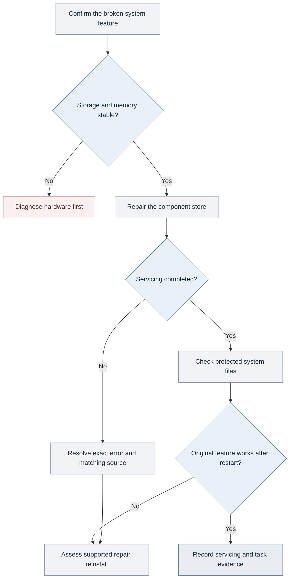

[INTA](https://github.com/Herbertofury/INTA/wiki) / [Decision desk](https://github.com/Herbertofury/INTA/wiki/Decision-Desk) · [Service map](https://github.com/Herbertofury/INTA/wiki/Service-Map) · [Playbooks](https://github.com/Herbertofury/INTA/wiki/Playbooks) · [Tools](https://github.com/Herbertofury/INTA/wiki/Tool-Directory) · [Methods](https://github.com/Herbertofury/INTA/wiki/Methods) · [Open hub](https://herbertofury.github.io/INTA/)

<a id="-repair-windows-component-or-system-file-corruption"></a>

# [Repair Windows component or system-file corruption](https://github.com/Herbertofury/INTA/wiki/Job-windows-repair)

Use [Windows](https://www.microsoft.com/windows) servicing tools in a sensible order and validate the specific broken feature.

**[Windows](https://www.microsoft.com/windows) & performance** · Intermediate · 30–90 min · 6 steps

[Tools and useful links](#working-kit) · [Quick answer](#quick-answer) · [Next action](#next-action) · [Specific fixes](#specific-fixes) · [Decision route](#decision-route) · [Tools](#toolkit) · [Procedure](#walkthrough) · [Verification](#acceptance) · [Sources](#sources) · [Interactive checklist](https://herbertofury.github.io/INTA/#job/windows-repair)

<a id="tool-choices"></a>

## 🧰 Choose the tool for this job

Choose by the task shown in the first column. Each option includes its acquisition route and access boundary.

| Need | Official tool + exact action | Why this choice / access |
| --- | --- | --- |
| **Repair component store** | **[DISM](https://learn.microsoft.com/en-us/windows-hardware/manufacture/desktop/repair-a-windows-image)** · **[Open built-in repair instructions](https://learn.microsoft.com/en-us/windows-hardware/manufacture/desktop/repair-a-windows-image)** | Repair the supported running or explicitly identified offline image using a matching source. **Access:** Included with supported [Windows](https://www.microsoft.com/windows) |
| **Verify protected files** | **[System File Checker](https://learn.microsoft.com/en-us/windows-server/administration/windows-commands/sfc)** · **[Open built-in system-file checks](https://learn.microsoft.com/en-us/windows-server/administration/windows-commands/sfc)** | Check and repair protected system files after the component store is healthy. **Access:** Included with supported [Windows](https://www.microsoft.com/windows) |
| **Same-version reinstall** | **[Windows Recovery Environment](https://learn.microsoft.com/en-us/windows-hardware/manufacture/desktop/windows-recovery-environment--windows-re--technical-reference)** · **[Reinstall current Windows via Windows Update](https://support.microsoft.com/en-us/windows/deployment/install-upgrade/fix-issues-by-reinstalling-the-current-version-of-windows)** | Use the supported current-version repair path when ordinary servicing does not resolve the fault. **Access:** Included with supported [Windows](https://www.microsoft.com/windows) |

**[Current selection evidence](https://github.com/Herbertofury/INTA/wiki/Current-Tool-Choices)**

<a id="working-kit"></a>

## 🧰 Tools and links for this job

**[Open working view](https://herbertofury.github.io/INTA/#job/windows-repair)** · Keep the tool panel beside the instructions.

**First move:** Check stable storage, saved work and a recovery copy. The online repair commands below apply to the running [Windows](https://www.microsoft.com/windows) installation, not an unverified [WinRE](https://learn.microsoft.com/en-us/windows-hardware/manufacture/desktop/windows-recovery-environment--windows-re--technical-reference) drive.

| Use this for | Official tool + exact action |
| --- | --- |
| Repair the running [Windows](https://www.microsoft.com/windows) component store. | **[DISM](https://learn.microsoft.com/en-us/windows-hardware/manufacture/desktop/repair-a-windows-image)** · [Official page](https://learn.microsoft.com/en-us/windows-hardware/manufacture/desktop/repair-a-windows-image) · **[Open built-in repair instructions](https://learn.microsoft.com/en-us/windows-hardware/manufacture/desktop/repair-a-windows-image)** |
| Verify protected files after [component-store repair](https://github.com/Herbertofury/INTA/wiki/Job-windows-repair). | **[System File Checker](https://learn.microsoft.com/en-us/windows-server/administration/windows-commands/sfc)** · [Official page](https://learn.microsoft.com/en-us/windows-server/administration/windows-commands/sfc) · **[Open built-in system-file checks](https://learn.microsoft.com/en-us/windows-server/administration/windows-commands/sfc)** |
| Reinstall the current [Windows](https://www.microsoft.com/windows) version while keeping apps, files and settings, when available. | **[Windows Recovery Environment](https://learn.microsoft.com/en-us/windows-hardware/manufacture/desktop/windows-recovery-environment--windows-re--technical-reference)** · [Official page](https://learn.microsoft.com/en-us/windows-hardware/manufacture/desktop/windows-recovery-environment--windows-re--technical-reference) · **[Reinstall current Windows via Windows Update](https://support.microsoft.com/en-us/windows/deployment/install-upgrade/fix-issues-by-reinstalling-the-current-version-of-windows)** |
| Finding the failure rule and related log evidence before retrying an unsuccessful [Windows](https://www.microsoft.com/windows) upgrade. | **[SetupDiag](https://learn.microsoft.com/en-us/windows/deployment/upgrade/setupdiag)** · [Official page](https://learn.microsoft.com/en-us/windows/deployment/upgrade/setupdiag) · **[Download Windows upgrade analyzer · EXE](https://go.microsoft.com/fwlink/?linkid=870142)** |
| Comparing a saved configuration with the changed version or checking a copied folder before accepting a repair or migration. | **[WinMerge](https://winmerge.org/)** · [Official page](https://winmerge.org/) · **[Download Windows x64 portable · ZIP](https://github.com/WinMerge/winmerge/releases/download/v2.16.60/winmerge-2.16.60-x64-exe.zip)** |

### Repair

| Open the exact resource | What to do there |
| --- | --- |
| **[Microsoft DISM and SFC sequence](https://support.microsoft.com/en-us/windows/experience/backup-recovery/using-system-file-checker-in-windows)** | Run the documented repair order and read the final result. |
| **[Repair an image and choose a source](https://learn.microsoft.com/en-us/windows-hardware/manufacture/desktop/repair-a-windows-image)** | Match the installed version and correct online/offline target. |

### Recovery

| Open the exact resource | What to do there |
| --- | --- |
| **[Recovery options](https://support.microsoft.com/en-us/windows/experience/backup-recovery/recovery-options-in-windows)** | Choose a supported next step if servicing cannot repair the installation. |
| **[Repair reinstall through Windows Update](https://support.microsoft.com/en-us/windows/deployment/install-upgrade/fix-issues-by-reinstalling-the-current-version-of-windows)** | Use the supported same-version repair; managed update policies can make it unavailable. |

<a id="quick-answer"></a>

## ⚡ Quick answer

<a id="quick-windows-repair"></a>

### 🧰 Repair [Windows](https://www.microsoft.com/windows) files

**Confirm storage health, a recovery route and the intended [Windows](https://www.microsoft.com/windows) installation before repair writes.**

1. Run the guide’s [DISM](https://learn.microsoft.com/en-us/windows-hardware/manufacture/desktop/repair-a-windows-image) checks and repair against the correct online or offline installation.
2. Follow with [System File Checker](https://learn.microsoft.com/en-us/windows-server/administration/windows-commands/sfc) and record whether corruption was repaired or remains unresolved.
3. Restart if required, repeat the original task and retain the relevant repair logs.

**[DISM](https://learn.microsoft.com/en-us/windows-hardware/manufacture/desktop/repair-a-windows-image)** · [Official page](https://learn.microsoft.com/en-us/windows-hardware/manufacture/desktop/repair-a-windows-image) · **[Open built-in repair instructions](https://learn.microsoft.com/en-us/windows-hardware/manufacture/desktop/repair-a-windows-image)**

<a id="next-action"></a>

## 🧭 Match the symptom

| You see this | Do this next | You should get |
| --- | --- | --- |
| **[Windows](https://www.microsoft.com/windows) runs but a component or system file is corrupt** | Open Terminal or [Command Prompt](https://learn.microsoft.com/en-us/windows-server/administration/windows-commands/cmd) as administrator; run [DISM](https://learn.microsoft.com/en-us/windows-hardware/manufacture/desktop/repair-a-windows-image).exe /Online /Cleanup-Image /RestoreHealth and wait for the final result. | The operation completes successfully or supplies a specific error for the next branch. |
| **[DISM](https://learn.microsoft.com/en-us/windows-hardware/manufacture/desktop/repair-a-windows-image) completes successfully** | Run [sfc](https://learn.microsoft.com/en-us/windows-server/administration/windows-commands/sfc) /scannow in that elevated online session and retain its final message. | [SFC](https://learn.microsoft.com/en-us/windows-server/administration/windows-commands/sfc) reports no corruption, repaired corruption or an explicit unresolved result. |
| **[DISM](https://learn.microsoft.com/en-us/windows-hardware/manufacture/desktop/repair-a-windows-image) cannot find repair files** | Record the error and OS build; follow Microsoft’s matching-source instructions instead of obtaining DLLs from third-party sites. | A compatible source is identified and the repair can complete. |
| **Repair reports success but the symptom remains** | Restart if required, repeat the original feature test and distinguish an application-only fault from recurring system corruption. | The actual failure is resolved or has an evidenced next owner. |
| **[Windows](https://www.microsoft.com/windows) starts but system/update corruption persists** | With saved work, recovery access, stable power and internet, open Settings > System > Recovery > Fix problems using [Windows Update](https://learn.microsoft.com/en-us/windows/deployment/update/) > Reinstall now if available. If managed policy hides it, use the organization’s repair route. | The same [Windows](https://www.microsoft.com/windows) version is repaired, apps/files/settings remain, and the original failed task or update succeeds after restart. |

### ✅ Finish the job

- [ ] The final [DISM](https://learn.microsoft.com/en-us/windows-hardware/manufacture/desktop/repair-a-windows-image)/[SFC](https://learn.microsoft.com/en-us/windows-server/administration/windows-commands/sfc) results and relevant logs are retained privately.
- [ ] The original failing feature works after the required restart.

**Change route when:** Corruption returns with I/O errors or other storage symptoms. · The installation is nonrepairable or the correct target/source is uncertain.

### 🎯 Go straight to a specific fix

- **[Resolve a missing DISM repair source](#fix-repair-dism-source-not-found)** — [DISM](https://learn.microsoft.com/en-us/windows-hardware/manufacture/desktop/repair-a-windows-image) reports that source files could not be found, including a source-related servicing error.
- **[Identify what SFC could not repair](#fix-repair-read-the-current-sfc-result)** — [System File Checker](https://learn.microsoft.com/en-us/windows-server/administration/windows-commands/sfc) reports unresolved corruption after the documented component-store sequence.
- **[Repair one broken app without resetting the PC](#fix-repair-one-app-without-resetting-windows)** — [Windows](https://www.microsoft.com/windows) works normally but one installed application will not open or behaves incorrectly.

> [!NOTE]
> **Start here.** Confirm the drive is stable and the affected data is backed up. Repeated corruption or I/O errors need a hardware investigation first.

<a id="decision-route"></a>

<a id="-choose-the-right-branch"></a>

## 🧭 Choose a route



**Route links:** [Continue this workflow](#walkthrough) · [Acceptance checks](#acceptance) · [Fix a failing Windows update](windows-update.md) · [Recover a Windows PC that will not boot](boot-recovery.md) · [Diagnose crashes, blue screens, and overheating](hardware-bsod.md) · [Prove a backup can actually restore](backup-restore.md)

| Checkpoint | What to carry forward |
| --- | --- |
| **Before changing anything** | Confirm healthy storage, recoverable data, and the running installation. |
| **Keep during the job** | Servicing results, error codes, and relevant log excerpts. |
| **Before handing back** | The original [Windows](https://www.microsoft.com/windows) feature works after restart. |

<a id="toolkit"></a>

<a id="-build-the-right-toolkit"></a>

## Recommended tools

Select a tool for the next diagnostic or repair step. Check its platform, access and licensing requirements before use.

| Tool / official page + download | Use it for | Platform & access | Documentation |
| --- | --- | --- | --- |
| **[DISM](https://learn.microsoft.com/en-us/windows-hardware/manufacture/desktop/repair-a-windows-image)** · [Official page](https://learn.microsoft.com/en-us/windows-hardware/manufacture/desktop/repair-a-windows-image) · **[Open built-in repair instructions](https://learn.microsoft.com/en-us/windows-hardware/manufacture/desktop/repair-a-windows-image)** | Repair the running [Windows](https://www.microsoft.com/windows) component store. | [Windows](https://www.microsoft.com/windows); Included with [Windows](https://www.microsoft.com/windows) | [Open guide](https://learn.microsoft.com/en-us/windows-hardware/manufacture/desktop/repair-a-windows-image) |
| **[System File Checker](https://learn.microsoft.com/en-us/windows-server/administration/windows-commands/sfc)** · [Official page](https://learn.microsoft.com/en-us/windows-server/administration/windows-commands/sfc) · **[Open built-in system-file checks](https://learn.microsoft.com/en-us/windows-server/administration/windows-commands/sfc)** | Verify protected files after [component-store repair](https://github.com/Herbertofury/INTA/wiki/Job-windows-repair). | [Windows](https://www.microsoft.com/windows); Included with [Windows](https://www.microsoft.com/windows) | [Open guide](https://learn.microsoft.com/en-us/windows-server/administration/windows-commands/sfc) |
| **[Windows Recovery Environment](https://learn.microsoft.com/en-us/windows-hardware/manufacture/desktop/windows-recovery-environment--windows-re--technical-reference)** · [Official page](https://learn.microsoft.com/en-us/windows-hardware/manufacture/desktop/windows-recovery-environment--windows-re--technical-reference) · **[Reinstall current Windows via Windows Update](https://support.microsoft.com/en-us/windows/deployment/install-upgrade/fix-issues-by-reinstalling-the-current-version-of-windows)** | Reinstall the current [Windows](https://www.microsoft.com/windows) version while keeping apps, files and settings, when available. | [Windows](https://www.microsoft.com/windows); Included with [Windows](https://www.microsoft.com/windows) | [Open guide](https://learn.microsoft.com/en-us/windows-hardware/manufacture/desktop/windows-recovery-environment--windows-re--technical-reference) |
| **[SetupDiag](https://learn.microsoft.com/en-us/windows/deployment/upgrade/setupdiag)** · [Official page](https://learn.microsoft.com/en-us/windows/deployment/upgrade/setupdiag) · **[Download Windows upgrade analyzer · EXE](https://go.microsoft.com/fwlink/?linkid=870142)** | Finding the failure rule and related log evidence before retrying an unsuccessful [Windows](https://www.microsoft.com/windows) upgrade. | [Windows](https://www.microsoft.com/windows); Free Microsoft diagnostic download | [Open guide](https://learn.microsoft.com/en-us/windows/deployment/upgrade/setupdiag) |
| **[WinMerge](https://winmerge.org/)** · [Official page](https://winmerge.org/) · **[Download Windows x64 portable · ZIP](https://github.com/WinMerge/winmerge/releases/download/v2.16.60/winmerge-2.16.60-x64-exe.zip)** | Comparing a saved configuration with the changed version or checking a copied folder before accepting a repair or migration. | [Windows](https://www.microsoft.com/windows); Free and open source under GPL-2.0-or-later | [Open guide](https://manual.winmerge.org/en/) |

<a id="walkthrough"></a>

<a id="-work-the-case"></a>

## Procedure

Work in order, record the result of each step, and change route when the evidence calls for it.

<a id="step-01"></a>

### 01 · Record the exact failure

- [ ] Capture the app or [Windows](https://www.microsoft.com/windows) feature that fails, error code, OS build, recent changes, and available disk space. Save relevant event entries before repair. Confirm this is a [Windows](https://www.microsoft.com/windows) component problem rather than an application-only fault.

<a id="step-02"></a>

### 02 · Prepare the online [Windows](https://www.microsoft.com/windows) session

- [ ] Save work, finish a pending restart if practical, connect stable power, and open Terminal or [Command Prompt](https://learn.microsoft.com/en-us/windows-server/administration/windows-commands/cmd) as administrator. These commands target the currently running [Windows](https://www.microsoft.com/windows) installation. Do not paste them into [WinRE](https://learn.microsoft.com/en-us/windows-hardware/manufacture/desktop/windows-recovery-environment--windows-re--technical-reference) expecting them to repair an offline [Windows](https://www.microsoft.com/windows) volume.

<a id="step-03"></a>

### 03 · Repair the component store

- [ ] Run [DISM](https://learn.microsoft.com/en-us/windows-hardware/manufacture/desktop/repair-a-windows-image) and wait for its final result. If the repair source cannot be found, retain the error code and use Microsoft’s matching-source guidance; do not download replacement DLLs from a third-party site.

**Command for the environment described above:**

```text
DISM.exe /Online /Cleanup-Image /RestoreHealth
```

**Command legend:** [DISM](https://learn.microsoft.com/en-us/windows-hardware/manufacture/desktop/repair-a-windows-image) · [Return to the step context](#step-03).

<a id="step-04"></a>

### 04 · Check protected system files

- [ ] After [DISM](https://learn.microsoft.com/en-us/windows-hardware/manufacture/desktop/repair-a-windows-image) completes successfully, run [System File Checker](https://learn.microsoft.com/en-us/windows-server/administration/windows-commands/sfc). Record whether corruption was absent, repaired, or unresolved. Keep the relevant CBS and [DISM](https://learn.microsoft.com/en-us/windows-hardware/manufacture/desktop/repair-a-windows-image) log excerpts privately if escalation is needed.

**Command for the environment described above:**

```text
sfc /scannow
```

**Command legend:** [System File Checker](https://learn.microsoft.com/en-us/windows-server/administration/windows-commands/sfc) · [Return to the step context](#step-04).

<a id="step-05"></a>

### 05 · Reboot and retest the original feature

- [ ] Reproduce the exact failure from intake. Check [Windows Update](https://learn.microsoft.com/en-us/windows/deployment/update/) and [Reliability Monitor](https://learn.microsoft.com/en-us/windows-server/administration/windows-commands/perfmon) for new errors. A successful command exit is evidence about servicing, not proof that the user’s problem is solved.

<a id="step-06"></a>

### 06 · Escalate from the remaining evidence

- [ ] If a stable system still has unresolved servicing problems, evaluate a supported repair reinstall that preserves apps and files. Confirm backup, edition, language, recovery keys, available space, and the actual preservation options before proceeding. Repeated corruption returns to [hardware diagnostics](https://github.com/Herbertofury/INTA/wiki/Job-hardware-bsod).

<a id="acceptance"></a>

<a id="-prove-the-result"></a>

## Verification

- [ ] [DISM](https://learn.microsoft.com/en-us/windows-hardware/manufacture/desktop/repair-a-windows-image) and [SFC](https://learn.microsoft.com/en-us/windows-server/administration/windows-commands/sfc) outcomes are recorded.
- [ ] The originally broken [Windows](https://www.microsoft.com/windows) function works after restart.
- [ ] No new storage or recurring corruption evidence is present.

> [!WARNING]
> **Pause this route and escalate when:**
> - Drive failure, unstable RAM, or overheating is suspected.
> - The proposed reinstall does not clearly preserve the required data and applications.

<a id="specific-fixes"></a>

## 🎯 Specific fixes

Choose the case that matches the evidence. Each case gives a first action, a short procedure and a result to prove.

<a id="fix-repair-dism-source-not-found"></a>

### Resolve a missing [DISM](https://learn.microsoft.com/en-us/windows-hardware/manufacture/desktop/repair-a-windows-image) repair source

**Use when:** [DISM](https://learn.microsoft.com/en-us/windows-hardware/manufacture/desktop/repair-a-windows-image) reports that source files could not be found, including a source-related servicing error.

**Start here:** Record the exact servicing error, installed [Windows](https://www.microsoft.com/windows) build, architecture and language.

**[DISM](https://learn.microsoft.com/en-us/windows-hardware/manufacture/desktop/repair-a-windows-image)** · [Official page](https://learn.microsoft.com/en-us/windows-hardware/manufacture/desktop/repair-a-windows-image) · **[Open built-in repair instructions](https://learn.microsoft.com/en-us/windows-hardware/manufacture/desktop/repair-a-windows-image)**

1. Check whether [Windows Update](https://learn.microsoft.com/en-us/windows/deployment/update/) can supply repair content under the device’s policy before selecting a local source.
2. Use Microsoft’s repair-source guidance to match the installed image and required language/servicing level; identify the correct image index when the source contains several editions.
3. Retry only the documented repair against the confirmed running installation or explicitly identified offline image, then retain its final result.

**Prove it worked:** [DISM](https://learn.microsoft.com/en-us/windows-hardware/manufacture/desktop/repair-a-windows-image) accepts the compatible source and finishes, or returns a narrower actionable error.

**If this does not resolve it:** Do not substitute random DLLs or use an unrelated ISO. Recurring corruption with I/O faults belongs to storage recovery.

**Official evidence:** [Source 1](https://learn.microsoft.com/en-us/windows-hardware/manufacture/desktop/configure-a-windows-repair-source) · [Source 2](https://learn.microsoft.com/en-us/windows-hardware/manufacture/desktop/repair-a-windows-image) · Reviewed 2026-11-26

[Back to specific fixes](#specific-fixes) · [Full procedure](#walkthrough)

<a id="fix-repair-read-the-current-sfc-result"></a>

### Identify what [SFC](https://learn.microsoft.com/en-us/windows-server/administration/windows-commands/sfc) could not repair

**Use when:** [System File Checker](https://learn.microsoft.com/en-us/windows-server/administration/windows-commands/sfc) reports unresolved corruption after the documented component-store sequence.

**Start here:** Note the start/end time of the latest scan rather than interpreting every old log entry.

**[System File Checker](https://learn.microsoft.com/en-us/windows-server/administration/windows-commands/sfc)** · [Official page](https://learn.microsoft.com/en-us/windows-server/administration/windows-commands/sfc) · **[Open built-in system-file checks](https://learn.microsoft.com/en-us/windows-server/administration/windows-commands/sfc)**

**[DISM](https://learn.microsoft.com/en-us/windows-hardware/manufacture/desktop/repair-a-windows-image)** · [Official page](https://learn.microsoft.com/en-us/windows-hardware/manufacture/desktop/repair-a-windows-image) · **[Open built-in repair instructions](https://learn.microsoft.com/en-us/windows-hardware/manufacture/desktop/repair-a-windows-image)**

**[Notepad++](https://notepad-plus-plus.org/)** · [Official page](https://notepad-plus-plus.org/) · **[Download Windows x64 portable · ZIP](https://github.com/notepad-plus-plus/notepad-plus-plus/releases/download/v8.9.9.1/npp.8.9.9.1.portable.x64.zip)**

1. Open the current CBS log through Microsoft’s documented [SFC](https://learn.microsoft.com/en-us/windows-server/administration/windows-commands/sfc) detail workflow and inspect entries marked [SR] for that run.
2. Record the unresolved component names and servicing errors privately; distinguish old repaired entries from current failures.
3. Use the matching supported servicing or repair-install route, then rerun the relevant verification and the original failing feature.

**Prove it worked:** The case identifies the current unresolved component or records a clean final scan and working feature.

**If this does not resolve it:** Do not take ownership of protected files or copy binaries from another random PC as a generic repair.

**Official evidence:** [Source 1](https://support.microsoft.com/en-gb/windows/experience/backup-recovery/use-the-system-file-checker-tool-to-repair-missing-or-corrupted-system-files) · Reviewed 2026-11-26

[Back to specific fixes](#specific-fixes) · [Full procedure](#walkthrough)

<a id="fix-repair-one-app-without-resetting-windows"></a>

### Repair one broken app without resetting the PC

**Use when:** [Windows](https://www.microsoft.com/windows) works normally but one installed application will not open or behaves incorrectly.

**Start here:** Confirm that the same failure is limited to that application and protect its local-only data.

1. Open Settings > Apps > Installed apps, choose the affected app’s menu and open Advanced options if available.
2. Use Repair first when offered, then retest. Review the displayed data effects before considering Reset; reset can remove local app state.
3. For desktop programs without that option, use the publisher-supported Modify/Repair path in Programs and Features or its installer.

**Prove it worked:** The original application task works with the required data, settings and account access verified.

**If this does not resolve it:** If the fault affects several [Windows](https://www.microsoft.com/windows) components or data cannot be protected, use the system or application-owner route before resetting.

**Official evidence:** [Source 1](https://support.microsoft.com/en-us/windows/apps/repair-apps-and-programs-in-windows) · Reviewed 2026-11-26

[Back to specific fixes](#specific-fixes) · [Full procedure](#walkthrough)


<a id="-continue-with-the-evidence"></a>

## Related playbooks

| Next playbook | What it resolves |
| --- | --- |
| [Fix a failing Windows update](windows-update.md) | Diagnose the update code, servicing state, and available space before broad reset scripts. |
| [Recover a Windows PC that will not boot](boot-recovery.md) | Separate firmware, storage, encryption, and [Windows](https://www.microsoft.com/windows) startup faults before changing the boot configuration. |
| [Diagnose crashes, blue screens, and overheating](hardware-bsod.md) | Correlate crash evidence with memory, storage, temperature, power, and driver changes. |
| [Prove a backup can actually restore](backup-restore.md) | Validate recovery credentials, data integrity, application usability, and recovery time. |

<a id="sources"></a>

<a id="-source-trail"></a>

## Official sources

- [Microsoft: using System File Checker](https://support.microsoft.com/en-us/windows/experience/backup-recovery/using-system-file-checker-in-windows)
- [Microsoft: recovery options in Windows](https://support.microsoft.com/en-us/windows/experience/backup-recovery/recovery-options-in-windows)

Reviewed **2026-11-26**. Timing is a planning range. A successful command is evidence about that operation; acceptance belongs to the user’s original task.


---

Editorial review: **2026-11-26** · [Review standard](https://github.com/Herbertofury/INTA/wiki/Knowledge-Standards) · [Suggest a correction](https://github.com/Herbertofury/INTA/issues/new/choose)

[← All playbooks](README.md) · [Live Wiki](https://github.com/Herbertofury/INTA/wiki) · [Contribution guide](https://github.com/Herbertofury/INTA/blob/main/CONTRIBUTING.md)
