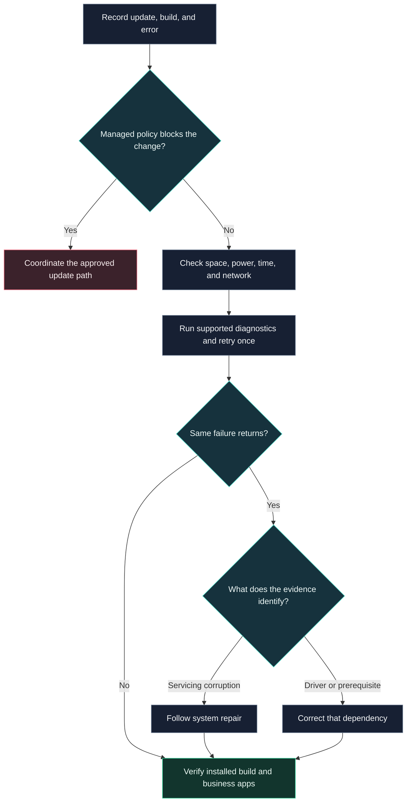

[🏠 Home](https://github.com/Herbertofury/INTA/wiki) · [🧭 Decision desk](https://github.com/Herbertofury/INTA/wiki/Decision-Desk) · [📚 Playbooks](https://github.com/Herbertofury/INTA/wiki/Playbooks) · [🧰 Tool directory](https://github.com/Herbertofury/INTA/wiki/Tool-Directory) · [✨ Open interactive hub](https://herbertofury.github.io/INTA/)

# 🔄 [Fix a failing Windows update](https://github.com/Herbertofury/INTA/wiki/Job-windows-update)

Diagnose the update code, servicing state, and available space before broad reset scripts.

| Work area | Experience | Plan your time | Workflow |
| --- | --- | --- | --- |
| [Windows](https://www.microsoft.com/windows) & performance | Intermediate | 20–60 min plus installation | 6 steps + acceptance |

**[▶ Open the interactive checklist](https://herbertofury.github.io/INTA/#job/windows-update)** · [Decision route](#decision-route) · [Toolkit](#toolkit) · [Walkthrough](#walkthrough) · [Acceptance](#acceptance) · [Sources](#sources)

> [!TIP]
> **Your starting move:** Write down the exact KB or feature update, error code, [Windows](https://www.microsoft.com/windows) edition/build, and whether the device is centrally managed.

## 🧭 Choose the right branch

**Diagram routes:** [Continue this workflow](#walkthrough) · [Acceptance checks](#acceptance) · [Repair Windows component or system-file corruption](windows-repair.md) · [Diagnose crashes, blue screens, and overheating](hardware-bsod.md) · [Run a useful workstation maintenance visit](preventive-maintenance.md)

| Checkpoint | What to carry forward |
| --- | --- |
| **Before changing anything** | Respect the update policy and maintenance window. |
| **Keep during the job** | Exact update, failure stage, error, logs, and each changed dependency. |
| **Before handing back** | Installed build plus the user’s normal workload pass. |

## 🧰 Build the right toolkit

Choose the tools that answer the case’s next question. Opening a tool is a separate decision from changing the customer’s system.

| Tool / official download | Use it for | Platform & access | Documentation |
| --- | --- | --- | --- |
| [Microsoft Sysinternals Suite](https://learn.microsoft.com/en-us/sysinternals/downloads/sysinternals-suite) | The core portable [Windows](https://www.microsoft.com/windows) troubleshooting kit. | [Windows](https://www.microsoft.com/windows); Free Microsoft utilities | [Open guide](https://learn.microsoft.com/en-us/sysinternals/downloads/) |

## 🪜 Work the case

Work in order, record the result of each step, and change route when the evidence calls for it.

### 01 · Confirm the failure and update policy

- [ ] Read Settings > [Windows Update](https://learn.microsoft.com/en-us/windows/deployment/update/) > Update history. Determine whether the failure is download, installation, or reboot rollback. On managed devices, check the assigned update policy and maintenance window before overriding settings.

### 02 · Check the simple prerequisites

- [ ] Verify stable power, free space, correct time, functioning network/proxy, and whether a restart is pending. Compare with another device on the same network to distinguish local servicing from a broader service issue.

### 03 · Run the supported troubleshooter

- [ ] Open Get Help and run the [Windows Update](https://learn.microsoft.com/en-us/windows/deployment/update/) troubleshooter. Capture its findings and restart when appropriate, then retry the specific update once. If the same failure persists, use the new evidence rather than looping identical retries.

### 04 · Follow the exact error path

- [ ] Use Microsoft’s troubleshooting reference for the captured code. Inspect relevant logs and service state. A cache reset or security-product change should be tied to a specific diagnosis and have a recovery plan; avoid one-click scripts that reset unrelated settings.

### 05 · Repair servicing if indicated

- [ ] For component-store or protected-file errors on a healthy drive, follow the [Windows repair](https://github.com/Herbertofury/INTA/wiki/Job-windows-repair) guide. If install rollback names a driver, check the device manufacturer’s supported update or rollback path instead of layering more repair commands.

### 06 · Validate the installed result

- [ ] Confirm the intended update appears in history and the resulting OS build is correct. Test the user’s business applications, network, printing, and restart. Record any deferred update with its cause, owner, and next review.

## ✅ Prove the result

- [ ] The target update is installed or the remaining blocker is explicitly documented.
- [ ] Update history and the OS build agree.
- [ ] The original applications and devices work after reboot.

> [!WARNING]
> **Pause this route and escalate when:**
> - The device is in an organization-managed change freeze.
> - Repeated rollback or storage symptoms point to a deeper problem.

## 🔀 Continue with the evidence

| Next playbook | What it resolves |
| --- | --- |
| [Repair Windows component or system-file corruption](windows-repair.md) | Use [Windows](https://www.microsoft.com/windows) servicing tools in a sensible order and validate the specific broken feature. |
| [Diagnose crashes, blue screens, and overheating](hardware-bsod.md) | Correlate crash evidence with memory, storage, temperature, power, and driver changes. |
| [Run a useful workstation maintenance visit](preventive-maintenance.md) | Check security, updates, hardware, backups, and usability without unnecessary cleanup rituals. |

Found a reusable improvement? [Contribute the correction](https://github.com/Herbertofury/INTA/wiki/Contribute) and include the test that proved it.

## 🔎 Source trail

Official references and editorial review

- [Microsoft: Windows Update troubleshooter](https://support.microsoft.com/en-us/windows/experience/windows-update-troubleshooter)
- [Microsoft: troubleshooting Windows updates](https://support.microsoft.com/en-us/windows/deployment/updates-lifecycle/troubleshoot-problems-updating-windows)

Reviewed **2026-11-26**. Timing is a planning range. A successful command is evidence about that operation; acceptance belongs to the user’s original task.

---

**Source review: 2026-11-26.** Guidance review and tool release versions are separate. [Report a correction](https://github.com/Herbertofury/INTA/issues/new/choose) · [How we maintain this guide](https://github.com/Herbertofury/INTA/wiki/Knowledge-Standards)

[← All playbooks](README.md) · [Live Wiki](https://github.com/Herbertofury/INTA/wiki) · [Contribution guide](https://github.com/Herbertofury/INTA/blob/main/CONTRIBUTING.md)
