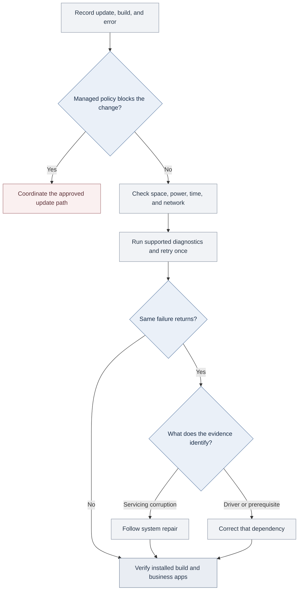

[INTA](https://github.com/Herbertofury/INTA/wiki) / [Decision desk](https://github.com/Herbertofury/INTA/wiki/Decision-Desk) · [Service map](https://github.com/Herbertofury/INTA/wiki/Service-Map) · [Playbooks](https://github.com/Herbertofury/INTA/wiki/Playbooks) · [Tools](https://github.com/Herbertofury/INTA/wiki/Tool-Directory) · [Methods](https://github.com/Herbertofury/INTA/wiki/Methods) · [Open hub](https://herbertofury.github.io/INTA/)

# [Fix a failing Windows update](https://github.com/Herbertofury/INTA/wiki/Job-windows-update)

Diagnose the update code, servicing state, and available space before broad reset scripts.

**[Windows](https://www.microsoft.com/windows) & performance** · Intermediate · 20–60 min plus installation · 6 steps

[Tools and useful links](#working-kit) · [Quick answer](#quick-answer) · [Next action](#next-action) · [Specific fixes](#specific-fixes) · [Decision route](#decision-route) · [Tools](#toolkit) · [Procedure](#walkthrough) · [Verification](#acceptance) · [Sources](#sources) · [Interactive checklist](https://herbertofury.github.io/INTA/#job/windows-update)

## 🧰 Choose the tool for this job

Choose by the task shown in the first column. Each option includes its acquisition route and access boundary.

| Need | Official tool + exact action | Why this choice / access |
| --- | --- | --- |
| **Update diagnostic** | **[Windows Get Help](https://support.microsoft.com/en-us/support/get-help/about-get-help)** · **[Open Windows Update troubleshooting](https://support.microsoft.com/en-us/windows/experience/windows-update-troubleshooter)** | Start with the current [Windows Update](https://learn.microsoft.com/en-us/windows/deployment/update/) diagnostic and record the exact error. **Access:** Included with supported [Windows](https://www.microsoft.com/windows) |
| **Explain an upgrade rollback** | **[SetupDiag](https://learn.microsoft.com/en-us/windows/deployment/upgrade/setupdiag)** · **[Download Windows upgrade analyzer · EXE](https://go.microsoft.com/fwlink/?linkid=870142)** | Analyze preserved setup logs for the failed upgrade phase and matching failure rule. **Access:** Free Microsoft diagnostic |
| **[Component-store repair](https://github.com/Herbertofury/INTA/wiki/Job-windows-repair)** | **[DISM](https://learn.microsoft.com/en-us/windows-hardware/manufacture/desktop/repair-a-windows-image)** · **[Open built-in repair instructions](https://learn.microsoft.com/en-us/windows-hardware/manufacture/desktop/repair-a-windows-image)** | Use the supported servicing workflow when update evidence points to component-store damage. **Access:** Included with supported [Windows](https://www.microsoft.com/windows) |
| **Same-version reinstall** | **[Windows Recovery Environment](https://learn.microsoft.com/en-us/windows-hardware/manufacture/desktop/windows-recovery-environment--windows-re--technical-reference)** · **[Reinstall current Windows via Windows Update](https://support.microsoft.com/en-us/windows/deployment/install-upgrade/fix-issues-by-reinstalling-the-current-version-of-windows)** | Use the [Windows Update](https://learn.microsoft.com/en-us/windows/deployment/update/) repair reinstall if available and the machine can still run [Windows](https://www.microsoft.com/windows). **Access:** Included with supported [Windows](https://www.microsoft.com/windows) |

**[Current selection evidence](https://github.com/Herbertofury/INTA/wiki/Current-Tool-Choices)**

## 🧰 Tools and links for this job

**[Open working view](https://herbertofury.github.io/INTA/#job/windows-update)** · Keep the tool panel beside the instructions.

**First move:** Open Settings > [Windows Update](https://learn.microsoft.com/en-us/windows/deployment/update/) > Update history. Record the failing KB, error and restart state before retrying.

| Use this for | Official tool + exact action |
| --- | --- |
| Run the supported update diagnostic. | **[Windows Get Help](https://support.microsoft.com/en-us/support/get-help/about-get-help)** · [Official page](https://support.microsoft.com/en-us/support/get-help/about-get-help) · **[Open Windows Update troubleshooting](https://support.microsoft.com/en-us/windows/experience/windows-update-troubleshooter)** |
| Investigate component-store damage when the error points there. | **[DISM](https://learn.microsoft.com/en-us/windows-hardware/manufacture/desktop/repair-a-windows-image)** · [Official page](https://learn.microsoft.com/en-us/windows-hardware/manufacture/desktop/repair-a-windows-image) · **[Open built-in repair instructions](https://learn.microsoft.com/en-us/windows-hardware/manufacture/desktop/repair-a-windows-image)** |
| Check protected files after successful servicing repair. | **[System File Checker](https://learn.microsoft.com/en-us/windows-server/administration/windows-commands/sfc)** · [Official page](https://learn.microsoft.com/en-us/windows-server/administration/windows-commands/sfc) · **[Open built-in system-file checks](https://learn.microsoft.com/en-us/windows-server/administration/windows-commands/sfc)** |
| Reinstall the current [Windows](https://www.microsoft.com/windows) version while keeping apps, files and settings, when available. | **[Windows Recovery Environment](https://learn.microsoft.com/en-us/windows-hardware/manufacture/desktop/windows-recovery-environment--windows-re--technical-reference)** · [Official page](https://learn.microsoft.com/en-us/windows-hardware/manufacture/desktop/windows-recovery-environment--windows-re--technical-reference) · **[Reinstall current Windows via Windows Update](https://support.microsoft.com/en-us/windows/deployment/install-upgrade/fix-issues-by-reinstalling-the-current-version-of-windows)** |
| Finding the failure rule and related log evidence before retrying an unsuccessful [Windows](https://www.microsoft.com/windows) upgrade. | **[SetupDiag](https://learn.microsoft.com/en-us/windows/deployment/upgrade/setupdiag)** · [Official page](https://learn.microsoft.com/en-us/windows/deployment/upgrade/setupdiag) · **[Download Windows upgrade analyzer · EXE](https://go.microsoft.com/fwlink/?linkid=870142)** |

### First repair

| Open the exact resource | What to do there |
| --- | --- |
| **[Windows Update troubleshooter](https://support.microsoft.com/en-us/windows/experience/windows-update-troubleshooter)** | Run the diagnostic, restart when required and check updates again. |
| **[Troubleshoot update failures](https://support.microsoft.com/en-us/windows/deployment/updates-lifecycle/troubleshoot-problems-updating-windows)** | Use the exact error and installation stage. |

### Current issues

| Open the exact resource | What to do there |
| --- | --- |
| **[Windows release health](https://learn.microsoft.com/en-us/windows/release-health/)** | Check the affected [Windows](https://www.microsoft.com/windows) version for known issues or holds. |

### Recovery

| Open the exact resource | What to do there |
| --- | --- |
| **[Recovery and uninstall choices](https://support.microsoft.com/en-us/windows/experience/backup-recovery/recovery-options-in-windows)** | Use the appropriate rollback route if the update prevents startup. |
| **[Repair reinstall through Windows Update](https://support.microsoft.com/en-us/windows/deployment/install-upgrade/fix-issues-by-reinstalling-the-current-version-of-windows)** | Use the supported same-version repair; managed update policies can make it unavailable. |

## ⚡ Quick answer

### 🔄 Fix [Windows](https://www.microsoft.com/windows) updates

**Record the failing update or KB number, error code and pending restart before retrying it.**

1. Confirm free space, a stable connection and a planned restart window.
2. Run the [Windows Update](https://learn.microsoft.com/en-us/windows/deployment/update/) troubleshooter in [Windows Get Help](https://support.microsoft.com/en-us/support/get-help/about-get-help) and review its findings.
3. Restart when required, check for updates again and verify the affected update and original task.

**[Windows Get Help](https://support.microsoft.com/en-us/support/get-help/about-get-help)** · [Official page](https://support.microsoft.com/en-us/support/get-help/about-get-help) · **[Open Windows Update troubleshooting](https://support.microsoft.com/en-us/windows/experience/windows-update-troubleshooter)**

## 🧭 Match the symptom

| You see this | Do this next | You should get |
| --- | --- | --- |
| **One update repeatedly fails** | Record its KB/error, check free space and connection, then run the [Windows Update](https://learn.microsoft.com/en-us/windows/deployment/update/) troubleshooter in [Windows Get Help](https://support.microsoft.com/en-us/support/get-help/about-get-help). | The diagnostic gives a finding or a reproducible update error. |
| **A restart is pending** | Save work and restart in the agreed window, then return to [Windows Update](https://learn.microsoft.com/en-us/windows/deployment/update/) and Update history. | The update completes or the same failing KB is identified after restart. |
| **The device is managed or a compatibility hold is present** | Check the organization’s update owner and the applicable release-health notice; do not bypass the hold or policy. | The approved next update or remediation is recorded. |
| **The update prevents [Windows](https://www.microsoft.com/windows) from starting** | With recovery access ready, use [WinRE](https://learn.microsoft.com/en-us/windows-hardware/manufacture/desktop/windows-recovery-environment--windows-re--technical-reference) > Troubleshoot > Advanced options > Uninstall Updates when the affected update is the established cause. | The device returns to a bootable state for a scoped recovery plan. |
| **[Windows](https://www.microsoft.com/windows) starts but system/update corruption persists** | With saved work, recovery access, stable power and internet, open Settings > System > Recovery > Fix problems using [Windows Update](https://learn.microsoft.com/en-us/windows/deployment/update/) > Reinstall now if available. If managed policy hides it, use the organization’s repair route. | The same [Windows](https://www.microsoft.com/windows) version is repaired, apps/files/settings remain, and the original failed task or update succeeds after restart. |

### ✅ Finish the job

- [ ] Update history shows the intended result and no required restart remains.
- [ ] The original application and a normal reboot succeed.

**Change route when:** The next step would bypass a managed policy or documented safeguard without an approved plan. · Boot or storage failure changes the job into recovery.

### 🎯 Go straight to a specific fix

- **[Clear an update’s storage blocker safely](#fix-update-free-the-space-the-installer-needs)** — [Windows Update](https://learn.microsoft.com/en-us/windows/deployment/update/) asks for more space or fails during a low-space installation.
- **[Find why a feature upgrade rolled back](#fix-update-explain-a-feature-upgrade-rollback)** — [Windows](https://www.microsoft.com/windows) returns to the previous version after an attempted feature upgrade.
- **[Check why a feature update is not offered](#fix-update-respect-a-safeguard-hold)** — A device receives routine updates but a newer feature release is missing.

> [!NOTE]
> **Start here.** Write down the exact KB or feature update, error code, [Windows](https://www.microsoft.com/windows) edition/build, and whether the device is centrally managed.

## 🧭 Choose a route

**Route links:** [Continue this workflow](#walkthrough) · [Acceptance checks](#acceptance) · [Repair Windows component or system-file corruption](windows-repair.md) · [Diagnose crashes, blue screens, and overheating](hardware-bsod.md) · [Run a useful workstation maintenance visit](preventive-maintenance.md)

| Checkpoint | What to carry forward |
| --- | --- |
| **Before changing anything** | Respect the update policy and maintenance window. |
| **Keep during the job** | Exact update, failure stage, error, logs, and each changed dependency. |
| **Before handing back** | Installed build plus the user’s normal workload pass. |

## Recommended tools

Select a tool for the next diagnostic or repair step. Check its platform, access and licensing requirements before use.

| Tool / official page + download | Use it for | Platform & access | Documentation |
| --- | --- | --- | --- |
| **[Windows Get Help](https://support.microsoft.com/en-us/support/get-help/about-get-help)** · [Official page](https://support.microsoft.com/en-us/support/get-help/about-get-help) · **[Open Windows Update troubleshooting](https://support.microsoft.com/en-us/windows/experience/windows-update-troubleshooter)** | Run the supported update diagnostic. | [Windows](https://www.microsoft.com/windows); Included with supported [Windows](https://www.microsoft.com/windows); assisted support availability depends on the account and support agreement. | [Open guide](https://support.microsoft.com/en-us/support/get-help/windows-troubleshooters) |
| **[DISM](https://learn.microsoft.com/en-us/windows-hardware/manufacture/desktop/repair-a-windows-image)** · [Official page](https://learn.microsoft.com/en-us/windows-hardware/manufacture/desktop/repair-a-windows-image) · **[Open built-in repair instructions](https://learn.microsoft.com/en-us/windows-hardware/manufacture/desktop/repair-a-windows-image)** | Investigate component-store damage when the error points there. | [Windows](https://www.microsoft.com/windows); Included with [Windows](https://www.microsoft.com/windows) | [Open guide](https://learn.microsoft.com/en-us/windows-hardware/manufacture/desktop/repair-a-windows-image) |
| **[System File Checker](https://learn.microsoft.com/en-us/windows-server/administration/windows-commands/sfc)** · [Official page](https://learn.microsoft.com/en-us/windows-server/administration/windows-commands/sfc) · **[Open built-in system-file checks](https://learn.microsoft.com/en-us/windows-server/administration/windows-commands/sfc)** | Check protected files after successful servicing repair. | [Windows](https://www.microsoft.com/windows); Included with [Windows](https://www.microsoft.com/windows) | [Open guide](https://learn.microsoft.com/en-us/windows-server/administration/windows-commands/sfc) |
| **[Windows Recovery Environment](https://learn.microsoft.com/en-us/windows-hardware/manufacture/desktop/windows-recovery-environment--windows-re--technical-reference)** · [Official page](https://learn.microsoft.com/en-us/windows-hardware/manufacture/desktop/windows-recovery-environment--windows-re--technical-reference) · **[Reinstall current Windows via Windows Update](https://support.microsoft.com/en-us/windows/deployment/install-upgrade/fix-issues-by-reinstalling-the-current-version-of-windows)** | Reinstall the current [Windows](https://www.microsoft.com/windows) version while keeping apps, files and settings, when available. | [Windows](https://www.microsoft.com/windows); Included with [Windows](https://www.microsoft.com/windows) | [Open guide](https://learn.microsoft.com/en-us/windows-hardware/manufacture/desktop/windows-recovery-environment--windows-re--technical-reference) |
| **[Microsoft Sysinternals Suite](https://learn.microsoft.com/en-us/sysinternals/)** · [Official page](https://learn.microsoft.com/en-us/sysinternals/) · **[Download Windows portable · ZIP](https://download.sysinternals.com/files/SysinternalsSuite.zip)** | The core portable [Windows](https://www.microsoft.com/windows) troubleshooting kit. | [Windows](https://www.microsoft.com/windows); Free Microsoft utilities | [Open guide](https://learn.microsoft.com/en-us/sysinternals/downloads/) |
| **[SetupDiag](https://learn.microsoft.com/en-us/windows/deployment/upgrade/setupdiag)** · [Official page](https://learn.microsoft.com/en-us/windows/deployment/upgrade/setupdiag) · **[Download Windows upgrade analyzer · EXE](https://go.microsoft.com/fwlink/?linkid=870142)** | Finding the failure rule and related log evidence before retrying an unsuccessful [Windows](https://www.microsoft.com/windows) upgrade. | [Windows](https://www.microsoft.com/windows); Free Microsoft diagnostic download | [Open guide](https://learn.microsoft.com/en-us/windows/deployment/upgrade/setupdiag) |

## Procedure

Work in order, record the result of each step, and change route when the evidence calls for it.

### 01 · Confirm the failure and update policy

- [ ] Read Settings > [Windows Update](https://learn.microsoft.com/en-us/windows/deployment/update/) > Update history. Determine whether the failure is download, installation, or reboot rollback. On managed devices, check the assigned update policy and maintenance window before overriding settings.

### 02 · Check the simple prerequisites

- [ ] Verify stable power, free space, correct time, functioning network/proxy, and whether a restart is pending. Compare with another device on the same network to distinguish local servicing from a broader service issue.

### 03 · Run the supported troubleshooter

- [ ] Open Get Help and run the [Windows Update](https://learn.microsoft.com/en-us/windows/deployment/update/) troubleshooter. Capture its findings and restart when appropriate, then retry the specific update once. If the same failure persists, use the new evidence rather than looping identical retries.

### 04 · Follow the exact error path

- [ ] Use Microsoft’s troubleshooting reference for the captured code. Inspect relevant logs and service state. A cache reset or security-product change should be tied to a specific diagnosis and have a recovery plan; avoid one-click scripts that reset unrelated settings.

### 05 · Repair servicing if indicated

- [ ] For component-store or protected-file errors on a healthy drive, follow the [Windows repair](https://github.com/Herbertofury/INTA/wiki/Job-windows-repair) guide. If install rollback names a driver, check the device manufacturer’s supported update or rollback path instead of layering more repair commands.

### 06 · Validate the installed result

- [ ] Confirm the intended update appears in history and the resulting OS build is correct. Test the user’s business applications, network, printing, and restart. Record any deferred update with its cause, owner, and next review.

## Verification

- [ ] The target update is installed or the remaining blocker is explicitly documented.
- [ ] Update history and the OS build agree.
- [ ] The original applications and devices work after reboot.

> [!WARNING]
> **Pause this route and escalate when:**
> - The device is in an organization-managed change freeze.
> - Repeated rollback or storage symptoms point to a deeper problem.

## 🎯 Specific fixes

Choose the case that matches the evidence. Each case gives a first action, a short procedure and a result to prove.

### Clear an update’s storage blocker safely

**Use when:** [Windows Update](https://learn.microsoft.com/en-us/windows/deployment/update/) asks for more space or fails during a low-space installation.

**Start here:** Open Settings > System > Storage and record available space before deleting anything.

**[WinDirStat](https://windirstat.net/)** · [Official page](https://windirstat.net/) · **[Download Windows x64 · MSI](https://github.com/windirstat/windirstat/releases/download/release/v2.9.3/WinDirStat-x64.msi)**

**[Windows Get Help](https://support.microsoft.com/en-us/support/get-help/about-get-help)** · [Official page](https://support.microsoft.com/en-us/support/get-help/about-get-help) · **[Open Windows Update troubleshooting](https://support.microsoft.com/en-us/windows/experience/windows-update-troubleshooter)**

1. Review the supported temporary-file and cleanup choices; keep Downloads, customer files and rollback material unless their removal is explicitly intended.
2. If the update offers external storage, follow that specific workflow using a trusted device and keep it attached for the required phase.
3. Retry the same update, restart when requested and confirm its entry in Update history.

**Prove it worked:** The identified update completes and the user’s data and rollback decision remain accounted for.

**If this does not resolve it:** If space rapidly disappears again, identify the owning files or service; do not repeatedly erase logs needed to diagnose the failure.

**Official evidence:** [Source 1](https://support.microsoft.com/en-us/windows/deployment/updates-lifecycle/free-up-space-for-windows-updates) · Reviewed 2026-11-26

[Back to specific fixes](#specific-fixes) · [Full procedure](#walkthrough)

### Find why a feature upgrade rolled back

**Use when:** [Windows](https://www.microsoft.com/windows) returns to the previous version after an attempted feature upgrade.

**Start here:** Preserve the failed-upgrade logs before cleanup or another installation attempt.

**[SetupDiag](https://learn.microsoft.com/en-us/windows/deployment/upgrade/setupdiag)** · [Official page](https://learn.microsoft.com/en-us/windows/deployment/upgrade/setupdiag) · **[Download Windows upgrade analyzer · EXE](https://go.microsoft.com/fwlink/?linkid=870142)**

1. Use the current official [SetupDiag](https://learn.microsoft.com/en-us/windows/deployment/upgrade/setupdiag) workflow to analyze the applicable setup logs and retain its result file.
2. Read the matched failure rule, phase and operation alongside the original logs; separate the last failure from earlier warnings.
3. Correct the specific driver, application or servicing blocker identified by the evidence, then plan one controlled retry.

**Prove it worked:** The retry targets a documented blocker and either succeeds or produces a distinct new failure record.

**If this does not resolve it:** [SetupDiag](https://learn.microsoft.com/en-us/windows/deployment/upgrade/setupdiag) is an analyzer, not an automatic repair. Escalate unmatched or contradictory results with the preserved logs.

**Official evidence:** [Source 1](https://learn.microsoft.com/en-us/windows/deployment/upgrade/setupdiag) · [Source 2](https://learn.microsoft.com/en-us/windows/deployment/upgrade/log-files) · Reviewed 2026-11-26

[Back to specific fixes](#specific-fixes) · [Full procedure](#walkthrough)

### Check why a feature update is not offered

**Use when:** A device receives routine updates but a newer feature release is missing.

**Start here:** Record the installed edition/build and whether update settings are organization-managed.

**[Windows Get Help](https://support.microsoft.com/en-us/support/get-help/about-get-help)** · [Official page](https://support.microsoft.com/en-us/support/get-help/about-get-help) · **[Open Windows Update troubleshooting](https://support.microsoft.com/en-us/windows/experience/windows-update-troubleshooter)**

1. Compare the target release with the official release-health page and the device’s hardware/application compatibility issue.
2. Ask the update owner to check deployment policy and safeguard status; distinguish a deliberate ring delay from a compatibility hold.
3. Apply the documented prerequisite or wait for the resolved issue, then recheck the offer through the approved update path.

**Prove it worked:** The missing offer has an explicit policy or compatibility explanation and an approved next step.

**If this does not resolve it:** Do not bypass a safeguard or force installation solely because another PC received the update.

**Official evidence:** [Source 1](https://learn.microsoft.com/en-us/windows/deployment/update/safeguard-holds) · [Source 2](https://learn.microsoft.com/en-us/windows/release-health/) · Reviewed 2026-11-26

[Back to specific fixes](#specific-fixes) · [Full procedure](#walkthrough)

## Related playbooks

| Next playbook | What it resolves |
| --- | --- |
| [Repair Windows component or system-file corruption](windows-repair.md) | Use [Windows](https://www.microsoft.com/windows) servicing tools in a sensible order and validate the specific broken feature. |
| [Diagnose crashes, blue screens, and overheating](hardware-bsod.md) | Correlate crash evidence with memory, storage, temperature, power, and driver changes. |
| [Run a useful workstation maintenance visit](preventive-maintenance.md) | Check security, updates, hardware, backups, and usability without unnecessary cleanup rituals. |

## Official sources

- [Microsoft: Windows Update troubleshooter](https://support.microsoft.com/en-us/windows/experience/windows-update-troubleshooter)
- [Microsoft: troubleshooting Windows updates](https://support.microsoft.com/en-us/windows/deployment/updates-lifecycle/troubleshoot-problems-updating-windows)

Reviewed **2026-11-26**. Timing is a planning range. A successful command is evidence about that operation; acceptance belongs to the user’s original task.

---

Editorial review: **2026-11-26** · [Review standard](https://github.com/Herbertofury/INTA/wiki/Knowledge-Standards) · [Suggest a correction](https://github.com/Herbertofury/INTA/issues/new/choose)

[← All playbooks](README.md) · [Live Wiki](https://github.com/Herbertofury/INTA/wiki) · [Contribution guide](https://github.com/Herbertofury/INTA/blob/main/CONTRIBUTING.md)
