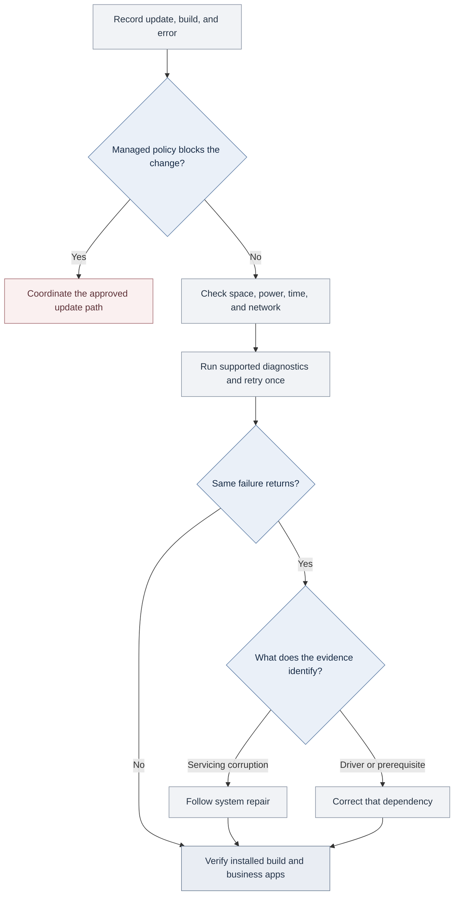

<a href="https://herbertofury.github.io/INTA/" title="Open INTA official download or service page" aria-label="Open INTA official download or service page" data-inta-brand="app-inta"></a> [INTA](https://github.com/Herbertofury/INTA/wiki) / [Decision desk](https://github.com/Herbertofury/INTA/wiki/Decision-Desk) · [Service map](https://github.com/Herbertofury/INTA/wiki/Service-Map) · [Playbooks](https://github.com/Herbertofury/INTA/wiki/Playbooks) · [Tools](https://github.com/Herbertofury/INTA/wiki/Tool-Directory) · [Methods](https://github.com/Herbertofury/INTA/wiki/Methods) · [Open hub](https://herbertofury.github.io/INTA/)

<a id="-fix-a-failing-windows-update"></a>

# <a href="https://learn.microsoft.com/en-us/windows/deployment/update/" title="Open Windows Update official download or service page" aria-label="Open Windows Update official download or service page" data-inta-brand="app-windows-update"></a> [Fix a failing Windows update](https://github.com/Herbertofury/INTA/wiki/Job-windows-update)

Diagnose the update code, servicing state, and available space before broad reset scripts.

**<a href="https://www.microsoft.com/windows" title="Open Windows official download or service page" aria-label="Open Windows official download or service page" data-inta-brand="app-windows"></a> [Windows](https://www.microsoft.com/windows) & performance** · Intermediate · 20–60 min plus installation · 6 steps

[Tools and useful links](#working-kit) · [Quick answer](#quick-answer) · [Next action](#next-action) · [Specific fixes](#specific-fixes) · [Decision route](#decision-route) · [Tools](#toolkit) · [Procedure](#walkthrough) · [Verification](#acceptance) · [Sources](#sources) · [Interactive checklist](https://herbertofury.github.io/INTA/#job/windows-update)

<a id="tool-choices"></a>

## 🧰 Choose the tool for this job

Choose by the task shown in the first column. Each option includes its acquisition route and access boundary.

| Need | Official tool + exact action | Why this choice / access |
| --- | --- | --- |
| **Update diagnostic** | **<a href="https://support.microsoft.com/en-us/support/get-help/windows-troubleshooters" title="Open Windows Get Help official download or service page" aria-label="Open Windows Get Help official download or service page" data-inta-brand="get-help"></a> [Windows Get Help](https://support.microsoft.com/en-us/support/get-help/about-get-help)** · **<a href="https://learn.microsoft.com/en-us/windows/deployment/update/" title="Open Windows Update official download or service page" aria-label="Open Windows Update official download or service page" data-inta-brand="app-windows-update"></a> [Open Windows Update troubleshooting](https://support.microsoft.com/en-us/windows/experience/windows-update-troubleshooter)** | Start with the current <a href="https://learn.microsoft.com/en-us/windows/deployment/update/" title="Open Windows Update official download or service page" aria-label="Open Windows Update official download or service page" data-inta-brand="app-windows-update"></a> [Windows Update](https://learn.microsoft.com/en-us/windows/deployment/update/) diagnostic and record the exact error. **Access:** Included with supported <a href="https://www.microsoft.com/windows" title="Open Windows official download or service page" aria-label="Open Windows official download or service page" data-inta-brand="app-windows"></a> [Windows](https://www.microsoft.com/windows) |
| **Explain an upgrade rollback** | **<a href="https://learn.microsoft.com/en-us/windows/deployment/upgrade/setupdiag" title="Open SetupDiag official download or service page" aria-label="Open SetupDiag official download or service page" data-inta-brand="setupdiag"></a> [SetupDiag](https://learn.microsoft.com/en-us/windows/deployment/upgrade/setupdiag)** · **<a href="https://www.microsoft.com/windows" title="Open Windows official download or service page" aria-label="Open Windows official download or service page" data-inta-brand="app-windows"></a> [Download Windows upgrade analyzer · EXE](https://go.microsoft.com/fwlink/?linkid=870142)** | Analyze preserved setup logs for the failed upgrade phase and matching failure rule. **Access:** Free <a href="https://www.microsoft.com/" title="Open microsoft.com official download or service page" aria-label="Open microsoft.com official download or service page" data-inta-brand="site-www-microsoft-com"></a> [Microsoft](https://www.microsoft.com/) diagnostic |
| **[Component-store repair](https://github.com/Herbertofury/INTA/wiki/Job-windows-repair)** | **<a href="https://learn.microsoft.com/en-us/windows-hardware/manufacture/desktop/repair-a-windows-image" title="Open DISM official download or service page" aria-label="Open DISM official download or service page" data-inta-brand="dism"></a> [DISM](https://learn.microsoft.com/en-us/windows-hardware/manufacture/desktop/repair-a-windows-image)** · **<a href="https://learn.microsoft.com/en-us/windows-hardware/manufacture/desktop/repair-a-windows-image" title="Open DISM official download or service page" aria-label="Open DISM official download or service page" data-inta-brand="dism"></a> [Open built-in repair instructions](https://learn.microsoft.com/en-us/windows-hardware/manufacture/desktop/repair-a-windows-image)** | Use the supported servicing workflow when update evidence points to component-store damage. **Access:** Included with supported <a href="https://www.microsoft.com/windows" title="Open Windows official download or service page" aria-label="Open Windows official download or service page" data-inta-brand="app-windows"></a> [Windows](https://www.microsoft.com/windows) |
| **Same-version reinstall** | **<a href="https://learn.microsoft.com/en-us/windows-hardware/manufacture/desktop/windows-recovery-environment--windows-re--technical-reference" title="Open Windows Recovery Environment official download or service page" aria-label="Open Windows Recovery Environment official download or service page" data-inta-brand="windows-recovery"></a> [Windows Recovery Environment](https://learn.microsoft.com/en-us/windows-hardware/manufacture/desktop/windows-recovery-environment--windows-re--technical-reference)** · **<a href="https://www.microsoft.com/windows" title="Open Windows official download or service page" aria-label="Open Windows official download or service page" data-inta-brand="app-windows"></a> <a href="https://learn.microsoft.com/en-us/windows/deployment/update/" title="Open Windows Update official download or service page" aria-label="Open Windows Update official download or service page" data-inta-brand="app-windows-update"></a> [Reinstall current Windows via Windows Update](https://support.microsoft.com/en-us/windows/deployment/install-upgrade/fix-issues-by-reinstalling-the-current-version-of-windows)** | Use the <a href="https://learn.microsoft.com/en-us/windows/deployment/update/" title="Open Windows Update official download or service page" aria-label="Open Windows Update official download or service page" data-inta-brand="app-windows-update"></a> [Windows Update](https://learn.microsoft.com/en-us/windows/deployment/update/) repair reinstall if available and the machine can still run <a href="https://www.microsoft.com/windows" title="Open Windows official download or service page" aria-label="Open Windows official download or service page" data-inta-brand="app-windows"></a> [Windows](https://www.microsoft.com/windows). **Access:** Included with supported <a href="https://www.microsoft.com/windows" title="Open Windows official download or service page" aria-label="Open Windows official download or service page" data-inta-brand="app-windows"></a> [Windows](https://www.microsoft.com/windows) |

**[Current selection evidence](https://github.com/Herbertofury/INTA/wiki/Current-Tool-Choices)**

<a id="working-kit"></a>

## 🧰 Tools and links for this job

**[Open working view](https://herbertofury.github.io/INTA/#job/windows-update)** · Keep the tool panel beside the instructions.

**First move:** Open Settings > <a href="https://learn.microsoft.com/en-us/windows/deployment/update/" title="Open Windows Update official download or service page" aria-label="Open Windows Update official download or service page" data-inta-brand="app-windows-update"></a> [Windows Update](https://learn.microsoft.com/en-us/windows/deployment/update/) > Update history. Record the failing KB, error and restart state before retrying.

| Use this for | Official tool + exact action |
| --- | --- |
| Run the supported update diagnostic. | **<a href="https://support.microsoft.com/en-us/support/get-help/windows-troubleshooters" title="Open Windows Get Help official download or service page" aria-label="Open Windows Get Help official download or service page" data-inta-brand="get-help"></a> [Windows Get Help](https://support.microsoft.com/en-us/support/get-help/about-get-help)** · <a href="https://support.microsoft.com/en-us/support/get-help/windows-troubleshooters" title="Open Windows Get Help official download or service page" aria-label="Open Windows Get Help official download or service page" data-inta-brand="get-help"></a> [Official page](https://support.microsoft.com/en-us/support/get-help/about-get-help) · **<a href="https://learn.microsoft.com/en-us/windows/deployment/update/" title="Open Windows Update official download or service page" aria-label="Open Windows Update official download or service page" data-inta-brand="app-windows-update"></a> [Open Windows Update troubleshooting](https://support.microsoft.com/en-us/windows/experience/windows-update-troubleshooter)** |
| Investigate component-store damage when the error points there. | **<a href="https://learn.microsoft.com/en-us/windows-hardware/manufacture/desktop/repair-a-windows-image" title="Open DISM official download or service page" aria-label="Open DISM official download or service page" data-inta-brand="dism"></a> [DISM](https://learn.microsoft.com/en-us/windows-hardware/manufacture/desktop/repair-a-windows-image)** · <a href="https://learn.microsoft.com/en-us/windows-hardware/manufacture/desktop/repair-a-windows-image" title="Open DISM official download or service page" aria-label="Open DISM official download or service page" data-inta-brand="dism"></a> [Official page](https://learn.microsoft.com/en-us/windows-hardware/manufacture/desktop/repair-a-windows-image) · **<a href="https://learn.microsoft.com/en-us/windows-hardware/manufacture/desktop/repair-a-windows-image" title="Open DISM official download or service page" aria-label="Open DISM official download or service page" data-inta-brand="dism"></a> [Open built-in repair instructions](https://learn.microsoft.com/en-us/windows-hardware/manufacture/desktop/repair-a-windows-image)** |
| Check protected files after successful servicing repair. | **<a href="https://learn.microsoft.com/en-us/windows-server/administration/windows-commands/sfc" title="Open System File Checker official download or service page" aria-label="Open System File Checker official download or service page" data-inta-brand="sfc"></a> [System File Checker](https://learn.microsoft.com/en-us/windows-server/administration/windows-commands/sfc)** · <a href="https://learn.microsoft.com/en-us/windows-server/administration/windows-commands/sfc" title="Open System File Checker official download or service page" aria-label="Open System File Checker official download or service page" data-inta-brand="sfc"></a> [Official page](https://learn.microsoft.com/en-us/windows-server/administration/windows-commands/sfc) · **<a href="https://learn.microsoft.com/en-us/windows-server/administration/windows-commands/sfc" title="Open System File Checker official download or service page" aria-label="Open System File Checker official download or service page" data-inta-brand="sfc"></a> [Open built-in system-file checks](https://learn.microsoft.com/en-us/windows-server/administration/windows-commands/sfc)** |
| Reinstall the current <a href="https://www.microsoft.com/windows" title="Open Windows official download or service page" aria-label="Open Windows official download or service page" data-inta-brand="app-windows"></a> [Windows](https://www.microsoft.com/windows) version while keeping apps, files and settings, when available. | **<a href="https://learn.microsoft.com/en-us/windows-hardware/manufacture/desktop/windows-recovery-environment--windows-re--technical-reference" title="Open Windows Recovery Environment official download or service page" aria-label="Open Windows Recovery Environment official download or service page" data-inta-brand="windows-recovery"></a> [Windows Recovery Environment](https://learn.microsoft.com/en-us/windows-hardware/manufacture/desktop/windows-recovery-environment--windows-re--technical-reference)** · <a href="https://learn.microsoft.com/en-us/windows-hardware/manufacture/desktop/windows-recovery-environment--windows-re--technical-reference" title="Open Windows Recovery Environment official download or service page" aria-label="Open Windows Recovery Environment official download or service page" data-inta-brand="windows-recovery"></a> [Official page](https://learn.microsoft.com/en-us/windows-hardware/manufacture/desktop/windows-recovery-environment--windows-re--technical-reference) · **<a href="https://www.microsoft.com/windows" title="Open Windows official download or service page" aria-label="Open Windows official download or service page" data-inta-brand="app-windows"></a> <a href="https://learn.microsoft.com/en-us/windows/deployment/update/" title="Open Windows Update official download or service page" aria-label="Open Windows Update official download or service page" data-inta-brand="app-windows-update"></a> [Reinstall current Windows via Windows Update](https://support.microsoft.com/en-us/windows/deployment/install-upgrade/fix-issues-by-reinstalling-the-current-version-of-windows)** |
| Finding the failure rule and related log evidence before retrying an unsuccessful <a href="https://www.microsoft.com/windows" title="Open Windows official download or service page" aria-label="Open Windows official download or service page" data-inta-brand="app-windows"></a> [Windows](https://www.microsoft.com/windows) upgrade. | **<a href="https://learn.microsoft.com/en-us/windows/deployment/upgrade/setupdiag" title="Open SetupDiag official download or service page" aria-label="Open SetupDiag official download or service page" data-inta-brand="setupdiag"></a> [SetupDiag](https://learn.microsoft.com/en-us/windows/deployment/upgrade/setupdiag)** · <a href="https://learn.microsoft.com/en-us/windows/deployment/upgrade/setupdiag" title="Open SetupDiag official download or service page" aria-label="Open SetupDiag official download or service page" data-inta-brand="setupdiag"></a> [Official page](https://learn.microsoft.com/en-us/windows/deployment/upgrade/setupdiag) · **<a href="https://www.microsoft.com/windows" title="Open Windows official download or service page" aria-label="Open Windows official download or service page" data-inta-brand="app-windows"></a> [Download Windows upgrade analyzer · EXE](https://go.microsoft.com/fwlink/?linkid=870142)** |

### First repair

| Open the exact resource | What to do there |
| --- | --- |
| **<a href="https://learn.microsoft.com/en-us/windows/deployment/update/" title="Open Windows Update official download or service page" aria-label="Open Windows Update official download or service page" data-inta-brand="app-windows-update"></a> [Windows Update troubleshooter](https://support.microsoft.com/en-us/windows/experience/windows-update-troubleshooter)** | Run the diagnostic, restart when required and check updates again. |
| **<a href="https://support.microsoft.com/" title="Open support.microsoft.com official download or service page" aria-label="Open support.microsoft.com official download or service page" data-inta-brand="site-support-microsoft-com"></a> [Troubleshoot update failures](https://support.microsoft.com/en-us/windows/deployment/updates-lifecycle/troubleshoot-problems-updating-windows)** | Use the exact error and installation stage. |

### Current issues

| Open the exact resource | What to do there |
| --- | --- |
| **<a href="https://learn.microsoft.com/" title="Open learn.microsoft.com official download or service page" aria-label="Open learn.microsoft.com official download or service page" data-inta-brand="site-learn-microsoft-com"></a> [Windows release health](https://learn.microsoft.com/en-us/windows/release-health/)** | Check the affected <a href="https://www.microsoft.com/windows" title="Open Windows official download or service page" aria-label="Open Windows official download or service page" data-inta-brand="app-windows"></a> [Windows](https://www.microsoft.com/windows) version for known issues or holds. |

### Recovery

| Open the exact resource | What to do there |
| --- | --- |
| **<a href="https://support.microsoft.com/" title="Open support.microsoft.com official download or service page" aria-label="Open support.microsoft.com official download or service page" data-inta-brand="site-support-microsoft-com"></a> [Recovery and uninstall choices](https://support.microsoft.com/en-us/windows/experience/backup-recovery/recovery-options-in-windows)** | Use the appropriate rollback route if the update prevents startup. |
| **<a href="https://learn.microsoft.com/en-us/windows/deployment/update/" title="Open Windows Update official download or service page" aria-label="Open Windows Update official download or service page" data-inta-brand="app-windows-update"></a> [Repair reinstall through Windows Update](https://support.microsoft.com/en-us/windows/deployment/install-upgrade/fix-issues-by-reinstalling-the-current-version-of-windows)** | Use the supported same-version repair; managed update policies can make it unavailable. |

<a id="quick-answer"></a>

## ⚡ Quick answer

<a id="quick-fix-windows-updates"></a>

### 🔄 Fix <a href="https://www.microsoft.com/windows" title="Open Windows official download or service page" aria-label="Open Windows official download or service page" data-inta-brand="app-windows"></a> [Windows](https://www.microsoft.com/windows) updates

**Record the failing update or KB number, error code and pending restart before retrying it.**

1. Confirm free space, a stable connection and a planned restart window.
2. Run the <a href="https://learn.microsoft.com/en-us/windows/deployment/update/" title="Open Windows Update official download or service page" aria-label="Open Windows Update official download or service page" data-inta-brand="app-windows-update"></a> [Windows Update](https://learn.microsoft.com/en-us/windows/deployment/update/) troubleshooter in <a href="https://support.microsoft.com/en-us/support/get-help/windows-troubleshooters" title="Open Windows Get Help official download or service page" aria-label="Open Windows Get Help official download or service page" data-inta-brand="get-help"></a> [Windows Get Help](https://support.microsoft.com/en-us/support/get-help/about-get-help) and review its findings.
3. Restart when required, check for updates again and verify the affected update and original task.

**<a href="https://support.microsoft.com/en-us/support/get-help/windows-troubleshooters" title="Open Windows Get Help official download or service page" aria-label="Open Windows Get Help official download or service page" data-inta-brand="get-help"></a> [Windows Get Help](https://support.microsoft.com/en-us/support/get-help/about-get-help)** · <a href="https://support.microsoft.com/en-us/support/get-help/windows-troubleshooters" title="Open Windows Get Help official download or service page" aria-label="Open Windows Get Help official download or service page" data-inta-brand="get-help"></a> [Official page](https://support.microsoft.com/en-us/support/get-help/about-get-help) · **<a href="https://learn.microsoft.com/en-us/windows/deployment/update/" title="Open Windows Update official download or service page" aria-label="Open Windows Update official download or service page" data-inta-brand="app-windows-update"></a> [Open Windows Update troubleshooting](https://support.microsoft.com/en-us/windows/experience/windows-update-troubleshooter)**

<a id="next-action"></a>

## 🧭 Match the symptom

| You see this | Do this next | You should get |
| --- | --- | --- |
| **One update repeatedly fails** | Record its KB/error, check free space and connection, then run the <a href="https://learn.microsoft.com/en-us/windows/deployment/update/" title="Open Windows Update official download or service page" aria-label="Open Windows Update official download or service page" data-inta-brand="app-windows-update"></a> [Windows Update](https://learn.microsoft.com/en-us/windows/deployment/update/) troubleshooter in <a href="https://support.microsoft.com/en-us/support/get-help/windows-troubleshooters" title="Open Windows Get Help official download or service page" aria-label="Open Windows Get Help official download or service page" data-inta-brand="get-help"></a> [Windows Get Help](https://support.microsoft.com/en-us/support/get-help/about-get-help). | The diagnostic gives a finding or a reproducible update error. |
| **A restart is pending** | Save work and restart in the agreed window, then return to <a href="https://learn.microsoft.com/en-us/windows/deployment/update/" title="Open Windows Update official download or service page" aria-label="Open Windows Update official download or service page" data-inta-brand="app-windows-update"></a> [Windows Update](https://learn.microsoft.com/en-us/windows/deployment/update/) and Update history. | The update completes or the same failing KB is identified after restart. |
| **The device is managed or a compatibility hold is present** | Check the organization’s update owner and the applicable release-health notice; do not bypass the hold or policy. | The approved next update or remediation is recorded. |
| **The update prevents <a href="https://www.microsoft.com/windows" title="Open Windows official download or service page" aria-label="Open Windows official download or service page" data-inta-brand="app-windows"></a> [Windows](https://www.microsoft.com/windows) from starting** | With recovery access ready, use <a href="https://learn.microsoft.com/en-us/windows-hardware/manufacture/desktop/windows-recovery-environment--windows-re--technical-reference" title="Open Windows Recovery Environment official download or service page" aria-label="Open Windows Recovery Environment official download or service page" data-inta-brand="windows-recovery"></a> [WinRE](https://learn.microsoft.com/en-us/windows-hardware/manufacture/desktop/windows-recovery-environment--windows-re--technical-reference) > Troubleshoot > Advanced options > Uninstall Updates when the affected update is the established cause. | The device returns to a bootable state for a scoped recovery plan. |
| **<a href="https://www.microsoft.com/windows" title="Open Windows official download or service page" aria-label="Open Windows official download or service page" data-inta-brand="app-windows"></a> [Windows](https://www.microsoft.com/windows) starts but system/update corruption persists** | With saved work, recovery access, stable power and internet, open Settings > System > Recovery > Fix problems using <a href="https://learn.microsoft.com/en-us/windows/deployment/update/" title="Open Windows Update official download or service page" aria-label="Open Windows Update official download or service page" data-inta-brand="app-windows-update"></a> [Windows Update](https://learn.microsoft.com/en-us/windows/deployment/update/) > Reinstall now if available. If managed policy hides it, use the organization’s repair route. | The same <a href="https://www.microsoft.com/windows" title="Open Windows official download or service page" aria-label="Open Windows official download or service page" data-inta-brand="app-windows"></a> [Windows](https://www.microsoft.com/windows) version is repaired, apps/files/settings remain, and the original failed task or update succeeds after restart. |

### ✅ Finish the job

- [ ] Update history shows the intended result and no required restart remains.
- [ ] The original application and a normal reboot succeed.

**Change route when:** The next step would bypass a managed policy or documented safeguard without an approved plan. · Boot or storage failure changes the job into recovery.

### 🎯 Go straight to a specific fix

- **[Clear an update’s storage blocker safely](#fix-update-free-the-space-the-installer-needs)** — <a href="https://learn.microsoft.com/en-us/windows/deployment/update/" title="Open Windows Update official download or service page" aria-label="Open Windows Update official download or service page" data-inta-brand="app-windows-update"></a> [Windows Update](https://learn.microsoft.com/en-us/windows/deployment/update/) asks for more space or fails during a low-space installation.
- **[Find why a feature upgrade rolled back](#fix-update-explain-a-feature-upgrade-rollback)** — <a href="https://www.microsoft.com/windows" title="Open Windows official download or service page" aria-label="Open Windows official download or service page" data-inta-brand="app-windows"></a> [Windows](https://www.microsoft.com/windows) returns to the previous version after an attempted feature upgrade.
- **[Check why a feature update is not offered](#fix-update-respect-a-safeguard-hold)** — A device receives routine updates but a newer feature release is missing.
- **[Turn an update rollback into a specific repair](#fix-update-generic-rollback-needs-exact-code)** — The PC repeatedly says it could not complete updates or is undoing changes.

> [!NOTE]
> **Start here.** Write down the exact KB or feature update, error code, <a href="https://www.microsoft.com/windows" title="Open Windows official download or service page" aria-label="Open Windows official download or service page" data-inta-brand="app-windows"></a> [Windows](https://www.microsoft.com/windows) edition/build, and whether the device is centrally managed.

<a id="decision-route"></a>

<a id="-choose-the-right-branch"></a>

## 🧭 Choose a route



**Route links:** [Continue this workflow](#walkthrough) · [Acceptance checks](#acceptance) · <a href="https://www.microsoft.com/windows" title="Open Windows official download or service page" aria-label="Open Windows official download or service page" data-inta-brand="app-windows"></a> [Repair Windows component or system-file corruption](windows-repair.md) · [Diagnose crashes, blue screens, and overheating](hardware-bsod.md) · [Run a useful workstation maintenance visit](preventive-maintenance.md)

| Checkpoint | What to carry forward |
| --- | --- |
| **Before changing anything** | Respect the update policy and maintenance window. |
| **Keep during the job** | Exact update, failure stage, error, logs, and each changed dependency. |
| **Before handing back** | Installed build plus the user’s normal workload pass. |

<a id="toolkit"></a>

<a id="-build-the-right-toolkit"></a>

## Recommended tools

Select a tool for the next diagnostic or repair step. Check its platform, access and licensing requirements before use.

| Tool / official page + download | Use it for | Platform & access | Documentation |
| --- | --- | --- | --- |
| **<a href="https://support.microsoft.com/en-us/support/get-help/windows-troubleshooters" title="Open Windows Get Help official download or service page" aria-label="Open Windows Get Help official download or service page" data-inta-brand="get-help"></a> [Windows Get Help](https://support.microsoft.com/en-us/support/get-help/about-get-help)** · <a href="https://support.microsoft.com/en-us/support/get-help/windows-troubleshooters" title="Open Windows Get Help official download or service page" aria-label="Open Windows Get Help official download or service page" data-inta-brand="get-help"></a> [Official page](https://support.microsoft.com/en-us/support/get-help/about-get-help) · **<a href="https://learn.microsoft.com/en-us/windows/deployment/update/" title="Open Windows Update official download or service page" aria-label="Open Windows Update official download or service page" data-inta-brand="app-windows-update"></a> [Open Windows Update troubleshooting](https://support.microsoft.com/en-us/windows/experience/windows-update-troubleshooter)** | Run the supported update diagnostic. | <a href="https://www.microsoft.com/windows" title="Open Windows official download or service page" aria-label="Open Windows official download or service page" data-inta-brand="app-windows"></a> [Windows](https://www.microsoft.com/windows); Included with supported <a href="https://www.microsoft.com/windows" title="Open Windows official download or service page" aria-label="Open Windows official download or service page" data-inta-brand="app-windows"></a> [Windows](https://www.microsoft.com/windows); assisted support availability depends on the account and support agreement. | <a href="https://support.microsoft.com/en-us/support/get-help/windows-troubleshooters" title="Open Windows Get Help official download or service page" aria-label="Open Windows Get Help official download or service page" data-inta-brand="get-help"></a> [Open guide](https://support.microsoft.com/en-us/support/get-help/windows-troubleshooters) |
| **<a href="https://learn.microsoft.com/en-us/windows-hardware/manufacture/desktop/repair-a-windows-image" title="Open DISM official download or service page" aria-label="Open DISM official download or service page" data-inta-brand="dism"></a> [DISM](https://learn.microsoft.com/en-us/windows-hardware/manufacture/desktop/repair-a-windows-image)** · <a href="https://learn.microsoft.com/en-us/windows-hardware/manufacture/desktop/repair-a-windows-image" title="Open DISM official download or service page" aria-label="Open DISM official download or service page" data-inta-brand="dism"></a> [Official page](https://learn.microsoft.com/en-us/windows-hardware/manufacture/desktop/repair-a-windows-image) · **<a href="https://learn.microsoft.com/en-us/windows-hardware/manufacture/desktop/repair-a-windows-image" title="Open DISM official download or service page" aria-label="Open DISM official download or service page" data-inta-brand="dism"></a> [Open built-in repair instructions](https://learn.microsoft.com/en-us/windows-hardware/manufacture/desktop/repair-a-windows-image)** | Investigate component-store damage when the error points there. | <a href="https://www.microsoft.com/windows" title="Open Windows official download or service page" aria-label="Open Windows official download or service page" data-inta-brand="app-windows"></a> [Windows](https://www.microsoft.com/windows); Included with <a href="https://www.microsoft.com/windows" title="Open Windows official download or service page" aria-label="Open Windows official download or service page" data-inta-brand="app-windows"></a> [Windows](https://www.microsoft.com/windows) | <a href="https://learn.microsoft.com/en-us/windows-hardware/manufacture/desktop/repair-a-windows-image" title="Open DISM official download or service page" aria-label="Open DISM official download or service page" data-inta-brand="dism"></a> [Open guide](https://learn.microsoft.com/en-us/windows-hardware/manufacture/desktop/repair-a-windows-image) |
| **<a href="https://learn.microsoft.com/en-us/windows-server/administration/windows-commands/sfc" title="Open System File Checker official download or service page" aria-label="Open System File Checker official download or service page" data-inta-brand="sfc"></a> [System File Checker](https://learn.microsoft.com/en-us/windows-server/administration/windows-commands/sfc)** · <a href="https://learn.microsoft.com/en-us/windows-server/administration/windows-commands/sfc" title="Open System File Checker official download or service page" aria-label="Open System File Checker official download or service page" data-inta-brand="sfc"></a> [Official page](https://learn.microsoft.com/en-us/windows-server/administration/windows-commands/sfc) · **<a href="https://learn.microsoft.com/en-us/windows-server/administration/windows-commands/sfc" title="Open System File Checker official download or service page" aria-label="Open System File Checker official download or service page" data-inta-brand="sfc"></a> [Open built-in system-file checks](https://learn.microsoft.com/en-us/windows-server/administration/windows-commands/sfc)** | Check protected files after successful servicing repair. | <a href="https://www.microsoft.com/windows" title="Open Windows official download or service page" aria-label="Open Windows official download or service page" data-inta-brand="app-windows"></a> [Windows](https://www.microsoft.com/windows); Included with <a href="https://www.microsoft.com/windows" title="Open Windows official download or service page" aria-label="Open Windows official download or service page" data-inta-brand="app-windows"></a> [Windows](https://www.microsoft.com/windows) | <a href="https://learn.microsoft.com/en-us/windows-server/administration/windows-commands/sfc" title="Open System File Checker official download or service page" aria-label="Open System File Checker official download or service page" data-inta-brand="sfc"></a> [Open guide](https://learn.microsoft.com/en-us/windows-server/administration/windows-commands/sfc) |
| **<a href="https://learn.microsoft.com/en-us/windows-hardware/manufacture/desktop/windows-recovery-environment--windows-re--technical-reference" title="Open Windows Recovery Environment official download or service page" aria-label="Open Windows Recovery Environment official download or service page" data-inta-brand="windows-recovery"></a> [Windows Recovery Environment](https://learn.microsoft.com/en-us/windows-hardware/manufacture/desktop/windows-recovery-environment--windows-re--technical-reference)** · <a href="https://learn.microsoft.com/en-us/windows-hardware/manufacture/desktop/windows-recovery-environment--windows-re--technical-reference" title="Open Windows Recovery Environment official download or service page" aria-label="Open Windows Recovery Environment official download or service page" data-inta-brand="windows-recovery"></a> [Official page](https://learn.microsoft.com/en-us/windows-hardware/manufacture/desktop/windows-recovery-environment--windows-re--technical-reference) · **<a href="https://www.microsoft.com/windows" title="Open Windows official download or service page" aria-label="Open Windows official download or service page" data-inta-brand="app-windows"></a> <a href="https://learn.microsoft.com/en-us/windows/deployment/update/" title="Open Windows Update official download or service page" aria-label="Open Windows Update official download or service page" data-inta-brand="app-windows-update"></a> [Reinstall current Windows via Windows Update](https://support.microsoft.com/en-us/windows/deployment/install-upgrade/fix-issues-by-reinstalling-the-current-version-of-windows)** | Reinstall the current <a href="https://www.microsoft.com/windows" title="Open Windows official download or service page" aria-label="Open Windows official download or service page" data-inta-brand="app-windows"></a> [Windows](https://www.microsoft.com/windows) version while keeping apps, files and settings, when available. | <a href="https://www.microsoft.com/windows" title="Open Windows official download or service page" aria-label="Open Windows official download or service page" data-inta-brand="app-windows"></a> [Windows](https://www.microsoft.com/windows); Included with <a href="https://www.microsoft.com/windows" title="Open Windows official download or service page" aria-label="Open Windows official download or service page" data-inta-brand="app-windows"></a> [Windows](https://www.microsoft.com/windows) | <a href="https://learn.microsoft.com/en-us/windows-hardware/manufacture/desktop/windows-recovery-environment--windows-re--technical-reference" title="Open Windows Recovery Environment official download or service page" aria-label="Open Windows Recovery Environment official download or service page" data-inta-brand="windows-recovery"></a> [Open guide](https://learn.microsoft.com/en-us/windows-hardware/manufacture/desktop/windows-recovery-environment--windows-re--technical-reference) |
| **<a href="https://learn.microsoft.com/en-us/sysinternals/downloads/sysinternals-suite" title="Open Microsoft Sysinternals Suite official download or service page" aria-label="Open Microsoft Sysinternals Suite official download or service page" data-inta-brand="sysinternals"></a> [Microsoft Sysinternals Suite](https://learn.microsoft.com/en-us/sysinternals/)** · <a href="https://learn.microsoft.com/en-us/sysinternals/downloads/sysinternals-suite" title="Open Microsoft Sysinternals Suite official download or service page" aria-label="Open Microsoft Sysinternals Suite official download or service page" data-inta-brand="sysinternals"></a> [Official page](https://learn.microsoft.com/en-us/sysinternals/) · **<a href="https://www.microsoft.com/windows" title="Open Windows official download or service page" aria-label="Open Windows official download or service page" data-inta-brand="app-windows"></a> [Download Windows portable · ZIP](https://download.sysinternals.com/files/SysinternalsSuite.zip)** | The core portable <a href="https://www.microsoft.com/windows" title="Open Windows official download or service page" aria-label="Open Windows official download or service page" data-inta-brand="app-windows"></a> [Windows](https://www.microsoft.com/windows) troubleshooting kit. | <a href="https://www.microsoft.com/windows" title="Open Windows official download or service page" aria-label="Open Windows official download or service page" data-inta-brand="app-windows"></a> [Windows](https://www.microsoft.com/windows); Free <a href="https://www.microsoft.com/" title="Open microsoft.com official download or service page" aria-label="Open microsoft.com official download or service page" data-inta-brand="site-www-microsoft-com"></a> [Microsoft](https://www.microsoft.com/) utilities | <a href="https://learn.microsoft.com/en-us/sysinternals/downloads/sysinternals-suite" title="Open Microsoft Sysinternals Suite official download or service page" aria-label="Open Microsoft Sysinternals Suite official download or service page" data-inta-brand="sysinternals"></a> [Open guide](https://learn.microsoft.com/en-us/sysinternals/downloads/) |
| **<a href="https://learn.microsoft.com/en-us/windows/deployment/upgrade/setupdiag" title="Open SetupDiag official download or service page" aria-label="Open SetupDiag official download or service page" data-inta-brand="setupdiag"></a> [SetupDiag](https://learn.microsoft.com/en-us/windows/deployment/upgrade/setupdiag)** · <a href="https://learn.microsoft.com/en-us/windows/deployment/upgrade/setupdiag" title="Open SetupDiag official download or service page" aria-label="Open SetupDiag official download or service page" data-inta-brand="setupdiag"></a> [Official page](https://learn.microsoft.com/en-us/windows/deployment/upgrade/setupdiag) · **<a href="https://www.microsoft.com/windows" title="Open Windows official download or service page" aria-label="Open Windows official download or service page" data-inta-brand="app-windows"></a> [Download Windows upgrade analyzer · EXE](https://go.microsoft.com/fwlink/?linkid=870142)** | Finding the failure rule and related log evidence before retrying an unsuccessful <a href="https://www.microsoft.com/windows" title="Open Windows official download or service page" aria-label="Open Windows official download or service page" data-inta-brand="app-windows"></a> [Windows](https://www.microsoft.com/windows) upgrade. | <a href="https://www.microsoft.com/windows" title="Open Windows official download or service page" aria-label="Open Windows official download or service page" data-inta-brand="app-windows"></a> [Windows](https://www.microsoft.com/windows); Free <a href="https://www.microsoft.com/" title="Open microsoft.com official download or service page" aria-label="Open microsoft.com official download or service page" data-inta-brand="site-www-microsoft-com"></a> [Microsoft](https://www.microsoft.com/) diagnostic download | <a href="https://learn.microsoft.com/en-us/windows/deployment/upgrade/setupdiag" title="Open SetupDiag official download or service page" aria-label="Open SetupDiag official download or service page" data-inta-brand="setupdiag"></a> [Open guide](https://learn.microsoft.com/en-us/windows/deployment/upgrade/setupdiag) |

<a id="walkthrough"></a>

<a id="-work-the-case"></a>

## Procedure

Work in order, record the result of each step, and change route when the evidence calls for it.

<a id="step-01"></a>

### 01 · Confirm the failure and update policy

- [ ] Read Settings > <a href="https://learn.microsoft.com/en-us/windows/deployment/update/" title="Open Windows Update official download or service page" aria-label="Open Windows Update official download or service page" data-inta-brand="app-windows-update"></a> [Windows Update](https://learn.microsoft.com/en-us/windows/deployment/update/) > Update history. Determine whether the failure is download, installation, or reboot rollback. On managed devices, check the assigned update policy and maintenance window before overriding settings.

<a id="step-02"></a>

### 02 · Check the simple prerequisites

- [ ] Verify stable power, free space, correct time, functioning network/proxy, and whether a restart is pending. Compare with another device on the same network to distinguish local servicing from a broader service issue.

<a id="step-03"></a>

### 03 · Run the supported troubleshooter

- [ ] Open Get Help and run the <a href="https://learn.microsoft.com/en-us/windows/deployment/update/" title="Open Windows Update official download or service page" aria-label="Open Windows Update official download or service page" data-inta-brand="app-windows-update"></a> [Windows Update](https://learn.microsoft.com/en-us/windows/deployment/update/) troubleshooter. Capture its findings and restart when appropriate, then retry the specific update once. If the same failure persists, use the new evidence rather than looping identical retries.

**<a href="https://github.com/PowerShell/PowerShell/releases/latest" title="Open PowerShell official download or service page" aria-label="Open PowerShell official download or service page" data-inta-brand="powershell"></a> [PowerShell](https://learn.microsoft.com/en-us/powershell/) · Open <a href="https://www.microsoft.com/windows" title="Open Windows official download or service page" aria-label="Open Windows official download or service page" data-inta-brand="app-windows"></a> [Windows](https://www.microsoft.com/windows) Settings troubleshooting so the technician can select the supported <a href="https://learn.microsoft.com/en-us/windows/deployment/update/" title="Open Windows Update official download or service page" aria-label="Open Windows Update official download or service page" data-inta-brand="app-windows-update"></a> [Windows Update](https://learn.microsoft.com/en-us/windows/deployment/update/) troubleshooter for the installed <a href="https://www.microsoft.com/windows" title="Open Windows official download or service page" aria-label="Open Windows official download or service page" data-inta-brand="app-windows"></a> [Windows](https://www.microsoft.com/windows) version.:**

```text
Start-Process 'ms-settings:troubleshoot'
```

> **Before running:** Opens Settings only; review the suggested changes before accepting them. Troubleshooter availability and behavior vary by <a href="https://www.microsoft.com/windows" title="Open Windows official download or service page" aria-label="Open Windows official download or service page" data-inta-brand="app-windows"></a> [Windows](https://www.microsoft.com/windows) release and managed policy.

**Official command reference:** <a href="https://www.microsoft.com/" title="Open microsoft.com official download or service page" aria-label="Open microsoft.com official download or service page" data-inta-brand="site-www-microsoft-com"></a> <a href="https://learn.microsoft.com/en-us/windows/deployment/update/" title="Open Windows Update official download or service page" aria-label="Open Windows Update official download or service page" data-inta-brand="app-windows-update"></a> [Microsoft Windows Update troubleshooter](https://support.microsoft.com/en-us/windows/experience/windows-update/windows-update-troubleshooter)

**Command legend:** <a href="https://www.microsoft.com/" title="Open microsoft.com official download or service page" aria-label="Open microsoft.com official download or service page" data-inta-brand="site-www-microsoft-com"></a> <a href="https://learn.microsoft.com/en-us/windows/deployment/update/" title="Open Windows Update official download or service page" aria-label="Open Windows Update official download or service page" data-inta-brand="app-windows-update"></a> [Microsoft Windows Update troubleshooter](https://support.microsoft.com/en-us/windows/experience/windows-update/windows-update-troubleshooter) · [Return to the step context](#step-03).

<a id="step-04"></a>

### 04 · Follow the exact error path

- [ ] Use <a href="https://www.microsoft.com/" title="Open microsoft.com official download or service page" aria-label="Open microsoft.com official download or service page" data-inta-brand="site-www-microsoft-com"></a> [Microsoft](https://www.microsoft.com/)’s troubleshooting reference for the captured code. Inspect relevant logs and service state. A cache reset or security-product change should be tied to a specific diagnosis and have a recovery plan; avoid one-click scripts that reset unrelated settings.

**<a href="https://github.com/PowerShell/PowerShell/releases/latest" title="Open PowerShell official download or service page" aria-label="Open PowerShell official download or service page" data-inta-brand="powershell"></a> [PowerShell](https://learn.microsoft.com/en-us/powershell/) · Read recent <a href="https://learn.microsoft.com/en-us/windows/deployment/update/" title="Open Windows Update official download or service page" aria-label="Open Windows Update official download or service page" data-inta-brand="app-windows-update"></a> [Windows Update](https://learn.microsoft.com/en-us/windows/deployment/update/) client events to identify the failure time and error before retrying installation.:**

```text
Get-WinEvent -FilterHashtable @{LogName='System'; ProviderName='Microsoft-Windows-WindowsUpdateClient'} -MaxEvents 30 | Select-Object TimeCreated,Id,LevelDisplayName,Message | Format-List
```

> **Before running:** Read-only diagnostic; event availability and detail vary by <a href="https://www.microsoft.com/windows" title="Open Windows official download or service page" aria-label="Open Windows official download or service page" data-inta-brand="app-windows"></a> [Windows](https://www.microsoft.com/windows) build.

**Official command reference:** <a href="https://www.microsoft.com/" title="Open microsoft.com official download or service page" aria-label="Open microsoft.com official download or service page" data-inta-brand="site-www-microsoft-com"></a> [Microsoft Get-WinEvent documentation](https://learn.microsoft.com/en-us/powershell/module/microsoft.powershell.diagnostics/get-winevent)

**Command legend:** <a href="https://www.microsoft.com/" title="Open microsoft.com official download or service page" aria-label="Open microsoft.com official download or service page" data-inta-brand="site-www-microsoft-com"></a> [Microsoft Get-WinEvent documentation](https://learn.microsoft.com/en-us/powershell/module/microsoft.powershell.diagnostics/get-winevent) · [Return to the step context](#step-04).

<a id="step-05"></a>

### 05 · Repair servicing if indicated

- [ ] For component-store or protected-file errors on a healthy drive, follow the <a href="https://www.microsoft.com/windows" title="Open Windows official download or service page" aria-label="Open Windows official download or service page" data-inta-brand="app-windows"></a> [Windows repair](https://github.com/Herbertofury/INTA/wiki/Job-windows-repair) guide. If install rollback names a driver, check the device manufacturer’s supported update or rollback path instead of layering more repair commands.

<a id="step-06"></a>

### 06 · Validate the installed result

- [ ] Confirm the intended update appears in history and the resulting OS build is correct. Test the user’s business applications, network, printing, and restart. Record any deferred update with its cause, owner, and next review.

<a id="acceptance"></a>

<a id="-prove-the-result"></a>

## Verification

- [ ] The target update is installed or the remaining blocker is explicitly documented.
- [ ] Update history and the OS build agree.
- [ ] The original applications and devices work after reboot.

> [!WARNING]
> **Pause this route and escalate when:**
> - The device is in an organization-managed change freeze.
> - Repeated rollback or storage symptoms point to a deeper problem.

<a id="specific-fixes"></a>

## 🎯 Specific fixes

Choose the case that matches the evidence. Each case gives a first action, a short procedure and a result to prove.

<a id="fix-update-free-the-space-the-installer-needs"></a>

### Clear an update’s storage blocker safely

**Use when:** <a href="https://learn.microsoft.com/en-us/windows/deployment/update/" title="Open Windows Update official download or service page" aria-label="Open Windows Update official download or service page" data-inta-brand="app-windows-update"></a> [Windows Update](https://learn.microsoft.com/en-us/windows/deployment/update/) asks for more space or fails during a low-space installation.

**Start here:** Open Settings > System > Storage and record available space before deleting anything.

**<a href="https://github.com/windirstat/windirstat/releases/latest" title="Open WinDirStat official download or service page" aria-label="Open WinDirStat official download or service page" data-inta-brand="windirstat"></a> [WinDirStat](https://windirstat.net/)** · <a href="https://github.com/windirstat/windirstat/releases/latest" title="Open WinDirStat official download or service page" aria-label="Open WinDirStat official download or service page" data-inta-brand="windirstat"></a> [Official page](https://windirstat.net/) · **<a href="https://www.microsoft.com/windows" title="Open Windows official download or service page" aria-label="Open Windows official download or service page" data-inta-brand="app-windows"></a> [Download Windows x64 · MSI](https://github.com/windirstat/windirstat/releases/download/release/v2.9.3/WinDirStat-x64.msi)**

**<a href="https://support.microsoft.com/en-us/support/get-help/windows-troubleshooters" title="Open Windows Get Help official download or service page" aria-label="Open Windows Get Help official download or service page" data-inta-brand="get-help"></a> [Windows Get Help](https://support.microsoft.com/en-us/support/get-help/about-get-help)** · <a href="https://support.microsoft.com/en-us/support/get-help/windows-troubleshooters" title="Open Windows Get Help official download or service page" aria-label="Open Windows Get Help official download or service page" data-inta-brand="get-help"></a> [Official page](https://support.microsoft.com/en-us/support/get-help/about-get-help) · **<a href="https://learn.microsoft.com/en-us/windows/deployment/update/" title="Open Windows Update official download or service page" aria-label="Open Windows Update official download or service page" data-inta-brand="app-windows-update"></a> [Open Windows Update troubleshooting](https://support.microsoft.com/en-us/windows/experience/windows-update-troubleshooter)**

1. Review the supported temporary-file and cleanup choices; keep Downloads, customer files and rollback material unless their removal is explicitly intended.
2. If the update offers external storage, follow that specific workflow using a trusted device and keep it attached for the required phase.
3. Retry the same update, restart when requested and confirm its entry in Update history.

**Prove it worked:** The identified update completes and the user’s data and rollback decision remain accounted for.

**If this does not resolve it:** If space rapidly disappears again, identify the owning files or service; do not repeatedly erase logs needed to diagnose the failure.

**Official evidence:** <a href="https://support.microsoft.com/" title="Open support.microsoft.com official download or service page" aria-label="Open support.microsoft.com official download or service page" data-inta-brand="site-support-microsoft-com"></a> [Source 1](https://support.microsoft.com/en-us/windows/deployment/updates-lifecycle/free-up-space-for-windows-updates) · Reviewed 2026-11-26

[Back to specific fixes](#specific-fixes) · [Full procedure](#walkthrough)

<a id="fix-update-explain-a-feature-upgrade-rollback"></a>

### Find why a feature upgrade rolled back

**Use when:** <a href="https://www.microsoft.com/windows" title="Open Windows official download or service page" aria-label="Open Windows official download or service page" data-inta-brand="app-windows"></a> [Windows](https://www.microsoft.com/windows) returns to the previous version after an attempted feature upgrade.

**Start here:** Preserve the failed-upgrade logs before cleanup or another installation attempt.

**<a href="https://learn.microsoft.com/en-us/windows/deployment/upgrade/setupdiag" title="Open SetupDiag official download or service page" aria-label="Open SetupDiag official download or service page" data-inta-brand="setupdiag"></a> [SetupDiag](https://learn.microsoft.com/en-us/windows/deployment/upgrade/setupdiag)** · <a href="https://learn.microsoft.com/en-us/windows/deployment/upgrade/setupdiag" title="Open SetupDiag official download or service page" aria-label="Open SetupDiag official download or service page" data-inta-brand="setupdiag"></a> [Official page](https://learn.microsoft.com/en-us/windows/deployment/upgrade/setupdiag) · **<a href="https://www.microsoft.com/windows" title="Open Windows official download or service page" aria-label="Open Windows official download or service page" data-inta-brand="app-windows"></a> [Download Windows upgrade analyzer · EXE](https://go.microsoft.com/fwlink/?linkid=870142)**

1. Use the current official <a href="https://learn.microsoft.com/en-us/windows/deployment/upgrade/setupdiag" title="Open SetupDiag official download or service page" aria-label="Open SetupDiag official download or service page" data-inta-brand="setupdiag"></a> [SetupDiag](https://learn.microsoft.com/en-us/windows/deployment/upgrade/setupdiag) workflow to analyze the applicable setup logs and retain its result file.
2. Read the matched failure rule, phase and operation alongside the original logs; separate the last failure from earlier warnings.
3. Correct the specific driver, application or servicing blocker identified by the evidence, then plan one controlled retry.

#### ⚡ Quick commands

**Check for <a href="https://learn.microsoft.com/en-us/windows/deployment/upgrade/setupdiag" title="Open SetupDiag official download or service page" aria-label="Open SetupDiag official download or service page" data-inta-brand="setupdiag"></a> [SetupDiag](https://learn.microsoft.com/en-us/windows/deployment/upgrade/setupdiag) and open official guidance** · <a href="https://github.com/PowerShell/PowerShell/releases/latest" title="Open PowerShell official download or service page" aria-label="Open PowerShell official download or service page" data-inta-brand="powershell"></a> [PowerShell](https://learn.microsoft.com/en-us/powershell/)

Locate an existing <a href="https://learn.microsoft.com/en-us/windows/deployment/upgrade/setupdiag" title="Open SetupDiag official download or service page" aria-label="Open SetupDiag official download or service page" data-inta-brand="setupdiag"></a> [SetupDiag](https://learn.microsoft.com/en-us/windows/deployment/upgrade/setupdiag) executable or open <a href="https://www.microsoft.com/" title="Open microsoft.com official download or service page" aria-label="Open microsoft.com official download or service page" data-inta-brand="site-www-microsoft-com"></a> [Microsoft](https://www.microsoft.com/)'s official <a href="https://learn.microsoft.com/en-us/windows/deployment/upgrade/setupdiag" title="Open SetupDiag official download or service page" aria-label="Open SetupDiag official download or service page" data-inta-brand="setupdiag"></a> [SetupDiag](https://learn.microsoft.com/en-us/windows/deployment/upgrade/setupdiag) instructions for upgrade rollback analysis.

```powershell
$setupDiag = Get-Command SetupDiag.exe -ErrorAction SilentlyContinue
if ($setupDiag) { & $setupDiag.Source } else { Start-Process 'https://learn.microsoft.com/en-us/windows/deployment/upgrade/setupdiag' }
```

> **Before running:** Do not download and run a random executable. Use the official <a href="https://www.microsoft.com/" title="Open microsoft.com official download or service page" aria-label="Open microsoft.com official download or service page" data-inta-brand="site-www-microsoft-com"></a> [Microsoft](https://www.microsoft.com/) download and review the generated logs for personal or device identifiers before sharing.

**Official reference:** <a href="https://www.microsoft.com/" title="Open microsoft.com official download or service page" aria-label="Open microsoft.com official download or service page" data-inta-brand="site-www-microsoft-com"></a> <a href="https://learn.microsoft.com/en-us/windows/deployment/upgrade/setupdiag" title="Open SetupDiag official download or service page" aria-label="Open SetupDiag official download or service page" data-inta-brand="setupdiag"></a> [Microsoft SetupDiag](https://learn.microsoft.com/en-us/windows/deployment/upgrade/setupdiag)


**Prove it worked:** The retry targets a documented blocker and either succeeds or produces a distinct new failure record.

**If this does not resolve it:** <a href="https://learn.microsoft.com/en-us/windows/deployment/upgrade/setupdiag" title="Open SetupDiag official download or service page" aria-label="Open SetupDiag official download or service page" data-inta-brand="setupdiag"></a> [SetupDiag](https://learn.microsoft.com/en-us/windows/deployment/upgrade/setupdiag) is an analyzer, not an automatic repair. Escalate unmatched or contradictory results with the preserved logs.

**Official evidence:** <a href="https://learn.microsoft.com/en-us/windows/deployment/upgrade/setupdiag" title="Open SetupDiag official download or service page" aria-label="Open SetupDiag official download or service page" data-inta-brand="setupdiag"></a> [Source 1](https://learn.microsoft.com/en-us/windows/deployment/upgrade/setupdiag) · <a href="https://learn.microsoft.com/" title="Open learn.microsoft.com official download or service page" aria-label="Open learn.microsoft.com official download or service page" data-inta-brand="site-learn-microsoft-com"></a> [Source 2](https://learn.microsoft.com/en-us/windows/deployment/upgrade/log-files) · Reviewed 2026-11-26

[Back to specific fixes](#specific-fixes) · [Full procedure](#walkthrough)

<a id="fix-update-respect-a-safeguard-hold"></a>

### Check why a feature update is not offered

**Use when:** A device receives routine updates but a newer feature release is missing.

**Start here:** Record the installed edition/build and whether update settings are organization-managed.

**<a href="https://support.microsoft.com/en-us/support/get-help/windows-troubleshooters" title="Open Windows Get Help official download or service page" aria-label="Open Windows Get Help official download or service page" data-inta-brand="get-help"></a> [Windows Get Help](https://support.microsoft.com/en-us/support/get-help/about-get-help)** · <a href="https://support.microsoft.com/en-us/support/get-help/windows-troubleshooters" title="Open Windows Get Help official download or service page" aria-label="Open Windows Get Help official download or service page" data-inta-brand="get-help"></a> [Official page](https://support.microsoft.com/en-us/support/get-help/about-get-help) · **<a href="https://learn.microsoft.com/en-us/windows/deployment/update/" title="Open Windows Update official download or service page" aria-label="Open Windows Update official download or service page" data-inta-brand="app-windows-update"></a> [Open Windows Update troubleshooting](https://support.microsoft.com/en-us/windows/experience/windows-update-troubleshooter)**

1. Compare the target release with the official release-health page and the device’s hardware/application compatibility issue.
2. Ask the update owner to check deployment policy and safeguard status; distinguish a deliberate ring delay from a compatibility hold.
3. Apply the documented prerequisite or wait for the resolved issue, then recheck the offer through the approved update path.

**Prove it worked:** The missing offer has an explicit policy or compatibility explanation and an approved next step.

**If this does not resolve it:** Do not bypass a safeguard or force installation solely because another PC received the update.

**Official evidence:** <a href="https://learn.microsoft.com/en-us/windows/deployment/update/" title="Open Windows Update official download or service page" aria-label="Open Windows Update official download or service page" data-inta-brand="app-windows-update"></a> [Source 1](https://learn.microsoft.com/en-us/windows/deployment/update/safeguard-holds) · <a href="https://learn.microsoft.com/" title="Open learn.microsoft.com official download or service page" aria-label="Open learn.microsoft.com official download or service page" data-inta-brand="site-learn-microsoft-com"></a> [Source 2](https://learn.microsoft.com/en-us/windows/release-health/) · Reviewed 2026-11-26

[Back to specific fixes](#specific-fixes) · [Full procedure](#walkthrough)

<a id="fix-update-generic-rollback-needs-exact-code"></a>

### Turn an update rollback into a specific repair

**Use when:** The PC repeatedly says it could not complete updates or is undoing changes.

**Start here:** Open <a href="https://learn.microsoft.com/en-us/windows/deployment/update/" title="Open Windows Update official download or service page" aria-label="Open Windows Update official download or service page" data-inta-brand="app-windows-update"></a> [Windows Update](https://learn.microsoft.com/en-us/windows/deployment/update/) > Update history and record the failed update identifier and exact error code.

**<a href="https://support.microsoft.com/en-us/support/get-help/windows-troubleshooters" title="Open Windows Get Help official download or service page" aria-label="Open Windows Get Help official download or service page" data-inta-brand="get-help"></a> [Windows Get Help](https://support.microsoft.com/en-us/support/get-help/about-get-help)** · <a href="https://support.microsoft.com/en-us/support/get-help/windows-troubleshooters" title="Open Windows Get Help official download or service page" aria-label="Open Windows Get Help official download or service page" data-inta-brand="get-help"></a> [Official page](https://support.microsoft.com/en-us/support/get-help/about-get-help) · **<a href="https://learn.microsoft.com/en-us/windows/deployment/update/" title="Open Windows Update official download or service page" aria-label="Open Windows Update official download or service page" data-inta-brand="app-windows-update"></a> [Open Windows Update troubleshooting](https://support.microsoft.com/en-us/windows/experience/windows-update-troubleshooter)**

**<a href="https://learn.microsoft.com/en-us/windows/deployment/upgrade/setupdiag" title="Open SetupDiag official download or service page" aria-label="Open SetupDiag official download or service page" data-inta-brand="setupdiag"></a> [SetupDiag](https://learn.microsoft.com/en-us/windows/deployment/upgrade/setupdiag)** · <a href="https://learn.microsoft.com/en-us/windows/deployment/upgrade/setupdiag" title="Open SetupDiag official download or service page" aria-label="Open SetupDiag official download or service page" data-inta-brand="setupdiag"></a> [Official page](https://learn.microsoft.com/en-us/windows/deployment/upgrade/setupdiag) · **<a href="https://www.microsoft.com/windows" title="Open Windows official download or service page" aria-label="Open Windows official download or service page" data-inta-brand="app-windows"></a> [Download Windows upgrade analyzer · EXE](https://go.microsoft.com/fwlink/?linkid=870142)**

1. Capture the <a href="https://www.microsoft.com/windows" title="Open Windows official download or service page" aria-label="Open Windows official download or service page" data-inta-brand="app-windows"></a> [Windows](https://www.microsoft.com/windows) build and whether this is a cumulative update, driver update or feature upgrade.
2. Use the matching error branch in the official installation-error reference. A generic rollback message does not identify one cause.
3. Compare the documented prerequisite with evidence on this device, such as available space, the connection path or supported drivers; make one relevant change.
4. Retry that update and check its history after the required restart, then repeat the original user task.

**Prove it worked:** The exact update is recorded as installed and the device completes a normal restart.

**If this does not resolve it:** If the same code returns, retain the error and applicable setup/servicing logs for the next diagnostic branch rather than cycling through unrelated reset commands.

**Official evidence:** <a href="https://support.microsoft.com/" title="Open support.microsoft.com official download or service page" aria-label="Open support.microsoft.com official download or service page" data-inta-brand="site-support-microsoft-com"></a> [Source 1](https://support.microsoft.com/en-us/windows/deployment/install-upgrade/get-help-with-windows-upgrade-and-installation-errors) · Reviewed 2026-11-26

[Back to specific fixes](#specific-fixes) · [Full procedure](#walkthrough)


<a id="-continue-with-the-evidence"></a>

## Related playbooks

| Next playbook | What it resolves |
| --- | --- |
| <a href="https://www.microsoft.com/windows" title="Open Windows official download or service page" aria-label="Open Windows official download or service page" data-inta-brand="app-windows"></a> [Repair Windows component or system-file corruption](windows-repair.md) | Use <a href="https://www.microsoft.com/windows" title="Open Windows official download or service page" aria-label="Open Windows official download or service page" data-inta-brand="app-windows"></a> [Windows](https://www.microsoft.com/windows) servicing tools in a sensible order and validate the specific broken feature. |
| [Diagnose crashes, blue screens, and overheating](hardware-bsod.md) | Correlate crash evidence with memory, storage, temperature, power, and driver changes. |
| [Run a useful workstation maintenance visit](preventive-maintenance.md) | Check security, updates, hardware, backups, and usability without unnecessary cleanup rituals. |

<a id="sources"></a>

<a id="-source-trail"></a>

## Official sources

- <a href="https://www.microsoft.com/" title="Open microsoft.com official download or service page" aria-label="Open microsoft.com official download or service page" data-inta-brand="site-www-microsoft-com"></a> <a href="https://learn.microsoft.com/en-us/windows/deployment/update/" title="Open Windows Update official download or service page" aria-label="Open Windows Update official download or service page" data-inta-brand="app-windows-update"></a> [Microsoft: Windows Update troubleshooter](https://support.microsoft.com/en-us/windows/experience/windows-update-troubleshooter)
- <a href="https://www.microsoft.com/" title="Open microsoft.com official download or service page" aria-label="Open microsoft.com official download or service page" data-inta-brand="site-www-microsoft-com"></a> <a href="https://www.microsoft.com/windows" title="Open Windows official download or service page" aria-label="Open Windows official download or service page" data-inta-brand="app-windows"></a> [Microsoft: troubleshooting Windows updates](https://support.microsoft.com/en-us/windows/deployment/updates-lifecycle/troubleshoot-problems-updating-windows)

Reviewed **2026-11-26**. Timing is a planning range. A successful command is evidence about that operation; acceptance belongs to the user’s original task.


---

Editorial review: **2026-11-26** · [Review standard](https://github.com/Herbertofury/INTA/wiki/Knowledge-Standards) · [Suggest a correction](https://github.com/Herbertofury/INTA/issues/new/choose)

[← All playbooks](README.md) · [Live Wiki](https://github.com/Herbertofury/INTA/wiki) · [Contribution guide](https://github.com/Herbertofury/INTA/blob/main/CONTRIBUTING.md)
