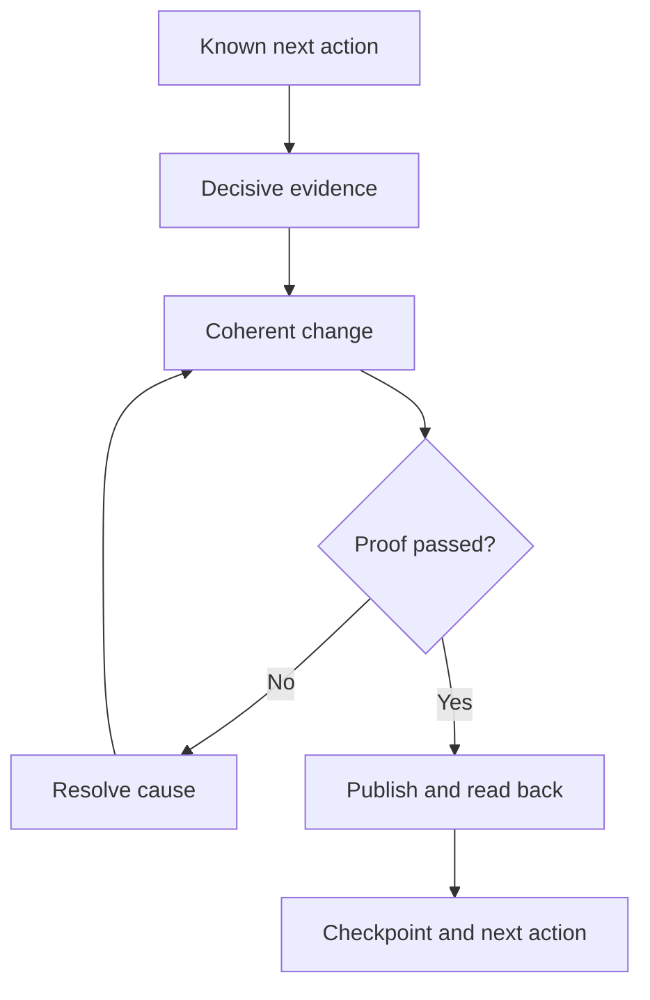

 [INTA](https://github.com/Herbertofury/INTA/wiki) / [Decision desk](https://github.com/Herbertofury/INTA/wiki/Decision-Desk) · [Service map](https://github.com/Herbertofury/INTA/wiki/Service-Map) · [Playbooks](https://github.com/Herbertofury/INTA/wiki/Playbooks) · [Tools](https://github.com/Herbertofury/INTA/wiki/Tool-Directory) · [Methods](https://github.com/Herbertofury/INTA/wiki/Methods) · [Open hub](https://herbertofury.github.io/INTA/)

# 🌱 Keep making the hub better

[Home](https://github.com/Herbertofury/INTA/wiki) › [Contribute](https://github.com/Herbertofury/INTA/wiki/Contribute) › **Continuous improvement**

**Each contribution should leave technicians with better guidance, a clearer decision, a stronger tool choice or a proven workflow improvement.** Preserve the source checkpoint and unfinished acceptance items so the next pass starts with the next action.

## 🧭 Choose work with a visible benefit

| Priority | Useful contribution | Completion evidence |
| --- | --- | --- |
| 1 · Correct a harmful or misleading step | Fix the target, environment, data-protection boundary or claimed result. | The corrected branch and acceptance test have been reviewed against decisive sources. |
| 2 · Repair navigation and official routes | Resolve a dead link, moved upstream or ambiguous tool alias. | The live page reaches the intended source from every affected mention. |
| 3 · Strengthen a common job | Add a missing first test, interpretation, fallback or proof. | A technician can follow the complete path with less guesswork. |
| 4 · Improve a tool decision | Compare a meaningful candidate with the existing recommendation. | Job fit, platform, operating cost and evidence level support the disposition. |
| 5 · Improve usability | Make a dense guide easier to scan or a real decision easier to understand. | Rendered review confirms readable navigation, links, tables, diagrams and mobile layout. |
| 6 · Expand useful coverage | Add a new method or job with a concrete audience and outcome. | The full procedure, sources, crosslinks and acceptance evidence exist. |

The order is a decision aid, not a quantity limit. Finish the accepted scope. When several improvements share a source or test, batch them coherently instead of repeating discovery.

## 🔁 The contribution loop

Use the [Service map](https://github.com/Herbertofury/INTA/wiki/Service-Map) as the shared field index and the [research queue](https://github.com/Herbertofury/INTA/wiki/Research-Queue) as the explicit next-work list. Each existing job and tool category has concrete questions, deliverables and acceptance evidence. Review the complete [knowledge health report](https://github.com/Herbertofury/INTA/wiki/Knowledge-Health), fix higher-impact defects first, then rotate through the least recently reviewed areas. New findings extend an existing guide or tool record whenever possible; [organization rules](https://github.com/Herbertofury/INTA/wiki/Knowledge-Organization) keep this growth navigable.

Diagram legend: [Contribution Guide](https://github.com/Herbertofury/INTA/wiki/Contribute), [post-change acceptance](https://github.com/Herbertofury/INTA/wiki/Job-client-handoff), [Maintaining the Hub](https://github.com/Herbertofury/INTA/wiki/Maintaining-the-Hub), and [contribution record](https://github.com/Herbertofury/INTA/wiki/Templates). Diagram syntax:  [Mermaid flowcharts](https://mermaid.js.org/syntax/flowchart.html).

Reuse the known repository, branch, source revision, artifact identities, source-review state and current blocker. If the target and safe edit are already known, make the change and verify it. Further reading should answer a named correctness question. Two consecutive passes that add no evidence, useful change, proof or blocker resolution call for a different strategy.

## 📚 Review the right evidence

For tools, begin with the official project and its current release/compatibility information. Use  [ATHENA's endpoint-security research](https://github.com/Herbertofury/Athena/blob/7d529423b52d3cc6104ce7469eec358f5dc9b9ac/engineering/docs/windows-endpoint-security.md) and  [utility research](https://github.com/Herbertofury/Athena/blob/7d529423b52d3cc6104ce7469eec358f5dc9b9ac/research/windows-utilities-2026-11-14/catalog.json) as preserved discovery inputs. Review the actual upstream before changing a present-tense recommendation.

For methods, start with the observed gap in [the job guides](https://github.com/Herbertofury/INTA/blob/main/data/jobs.json). Add a [known-good comparison](https://github.com/Herbertofury/INTA/wiki/Job-intake-triage), [single-change experiment](https://github.com/Herbertofury/INTA/wiki/Job-slow-pc), clearer branch or stronger [post-change acceptance](https://github.com/Herbertofury/INTA/wiki/Job-client-handoff) when it answers the gap. Avoid cosmetic rewrites of already clear, current instructions.

Keep these outcomes distinct: **adopt**, **compare further**, **retain current choice**, **specialist only**, **retire with replacement**, and **unresolved**. Record the reason. A candidate may be valuable without being ready for routine client work.

## 🛠 Recurring contributions

The **Grow the  [INTA](https://herbertofury.github.io/INTA/) Wiki** maintenance task is enabled in  [ChatGPT](https://chatgpt.com/) for **weekdays around 8:00 AM, America/Denver**, beginning **Friday, November 27, 2026**. It is configured to make substantive sourced contributions, verify the changed work and maintain source, site, live-wiki and complete-artifact publication. Its private task identity stays in the project continuation record.

For any enabled recurring task, record its exact task identity, cadence, timezone, canonical project and publication destinations in the maintenance record. Reuse that task when changing the cadence instead of creating a duplicate.

A recurring contribution run should:

1. Resume the latest known checkpoint and inspect only genuinely changed or unresolved state.
2. Choose meaningful work from current evidence, incoming corrections or the remaining queue.
   Run the organization checker, use its complete review queue and reconcile every job/category against the canonical research queue. Choose a substantial coherent contribution and mark research complete only when a real published result and applicable proof exist. Finish the current investigation before duplicating it in another area.
3. Implement the complete selected improvement in canonical source, following [Knowledge Standards](https://github.com/Herbertofury/INTA/wiki/Knowledge-Standards).
   Visual work also follows [Interface Design](https://github.com/Herbertofury/INTA/wiki/Interface-Design) and the linked  [Athena design study](https://github.com/Herbertofury/Athena/blob/7d529423b52d3cc6104ce7469eec358f5dc9b9ac/research/ui-reference-comparison-2026-11-21/README.md). Preserve the compact neutral workspace and readable rows; maintain every tool and interaction as content grows. Keep Wiki scenarios, tool categories and official-tool shortcuts bold, emoji-labeled and always visible without opening collapsed groups. Keep the shared quick-start selections at the top of the Home, README and orientation pages; recheck their free-use boundary, task fit and source evidence before changing a recommendation.
4. Verify content, links, generation and the affected user path; perform a material challenge pass.
5. Publish the source checkpoint, matching site, actual live wiki and complete deliverable to connected  [Google Drive](https://drive.google.com/), then read back the relevant remote identities.
6. Report the useful change, proof, exact published destinations and any unresolved gate with its next action.

Keep the front-page answer set complete as service coverage grows. Preserve ordinary labels, separate official-page and exact acquisition actions, and a three-step answer for every case. Keep the dedicated Wiki answer-page routes synchronized with their complete guides. Recheck pinned file links against current publisher releases and distinguish actual files from HTML download pages. Review different scenarios that share an application independently: a printer launch must not appear as the action for an email or internet problem. Shorten the route to a useful answer without removing the full procedure or its evidence.

Maintain [the job workspaces](https://github.com/Herbertofury/INTA/blob/main/data/job-workspaces.json) alongside every procedure. Put exact tools and useful resources first, including model-specific manufacturer portals when a job needs drivers. Keep the selected scenario action consistent in every tool table. Preserve the desktop toolkit while reading, unobstructed mobile Tools/Steps/Verify navigation, symptom/action/expected-result branches, and completion checks that fit the selected route. Recheck the real scrolling, keyboard and narrow-screen path after layout changes. The [current tool choices](https://github.com/Herbertofury/INTA/wiki/Current-Tool-Choices) must use present primary evidence and distinguish stable, specialist and preview options.

Recurring knowledge work and client software installation are separate activities. The existing [on-demand upstream checker](https://github.com/Herbertofury/INTA/blob/main/scripts/check-upstreams.py) remains a report-producing tool. A report may trigger [manual freshness review](https://github.com/Herbertofury/INTA/wiki/Job-preventive-maintenance); it does not silently update client computers or turn a documentation check into runtime proof.

## 🧪 Preserve useful coverage while improving speed

Treat a proven improvement as the next baseline. Keep every catalog entry, guide, field, link, saved-item feature, export and accessible interaction available. A shorter wait achieved by hiding content, reducing search coverage or omitting proof is not an improvement.

Measure only the path touched by a performance claim, using equivalent input and outcome. Include relevant startup, memory, CPU, storage, network and foreground responsiveness where the change can move cost. For guidance-only edits, meaningful link, generation and rendered-page checks are enough; do not invent a speed claim.

## 🗃 Retain the recovery capsule

| Keep | Why the next pass needs it |
| --- | --- |
| Accepted goal and remaining checklist | Prevents scope loss |
| Canonical repository, branch and exact commit | Prevents rebuilding the wrong source |
| Current source/artifact hashes and remote identities | Connects publication to the tested content |
| Last useful mutation and verification | Avoids repeating completed work |
| Current job/run identity, if a gate is still running | Supports continuation without duplicate runs |
| Blocker and rejected routes | Prevents retrying an unchanged failure |
| Literal next action | Allows immediate continuation |

Use [the contribution record](https://github.com/Herbertofury/INTA/wiki/Templates) for a completed change and [the technician continuation record](https://github.com/Herbertofury/INTA/wiki/Technician-Handoff) for a service case. Keep public project state and private customer evidence separate.

**➜ Continue:** [Contribution Guide](https://github.com/Herbertofury/INTA/wiki/Contribute) · [Maintenance commands](https://github.com/Herbertofury/INTA/wiki/Maintaining-the-Hub) · [Decision Desk](https://github.com/Herbertofury/INTA/wiki/Decision-Desk)

---

Editorial review: **2026-11-26** · [Review standard](https://github.com/Herbertofury/INTA/wiki/Knowledge-Standards) · [Suggest a correction](https://github.com/Herbertofury/INTA/issues/new/choose)
