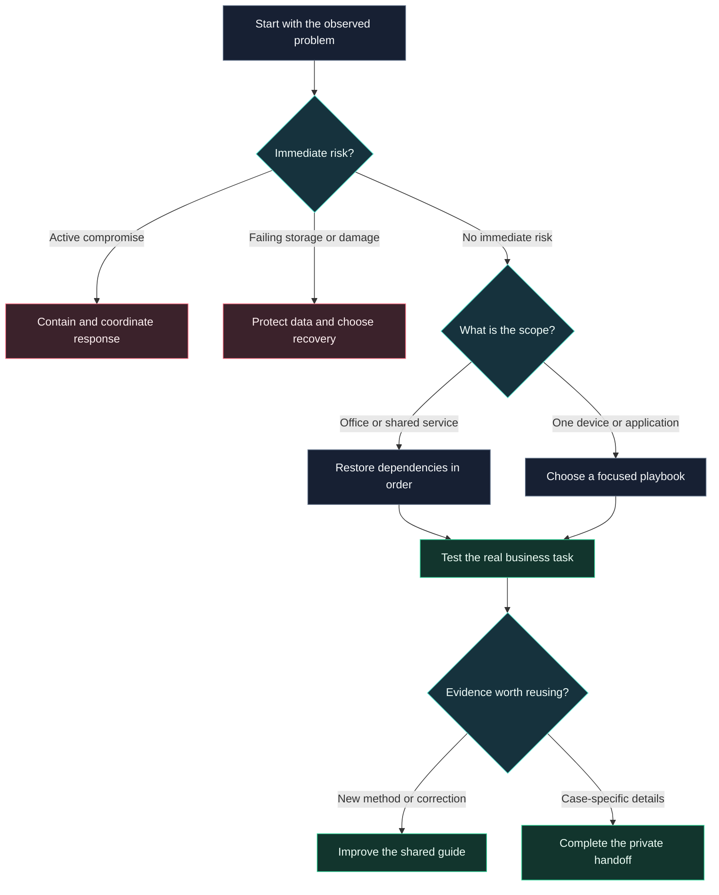

# 🧭 Your next good fix starts here.

The shared home for INTA Computer Services: a clear route through the job, the tools to do it, and the proof that it worked.

**[✨ Open the interactive technician hub](https://herbertofury.github.io/INTA/)** · [Find a playbook](Playbooks) · [Browse every tool](Tool-Directory) · [Contribute a better way](Contribute)

| Ready on the bench | Knowledge with a path | Built to keep improving |
| --- | --- | --- |
| **111 selected tools** across 10 disciplines | **22 complete job guides** with decision maps | [Standards](Knowledge-Standards), [templates](Templates), and [manual review](Continuous-Improvement) |

> [!TIP]
> **New case?** Start at the [decision desk](Decision-Desk). **Already know the job?** Open its [playbook](Playbooks). **Need a download?** Use the [tool directory](Tool-Directory).

## 🚦 First, choose the right route

| What you see | Open this route first |
| --- | --- |
| Encryption spreading, unusual privileged access, or several affected machines | [🚨 Contain a wider compromise](Job-ransomware-response) |
| Clicking storage, disappearing volumes, or data with no other copy | [💾 Protect and recover the source](Job-failing-drive) |
| The whole office or a shared service is down | [🔌 Restore office dependencies](Job-outage-recovery) |
| The cause is still unclear | [🧭 Scope and triage the problem](Job-intake-triage) |

## 🗂️ Find your work area

| Work area | Pick a playbook |
| --- | --- |
| **🧭 First response & handoff** | [Start here: triage any computer problem](https://github.com/Herbertofury/INTA/wiki/Job-intake-triage) · [Start and finish a clean remote-support session](https://github.com/Herbertofury/INTA/wiki/Job-remote-support) · [Close a repair with a clear client handoff](https://github.com/Herbertofury/INTA/wiki/Job-client-handoff) |
| **🛡️ Security & [incident response](https://github.com/Herbertofury/INTA/wiki/Job-ransomware-response)** | [Remove malware and browser hijackers](https://github.com/Herbertofury/INTA/wiki/Job-malware-removal) · [Contain ransomware or a wider compromise](https://github.com/Herbertofury/INTA/wiki/Job-ransomware-response) |
| **🪟 [Windows](https://www.microsoft.com/windows) & system stability** | [Diagnose a slow, freezing, or hitching PC](https://github.com/Herbertofury/INTA/wiki/Job-slow-pc) · [Repair Windows component or system-file corruption](https://github.com/Herbertofury/INTA/wiki/Job-windows-repair) · [Fix a failing Windows update](https://github.com/Herbertofury/INTA/wiki/Job-windows-update) · [Diagnose crashes, blue screens, and overheating](https://github.com/Herbertofury/INTA/wiki/Job-hardware-bsod) |
| **💾 Storage, backup & rescue** | [Recover a Windows PC that will not boot](https://github.com/Herbertofury/INTA/wiki/Job-boot-recovery) · [Rescue data from a failing or unreadable drive](https://github.com/Herbertofury/INTA/wiki/Job-failing-drive) · [Clone a healthy system or migrate to a new SSD](https://github.com/Herbertofury/INTA/wiki/Job-disk-migration) · [Prove a backup can actually restore](https://github.com/Herbertofury/INTA/wiki/Job-backup-restore) · [Build and refresh a technician rescue USB](https://github.com/Herbertofury/INTA/wiki/Job-boot-usb) |
| **🌐 Network & office continuity** | [Fix internet, DNS, or local-network problems](https://github.com/Herbertofury/INTA/wiki/Job-network-dns) · [Bring an office back after a power outage](https://github.com/Herbertofury/INTA/wiki/Job-outage-recovery) · [Repair a workstation’s domain trust relationship](https://github.com/Herbertofury/INTA/wiki/Job-ad-trust) |
| **🖨️ Everyday workplace fixes** | [Fix Outlook or email send/receive problems](https://github.com/Herbertofury/INTA/wiki/Job-outlook-email) · [Restore printing without breaking other queues](https://github.com/Herbertofury/INTA/wiki/Job-printer-repair) |
| **🧰 Deployment & maintenance** | [Set up a dependable new workstation](https://github.com/Herbertofury/INTA/wiki/Job-new-pc) · [Run a useful workstation maintenance visit](https://github.com/Herbertofury/INTA/wiki/Job-preventive-maintenance) |
| **✨ AI-assisted investigation** | [Use AI as a careful troubleshooting copilot](https://github.com/Herbertofury/INTA/wiki/Job-ai-triage) |

## 🧰 Put the right resource within reach

| Resource | What you can do here |
| --- | --- |
| [🧰 Tool directory](Tool-Directory) | Compare use cases, platforms, access, official downloads, and documentation. |
| [🧠 Method library](Methods) | Learn repeatable ways to isolate a cause, protect the source, and prove the result. |
| [🥾 Rescue media](Rescue-Media) | Choose and maintain the boot environment for the task. |
| [🤝 Intake and handoff](Technician-Handoff) | Start a clear private service record and leave the next technician a useful checkpoint. |
| [📏 Knowledge standards](Knowledge-Standards) | Follow the shared rules for clear instructions, evidence, links, and review. |
| [🛠️ Contribute](Contribute) | Submit a tested correction or a useful new guide with the [template](Templates). |

## 📐 The INTA working standard

| At the start | While you work | Before you close |
| --- | --- | --- |
| Establish scope and protect unique data. | Follow one evidence-led test and keep the result. | Repeat the real task and document the handoff. |
| Choose the appropriate recovery or incident route early. | Preserve a usable rollback and avoid repeating unchanged failures. | Turn a proven improvement into a reusable contribution. |

## 🎒 Take the whole bench guide offline

Download the [complete repository](https://github.com/Herbertofury/INTA/archive/refs/heads/main.zip) and open `site/index.html`. The hub keeps search, filters, saved tools, and checklists available without a connection. Official downloads and external reference pages need internet access. Keep customer records outside this public guide.

## 🌱 Improve it after the next real case

A changed download, a clearer branch, a newly proven tool, or a missing verification step is a useful contribution. [See the review loop](Continuous-Improvement), [use the template](Templates), and [check the publication workflow](Maintaining-the-Hub).

---

**Source review: 2026-11-26.** Guidance review and tool release versions are separate. [Report a correction](https://github.com/Herbertofury/INTA/issues/new/choose) · [How we maintain this guide](https://github.com/Herbertofury/INTA/wiki/Knowledge-Standards)
