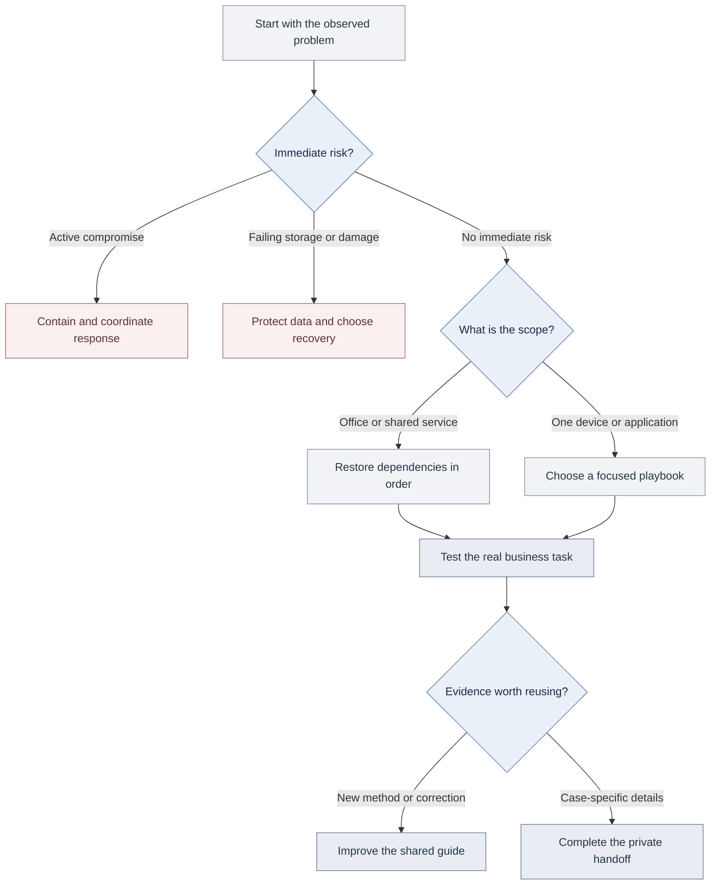

# INTA knowledge base

Service procedures, tool references and troubleshooting methods for the INTA team.

[Open technician hub](https://herbertofury.github.io/INTA/) · [Decision desk](Decision-Desk) · [Playbooks](Playbooks) · [Tool directory](Tool-Directory) · [Methods](Methods)

**113 tools · 22 playbooks · 10 tool categories**

## 🧭 Start a job

| Observed situation | First route |
| --- | --- |
| Encryption spreading, unusual privileged access, or several affected machines | [Contain a wider compromise](Job-ransomware-response) |
| Clicking storage, disappearing volumes, or data with no other copy | [Protect and recover the source](Job-failing-drive) |
| The whole office or a shared service is down | [Restore office dependencies](Job-outage-recovery) |
| The cause is still unclear | [Scope and triage the problem](Job-intake-triage) |

Decision map: from first observation to verified handoff

**Map routes:** [Containment](Job-ransomware-response) · [Data preservation](Job-failing-drive) · [Outage recovery](Job-outage-recovery) · [Triage](Job-intake-triage) · [Verification and handoff](Job-client-handoff) · [Contributions](Contribute)

## Playbooks by work area

| Work area | Playbooks |
| --- | --- |
| **First response & handoff** | [Start here: triage any computer problem](https://github.com/Herbertofury/INTA/wiki/Job-intake-triage) · [Start and finish a clean remote-support session](https://github.com/Herbertofury/INTA/wiki/Job-remote-support) · [Close a repair with a clear client handoff](https://github.com/Herbertofury/INTA/wiki/Job-client-handoff) |
| **Security & [incident response](https://github.com/Herbertofury/INTA/wiki/Job-ransomware-response)** | [Remove malware and browser hijackers](https://github.com/Herbertofury/INTA/wiki/Job-malware-removal) · [Contain ransomware or a wider compromise](https://github.com/Herbertofury/INTA/wiki/Job-ransomware-response) |
| **[Windows](https://www.microsoft.com/windows) & system stability** | [Diagnose a slow, freezing, or hitching PC](https://github.com/Herbertofury/INTA/wiki/Job-slow-pc) · [Repair Windows component or system-file corruption](https://github.com/Herbertofury/INTA/wiki/Job-windows-repair) · [Fix a failing Windows update](https://github.com/Herbertofury/INTA/wiki/Job-windows-update) · [Diagnose crashes, blue screens, and overheating](https://github.com/Herbertofury/INTA/wiki/Job-hardware-bsod) |
| **Storage, backup & rescue** | [Recover a Windows PC that will not boot](https://github.com/Herbertofury/INTA/wiki/Job-boot-recovery) · [Rescue data from a failing or unreadable drive](https://github.com/Herbertofury/INTA/wiki/Job-failing-drive) · [Clone a healthy system or migrate to a new SSD](https://github.com/Herbertofury/INTA/wiki/Job-disk-migration) · [Prove a backup can actually restore](https://github.com/Herbertofury/INTA/wiki/Job-backup-restore) · [Build and refresh a technician rescue USB](https://github.com/Herbertofury/INTA/wiki/Job-boot-usb) |
| **Network & office continuity** | [Fix internet, DNS, or local-network problems](https://github.com/Herbertofury/INTA/wiki/Job-network-dns) · [Bring an office back after a power outage](https://github.com/Herbertofury/INTA/wiki/Job-outage-recovery) · [Repair a workstation’s domain trust relationship](https://github.com/Herbertofury/INTA/wiki/Job-ad-trust) |
| **Everyday workplace fixes** | [Fix Outlook or email send/receive problems](https://github.com/Herbertofury/INTA/wiki/Job-outlook-email) · [Restore printing without breaking other queues](https://github.com/Herbertofury/INTA/wiki/Job-printer-repair) |
| **Deployment & maintenance** | [Set up a dependable new workstation](https://github.com/Herbertofury/INTA/wiki/Job-new-pc) · [Run a useful workstation maintenance visit](https://github.com/Herbertofury/INTA/wiki/Job-preventive-maintenance) |
| **AI-assisted investigation** | [Use AI as a careful troubleshooting copilot](https://github.com/Herbertofury/INTA/wiki/Job-ai-triage) |

## Reference

| Resource | Contents |
| --- | --- |
| [Tool directory](Tool-Directory) | Use cases, supported platforms, access, official downloads and documentation. |
| [Method library](Methods) | Reusable diagnostic methods, selection criteria and expected evidence. |
| [Rescue media](Rescue-Media) | Boot environments, media preparation and readiness checks. |
| [Intake and handoff](Technician-Handoff) | A private service record template and technician handoff criteria. |
| [Service evidence](Service-Evidence) | Before-and-after measurements, validation records and useful evidence limits. |
| [Tool selection](Tool-Selection) | Match a utility to the job, operating environment and commercial-use requirements. |
| [Knowledge standards](Knowledge-Standards) | Authoring rules for instructions, links, diagrams, evidence and review. |
| [Interface design](Interface-Design) | Visual standards for the hub, Wiki and documentation. |
| [Contribution guide](Contribute) | Review and publication workflow, with a [submission template](Templates). |

## Service checkpoints

| Before work | During work | Before closure |
| --- | --- | --- |
| Establish scope and protect unique data. | Record the result of each purposeful test. | Repeat the real task and document the handoff. |
| Choose recovery or [incident response](https://github.com/Herbertofury/INTA/wiki/Job-ransomware-response) early when indicated. | Preserve rollback and investigate unchanged failures. | Contribute a proven reusable improvement. |

## Offline access

Download the [complete repository](https://github.com/Herbertofury/INTA/archive/refs/heads/main.zip) and open `site/index.html`. Search, filters, saved tools and checklists remain available without a connection. Official downloads and external references require internet access. Keep customer records outside this public guide.

## Contributing

Submit a corrected download, improved diagnostic branch, evaluated tool or missing verification step through the [contribution guide](Contribute). Follow the [review process](Continuous-Improvement), [record the evidence](Templates), and [publish the matching outputs](Maintaining-the-Hub).

---

Editorial review: **2026-11-26** · [Review standard](https://github.com/Herbertofury/INTA/wiki/Knowledge-Standards) · [Suggest a correction](https://github.com/Herbertofury/INTA/issues/new/choose)
