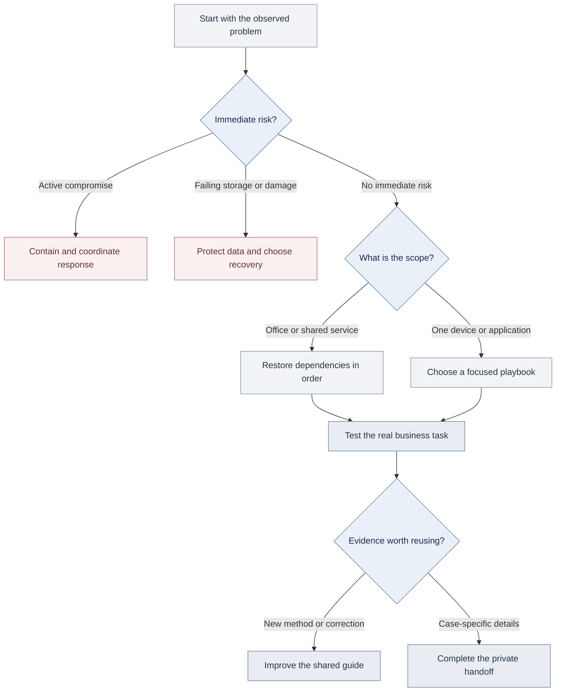

# INTA knowledge base

Service procedures, tool references and troubleshooting methods for the INTA team.

**[🧰 Open technician hub](https://herbertofury.github.io/INTA/)** · **[🗺️ Service map](Service-Map)** · [Decision desk](Decision-Desk) · [Playbooks](Playbooks) · [Tool directory](Tool-Directory) · [Methods](Methods)

**133 tools · 22 playbooks · 10 tool categories**

## ⚡ What do you need to fix?

**Choose your problem for the first three actions.** Tool names open the official page; download links identify the file and platform. Each role has its own visible choice. Built-in features link to their instructions.

| Fix this | Choose the right tool · official page + exact action |
| --- | --- |
| **[🛡️ Remove viruses](https://github.com/Herbertofury/INTA/wiki/Remove-viruses)** | **On-demand cleanup:** **[Malwarebytes](https://www.malwarebytes.com/)** · **[Download Windows installer · EXE](https://downloads.malwarebytes.com/file/mb-windows)** (Free personal-use scans; business servicing rights differ.) **Adware and hijackers:** **[Malwarebytes AdwCleaner](https://www.malwarebytes.com/adwcleaner)** · **[Download Windows portable cleaner · EXE](https://adwcleaner.malwarebytes.com/adwcleaner?channel=release)** (Free for qualifying repair firms with ≤10 total staff; other business use needs rights.) **Personal PC protection:** **[Bitdefender Antivirus Free](https://www.bitdefender.com/en-us/consumer/free-antivirus)** · **[Download Windows setup · EXE](https://download.bitdefender.com/windows/installer/en-us/bitdefender_avfree.exe)** (Personal/non-commercial only; account required.) **Portable second opinion:** **[Microsoft Safety Scanner](https://learn.microsoft.com/en-us/defender-endpoint/safety-scanner-download)** · **[Download Windows x64 scanner · EXE](https://go.microsoft.com/fwlink/?LinkId=212732)** (Free Microsoft scanner; download expires after 10 days.) **Scan outside [Windows](https://www.microsoft.com/windows):** **[Microsoft Defender Offline](https://learn.microsoft.com/en-us/defender-endpoint/microsoft-defender-offline)** · **[Run the built-in offline scan](https://learn.microsoft.com/en-us/defender-endpoint/microsoft-defender-offline)** (Included with supported [Windows](https://www.microsoft.com/windows)) |
| **[🖨️ Fix a printer](https://github.com/Herbertofury/INTA/wiki/Fix-a-printer)** | **Printer diagnostic:** **[Windows Get Help](https://support.microsoft.com/en-us/support/get-help/about-get-help)** · **[Start the printer troubleshooter](https://aka.ms/PrinterConnection)** (Included with supported [Windows](https://www.microsoft.com/windows)) **Exact-model driver:** **[Official OEM driver and firmware portals](https://support.microsoft.com/en-us/windows/hardware/drivers/update-drivers-through-device-manager-in-windows)** · **[Find the correct printer driver](https://support.microsoft.com/en-us/windows/hardware/printer/download-and-install-the-latest-printer-drivers)** (Vendor downloads; match model, architecture and policy.) **Find the printer IP:** **[Advanced IP Scanner](https://www.advanced-ip-scanner.com/)** · **[Download Windows scanner · EXE](https://download.advanced-ip-scanner.com/download/files/Advanced_IP_Scanner_2.5.4594.1.exe)** (Free [Windows](https://www.microsoft.com/windows) tool; scan only an approved subnet.) **Scanner and ADF test:** **[NAPS2](https://www.naps2.com/)** · **[Download Windows x64 portable · ZIP](https://github.com/cyanfish/naps2/releases/download/v8.6.1/naps2-8.6.1-win-x64.zip)** (Free and open source) |
| **[🌐 Fix internet](https://github.com/Herbertofury/INTA/wiki/Fix-internet)** | **Connection diagnostic:** **[Windows Get Help](https://support.microsoft.com/en-us/support/get-help/about-get-help)** · **[Open network troubleshooting](https://support.microsoft.com/en-us/windows/experience/connectivity-networking/fix-wi-fi-connection-issues-in-windows)** (Included with supported [Windows](https://www.microsoft.com/windows)) **DNS and port checks:** **[PowerShell](https://learn.microsoft.com/en-us/powershell/)** · **[Use Windows PowerShell 5.1](https://learn.microsoft.com/en-us/powershell/scripting/windows-powershell/starting-windows-powershell)** (Included with supported [Windows](https://www.microsoft.com/windows)) **HTTP and TLS check:** **[curl](https://curl.se/)** · **[Use the Windows-included curl.exe](https://curl.se/windows/microsoft.html)** (Included with supported [Windows](https://www.microsoft.com/windows)) |
| **[✉️ Fix email](https://github.com/Herbertofury/INTA/wiki/Fix-email)** | **Classic [Outlook](https://support.microsoft.com/outlook) diagnostic:** **[Windows Get Help](https://support.microsoft.com/en-us/support/get-help/about-get-help)** · **[Choose a classic Outlook diagnostic](https://support.microsoft.com/en-us/support/get-help/classic-outlook-troubleshooters)** (Included diagnostics; email service licensing is separate.) |
| **[💾 Recover a failing drive](https://github.com/Herbertofury/INTA/wiki/Recover-a-failing-drive)** | **Image the failing source:** **[SystemRescue](https://www.system-rescue.org/)** · **[Download x64 rescue image · ISO](https://fastly-cdn.system-rescue.org/releases/13.03/systemrescue-13.03-amd64.iso)** (Free and open source) **Inspect the working copy:** **[TestDisk](https://www.cgsecurity.org/wiki/TestDisk)** · **[Download Windows x64 tools · ZIP](https://www.cgsecurity.org/testdisk-7.2.win64.zip)** (Free and open source) **Recover file contents:** **[PhotoRec](https://www.cgsecurity.org/wiki/PhotoRec)** · **[Download PhotoRec / TestDisk · ZIP](https://www.cgsecurity.org/testdisk-7.2.win64.zip)** (Free and open source) |
| **[📁 Recover deleted files](https://github.com/Herbertofury/INTA/wiki/Recover-deleted-files)** | **Recover by file signature:** **[PhotoRec](https://www.cgsecurity.org/wiki/PhotoRec)** · **[Download PhotoRec / TestDisk · ZIP](https://www.cgsecurity.org/testdisk-7.2.win64.zip)** (Free and open source) **Undelete supported files:** **[TestDisk](https://www.cgsecurity.org/wiki/TestDisk)** · **[Download Windows x64 tools · ZIP](https://www.cgsecurity.org/testdisk-7.2.win64.zip)** (Free and open source) |
| **[🐢 Fix a slow PC](https://github.com/Herbertofury/INTA/wiki/Fix-a-slow-PC)** | **Find the busy process:** **[Process Explorer](https://learn.microsoft.com/en-us/sysinternals/downloads/process-explorer)** · **[Download Windows portable · ZIP](https://download.sysinternals.com/files/ProcessExplorer.zip)** (Free Microsoft utility) **Explain an I/O stall:** **[Process Monitor](https://learn.microsoft.com/en-us/sysinternals/downloads/procmon)** · **[Download Windows portable · ZIP](https://download.sysinternals.com/files/ProcessMonitor.zip)** (Free Microsoft utility) **Check storage warnings:** **[CrystalDiskInfo](https://crystalmark.info/en/software/crystaldiskinfo/)** · **[Get Windows ZIP · 9.9.5](https://sourceforge.net/projects/crystaldiskinfo/files/9.9.5/CrystalDiskInfo9_9_5.zip/download)** (Free and open source) **Complete diagnostic kit:** **[Microsoft Sysinternals Suite](https://learn.microsoft.com/en-us/sysinternals/)** · **[Download Windows portable · ZIP](https://download.sysinternals.com/files/SysinternalsSuite.zip)** (Free Microsoft utilities) |
| **[🖥️ Help remotely](https://github.com/Herbertofury/INTA/wiki/Help-remotely)** | **Attended [Windows](https://www.microsoft.com/windows) help:** **[Microsoft Quick Assist](https://learn.microsoft.com/en-us/windows/client-management/client-tools/quick-assist)** · **[Get Quick Assist in Microsoft Store](https://apps.microsoft.com/detail/9P7BP5VNWKX5)** (Included app; helper Microsoft account required.) **Cross-platform support:** **[RustDesk](https://rustdesk.com/)** · **[Download Windows x64 · EXE](https://github.com/rustdesk/rustdesk/releases/download/1.5.3/rustdesk-1.5.3-x86_64.exe)** (Open-source components; Pro and hosting costs vary.) **Existing managed fleet:** **[MeshCentral](https://meshcentral.com/)** · **[Open server installation instructions](https://github.com/Ylianst/MeshCentral#installation)** (Open source; hosting and operation are separate.) **[Linux](https://www.kernel.org/) remote client:** **[Remmina](https://remmina.org/)** · **[Install Linux package · Flatpak or distribution](https://www.remmina.org/how-to-install-remmina/)** (Free and open source) |
| **[🔄 Fix Windows updates](https://github.com/Herbertofury/INTA/wiki/Fix-Windows-updates)** | **Update diagnostic:** **[Windows Get Help](https://support.microsoft.com/en-us/support/get-help/about-get-help)** · **[Open Windows Update troubleshooting](https://support.microsoft.com/en-us/windows/experience/windows-update-troubleshooter)** (Included with supported [Windows](https://www.microsoft.com/windows)) **Explain an upgrade rollback:** **[SetupDiag](https://learn.microsoft.com/en-us/windows/deployment/upgrade/setupdiag)** · **[Download Windows upgrade analyzer · EXE](https://go.microsoft.com/fwlink/?linkid=870142)** (Free Microsoft diagnostic) **[Component-store repair](https://github.com/Herbertofury/INTA/wiki/Job-windows-repair):** **[DISM](https://learn.microsoft.com/en-us/windows-hardware/manufacture/desktop/repair-a-windows-image)** · **[Open built-in repair instructions](https://learn.microsoft.com/en-us/windows-hardware/manufacture/desktop/repair-a-windows-image)** (Included with supported [Windows](https://www.microsoft.com/windows)) **Same-version reinstall:** **[Windows Recovery Environment](https://learn.microsoft.com/en-us/windows-hardware/manufacture/desktop/windows-recovery-environment--windows-re--technical-reference)** · **[Reinstall current Windows via Windows Update](https://support.microsoft.com/en-us/windows/deployment/install-upgrade/fix-issues-by-reinstalling-the-current-version-of-windows)** (Included with supported [Windows](https://www.microsoft.com/windows)) |
| **[🧰 Repair Windows files](https://github.com/Herbertofury/INTA/wiki/Repair-Windows-files)** | **Repair component store:** **[DISM](https://learn.microsoft.com/en-us/windows-hardware/manufacture/desktop/repair-a-windows-image)** · **[Open built-in repair instructions](https://learn.microsoft.com/en-us/windows-hardware/manufacture/desktop/repair-a-windows-image)** (Included with supported [Windows](https://www.microsoft.com/windows)) **Verify protected files:** **[System File Checker](https://learn.microsoft.com/en-us/windows-server/administration/windows-commands/sfc)** · **[Open built-in system-file checks](https://learn.microsoft.com/en-us/windows-server/administration/windows-commands/sfc)** (Included with supported [Windows](https://www.microsoft.com/windows)) **Same-version reinstall:** **[Windows Recovery Environment](https://learn.microsoft.com/en-us/windows-hardware/manufacture/desktop/windows-recovery-environment--windows-re--technical-reference)** · **[Reinstall current Windows via Windows Update](https://support.microsoft.com/en-us/windows/deployment/install-upgrade/fix-issues-by-reinstalling-the-current-version-of-windows)** (Included with supported [Windows](https://www.microsoft.com/windows)) |
| **[🚀 Fix a PC that will not boot](https://github.com/Herbertofury/INTA/wiki/Fix-a-PC-that-will-not-boot)** | **[Startup recovery](https://github.com/Herbertofury/INTA/wiki/Job-boot-recovery):** **[Windows Recovery Environment](https://learn.microsoft.com/en-us/windows-hardware/manufacture/desktop/windows-recovery-environment--windows-re--technical-reference)** · **[Open recovery instructions](https://learn.microsoft.com/en-us/windows-hardware/manufacture/desktop/windows-recovery-environment--windows-re--technical-reference)** (Included with supported [Windows](https://www.microsoft.com/windows)) **Trusted repair media:** **[Windows 11 installation media](https://www.microsoft.com/software-download/windows11)** · **[Download media creation tool · EXE](https://go.microsoft.com/fwlink/?linkid=2156295)** (Media is free; [Windows](https://www.microsoft.com/windows) licensing remains separate.) **Preserve unstable storage:** **[SystemRescue](https://www.system-rescue.org/)** · **[Download x64 rescue image · ISO](https://fastly-cdn.system-rescue.org/releases/13.03/systemrescue-13.03-amd64.iso)** (Free and open source) **Eligible widespread failure:** **[Quick machine recovery](https://learn.microsoft.com/en-us/windows/configuration/quick-machine-recovery/?tabs=csp)** · **[Check supported recovery setup](https://learn.microsoft.com/en-us/windows/configuration/quick-machine-recovery/?tabs=csp)** (Included on eligible, configured [Windows](https://www.microsoft.com/windows) devices.) |
| **[🧩 Diagnose crashes](https://github.com/Herbertofury/INTA/wiki/Diagnose-crashes)** | **Analyze a crash dump:** **[WinDbg](https://learn.microsoft.com/en-us/windows-hardware/drivers/debugger/)** · **[Download Windows debugger · APPINSTALLER](https://aka.ms/windbg/download)** (Free Microsoft debugger) **Test memory stability:** **[Memtest86+](https://www.memtest.org/)** · **[Download x64 memory-test ISO · ZIP](https://www.memtest.org/download/v9.00/mt86plus_9.00_x86_64.iso.zip)** (Free and open source) **Observe temperatures:** **[Libre Hardware Monitor](https://github.com/LibreHardwareMonitor/LibreHardwareMonitor)** · **[Download Windows portable · ZIP](https://github.com/LibreHardwareMonitor/LibreHardwareMonitor/releases/download/v0.9.6/LibreHardwareMonitor.zip)** (Free and open source) |
| **[📊 Free disk space](https://github.com/Herbertofury/INTA/wiki/Free-disk-space)** | **Free capacity map:** **[WinDirStat](https://windirstat.net/)** · **[Download Windows x64 · MSI](https://github.com/windirstat/windirstat/releases/download/release/v2.9.3/WinDirStat-x64.msi)** (Free and open source) **Licensed capacity analysis:** **[WizTree](https://diskanalyzer.com/)** · **[Download Windows portable · ZIP](https://diskanalyzer.com/files/wiztree_4_34_portable.zip)** (Personal use is free; business use requires a license.) |
| **[🔁 Clone or move a drive](https://github.com/Herbertofury/INTA/wiki/Clone-or-move-a-drive)** | **Graphical image or clone:** **[Rescuezilla](https://rescuezilla.com/)** · **[Download x64 rescue image · ISO](https://github.com/rescuezilla/rescuezilla/releases/download/2.6.2/rescuezilla-2.6.2-64bit.resolute.iso)** (Free and open source) **Advanced image workflow:** **[Clonezilla](https://clonezilla.org/)** · **[Get x64 rescue image · ISO](https://downloads.sourceforge.net/clonezilla/clonezilla-live-3.3.5-3-amd64.iso)** (Free and open source) **Files-only migration:** **[Robocopy](https://learn.microsoft.com/en-us/windows-server/administration/windows-commands/robocopy)** · **[Open built-in copy instructions](https://learn.microsoft.com/en-us/windows-server/administration/windows-commands/robocopy)** (Included with supported [Windows](https://www.microsoft.com/windows)) |
| **[🗄️ Restore a file backup](https://github.com/Herbertofury/INTA/wiki/Restore-a-file-backup)** | **Restore a [restic](https://restic.net/) repository:** **[restic](https://restic.net/)** · **[Download Windows x64 · ZIP](https://github.com/restic/restic/releases/download/v0.20.0/restic_0.20.0_windows_amd64.zip)** (Free software; repository storage is separate.) **Restore a [Kopia](https://kopia.io/) snapshot:** **[Kopia](https://kopia.io/)** · **[Download Windows desktop · ZIP](https://github.com/kopia/kopia/releases/download/v0.23.1/KopiaUI-0.23.1-win.zip)** (Free software; repository storage is separate.) **Restore an agent backup:** **[Veeam Agent for Microsoft Windows](https://www.veeam.com/products/free/microsoft-windows)** · **[Sign in for the Windows download](https://www.veeam.com/products/physical/windows-backup-recovery-download.html)** (Free edition exists; service-provider terms differ.) |
| **[🔌 Make a boot USB](https://github.com/Herbertofury/INTA/wiki/Make-a-boot-USB)** | **Write one official ISO:** **[Rufus](https://rufus.ie/)** · **[Download Windows x64 portable · EXE](https://github.com/pbatard/rufus/releases/download/v4.16/rufus-4.16p.exe)** (Free and open source) **Maintain multiple ISOs:** **[Ventoy](https://www.ventoy.net/)** · **[Download Windows package · ZIP](https://github.com/ventoy/Ventoy/releases/download/v1.1.18/ventoy-1.1.18-windows.zip)** (Free and open source) **Official [Windows](https://www.microsoft.com/windows) media:** **[Windows 11 installation media](https://www.microsoft.com/software-download/windows11)** · **[Download media creation tool · EXE](https://go.microsoft.com/fwlink/?linkid=2156295)** (Media is free; [Windows](https://www.microsoft.com/windows) licensing remains separate.) **Ready recovery ISO:** **[SystemRescue](https://www.system-rescue.org/)** · **[Download x64 rescue image · ISO](https://fastly-cdn.system-rescue.org/releases/13.03/systemrescue-13.03-amd64.iso)** (Free and open source) |
| **[💻 Set up a new PC](https://github.com/Herbertofury/INTA/wiki/Set-up-a-new-PC)** | **Approved application setup:** **[WinGet](https://learn.microsoft.com/en-us/windows/package-manager/winget/)** · **[Download App Installer · MSIXBUNDLE](https://github.com/microsoft/winget-cli/releases/download/v1.29.380/Microsoft.DesktopAppInstaller_8wekyb3d8bbwe.msixbundle)** (Included App Installer; each app keeps its own license.) **Model-specific drivers:** **[Official OEM driver and firmware portals](https://support.microsoft.com/en-us/windows/hardware/drivers/update-drivers-through-device-manager-in-windows)** · **[Find the correct driver source](https://support.microsoft.com/en-us/windows/hardware/drivers/update-drivers-through-device-manager-in-windows)** (Vendor downloads; support terms vary.) **Move agreed user files:** **[Robocopy](https://learn.microsoft.com/en-us/windows-server/administration/windows-commands/robocopy)** · **[Open built-in copy instructions](https://learn.microsoft.com/en-us/windows-server/administration/windows-commands/robocopy)** (Included with supported [Windows](https://www.microsoft.com/windows)) |
| **[🛠️ Maintain a PC](https://github.com/Herbertofury/INTA/wiki/Maintain-a-PC)** | **Review app updates:** **[WinGet](https://learn.microsoft.com/en-us/windows/package-manager/winget/)** · **[Download App Installer · MSIXBUNDLE](https://github.com/microsoft/winget-cli/releases/download/v1.29.380/Microsoft.DesktopAppInstaller_8wekyb3d8bbwe.msixbundle)** (Included App Installer; each app keeps its own license.) **Review storage health:** **[CrystalDiskInfo](https://crystalmark.info/en/software/crystaldiskinfo/)** · **[Get Windows ZIP · 9.9.5](https://sourceforge.net/projects/crystaldiskinfo/files/9.9.5/CrystalDiskInfo9_9_5.zip/download)** (Free and open source) **Explain capacity use:** **[WinDirStat](https://windirstat.net/)** · **[Download Windows x64 · MSI](https://github.com/windirstat/windirstat/releases/download/release/v2.9.3/WinDirStat-x64.msi)** (Free and open source) |
| **[🧭 Start a repair](https://github.com/Herbertofury/INTA/wiki/Start-a-repair)** | No extra download needed · **[Open checklist](https://github.com/Herbertofury/INTA/wiki/Start-a-repair)** |
| **[🚨 Contain ransomware](https://github.com/Herbertofury/INTA/wiki/Contain-ransomware)** | No extra download needed · **[Open checklist](https://github.com/Herbertofury/INTA/wiki/Contain-ransomware)** |
| **[🏢 Recover an office outage](https://github.com/Herbertofury/INTA/wiki/Recover-an-office-outage)** | No extra download needed · **[Open checklist](https://github.com/Herbertofury/INTA/wiki/Recover-an-office-outage)** |
| **[🔐 Repair domain sign-in](https://github.com/Herbertofury/INTA/wiki/Repair-domain-sign-in)** | **Member secure-channel test:** **[PowerShell](https://learn.microsoft.com/en-us/powershell/)** · **[Use Windows PowerShell 5.1](https://learn.microsoft.com/en-us/powershell/scripting/windows-powershell/starting-windows-powershell)** (Included with supported [Windows](https://www.microsoft.com/windows)) |
| **[💡 Troubleshoot with AI](https://github.com/Herbertofury/INTA/wiki/Troubleshoot-with-AI)** | **Compare hypotheses:** **[ChatGPT](https://chatgpt.com/)** · **[Open ChatGPT](https://chatgpt.com/)** (Free tier available; account and organization limits apply.) **Review a scoped script:** **[OpenAI Codex CLI](https://github.com/openai/codex)** · **[Download Windows x64 CLI · EXE](https://github.com/openai/codex/releases/download/rust-v0.172.0/codex-x86_64-pc-windows-msvc.exe)** (Open-source client; account/API usage terms apply.) |
| **[✅ Finish the job and hand over](https://github.com/Herbertofury/INTA/wiki/Finish-the-job-and-hand-over)** | No extra download needed · **[Open checklist](https://github.com/Herbertofury/INTA/wiki/Finish-the-job-and-hand-over)** |
| **[🔎 Find a file](https://github.com/Herbertofury/INTA/wiki/Find-a-file)** | **Find a local filename:** **[Everything](https://www.voidtools.com/)** · **[Download Windows x64 EXE](https://www.voidtools.com/Everything-1.4.1.1032.x64-Setup.exe)** (Free desktop edition, including business use.) **Licensed file search:** **[WizFile](https://antibody-software.com/wizfile/)** · **[Download Windows portable · ZIP](https://antibody-software.com/files/wizfile_3_15_portable.zip)** (Personal use is free; business use requires a license.) |
| **[🌐 Inspect network traffic](https://github.com/Herbertofury/INTA/wiki/Inspect-network-traffic)** | **Protocol evidence:** **[Wireshark](https://www.wireshark.org/)** · **[Download Windows x64 · EXE](https://2.na.dl.wireshark.org/win64/Wireshark-4.6.10-x64.exe)** (Free; [Windows](https://www.microsoft.com/windows) capture-driver terms apply.) **HTTP/TLS comparison:** **[curl](https://curl.se/)** · **[Use the Windows-included curl.exe](https://curl.se/windows/microsoft.html)** (Included with supported [Windows](https://www.microsoft.com/windows)) **Path-loss comparison:** **[mtr](https://www.bitwizard.nl/mtr/)** · **[Install a Linux/WSL distribution package](https://github.com/traviscross/mtr#using-mtr-on-windows)** (Free and open source) |
| **[🧪 Test memory](https://github.com/Herbertofury/INTA/wiki/Test-memory)** | **Bootable memory test:** **[Memtest86+](https://www.memtest.org/)** · **[Download x64 memory-test ISO · ZIP](https://www.memtest.org/download/v9.00/mt86plus_9.00_x86_64.iso.zip)** (Free and open source) |

Selection review: **2026-11-26** · [Complete tool directory](https://github.com/Herbertofury/INTA/wiki/Tool-Directory) · [Why these tools](https://github.com/Herbertofury/INTA/wiki/Free-Tool-Picks) · [Current tool choices](https://github.com/Herbertofury/INTA/wiki/Current-Tool-Choices)

## 🧭 Start a job

| Scenario | Outcome |
| --- | --- |
| **[🦠 Remove viruses](Job-malware-removal)** | A measured cleanup workflow for a single [Windows](https://www.microsoft.com/windows) endpoint, with a separate path for a wider compromise. |
| **[🖨️ Fix a printer](Job-printer-repair)** | Isolate printer hardware, network reachability, queue state, driver, and application behavior. |
| **[🌐 Fix internet & DNS](Job-network-dns)** | Locate the failing layer before resetting adapters or changing the whole network. |
| **[📧 Fix email](Job-outlook-email)** | Separate service, authentication, mailbox, network, and local-client faults. |
| **[🐢 Fix a slow PC](Job-slow-pc)** | Find the actual bottleneck and prove the improvement with the same workload. |
| **[💾 Recover data](Job-failing-drive)** | Preserve the source, create a recoverable image, and perform recovery on a copy. |
| **[🖥️ Help remotely](Job-remote-support)** | Choose the right attended or managed tool and leave a clear, auditable handoff. |
| **[🚑 Fix boot failure](Job-boot-recovery)** | Separate firmware, storage, encryption, and [Windows](https://www.microsoft.com/windows) startup faults before changing the boot configuration. |
| **[🔄 Fix Windows updates](Job-windows-update)** | Diagnose the update code, servicing state, and available space before broad reset scripts. |
| **[🛠️ Repair Windows](Job-windows-repair)** | Use [Windows](https://www.microsoft.com/windows) servicing tools in a sensible order and validate the specific broken feature. |
| **[🌡️ Diagnose crashes / BSOD](Job-hardware-bsod)** | Correlate crash evidence with memory, storage, temperature, power, and driver changes. |
| **[🗄️ Test a backup restore](Job-backup-restore)** | Validate recovery credentials, data integrity, application usability, and recovery time. |
| **[🔌 Build a rescue USB](Job-boot-usb)** | Keep verified recovery images, [Windows repair](https://github.com/Herbertofury/INTA/wiki/Job-windows-repair) media, and the INTA knowledge hub ready for offline use. |
| **[💽 Clone or migrate a disk](Job-disk-migration)** | Move a working system with clear source/destination control and a rollback copy. |
| **[⚡ Recover from an outage](Job-outage-recovery)** | Restore dependencies in order and verify services before releasing the office back to work. |
| **[🚨 Contain ransomware](Job-ransomware-response)** | Stop spread, preserve useful evidence, and restore services through a clean recovery path. |
| **[🧹 Maintain a workstation](Job-preventive-maintenance)** | Check security, updates, hardware, backups, and usability without unnecessary cleanup rituals. |
| **[🆕 Set up a new PC](Job-new-pc)** | Build a usable, recoverable workstation around the employee’s actual job. |
| **[🧭 Triage a new issue](Job-intake-triage)** | Turn a vague symptom into a clear next action, a protected data set, and a useful service record. |
| **[🔑 Repair domain trust](Job-ad-trust)** | Check connectivity, time, and computer identity before repairing a member computer’s secure channel. |
| **[🧠 Troubleshoot with AI](Job-ai-triage)** | Use AI to organize evidence, compare hypotheses, and explain findings while the technician controls execution. |
| **[📋 Complete the handoff](Job-client-handoff)** | Turn completed technical work into proof the customer can use, with clean access and an actionable service record. |

## Before you begin

| Observed situation | First route |
| --- | --- |
| Encryption spreading, unusual privileged access, or several affected machines | [Contain a wider compromise](Job-ransomware-response) |
| Clicking storage, disappearing volumes, or data with no other copy | [Protect and recover the source](Job-failing-drive) |
| The whole office or a shared service is down | [Restore office dependencies](Job-outage-recovery) |
| The cause is still unclear | [Scope and triage the problem](Job-intake-triage) |

Decision map: from first observation to verified handoff

**Map routes:** [Containment](Job-ransomware-response) · [Data preservation](Job-failing-drive) · [Outage recovery](Job-outage-recovery) · [Triage](Job-intake-triage) · [Verification and handoff](Job-client-handoff) · [Contributions](Contribute)

## Reference

| Resource | Contents |
| --- | --- |
| [Tool directory](Tool-Directory) | Use cases, supported platforms, access, official downloads and documentation. |
| [Method library](Methods) | Reusable diagnostic methods, selection criteria and expected evidence. |
| [Rescue media](Rescue-Media) | Boot environments, media preparation and readiness checks. |
| [Intake and handoff](Technician-Handoff) | A private service record template and technician handoff criteria. |
| [Service evidence](Service-Evidence) | Before-and-after measurements, validation records and useful evidence limits. |
| [Tool selection](Tool-Selection) | Match a utility to the job, operating environment and commercial-use requirements. |
| [Free Tool Picks](Free-Tool-Picks) | Business-use terms, practical limits and source evidence for the quick-start selections. |
| [Knowledge standards](Knowledge-Standards) | Authoring rules for instructions, links, diagrams, evidence and review. |
| [Interface design](Interface-Design) | Visual standards for the hub, Wiki and documentation. |
| [Contribution guide](Contribute) | Review and publication workflow, with a [submission template](Templates). |

## Service checkpoints

| Before work | During work | Before closure |
| --- | --- | --- |
| Establish scope and protect unique data. | Record the result of each purposeful test. | Repeat the real task and document the handoff. |
| Choose recovery or [incident response](https://github.com/Herbertofury/INTA/wiki/Job-ransomware-response) early when indicated. | Preserve rollback and investigate unchanged failures. | Contribute a proven reusable improvement. |

## Offline access

Download the [complete repository](https://github.com/Herbertofury/INTA/archive/refs/heads/main.zip) and open `site/index.html`. Search, filters, saved tools and checklists remain available without a connection. Official downloads and external references require internet access. Keep customer records outside this public guide.

## Contributing

Submit a corrected download, improved diagnostic branch, evaluated tool or missing verification step through the [contribution guide](Contribute). Follow the [review process](Continuous-Improvement), [record the evidence](Templates), and [publish the matching outputs](Maintaining-the-Hub).

---

Editorial review: **2026-11-26** · [Review standard](https://github.com/Herbertofury/INTA/wiki/Knowledge-Standards) · [Suggest a correction](https://github.com/Herbertofury/INTA/issues/new/choose)
