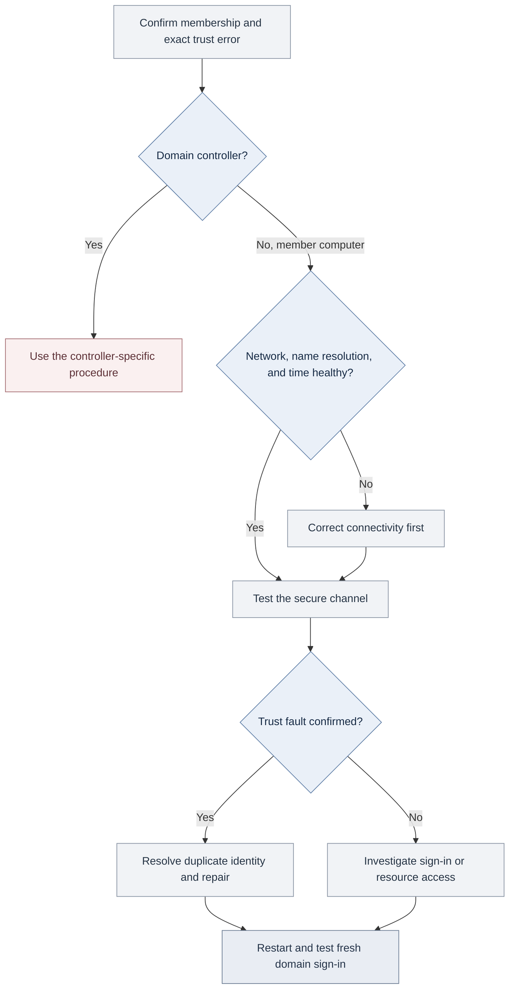

<a href="https://herbertofury.github.io/INTA/" title="Open INTA official download or service page" aria-label="Open INTA official download or service page" data-inta-brand="app-inta"></a> [INTA](https://github.com/Herbertofury/INTA/wiki) / [Decision desk](https://github.com/Herbertofury/INTA/wiki/Decision-Desk) · [Service map](https://github.com/Herbertofury/INTA/wiki/Service-Map) · [Playbooks](https://github.com/Herbertofury/INTA/wiki/Playbooks) · [Tools](https://github.com/Herbertofury/INTA/wiki/Tool-Directory) · [Methods](https://github.com/Herbertofury/INTA/wiki/Methods) · [Open hub](https://herbertofury.github.io/INTA/)

<a id="-repair-a-workstations-domain-trust-relationship"></a>

# [Repair a workstation’s domain trust relationship](https://github.com/Herbertofury/INTA/wiki/Job-ad-trust)

Check connectivity, time, and computer identity before repairing a member computer’s secure channel.

**Identity & business systems** · Advanced · 20–60 min · 6 steps

[Tools and useful links](#working-kit) · [Quick answer](#quick-answer) · [Next action](#next-action) · [Specific fixes](#specific-fixes) · [Decision route](#decision-route) · [Tools](#toolkit) · [Procedure](#walkthrough) · [Verification](#acceptance) · [Sources](#sources) · [Interactive checklist](https://herbertofury.github.io/INTA/#job/ad-trust)

<a id="tool-choices"></a>

## 🧰 Choose the tool for this job

Choose by the task shown in the first column. Each option includes its acquisition route and access boundary.

| Need | Official tool + exact action | Why this choice / access |
| --- | --- | --- |
| **Member secure-channel test** | **<a href="https://github.com/PowerShell/PowerShell/releases/latest" title="Open PowerShell official download or service page" aria-label="Open PowerShell official download or service page" data-inta-brand="powershell"></a> [PowerShell](https://learn.microsoft.com/en-us/powershell/)** · **<a href="https://learn.microsoft.com/en-us/powershell/scripting/windows-powershell/starting-windows-powershell" title="Open Windows PowerShell 5.1 official download or service page" aria-label="Open Windows PowerShell 5.1 official download or service page" data-inta-brand="app-windows-powershell-51"></a> [Use Windows PowerShell 5.1](https://learn.microsoft.com/en-us/powershell/scripting/windows-powershell/starting-windows-powershell)** | Use existing <a href="https://learn.microsoft.com/en-us/powershell/scripting/windows-powershell/starting-windows-powershell" title="Open Windows PowerShell 5.1 official download or service page" aria-label="Open Windows PowerShell 5.1 official download or service page" data-inta-brand="app-windows-powershell-51"></a> [Windows PowerShell 5.1](https://learn.microsoft.com/en-us/powershell/scripting/windows-powershell/starting-windows-powershell) on the domain member after DNS, time and connectivity checks. **Access:** Included with supported [Windows](https://www.microsoft.com/windows) |

**[Current selection evidence](https://github.com/Herbertofury/INTA/wiki/Current-Tool-Choices)**

<a id="working-kit"></a>

## 🧰 Tools and links for this job

**[Open working view](https://herbertofury.github.io/INTA/#job/ad-trust)** · Keep the tool panel beside the instructions.

**First move:** Use the affected member PC. Check its domain DNS, time and domain-controller reachability before considering a trust repair.

| Use this for | Official tool + exact action |
| --- | --- |
| Use existing <a href="https://learn.microsoft.com/en-us/powershell/scripting/windows-powershell/starting-windows-powershell" title="Open Windows PowerShell 5.1 official download or service page" aria-label="Open Windows PowerShell 5.1 official download or service page" data-inta-brand="app-windows-powershell-51"></a> [Windows PowerShell 5.1](https://learn.microsoft.com/en-us/powershell/scripting/windows-powershell/starting-windows-powershell) on the member PC. | **<a href="https://github.com/PowerShell/PowerShell/releases/latest" title="Open PowerShell official download or service page" aria-label="Open PowerShell official download or service page" data-inta-brand="powershell"></a> [PowerShell](https://learn.microsoft.com/en-us/powershell/)** · <a href="https://github.com/PowerShell/PowerShell/releases/latest" title="Open PowerShell official download or service page" aria-label="Open PowerShell official download or service page" data-inta-brand="powershell"></a> [Official page](https://learn.microsoft.com/en-us/powershell/) · **<a href="https://learn.microsoft.com/en-us/powershell/scripting/windows-powershell/starting-windows-powershell" title="Open Windows PowerShell 5.1 official download or service page" aria-label="Open Windows PowerShell 5.1 official download or service page" data-inta-brand="app-windows-powershell-51"></a> [Use Windows PowerShell 5.1](https://learn.microsoft.com/en-us/powershell/scripting/windows-powershell/starting-windows-powershell)** |
| Establishing recoverable, per-device administrator access during managed workstation setup and support planning. | **<a href="https://learn.microsoft.com/en-us/windows-server/identity/laps/laps-overview" title="Open Windows LAPS official download or service page" aria-label="Open Windows LAPS official download or service page" data-inta-brand="windows-laps"></a> [Windows LAPS](https://learn.microsoft.com/en-us/windows-server/identity/laps/laps-overview)** · <a href="https://learn.microsoft.com/en-us/windows-server/identity/laps/laps-overview" title="Open Windows LAPS official download or service page" aria-label="Open Windows LAPS official download or service page" data-inta-brand="windows-laps"></a> [Official page](https://learn.microsoft.com/en-us/windows-server/identity/laps/laps-overview) · **<a href="https://learn.microsoft.com/en-us/windows-server/identity/ad-ds/get-started/virtual-dc/active-directory-domain-services-overview" title="Open Active Directory official download or service page" aria-label="Open Active Directory official download or service page" data-inta-brand="app-active-directory"></a> [Configure Active Directory backup](https://learn.microsoft.com/en-us/windows-server/identity/laps/laps-scenarios-windows-server-active-directory)** |

### Diagnostic and repair

| Open the exact resource | What to do there |
| --- | --- |
| **<a href="https://github.com/PowerShell/PowerShell/releases/latest" title="Open PowerShell official download or service page" aria-label="Open PowerShell official download or service page" data-inta-brand="powershell"></a> [Test-ComputerSecureChannel](https://learn.microsoft.com/en-us/powershell/module/microsoft.powershell.management/test-computersecurechannel?view=powershell-5.1)** | Read-only test first; repair only a confirmed member-computer fault. |
| **<a href="https://www.microsoft.com/" title="Open microsoft.com official download or service page" aria-label="Open microsoft.com official download or service page" data-inta-brand="site-www-microsoft-com"></a> [Microsoft trust-relationship troubleshooting](https://learn.microsoft.com/en-us/troubleshoot/windows-server/windows-security/broken-trust-relationship-domain-joined-device-its-domain-secure-channel-issues)** | Check connectivity, identity and the cause before rejoining. |

### Read-only diagnostics

| Open the exact resource | What to do there |
| --- | --- |
| **<a href="https://github.com/PowerShell/PowerShell/releases/latest" title="Open PowerShell official download or service page" aria-label="Open PowerShell official download or service page" data-inta-brand="powershell"></a> [Read the member PC network configuration](https://learn.microsoft.com/en-us/powershell/module/nettcpip/get-netipconfiguration)** | Confirm the intended domain DNS path. |

<a id="quick-answer"></a>

## ⚡ Quick answer

<a id="quick-repair-domain-trust"></a>

### 🔐 Repair domain sign-in

**On the affected domain-member PC, check the domain DNS, time and domain-controller reachability first.**

1. Use existing <a href="https://learn.microsoft.com/en-us/powershell/scripting/windows-powershell/starting-windows-powershell" title="Open Windows PowerShell 5.1 official download or service page" aria-label="Open Windows PowerShell 5.1 official download or service page" data-inta-brand="app-windows-powershell-51"></a> [Windows PowerShell 5.1](https://learn.microsoft.com/en-us/powershell/scripting/windows-powershell/starting-windows-powershell) to run the guide’s diagnostic secure-channel check on the member PC.
2. Repair only a confirmed trust fault using an authorized account and the scoped procedure.
3. Verify domain sign-in, a required shared resource and the secure-channel result.

**<a href="https://github.com/PowerShell/PowerShell/releases/latest" title="Open PowerShell official download or service page" aria-label="Open PowerShell official download or service page" data-inta-brand="powershell"></a> [PowerShell](https://learn.microsoft.com/en-us/powershell/)** · <a href="https://github.com/PowerShell/PowerShell/releases/latest" title="Open PowerShell official download or service page" aria-label="Open PowerShell official download or service page" data-inta-brand="powershell"></a> [Official page](https://learn.microsoft.com/en-us/powershell/) · **<a href="https://learn.microsoft.com/en-us/powershell/scripting/windows-powershell/starting-windows-powershell" title="Open Windows PowerShell 5.1 official download or service page" aria-label="Open Windows PowerShell 5.1 official download or service page" data-inta-brand="app-windows-powershell-51"></a> [Use Windows PowerShell 5.1](https://learn.microsoft.com/en-us/powershell/scripting/windows-powershell/starting-windows-powershell)**

<a id="next-action"></a>

## 🧭 Match the symptom

| You see this | Do this next | You should get |
| --- | --- | --- |
| **Domain names or controllers cannot be reached** | Correct the approved network/VPN, DNS or time issue before touching the computer account. | The member can resolve and reach its expected domain services. |
| **Connectivity is correct but the trust error remains** | Open <a href="https://learn.microsoft.com/en-us/powershell/scripting/windows-powershell/starting-windows-powershell" title="Open Windows PowerShell 5.1 official download or service page" aria-label="Open Windows PowerShell 5.1 official download or service page" data-inta-brand="app-windows-powershell-51"></a> [Windows PowerShell 5.1](https://learn.microsoft.com/en-us/powershell/scripting/windows-powershell/starting-windows-powershell) as administrator on the member PC and run Test-ComputerSecureChannel -Verbose. | True confirms that this channel works; False supplies evidence for the scoped repair branch. |
| **A member secure-channel fault is confirmed** | With approved repair rights and local recovery access, run Test-ComputerSecureChannel -Repair -Credential (Get-Credential) -Verbose in that elevated member-PC session; enter delegated credentials only in the prompt. | The diagnostic returns True after repair. |
| **The device is a domain controller or many devices fail** | Use the domain-administration incident route instead of this member-only cmdlet. | The correct infrastructure owner investigates the wider fault. |

### ✅ Finish the job

- [ ] The member secure-channel test succeeds.
- [ ] A normal domain sign-in and required shared resource work.

**Change route when:** The target is a domain controller or the issue affects the wider domain. · Repair authority, local recovery access or the device identity is uncertain.

### 🎯 Go straight to a specific fix

- **[Fix domain discovery before changing trust](#fix-trust-domain-dns-before-account-repair)** — The member PC reports a trust/sign-in fault while internal domain names also fail.
- **[Restore the domain time path](#fix-trust-clock-skew-blocks-authentication)** — Domain authentication fails and the member clock differs materially from the domain’s reference.
- **[Check computer identity after restoring an old image](#fix-trust-error-after-old-image-restore)** — Trust broke after cloning, renaming or restoring a domain-joined workstation.

> [!NOTE]
> **Start here.** Use this guide for an <a href="https://learn.microsoft.com/en-us/windows-server/identity/ad-ds/get-started/virtual-dc/active-directory-domain-services-overview" title="Open Active Directory official download or service page" aria-label="Open Active Directory official download or service page" data-inta-brand="app-active-directory"></a> [Active Directory](https://learn.microsoft.com/en-us/windows-server/identity/ad-ds/get-started/virtual-dc/active-directory-domain-services-overview) member workstation or member server. Domain-controller trust repair needs its own procedure.

<a id="decision-route"></a>

<a id="-choose-the-right-branch"></a>

## 🧭 Choose a route



**Route links:** [Continue this workflow](#walkthrough) · [Acceptance checks](#acceptance) · [Fix internet, DNS, or local-network problems](https://github.com/Herbertofury/INTA/wiki/Job-network-dns) · [Set up a dependable new workstation](https://github.com/Herbertofury/INTA/wiki/Job-new-pc) · [Bring an office back after a power outage](https://github.com/Herbertofury/INTA/wiki/Job-outage-recovery)

| Checkpoint | What to carry forward |
| --- | --- |
| **Before changing anything** | Confirm a member computer, local fallback, and its unique identity. |
| **Keep during the job** | Connectivity, time, channel result, directory object, and repair evidence. |
| **Before handing back** | Fresh domain sign-in, policy, shares, and printers pass. |

<a id="toolkit"></a>

<a id="-build-the-right-toolkit"></a>

## Recommended tools

Select a tool for the next diagnostic or repair step. Check its platform, access and licensing requirements before use.

| Tool / official page + download | Use it for | Platform & access | Documentation |
| --- | --- | --- | --- |
| **<a href="https://github.com/PowerShell/PowerShell/releases/latest" title="Open PowerShell official download or service page" aria-label="Open PowerShell official download or service page" data-inta-brand="powershell"></a> [PowerShell](https://learn.microsoft.com/en-us/powershell/)** · <a href="https://github.com/PowerShell/PowerShell/releases/latest" title="Open PowerShell official download or service page" aria-label="Open PowerShell official download or service page" data-inta-brand="powershell"></a> [Official page](https://learn.microsoft.com/en-us/powershell/) · **<a href="https://learn.microsoft.com/en-us/powershell/scripting/windows-powershell/starting-windows-powershell" title="Open Windows PowerShell 5.1 official download or service page" aria-label="Open Windows PowerShell 5.1 official download or service page" data-inta-brand="app-windows-powershell-51"></a> [Use Windows PowerShell 5.1](https://learn.microsoft.com/en-us/powershell/scripting/windows-powershell/starting-windows-powershell)** | Use existing <a href="https://learn.microsoft.com/en-us/powershell/scripting/windows-powershell/starting-windows-powershell" title="Open Windows PowerShell 5.1 official download or service page" aria-label="Open Windows PowerShell 5.1 official download or service page" data-inta-brand="app-windows-powershell-51"></a> [Windows PowerShell 5.1](https://learn.microsoft.com/en-us/powershell/scripting/windows-powershell/starting-windows-powershell) on the member PC. | [Windows](https://www.microsoft.com/windows), <a href="https://www.kernel.org/" title="Open Linux official download or service page" aria-label="Open Linux official download or service page" data-inta-brand="app-linux"></a> [Linux](https://www.kernel.org/), <a href="https://support.apple.com/macos" title="Open macOS official download or service page" aria-label="Open macOS official download or service page" data-inta-brand="app-macos"></a> [macOS](https://support.apple.com/macos); Free / open source | <a href="https://github.com/PowerShell/PowerShell/releases/latest" title="Open PowerShell official download or service page" aria-label="Open PowerShell official download or service page" data-inta-brand="powershell"></a> [Open guide](https://learn.microsoft.com/en-us/powershell/) |
| **<a href="https://learn.microsoft.com/en-us/sysinternals/downloads/sysinternals-suite" title="Open Microsoft Sysinternals Suite official download or service page" aria-label="Open Microsoft Sysinternals Suite official download or service page" data-inta-brand="sysinternals"></a> [Microsoft Sysinternals Suite](https://learn.microsoft.com/en-us/sysinternals/)** · <a href="https://learn.microsoft.com/en-us/sysinternals/downloads/sysinternals-suite" title="Open Microsoft Sysinternals Suite official download or service page" aria-label="Open Microsoft Sysinternals Suite official download or service page" data-inta-brand="sysinternals"></a> [Official page](https://learn.microsoft.com/en-us/sysinternals/) · **[Download Windows portable · ZIP](https://download.sysinternals.com/files/SysinternalsSuite.zip)** | The core portable [Windows](https://www.microsoft.com/windows) troubleshooting kit. | [Windows](https://www.microsoft.com/windows); Free <a href="https://www.microsoft.com/" title="Open microsoft.com official download or service page" aria-label="Open microsoft.com official download or service page" data-inta-brand="site-www-microsoft-com"></a> [Microsoft](https://www.microsoft.com/) utilities | <a href="https://learn.microsoft.com/en-us/sysinternals/downloads/sysinternals-suite" title="Open Microsoft Sysinternals Suite official download or service page" aria-label="Open Microsoft Sysinternals Suite official download or service page" data-inta-brand="sysinternals"></a> [Open guide](https://learn.microsoft.com/en-us/sysinternals/downloads/) |
| **<a href="https://learn.microsoft.com/en-us/windows-server/identity/laps/laps-overview" title="Open Windows LAPS official download or service page" aria-label="Open Windows LAPS official download or service page" data-inta-brand="windows-laps"></a> [Windows LAPS](https://learn.microsoft.com/en-us/windows-server/identity/laps/laps-overview)** · <a href="https://learn.microsoft.com/en-us/windows-server/identity/laps/laps-overview" title="Open Windows LAPS official download or service page" aria-label="Open Windows LAPS official download or service page" data-inta-brand="windows-laps"></a> [Official page](https://learn.microsoft.com/en-us/windows-server/identity/laps/laps-overview) · **<a href="https://learn.microsoft.com/en-us/windows-server/identity/ad-ds/get-started/virtual-dc/active-directory-domain-services-overview" title="Open Active Directory official download or service page" aria-label="Open Active Directory official download or service page" data-inta-brand="app-active-directory"></a> [Configure Active Directory backup](https://learn.microsoft.com/en-us/windows-server/identity/laps/laps-scenarios-windows-server-active-directory)** | Establishing recoverable, per-device administrator access during managed workstation setup and support planning. | [Windows](https://www.microsoft.com/windows), [Windows Server](https://learn.microsoft.com/en-us/windows-server/); Included with supported [Windows](https://www.microsoft.com/windows); directory prerequisites, licensing and retrieval permissions still apply | <a href="https://learn.microsoft.com/en-us/windows-server/identity/laps/laps-overview" title="Open Windows LAPS official download or service page" aria-label="Open Windows LAPS official download or service page" data-inta-brand="windows-laps"></a> [Open guide](https://learn.microsoft.com/en-us/windows-server/identity/laps/laps-overview) |

<a id="walkthrough"></a>

<a id="-work-the-case"></a>

## Procedure

Work in order, record the result of each step, and change route when the evidence calls for it.

<a id="step-01"></a>

### 01 · Confirm the exact failure

- [ ] Record the trust error, hostname, domain membership, recent rename/reimage/restore, and whether another device has reused the same computer account. Use a known local administrator or approved recovery access rather than repeatedly trying cached domain credentials.

<a id="step-02"></a>

### 02 · Verify the domain path

- [ ] Confirm the device uses the intended internal DNS, can reach its domain controllers, and has correct time. Check VPN requirements for offsite devices. If connectivity is broken, fix that first; a channel test cannot establish trust across a missing network path.

<a id="step-03"></a>

### 03 · Test without repairing

- [ ] Open [Windows](https://www.microsoft.com/windows) <a href="https://github.com/PowerShell/PowerShell/releases/latest" title="Open PowerShell official download or service page" aria-label="Open PowerShell official download or service page" data-inta-brand="powershell"></a> [PowerShell](https://learn.microsoft.com/en-us/powershell/) as administrator on the member computer and run the diagnostic command. Record the result and relevant NETLOGON events. Do not apply this cmdlet to a domain controller, where the result can be misleading.

**<a href="https://github.com/PowerShell/PowerShell/releases/latest" title="Open PowerShell official download or service page" aria-label="Open PowerShell official download or service page" data-inta-brand="powershell"></a> [PowerShell](https://learn.microsoft.com/en-us/powershell/) (Run as Administrator) · Test the computer's secure channel to its domain before attempting a trust repair.:**

```text
Test-ComputerSecureChannel -Verbose
```

> **Before running:** Diagnostic only. Do not run the -Repair variant until domain connectivity, a suitable domain controller, time synchronization and authorized domain credentials are confirmed.

**Official command reference:** <a href="https://www.microsoft.com/" title="Open microsoft.com official download or service page" aria-label="Open microsoft.com official download or service page" data-inta-brand="site-www-microsoft-com"></a> [Microsoft Test-ComputerSecureChannel documentation](https://learn.microsoft.com/en-us/powershell/module/microsoft.powershell.management/test-computersecurechannel)

**Command legend:** <a href="https://www.microsoft.com/" title="Open microsoft.com official download or service page" aria-label="Open microsoft.com official download or service page" data-inta-brand="site-www-microsoft-com"></a> [Microsoft Test-ComputerSecureChannel documentation](https://learn.microsoft.com/en-us/powershell/module/microsoft.powershell.management/test-computersecurechannel) · <a href="https://github.com/PowerShell/PowerShell/releases/latest" title="Open PowerShell official download or service page" aria-label="Open PowerShell official download or service page" data-inta-brand="powershell"></a> [PowerShell](https://learn.microsoft.com/en-us/powershell/) · [Return to the step context](#step-03).

<a id="step-04"></a>

### 04 · Resolve conflicting computer identity

- [ ] Have the directory administrator inspect the computer object and recent changes. Give each active machine its own correct computer identity. Do not let two physical computers alternate using one cloned domain computer account, and do not delete the object until its dependencies are understood.

<a id="step-05"></a>

### 05 · Repair the confirmed secure-channel fault

- [ ] If the network is healthy and the correct computer object is established, the directory administrator can use the documented Test-ComputerSecureChannel repair flow with credentials that have the required rights. Keep credentials in the interactive prompt and plan the restart with the user.

**<a href="https://github.com/PowerShell/PowerShell/releases/latest" title="Open PowerShell official download or service page" aria-label="Open PowerShell official download or service page" data-inta-brand="powershell"></a> [PowerShell](https://learn.microsoft.com/en-us/powershell/) (Run as Administrator) · Repair a confirmed broken workstation secure channel after the read-only test fails and the correct domain controller path is available.:**

```text
Test-ComputerSecureChannel -Repair -Credential (Get-Credential) -Verbose
```

> **Before running:** State-changing domain operation. Use only with authorized domain credentials after verifying DNS, connectivity, time synchronization, domain controller reachability and the correct computer identity. Do not run on a domain controller or as a generic sign-in fix; verify the channel again afterward.

**Official command reference:** <a href="https://www.microsoft.com/" title="Open microsoft.com official download or service page" aria-label="Open microsoft.com official download or service page" data-inta-brand="site-www-microsoft-com"></a> [Microsoft Test-ComputerSecureChannel documentation](https://learn.microsoft.com/en-us/powershell/module/microsoft.powershell.management/test-computersecurechannel)

**Command legend:** <a href="https://www.microsoft.com/" title="Open microsoft.com official download or service page" aria-label="Open microsoft.com official download or service page" data-inta-brand="site-www-microsoft-com"></a> [Microsoft Test-ComputerSecureChannel documentation](https://learn.microsoft.com/en-us/powershell/module/microsoft.powershell.management/test-computersecurechannel) · <a href="https://github.com/PowerShell/PowerShell/releases/latest" title="Open PowerShell official download or service page" aria-label="Open PowerShell official download or service page" data-inta-brand="powershell"></a> [PowerShell](https://learn.microsoft.com/en-us/powershell/) · [Return to the step context](#step-05).

<a id="step-06"></a>

### 06 · Validate from a fresh sign-in

- [ ] After the approved repair and restart, repeat the secure-channel test and perform a real domain sign-in. Check group policy, shares, printers, and business apps. If rejoin is needed, plan profile and local-access continuity before leaving the domain.

<a id="acceptance"></a>

<a id="-prove-the-result"></a>

## Verification

- [ ] The member computer’s secure-channel test succeeds.
- [ ] Fresh domain sign-in and required network resources work.
- [ ] No duplicate active computer identity remains.

> [!WARNING]
> **Pause this route and escalate when:**
> - The target is a domain controller.
> - DNS/time/connectivity is still broken or the computer account is ambiguous.
> - Local recovery access is not available before a membership change.

<a id="specific-fixes"></a>

## 🎯 Specific fixes

Choose the case that matches the evidence. Each case gives a first action, a short procedure and a result to prove.

<a id="fix-trust-domain-dns-before-account-repair"></a>

### Fix domain discovery before changing trust

**Use when:** The member PC reports a trust/sign-in fault while internal domain names also fail.

**Start here:** Read the member’s active IP and DNS configuration on the intended network or VPN.

**<a href="https://github.com/PowerShell/PowerShell/releases/latest" title="Open PowerShell official download or service page" aria-label="Open PowerShell official download or service page" data-inta-brand="powershell"></a> [PowerShell](https://learn.microsoft.com/en-us/powershell/)** · <a href="https://github.com/PowerShell/PowerShell/releases/latest" title="Open PowerShell official download or service page" aria-label="Open PowerShell official download or service page" data-inta-brand="powershell"></a> [Official page](https://learn.microsoft.com/en-us/powershell/) · **<a href="https://learn.microsoft.com/en-us/powershell/scripting/windows-powershell/starting-windows-powershell" title="Open Windows PowerShell 5.1 official download or service page" aria-label="Open Windows PowerShell 5.1 official download or service page" data-inta-brand="app-windows-powershell-51"></a> [Use Windows PowerShell 5.1](https://learn.microsoft.com/en-us/powershell/scripting/windows-powershell/starting-windows-powershell)**

1. Compare the DNS servers and suffix with a working domain client, then resolve the actual domain/service names through the approved resolver.
2. Restore the managed DNS/VPN route before running a secure-channel diagnostic.
3. Use <a href="https://learn.microsoft.com/en-us/powershell/scripting/windows-powershell/starting-windows-powershell" title="Open Windows PowerShell 5.1 official download or service page" aria-label="Open Windows PowerShell 5.1 official download or service page" data-inta-brand="app-windows-powershell-51"></a> [Windows PowerShell 5.1](https://learn.microsoft.com/en-us/powershell/scripting/windows-powershell/starting-windows-powershell) to repeat the member-only Test-ComputerSecureChannel check and test a normal sign-in.

#### ⚡ Quick commands

**Test domain controller discovery** · <a href="https://github.com/PowerShell/PowerShell/releases/latest" title="Open PowerShell official download or service page" aria-label="Open PowerShell official download or service page" data-inta-brand="powershell"></a> [PowerShell](https://learn.microsoft.com/en-us/powershell/)

Verify the workstation can locate a domain controller using the configured domain DNS before attempting trust repair.

```powershell
$env:USERDNSDOMAIN
nltest /dsgetdc:$env:USERDNSDOMAIN /force
w32tm /query /status
```

> **Before running:** Read-only diagnostic. Review output before sharing; redact device names, user names, IP addresses, serial numbers and other customer-identifying details.

**Official reference:** <a href="https://www.microsoft.com/" title="Open microsoft.com official download or service page" aria-label="Open microsoft.com official download or service page" data-inta-brand="site-www-microsoft-com"></a> [Microsoft DC Locator](https://learn.microsoft.com/en-us/windows-server/identity/ad-ds/manage/dc-locator)


**Prove it worked:** Domain discovery works and the trust test now gives a meaningful result over a working network path.

**If this does not resolve it:** Do not rejoin the domain or point the member at public DNS to work around missing domain connectivity.

**Official evidence:** <a href="https://learn.microsoft.com/" title="Open learn.microsoft.com official download or service page" aria-label="Open learn.microsoft.com official download or service page" data-inta-brand="site-learn-microsoft-com"></a> [Source 1](https://learn.microsoft.com/en-us/troubleshoot/windows-server/windows-security/broken-trust-relationship-domain-joined-device-its-domain-secure-channel-issues) · <a href="https://github.com/PowerShell/PowerShell/releases/latest" title="Open PowerShell official download or service page" aria-label="Open PowerShell official download or service page" data-inta-brand="powershell"></a> [Source 2](https://learn.microsoft.com/en-us/powershell/module/microsoft.powershell.management/test-computersecurechannel?view=powershell-5.1) · Reviewed 2026-11-26

[Back to specific fixes](#specific-fixes) · [Full procedure](#walkthrough)

<a id="fix-trust-clock-skew-blocks-authentication"></a>

### Restore the domain time path

**Use when:** Domain authentication fails and the member clock differs materially from the domain’s reference.

**Start here:** Read the current clock and w32tm /query /status without changing time providers.

**<a href="https://github.com/PowerShell/PowerShell/releases/latest" title="Open PowerShell official download or service page" aria-label="Open PowerShell official download or service page" data-inta-brand="powershell"></a> [PowerShell](https://learn.microsoft.com/en-us/powershell/)** · <a href="https://github.com/PowerShell/PowerShell/releases/latest" title="Open PowerShell official download or service page" aria-label="Open PowerShell official download or service page" data-inta-brand="powershell"></a> [Official page](https://learn.microsoft.com/en-us/powershell/) · **<a href="https://learn.microsoft.com/en-us/powershell/scripting/windows-powershell/starting-windows-powershell" title="Open Windows PowerShell 5.1 official download or service page" aria-label="Open Windows PowerShell 5.1 official download or service page" data-inta-brand="app-windows-powershell-51"></a> [Use Windows PowerShell 5.1](https://learn.microsoft.com/en-us/powershell/scripting/windows-powershell/starting-windows-powershell)**

1. Check the reported time source and whether the member can reach the intended domain synchronization path.
2. Have the domain owner correct the configuration or connectivity under the organization’s policy, preserving evidence of the old state.
3. After synchronization, retry domain authentication and the required share/application.

#### ⚡ Quick commands

**Inspect domain time source and synchronization** · <a href="https://github.com/PowerShell/PowerShell/releases/latest" title="Open PowerShell official download or service page" aria-label="Open PowerShell official download or service page" data-inta-brand="powershell"></a> [PowerShell](https://learn.microsoft.com/en-us/powershell/)

Read current time service state before restoring the organization's approved domain time hierarchy.

```powershell
w32tm /query /status
w32tm /query /source
w32tm /monitor
```

> **Before running:** Read-only diagnostic. Review output before sharing; redact device names, user names, IP addresses, serial numbers and other customer-identifying details.

**Official reference:** <a href="https://www.microsoft.com/" title="Open microsoft.com official download or service page" aria-label="Open microsoft.com official download or service page" data-inta-brand="site-www-microsoft-com"></a> [Microsoft Windows Time service](https://learn.microsoft.com/en-us/windows-server/networking/windows-time-service/windows-time-service-tools-and-settings)


**Prove it worked:** The member follows the approved time hierarchy and authentication succeeds without bypassing policy.

**If this does not resolve it:** Do not apply a generic public-NTP recipe to domain controllers or all members; wider clock failure belongs to the directory owner.

**Official evidence:** <a href="https://learn.microsoft.com/" title="Open learn.microsoft.com official download or service page" aria-label="Open learn.microsoft.com official download or service page" data-inta-brand="site-learn-microsoft-com"></a> [Source 1](https://learn.microsoft.com/en-us/windows-server/networking/windows-time-service/windows-time-service-tools-and-settings) · Reviewed 2026-11-26

[Back to specific fixes](#specific-fixes) · [Full procedure](#walkthrough)

<a id="fix-trust-error-after-old-image-restore"></a>

### Check computer identity after restoring an old image

**Use when:** Trust broke after cloning, renaming or restoring a domain-joined workstation.

**Start here:** Record the restoration time and whether another active PC uses the same computer identity.

**<a href="https://github.com/PowerShell/PowerShell/releases/latest" title="Open PowerShell official download or service page" aria-label="Open PowerShell official download or service page" data-inta-brand="powershell"></a> [PowerShell](https://learn.microsoft.com/en-us/powershell/)** · <a href="https://github.com/PowerShell/PowerShell/releases/latest" title="Open PowerShell official download or service page" aria-label="Open PowerShell official download or service page" data-inta-brand="powershell"></a> [Official page](https://learn.microsoft.com/en-us/powershell/) · **<a href="https://learn.microsoft.com/en-us/powershell/scripting/windows-powershell/starting-windows-powershell" title="Open Windows PowerShell 5.1 official download or service page" aria-label="Open Windows PowerShell 5.1 official download or service page" data-inta-brand="app-windows-powershell-51"></a> [Use Windows PowerShell 5.1](https://learn.microsoft.com/en-us/powershell/scripting/windows-powershell/starting-windows-powershell)**

1. Have the directory administrator compare the intended computer object, recent resets and duplicate-machine evidence.
2. Keep a working local recovery account and correct the identity conflict before a scoped member secure-channel repair.
3. Restart as planned, test a fresh domain sign-in and verify group policy, shares and business apps.

**Prove it worked:** One intended machine owns the correct computer identity and its secure channel remains healthy.

**If this does not resolve it:** Do not repeatedly reset or delete the computer object while two active machines compete for it; do not use this member procedure on a domain controller.

**Official evidence:** <a href="https://learn.microsoft.com/" title="Open learn.microsoft.com official download or service page" aria-label="Open learn.microsoft.com official download or service page" data-inta-brand="site-learn-microsoft-com"></a> [Source 1](https://learn.microsoft.com/en-us/troubleshoot/windows-server/windows-security/broken-trust-relationship-domain-joined-device-its-domain-secure-channel-issues) · Reviewed 2026-11-26

[Back to specific fixes](#specific-fixes) · [Full procedure](#walkthrough)


<a id="-continue-with-the-evidence"></a>

## Related playbooks

| Next playbook | What it resolves |
| --- | --- |
| [Fix internet, DNS, or local-network problems](https://github.com/Herbertofury/INTA/wiki/Job-network-dns) | Locate the failing layer before resetting adapters or changing the whole network. |
| [Set up a dependable new workstation](https://github.com/Herbertofury/INTA/wiki/Job-new-pc) | Build a usable, recoverable workstation around the employee’s actual job. |
| [Bring an office back after a power outage](https://github.com/Herbertofury/INTA/wiki/Job-outage-recovery) | Restore dependencies in order and verify services before releasing the office back to work. |

<a id="sources"></a>

<a id="-source-trail"></a>

## Official sources

- <a href="https://www.microsoft.com/" title="Open microsoft.com official download or service page" aria-label="Open microsoft.com official download or service page" data-inta-brand="site-www-microsoft-com"></a> [Microsoft: Test-ComputerSecureChannel](https://learn.microsoft.com/en-us/powershell/module/microsoft.powershell.management/test-computersecurechannel?view=powershell-5.1)
- <a href="https://www.microsoft.com/" title="Open microsoft.com official download or service page" aria-label="Open microsoft.com official download or service page" data-inta-brand="site-www-microsoft-com"></a> [Microsoft: broken trust relationship](https://learn.microsoft.com/en-us/troubleshoot/windows-server/windows-security/broken-trust-relationship-domain-joined-device-its-domain-secure-channel-issues)

Reviewed **2026-11-26**. Timing is a planning range. A successful command is evidence about that operation; acceptance belongs to the user’s original task.


---

Editorial review: **2026-11-26** · [Review standard](https://github.com/Herbertofury/INTA/wiki/Knowledge-Standards) · [Suggest a correction](https://github.com/Herbertofury/INTA/issues/new/choose)
