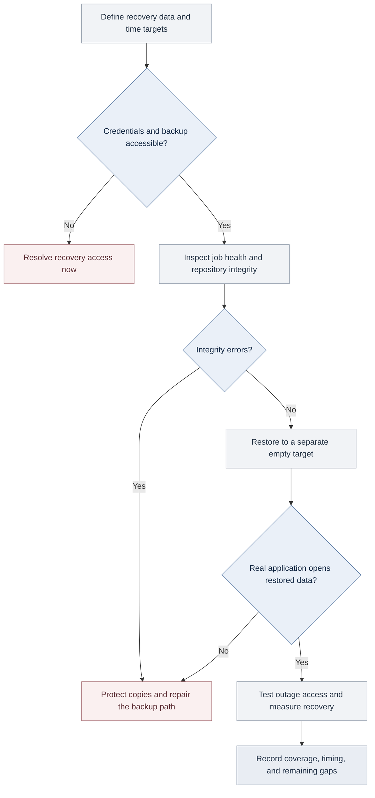

<a href="https://herbertofury.github.io/INTA/" title="Open INTA official download or service page" aria-label="Open INTA official download or service page" data-inta-brand="app-inta"></a> [INTA](https://github.com/Herbertofury/INTA/wiki) / [Decision desk](https://github.com/Herbertofury/INTA/wiki/Decision-Desk) · [Service map](https://github.com/Herbertofury/INTA/wiki/Service-Map) · [Playbooks](https://github.com/Herbertofury/INTA/wiki/Playbooks) · [Tools](https://github.com/Herbertofury/INTA/wiki/Tool-Directory) · [Methods](https://github.com/Herbertofury/INTA/wiki/Methods) · [Open hub](https://herbertofury.github.io/INTA/)

<a id="-prove-a-backup-can-actually-restore"></a>

# [Prove a backup can actually restore](https://github.com/Herbertofury/INTA/wiki/Job-backup-restore)

Validate recovery credentials, data integrity, application usability, and recovery time.

**Backup & continuity** · Intermediate · 30–90 min; full restore varies · 6 steps

[Tools and useful links](#working-kit) · [Quick answer](#quick-answer) · [Next action](#next-action) · [Specific fixes](#specific-fixes) · [Decision route](#decision-route) · [Tools](#toolkit) · [Procedure](#walkthrough) · [Verification](#acceptance) · [Sources](#sources) · [Interactive checklist](https://herbertofury.github.io/INTA/#job/backup-restore)

<a id="tool-choices"></a>

## 🧰 Choose the tool for this job

Choose by the task shown in the first column. Each option includes its acquisition route and access boundary.

| Need | Official tool + exact action | Why this choice / access |
| --- | --- | --- |
| **Restore a <a href="https://github.com/restic/restic/releases/latest" title="Open restic official download or service page" aria-label="Open restic official download or service page" data-inta-brand="restic"></a> [restic](https://restic.net/) repository** | **<a href="https://github.com/restic/restic/releases/latest" title="Open restic official download or service page" aria-label="Open restic official download or service page" data-inta-brand="restic"></a> [restic](https://restic.net/)** · **<a href="https://www.microsoft.com/windows" title="Open Windows official download or service page" aria-label="Open Windows official download or service page" data-inta-brand="app-windows"></a> [Download Windows x64 · ZIP](https://github.com/restic/restic/releases/download/v0.20.0/restic_0.20.0_windows_amd64.zip)** | Use its native snapshot and restore commands for an existing <a href="https://github.com/restic/restic/releases/latest" title="Open restic official download or service page" aria-label="Open restic official download or service page" data-inta-brand="restic"></a> [restic](https://restic.net/) backup. **Access:** Free software; repository storage is separate. |
| **Restore a <a href="https://kopia.io/docs/installation/" title="Open Kopia official download or service page" aria-label="Open Kopia official download or service page" data-inta-brand="kopia"></a> [Kopia](https://kopia.io/) snapshot** | **<a href="https://kopia.io/docs/installation/" title="Open Kopia official download or service page" aria-label="Open Kopia official download or service page" data-inta-brand="kopia"></a> [Kopia](https://kopia.io/)** · **<a href="https://www.microsoft.com/windows" title="Open Windows official download or service page" aria-label="Open Windows official download or service page" data-inta-brand="app-windows"></a> [Download Windows desktop · ZIP](https://github.com/kopia/kopia/releases/download/v0.23.1/KopiaUI-0.23.1-win.zip)** | Open the existing repository and restore the selected snapshot into a separate location. **Access:** Free software; repository storage is separate. |
| **Restore an agent backup** | **<a href="https://www.veeam.com/products/free/microsoft-windows" title="Open Veeam Agent for Microsoft Windows official download or service page" aria-label="Open Veeam Agent for Microsoft Windows official download or service page" data-inta-brand="veeam-agent"></a> [Veeam Agent for Microsoft Windows](https://www.veeam.com/products/free/microsoft-windows)** · **<a href="https://www.microsoft.com/windows" title="Open Windows official download or service page" aria-label="Open Windows official download or service page" data-inta-brand="app-windows"></a> [Sign in for the Windows download](https://www.veeam.com/products/physical/windows-backup-recovery-download.html)** | Use the matching agent recovery workflow for an existing supported <a href="https://www.microsoft.com/windows" title="Open Windows official download or service page" aria-label="Open Windows official download or service page" data-inta-brand="app-windows"></a> [Windows](https://www.microsoft.com/windows) backup. **Access:** Free edition exists; service-provider terms differ. |

**[Current selection evidence](https://github.com/Herbertofury/INTA/wiki/Current-Tool-Choices)**

<a id="working-kit"></a>

## 🧰 Tools and links for this job

**[Open working view](https://herbertofury.github.io/INTA/#job/backup-restore)** · Keep the tool panel beside the instructions.

**First move:** Identify the existing backup product, repository, recovery point and credentials. Use the matching restore tool rather than converting formats during an incident.

| Use this for | Official tool + exact action |
| --- | --- |
| Restore an existing supported <a href="https://www.microsoft.com/windows" title="Open Windows official download or service page" aria-label="Open Windows official download or service page" data-inta-brand="app-windows"></a> [Windows](https://www.microsoft.com/windows)-agent backup. | **<a href="https://www.veeam.com/products/free/microsoft-windows" title="Open Veeam Agent for Microsoft Windows official download or service page" aria-label="Open Veeam Agent for Microsoft Windows official download or service page" data-inta-brand="veeam-agent"></a> [Veeam Agent for Microsoft Windows](https://www.veeam.com/products/free/microsoft-windows)** · <a href="https://www.veeam.com/products/free/microsoft-windows" title="Open Veeam Agent for Microsoft Windows official download or service page" aria-label="Open Veeam Agent for Microsoft Windows official download or service page" data-inta-brand="veeam-agent"></a> [Official page](https://www.veeam.com/products/free/microsoft-windows) · **<a href="https://www.microsoft.com/windows" title="Open Windows official download or service page" aria-label="Open Windows official download or service page" data-inta-brand="app-windows"></a> [Sign in for the Windows download](https://www.veeam.com/products/physical/windows-backup-recovery-download.html)** |
| Inspect and restore an existing <a href="https://github.com/restic/restic/releases/latest" title="Open restic official download or service page" aria-label="Open restic official download or service page" data-inta-brand="restic"></a> [restic](https://restic.net/) repository. | **<a href="https://github.com/restic/restic/releases/latest" title="Open restic official download or service page" aria-label="Open restic official download or service page" data-inta-brand="restic"></a> [restic](https://restic.net/)** · <a href="https://github.com/restic/restic/releases/latest" title="Open restic official download or service page" aria-label="Open restic official download or service page" data-inta-brand="restic"></a> [Official page](https://restic.net/) · **<a href="https://www.microsoft.com/windows" title="Open Windows official download or service page" aria-label="Open Windows official download or service page" data-inta-brand="app-windows"></a> [Download Windows x64 · ZIP](https://github.com/restic/restic/releases/download/v0.20.0/restic_0.20.0_windows_amd64.zip)** |
| Restore files from an existing <a href="https://kopia.io/docs/installation/" title="Open Kopia official download or service page" aria-label="Open Kopia official download or service page" data-inta-brand="kopia"></a> [Kopia](https://kopia.io/) snapshot. | **<a href="https://kopia.io/docs/installation/" title="Open Kopia official download or service page" aria-label="Open Kopia official download or service page" data-inta-brand="kopia"></a> [Kopia](https://kopia.io/)** · <a href="https://kopia.io/docs/installation/" title="Open Kopia official download or service page" aria-label="Open Kopia official download or service page" data-inta-brand="kopia"></a> [Official page](https://kopia.io/) · **<a href="https://www.microsoft.com/windows" title="Open Windows official download or service page" aria-label="Open Windows official download or service page" data-inta-brand="app-windows"></a> [Download Windows desktop · ZIP](https://github.com/kopia/kopia/releases/download/v0.23.1/KopiaUI-0.23.1-win.zip)** |

### File snapshots

| Open the exact resource | What to do there |
| --- | --- |
| **<a href="https://github.com/restic/restic/releases/latest" title="Open restic official download or service page" aria-label="Open restic official download or service page" data-inta-brand="restic"></a> [restic repository checks](https://restic.readthedocs.io/en/stable/045_working_with_repos.html)** | Check repository integrity before declaring a backup usable. |
| **<a href="https://github.com/restic/restic/releases/latest" title="Open restic official download or service page" aria-label="Open restic official download or service page" data-inta-brand="restic"></a> [restic restore procedure](https://restic.readthedocs.io/en/stable/050_restore.html)** | Choose the snapshot and a separate restore destination. |
| **<a href="https://kopia.io/docs/installation/" title="Open Kopia official download or service page" aria-label="Open Kopia official download or service page" data-inta-brand="kopia"></a> [Kopia snapshot restoration](https://kopia.io/docs/getting-started/)** | Use the GUI snapshot browser or documented CLI restore to a separate folder. |

### System backups

| Open the exact resource | What to do there |
| --- | --- |
| **<a href="https://helpcenter.veeam.com/" title="Open helpcenter.veeam.com official download or service page" aria-label="Open helpcenter.veeam.com official download or service page" data-inta-brand="site-helpcenter-veeam-com"></a> [Start Veeam file-level restore](https://helpcenter.veeam.com/docs/agentforwindows/userguide/files_restore_launch.html)** | Launch the restore wizard and choose the existing backup and recovery point. |
| **<a href="https://helpcenter.veeam.com/" title="Open helpcenter.veeam.com official download or service page" aria-label="Open helpcenter.veeam.com official download or service page" data-inta-brand="site-helpcenter-veeam-com"></a> [Veeam recovery media and bare-metal restore](https://helpcenter.veeam.com/docs/agentforwindows/userguide/recovery_media.html)** | Use compatible recovery media for an existing image backup; verify the target before overwrite. |

### Snapshot failures

| Open the exact resource | What to do there |
| --- | --- |
| **<a href="https://www.veeam.com/" title="Open veeam.com official download or service page" aria-label="Open veeam.com official download or service page" data-inta-brand="site-www-veeam-com"></a> [VSS writer and service map](https://www.veeam.com/kb2041)** | Match the failed writer to its service and coordinate any restart with the application owner. |

<a id="quick-answer"></a>

## ⚡ Quick answer

<a id="quick-file-backup"></a>

### 🗄️ Restore a file backup

**Identify the backup format, snapshot date and recoverable credentials before choosing the restore tool.**

1. For a <a href="https://github.com/restic/restic/releases/latest" title="Open restic official download or service page" aria-label="Open restic official download or service page" data-inta-brand="restic"></a> [restic](https://restic.net/) repository, inspect snapshots and run the documented repository checks.
2. Restore the required snapshot or files to a separate destination using the scoped procedure.
3. Open representative files, check permissions and record the restored date and any missing data.

**<a href="https://github.com/restic/restic/releases/latest" title="Open restic official download or service page" aria-label="Open restic official download or service page" data-inta-brand="restic"></a> [restic](https://restic.net/)** · <a href="https://github.com/restic/restic/releases/latest" title="Open restic official download or service page" aria-label="Open restic official download or service page" data-inta-brand="restic"></a> [Official page](https://restic.net/) · **<a href="https://www.microsoft.com/windows" title="Open Windows official download or service page" aria-label="Open Windows official download or service page" data-inta-brand="app-windows"></a> [Download Windows x64 · ZIP](https://github.com/restic/restic/releases/download/v0.20.0/restic_0.20.0_windows_amd64.zip)**

<a id="next-action"></a>

## 🧭 Match the symptom

| You see this | Do this next | You should get |
| --- | --- | --- |
| **A file or folder must be restored** | Select the correct device and snapshot date in the matching backup tool and restore to a separate location. | The expected version exists without overwriting the current working copy. |
| **The existing backup is a <a href="https://www.veeam.com/products/free/microsoft-windows" title="Open Veeam Agent for Microsoft Windows official download or service page" aria-label="Open Veeam Agent for Microsoft Windows official download or service page" data-inta-brand="veeam-agent"></a> [Veeam Agent](https://www.veeam.com/products/free/microsoft-windows) backup** | Open File Level Restore from the Veeam Start-menu entry, select the [backup and restore](https://github.com/Herbertofury/INTA/wiki/Job-backup-restore) point, then copy the required files to a separate destination in the backup browser. | The restored version opens correctly before any working file is replaced. |
| **The existing backup is a <a href="https://kopia.io/docs/installation/" title="Open Kopia official download or service page" aria-label="Open Kopia official download or service page" data-inta-brand="kopia"></a> [Kopia](https://kopia.io/) snapshot** | Connect KopiaUI to the existing repository, open Snapshots, select the source Path and dated snapshot, then restore the required item to a separate folder. | The selected files exist in the restore folder and open with the expected contents. |
| **A <a href="https://github.com/restic/restic/releases/latest" title="Open restic official download or service page" aria-label="Open restic official download or service page" data-inta-brand="restic"></a> [restic](https://restic.net/) backup reports success but has not been tested** | Inspect its snapshots, run the documented repository check and restore representative files to a separate target. | The recovery point and usable contents are demonstrated rather than inferred from a green job. |
| **A whole computer must be recovered** | Use that backup product’s compatible recovery media and check storage/network drivers before selecting the erase target. | The restored system boots and its critical application opens the expected data. |
| **A password, repository or required snapshot is missing** | Record the exact missing dependency and contact its owner before modifying the repository. | The recovery gap has an owner and the remaining copies stay intact. |

### ✅ Finish the job

- [ ] The requested recovery date and a real file/application test are recorded.
- [ ] Permissions and ownership allow the intended user to work.
- [ ] Measured restore time and missing data are documented.

**Change route when:** The only backup would be overwritten or exposed to an active compromise. · Required credentials or a valid recovery point cannot be established.

### 🎯 Go straight to a specific fix

- **[Include cloud-only files in the recovery plan](#fix-backup-cloud-placeholders-are-not-local-files)** — A local backup or migrated folder contains <a href="https://www.microsoft.com/microsoft-365/onedrive/online-cloud-storage" title="Open OneDrive official download or service page" aria-label="Open OneDrive official download or service page" data-inta-brand="app-onedrive"></a> [OneDrive](https://www.microsoft.com/microsoft-365/onedrive/online-cloud-storage) placeholders instead of usable offline files.
- **[Check repository data as well as metadata](#fix-backup-restic-check-is-not-full-data-proof)** — A <a href="https://github.com/restic/restic/releases/latest" title="Open restic official download or service page" aria-label="Open restic official download or service page" data-inta-brand="restic"></a> [restic](https://restic.net/) repository check passes but no restored file has been tested.
- **[Recover an older version without overwriting current work](#fix-backup-restore-beside-current-files)** — The owner needs an earlier file version but current edits must be retained.
- **[Prove the backup can be opened after the PC is lost](#fix-backup-test-credentials-away-from-source)** — Backups run automatically, but only the original machine appears to know the repository password.
- **[Identify the writer stopping an application-aware backup](#fix-backup-vss-writer-failed)** — A backup fails during snapshot creation or reports a VSS writer error.

> [!NOTE]
> **Start here.** Identify what must be recovered, the acceptable data-loss window, and the target recovery time. A green backup status is only the starting point.

<a id="decision-route"></a>

<a id="-choose-the-right-branch"></a>

## 🧭 Choose a route



**Route links:** [Continue this workflow](#walkthrough) · [Acceptance checks](#acceptance) · [Clone a healthy system or migrate to a new SSD](https://github.com/Herbertofury/INTA/wiki/Job-disk-migration) · [Bring an office back after a power outage](https://github.com/Herbertofury/INTA/wiki/Job-outage-recovery) · [Contain ransomware or a wider compromise](https://github.com/Herbertofury/INTA/wiki/Job-ransomware-response) · [Run a useful workstation maintenance visit](https://github.com/Herbertofury/INTA/wiki/Job-preventive-maintenance)

| Checkpoint | What to carry forward |
| --- | --- |
| **Before changing anything** | Identify recovery credentials, unique data, and a separate test target. |
| **Keep during the job** | Snapshot, integrity result, restore log, elapsed time, and test evidence. |
| **Before handing back** | Real restored data opens and the outage path is usable. |

<a id="toolkit"></a>

<a id="-build-the-right-toolkit"></a>

## Recommended tools

Select a tool for the next diagnostic or repair step. Check its platform, access and licensing requirements before use.

| Tool / official page + download | Use it for | Platform & access | Documentation |
| --- | --- | --- | --- |
| **<a href="https://www.veeam.com/products/free/microsoft-windows" title="Open Veeam Agent for Microsoft Windows official download or service page" aria-label="Open Veeam Agent for Microsoft Windows official download or service page" data-inta-brand="veeam-agent"></a> [Veeam Agent for Microsoft Windows](https://www.veeam.com/products/free/microsoft-windows)** · <a href="https://www.veeam.com/products/free/microsoft-windows" title="Open Veeam Agent for Microsoft Windows official download or service page" aria-label="Open Veeam Agent for Microsoft Windows official download or service page" data-inta-brand="veeam-agent"></a> [Official page](https://www.veeam.com/products/free/microsoft-windows) · **<a href="https://www.microsoft.com/windows" title="Open Windows official download or service page" aria-label="Open Windows official download or service page" data-inta-brand="app-windows"></a> [Sign in for the Windows download](https://www.veeam.com/products/physical/windows-backup-recovery-download.html)** | Restore an existing supported <a href="https://www.microsoft.com/windows" title="Open Windows official download or service page" aria-label="Open Windows official download or service page" data-inta-brand="app-windows"></a> [Windows](https://www.microsoft.com/windows)-agent backup. | <a href="https://www.microsoft.com/windows" title="Open Windows official download or service page" aria-label="Open Windows official download or service page" data-inta-brand="app-windows"></a> [Windows](https://www.microsoft.com/windows); Free and paid editions; service-provider terms differ | <a href="https://www.veeam.com/products/free/microsoft-windows" title="Open Veeam Agent for Microsoft Windows official download or service page" aria-label="Open Veeam Agent for Microsoft Windows official download or service page" data-inta-brand="veeam-agent"></a> [Open guide](https://helpcenter.veeam.com/docs/agentforwindows/userguide/overview.html) |
| **<a href="https://github.com/restic/restic/releases/latest" title="Open restic official download or service page" aria-label="Open restic official download or service page" data-inta-brand="restic"></a> [restic](https://restic.net/)** · <a href="https://github.com/restic/restic/releases/latest" title="Open restic official download or service page" aria-label="Open restic official download or service page" data-inta-brand="restic"></a> [Official page](https://restic.net/) · **<a href="https://www.microsoft.com/windows" title="Open Windows official download or service page" aria-label="Open Windows official download or service page" data-inta-brand="app-windows"></a> [Download Windows x64 · ZIP](https://github.com/restic/restic/releases/download/v0.20.0/restic_0.20.0_windows_amd64.zip)** | Inspect and restore an existing <a href="https://github.com/restic/restic/releases/latest" title="Open restic official download or service page" aria-label="Open restic official download or service page" data-inta-brand="restic"></a> [restic](https://restic.net/) repository. | <a href="https://www.microsoft.com/windows" title="Open Windows official download or service page" aria-label="Open Windows official download or service page" data-inta-brand="app-windows"></a> [Windows](https://www.microsoft.com/windows), <a href="https://www.kernel.org/" title="Open Linux official download or service page" aria-label="Open Linux official download or service page" data-inta-brand="app-linux"></a> [Linux](https://www.kernel.org/), <a href="https://support.apple.com/macos" title="Open macOS official download or service page" aria-label="Open macOS official download or service page" data-inta-brand="app-macos"></a> [macOS](https://support.apple.com/macos); Free / open source | <a href="https://github.com/restic/restic/releases/latest" title="Open restic official download or service page" aria-label="Open restic official download or service page" data-inta-brand="restic"></a> [Open guide](https://restic.readthedocs.io/en/stable/) |
| **<a href="https://kopia.io/docs/installation/" title="Open Kopia official download or service page" aria-label="Open Kopia official download or service page" data-inta-brand="kopia"></a> [Kopia](https://kopia.io/)** · <a href="https://kopia.io/docs/installation/" title="Open Kopia official download or service page" aria-label="Open Kopia official download or service page" data-inta-brand="kopia"></a> [Official page](https://kopia.io/) · **<a href="https://www.microsoft.com/windows" title="Open Windows official download or service page" aria-label="Open Windows official download or service page" data-inta-brand="app-windows"></a> [Download Windows desktop · ZIP](https://github.com/kopia/kopia/releases/download/v0.23.1/KopiaUI-0.23.1-win.zip)** | Restore files from an existing <a href="https://kopia.io/docs/installation/" title="Open Kopia official download or service page" aria-label="Open Kopia official download or service page" data-inta-brand="kopia"></a> [Kopia](https://kopia.io/) snapshot. | <a href="https://www.microsoft.com/windows" title="Open Windows official download or service page" aria-label="Open Windows official download or service page" data-inta-brand="app-windows"></a> [Windows](https://www.microsoft.com/windows), <a href="https://www.kernel.org/" title="Open Linux official download or service page" aria-label="Open Linux official download or service page" data-inta-brand="app-linux"></a> [Linux](https://www.kernel.org/), <a href="https://support.apple.com/macos" title="Open macOS official download or service page" aria-label="Open macOS official download or service page" data-inta-brand="app-macos"></a> [macOS](https://support.apple.com/macos); Free / open source | <a href="https://kopia.io/docs/installation/" title="Open Kopia official download or service page" aria-label="Open Kopia official download or service page" data-inta-brand="kopia"></a> [Open guide](https://kopia.io/docs/) |
| **<a href="https://rescuezilla.com/download" title="Open Rescuezilla official download or service page" aria-label="Open Rescuezilla official download or service page" data-inta-brand="rescuezilla"></a> [Rescuezilla](https://rescuezilla.com/)** · <a href="https://rescuezilla.com/download" title="Open Rescuezilla official download or service page" aria-label="Open Rescuezilla official download or service page" data-inta-brand="rescuezilla"></a> [Official page](https://rescuezilla.com/) · **<a href="https://rescuezilla.com/download" title="Open Rescuezilla official download or service page" aria-label="Open Rescuezilla official download or service page" data-inta-brand="rescuezilla"></a> [Download x64 rescue image · ISO](https://github.com/rescuezilla/rescuezilla/releases/download/2.6.2/rescuezilla-2.6.2-64bit.resolute.iso)** | A visual bare-metal backup or restore workflow at the bench. | Bootable PC; Free / open source | <a href="https://rescuezilla.com/download" title="Open Rescuezilla official download or service page" aria-label="Open Rescuezilla official download or service page" data-inta-brand="rescuezilla"></a> [Open guide](https://rescuezilla.com/help) |

<a id="walkthrough"></a>

<a id="-work-the-case"></a>

## Procedure

Work in order, record the result of each step, and change route when the evidence calls for it.

<a id="step-01"></a>

### 01 · Inventory the recovery set

- [ ] List protected devices, folders, application data, backup destination, retention, encryption keys, and the last successful job. Confirm the person covering an outage can obtain the credentials. Identify data that lives outside the usual Documents/Desktop folders.

**CMD (Run as Administrator) · List discoverable <a href="https://learn.microsoft.com/en-us/windows-server/" title="Open Windows Server official download or service page" aria-label="Open Windows Server official download or service page" data-inta-brand="app-windows-server"></a> [Windows Server](https://learn.microsoft.com/en-us/windows-server/) Backup versions before selecting a recovery point; verify the destination and scope separately.:**

```text
wbadmin get versions
```

> **Before running:** Read-only query. A listed version is not proof that the data can be restored; perform a test restore to an isolated destination.

**Official command reference:** <a href="https://www.microsoft.com/" title="Open microsoft.com official download or service page" aria-label="Open microsoft.com official download or service page" data-inta-brand="site-www-microsoft-com"></a> [Microsoft wbadmin get versions documentation](https://learn.microsoft.com/en-us/windows-server/administration/windows-commands/wbadmin-get-versions)

**Command legend:** <a href="https://www.microsoft.com/" title="Open microsoft.com official download or service page" aria-label="Open microsoft.com official download or service page" data-inta-brand="site-www-microsoft-com"></a> [Microsoft wbadmin get versions documentation](https://learn.microsoft.com/en-us/windows-server/administration/windows-commands/wbadmin-get-versions) · [Return to the step context](#step-01).

<a id="step-02"></a>

### 02 · Inspect repository and job health

- [ ] Read recent backup logs, skipped-file reports, capacity, and retention errors. Use the product’s integrity check. For <a href="https://github.com/restic/restic/releases/latest" title="Open restic official download or service page" aria-label="Open restic official download or service page" data-inta-brand="restic"></a> [restic](https://restic.net/), a normal check validates repository structure; reading and verifying stored data requires the additional data-check option and an appropriate maintenance window.

<a id="step-03"></a>

### 03 · Select a representative restore

- [ ] Choose a known snapshot and business-relevant files, including a large file and a format used by the client. Restore to an empty separate folder or isolated test machine. Avoid restoring directly over live files during a routine verification.

<a id="step-04"></a>

### 04 · Test the content with the real application

- [ ] Open documents, photos, archives, and business data in their intended applications. Check permissions and required metadata. For databases or server workloads, follow the application’s supported recovery procedure and confirm consistency, not just file presence.

<a id="step-05"></a>

### 05 · Exercise the outage path

- [ ] For system recovery, boot the recovery media in a test environment and confirm it can see the backup destination and required storage/network hardware. Measure restore time. Verify recovery still works when the original PC or ordinary sign-in method is unavailable.

<a id="step-06"></a>

### 06 · Record and resolve gaps

- [ ] Save the restore date, snapshot, scope, integrity result, elapsed time, and evidence in the private service record. Assign an owner to missing data, inaccessible keys, slow restore paths, or capacity problems. Keep backup copies isolated from ordinary endpoint write access where supported.

<a id="acceptance"></a>

<a id="-prove-the-result"></a>

## Verification

- [ ] A real restore has completed to a separate target.
- [ ] Restored data opens correctly and required permissions work.
- [ ] Recovery keys, media, network access, and time expectations were tested.
- [ ] Any integrity or coverage gap has an owner and corrective action.

> [!WARNING]
> **Pause this route and escalate when:**
> - A repository check reports corruption or essential credentials are missing.
> - The restore plan would overwrite the only good copy or live production data.

<a id="specific-fixes"></a>

## 🎯 Specific fixes

Choose the case that matches the evidence. Each case gives a first action, a short procedure and a result to prove.

<a id="fix-backup-cloud-placeholders-are-not-local-files"></a>

### Include cloud-only files in the recovery plan

**Use when:** A local backup or migrated folder contains <a href="https://www.microsoft.com/microsoft-365/onedrive/online-cloud-storage" title="Open OneDrive official download or service page" aria-label="Open OneDrive official download or service page" data-inta-brand="app-onedrive"></a> [OneDrive](https://www.microsoft.com/microsoft-365/onedrive/online-cloud-storage) placeholders instead of usable offline files.

**Start here:** Inspect the affected files’ <a href="https://www.microsoft.com/microsoft-365/onedrive/online-cloud-storage" title="Open OneDrive official download or service page" aria-label="Open OneDrive official download or service page" data-inta-brand="app-onedrive"></a> [OneDrive](https://www.microsoft.com/microsoft-365/onedrive/online-cloud-storage) status icons and confirm the intended account.

**<a href="https://github.com/restic/restic/releases/latest" title="Open restic official download or service page" aria-label="Open restic official download or service page" data-inta-brand="restic"></a> [restic](https://restic.net/)** · <a href="https://github.com/restic/restic/releases/latest" title="Open restic official download or service page" aria-label="Open restic official download or service page" data-inta-brand="restic"></a> [Official page](https://restic.net/) · **<a href="https://www.microsoft.com/windows" title="Open Windows official download or service page" aria-label="Open Windows official download or service page" data-inta-brand="app-windows"></a> [Download Windows x64 · ZIP](https://github.com/restic/restic/releases/download/v0.20.0/restic_0.20.0_windows_amd64.zip)**

**<a href="https://kopia.io/docs/installation/" title="Open Kopia official download or service page" aria-label="Open Kopia official download or service page" data-inta-brand="kopia"></a> [Kopia](https://kopia.io/)** · <a href="https://kopia.io/docs/installation/" title="Open Kopia official download or service page" aria-label="Open Kopia official download or service page" data-inta-brand="kopia"></a> [Official page](https://kopia.io/) · **<a href="https://www.microsoft.com/windows" title="Open Windows official download or service page" aria-label="Open Windows official download or service page" data-inta-brand="app-windows"></a> [Download Windows desktop · ZIP](https://github.com/kopia/kopia/releases/download/v0.23.1/KopiaUI-0.23.1-win.zip)**

1. For files that must be available locally, choose Always keep on this device and wait for the download to finish with enough disk space.
2. Open representative files while disconnected from the network to prove local availability before relying on a filesystem copy.
3. Run the approved backup, restore those samples to a separate destination and test them there.

**Prove it worked:** The restore contains real usable content, not only cloud references that still depend on the original account.

**If this does not resolve it:** If the cloud account, retention or download is blocked, record that recovery gap rather than marking the local backup complete.

**Official evidence:** <a href="https://support.microsoft.com/" title="Open support.microsoft.com official download or service page" aria-label="Open support.microsoft.com official download or service page" data-inta-brand="site-support-microsoft-com"></a> [Source 1](https://support.microsoft.com/en-gb/onedrive/save-disk-space-with-onedrive-files-on-demand-for-windows) · Reviewed 2026-11-26

[Back to specific fixes](#specific-fixes) · [Full procedure](#walkthrough)

<a id="fix-backup-restic-check-is-not-full-data-proof"></a>

### Check repository data as well as metadata

**Use when:** A <a href="https://github.com/restic/restic/releases/latest" title="Open restic official download or service page" aria-label="Open restic official download or service page" data-inta-brand="restic"></a> [restic](https://restic.net/) repository check passes but no restored file has been tested.

**Start here:** Record the snapshot ID and the scope of the check that actually ran.

**<a href="https://github.com/restic/restic/releases/latest" title="Open restic official download or service page" aria-label="Open restic official download or service page" data-inta-brand="restic"></a> [restic](https://restic.net/)** · <a href="https://github.com/restic/restic/releases/latest" title="Open restic official download or service page" aria-label="Open restic official download or service page" data-inta-brand="restic"></a> [Official page](https://restic.net/) · **<a href="https://www.microsoft.com/windows" title="Open Windows official download or service page" aria-label="Open Windows official download or service page" data-inta-brand="app-windows"></a> [Download Windows x64 · ZIP](https://github.com/restic/restic/releases/download/v0.20.0/restic_0.20.0_windows_amd64.zip)**

1. Distinguish <a href="https://github.com/restic/restic/releases/latest" title="Open restic official download or service page" aria-label="Open restic official download or service page" data-inta-brand="restic"></a> [restic](https://restic.net/) check’s structural checks from the documented read-data options that read stored data packs.
2. Choose an authorized data-verification scope appropriate to repository size, connection cost and the service window.
3. Restore representative priority files from the selected snapshot to a separate target and open them with their real applications.

**Prove it worked:** The record states which data was read and which restored files were usable, with sample limits explicit.

**If this does not resolve it:** A metadata-only pass cannot establish every file’s recoverability; investigate reported pack errors without pruning the only repository copy.

**Official evidence:** <a href="https://restic.readthedocs.io/" title="Open restic.readthedocs.io official download or service page" aria-label="Open restic.readthedocs.io official download or service page" data-inta-brand="site-restic-readthedocs-io"></a> [Source 1](https://restic.readthedocs.io/en/stable/045_working_with_repos.html) · <a href="https://github.com/restic/restic/releases/latest" title="Open restic official download or service page" aria-label="Open restic official download or service page" data-inta-brand="restic"></a> [Source 2](https://restic.readthedocs.io/en/stable/050_restore.html) · Reviewed 2026-11-26

[Back to specific fixes](#specific-fixes) · [Full procedure](#walkthrough)

<a id="fix-backup-restore-beside-current-files"></a>

### Recover an older version without overwriting current work

**Use when:** The owner needs an earlier file version but current edits must be retained.

**Start here:** Confirm the required recovery date and create a separate restore destination.

**<a href="https://www.veeam.com/products/free/microsoft-windows" title="Open Veeam Agent for Microsoft Windows official download or service page" aria-label="Open Veeam Agent for Microsoft Windows official download or service page" data-inta-brand="veeam-agent"></a> [Veeam Agent for Microsoft Windows](https://www.veeam.com/products/free/microsoft-windows)** · <a href="https://www.veeam.com/products/free/microsoft-windows" title="Open Veeam Agent for Microsoft Windows official download or service page" aria-label="Open Veeam Agent for Microsoft Windows official download or service page" data-inta-brand="veeam-agent"></a> [Official page](https://www.veeam.com/products/free/microsoft-windows) · **<a href="https://www.microsoft.com/windows" title="Open Windows official download or service page" aria-label="Open Windows official download or service page" data-inta-brand="app-windows"></a> [Sign in for the Windows download](https://www.veeam.com/products/physical/windows-backup-recovery-download.html)**

**<a href="https://kopia.io/docs/installation/" title="Open Kopia official download or service page" aria-label="Open Kopia official download or service page" data-inta-brand="kopia"></a> [Kopia](https://kopia.io/)** · <a href="https://kopia.io/docs/installation/" title="Open Kopia official download or service page" aria-label="Open Kopia official download or service page" data-inta-brand="kopia"></a> [Official page](https://kopia.io/) · **<a href="https://www.microsoft.com/windows" title="Open Windows official download or service page" aria-label="Open Windows official download or service page" data-inta-brand="app-windows"></a> [Download Windows desktop · ZIP](https://github.com/kopia/kopia/releases/download/v0.23.1/KopiaUI-0.23.1-win.zip)**

1. Select the correct source device and recovery point in the matching backup product.
2. Use its copy-to-new-location or alternate-destination restore choice instead of restoring over the live file.
3. Open both versions with the owner, verify permissions and decide which approved version should become active.

**Prove it worked:** The requested earlier content is recovered while the current working copy remains available.

**If this does not resolve it:** If an application database requires its own restore process, use that workflow on a safe copy rather than copying open database files blindly.

**Official evidence:** <a href="https://helpcenter.veeam.com/" title="Open helpcenter.veeam.com official download or service page" aria-label="Open helpcenter.veeam.com official download or service page" data-inta-brand="site-helpcenter-veeam-com"></a> [Source 1](https://helpcenter.veeam.com/docs/agentforwindows/userguide/files_restore.html) · <a href="https://kopia.io/" title="Open kopia.io official download or service page" aria-label="Open kopia.io official download or service page" data-inta-brand="site-kopia-io"></a> [Source 2](https://kopia.io/docs/getting-started/) · Reviewed 2026-11-26

[Back to specific fixes](#specific-fixes) · [Full procedure](#walkthrough)

<a id="fix-backup-test-credentials-away-from-source"></a>

### Prove the backup can be opened after the PC is lost

**Use when:** Backups run automatically, but only the original machine appears to know the repository password.

**Start here:** Identify the approved credential/recovery store without copying secrets into the public record.

**<a href="https://kopia.io/docs/installation/" title="Open Kopia official download or service page" aria-label="Open Kopia official download or service page" data-inta-brand="kopia"></a> [Kopia](https://kopia.io/)** · <a href="https://kopia.io/docs/installation/" title="Open Kopia official download or service page" aria-label="Open Kopia official download or service page" data-inta-brand="kopia"></a> [Official page](https://kopia.io/) · **<a href="https://www.microsoft.com/windows" title="Open Windows official download or service page" aria-label="Open Windows official download or service page" data-inta-brand="app-windows"></a> [Download Windows desktop · ZIP](https://github.com/kopia/kopia/releases/download/v0.23.1/KopiaUI-0.23.1-win.zip)**

**<a href="https://github.com/restic/restic/releases/latest" title="Open restic official download or service page" aria-label="Open restic official download or service page" data-inta-brand="restic"></a> [restic](https://restic.net/)** · <a href="https://github.com/restic/restic/releases/latest" title="Open restic official download or service page" aria-label="Open restic official download or service page" data-inta-brand="restic"></a> [Official page](https://restic.net/) · **<a href="https://www.microsoft.com/windows" title="Open Windows official download or service page" aria-label="Open Windows official download or service page" data-inta-brand="app-windows"></a> [Download Windows x64 · ZIP](https://github.com/restic/restic/releases/download/v0.20.0/restic_0.20.0_windows_amd64.zip)**

**<a href="https://keepassxc.org/download/" title="Open KeePassXC official download or service page" aria-label="Open KeePassXC official download or service page" data-inta-brand="keepassxc"></a> [KeePassXC](https://keepassxc.org/)** · <a href="https://keepassxc.org/download/" title="Open KeePassXC official download or service page" aria-label="Open KeePassXC official download or service page" data-inta-brand="keepassxc"></a> [Official page](https://keepassxc.org/) · **<a href="https://www.microsoft.com/windows" title="Open Windows official download or service page" aria-label="Open Windows official download or service page" data-inta-brand="app-windows"></a> [Download Windows x64 portable · ZIP](https://github.com/keepassxreboot/keepassxc/releases/download/2.8.0/KeePassXC-2.8.0-x64.zip)**

1. From a separate trusted restore environment, follow the product’s existing-repository connection procedure with the authorized credentials.
2. List the expected snapshots and restore a harmless representative file to a separate location.
3. Record the private credential reference, required software and tested restore route so another authorized technician can repeat it.

**Prove it worked:** Recovery succeeds without relying on the original workstation’s saved session or local configuration.

**If this does not resolve it:** If the encryption password or recovery material is unavailable, preserve the repository and escalate; do not create a new repository over it.

**Official evidence:** <a href="https://kopia.io/" title="Open kopia.io official download or service page" aria-label="Open kopia.io official download or service page" data-inta-brand="site-kopia-io"></a> [Source 1](https://kopia.io/docs/getting-started/) · <a href="https://github.com/restic/restic/releases/latest" title="Open restic official download or service page" aria-label="Open restic official download or service page" data-inta-brand="restic"></a> [Source 2](https://restic.readthedocs.io/en/stable/030_preparing_a_new_repo.html) · Reviewed 2026-11-26

[Back to specific fixes](#specific-fixes) · [Full procedure](#walkthrough)

<a id="fix-backup-vss-writer-failed"></a>

### Identify the writer stopping an application-aware backup

**Use when:** A backup fails during snapshot creation or reports a VSS writer error.

**Start here:** On the computer being backed up, run vssadmin list writers from an elevated <a href="https://learn.microsoft.com/en-us/windows-server/administration/windows-commands/cmd" title="Open Command Prompt official download or service page" aria-label="Open Command Prompt official download or service page" data-inta-brand="app-command-prompt"></a> [command prompt](https://learn.microsoft.com/en-us/windows-server/administration/windows-commands/cmd) and record failed writers.

**<a href="https://www.veeam.com/products/free/microsoft-windows" title="Open Veeam Agent for Microsoft Windows official download or service page" aria-label="Open Veeam Agent for Microsoft Windows official download or service page" data-inta-brand="veeam-agent"></a> [Veeam Agent for Microsoft Windows](https://www.veeam.com/products/free/microsoft-windows)** · <a href="https://www.veeam.com/products/free/microsoft-windows" title="Open Veeam Agent for Microsoft Windows official download or service page" aria-label="Open Veeam Agent for Microsoft Windows official download or service page" data-inta-brand="veeam-agent"></a> [Official page](https://www.veeam.com/products/free/microsoft-windows) · **<a href="https://www.microsoft.com/windows" title="Open Windows official download or service page" aria-label="Open Windows official download or service page" data-inta-brand="app-windows"></a> [Sign in for the Windows download](https://www.veeam.com/products/physical/windows-backup-recovery-download.html)**

1. Retain the backup error and its timestamp; match the failing writer to its owning service using the vendor reference.
2. Plan any service restart with the application owner because it can interrupt the live workload.
3. After the agreed recovery action, run vssadmin list writers again and retry the backup only when the relevant writer is stable.
4. Perform a representative restore and application check after a successful backup. A recovered writer state alone is not restore proof.

**Prove it worked:** The relevant writer remains stable, the job completes, and restored content passes the intended check.

**If this does not resolve it:** If the writer fails again, collect the machine's System and Application events around the failure for the backup/application owner instead of repeatedly restarting all services.

**Official evidence:** <a href="https://www.veeam.com/" title="Open veeam.com official download or service page" aria-label="Open veeam.com official download or service page" data-inta-brand="site-www-veeam-com"></a> [Source 1](https://www.veeam.com/kb2041) · Reviewed 2026-11-26

[Back to specific fixes](#specific-fixes) · [Full procedure](#walkthrough)


<a id="-continue-with-the-evidence"></a>

## Related playbooks

| Next playbook | What it resolves |
| --- | --- |
| [Clone a healthy system or migrate to a new SSD](https://github.com/Herbertofury/INTA/wiki/Job-disk-migration) | Move a working system with clear source/destination control and a rollback copy. |
| [Bring an office back after a power outage](https://github.com/Herbertofury/INTA/wiki/Job-outage-recovery) | Restore dependencies in order and verify services before releasing the office back to work. |
| [Contain ransomware or a wider compromise](https://github.com/Herbertofury/INTA/wiki/Job-ransomware-response) | Stop spread, preserve useful evidence, and restore services through a clean recovery path. |
| [Run a useful workstation maintenance visit](https://github.com/Herbertofury/INTA/wiki/Job-preventive-maintenance) | Check security, updates, hardware, backups, and usability without unnecessary cleanup rituals. |

<a id="sources"></a>

<a id="-source-trail"></a>

## Official sources

- <a href="https://github.com/restic/restic/releases/latest" title="Open restic official download or service page" aria-label="Open restic official download or service page" data-inta-brand="restic"></a> [restic: repository consistency and integrity](https://restic.readthedocs.io/en/stable/045_working_with_repos.html)
- <a href="https://github.com/restic/restic/releases/latest" title="Open restic official download or service page" aria-label="Open restic official download or service page" data-inta-brand="restic"></a> [restic: restore a backup](https://restic.readthedocs.io/en/stable/050_restore.html)

Reviewed **2026-11-26**. Timing is a planning range. A successful command is evidence about that operation; acceptance belongs to the user’s original task.


---

Editorial review: **2026-11-26** · [Review standard](https://github.com/Herbertofury/INTA/wiki/Knowledge-Standards) · [Suggest a correction](https://github.com/Herbertofury/INTA/issues/new/choose)
