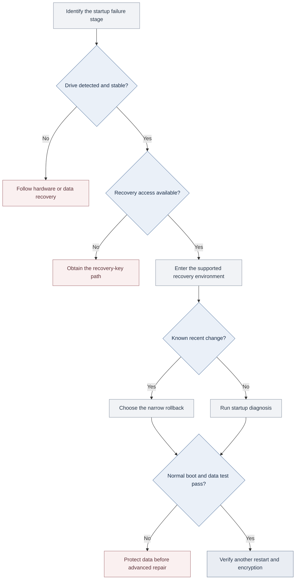

[INTA](https://github.com/Herbertofury/INTA/wiki) / [Decision desk](https://github.com/Herbertofury/INTA/wiki/Decision-Desk) · [Playbooks](https://github.com/Herbertofury/INTA/wiki/Playbooks) · [Tools](https://github.com/Herbertofury/INTA/wiki/Tool-Directory) · [Methods](https://github.com/Herbertofury/INTA/wiki/Methods) · [Open hub](https://herbertofury.github.io/INTA/)

# [Recover a Windows PC that will not boot](https://github.com/Herbertofury/INTA/wiki/Job-boot-recovery)

Separate firmware, storage, encryption, and [Windows](https://www.microsoft.com/windows) startup faults before changing the boot configuration.

**Recovery & boot** · Advanced · 30–120 min · 6 steps

[Quick answer](#quick-answer) · [Decision route](#decision-route) · [Tools](#toolkit) · [Procedure](#walkthrough) · [Verification](#acceptance) · [Sources](#sources) · [Interactive checklist](https://herbertofury.github.io/INTA/#job/boot-recovery)

## ⚡ Quick answer

### 🚀 Fix a PC that will not boot

**Record the startup error and confirm disk health and [BitLocker](https://learn.microsoft.com/en-us/windows/security/operating-system-security/data-protection/bitlocker/) recovery access before attempting repairs.**

1. Check power, attached devices and the selected boot disk; stop if storage is failing.
2. Open [Windows Recovery Environment](https://learn.microsoft.com/en-us/windows-hardware/manufacture/desktop/windows-recovery-environment--windows-re--technical-reference) and run [Startup Repair](https://support.microsoft.com/en-us/windows/experience/startup-boot/startup-repair) for the identified installation when appropriate.
3. Follow the matching recovery branch, verify a normal boot and open priority files before closing the job.

**[Windows Recovery Environment](https://learn.microsoft.com/en-us/windows-hardware/manufacture/desktop/windows-recovery-environment--windows-re--technical-reference)** · [Official page](https://learn.microsoft.com/en-us/windows-hardware/manufacture/desktop/windows-recovery-environment--windows-re--technical-reference) · **[Open recovery instructions](https://learn.microsoft.com/en-us/windows-hardware/manufacture/desktop/windows-recovery-environment--windows-re--technical-reference)**

> [!NOTE]
> **Start here.** Record the exact screen and failure stage. Obtain the device’s recovery-key access path before any firmware, TPM, or boot changes.

## 🧭 Choose a route

View the decision map and escalation routes

**Route links:** [Continue this workflow](#walkthrough) · [Acceptance checks](#acceptance) · [Rescue data from a failing or unreadable drive](https://github.com/Herbertofury/INTA/wiki/Job-failing-drive) · [Build and refresh a technician rescue USB](https://github.com/Herbertofury/INTA/wiki/Job-boot-usb) · [Repair Windows component or system-file corruption](https://github.com/Herbertofury/INTA/wiki/Job-windows-repair) · [Prove a backup can actually restore](https://github.com/Herbertofury/INTA/wiki/Job-backup-restore)

| Checkpoint | What to carry forward |
| --- | --- |
| **Before changing anything** | Preserve recovery-key access and identify the actual [Windows](https://www.microsoft.com/windows) volume. |
| **Keep during the job** | Failure stage, volume layout, recovery action, and its result. |
| **Before handing back** | Two normal boots, accessible data, and healthy encryption. |

## Recommended tools

Select a tool for the next diagnostic or repair step. Check its platform, access and licensing requirements before use.

| Tool / official page + download | Use it for | Platform & access | Documentation |
| --- | --- | --- | --- |
| **[Windows Recovery Environment](https://learn.microsoft.com/en-us/windows-hardware/manufacture/desktop/windows-recovery-environment--windows-re--technical-reference)** · [Official page](https://learn.microsoft.com/en-us/windows-hardware/manufacture/desktop/windows-recovery-environment--windows-re--technical-reference) · **[Open recovery instructions](https://learn.microsoft.com/en-us/windows-hardware/manufacture/desktop/windows-recovery-environment--windows-re--technical-reference)** | A [Windows](https://www.microsoft.com/windows) machine that will not boot or needs supported recovery options. | [Windows](https://www.microsoft.com/windows); Included with [Windows](https://www.microsoft.com/windows) | [Open guide](https://learn.microsoft.com/en-us/windows-hardware/manufacture/desktop/windows-recovery-environment--windows-re--technical-reference) |
| **[Windows 11 installation media](https://www.microsoft.com/software-download/windows11)** · [Official page](https://www.microsoft.com/software-download/windows11) · **[Download media creation tool · EXE](https://go.microsoft.com/fwlink/?linkid=2156295)** | A clean installation or supported repair using the correct [Windows](https://www.microsoft.com/windows) edition and architecture. | [Windows](https://www.microsoft.com/windows), Bootable PC; Download available; [Windows](https://www.microsoft.com/windows) license required | [Open guide](https://www.microsoft.com/software-download/windows11) |
| **[Ventoy](https://www.ventoy.net/)** · [Official page](https://www.ventoy.net/) · **[Download Windows package · ZIP](https://github.com/ventoy/Ventoy/releases/download/v1.1.18/ventoy-1.1.18-windows.zip)** | Maintaining a technician USB with several independently updated rescue images. | [Windows](https://www.microsoft.com/windows), [Linux](https://www.kernel.org/); Free / open source | [Open guide](https://www.ventoy.net/en/doc_start.html) |
| **[Rufus](https://rufus.ie/)** · [Official page](https://rufus.ie/) · **[Download Windows x64 portable · EXE](https://github.com/pbatard/rufus/releases/download/v4.16/rufus-4.16p.exe)** | Preparing one ISO on a dedicated USB drive. | [Windows](https://www.microsoft.com/windows); Free / open source | [Open guide](https://github.com/pbatard/rufus/wiki/FAQ) |
| **[SystemRescue](https://www.system-rescue.org/)** · [Official page](https://www.system-rescue.org/) · **[Download x64 rescue image · ISO](https://fastly-cdn.system-rescue.org/releases/13.03/systemrescue-13.03-amd64.iso)** | A ready-made [Linux](https://www.kernel.org/) recovery environment for an unbootable or damaged machine. | Bootable PC; Free / open source | [Open guide](https://www.system-rescue.org/manual/) |
| **[Hiren's BootCD PE](https://www.hirensbootcd.org/)** · [Official page](https://www.hirensbootcd.org/) · **[Download x64 rescue image · ISO](https://www.hirensbootcd.org/files/HBCD_PE_x64.iso)** | A familiar [Windows](https://www.microsoft.com/windows)-oriented offline bench toolkit. | Bootable PC; Free distribution; bundled tools have individual terms | [Open guide](https://www.hirensbootcd.org/howtos/) |

## Procedure

Work in order, record the result of each step, and change route when the evidence calls for it.

### 01 · Identify the failure stage

- [ ] Check whether the system powers on, completes firmware POST, detects its drive, reaches [Windows](https://www.microsoft.com/windows) Boot Manager, or fails after the [Windows](https://www.microsoft.com/windows) logo. Disconnect only nonessential peripherals. A missing drive or hardware error goes to hardware or failing-drive diagnosis.

### 02 · Protect data and encryption access

- [ ] Confirm the [BitLocker](https://learn.microsoft.com/en-us/windows/security/operating-system-security/data-protection/bitlocker/) recovery key is available through the customer’s approved account or management system. Never publish it in the wiki or ticket attachments visible to unrelated staff. Do not clear the TPM, initialize the disk, or reinstall over the only data copy.

### 03 · Enter [Windows Recovery Environment](https://learn.microsoft.com/en-us/windows-hardware/manufacture/desktop/windows-recovery-environment--windows-re--technical-reference)

- [ ] Use the built-in recovery environment or official [Windows installation media](https://www.microsoft.com/software-download/windows11) and select Repair my PC. Check the actual volume layout and encryption status before working on an offline installation; drive letters can differ from the normal [Windows](https://www.microsoft.com/windows) session.

### 04 · Try the narrow recovery option

- [ ] Use [Startup Repair](https://support.microsoft.com/en-us/windows/experience/startup-boot/startup-repair) for a startup fault. If the failure follows a known update or driver change, consider the relevant update removal or restore option after checking its effect on data. Review the result before trying another repair.

### 05 · Reserve manual boot edits for a confirmed diagnosis

- [ ] If boot files or the EFI partition require repair, follow Microsoft’s procedure for the observed firmware mode, disk layout, and [Windows](https://www.microsoft.com/windows) installation. Have another technician verify the selected partitions. Do not paste generic bootrec, [bcdboot](https://learn.microsoft.com/en-us/windows-hardware/manufacture/desktop/bcdboot-command-line-options-techref-di), [diskpart](https://learn.microsoft.com/en-us/windows-server/administration/windows-commands/diskpart), or format sequences.

### 06 · Boot, validate, and preserve a recovery path

- [ ] Test a normal boot and a second restart, confirm encryption is healthy, and run the real business workflow. Record the root cause and boot changes. If recovery remains uncertain, export or image the data before planning a supported reinstall.

## Verification

- [ ] The correct [Windows](https://www.microsoft.com/windows) installation boots reliably twice.
- [ ] User data, required applications, and encryption remain accessible.
- [ ] Recovery-key escrow and backup status are confirmed.

> [!WARNING]
> **Pause this route and escalate when:**
> - The recovery key or correct target disk cannot be established.
> - The drive shows physical failure or the proposed action would overwrite the only copy.

## Related playbooks

| Next playbook | What it resolves |
| --- | --- |
| [Rescue data from a failing or unreadable drive](https://github.com/Herbertofury/INTA/wiki/Job-failing-drive) | Preserve the source, create a recoverable image, and perform recovery on a copy. |
| [Build and refresh a technician rescue USB](https://github.com/Herbertofury/INTA/wiki/Job-boot-usb) | Keep verified recovery images, [Windows repair](https://github.com/Herbertofury/INTA/wiki/Job-windows-repair) media, and the INTA knowledge hub ready for offline use. |
| [Repair Windows component or system-file corruption](https://github.com/Herbertofury/INTA/wiki/Job-windows-repair) | Use [Windows](https://www.microsoft.com/windows) servicing tools in a sensible order and validate the specific broken feature. |
| [Prove a backup can actually restore](https://github.com/Herbertofury/INTA/wiki/Job-backup-restore) | Validate recovery credentials, data integrity, application usability, and recovery time. |

## Official sources

References and review notes

- [Microsoft: Windows recovery environment](https://support.microsoft.com/en-us/windows/experience/backup-recovery/windows-recovery-environment)
- [Microsoft: startup troubleshooting](https://learn.microsoft.com/en-us/windows/client-management/advanced-troubleshooting-boot-problems)

Reviewed **2026-11-26**. Timing is a planning range. A successful command is evidence about that operation; acceptance belongs to the user’s original task.

---

Editorial review: **2026-11-26** · [Review standard](https://github.com/Herbertofury/INTA/wiki/Knowledge-Standards) · [Suggest a correction](https://github.com/Herbertofury/INTA/issues/new/choose)
