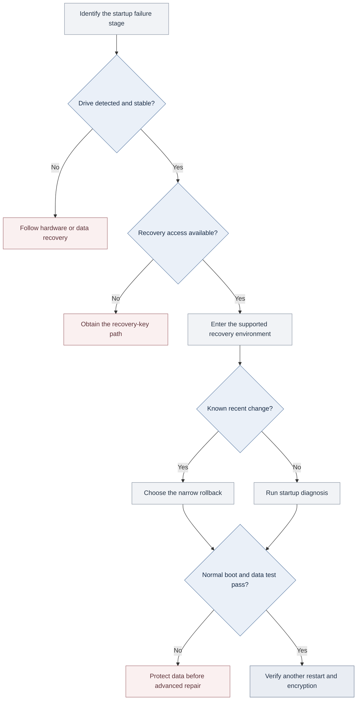

[INTA](https://github.com/Herbertofury/INTA/wiki) / [Decision desk](https://github.com/Herbertofury/INTA/wiki/Decision-Desk) · [Service map](https://github.com/Herbertofury/INTA/wiki/Service-Map) · [Playbooks](https://github.com/Herbertofury/INTA/wiki/Playbooks) · [Tools](https://github.com/Herbertofury/INTA/wiki/Tool-Directory) · [Methods](https://github.com/Herbertofury/INTA/wiki/Methods) · [Open hub](https://herbertofury.github.io/INTA/)

# [Recover a Windows PC that will not boot](https://github.com/Herbertofury/INTA/wiki/Job-boot-recovery)

Separate firmware, storage, encryption, and [Windows](https://www.microsoft.com/windows) startup faults before changing the boot configuration.

**Recovery & boot** · Advanced · 30–120 min · 6 steps

[Tools and useful links](#working-kit) · [Quick answer](#quick-answer) · [Next action](#next-action) · [Specific fixes](#specific-fixes) · [Decision route](#decision-route) · [Tools](#toolkit) · [Procedure](#walkthrough) · [Verification](#acceptance) · [Sources](#sources) · [Interactive checklist](https://herbertofury.github.io/INTA/#job/boot-recovery)

## 🧰 Choose the tool for this job

Choose by the task shown in the first column. Each option includes its acquisition route and access boundary.

| Need | Official tool + exact action | Why this choice / access |
| --- | --- | --- |
| **[Startup recovery](https://github.com/Herbertofury/INTA/wiki/Job-boot-recovery)** | **[Windows Recovery Environment](https://learn.microsoft.com/en-us/windows-hardware/manufacture/desktop/windows-recovery-environment--windows-re--technical-reference)** · **[Open recovery instructions](https://learn.microsoft.com/en-us/windows-hardware/manufacture/desktop/windows-recovery-environment--windows-re--technical-reference)** | Use the least disruptive applicable recovery option after preserving data and recovery keys. **Access:** Included with supported [Windows](https://www.microsoft.com/windows) |
| **Trusted repair media** | **[Windows 11 installation media](https://www.microsoft.com/software-download/windows11)** · **[Download media creation tool · EXE](https://go.microsoft.com/fwlink/?linkid=2156295)** | Create official matching-architecture media on a working PC when local recovery is unavailable. **Access:** Media is free; [Windows](https://www.microsoft.com/windows) licensing remains separate. |
| **Preserve unstable storage** | **[SystemRescue](https://www.system-rescue.org/)** · **[Download x64 rescue image · ISO](https://fastly-cdn.system-rescue.org/releases/13.03/systemrescue-13.03-amd64.iso)** | Use a separate recovery environment for image-first work when the disk may be failing. **Access:** Free and open source |
| **Eligible widespread failure** | **[Quick machine recovery](https://learn.microsoft.com/en-us/windows/configuration/quick-machine-recovery/?tabs=csp)** · **[Check supported recovery setup](https://learn.microsoft.com/en-us/windows/configuration/quick-machine-recovery/?tabs=csp)** | Check the configured cloud recovery option on a supported device when a matching widespread boot remedy exists. **Access:** Included on eligible, configured [Windows](https://www.microsoft.com/windows) devices. |

**[Current selection evidence](https://github.com/Herbertofury/INTA/wiki/Current-Tool-Choices)**

## 🧰 Tools and links for this job

**[Open working view](https://herbertofury.github.io/INTA/#job/boot-recovery)** · Keep the tool panel beside the instructions.

**First move:** Record the exact startup screen. Check whether firmware sees the disk and whether [BitLocker](https://learn.microsoft.com/en-us/windows/security/operating-system-security/data-protection/bitlocker/) recovery material is available before repair.

| Use this for | Official tool + exact action |
| --- | --- |
| Open built-in startup and recovery tools. | **[Windows Recovery Environment](https://learn.microsoft.com/en-us/windows-hardware/manufacture/desktop/windows-recovery-environment--windows-re--technical-reference)** · [Official page](https://learn.microsoft.com/en-us/windows-hardware/manufacture/desktop/windows-recovery-environment--windows-re--technical-reference) · **[Open recovery instructions](https://learn.microsoft.com/en-us/windows-hardware/manufacture/desktop/windows-recovery-environment--windows-re--technical-reference)** |
| Create trusted repair media on a working PC. | **[Windows 11 installation media](https://www.microsoft.com/software-download/windows11)** · [Official page](https://www.microsoft.com/software-download/windows11) · **[Download media creation tool · EXE](https://go.microsoft.com/fwlink/?linkid=2156295)** |
| Preserve an unstable disk before boot-repair writes. | **[SystemRescue](https://www.system-rescue.org/)** · [Official page](https://www.system-rescue.org/) · **[Download x64 rescue image · ISO](https://fastly-cdn.system-rescue.org/releases/13.03/systemrescue-13.03-amd64.iso)** |
| Check for a matching cloud remedy on eligible, configured devices with a widespread startup failure. | **[Quick machine recovery](https://learn.microsoft.com/en-us/windows/configuration/quick-machine-recovery/?tabs=csp)** · [Official page](https://learn.microsoft.com/en-us/windows/configuration/quick-machine-recovery/?tabs=csp) · **[Check supported recovery setup](https://learn.microsoft.com/en-us/windows/configuration/quick-machine-recovery/?tabs=csp)** |

### [Startup repair](https://support.microsoft.com/en-us/windows/experience/startup-boot/startup-repair)

| Open the exact resource | What to do there |
| --- | --- |
| **[Enter Windows Recovery Environment](https://support.microsoft.com/en-us/windows/experience/backup-recovery/windows-recovery-environment)** | Use supported recovery media or the available advanced-startup path. |
| **[Diagnose the failed boot stage](https://learn.microsoft.com/en-us/windows/client-management/advanced-troubleshooting-boot-problems)** | Separate firmware, boot manager, loader and OS failures. |

### Unlock the intended disk

| Open the exact resource | What to do there |
| --- | --- |
| **[Find the matching BitLocker recovery key](https://support.microsoft.com/en-us/windows/security/encryption/find-your-bitlocker-recovery-key)** | Match the on-screen key ID with the approved personal or organization recovery record. |

### Recovery

| Open the exact resource | What to do there |
| --- | --- |
| **[Choose a recovery operation](https://support.microsoft.com/en-us/windows/experience/backup-recovery/recovery-options-in-windows)** | Check the data and application effects before reset or reinstall. |

### Current recovery

| Open the exact resource | What to do there |
| --- | --- |
| **[Quick machine recovery — conditional](https://learn.microsoft.com/en-us/windows/configuration/quick-machine-recovery/?tabs=csp)** | [Windows 11](https://www.microsoft.com/windows/windows-11) 24H2 build 26100.4700 or later; verify policy, network access and a matching remedy. Enterprise defaults can be off. |

## ⚡ Quick answer

### 🚀 Fix a PC that will not boot

**Record the startup error and confirm disk health and [BitLocker](https://learn.microsoft.com/en-us/windows/security/operating-system-security/data-protection/bitlocker/) recovery access before attempting repairs.**

1. Check power, attached devices and the selected boot disk; stop if storage is failing.
2. Open [Windows Recovery Environment](https://learn.microsoft.com/en-us/windows-hardware/manufacture/desktop/windows-recovery-environment--windows-re--technical-reference) and run [Startup Repair](https://support.microsoft.com/en-us/windows/experience/startup-boot/startup-repair) for the identified installation when appropriate.
3. Follow the matching recovery branch, verify a normal boot and open priority files before closing the job.

**[Windows Recovery Environment](https://learn.microsoft.com/en-us/windows-hardware/manufacture/desktop/windows-recovery-environment--windows-re--technical-reference)** · [Official page](https://learn.microsoft.com/en-us/windows-hardware/manufacture/desktop/windows-recovery-environment--windows-re--technical-reference) · **[Open recovery instructions](https://learn.microsoft.com/en-us/windows-hardware/manufacture/desktop/windows-recovery-environment--windows-re--technical-reference)**

## 🧭 Match the symptom

| You see this | Do this next | You should get |
| --- | --- | --- |
| **Firmware does not list the intended disk** | Check the correct storage device and connection using the hardware procedure; stop if the disk is unstable. | The disk is detected consistently or the job is routed to hardware/[data recovery](https://github.com/Herbertofury/INTA/wiki/Job-failing-drive). |
| **[BitLocker](https://learn.microsoft.com/en-us/windows/security/operating-system-security/data-protection/bitlocker/) asks for a recovery key** | Match the displayed key ID to the approved recovery record; keep the key out of the public ticket or wiki. | The correct encrypted volume unlocks without a reset or format. |
| **The disk is stable but [Windows](https://www.microsoft.com/windows) cannot start** | Open [WinRE](https://learn.microsoft.com/en-us/windows-hardware/manufacture/desktop/windows-recovery-environment--windows-re--technical-reference) > Troubleshoot > Advanced options > [Startup Repair](https://support.microsoft.com/en-us/windows/experience/startup-boot/startup-repair) for the identified installation. | [Startup Repair](https://support.microsoft.com/en-us/windows/experience/startup-boot/startup-repair) reports its result and a normal boot can be tested. |
| **A broad known startup failure may have a cloud remedy** | Check supported [Quick machine recovery](https://learn.microsoft.com/en-us/windows/configuration/quick-machine-recovery/?tabs=csp) availability, network access and organization policy in the recovery interface. | A remedy is offered and tested, or ordinary recovery continues without assuming a cloud fix exists. |
| **A recent update or driver change is the established trigger** | Use the applicable uninstall or restore choice in [WinRE](https://learn.microsoft.com/en-us/windows-hardware/manufacture/desktop/windows-recovery-environment--windows-re--technical-reference) after confirming recovery access and data protection. | [Windows](https://www.microsoft.com/windows) boots without losing the required files and the triggering change is documented. |

### ✅ Finish the job

- [ ] The device boots normally twice and the user can open priority files.
- [ ] The intended boot disk and encryption recovery remain available.

**Change route when:** The disk fails, disconnects or contains the only unprotected data copy. · Recovery keys or the identity of the target installation are uncertain.

### 🎯 Go straight to a specific fix

- **[Find a disk missing from recovery media](#fix-boot-installer-cannot-see-storage)** — Firmware sees the disk but [Windows](https://www.microsoft.com/windows) installation or recovery media does not.
- **[Identify the Windows volume inside recovery](#fix-boot-check-recovery-drive-letters)** — An offline repair cannot find [Windows](https://www.microsoft.com/windows) or appears to target the wrong drive.
- **[Find the matching BitLocker key](#fix-boot-recovery-key-does-not-match)** — A stored recovery key is rejected or several similarly named device records exist.

> [!NOTE]
> **Start here.** Record the exact screen and failure stage. Obtain the device’s recovery-key access path before any firmware, TPM, or boot changes.

## 🧭 Choose a route

**Route links:** [Continue this workflow](#walkthrough) · [Acceptance checks](#acceptance) · [Rescue data from a failing or unreadable drive](https://github.com/Herbertofury/INTA/wiki/Job-failing-drive) · [Build and refresh a technician rescue USB](https://github.com/Herbertofury/INTA/wiki/Job-boot-usb) · [Repair Windows component or system-file corruption](https://github.com/Herbertofury/INTA/wiki/Job-windows-repair) · [Prove a backup can actually restore](https://github.com/Herbertofury/INTA/wiki/Job-backup-restore)

| Checkpoint | What to carry forward |
| --- | --- |
| **Before changing anything** | Preserve recovery-key access and identify the actual [Windows](https://www.microsoft.com/windows) volume. |
| **Keep during the job** | Failure stage, volume layout, recovery action, and its result. |
| **Before handing back** | Two normal boots, accessible data, and healthy encryption. |

## Recommended tools

Select a tool for the next diagnostic or repair step. Check its platform, access and licensing requirements before use.

| Tool / official page + download | Use it for | Platform & access | Documentation |
| --- | --- | --- | --- |
| **[Windows Recovery Environment](https://learn.microsoft.com/en-us/windows-hardware/manufacture/desktop/windows-recovery-environment--windows-re--technical-reference)** · [Official page](https://learn.microsoft.com/en-us/windows-hardware/manufacture/desktop/windows-recovery-environment--windows-re--technical-reference) · **[Open recovery instructions](https://learn.microsoft.com/en-us/windows-hardware/manufacture/desktop/windows-recovery-environment--windows-re--technical-reference)** | Open built-in startup and recovery tools. | [Windows](https://www.microsoft.com/windows); Included with [Windows](https://www.microsoft.com/windows) | [Open guide](https://learn.microsoft.com/en-us/windows-hardware/manufacture/desktop/windows-recovery-environment--windows-re--technical-reference) |
| **[Windows 11 installation media](https://www.microsoft.com/software-download/windows11)** · [Official page](https://www.microsoft.com/software-download/windows11) · **[Download media creation tool · EXE](https://go.microsoft.com/fwlink/?linkid=2156295)** | Create trusted repair media on a working PC. | [Windows](https://www.microsoft.com/windows), Bootable PC; Download available; [Windows](https://www.microsoft.com/windows) license required | [Open guide](https://www.microsoft.com/software-download/windows11) |
| **[SystemRescue](https://www.system-rescue.org/)** · [Official page](https://www.system-rescue.org/) · **[Download x64 rescue image · ISO](https://fastly-cdn.system-rescue.org/releases/13.03/systemrescue-13.03-amd64.iso)** | Preserve an unstable disk before boot-repair writes. | Bootable PC; Free / open source | [Open guide](https://www.system-rescue.org/manual/) |
| **[Quick machine recovery](https://learn.microsoft.com/en-us/windows/configuration/quick-machine-recovery/?tabs=csp)** · [Official page](https://learn.microsoft.com/en-us/windows/configuration/quick-machine-recovery/?tabs=csp) · **[Check supported recovery setup](https://learn.microsoft.com/en-us/windows/configuration/quick-machine-recovery/?tabs=csp)** | Check for a matching cloud remedy on eligible, configured devices with a widespread startup failure. | [Windows 11](https://www.microsoft.com/windows/windows-11), [Windows Server](https://learn.microsoft.com/en-us/windows-server/) 2025; Included with supported [Windows](https://www.microsoft.com/windows); availability depends on release, edition and management policy | [Open guide](https://learn.microsoft.com/en-us/windows/configuration/quick-machine-recovery/?tabs=csp) |
| **[Ventoy](https://www.ventoy.net/)** · [Official page](https://www.ventoy.net/) · **[Download Windows package · ZIP](https://github.com/ventoy/Ventoy/releases/download/v1.1.18/ventoy-1.1.18-windows.zip)** | Maintaining a technician USB with several independently updated rescue images. | [Windows](https://www.microsoft.com/windows), [Linux](https://www.kernel.org/); Free / open source | [Open guide](https://www.ventoy.net/en/doc_start.html) |
| **[Rufus](https://rufus.ie/)** · [Official page](https://rufus.ie/) · **[Download Windows x64 portable · EXE](https://github.com/pbatard/rufus/releases/download/v4.16/rufus-4.16p.exe)** | Preparing one ISO on a dedicated USB drive. | [Windows](https://www.microsoft.com/windows); Free / open source | [Open guide](https://github.com/pbatard/rufus/wiki/FAQ) |
| **[Hiren's BootCD PE](https://www.hirensbootcd.org/)** · [Official page](https://www.hirensbootcd.org/) · **[Download x64 rescue image · ISO](https://www.hirensbootcd.org/files/HBCD_PE_x64.iso)** | A familiar [Windows](https://www.microsoft.com/windows)-oriented offline bench toolkit. | Bootable PC; Free distribution; bundled tools have individual terms | [Open guide](https://www.hirensbootcd.org/howtos/) |

## Procedure

Work in order, record the result of each step, and change route when the evidence calls for it.

### 01 · Identify the failure stage

- [ ] Check whether the system powers on, completes firmware POST, detects its drive, reaches [Windows](https://www.microsoft.com/windows) Boot Manager, or fails after the [Windows](https://www.microsoft.com/windows) logo. Disconnect only nonessential peripherals. A missing drive or hardware error goes to hardware or failing-drive diagnosis.

### 02 · Protect data and encryption access

- [ ] Confirm the [BitLocker](https://learn.microsoft.com/en-us/windows/security/operating-system-security/data-protection/bitlocker/) recovery key is available through the customer’s approved account or management system. Never publish it in the wiki or ticket attachments visible to unrelated staff. Do not clear the TPM, initialize the disk, or reinstall over the only data copy.

### 03 · Enter [Windows Recovery Environment](https://learn.microsoft.com/en-us/windows-hardware/manufacture/desktop/windows-recovery-environment--windows-re--technical-reference)

- [ ] Use the built-in recovery environment or official [Windows installation media](https://www.microsoft.com/software-download/windows11) and select Repair my PC. Check the actual volume layout and encryption status before working on an offline installation; drive letters can differ from the normal [Windows](https://www.microsoft.com/windows) session.

### 04 · Try the narrow recovery option

- [ ] Use [Startup Repair](https://support.microsoft.com/en-us/windows/experience/startup-boot/startup-repair) for a startup fault. If the failure follows a known update or driver change, consider the relevant update removal or restore option after checking its effect on data. Review the result before trying another repair.

### 05 · Reserve manual boot edits for a confirmed diagnosis

- [ ] If boot files or the EFI partition require repair, follow Microsoft’s procedure for the observed firmware mode, disk layout, and [Windows](https://www.microsoft.com/windows) installation. Have another technician verify the selected partitions. Do not paste generic bootrec, [bcdboot](https://learn.microsoft.com/en-us/windows-hardware/manufacture/desktop/bcdboot-command-line-options-techref-di), [diskpart](https://learn.microsoft.com/en-us/windows-server/administration/windows-commands/diskpart), or format sequences.

### 06 · Boot, validate, and preserve a recovery path

- [ ] Test a normal boot and a second restart, confirm encryption is healthy, and run the real business workflow. Record the root cause and boot changes. If recovery remains uncertain, export or image the data before planning a supported reinstall.

## Verification

- [ ] The correct [Windows](https://www.microsoft.com/windows) installation boots reliably twice.
- [ ] User data, required applications, and encryption remain accessible.
- [ ] Recovery-key escrow and backup status are confirmed.

> [!WARNING]
> **Pause this route and escalate when:**
> - The recovery key or correct target disk cannot be established.
> - The drive shows physical failure or the proposed action would overwrite the only copy.

## 🎯 Specific fixes

Choose the case that matches the evidence. Each case gives a first action, a short procedure and a result to prove.

### Find a disk missing from recovery media

**Use when:** Firmware sees the disk but [Windows](https://www.microsoft.com/windows) installation or recovery media does not.

**Start here:** Confirm the disk is consistently detected in firmware and identify the exact storage controller/model.

**[Windows 11 installation media](https://www.microsoft.com/software-download/windows11)** · [Official page](https://www.microsoft.com/software-download/windows11) · **[Download media creation tool · EXE](https://go.microsoft.com/fwlink/?linkid=2156295)**

**[Official OEM driver and firmware portals](https://support.microsoft.com/en-us/windows/hardware/drivers/update-drivers-through-device-manager-in-windows)** · [Official page](https://support.microsoft.com/en-us/windows/hardware/drivers/update-drivers-through-device-manager-in-windows) · **[Find the correct driver source](https://support.microsoft.com/en-us/windows/hardware/drivers/update-drivers-through-device-manager-in-windows)**

1. Obtain the model-specific storage-controller driver for the recovery environment’s architecture from the OEM.
2. Use the supported Load driver option in [Windows](https://www.microsoft.com/windows) Setup where applicable, then inspect the disk list again.
3. Keep the original storage-controller mode documented; do not change RAID/VMD/AHCI settings as an unexplained workaround.

**Prove it worked:** The correct disk and existing partitions appear without initializing, formatting or altering the storage mode.

**If this does not resolve it:** If firmware detection is unstable or the OEM driver does not expose the disk, move to hardware/[data recovery](https://github.com/Herbertofury/INTA/wiki/Job-failing-drive) before write operations.

**Official evidence:** [Source 1](https://learn.microsoft.com/en-us/windows-hardware/manufacture/desktop/add-device-drivers-to-windows-during-windows-setup) · Reviewed 2026-11-26

[Back to specific fixes](#specific-fixes) · [Full procedure](#walkthrough)

### Identify the [Windows](https://www.microsoft.com/windows) volume inside recovery

**Use when:** An offline repair cannot find [Windows](https://www.microsoft.com/windows) or appears to target the wrong drive.

**Start here:** Treat drive letters in the recovery environment as unverified until the actual volumes are identified.

**[Windows Recovery Environment](https://learn.microsoft.com/en-us/windows-hardware/manufacture/desktop/windows-recovery-environment--windows-re--technical-reference)** · [Official page](https://learn.microsoft.com/en-us/windows-hardware/manufacture/desktop/windows-recovery-environment--windows-re--technical-reference) · **[Open recovery instructions](https://learn.microsoft.com/en-us/windows-hardware/manufacture/desktop/windows-recovery-environment--windows-re--technical-reference)**

**[DISM](https://learn.microsoft.com/en-us/windows-hardware/manufacture/desktop/repair-a-windows-image)** · [Official page](https://learn.microsoft.com/en-us/windows-hardware/manufacture/desktop/repair-a-windows-image) · **[Open built-in repair instructions](https://learn.microsoft.com/en-us/windows-hardware/manufacture/desktop/repair-a-windows-image)**

1. In the recovery [Command Prompt](https://learn.microsoft.com/en-us/windows-server/administration/windows-commands/cmd), run [diskpart](https://learn.microsoft.com/en-us/windows-server/administration/windows-commands/diskpart), then list volume, then exit; compare volume sizes and labels without formatting or modifying partitions, and verify the candidate volume’s encryption state.
2. Inspect the candidate volume for the expected [Windows](https://www.microsoft.com/windows) and user folders; unlock the intended encrypted volume through its approved recovery key if required.
3. Use that verified volume only in the product’s documented offline repair syntax and retain the target identity in the private ticket.

**Prove it worked:** The offline operation addresses the intended installation, not the USB, recovery partition or another attached disk.

**If this does not resolve it:** Stop if the target cannot be distinguished or the source is failing; never assume that C: identifies the installed OS in recovery.

**Official evidence:** [Source 1](https://learn.microsoft.com/en-us/windows-server/administration/windows-commands/list-volume) · [Source 2](https://learn.microsoft.com/en-us/windows-hardware/manufacture/desktop/repair-a-windows-image) · Reviewed 2026-11-26

[Back to specific fixes](#specific-fixes) · [Full procedure](#walkthrough)

### Find the matching [BitLocker](https://learn.microsoft.com/en-us/windows/security/operating-system-security/data-protection/bitlocker/) key

**Use when:** A stored recovery key is rejected or several similarly named device records exist.

**Start here:** Read the recovery-key ID displayed by the affected device.

**[Windows Recovery Environment](https://learn.microsoft.com/en-us/windows-hardware/manufacture/desktop/windows-recovery-environment--windows-re--technical-reference)** · [Official page](https://learn.microsoft.com/en-us/windows-hardware/manufacture/desktop/windows-recovery-environment--windows-re--technical-reference) · **[Open recovery instructions](https://learn.microsoft.com/en-us/windows-hardware/manufacture/desktop/windows-recovery-environment--windows-re--technical-reference)**

1. Use a separate trusted device to open the approved personal or organization recovery store and match the key ID, not just the computer name.
2. Check the account that originally enabled encryption or the organization’s administrator-held record when the expected account has no match.
3. Enter the matching recovery key locally and verify the intended volume unlocks; record only the approved private reference in the service ticket.

**Prove it worked:** The encrypted installation unlocks with the record matching its displayed key ID.

**If this does not resolve it:** If no valid key is available, stop data-destructive reset/reinstall decisions until the owner understands the recovery limit.

**Official evidence:** [Source 1](https://support.microsoft.com/en-us/windows/security/encryption/find-your-bitlocker-recovery-key) · Reviewed 2026-11-26

[Back to specific fixes](#specific-fixes) · [Full procedure](#walkthrough)

## Related playbooks

| Next playbook | What it resolves |
| --- | --- |
| [Rescue data from a failing or unreadable drive](https://github.com/Herbertofury/INTA/wiki/Job-failing-drive) | Preserve the source, create a recoverable image, and perform recovery on a copy. |
| [Build and refresh a technician rescue USB](https://github.com/Herbertofury/INTA/wiki/Job-boot-usb) | Keep verified recovery images, [Windows repair](https://github.com/Herbertofury/INTA/wiki/Job-windows-repair) media, and the INTA knowledge hub ready for offline use. |
| [Repair Windows component or system-file corruption](https://github.com/Herbertofury/INTA/wiki/Job-windows-repair) | Use [Windows](https://www.microsoft.com/windows) servicing tools in a sensible order and validate the specific broken feature. |
| [Prove a backup can actually restore](https://github.com/Herbertofury/INTA/wiki/Job-backup-restore) | Validate recovery credentials, data integrity, application usability, and recovery time. |

## Official sources

- [Microsoft: Windows recovery environment](https://support.microsoft.com/en-us/windows/experience/backup-recovery/windows-recovery-environment)
- [Microsoft: startup troubleshooting](https://learn.microsoft.com/en-us/windows/client-management/advanced-troubleshooting-boot-problems)

Reviewed **2026-11-26**. Timing is a planning range. A successful command is evidence about that operation; acceptance belongs to the user’s original task.

---

Editorial review: **2026-11-26** · [Review standard](https://github.com/Herbertofury/INTA/wiki/Knowledge-Standards) · [Suggest a correction](https://github.com/Herbertofury/INTA/issues/new/choose)
