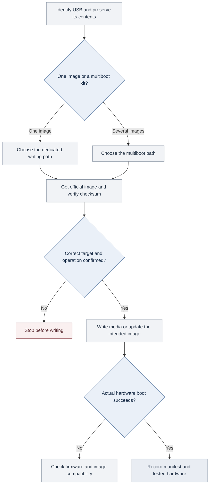

[INTA](https://github.com/Herbertofury/INTA/wiki) / [Decision desk](https://github.com/Herbertofury/INTA/wiki/Decision-Desk) · [Playbooks](https://github.com/Herbertofury/INTA/wiki/Playbooks) · [Tools](https://github.com/Herbertofury/INTA/wiki/Tool-Directory) · [Methods](https://github.com/Herbertofury/INTA/wiki/Methods) · [Open hub](https://herbertofury.github.io/INTA/)

# [Build and refresh a technician rescue USB](https://github.com/Herbertofury/INTA/wiki/Job-boot-usb)

Keep verified recovery images, [Windows repair](https://github.com/Herbertofury/INTA/wiki/Job-windows-repair) media, and the INTA knowledge hub ready for offline use.

**Recovery & boot** · Intermediate · 20–60 min plus downloads · 6 steps

[Decision route](#decision-route) · [Tools](#toolkit) · [Procedure](#walkthrough) · [Verification](#acceptance) · [Sources](#sources) · [Interactive checklist](https://herbertofury.github.io/INTA/#job/boot-usb)

> [!NOTE]
> **Start here.** Choose a known USB drive and copy off anything that must be kept. Confirm its model, capacity, and contents before a media-writing operation.

## 🧭 Choose a route

View the decision map and escalation routes

**Route links:** [Continue this workflow](#walkthrough) · [Acceptance checks](#acceptance) · [Recover a Windows PC that will not boot](https://github.com/Herbertofury/INTA/wiki/Job-boot-recovery) · [Rescue data from a failing or unreadable drive](https://github.com/Herbertofury/INTA/wiki/Job-failing-drive) · [Prove a backup can actually restore](https://github.com/Herbertofury/INTA/wiki/Job-backup-restore)

| Checkpoint | What to carry forward |
| --- | --- |
| **Before changing anything** | Identify the USB and save anything that must be retained. |
| **Keep during the job** | Official image, checksum, selected operation, and boot-test hardware. |
| **Before handing back** | Required tools and offline guide work on the actual boot path. |

## Recommended tools

Select a tool for the next diagnostic or repair step. Check its platform, access and licensing requirements before use.

| Tool / official download | Use it for | Platform & access | Documentation |
| --- | --- | --- | --- |
| [Ventoy](https://www.ventoy.net/en/download.html) | Maintaining a technician USB with several independently updated rescue images. | [Windows](https://www.microsoft.com/windows), [Linux](https://www.kernel.org/); Free / open source | [Open guide](https://www.ventoy.net/en/doc_start.html) |
| [Rufus](https://rufus.ie/#download) | Preparing one ISO on a dedicated USB drive. | [Windows](https://www.microsoft.com/windows); Free / open source | [Open guide](https://github.com/pbatard/rufus/wiki/FAQ) |
| [Windows 11 installation media](https://www.microsoft.com/software-download/windows11) | A clean installation or supported repair using the correct [Windows](https://www.microsoft.com/windows) edition and architecture. | [Windows](https://www.microsoft.com/windows), Bootable PC; Download available; [Windows](https://www.microsoft.com/windows) license required | [Open guide](https://www.microsoft.com/software-download/windows11) |
| [SystemRescue](https://www.system-rescue.org/Download/) | A ready-made [Linux](https://www.kernel.org/) recovery environment for an unbootable or damaged machine. | Bootable PC; Free / open source | [Open guide](https://www.system-rescue.org/manual/) |
| [Hiren's BootCD PE](https://www.hirensbootcd.org/download/) | A familiar [Windows](https://www.microsoft.com/windows)-oriented offline bench toolkit. | Bootable PC; Free distribution; bundled tools have individual terms | [Open guide](https://www.hirensbootcd.org/howtos/) |
| [Rescuezilla](https://rescuezilla.com/download) | A visual bare-metal backup or restore workflow at the bench. | Bootable PC; Free / open source | [Open guide](https://rescuezilla.com/help) |

## Procedure

Work in order, record the result of each step, and change route when the evidence calls for it.

### 01 · Choose the media strategy

- [ ] Use [Ventoy](https://www.ventoy.net/) for a multiboot collection that can be refreshed by copying ISO files, or [Rufus](https://rufus.ie/) for a dedicated image. Keep official [Windows](https://www.microsoft.com/windows) media for [WinRE](https://learn.microsoft.com/en-us/windows-hardware/manufacture/desktop/windows-recovery-environment--windows-re--technical-reference) and [Windows](https://www.microsoft.com/windows)-native repair alongside [Linux](https://www.kernel.org/)-based rescue tools. An ISO’s platform determines which tools run inside it.

### 02 · Download from the official source

- [ ] Use the catalog’s official download links and keep release notes and vendor checksums with each image. Use the INTA [Media Creator](https://github.com/Herbertofury/INTA/blob/main/docs/rescue.md) for its verified INTA ISO download/update flow. A current boot environment does not guarantee every bundled third-party tool is current.

### 03 · Verify the bytes before writing

- [ ] Compare the local SHA-256 hash with the release’s published checksum using the exact file path. In [PowerShell](https://learn.microsoft.com/en-us/powershell/), select the downloaded ISO and run Get-FileHash for that file. The hash proves a match to the published value; also verify you obtained that value from the genuine release.

### 04 · Write or update the chosen device

- [ ] Installing [Ventoy](https://www.ventoy.net/) or writing with [Rufus](https://rufus.ie/) can erase the selected USB. Review the device identity before confirming. Use [Ventoy](https://www.ventoy.net/)’s Update operation for an existing [Ventoy](https://www.ventoy.net/) installation when intended, and copy refreshed verified ISOs to its data partition. Keep a rollback image until the new one boots.

### 05 · Test the actual boot path

- [ ] Boot the USB on a representative spare machine and confirm keyboard, display, storage, network, and recovery tools. Test the intended firmware mode. Read [Ventoy](https://www.ventoy.net/)’s current Secure Boot documentation before enrolling keys or changing firmware settings; firmware and image support must be proven on the target hardware.

### 06 · Keep an offline manifest and refresh on demand

- [ ] Record image name, source URL, release, hash, download date, and successful boot test. Include the INTA offline hub and keep client evidence on a separate encrypted destination. Refresh before a service visit and re-verify changed images instead of assuming the old USB is current.

## Verification

- [ ] Each image matches its official checksum where one is provided.
- [ ] The intended USB boots and can see required hardware.
- [ ] The offline hub and recovery destination are accessible.
- [ ] The manifest distinguishes downloaded, verified, and hardware-boot-tested images.

> [!WARNING]
> **Pause this route and escalate when:**
> - The target USB is ambiguous or contains the only copy of important data.
> - Secure Boot or encryption changes are proposed without a recovery plan.

## Related playbooks

| Next playbook | What it resolves |
| --- | --- |
| [Recover a Windows PC that will not boot](https://github.com/Herbertofury/INTA/wiki/Job-boot-recovery) | Separate firmware, storage, encryption, and [Windows](https://www.microsoft.com/windows) startup faults before changing the boot configuration. |
| [Rescue data from a failing or unreadable drive](https://github.com/Herbertofury/INTA/wiki/Job-failing-drive) | Preserve the source, create a recoverable image, and perform recovery on a copy. |
| [Prove a backup can actually restore](https://github.com/Herbertofury/INTA/wiki/Job-backup-restore) | Validate recovery credentials, data integrity, application usability, and recovery time. |

## Official sources

References and review notes

- [Ventoy: install and update](https://www.ventoy.net/en/doc_start.html)
- [Ventoy: verify image checksums](https://www.ventoy.net/en/doc_checksum.html)
- [Ventoy: Secure Boot behavior](https://www.ventoy.net/en/doc_secure.html)
- [INTA Rescue source and build workflow](https://github.com/Herbertofury/INTA)

Reviewed **2026-11-26**. Timing is a planning range. A successful command is evidence about that operation; acceptance belongs to the user’s original task.

---

Editorial review: **2026-11-26** · [Review standard](https://github.com/Herbertofury/INTA/wiki/Knowledge-Standards) · [Suggest a correction](https://github.com/Herbertofury/INTA/issues/new/choose)
