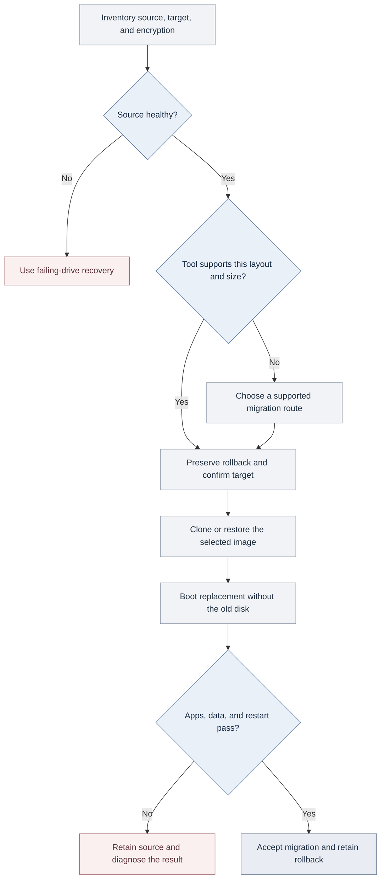

<a href="https://herbertofury.github.io/INTA/" title="Open INTA official download or service page" aria-label="Open INTA official download or service page" data-inta-brand="app-inta"></a> [INTA](https://github.com/Herbertofury/INTA/wiki) / [Decision desk](https://github.com/Herbertofury/INTA/wiki/Decision-Desk) · [Service map](https://github.com/Herbertofury/INTA/wiki/Service-Map) · [Playbooks](https://github.com/Herbertofury/INTA/wiki/Playbooks) · [Tools](https://github.com/Herbertofury/INTA/wiki/Tool-Directory) · [Methods](https://github.com/Herbertofury/INTA/wiki/Methods) · [Open hub](https://herbertofury.github.io/INTA/)

<a id="️-clone-a-healthy-system-or-migrate-to-a-new-ssd"></a>
<a id="-clone-a-healthy-system-or-migrate-to-a-new-ssd"></a>

# [Clone a healthy system or migrate to a new SSD](https://github.com/Herbertofury/INTA/wiki/Job-disk-migration)

Move a working system with clear source/destination control and a rollback copy.

**Storage & recovery** · Intermediate · 45–180 min · 6 steps

[Tools and useful links](#working-kit) · [Quick answer](#quick-answer) · [Next action](#next-action) · [Specific fixes](#specific-fixes) · [Decision route](#decision-route) · [Tools](#toolkit) · [Procedure](#walkthrough) · [Verification](#acceptance) · [Sources](#sources) · [Interactive checklist](https://herbertofury.github.io/INTA/#job/disk-migration)

<a id="tool-choices"></a>

## 🧰 Choose the tool for this job

Choose by the task shown in the first column. Each option includes its acquisition route and access boundary.

| Need | Official tool + exact action | Why this choice / access |
| --- | --- | --- |
| **Graphical image or clone** | **<a href="https://rescuezilla.com/download" title="Open Rescuezilla official download or service page" aria-label="Open Rescuezilla official download or service page" data-inta-brand="rescuezilla"></a> [Rescuezilla](https://rescuezilla.com/)** · **<a href="https://rescuezilla.com/download" title="Open Rescuezilla official download or service page" aria-label="Open Rescuezilla official download or service page" data-inta-brand="rescuezilla"></a> [Download x64 rescue image · ISO](https://github.com/rescuezilla/rescuezilla/releases/download/2.6.2/rescuezilla-2.6.2-64bit.resolute.iso)** | Use a guided source/destination workflow for healthy storage after checking disk identity. **Access:** Free and open source |
| **Advanced image workflow** | **<a href="https://clonezilla.org/downloads.php" title="Open Clonezilla official download or service page" aria-label="Open Clonezilla official download or service page" data-inta-brand="clonezilla"></a> [Clonezilla](https://clonezilla.org/)** · **<a href="https://clonezilla.org/downloads.php" title="Open Clonezilla official download or service page" aria-label="Open Clonezilla official download or service page" data-inta-brand="clonezilla"></a> [Get x64 rescue image · ISO](https://downloads.sourceforge.net/clonezilla/clonezilla-live-3.3.5-3-amd64.iso)** | Use the documented imaging or cloning mode when its filesystem and destination constraints fit. **Access:** Free and open source |
| **Files-only migration** | **<a href="https://learn.microsoft.com/en-us/windows-server/administration/windows-commands/robocopy" title="Open Robocopy official download or service page" aria-label="Open Robocopy official download or service page" data-inta-brand="robocopy"></a> [Robocopy](https://learn.microsoft.com/en-us/windows-server/administration/windows-commands/robocopy)** · **<a href="https://learn.microsoft.com/en-us/windows-server/administration/windows-commands/robocopy" title="Open Robocopy official download or service page" aria-label="Open Robocopy official download or service page" data-inta-brand="robocopy"></a> [Open built-in copy instructions](https://learn.microsoft.com/en-us/windows-server/administration/windows-commands/robocopy)** | Copy the agreed file trees with logs when an entire disk image is unnecessary. **Access:** Included with supported <a href="https://www.microsoft.com/windows" title="Open Windows official download or service page" aria-label="Open Windows official download or service page" data-inta-brand="app-windows"></a> [Windows](https://www.microsoft.com/windows) |

**[Current selection evidence](https://github.com/Herbertofury/INTA/wiki/Current-Tool-Choices)**

<a id="working-kit"></a>

## 🧰 Tools and links for this job

**[Open working view](https://herbertofury.github.io/INTA/#job/disk-migration)** · Keep the tool panel beside the instructions.

**First move:** Identify every disk by model, serial and capacity. Confirm the source is healthy, backed up and the chosen destination may be overwritten.

| Use this for | Official tool + exact action |
| --- | --- |
| Graphical image or clone workflow for healthy storage. | **<a href="https://rescuezilla.com/download" title="Open Rescuezilla official download or service page" aria-label="Open Rescuezilla official download or service page" data-inta-brand="rescuezilla"></a> [Rescuezilla](https://rescuezilla.com/)** · <a href="https://rescuezilla.com/download" title="Open Rescuezilla official download or service page" aria-label="Open Rescuezilla official download or service page" data-inta-brand="rescuezilla"></a> [Official page](https://rescuezilla.com/) · **<a href="https://rescuezilla.com/download" title="Open Rescuezilla official download or service page" aria-label="Open Rescuezilla official download or service page" data-inta-brand="rescuezilla"></a> [Download x64 rescue image · ISO](https://github.com/rescuezilla/rescuezilla/releases/download/2.6.2/rescuezilla-2.6.2-64bit.resolute.iso)** |
| Copy approved file trees with an inspectable log. | **<a href="https://learn.microsoft.com/en-us/windows-server/administration/windows-commands/robocopy" title="Open Robocopy official download or service page" aria-label="Open Robocopy official download or service page" data-inta-brand="robocopy"></a> [Robocopy](https://learn.microsoft.com/en-us/windows-server/administration/windows-commands/robocopy)** · <a href="https://learn.microsoft.com/en-us/windows-server/administration/windows-commands/robocopy" title="Open Robocopy official download or service page" aria-label="Open Robocopy official download or service page" data-inta-brand="robocopy"></a> [Official page](https://learn.microsoft.com/en-us/windows-server/administration/windows-commands/robocopy) · **<a href="https://learn.microsoft.com/en-us/windows-server/administration/windows-commands/robocopy" title="Open Robocopy official download or service page" aria-label="Open Robocopy official download or service page" data-inta-brand="robocopy"></a> [Open built-in copy instructions](https://learn.microsoft.com/en-us/windows-server/administration/windows-commands/robocopy)** |
| Inventory and reapply approved application packages. | **<a href="https://github.com/microsoft/winget-cli/releases/latest" title="Open Windows Package Manager (WinGet) official download or service page" aria-label="Open Windows Package Manager (WinGet) official download or service page" data-inta-brand="web-app-winget"></a> [WinGet](https://learn.microsoft.com/en-us/windows/package-manager/winget/)** · <a href="https://github.com/microsoft/winget-cli/releases/latest" title="Open Windows Package Manager (WinGet) official download or service page" aria-label="Open Windows Package Manager (WinGet) official download or service page" data-inta-brand="web-app-winget"></a> [Official page](https://learn.microsoft.com/en-us/windows/package-manager/winget/) · **<a href="https://github.com/microsoft/winget-cli/releases/latest" title="Open Windows Package Manager (WinGet) official download or service page" aria-label="Open Windows Package Manager (WinGet) official download or service page" data-inta-brand="web-app-winget"></a> [Download App Installer · MSIXBUNDLE](https://github.com/microsoft/winget-cli/releases/download/v1.29.380/Microsoft.DesktopAppInstaller_8wekyb3d8bbwe.msixbundle)** |
| Synchronize an explicitly chosen healthy-data folder between approved machines; keep an independent backup. | **<a href="https://syncthing.net/downloads/" title="Open Syncthing official download or service page" aria-label="Open Syncthing official download or service page" data-inta-brand="syncthing"></a> [Syncthing](https://syncthing.net/)** · <a href="https://syncthing.net/downloads/" title="Open Syncthing official download or service page" aria-label="Open Syncthing official download or service page" data-inta-brand="syncthing"></a> [Official page](https://syncthing.net/) · **<a href="https://www.microsoft.com/windows" title="Open Windows official download or service page" aria-label="Open Windows official download or service page" data-inta-brand="app-windows"></a> [Download Windows x64 · ZIP](https://github.com/syncthing/syncthing/releases/download/v2.1.7/syncthing-windows-amd64-v2.1.7.zip)** |
| Comparing a saved configuration with the changed version or checking a copied folder before accepting a repair or migration. | **<a href="https://winmerge.org/downloads/index.php" title="Open WinMerge official download or service page" aria-label="Open WinMerge official download or service page" data-inta-brand="winmerge"></a> [WinMerge](https://winmerge.org/)** · <a href="https://winmerge.org/downloads/index.php" title="Open WinMerge official download or service page" aria-label="Open WinMerge official download or service page" data-inta-brand="winmerge"></a> [Official page](https://winmerge.org/) · **<a href="https://www.microsoft.com/windows" title="Open Windows official download or service page" aria-label="Open Windows official download or service page" data-inta-brand="app-windows"></a> [Download Windows x64 portable · ZIP](https://github.com/WinMerge/winmerge/releases/download/v2.16.60/winmerge-2.16.60-x64-exe.zip)** |
| Use the documented imaging or cloning mode when its filesystem and destination constraints fit. | **<a href="https://clonezilla.org/downloads.php" title="Open Clonezilla official download or service page" aria-label="Open Clonezilla official download or service page" data-inta-brand="clonezilla"></a> [Clonezilla](https://clonezilla.org/)** · <a href="https://clonezilla.org/downloads.php" title="Open Clonezilla official download or service page" aria-label="Open Clonezilla official download or service page" data-inta-brand="clonezilla"></a> [Official page](https://clonezilla.org/) · **<a href="https://clonezilla.org/downloads.php" title="Open Clonezilla official download or service page" aria-label="Open Clonezilla official download or service page" data-inta-brand="clonezilla"></a> [Get x64 rescue image · ISO](https://downloads.sourceforge.net/clonezilla/clonezilla-live-3.3.5-3-amd64.iso)** |

### Choose the move

| Open the exact resource | What to do there |
| --- | --- |
| **<a href="https://rescuezilla.com/download" title="Open Rescuezilla official download or service page" aria-label="Open Rescuezilla official download or service page" data-inta-brand="rescuezilla"></a> [Rescuezilla migration limitations](https://rescuezilla.com/help)** | Plan smaller-disk restores and preserve an unmodified backup. |

### File migration

| Open the exact resource | What to do there |
| --- | --- |
| **<a href="https://learn.microsoft.com/en-us/windows-server/administration/windows-commands/robocopy" title="Open Robocopy official download or service page" aria-label="Open Robocopy official download or service page" data-inta-brand="robocopy"></a> [Robocopy reference](https://learn.microsoft.com/en-us/windows-server/administration/windows-commands/robocopy)** | Review source, destination and copy flags before execution. |

### Application setup

| Open the exact resource | What to do there |
| --- | --- |
| **<a href="https://github.com/microsoft/winget-cli/releases/latest" title="Open Windows Package Manager (WinGet) official download or service page" aria-label="Open Windows Package Manager (WinGet) official download or service page" data-inta-brand="web-app-winget"></a> [WinGet export](https://learn.microsoft.com/en-us/windows/package-manager/winget/export)** | Export supported application identities for later review. |
| **<a href="https://github.com/microsoft/winget-cli/releases/latest" title="Open Windows Package Manager (WinGet) official download or service page" aria-label="Open Windows Package Manager (WinGet) official download or service page" data-inta-brand="web-app-winget"></a> [WinGet import](https://learn.microsoft.com/en-us/windows/package-manager/winget/import)** | Review and install approved packages; user data is separate. |

<a id="quick-answer"></a>

## ⚡ Quick answer

<a id="quick-clone-a-drive"></a>

### 🔁 Clone or move a drive

**Confirm a healthy source, a verified backup and a destination large enough for the selected clone or restore.**

1. Boot <a href="https://rescuezilla.com/download" title="Open Rescuezilla official download or service page" aria-label="Open Rescuezilla official download or service page" data-inta-brand="rescuezilla"></a> [Rescuezilla](https://rescuezilla.com/) from a separate USB and identify every source and destination by model, serial and size.
2. Choose the intended clone or image operation; confirm the destination may be overwritten before starting.
3. Boot the destination alone and verify files, applications, encryption recovery and backup operation.

**<a href="https://rescuezilla.com/download" title="Open Rescuezilla official download or service page" aria-label="Open Rescuezilla official download or service page" data-inta-brand="rescuezilla"></a> [Rescuezilla](https://rescuezilla.com/)** · <a href="https://rescuezilla.com/download" title="Open Rescuezilla official download or service page" aria-label="Open Rescuezilla official download or service page" data-inta-brand="rescuezilla"></a> [Official page](https://rescuezilla.com/) · **<a href="https://rescuezilla.com/download" title="Open Rescuezilla official download or service page" aria-label="Open Rescuezilla official download or service page" data-inta-brand="rescuezilla"></a> [Download x64 rescue image · ISO](https://github.com/rescuezilla/rescuezilla/releases/download/2.6.2/rescuezilla-2.6.2-64bit.resolute.iso)**

<a id="next-action"></a>

## 🧭 Match the symptom

| You see this | Do this next | You should get |
| --- | --- | --- |
| **The source shows read errors or instability** | Change route to [image-first recovery](https://github.com/Herbertofury/INTA/wiki/Job-failing-drive) rather than treating the operation as routine migration. | The source is preserved before intensive copy or resize work. |
| **The destination is smaller than the source layout** | Check the tool’s supported geometry and create a rollback image before any separately planned resize. | The target layout fits by evidence, not merely by free-space assumptions. |
| **A complete healthy drive must be moved** | Boot <a href="https://rescuezilla.com/download" title="Open Rescuezilla official download or service page" aria-label="Open Rescuezilla official download or service page" data-inta-brand="rescuezilla"></a> [Rescuezilla](https://rescuezilla.com/), verify source/destination identities, then confirm the deliberate clone or restore operation. | The operation completes and the destination can be booted by itself. |
| **Only approved files need moving** | Choose exact source and destination folders, review <a href="https://learn.microsoft.com/en-us/windows-server/administration/windows-commands/robocopy" title="Open Robocopy official download or service page" aria-label="Open Robocopy official download or service page" data-inta-brand="robocopy"></a> [Robocopy](https://learn.microsoft.com/en-us/windows-server/administration/windows-commands/robocopy) flags and retain its result log; do not use a mirror/delete option by default. | Expected files, timestamps and access are verified at the new location. |
| **The copied system is ready for release** | Boot with the old disk disconnected and test sign-in, applications, encryption recovery and backup. | The new system works independently and the old disk remains the agreed rollback copy. |

### ✅ Finish the job

- [ ] The destination boots independently or the copied file set passes application checks.
- [ ] Required access, recovery material and backup work on the destination.

**Change route when:** Source/destination identity or erase permission is ambiguous. · Storage failure or incompatible target geometry makes the planned migration unsafe.

### 🎯 Go straight to a specific fix

- **[Use remaining space after a successful clone](#fix-migration-new-ssd-shows-old-capacity)** — A larger replacement disk boots correctly but the <a href="https://www.microsoft.com/windows" title="Open Windows official download or service page" aria-label="Open Windows official download or service page" data-inta-brand="app-windows"></a> [Windows](https://www.microsoft.com/windows) volume is still the old size.
- **[Read a copy result correctly](#fix-migration-interpret-robocopy-exit-code)** — A <a href="https://learn.microsoft.com/en-us/windows-server/administration/windows-commands/robocopy" title="Open Robocopy official download or service page" aria-label="Open Robocopy official download or service page" data-inta-brand="robocopy"></a> [Robocopy](https://learn.microsoft.com/en-us/windows-server/administration/windows-commands/robocopy) job reports a nonzero exit code and a wrapper labels the whole migration failed.
- **[Finish what an app-list import cannot migrate](#fix-migration-package-list-is-not-app-data)** — Applications reinstall on the new PC but settings, licenses or data are missing.

> [!NOTE]
> **Start here.** Verify the source drive is healthy. A failing drive needs the recovery workflow instead of an ordinary clone.

<a id="decision-route"></a>

<a id="-choose-the-right-branch"></a>

## 🧭 Choose a route



**Route links:** [Continue this workflow](#walkthrough) · [Acceptance checks](#acceptance) · [Rescue data from a failing or unreadable drive](https://github.com/Herbertofury/INTA/wiki/Job-failing-drive) · [Prove a backup can actually restore](https://github.com/Herbertofury/INTA/wiki/Job-backup-restore) · [Set up a dependable new workstation](https://github.com/Herbertofury/INTA/wiki/Job-new-pc) · [Close a repair with a clear client handoff](https://github.com/Herbertofury/INTA/wiki/Job-client-handoff)

| Checkpoint | What to carry forward |
| --- | --- |
| **Before changing anything** | Keep the healthy source and a verified independent backup. |
| **Keep during the job** | Source/target identities, supported layout, copy log, and boot device. |
| **Before handing back** | Replacement boots alone and the business workload passes. |

<a id="toolkit"></a>

<a id="-build-the-right-toolkit"></a>

## Recommended tools

Select a tool for the next diagnostic or repair step. Check its platform, access and licensing requirements before use.

| Tool / official page + download | Use it for | Platform & access | Documentation |
| --- | --- | --- | --- |
| **<a href="https://rescuezilla.com/download" title="Open Rescuezilla official download or service page" aria-label="Open Rescuezilla official download or service page" data-inta-brand="rescuezilla"></a> [Rescuezilla](https://rescuezilla.com/)** · <a href="https://rescuezilla.com/download" title="Open Rescuezilla official download or service page" aria-label="Open Rescuezilla official download or service page" data-inta-brand="rescuezilla"></a> [Official page](https://rescuezilla.com/) · **<a href="https://rescuezilla.com/download" title="Open Rescuezilla official download or service page" aria-label="Open Rescuezilla official download or service page" data-inta-brand="rescuezilla"></a> [Download x64 rescue image · ISO](https://github.com/rescuezilla/rescuezilla/releases/download/2.6.2/rescuezilla-2.6.2-64bit.resolute.iso)** | Graphical image or clone workflow for healthy storage. | Bootable PC; Free / open source | <a href="https://rescuezilla.com/download" title="Open Rescuezilla official download or service page" aria-label="Open Rescuezilla official download or service page" data-inta-brand="rescuezilla"></a> [Open guide](https://rescuezilla.com/help) |
| **<a href="https://learn.microsoft.com/en-us/windows-server/administration/windows-commands/robocopy" title="Open Robocopy official download or service page" aria-label="Open Robocopy official download or service page" data-inta-brand="robocopy"></a> [Robocopy](https://learn.microsoft.com/en-us/windows-server/administration/windows-commands/robocopy)** · <a href="https://learn.microsoft.com/en-us/windows-server/administration/windows-commands/robocopy" title="Open Robocopy official download or service page" aria-label="Open Robocopy official download or service page" data-inta-brand="robocopy"></a> [Official page](https://learn.microsoft.com/en-us/windows-server/administration/windows-commands/robocopy) · **<a href="https://learn.microsoft.com/en-us/windows-server/administration/windows-commands/robocopy" title="Open Robocopy official download or service page" aria-label="Open Robocopy official download or service page" data-inta-brand="robocopy"></a> [Open built-in copy instructions](https://learn.microsoft.com/en-us/windows-server/administration/windows-commands/robocopy)** | Copy approved file trees with an inspectable log. | <a href="https://www.microsoft.com/windows" title="Open Windows official download or service page" aria-label="Open Windows official download or service page" data-inta-brand="app-windows"></a> [Windows](https://www.microsoft.com/windows); Included with <a href="https://www.microsoft.com/windows" title="Open Windows official download or service page" aria-label="Open Windows official download or service page" data-inta-brand="app-windows"></a> [Windows](https://www.microsoft.com/windows) | <a href="https://learn.microsoft.com/en-us/windows-server/administration/windows-commands/robocopy" title="Open Robocopy official download or service page" aria-label="Open Robocopy official download or service page" data-inta-brand="robocopy"></a> [Open guide](https://learn.microsoft.com/en-us/windows-server/administration/windows-commands/robocopy) |
| **<a href="https://github.com/microsoft/winget-cli/releases/latest" title="Open Windows Package Manager (WinGet) official download or service page" aria-label="Open Windows Package Manager (WinGet) official download or service page" data-inta-brand="web-app-winget"></a> [WinGet](https://learn.microsoft.com/en-us/windows/package-manager/winget/)** · <a href="https://github.com/microsoft/winget-cli/releases/latest" title="Open Windows Package Manager (WinGet) official download or service page" aria-label="Open Windows Package Manager (WinGet) official download or service page" data-inta-brand="web-app-winget"></a> [Official page](https://learn.microsoft.com/en-us/windows/package-manager/winget/) · **<a href="https://github.com/microsoft/winget-cli/releases/latest" title="Open Windows Package Manager (WinGet) official download or service page" aria-label="Open Windows Package Manager (WinGet) official download or service page" data-inta-brand="web-app-winget"></a> [Download App Installer · MSIXBUNDLE](https://github.com/microsoft/winget-cli/releases/download/v1.29.380/Microsoft.DesktopAppInstaller_8wekyb3d8bbwe.msixbundle)** | Inventory and reapply approved application packages. | <a href="https://www.microsoft.com/windows" title="Open Windows official download or service page" aria-label="Open Windows official download or service page" data-inta-brand="app-windows"></a> [Windows](https://www.microsoft.com/windows); Free / open source | <a href="https://github.com/microsoft/winget-cli/releases/latest" title="Open Windows Package Manager (WinGet) official download or service page" aria-label="Open Windows Package Manager (WinGet) official download or service page" data-inta-brand="web-app-winget"></a> [Open guide](https://learn.microsoft.com/en-us/windows/package-manager/winget/) |
| **<a href="https://clonezilla.org/downloads.php" title="Open Clonezilla official download or service page" aria-label="Open Clonezilla official download or service page" data-inta-brand="clonezilla"></a> [Clonezilla](https://clonezilla.org/)** · <a href="https://clonezilla.org/downloads.php" title="Open Clonezilla official download or service page" aria-label="Open Clonezilla official download or service page" data-inta-brand="clonezilla"></a> [Official page](https://clonezilla.org/) · **<a href="https://clonezilla.org/downloads.php" title="Open Clonezilla official download or service page" aria-label="Open Clonezilla official download or service page" data-inta-brand="clonezilla"></a> [Get x64 rescue image · ISO](https://downloads.sourceforge.net/clonezilla/clonezilla-live-3.3.5-3-amd64.iso)** | Use the documented imaging or cloning mode when its filesystem and destination constraints fit. | Bootable PC, <a href="https://www.kernel.org/" title="Open Linux official download or service page" aria-label="Open Linux official download or service page" data-inta-brand="app-linux"></a> [Linux](https://www.kernel.org/); Free / open source | <a href="https://clonezilla.org/downloads.php" title="Open Clonezilla official download or service page" aria-label="Open Clonezilla official download or service page" data-inta-brand="clonezilla"></a> [Open guide](https://clonezilla.org/clonezilla-live-doc.php) |
| **<a href="https://crystalmark.info/en/download/" title="Open CrystalDiskInfo official download or service page" aria-label="Open CrystalDiskInfo official download or service page" data-inta-brand="crystaldiskinfo"></a> [CrystalDiskInfo](https://crystalmark.info/en/software/crystaldiskinfo/)** · <a href="https://crystalmark.info/en/download/" title="Open CrystalDiskInfo official download or service page" aria-label="Open CrystalDiskInfo official download or service page" data-inta-brand="crystaldiskinfo"></a> [Official page](https://crystalmark.info/en/software/crystaldiskinfo/) · **<a href="https://www.microsoft.com/windows" title="Open Windows official download or service page" aria-label="Open Windows official download or service page" data-inta-brand="app-windows"></a> [Get Windows ZIP · 9.9.5](https://sourceforge.net/projects/crystaldiskinfo/files/9.9.5/CrystalDiskInfo9_9_5.zip/download)** | First-pass HDD and SSD health inspection in <a href="https://www.microsoft.com/windows" title="Open Windows official download or service page" aria-label="Open Windows official download or service page" data-inta-brand="app-windows"></a> [Windows](https://www.microsoft.com/windows). | <a href="https://www.microsoft.com/windows" title="Open Windows official download or service page" aria-label="Open Windows official download or service page" data-inta-brand="app-windows"></a> [Windows](https://www.microsoft.com/windows); Free / open source | <a href="https://crystalmark.info/en/download/" title="Open CrystalDiskInfo official download or service page" aria-label="Open CrystalDiskInfo official download or service page" data-inta-brand="crystaldiskinfo"></a> [Open guide](https://crystalmark.info/en/software/crystaldiskinfo/) |
| **<a href="https://syncthing.net/downloads/" title="Open Syncthing official download or service page" aria-label="Open Syncthing official download or service page" data-inta-brand="syncthing"></a> [Syncthing](https://syncthing.net/)** · <a href="https://syncthing.net/downloads/" title="Open Syncthing official download or service page" aria-label="Open Syncthing official download or service page" data-inta-brand="syncthing"></a> [Official page](https://syncthing.net/) · **<a href="https://www.microsoft.com/windows" title="Open Windows official download or service page" aria-label="Open Windows official download or service page" data-inta-brand="app-windows"></a> [Download Windows x64 · ZIP](https://github.com/syncthing/syncthing/releases/download/v2.1.7/syncthing-windows-amd64-v2.1.7.zip)** | Synchronize an explicitly chosen healthy-data folder between approved machines; keep an independent backup. | <a href="https://www.microsoft.com/windows" title="Open Windows official download or service page" aria-label="Open Windows official download or service page" data-inta-brand="app-windows"></a> [Windows](https://www.microsoft.com/windows), <a href="https://support.apple.com/macos" title="Open macOS official download or service page" aria-label="Open macOS official download or service page" data-inta-brand="app-macos"></a> [macOS](https://support.apple.com/macos), <a href="https://www.kernel.org/" title="Open Linux official download or service page" aria-label="Open Linux official download or service page" data-inta-brand="app-linux"></a> [Linux](https://www.kernel.org/), BSD; Free and open source under MPL-2.0 | <a href="https://syncthing.net/downloads/" title="Open Syncthing official download or service page" aria-label="Open Syncthing official download or service page" data-inta-brand="syncthing"></a> [Open guide](https://docs.syncthing.net/) |
| **<a href="https://winmerge.org/downloads/index.php" title="Open WinMerge official download or service page" aria-label="Open WinMerge official download or service page" data-inta-brand="winmerge"></a> [WinMerge](https://winmerge.org/)** · <a href="https://winmerge.org/downloads/index.php" title="Open WinMerge official download or service page" aria-label="Open WinMerge official download or service page" data-inta-brand="winmerge"></a> [Official page](https://winmerge.org/) · **<a href="https://www.microsoft.com/windows" title="Open Windows official download or service page" aria-label="Open Windows official download or service page" data-inta-brand="app-windows"></a> [Download Windows x64 portable · ZIP](https://github.com/WinMerge/winmerge/releases/download/v2.16.60/winmerge-2.16.60-x64-exe.zip)** | Comparing a saved configuration with the changed version or checking a copied folder before accepting a repair or migration. | <a href="https://www.microsoft.com/windows" title="Open Windows official download or service page" aria-label="Open Windows official download or service page" data-inta-brand="app-windows"></a> [Windows](https://www.microsoft.com/windows); Free and open source under GPL-2.0-or-later | <a href="https://winmerge.org/downloads/index.php" title="Open WinMerge official download or service page" aria-label="Open WinMerge official download or service page" data-inta-brand="winmerge"></a> [Open guide](https://manual.winmerge.org/en/) |

<a id="walkthrough"></a>

<a id="-work-the-case"></a>

## Procedure

Work in order, record the result of each step, and change route when the evidence calls for it.

<a id="step-01"></a>

### 01 · Inventory before the move

- [ ] Record source and destination model/serial/capacity, firmware mode, partition layout, encryption, and the applications that must survive. Confirm the chosen tool supports the filesystem and intended target size. Shrinking to a smaller drive needs a specifically supported procedure.

**<a href="https://github.com/PowerShell/PowerShell/releases/latest" title="Open PowerShell official download or service page" aria-label="Open PowerShell official download or service page" data-inta-brand="powershell"></a> [PowerShell](https://learn.microsoft.com/en-us/powershell/) · Compare disk identity, partition style, media type and health before selecting a migration source and target.:**

```text
Get-Disk | Format-Table Number,FriendlyName,SerialNumber,PartitionStyle,OperationalStatus,Size -AutoSize
Get-PhysicalDisk | Format-Table FriendlyName,MediaType,HealthStatus,OperationalStatus,Size -AutoSize
```

> **Before running:** Read-only inventory. Confirm model, serial, capacity and direction before any clone or format operation.

**Official command reference:** <a href="https://www.microsoft.com/" title="Open microsoft.com official download or service page" aria-label="Open microsoft.com official download or service page" data-inta-brand="site-www-microsoft-com"></a> <a href="https://github.com/PowerShell/PowerShell/releases/latest" title="Open PowerShell official download or service page" aria-label="Open PowerShell official download or service page" data-inta-brand="powershell"></a> [Microsoft Storage PowerShell documentation](https://learn.microsoft.com/en-us/powershell/module/storage/get-disk)

**Command legend:** <a href="https://www.microsoft.com/" title="Open microsoft.com official download or service page" aria-label="Open microsoft.com official download or service page" data-inta-brand="site-www-microsoft-com"></a> <a href="https://github.com/PowerShell/PowerShell/releases/latest" title="Open PowerShell official download or service page" aria-label="Open PowerShell official download or service page" data-inta-brand="powershell"></a> [Microsoft Storage PowerShell documentation](https://learn.microsoft.com/en-us/powershell/module/storage/get-disk) · [Return to the step context](#step-01).

<a id="step-02"></a>

### 02 · Create an independent rollback

- [ ] Make a verified file backup and save recovery-key access. Export application inventory and record licenses or sign-in requirements through the client’s approved process. Keep the old drive intact until the new system is accepted.

<a id="step-03"></a>

### 03 · Prepare the destination and media

- [ ] Use current trusted rescue media and connect stable power. Disconnect unrelated removable storage where practical. Match source and target by serial number, not only the drive letter or position in a list; cloning overwrites the selected target.

<a id="step-04"></a>

### 04 · Perform and verify the copy

- [ ] Use the imaging application’s supported clone or image/restore workflow. Review the source, target, partition plan, and confirmation screen before committing. Keep the operation log and use the tool’s image verification feature when creating an image.

<a id="step-05"></a>

### 05 · Boot the replacement on its own

- [ ] For the first boot, disconnect or otherwise isolate the original system disk so you can prove the replacement is the actual boot device. Resolve any driver or boot-mode issue through supported vendor guidance. Check encryption state after the migration.

<a id="step-06"></a>

### 06 · Validate applications and rollback readiness

- [ ] Test the real business files, sign-in, network, printers, backup, and restart. Confirm usable capacity and partition layout. Retain the original drive or image for the agreed acceptance window; erase it only through a separately authorized disposal task.

<a id="acceptance"></a>

<a id="-prove-the-result"></a>

## Verification

- [ ] The new drive boots independently.
- [ ] Required data, applications, peripherals, and backup pass the client’s tests.
- [ ] The old source remains usable as a rollback until acceptance.

> [!WARNING]
> **Pause this route and escalate when:**
> - The source exhibits I/O errors or unhealthy behavior.
> - The selected tool cannot support the target size or partition/encryption layout.

<a id="specific-fixes"></a>

## 🎯 Specific fixes

Choose the case that matches the evidence. Each case gives a first action, a short procedure and a result to prove.

<a id="fix-migration-new-ssd-shows-old-capacity"></a>

### Use remaining space after a successful clone

**Use when:** A larger replacement disk boots correctly but the <a href="https://www.microsoft.com/windows" title="Open Windows official download or service page" aria-label="Open Windows official download or service page" data-inta-brand="app-windows"></a> [Windows](https://www.microsoft.com/windows) volume is still the old size.

**Start here:** Open Disk Management and inspect the partition order on the verified new disk.

**<a href="https://rescuezilla.com/download" title="Open Rescuezilla official download or service page" aria-label="Open Rescuezilla official download or service page" data-inta-brand="rescuezilla"></a> [Rescuezilla](https://rescuezilla.com/)** · <a href="https://rescuezilla.com/download" title="Open Rescuezilla official download or service page" aria-label="Open Rescuezilla official download or service page" data-inta-brand="rescuezilla"></a> [Official page](https://rescuezilla.com/) · **<a href="https://rescuezilla.com/download" title="Open Rescuezilla official download or service page" aria-label="Open Rescuezilla official download or service page" data-inta-brand="rescuezilla"></a> [Download x64 rescue image · ISO](https://github.com/rescuezilla/rescuezilla/releases/download/2.6.2/rescuezilla-2.6.2-64bit.resolute.iso)**

1. Confirm unallocated space exists on that same disk and whether it is immediately after the volume to extend.
2. Use Extend Volume only when the documented filesystem/layout requirements are met and a rollback copy exists.
3. Reopen the volume and verify capacity, applications and recovery behavior before releasing the original disk.

**Prove it worked:** The intended volume uses the approved additional space and the migrated system still boots independently.

**If this does not resolve it:** If a recovery or other partition blocks extension, plan a supported layout change; do not delete partitions just to make the option clickable.

**Official evidence:** <a href="https://learn.microsoft.com/en-us/windows-server/" title="Open Windows Server official download or service page" aria-label="Open Windows Server official download or service page" data-inta-brand="app-windows-server"></a> [Source 1](https://learn.microsoft.com/en-us/windows-server/storage/disk-management/extend-a-basic-volume) · Reviewed 2026-11-26

[Back to specific fixes](#specific-fixes) · [Full procedure](#walkthrough)

<a id="fix-migration-interpret-robocopy-exit-code"></a>

### Read a copy result correctly

**Use when:** A <a href="https://learn.microsoft.com/en-us/windows-server/administration/windows-commands/robocopy" title="Open Robocopy official download or service page" aria-label="Open Robocopy official download or service page" data-inta-brand="robocopy"></a> [Robocopy](https://learn.microsoft.com/en-us/windows-server/administration/windows-commands/robocopy) job reports a nonzero exit code and a wrapper labels the whole migration failed.

**Start here:** Retain the copy log and the exact exit code before rerunning.

**<a href="https://learn.microsoft.com/en-us/windows-server/administration/windows-commands/robocopy" title="Open Robocopy official download or service page" aria-label="Open Robocopy official download or service page" data-inta-brand="robocopy"></a> [Robocopy](https://learn.microsoft.com/en-us/windows-server/administration/windows-commands/robocopy)** · <a href="https://learn.microsoft.com/en-us/windows-server/administration/windows-commands/robocopy" title="Open Robocopy official download or service page" aria-label="Open Robocopy official download or service page" data-inta-brand="robocopy"></a> [Official page](https://learn.microsoft.com/en-us/windows-server/administration/windows-commands/robocopy) · **<a href="https://learn.microsoft.com/en-us/windows-server/administration/windows-commands/robocopy" title="Open Robocopy official download or service page" aria-label="Open Robocopy official download or service page" data-inta-brand="robocopy"></a> [Open built-in copy instructions](https://learn.microsoft.com/en-us/windows-server/administration/windows-commands/robocopy)**

1. Compare the result with <a href="https://www.microsoft.com/" title="Open microsoft.com official download or service page" aria-label="Open microsoft.com official download or service page" data-inta-brand="site-www-microsoft-com"></a> [Microsoft](https://www.microsoft.com/)’s return-code table: codes below 8 describe successful copies or differences; 8 or higher includes a failure.
2. Review copied, skipped, extra, mismatch and failed totals against the intended scope rather than accepting only the headline code.
3. Open representative destination files as the intended user and investigate any failed or mismatched items individually.

**Prove it worked:** The case identifies actual copy failures or documented differences and verifies usable destination data.

**If this does not resolve it:** Do not add mirror or purge flags to make the totals match; those can delete destination files.

**Official evidence:** <a href="https://learn.microsoft.com/en-us/windows-server/administration/windows-commands/robocopy" title="Open Robocopy official download or service page" aria-label="Open Robocopy official download or service page" data-inta-brand="robocopy"></a> [Source 1](https://learn.microsoft.com/en-us/windows-server/administration/windows-commands/robocopy) · Reviewed 2026-11-26

[Back to specific fixes](#specific-fixes) · [Full procedure](#walkthrough)

<a id="fix-migration-package-list-is-not-app-data"></a>

### Finish what an app-list import cannot migrate

**Use when:** Applications reinstall on the new PC but settings, licenses or data are missing.

**Start here:** Separate the application inventory from the user-data and license migration records.

**<a href="https://github.com/microsoft/winget-cli/releases/latest" title="Open Windows Package Manager (WinGet) official download or service page" aria-label="Open Windows Package Manager (WinGet) official download or service page" data-inta-brand="web-app-winget"></a> [WinGet](https://learn.microsoft.com/en-us/windows/package-manager/winget/)** · <a href="https://github.com/microsoft/winget-cli/releases/latest" title="Open Windows Package Manager (WinGet) official download or service page" aria-label="Open Windows Package Manager (WinGet) official download or service page" data-inta-brand="web-app-winget"></a> [Official page](https://learn.microsoft.com/en-us/windows/package-manager/winget/) · **<a href="https://github.com/microsoft/winget-cli/releases/latest" title="Open Windows Package Manager (WinGet) official download or service page" aria-label="Open Windows Package Manager (WinGet) official download or service page" data-inta-brand="web-app-winget"></a> [Download App Installer · MSIXBUNDLE](https://github.com/microsoft/winget-cli/releases/download/v1.29.380/Microsoft.DesktopAppInstaller_8wekyb3d8bbwe.msixbundle)**

**<a href="https://learn.microsoft.com/en-us/windows-server/administration/windows-commands/robocopy" title="Open Robocopy official download or service page" aria-label="Open Robocopy official download or service page" data-inta-brand="robocopy"></a> [Robocopy](https://learn.microsoft.com/en-us/windows-server/administration/windows-commands/robocopy)** · <a href="https://learn.microsoft.com/en-us/windows-server/administration/windows-commands/robocopy" title="Open Robocopy official download or service page" aria-label="Open Robocopy official download or service page" data-inta-brand="robocopy"></a> [Official page](https://learn.microsoft.com/en-us/windows-server/administration/windows-commands/robocopy) · **<a href="https://learn.microsoft.com/en-us/windows-server/administration/windows-commands/robocopy" title="Open Robocopy official download or service page" aria-label="Open Robocopy official download or service page" data-inta-brand="robocopy"></a> [Open built-in copy instructions](https://learn.microsoft.com/en-us/windows-server/administration/windows-commands/robocopy)**

1. Review <a href="https://github.com/microsoft/winget-cli/releases/latest" title="Open Windows Package Manager (WinGet) official download or service page" aria-label="Open Windows Package Manager (WinGet) official download or service page" data-inta-brand="web-app-winget"></a> [WinGet](https://learn.microsoft.com/en-us/windows/package-manager/winget/) export/import results for packages that were unmatched, unavailable or installed from a different source.
2. Install missing approved products from their publisher and restore settings/data through each application’s supported method.
3. Activate the correct licenses and test a real user document or workflow for each critical application.

**Prove it worked:** The migration proves working applications and user data rather than merely reproducing a package list.

**If this does not resolve it:** Keep the old device or rollback copy until unique local data and licensed application access are accounted for.

**Official evidence:** <a href="https://github.com/microsoft/winget-cli/releases/latest" title="Open Windows Package Manager (WinGet) official download or service page" aria-label="Open Windows Package Manager (WinGet) official download or service page" data-inta-brand="web-app-winget"></a> [Source 1](https://learn.microsoft.com/en-us/windows/package-manager/winget/export) · <a href="https://github.com/microsoft/winget-cli/releases/latest" title="Open Windows Package Manager (WinGet) official download or service page" aria-label="Open Windows Package Manager (WinGet) official download or service page" data-inta-brand="web-app-winget"></a> [Source 2](https://learn.microsoft.com/en-us/windows/package-manager/winget/import) · Reviewed 2026-11-26

[Back to specific fixes](#specific-fixes) · [Full procedure](#walkthrough)


<a id="-continue-with-the-evidence"></a>

## Related playbooks

| Next playbook | What it resolves |
| --- | --- |
| [Rescue data from a failing or unreadable drive](https://github.com/Herbertofury/INTA/wiki/Job-failing-drive) | Preserve the source, create a recoverable image, and perform recovery on a copy. |
| [Prove a backup can actually restore](https://github.com/Herbertofury/INTA/wiki/Job-backup-restore) | Validate recovery credentials, data integrity, application usability, and recovery time. |
| [Set up a dependable new workstation](https://github.com/Herbertofury/INTA/wiki/Job-new-pc) | Build a usable, recoverable workstation around the employee’s actual job. |
| [Close a repair with a clear client handoff](https://github.com/Herbertofury/INTA/wiki/Job-client-handoff) | Turn completed technical work into proof the customer can use, with clean access and an actionable service record. |

<a id="sources"></a>

<a id="-source-trail"></a>

## Official sources

- <a href="https://clonezilla.org/downloads.php" title="Open Clonezilla official download or service page" aria-label="Open Clonezilla official download or service page" data-inta-brand="clonezilla"></a> [Clonezilla: imaging and clone walkthroughs](https://clonezilla.org/clonezilla-live-doc.php)
- <a href="https://www.microsoft.com/" title="Open microsoft.com official download or service page" aria-label="Open microsoft.com official download or service page" data-inta-brand="site-www-microsoft-com"></a> <a href="https://www.microsoft.com/windows" title="Open Windows official download or service page" aria-label="Open Windows official download or service page" data-inta-brand="app-windows"></a> [Microsoft: recovery options in Windows](https://support.microsoft.com/en-us/windows/experience/backup-recovery/recovery-options-in-windows)
- <a href="https://www.microsoft.com/" title="Open microsoft.com official download or service page" aria-label="Open microsoft.com official download or service page" data-inta-brand="site-www-microsoft-com"></a> <a href="https://github.com/microsoft/winget-cli/releases/latest" title="Open Windows Package Manager (WinGet) official download or service page" aria-label="Open Windows Package Manager (WinGet) official download or service page" data-inta-brand="web-app-winget"></a> [Microsoft: WinGet export](https://learn.microsoft.com/en-us/windows/package-manager/winget/export)

Reviewed **2026-11-26**. Timing is a planning range. A successful command is evidence about that operation; acceptance belongs to the user’s original task.


---

Editorial review: **2026-11-26** · [Review standard](https://github.com/Herbertofury/INTA/wiki/Knowledge-Standards) · [Suggest a correction](https://github.com/Herbertofury/INTA/issues/new/choose)
