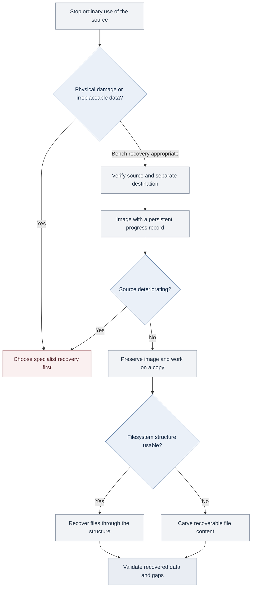

[INTA](https://github.com/Herbertofury/INTA/wiki) / [Decision desk](https://github.com/Herbertofury/INTA/wiki/Decision-Desk) · [Service map](https://github.com/Herbertofury/INTA/wiki/Service-Map) · [Playbooks](https://github.com/Herbertofury/INTA/wiki/Playbooks) · [Tools](https://github.com/Herbertofury/INTA/wiki/Tool-Directory) · [Methods](https://github.com/Herbertofury/INTA/wiki/Methods) · [Open hub](https://herbertofury.github.io/INTA/)

<a id="-rescue-data-from-a-failing-or-unreadable-drive"></a>

# [Rescue data from a failing or unreadable drive](https://github.com/Herbertofury/INTA/wiki/Job-failing-drive)

Preserve the source, create a recoverable image, and perform recovery on a copy.

**Storage & recovery** · Advanced · Triage 15–30 min; imaging varies · 8 steps

[Tools and useful links](#working-kit) · [Quick answer](#quick-answer) · [Next action](#next-action) · [Specific fixes](#specific-fixes) · [Decision route](#decision-route) · [Tools](#toolkit) · [Procedure](#walkthrough) · [Verification](#acceptance) · [Sources](#sources) · [Interactive checklist](https://herbertofury.github.io/INTA/#job/failing-drive)

<a id="working-kit"></a>

## 🧰 Tools and links for this job

**[Open working view](https://herbertofury.github.io/INTA/#job/failing-drive)** · Keep the tool panel beside the instructions.

**First move:** Stop writing to the source. Clicking, impact damage or irreplaceable data warrants a recovery-specialist decision before more power-on time.

| Use this for | Official tool + exact action |
| --- | --- |
| Boot a ready recovery environment containing [GNU ddrescue](https://www.gnu.org/software/ddrescue/). | **[SystemRescue](https://www.system-rescue.org/)** · [Official page](https://www.system-rescue.org/) · **[Download x64 rescue image · ISO](https://fastly-cdn.system-rescue.org/releases/13.03/systemrescue-13.03-amd64.iso)** |
| Recover file contents from healthy media or an image. | **[PhotoRec](https://www.cgsecurity.org/wiki/PhotoRec)** · [Official page](https://www.cgsecurity.org/wiki/PhotoRec) · **[Download PhotoRec / TestDisk · ZIP](https://www.cgsecurity.org/testdisk-7.2.win64.zip)** |
| Inspect partitions on a working copy when that branch is justified. | **[TestDisk](https://www.cgsecurity.org/wiki/TestDisk)** · [Official page](https://www.cgsecurity.org/wiki/TestDisk) · **[Download Windows x64 tools · ZIP](https://www.cgsecurity.org/testdisk-7.2.win64.zip)** |

### Preserve the source

| Open the exact resource | What to do there |
| --- | --- |
| **[GNU ddrescue imaging manual](https://www.gnu.org/software/ddrescue/manual/ddrescue_manual.html)** | Use verified devices and a persistent mapfile before file-system repair. |
| **[SystemRescue included recovery tools](https://www.system-rescue.org/System-tools/)** | Confirm the imaging and identification tools in the boot environment. |

### Recover from a copy

| Open the exact resource | What to do there |
| --- | --- |
| **[PhotoRec recovery steps](https://www.cgsecurity.org/wiki/PhotoRec_Step_By_Step)** | Write recovered output to another disk and inspect actual files. |
| **[TestDisk partition analysis](https://www.cgsecurity.org/wiki/TestDisk_Step_By_Step)** | Distinguish inspection from partition-table writes. |

<a id="quick-answer"></a>

## ⚡ Quick answer

<a id="quick-failing-drive"></a>

### 💾 Recover a failing drive

**Stop using the source disk; clicking, physical damage or irreplaceable data needs a recovery-specialist decision first.**

1. Boot a separate [SystemRescue](https://www.system-rescue.org/) USB and identify source and destination by model, serial and size.
2. Follow the [GNU ddrescue](https://www.gnu.org/software/ddrescue/) imaging procedure with a persistent mapfile; do not run file-system repairs on the source.
3. Work on an image copy, record unreadable ranges and open the client’s priority files to verify recovery.

**[SystemRescue](https://www.system-rescue.org/)** · [Official page](https://www.system-rescue.org/) · **[Download x64 rescue image · ISO](https://fastly-cdn.system-rescue.org/releases/13.03/systemrescue-13.03-amd64.iso)**

<a id="quick-deleted-files"></a>

### 📁 Recover deleted files

**Stop writing to the affected disk and check the backup or recycle bin before attempting recovery.**

1. Use healthy media or a preserved image; route an unstable drive to [image-first recovery](https://github.com/Herbertofury/INTA/wiki/Job-failing-drive).
2. Run [PhotoRec](https://www.cgsecurity.org/wiki/PhotoRec) against that source and send recovered output to a different disk.
3. Open representative recovered files and record missing items; retain the source until acceptance.

**[PhotoRec](https://www.cgsecurity.org/wiki/PhotoRec)** · [Official page](https://www.cgsecurity.org/wiki/PhotoRec) · **[Download PhotoRec / TestDisk · ZIP](https://www.cgsecurity.org/testdisk-7.2.win64.zip)**

<a id="next-action"></a>

## 🧭 Match the symptom

| You see this | Do this next | You should get |
| --- | --- | --- |
| **The drive clicks, was dropped or repeatedly disconnects** | Stop repeated boots and scans; record symptoms and have the owner choose specialist recovery. | The remaining recoverability is not consumed by routine repair attempts. |
| **A damaged drive remains readable enough to image** | Boot [SystemRescue](https://www.system-rescue.org/), identify source and destination by model/serial/size and follow [GNU ddrescue](https://www.gnu.org/software/ddrescue/) with a mapfile on persistent healthy storage. | An image and resumable mapfile preserve readable ranges and identify unreadable gaps. |
| **Files were deleted from healthy media** | Check backups first; otherwise run [PhotoRec](https://www.cgsecurity.org/wiki/PhotoRec) against the healthy source or image and save to a separate disk. | Recovered files open successfully; lost names or folder structure are recorded. |
| **The image is encrypted or recovery reports missing ranges** | Obtain the correct recovery material and assess the client’s priority files on a working copy. | Usable files and unrecoverable areas are explicitly distinguished. |

### ✅ Finish the job

- [ ] Source and destination identities are recorded; when imaging was required, the image and mapfile identities are recorded.
- [ ] Priority recovered files open in their actual applications.
- [ ] Any unreadable ranges and missing files are documented before acceptance.

**Change route when:** There is physical damage or an unstable connection that prevents controlled imaging. · A proposed repair would write to the only source or overwrite an unverified destination.

### 🎯 Go straight to a specific fix

- **[Try filesystem undelete before file carving](#fix-recovery-preserve-names-on-ntfs)** — Files were deleted from a healthy NTFS volume and original names or folders matter.
- **[Resume imaging without swapping source and target](#fix-recovery-resume-the-correct-disk-image)** — A recovery session stopped and device names changed after reconnecting or rebooting.
- **[Validate carved files without trusting their filenames](#fix-recovery-carved-files-have-wrong-names)** — [PhotoRec](https://www.cgsecurity.org/wiki/PhotoRec) produces numbered folders and files rather than the original directory tree.

> [!NOTE]
> **Start here.** Stop ordinary use of the source drive. Ask whether the data is replaceable and whether a verified backup exists before applying power again.

<a id="decision-route"></a>

<a id="-choose-the-right-branch"></a>

## 🧭 Choose a route



**Route links:** [Continue this workflow](#walkthrough) · [Acceptance checks](#acceptance) · [Clone a healthy system or migrate to a new SSD](https://github.com/Herbertofury/INTA/wiki/Job-disk-migration) · [Prove a backup can actually restore](https://github.com/Herbertofury/INTA/wiki/Job-backup-restore) · [Build and refresh a technician rescue USB](https://github.com/Herbertofury/INTA/wiki/Job-boot-usb) · [Close a repair with a clear client handoff](https://github.com/Herbertofury/INTA/wiki/Job-client-handoff)

| Checkpoint | What to carry forward |
| --- | --- |
| **Before changing anything** | Stop writes; choose the recovery route based on data value and damage. |
| **Keep during the job** | Device identities, imaging mapfile, unreadable ranges, and saved output. |
| **Before handing back** | Usable recovered files and an honest record of missing data. |

<a id="toolkit"></a>

<a id="-build-the-right-toolkit"></a>

## Recommended tools

Select a tool for the next diagnostic or repair step. Check its platform, access and licensing requirements before use.

| Tool / official page + download | Use it for | Platform & access | Documentation |
| --- | --- | --- | --- |
| **[SystemRescue](https://www.system-rescue.org/)** · [Official page](https://www.system-rescue.org/) · **[Download x64 rescue image · ISO](https://fastly-cdn.system-rescue.org/releases/13.03/systemrescue-13.03-amd64.iso)** | Boot a ready recovery environment containing [GNU ddrescue](https://www.gnu.org/software/ddrescue/). | Bootable PC; Free / open source | [Open guide](https://www.system-rescue.org/manual/) |
| **[PhotoRec](https://www.cgsecurity.org/wiki/PhotoRec)** · [Official page](https://www.cgsecurity.org/wiki/PhotoRec) · **[Download PhotoRec / TestDisk · ZIP](https://www.cgsecurity.org/testdisk-7.2.win64.zip)** | Recover file contents from healthy media or an image. | [Windows](https://www.microsoft.com/windows), [Linux](https://www.kernel.org/), [macOS](https://support.apple.com/macos); Free / open source | [Open guide](https://www.cgsecurity.org/wiki/PhotoRec_Step_By_Step) |
| **[TestDisk](https://www.cgsecurity.org/wiki/TestDisk)** · [Official page](https://www.cgsecurity.org/wiki/TestDisk) · **[Download Windows x64 tools · ZIP](https://www.cgsecurity.org/testdisk-7.2.win64.zip)** | Inspect partitions on a working copy when that branch is justified. | [Windows](https://www.microsoft.com/windows), [Linux](https://www.kernel.org/), [macOS](https://support.apple.com/macos); Free / open source | [Open guide](https://www.cgsecurity.org/wiki/TestDisk_Step_By_Step) |
| **[smartmontools](https://www.smartmontools.org/)** · [Official page](https://www.smartmontools.org/) · **[Download Windows setup · EXE](https://github.com/smartmontools/smartmontools/releases/download/RELEASE_7_5/smartmontools-7.5.win32-setup.exe)** | Reading SMART and NVMe health from a rescue environment or supported host OS. | [Linux](https://www.kernel.org/), [Windows](https://www.microsoft.com/windows), [macOS](https://support.apple.com/macos); Free / open source | [Open guide](https://github.com/smartmontools/smartmontools) |
| **[CrystalDiskInfo](https://crystalmark.info/en/software/crystaldiskinfo/)** · [Official page](https://crystalmark.info/en/software/crystaldiskinfo/) · **[Get Windows ZIP · 9.9.5](https://sourceforge.net/projects/crystaldiskinfo/files/9.9.5/CrystalDiskInfo9_9_5.zip/download)** | First-pass HDD and SSD health inspection in [Windows](https://www.microsoft.com/windows). | [Windows](https://www.microsoft.com/windows); Free / open source | [Open guide](https://crystalmark.info/en/software/crystaldiskinfo/) |
| **[GNU ddrescue](https://www.gnu.org/software/ddrescue/)** · [Official page](https://www.gnu.org/software/ddrescue/) · **[Download source · TAR.LZ](https://ftp.gnu.org/gnu/ddrescue/ddrescue-1.30.tar.lz)** | Creating an image of a failing disk before recovery or repair attempts. | [Linux](https://www.kernel.org/), [macOS](https://support.apple.com/macos); Free / open source | [Open guide](https://www.gnu.org/software/ddrescue/manual/ddrescue_manual.html) |

<a id="walkthrough"></a>

<a id="-work-the-case"></a>

## Procedure

Work in order, record the result of each step, and change route when the evidence calls for it.

<a id="step-01"></a>

### 01 · Choose professional recovery when needed

- [ ] Clicking, repeated spin-up, liquid or impact damage, unstable detection, and irreplaceable data justify a specialist recovery decision before further attempts. Repeated scans can consume the remaining readable life. Do not open a drive or repeatedly power-cycle it.

<a id="step-02"></a>

### 02 · Identify every device

- [ ] In the [Linux](https://www.kernel.org/) rescue session, record source and destination model, serial, capacity, interface, and mount state. Use a known-good cable and stable power when appropriate. Disable automount and keep the source unmounted or read-only; do not initialize, format, or run filesystem repair on it.

**Command for the environment described above:**

```text
lsblk -o NAME,SIZE,MODEL,SERIAL,TYPE,MOUNTPOINTS
```

**Command legend:** [lsblk command manual](https://man7.org/linux/man-pages/man8/lsblk.8.html) · [Return to the step context](#step-02).

<a id="step-03"></a>

### 03 · Prepare a separate healthy destination

- [ ] Choose a destination with sufficient capacity for the image and recovery output. Record the exact source, output file or device, and persistent mapfile path. A second technician should verify those identities before any imaging command that can overwrite a destination.

<a id="step-04"></a>

### 04 · Image with a resumable recovery tool

- [ ] Use [GNU ddrescue](https://www.gnu.org/software/ddrescue/) following its manual, with a mapfile saved on healthy storage. Start with a low-stress pass that retrieves easy data before any deliberate retry phase. Preserve the mapfile and image together, track errors and temperature, and stop if the device deteriorates.

<a id="step-reconcile-the-image-and-mapfile-before-recovery"></a>

### 05 · Reconcile the image and mapfile before recovery

- [ ] Perform [image and mapfile reconciliation](https://github.com/Herbertofury/INTA/wiki/Job-failing-drive) before filesystem work. Record the imaging command, source size, rescue domain, output path, mapfile path and saved status. Use the mapfile to distinguish finished ranges from non-tried, non-trimmed, non-scraped and bad-sector ranges; retain incomplete areas explicitly. A large image file, a finished process or an exit without a fatal error does not prove all source bytes were recovered. Preserve the image/mapfile pair and its acquisition notes together.

<a id="step-protect-the-accepted-acquisition-checkpoint"></a>

### 06 · Protect the accepted acquisition checkpoint

- [ ] After the imaging process has stopped and its writes are complete, record a checksum of the image and preserve the corresponding mapfile version on healthy storage. Hash or verify a working copy from healthy storage before analyzing it. This proves copy identity, not source completeness; do not reread the failing source solely to obtain a comparison hash. If imaging is resumed, retain the earlier checkpoint identity and record the new image/mapfile pair separately.

<a id="step-05"></a>

<a id="05--recover-from-a-working-copy"></a>

### 07 · Recover from a working copy

- [ ] Keep the original recovery image unchanged and create a working copy if capacity permits. Use [TestDisk](https://www.cgsecurity.org/wiki/TestDisk) for partition/filesystem investigation or [PhotoRec](https://www.cgsecurity.org/wiki/PhotoRec) for file carving as appropriate. Save recovered files to a different healthy location and expect carving to lose some names or folder structure.

<a id="step-06"></a>

<a id="06--validate-what-was-actually-recovered"></a>

### 08 · Validate what was actually recovered

- [ ] Open representative documents, photos, databases, and archives with the user’s applications. Compare expected folders and counts where known, record unreadable regions and missing files, and retain the recovery image until the client accepts the result. Separate image coverage from file usability: a representative sample is a sample, not proof that every file is intact. For priority databases or archives, use the owning application's validation or [restore test](https://github.com/Herbertofury/INTA/wiki/Job-backup-restore) on a copy and report exactly what passed. Include expected but missing folders, failed sample checks and the agreed image-retention decision in the handoff.

<a id="acceptance"></a>

<a id="-prove-the-result"></a>

## Verification

- [ ] The original source has not been repaired or overwritten.
- [ ] The image, mapfile, and device identities are recorded.
- [ ] Recovered files are stored separately and checked for usability.
- [ ] Unreadable data and incomplete recovery are explicitly reported.
- [ ] The recorded mapfile coverage distinguishes successfully copied ranges from every remaining incomplete state.
- [ ] The stopped acquisition checkpoint has an image checksum and its corresponding mapfile; working-copy identity is verified on healthy storage.
- [ ] Priority-file/application tests and sample limits are recorded separately from byte coverage, with unresolved loss stated clearly.

> [!WARNING]
> **Pause this route and escalate when:**
> - The source develops new noises, unstable detection, or worsening read failures.
> - Source and destination cannot be distinguished with certainty.
> - The data value calls for a specialist rather than further bench attempts.

<a id="specific-fixes"></a>

## 🎯 Specific fixes

Choose the case that matches the evidence. Each case gives a first action, a short procedure and a result to prove.

<a id="fix-recovery-preserve-names-on-ntfs"></a>

### Try filesystem undelete before file carving

**Use when:** Files were deleted from a healthy NTFS volume and original names or folders matter.

**Start here:** Stop writes to the affected filesystem and prepare a separate destination.

**[TestDisk](https://www.cgsecurity.org/wiki/TestDisk)** · [Official page](https://www.cgsecurity.org/wiki/TestDisk) · **[Download Windows x64 tools · ZIP](https://www.cgsecurity.org/testdisk-7.2.win64.zip)**

**[PhotoRec](https://www.cgsecurity.org/wiki/PhotoRec)** · [Official page](https://www.cgsecurity.org/wiki/PhotoRec) · **[Download PhotoRec / TestDisk · ZIP](https://www.cgsecurity.org/testdisk-7.2.win64.zip)**

1. On a healthy source or preserved working image, use [TestDisk](https://www.cgsecurity.org/wiki/TestDisk)’s documented Advanced > partition > Undelete path for NTFS.
2. Select the recoverable files and copy them to the separate destination; do not write partition-table changes merely to undelete files.
3. Open representative results. Use [PhotoRec](https://www.cgsecurity.org/wiki/PhotoRec) as the fallback when filesystem metadata no longer supplies the needed files.

**Prove it worked:** Recovered files are usable, with original metadata retained where the filesystem still provides it.

**If this does not resolve it:** If media is unstable, return to imaging first. No undelete method can promise data already overwritten or discarded.

**Official evidence:** [Source 1](https://www.cgsecurity.org/wiki/TestDisk:_undelete_file_for_NTFS) · Reviewed 2026-11-26

[Back to specific fixes](#specific-fixes) · [Full procedure](#walkthrough)

<a id="fix-recovery-resume-the-correct-disk-image"></a>

### Resume imaging without swapping source and target

**Use when:** A recovery session stopped and device names changed after reconnecting or rebooting.

**Start here:** Match the source and destination by model, serial and size before resuming anything.

**[SystemRescue](https://www.system-rescue.org/)** · [Official page](https://www.system-rescue.org/) · **[Download x64 rescue image · ISO](https://fastly-cdn.system-rescue.org/releases/13.03/systemrescue-13.03-amd64.iso)**

**[GNU ddrescue](https://www.gnu.org/software/ddrescue/)** · [Official page](https://www.gnu.org/software/ddrescue/) · **[Download source · TAR.LZ](https://ftp.gnu.org/gnu/ddrescue/ddrescue-1.30.tar.lz)**

1. Locate the existing image and persistent mapfile on healthy storage and confirm they belong to this acquisition.
2. Re-read the intended input/output paths and the [ddrescue](https://www.gnu.org/software/ddrescue/) command against the acquisition record; never rely on the old letter or device order alone.
3. Resume with the matching mapfile under the documented recovery policy, retaining earlier checkpoints and stopping if the source deteriorates.

**Prove it worked:** The operation continues the same acquisition and its mapfile records exactly which ranges remain incomplete.

**If this does not resolve it:** Do not resume if device identity, mapfile pairing or destination overwrite scope cannot be proved.

**Official evidence:** [Source 1](https://www.gnu.org/software/ddrescue/manual/ddrescue_manual.html) · Reviewed 2026-11-26

[Back to specific fixes](#specific-fixes) · [Full procedure](#walkthrough)

<a id="fix-recovery-carved-files-have-wrong-names"></a>

### Validate carved files without trusting their filenames

**Use when:** [PhotoRec](https://www.cgsecurity.org/wiki/PhotoRec) produces numbered folders and files rather than the original directory tree.

**Start here:** Treat recovered names and extensions as output labels, then test the contents.

**[PhotoRec](https://www.cgsecurity.org/wiki/PhotoRec)** · [Official page](https://www.cgsecurity.org/wiki/PhotoRec) · **[Download PhotoRec / TestDisk · ZIP](https://www.cgsecurity.org/testdisk-7.2.win64.zip)**

**[7-Zip](https://www.7-zip.org/)** · [Official page](https://www.7-zip.org/) · **[Download Windows x64 EXE](https://github.com/ip7z/7zip/releases/download/26.06/7z2606-x64.exe)**

1. Use [PhotoRec](https://www.cgsecurity.org/wiki/PhotoRec)’s documented file-type selection for the formats needed and send output to separate healthy storage.
2. Open representative documents, images and archives with their real applications; check complete contents rather than only thumbnails or file size.
3. Record missing filenames/folders, failed samples and any priority application validation; keep the source/image until acceptance.

**Prove it worked:** The report distinguishes usable recovered content from the original metadata that carving did not restore.

**If this does not resolve it:** If encrypted or fragmented priority files remain unusable, stop treating a large output count as successful recovery and escalate that specific format.

**Official evidence:** [Source 1](https://www.cgsecurity.org/wiki/PhotoRec) · [Source 2](https://www.cgsecurity.org/wiki/PhotoRec_Step_By_Step) · Reviewed 2026-11-26

[Back to specific fixes](#specific-fixes) · [Full procedure](#walkthrough)


<a id="-continue-with-the-evidence"></a>

## Related playbooks

| Next playbook | What it resolves |
| --- | --- |
| [Clone a healthy system or migrate to a new SSD](https://github.com/Herbertofury/INTA/wiki/Job-disk-migration) | Move a working system with clear source/destination control and a rollback copy. |
| [Prove a backup can actually restore](https://github.com/Herbertofury/INTA/wiki/Job-backup-restore) | Validate recovery credentials, data integrity, application usability, and recovery time. |
| [Build and refresh a technician rescue USB](https://github.com/Herbertofury/INTA/wiki/Job-boot-usb) | Keep verified recovery images, [Windows repair](https://github.com/Herbertofury/INTA/wiki/Job-windows-repair) media, and the INTA knowledge hub ready for offline use. |
| [Close a repair with a clear client handoff](https://github.com/Herbertofury/INTA/wiki/Job-client-handoff) | Turn completed technical work into proof the customer can use, with clean access and an actionable service record. |

<a id="sources"></a>

<a id="-source-trail"></a>

## Official sources

- [GNU ddrescue manual](https://www.gnu.org/software/ddrescue/manual/ddrescue_manual.html)
- [CGSecurity: PhotoRec data recovery](https://www.cgsecurity.org/wiki/PhotoRec)
- [GNU ddrescue: mapfile, algorithm and status semantics](https://www.gnu.org/software/ddrescue/manual/ddrescue_manual.html#Mapfile-structure)
- [INTA: Service Evidence](https://github.com/Herbertofury/INTA/wiki/Service-Evidence)

Reviewed **2026-11-26**. Timing is a planning range. A successful command is evidence about that operation; acceptance belongs to the user’s original task.


---

Editorial review: **2026-11-26** · [Review standard](https://github.com/Herbertofury/INTA/wiki/Knowledge-Standards) · [Suggest a correction](https://github.com/Herbertofury/INTA/issues/new/choose)
