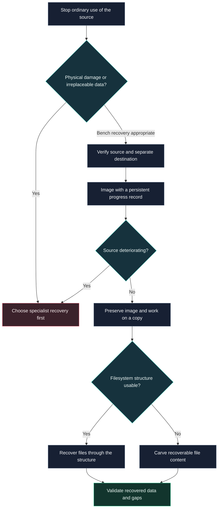

[🏠 Home](https://github.com/Herbertofury/INTA/wiki) · [🧭 Decision desk](https://github.com/Herbertofury/INTA/wiki/Decision-Desk) · [📚 Playbooks](https://github.com/Herbertofury/INTA/wiki/Playbooks) · [🧰 Tool directory](https://github.com/Herbertofury/INTA/wiki/Tool-Directory) · [✨ Open interactive hub](https://herbertofury.github.io/INTA/)

# 💾 [Rescue data from a failing or unreadable drive](https://github.com/Herbertofury/INTA/wiki/Job-failing-drive)

Preserve the source, create a recoverable image, and perform recovery on a copy.

| Work area | Experience | Plan your time | Workflow |
| --- | --- | --- | --- |
| Storage & recovery | Advanced | Triage 15–30 min; imaging varies | 6 steps + acceptance |

**[▶ Open the interactive checklist](https://herbertofury.github.io/INTA/#job/failing-drive)** · [Decision route](#decision-route) · [Toolkit](#toolkit) · [Walkthrough](#walkthrough) · [Acceptance](#acceptance) · [Sources](#sources)

> [!TIP]
> **Your starting move:** Stop ordinary use of the source drive. Ask whether the data is replaceable and whether a verified backup exists before applying power again.

<a id="decision-route"></a>

## 🧭 Choose the right branch



**Diagram routes:** [Continue this workflow](#walkthrough) · [Acceptance checks](#acceptance) · [Clone a healthy system or migrate to a new SSD](https://github.com/Herbertofury/INTA/wiki/Job-disk-migration) · [Prove a backup can actually restore](https://github.com/Herbertofury/INTA/wiki/Job-backup-restore) · [Build and refresh a technician rescue USB](https://github.com/Herbertofury/INTA/wiki/Job-boot-usb) · [Close a repair with a clear client handoff](https://github.com/Herbertofury/INTA/wiki/Job-client-handoff)

| Checkpoint | What to carry forward |
| --- | --- |
| **Before changing anything** | Stop writes; choose the recovery route based on data value and damage. |
| **Keep during the job** | Device identities, imaging mapfile, unreadable ranges, and saved output. |
| **Before handing back** | Usable recovered files and an honest record of missing data. |

<a id="toolkit"></a>

## 🧰 Build the right toolkit

Choose the tools that answer the case’s next question. Opening a tool is a separate decision from changing the customer’s system.

| Tool / official download | Use it for | Platform & access | Documentation |
| --- | --- | --- | --- |
| [smartmontools](https://github.com/smartmontools/smartmontools/releases) | Reading SMART and NVMe health from a rescue environment or supported host OS. | [Linux](https://www.kernel.org/), [Windows](https://www.microsoft.com/windows), [macOS](https://support.apple.com/macos); Free / open source | [Open guide](https://github.com/smartmontools/smartmontools) |
| [CrystalDiskInfo](https://crystalmark.info/en/download/) | First-pass HDD and SSD health inspection in [Windows](https://www.microsoft.com/windows). | [Windows](https://www.microsoft.com/windows); Free / open source | [Open guide](https://crystalmark.info/en/software/crystaldiskinfo/) |
| [GNU ddrescue](https://ftp.gnu.org/gnu/ddrescue/) | Creating an image of a failing disk before recovery or repair attempts. | [Linux](https://www.kernel.org/), [macOS](https://support.apple.com/macos); Free / open source | [Open guide](https://www.gnu.org/software/ddrescue/manual/ddrescue_manual.html) |
| [TestDisk](https://www.cgsecurity.org/wiki/TestDisk_Download) | Investigating missing partitions on an image or safely copied disk. | [Windows](https://www.microsoft.com/windows), [Linux](https://www.kernel.org/), [macOS](https://support.apple.com/macos); Free / open source | [Open guide](https://www.cgsecurity.org/wiki/TestDisk_Step_By_Step) |
| [PhotoRec](https://www.cgsecurity.org/wiki/TestDisk_Download) | Recovering files from an image when directory-based recovery is unsuccessful. | [Windows](https://www.microsoft.com/windows), [Linux](https://www.kernel.org/), [macOS](https://support.apple.com/macos); Free / open source | [Open guide](https://www.cgsecurity.org/wiki/PhotoRec_Step_By_Step) |

<a id="walkthrough"></a>

## 🪜 Work the case

Work in order, record the result of each step, and change route when the evidence calls for it.

<a id="step-01"></a>

### 01 · Choose professional recovery when needed

- [ ] Clicking, repeated spin-up, liquid or impact damage, unstable detection, and irreplaceable data justify a specialist recovery decision before further attempts. Repeated scans can consume the remaining readable life. Do not open a drive or repeatedly power-cycle it.

<a id="step-02"></a>

### 02 · Identify every device

- [ ] In the [Linux](https://www.kernel.org/) rescue session, record source and destination model, serial, capacity, interface, and mount state. Use a known-good cable and stable power when appropriate. Disable automount and keep the source unmounted or read-only; do not initialize, format, or run filesystem repair on it.

**Command for the environment described above:**

```text
lsblk -o NAME,SIZE,MODEL,SERIAL,TYPE,MOUNTPOINTS
```

**Command legend:** [lsblk command manual](https://man7.org/linux/man-pages/man8/lsblk.8.html) · [Return to the step context](#step-02).

<a id="step-03"></a>

### 03 · Prepare a separate healthy destination

- [ ] Choose a destination with sufficient capacity for the image and recovery output. Record the exact source, output file or device, and persistent mapfile path. A second technician should verify those identities before any imaging command that can overwrite a destination.

<a id="step-04"></a>

### 04 · Image with a resumable recovery tool

- [ ] Use [GNU ddrescue](https://www.gnu.org/software/ddrescue/) following its manual, with a mapfile saved on healthy storage. Start with a low-stress pass that retrieves easy data before any deliberate retry phase. Preserve the mapfile and image together, track errors and temperature, and stop if the device deteriorates.

<a id="step-05"></a>

### 05 · Recover from a working copy

- [ ] Keep the original recovery image unchanged and create a working copy if capacity permits. Use [TestDisk](https://www.cgsecurity.org/wiki/TestDisk) for partition/filesystem investigation or [PhotoRec](https://www.cgsecurity.org/wiki/PhotoRec) for file carving as appropriate. Save recovered files to a different healthy location and expect carving to lose some names or folder structure.

<a id="step-06"></a>

### 06 · Validate what was actually recovered

- [ ] Open representative documents, photos, databases, and archives with the user’s applications. Compare expected folders and counts where known, record unreadable regions and missing files, and retain the recovery image until the client accepts the result.

<a id="acceptance"></a>

## ✅ Prove the result

- [ ] The original source has not been repaired or overwritten.
- [ ] The image, mapfile, and device identities are recorded.
- [ ] Recovered files are stored separately and checked for usability.
- [ ] Unreadable data and incomplete recovery are explicitly reported.

> [!WARNING]
> **Pause this route and escalate when:**
> - The source develops new noises, unstable detection, or worsening read failures.
> - Source and destination cannot be distinguished with certainty.
> - The data value calls for a specialist rather than further bench attempts.

## 🔀 Continue with the evidence

| Next playbook | What it resolves |
| --- | --- |
| [Clone a healthy system or migrate to a new SSD](https://github.com/Herbertofury/INTA/wiki/Job-disk-migration) | Move a working system with clear source/destination control and a rollback copy. |
| [Prove a backup can actually restore](https://github.com/Herbertofury/INTA/wiki/Job-backup-restore) | Validate recovery credentials, data integrity, application usability, and recovery time. |
| [Build and refresh a technician rescue USB](https://github.com/Herbertofury/INTA/wiki/Job-boot-usb) | Keep verified recovery images, [Windows repair](https://github.com/Herbertofury/INTA/wiki/Job-windows-repair) media, and the INTA knowledge hub ready for offline use. |
| [Close a repair with a clear client handoff](https://github.com/Herbertofury/INTA/wiki/Job-client-handoff) | Turn completed technical work into proof the customer can use, with clean access and an actionable service record. |

Found a reusable improvement? [Contribute the correction](https://github.com/Herbertofury/INTA/wiki/Contribute) and include the test that proved it.

<a id="sources"></a>

## 🔎 Source trail

<details>
<summary>Official references and editorial review</summary>

- [GNU ddrescue manual](https://www.gnu.org/software/ddrescue/manual/ddrescue_manual.html)
- [CGSecurity: PhotoRec data recovery](https://www.cgsecurity.org/wiki/PhotoRec)

Reviewed **2026-11-26**. Timing is a planning range. A successful command is evidence about that operation; acceptance belongs to the user’s original task.

</details>

---

**Source review: 2026-11-26.** Guidance review and tool release versions are separate. [Report a correction](https://github.com/Herbertofury/INTA/issues/new/choose) · [How we maintain this guide](https://github.com/Herbertofury/INTA/wiki/Knowledge-Standards)
