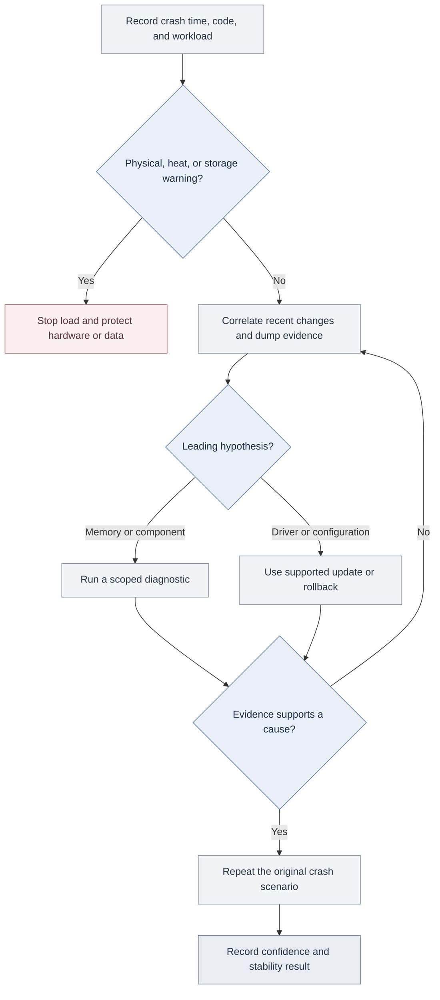

<a href="https://herbertofury.github.io/INTA/" title="Open INTA official download or service page" aria-label="Open INTA official download or service page" data-inta-brand="app-inta"></a> [INTA](https://github.com/Herbertofury/INTA/wiki) / [Decision desk](https://github.com/Herbertofury/INTA/wiki/Decision-Desk) · [Service map](https://github.com/Herbertofury/INTA/wiki/Service-Map) · [Playbooks](https://github.com/Herbertofury/INTA/wiki/Playbooks) · [Tools](https://github.com/Herbertofury/INTA/wiki/Tool-Directory) · [Methods](https://github.com/Herbertofury/INTA/wiki/Methods) · [Open hub](https://herbertofury.github.io/INTA/)

<a id="-diagnose-crashes-blue-screens-and-overheating"></a>

# [Diagnose crashes, blue screens, and overheating](https://github.com/Herbertofury/INTA/wiki/Job-hardware-bsod)

Correlate crash evidence with memory, storage, temperature, power, and driver changes.

**Hardware** · Advanced · 30–120 min plus extended tests · 6 steps

[Tools and useful links](#working-kit) · [Quick answer](#quick-answer) · [Next action](#next-action) · [Specific fixes](#specific-fixes) · [Decision route](#decision-route) · [Tools](#toolkit) · [Procedure](#walkthrough) · [Verification](#acceptance) · [Sources](#sources) · [Interactive checklist](https://herbertofury.github.io/INTA/#job/hardware-bsod)

<a id="tool-choices"></a>

## 🧰 Choose the tool for this job

Choose by the task shown in the first column. Each option includes its acquisition route and access boundary.

| Need | Official tool + exact action | Why this choice / access |
| --- | --- | --- |
| **Analyze a crash dump** | **<a href="https://learn.microsoft.com/en-us/windows-hardware/drivers/debugger/" title="Open WinDbg official download or service page" aria-label="Open WinDbg official download or service page" data-inta-brand="windbg"></a> [WinDbg](https://learn.microsoft.com/en-us/windows-hardware/drivers/debugger/)** · **<a href="https://www.microsoft.com/windows" title="Open Windows official download or service page" aria-label="Open Windows official download or service page" data-inta-brand="app-windows"></a> [Download Windows debugger · APPINSTALLER](https://aka.ms/windbg/download)** | Inspect the recorded dump and stack before blaming a driver or replacing hardware. **Access:** Free <a href="https://www.microsoft.com/" title="Open microsoft.com official download or service page" aria-label="Open microsoft.com official download or service page" data-inta-brand="site-www-microsoft-com"></a> [Microsoft](https://www.microsoft.com/) debugger |
| **Test memory stability** | **<a href="https://www.memtest.org/#download" title="Open Memtest86+ official download or service page" aria-label="Open Memtest86+ official download or service page" data-inta-brand="memtest86plus"></a> [Memtest86+](https://www.memtest.org/)** · **<a href="https://www.memtest.org/#download" title="Open Memtest86+ official download or service page" aria-label="Open Memtest86+ official download or service page" data-inta-brand="memtest86plus"></a> [Download x64 memory-test ISO · ZIP](https://www.memtest.org/download/v9.00/mt86plus_9.00_x86_64.iso.zip)** | Boot a memory test when evidence points to RAM or its configuration. **Access:** Free and open source |
| **Observe temperatures** | **<a href="https://github.com/LibreHardwareMonitor/LibreHardwareMonitor/releases/latest" title="Open Libre Hardware Monitor official download or service page" aria-label="Open Libre Hardware Monitor official download or service page" data-inta-brand="libre-hardware-monitor"></a> [Libre Hardware Monitor](https://github.com/LibreHardwareMonitor/LibreHardwareMonitor)** · **<a href="https://www.microsoft.com/windows" title="Open Windows official download or service page" aria-label="Open Windows official download or service page" data-inta-brand="app-windows"></a> [Download Windows portable · ZIP](https://github.com/LibreHardwareMonitor/LibreHardwareMonitor/releases/download/v0.9.6/LibreHardwareMonitor.zip)** | Log relevant sensors during the reproduced workload and validate labels against the hardware. **Access:** Free and open source |

**[Current selection evidence](https://github.com/Herbertofury/INTA/wiki/Current-Tool-Choices)**

<a id="working-kit"></a>

## 🧰 Tools and links for this job

**[Open working view](https://herbertofury.github.io/INTA/#job/hardware-bsod)** · Keep the tool panel beside the instructions.

**First move:** Record the stop code, crash time and recent changes. Check storage health and safe temperatures before load testing.

| Use this for | Official tool + exact action |
| --- | --- |
| Read the recorded crash dump and stack. | **<a href="https://learn.microsoft.com/en-us/windows-hardware/drivers/debugger/" title="Open WinDbg official download or service page" aria-label="Open WinDbg official download or service page" data-inta-brand="windbg"></a> [WinDbg](https://learn.microsoft.com/en-us/windows-hardware/drivers/debugger/)** · <a href="https://learn.microsoft.com/en-us/windows-hardware/drivers/debugger/" title="Open WinDbg official download or service page" aria-label="Open WinDbg official download or service page" data-inta-brand="windbg"></a> [Official page](https://learn.microsoft.com/en-us/windows-hardware/drivers/debugger/) · **<a href="https://www.microsoft.com/windows" title="Open Windows official download or service page" aria-label="Open Windows official download or service page" data-inta-brand="app-windows"></a> [Download Windows debugger · APPINSTALLER](https://aka.ms/windbg/download)** |
| Test memory outside the running OS when evidence points there. | **<a href="https://www.memtest.org/#download" title="Open Memtest86+ official download or service page" aria-label="Open Memtest86+ official download or service page" data-inta-brand="memtest86plus"></a> [Memtest86+](https://www.memtest.org/)** · <a href="https://www.memtest.org/#download" title="Open Memtest86+ official download or service page" aria-label="Open Memtest86+ official download or service page" data-inta-brand="memtest86plus"></a> [Official page](https://www.memtest.org/) · **<a href="https://www.memtest.org/#download" title="Open Memtest86+ official download or service page" aria-label="Open Memtest86+ official download or service page" data-inta-brand="memtest86plus"></a> [Download x64 memory-test ISO · ZIP](https://www.memtest.org/download/v9.00/mt86plus_9.00_x86_64.iso.zip)** |
| Observe sensor behavior without claiming a sensor alone proves the cause. | **<a href="https://github.com/LibreHardwareMonitor/LibreHardwareMonitor/releases/latest" title="Open Libre Hardware Monitor official download or service page" aria-label="Open Libre Hardware Monitor official download or service page" data-inta-brand="libre-hardware-monitor"></a> [Libre Hardware Monitor](https://github.com/LibreHardwareMonitor/LibreHardwareMonitor)** · <a href="https://github.com/LibreHardwareMonitor/LibreHardwareMonitor/releases/latest" title="Open Libre Hardware Monitor official download or service page" aria-label="Open Libre Hardware Monitor official download or service page" data-inta-brand="libre-hardware-monitor"></a> [Official page](https://github.com/LibreHardwareMonitor/LibreHardwareMonitor) · **<a href="https://www.microsoft.com/windows" title="Open Windows official download or service page" aria-label="Open Windows official download or service page" data-inta-brand="app-windows"></a> [Download Windows portable · ZIP](https://github.com/LibreHardwareMonitor/LibreHardwareMonitor/releases/download/v0.9.6/LibreHardwareMonitor.zip)** |
| Check storage warnings before further stress. | **<a href="https://crystalmark.info/en/download/" title="Open CrystalDiskInfo official download or service page" aria-label="Open CrystalDiskInfo official download or service page" data-inta-brand="crystaldiskinfo"></a> [CrystalDiskInfo](https://crystalmark.info/en/software/crystaldiskinfo/)** · <a href="https://crystalmark.info/en/download/" title="Open CrystalDiskInfo official download or service page" aria-label="Open CrystalDiskInfo official download or service page" data-inta-brand="crystaldiskinfo"></a> [Official page](https://crystalmark.info/en/software/crystaldiskinfo/) · **<a href="https://www.microsoft.com/windows" title="Open Windows official download or service page" aria-label="Open Windows official download or service page" data-inta-brand="app-windows"></a> [Get Windows ZIP · 9.9.5](https://sourceforge.net/projects/crystaldiskinfo/files/9.9.5/CrystalDiskInfo9_9_5.zip/download)** |
| Identifying the actual USB port, hub, device and negotiated connection when a printer, scanner or peripheral disconnects or runs slowly. | **<a href="https://www.uwe-sieber.de/usbtreeview_e.html" title="Open USB Device Tree Viewer official download or service page" aria-label="Open USB Device Tree Viewer official download or service page" data-inta-brand="usb-device-tree-view"></a> [USB Device Tree Viewer](https://www.uwe-sieber.de/usbtreeview_e.html)** · <a href="https://www.uwe-sieber.de/usbtreeview_e.html" title="Open USB Device Tree Viewer official download or service page" aria-label="Open USB Device Tree Viewer official download or service page" data-inta-brand="usb-device-tree-view"></a> [Official page](https://www.uwe-sieber.de/usbtreeview_e.html) · **<a href="https://www.microsoft.com/windows" title="Open Windows official download or service page" aria-label="Open Windows official download or service page" data-inta-brand="app-windows"></a> [Download Windows x64 portable · ZIP](https://www.uwe-sieber.de/files/UsbTreeView_x64.zip)** |
| Collecting battery and sleep evidence before changing hardware or power policy. | **<a href="https://learn.microsoft.com/en-us/windows-hardware/design/device-experiences/powercfg-command-line-options" title="Open powercfg official download or service page" aria-label="Open powercfg official download or service page" data-inta-brand="powercfg"></a> [powercfg](https://learn.microsoft.com/en-us/windows-hardware/design/device-experiences/powercfg-command-line-options)** · <a href="https://learn.microsoft.com/en-us/windows-hardware/design/device-experiences/powercfg-command-line-options" title="Open powercfg official download or service page" aria-label="Open powercfg official download or service page" data-inta-brand="powercfg"></a> [Official page](https://learn.microsoft.com/en-us/windows-hardware/design/device-experiences/powercfg-command-line-options) · **<a href="https://learn.microsoft.com/en-us/windows-hardware/design/device-experiences/powercfg-command-line-options" title="Open powercfg official download or service page" aria-label="Open powercfg official download or service page" data-inta-brand="powercfg"></a> [Open built-in battery and sleep diagnostics](https://learn.microsoft.com/en-us/windows-hardware/design/device-experiences/powercfg-command-line-options)** |
| Measure a reproducible storage-performance problem on healthy media with a bounded test file. | **<a href="https://github.com/microsoft/diskspd/releases" title="Open DiskSpd official download or service page" aria-label="Open DiskSpd official download or service page" data-inta-brand="diskspd"></a> [DiskSpd](https://github.com/microsoft/diskspd)** · <a href="https://github.com/microsoft/diskspd/releases" title="Open DiskSpd official download or service page" aria-label="Open DiskSpd official download or service page" data-inta-brand="diskspd"></a> [Official page](https://github.com/microsoft/diskspd) · **<a href="https://www.microsoft.com/windows" title="Open Windows official download or service page" aria-label="Open Windows official download or service page" data-inta-brand="app-windows"></a> [Download Windows x64/ARM64 tools · ZIP](https://github.com/microsoft/diskspd/releases/download/v2.3/DiskSpd.ZIP)** |

### Find the cause

| Open the exact resource | What to do there |
| --- | --- |
| **<a href="https://www.microsoft.com/" title="Open microsoft.com official download or service page" aria-label="Open microsoft.com official download or service page" data-inta-brand="site-www-microsoft-com"></a> [Microsoft stop-code troubleshooting](https://learn.microsoft.com/en-us/troubleshoot/windows-client/performance/stop-code-error-troubleshooting)** | Correlate stop codes, changes and relevant hardware tests. |
| **<a href="https://learn.microsoft.com/" title="Open learn.microsoft.com official download or service page" aria-label="Open learn.microsoft.com official download or service page" data-inta-brand="site-learn-microsoft-com"></a> [Unexpected-restart evidence](https://learn.microsoft.com/en-us/troubleshoot/windows-client/performance/event-id-41-restart)** | Event 41 is a symptom record, not proof of a failed PSU. |

### Crash analysis

| Open the exact resource | What to do there |
| --- | --- |
| **<a href="https://learn.microsoft.com/en-us/windows-hardware/drivers/debugger/" title="Open WinDbg official download or service page" aria-label="Open WinDbg official download or service page" data-inta-brand="windbg"></a> [WinDbg documentation](https://learn.microsoft.com/en-us/windows-hardware/drivers/debugger/)** | Open the dump and inspect analysis in the correct context. |

### Hardware tests

| Open the exact resource | What to do there |
| --- | --- |
| **<a href="https://www.memtest.org/#download" title="Open Memtest86+ official download or service page" aria-label="Open Memtest86+ official download or service page" data-inta-brand="memtest86plus"></a> [Memtest86+ boot and error guidance](https://www.memtest.org/)** | Match firmware support and record the tested configuration. |

<a id="quick-answer"></a>

## ⚡ Quick answer

<a id="quick-diagnose-crashes"></a>

### 🧩 Diagnose crashes

**Record the stop code, failure time and recent hardware or driver changes before replacing components.**

1. Check reliability and event history, available crash dumps and storage health to narrow the failure.
2. For a dump, use <a href="https://learn.microsoft.com/en-us/windows-hardware/drivers/debugger/" title="Open WinDbg official download or service page" aria-label="Open WinDbg official download or service page" data-inta-brand="windbg"></a> [WinDbg](https://learn.microsoft.com/en-us/windows-hardware/drivers/debugger/) to inspect the crash evidence; follow the indicated driver, memory or hardware branch.
3. Change one supported cause at a time and repeat the failing workload while checking for new crashes.

**<a href="https://learn.microsoft.com/en-us/windows-hardware/drivers/debugger/" title="Open WinDbg official download or service page" aria-label="Open WinDbg official download or service page" data-inta-brand="windbg"></a> [WinDbg](https://learn.microsoft.com/en-us/windows-hardware/drivers/debugger/)** · <a href="https://learn.microsoft.com/en-us/windows-hardware/drivers/debugger/" title="Open WinDbg official download or service page" aria-label="Open WinDbg official download or service page" data-inta-brand="windbg"></a> [Official page](https://learn.microsoft.com/en-us/windows-hardware/drivers/debugger/) · **<a href="https://www.microsoft.com/windows" title="Open Windows official download or service page" aria-label="Open Windows official download or service page" data-inta-brand="app-windows"></a> [Download Windows debugger · APPINSTALLER](https://aka.ms/windbg/download)**

<a id="quick-suspected-ram-fault"></a>

### 🧪 Test memory

**Use this branch when crash evidence suggests memory instability, after recording firmware and overclock settings.**

1. Create the supported <a href="https://www.memtest.org/#download" title="Open Memtest86+ official download or service page" aria-label="Open Memtest86+ official download or service page" data-inta-brand="memtest86plus"></a> [Memtest86+](https://www.memtest.org/) boot media and preserve recovery keys before any necessary firmware change.
2. Boot the test, record passes and errors, and isolate modules or slots using the hardware guide.
3. Retest the corrected configuration and restore the intended firmware settings.

**<a href="https://www.memtest.org/#download" title="Open Memtest86+ official download or service page" aria-label="Open Memtest86+ official download or service page" data-inta-brand="memtest86plus"></a> [Memtest86+](https://www.memtest.org/)** · <a href="https://www.memtest.org/#download" title="Open Memtest86+ official download or service page" aria-label="Open Memtest86+ official download or service page" data-inta-brand="memtest86plus"></a> [Official page](https://www.memtest.org/) · **<a href="https://www.memtest.org/#download" title="Open Memtest86+ official download or service page" aria-label="Open Memtest86+ official download or service page" data-inta-brand="memtest86plus"></a> [Download x64 memory-test ISO · ZIP](https://www.memtest.org/download/v9.00/mt86plus_9.00_x86_64.iso.zip)**

<a id="next-action"></a>

## 🧭 Match the symptom

| You see this | Do this next | You should get |
| --- | --- | --- |
| **A crash dump is available** | Open it in <a href="https://learn.microsoft.com/en-us/windows-hardware/drivers/debugger/" title="Open WinDbg official download or service page" aria-label="Open WinDbg official download or service page" data-inta-brand="windbg"></a> [WinDbg](https://learn.microsoft.com/en-us/windows-hardware/drivers/debugger/) and run !analyze -v; compare the stop code and stack with other failures and the change timeline. | Repeated evidence identifies a driver/component branch; one named module is not treated as proof by itself. |
| **Crashes began after a specific driver or hardware change** | Use the exact vendor-supported rollback or correction for that identified change and repeat the failing workload. | The same reproduction no longer crashes, or the hypothesis is rejected. |
| **Evidence points to RAM instability** | Record firmware/overclock settings, boot <a href="https://www.memtest.org/#download" title="Open Memtest86+ official download or service page" aria-label="Open Memtest86+ official download or service page" data-inta-brand="memtest86plus"></a> [Memtest86+](https://www.memtest.org/) and isolate modules or slots using the hardware procedure. | Errors are reproduced and narrowed to a configuration, or the test result is recorded without excluding other causes. |
| **The system overheats, loses power or storage disappears** | Stop stress testing and inspect the indicated cooling, power or storage path with the appropriate service guidance. | The physical fault is addressed before further workload testing. |

### ✅ Finish the job

- [ ] The same workload runs without a new crash after the evidenced correction.
- [ ] Crash/test results, firmware settings and any component change are recorded.

**Change route when:** There is unsafe temperature, electrical damage or unstable storage. · The fault requires disassembly or specialist testing beyond the available service capability.

### 🎯 Go straight to a specific fix

- **[Capture usable evidence for the next crash](#fix-hardware-crash-without-a-dump)** — A real stop error occurs but no usable memory dump is available.
- **[Isolate a memory fault after an upgrade](#fix-hardware-memory-errors-after-upgrade)** — Crashes or memory-test errors began after changing RAM or firmware memory settings.
- **[Find a device failing through a USB hub](#fix-hardware-usb-dock-device-drops)** — A scanner, printer or storage device disconnects through a dock but works intermittently elsewhere.

> [!NOTE]
> **Start here.** Record the exact stop code, timestamp, workload, recent hardware/driver changes, and whether the machine restarted or lost power.

<a id="decision-route"></a>

<a id="-choose-the-right-branch"></a>

## 🧭 Choose a route



**Route links:** [Continue this workflow](#walkthrough) · [Acceptance checks](#acceptance) · [Diagnose a slow, freezing, or hitching PC](https://github.com/Herbertofury/INTA/wiki/Job-slow-pc) · [Rescue data from a failing or unreadable drive](https://github.com/Herbertofury/INTA/wiki/Job-failing-drive) · <a href="https://www.microsoft.com/windows" title="Open Windows official download or service page" aria-label="Open Windows official download or service page" data-inta-brand="app-windows"></a> [Recover a Windows PC that will not boot](https://github.com/Herbertofury/INTA/wiki/Job-boot-recovery) · [Prove a backup can actually restore](https://github.com/Herbertofury/INTA/wiki/Job-backup-restore)

| Checkpoint | What to carry forward |
| --- | --- |
| **Before changing anything** | Protect data before reproducing failure or stressing components. |
| **Keep during the job** | Stop code, dump, temperatures, configuration, and diagnostic duration. |
| **Before handing back** | Original scenario, restart, sleep, and required devices are stable. |

<a id="toolkit"></a>

<a id="-build-the-right-toolkit"></a>

## Recommended tools

Select a tool for the next diagnostic or repair step. Check its platform, access and licensing requirements before use.

| Tool / official page + download | Use it for | Platform & access | Documentation |
| --- | --- | --- | --- |
| **<a href="https://learn.microsoft.com/en-us/windows-hardware/drivers/debugger/" title="Open WinDbg official download or service page" aria-label="Open WinDbg official download or service page" data-inta-brand="windbg"></a> [WinDbg](https://learn.microsoft.com/en-us/windows-hardware/drivers/debugger/)** · <a href="https://learn.microsoft.com/en-us/windows-hardware/drivers/debugger/" title="Open WinDbg official download or service page" aria-label="Open WinDbg official download or service page" data-inta-brand="windbg"></a> [Official page](https://learn.microsoft.com/en-us/windows-hardware/drivers/debugger/) · **<a href="https://www.microsoft.com/windows" title="Open Windows official download or service page" aria-label="Open Windows official download or service page" data-inta-brand="app-windows"></a> [Download Windows debugger · APPINSTALLER](https://aka.ms/windbg/download)** | Read the recorded crash dump and stack. | <a href="https://www.microsoft.com/windows" title="Open Windows official download or service page" aria-label="Open Windows official download or service page" data-inta-brand="app-windows"></a> [Windows](https://www.microsoft.com/windows); Free <a href="https://www.microsoft.com/" title="Open microsoft.com official download or service page" aria-label="Open microsoft.com official download or service page" data-inta-brand="site-www-microsoft-com"></a> [Microsoft](https://www.microsoft.com/) tool | <a href="https://learn.microsoft.com/en-us/windows-hardware/drivers/debugger/" title="Open WinDbg official download or service page" aria-label="Open WinDbg official download or service page" data-inta-brand="windbg"></a> [Open guide](https://learn.microsoft.com/en-us/windows-hardware/drivers/debugger/) |
| **<a href="https://www.memtest.org/#download" title="Open Memtest86+ official download or service page" aria-label="Open Memtest86+ official download or service page" data-inta-brand="memtest86plus"></a> [Memtest86+](https://www.memtest.org/)** · <a href="https://www.memtest.org/#download" title="Open Memtest86+ official download or service page" aria-label="Open Memtest86+ official download or service page" data-inta-brand="memtest86plus"></a> [Official page](https://www.memtest.org/) · **<a href="https://www.memtest.org/#download" title="Open Memtest86+ official download or service page" aria-label="Open Memtest86+ official download or service page" data-inta-brand="memtest86plus"></a> [Download x64 memory-test ISO · ZIP](https://www.memtest.org/download/v9.00/mt86plus_9.00_x86_64.iso.zip)** | Test memory outside the running OS when evidence points there. | Bootable PC; Free / open source | <a href="https://www.memtest.org/#download" title="Open Memtest86+ official download or service page" aria-label="Open Memtest86+ official download or service page" data-inta-brand="memtest86plus"></a> [Open guide](https://github.com/memtest86plus/memtest86plus) |
| **<a href="https://github.com/LibreHardwareMonitor/LibreHardwareMonitor/releases/latest" title="Open Libre Hardware Monitor official download or service page" aria-label="Open Libre Hardware Monitor official download or service page" data-inta-brand="libre-hardware-monitor"></a> [Libre Hardware Monitor](https://github.com/LibreHardwareMonitor/LibreHardwareMonitor)** · <a href="https://github.com/LibreHardwareMonitor/LibreHardwareMonitor/releases/latest" title="Open Libre Hardware Monitor official download or service page" aria-label="Open Libre Hardware Monitor official download or service page" data-inta-brand="libre-hardware-monitor"></a> [Official page](https://github.com/LibreHardwareMonitor/LibreHardwareMonitor) · **<a href="https://www.microsoft.com/windows" title="Open Windows official download or service page" aria-label="Open Windows official download or service page" data-inta-brand="app-windows"></a> [Download Windows portable · ZIP](https://github.com/LibreHardwareMonitor/LibreHardwareMonitor/releases/download/v0.9.6/LibreHardwareMonitor.zip)** | Observe sensor behavior without claiming a sensor alone proves the cause. | <a href="https://www.microsoft.com/windows" title="Open Windows official download or service page" aria-label="Open Windows official download or service page" data-inta-brand="app-windows"></a> [Windows](https://www.microsoft.com/windows); Free / open source | <a href="https://github.com/LibreHardwareMonitor/LibreHardwareMonitor/releases/latest" title="Open Libre Hardware Monitor official download or service page" aria-label="Open Libre Hardware Monitor official download or service page" data-inta-brand="libre-hardware-monitor"></a> [Open guide](https://github.com/LibreHardwareMonitor/LibreHardwareMonitor) |
| **<a href="https://crystalmark.info/en/download/" title="Open CrystalDiskInfo official download or service page" aria-label="Open CrystalDiskInfo official download or service page" data-inta-brand="crystaldiskinfo"></a> [CrystalDiskInfo](https://crystalmark.info/en/software/crystaldiskinfo/)** · <a href="https://crystalmark.info/en/download/" title="Open CrystalDiskInfo official download or service page" aria-label="Open CrystalDiskInfo official download or service page" data-inta-brand="crystaldiskinfo"></a> [Official page](https://crystalmark.info/en/software/crystaldiskinfo/) · **<a href="https://www.microsoft.com/windows" title="Open Windows official download or service page" aria-label="Open Windows official download or service page" data-inta-brand="app-windows"></a> [Get Windows ZIP · 9.9.5](https://sourceforge.net/projects/crystaldiskinfo/files/9.9.5/CrystalDiskInfo9_9_5.zip/download)** | Check storage warnings before further stress. | <a href="https://www.microsoft.com/windows" title="Open Windows official download or service page" aria-label="Open Windows official download or service page" data-inta-brand="app-windows"></a> [Windows](https://www.microsoft.com/windows); Free / open source | <a href="https://crystalmark.info/en/download/" title="Open CrystalDiskInfo official download or service page" aria-label="Open CrystalDiskInfo official download or service page" data-inta-brand="crystaldiskinfo"></a> [Open guide](https://crystalmark.info/en/software/crystaldiskinfo/) |
| **<a href="https://www.hwinfo.com/download/" title="Open HWiNFO official download or service page" aria-label="Open HWiNFO official download or service page" data-inta-brand="hwinfo"></a> [HWiNFO](https://www.hwinfo.com/)** · <a href="https://www.hwinfo.com/download/" title="Open HWiNFO official download or service page" aria-label="Open HWiNFO official download or service page" data-inta-brand="hwinfo"></a> [Official page](https://www.hwinfo.com/) · **<a href="https://www.microsoft.com/windows" title="Open Windows official download or service page" aria-label="Open Windows official download or service page" data-inta-brand="app-windows"></a> [Download Windows x64 EXE](https://www.hwinfo.com/files/hwi64_860.exe)** | Investigating temperatures, clocks, power and component identity. | <a href="https://www.microsoft.com/windows" title="Open Windows official download or service page" aria-label="Open Windows official download or service page" data-inta-brand="app-windows"></a> [Windows](https://www.microsoft.com/windows); Pro license for commercial use of 64/ARM64 editions | <a href="https://www.hwinfo.com/download/" title="Open HWiNFO official download or service page" aria-label="Open HWiNFO official download or service page" data-inta-brand="hwinfo"></a> [Open guide](https://www.hwinfo.com/licenses/) |
| **<a href="https://learn.microsoft.com/en-us/sysinternals/downloads/sysinternals-suite" title="Open Microsoft Sysinternals Suite official download or service page" aria-label="Open Microsoft Sysinternals Suite official download or service page" data-inta-brand="sysinternals"></a> [Microsoft Sysinternals Suite](https://learn.microsoft.com/en-us/sysinternals/)** · <a href="https://learn.microsoft.com/en-us/sysinternals/downloads/sysinternals-suite" title="Open Microsoft Sysinternals Suite official download or service page" aria-label="Open Microsoft Sysinternals Suite official download or service page" data-inta-brand="sysinternals"></a> [Official page](https://learn.microsoft.com/en-us/sysinternals/) · **<a href="https://www.microsoft.com/windows" title="Open Windows official download or service page" aria-label="Open Windows official download or service page" data-inta-brand="app-windows"></a> [Download Windows portable · ZIP](https://download.sysinternals.com/files/SysinternalsSuite.zip)** | The core portable <a href="https://www.microsoft.com/windows" title="Open Windows official download or service page" aria-label="Open Windows official download or service page" data-inta-brand="app-windows"></a> [Windows](https://www.microsoft.com/windows) troubleshooting kit. | <a href="https://www.microsoft.com/windows" title="Open Windows official download or service page" aria-label="Open Windows official download or service page" data-inta-brand="app-windows"></a> [Windows](https://www.microsoft.com/windows); Free <a href="https://www.microsoft.com/" title="Open microsoft.com official download or service page" aria-label="Open microsoft.com official download or service page" data-inta-brand="site-www-microsoft-com"></a> [Microsoft](https://www.microsoft.com/) utilities | <a href="https://learn.microsoft.com/en-us/sysinternals/downloads/sysinternals-suite" title="Open Microsoft Sysinternals Suite official download or service page" aria-label="Open Microsoft Sysinternals Suite official download or service page" data-inta-brand="sysinternals"></a> [Open guide](https://learn.microsoft.com/en-us/sysinternals/downloads/) |
| **<a href="https://www.uwe-sieber.de/usbtreeview_e.html" title="Open USB Device Tree Viewer official download or service page" aria-label="Open USB Device Tree Viewer official download or service page" data-inta-brand="usb-device-tree-view"></a> [USB Device Tree Viewer](https://www.uwe-sieber.de/usbtreeview_e.html)** · <a href="https://www.uwe-sieber.de/usbtreeview_e.html" title="Open USB Device Tree Viewer official download or service page" aria-label="Open USB Device Tree Viewer official download or service page" data-inta-brand="usb-device-tree-view"></a> [Official page](https://www.uwe-sieber.de/usbtreeview_e.html) · **<a href="https://www.microsoft.com/windows" title="Open Windows official download or service page" aria-label="Open Windows official download or service page" data-inta-brand="app-windows"></a> [Download Windows x64 portable · ZIP](https://www.uwe-sieber.de/files/UsbTreeView_x64.zip)** | Identifying the actual USB port, hub, device and negotiated connection when a printer, scanner or peripheral disconnects or runs slowly. | <a href="https://www.microsoft.com/windows" title="Open Windows official download or service page" aria-label="Open Windows official download or service page" data-inta-brand="app-windows"></a> [Windows](https://www.microsoft.com/windows); Freeware; publisher explicitly permits use in commercial environments | <a href="https://www.uwe-sieber.de/usbtreeview_e.html" title="Open USB Device Tree Viewer official download or service page" aria-label="Open USB Device Tree Viewer official download or service page" data-inta-brand="usb-device-tree-view"></a> [Open guide](https://www.uwe-sieber.de/usbtreeview_e.html) |
| **<a href="https://learn.microsoft.com/en-us/windows-hardware/design/device-experiences/powercfg-command-line-options" title="Open powercfg official download or service page" aria-label="Open powercfg official download or service page" data-inta-brand="powercfg"></a> [powercfg](https://learn.microsoft.com/en-us/windows-hardware/design/device-experiences/powercfg-command-line-options)** · <a href="https://learn.microsoft.com/en-us/windows-hardware/design/device-experiences/powercfg-command-line-options" title="Open powercfg official download or service page" aria-label="Open powercfg official download or service page" data-inta-brand="powercfg"></a> [Official page](https://learn.microsoft.com/en-us/windows-hardware/design/device-experiences/powercfg-command-line-options) · **<a href="https://learn.microsoft.com/en-us/windows-hardware/design/device-experiences/powercfg-command-line-options" title="Open powercfg official download or service page" aria-label="Open powercfg official download or service page" data-inta-brand="powercfg"></a> [Open built-in battery and sleep diagnostics](https://learn.microsoft.com/en-us/windows-hardware/design/device-experiences/powercfg-command-line-options)** | Collecting battery and sleep evidence before changing hardware or power policy. | <a href="https://www.microsoft.com/windows" title="Open Windows official download or service page" aria-label="Open Windows official download or service page" data-inta-brand="app-windows"></a> [Windows](https://www.microsoft.com/windows); Included with <a href="https://www.microsoft.com/windows" title="Open Windows official download or service page" aria-label="Open Windows official download or service page" data-inta-brand="app-windows"></a> [Windows](https://www.microsoft.com/windows) | <a href="https://learn.microsoft.com/en-us/windows-hardware/design/device-experiences/powercfg-command-line-options" title="Open powercfg official download or service page" aria-label="Open powercfg official download or service page" data-inta-brand="powercfg"></a> [Open guide](https://learn.microsoft.com/en-us/windows-hardware/design/device-experiences/powercfg-command-line-options) |
| **<a href="https://github.com/microsoft/diskspd/releases" title="Open DiskSpd official download or service page" aria-label="Open DiskSpd official download or service page" data-inta-brand="diskspd"></a> [DiskSpd](https://github.com/microsoft/diskspd)** · <a href="https://github.com/microsoft/diskspd/releases" title="Open DiskSpd official download or service page" aria-label="Open DiskSpd official download or service page" data-inta-brand="diskspd"></a> [Official page](https://github.com/microsoft/diskspd) · **<a href="https://www.microsoft.com/windows" title="Open Windows official download or service page" aria-label="Open Windows official download or service page" data-inta-brand="app-windows"></a> [Download Windows x64/ARM64 tools · ZIP](https://github.com/microsoft/diskspd/releases/download/v2.3/DiskSpd.ZIP)** | Measure a reproducible storage-performance problem on healthy media with a bounded test file. | <a href="https://www.microsoft.com/windows" title="Open Windows official download or service page" aria-label="Open Windows official download or service page" data-inta-brand="app-windows"></a> [Windows](https://www.microsoft.com/windows), <a href="https://learn.microsoft.com/en-us/windows-server/" title="Open Windows Server official download or service page" aria-label="Open Windows Server official download or service page" data-inta-brand="app-windows-server"></a> [Windows Server](https://learn.microsoft.com/en-us/windows-server/); Free and open source under MIT license | <a href="https://github.com/microsoft/diskspd/releases" title="Open DiskSpd official download or service page" aria-label="Open DiskSpd official download or service page" data-inta-brand="diskspd"></a> [Open guide](https://github.com/microsoft/diskspd/wiki) |

<a id="walkthrough"></a>

<a id="-work-the-case"></a>

## Procedure

Work in order, record the result of each step, and change route when the evidence calls for it.

<a id="step-01"></a>

### 01 · Capture evidence before repeated testing

- [ ] Save the stop code, <a href="https://learn.microsoft.com/en-us/windows-server/administration/windows-commands/perfmon" title="Open Reliability Monitor official download or service page" aria-label="Open Reliability Monitor official download or service page" data-inta-brand="app-reliability-monitor"></a> [Reliability Monitor](https://learn.microsoft.com/en-us/windows-server/administration/windows-commands/perfmon) history, relevant events, and available crash dump in the private case. Note the dump’s sensitivity because it may contain user data. A named module is a clue that still needs context.

**<a href="https://github.com/PowerShell/PowerShell/releases/latest" title="Open PowerShell official download or service page" aria-label="Open PowerShell official download or service page" data-inta-brand="powershell"></a> [PowerShell](https://learn.microsoft.com/en-us/powershell/) · Read recent Kernel-Power, unexpected-shutdown and bugcheck events to correlate crashes with the reported time.:**

```text
Get-WinEvent -FilterHashtable @{LogName='System'; Id=41,6008,1001} -MaxEvents 30 | Select-Object TimeCreated,Id,ProviderName,Message | Format-List
```

> **Before running:** Read-only diagnostic. Event IDs are clues, not proof of a failing component; correlate with dump analysis and hardware tests.

**Official command reference:** <a href="https://www.microsoft.com/" title="Open microsoft.com official download or service page" aria-label="Open microsoft.com official download or service page" data-inta-brand="site-www-microsoft-com"></a> [Microsoft Get-WinEvent documentation](https://learn.microsoft.com/en-us/powershell/module/microsoft.powershell.diagnostics/get-winevent)

**Command legend:** <a href="https://www.microsoft.com/" title="Open microsoft.com official download or service page" aria-label="Open microsoft.com official download or service page" data-inta-brand="site-www-microsoft-com"></a> [Microsoft Get-WinEvent documentation](https://learn.microsoft.com/en-us/powershell/module/microsoft.powershell.diagnostics/get-winevent) · [Return to the step context](#step-01).

<a id="step-02"></a>

### 02 · Check basic stability

- [ ] Inspect cooling, dust, fans, physical connections, and any changed overclock or memory profile. Review temperatures under the normal failing workload. If a recent tuning change correlates with the issue, return it to the documented supported baseline before stress testing.

<a id="step-03"></a>

### 03 · Rule out storage problems

- [ ] Inspect storage health and I/O errors before filesystem repairs or long benchmarks. A disappearing or unhealthy drive moves to [data recovery](https://github.com/Herbertofury/INTA/wiki/Job-failing-drive). Keep the user’s data safe before intentionally reproducing a crash.

<a id="step-04"></a>

### 04 · Test one hypothesis at a time

- [ ] Use bootable memory diagnostics for suspected RAM and the hardware vendor’s diagnostics for the relevant component. Stop a stress test if temperatures or behavior become abnormal. Record test configuration and duration; one clean test does not prove every intermittent fault absent.

<a id="step-05"></a>

### 05 · Investigate the driver or power path

- [ ] Compare the failure with the installation timeline and use an OEM-supported driver update or rollback when evidence supports it. Review dumps with an appropriate debugger for persistent crashes. Event ID 41 records an unclean shutdown and must not be treated as a complete power-supply diagnosis.

<a id="step-06"></a>

### 06 · Recreate the original workload

- [ ] After the targeted fix, repeat the real application or idle/sleep/resume scenario that failed. Verify restart, sleep, peripherals, and normal temperatures. Record the cause confidence, replaced component or driver, and remaining monitoring instructions.

<a id="acceptance"></a>

<a id="-prove-the-result"></a>

## Verification

- [ ] The original crash scenario no longer reproduces during the defined test.
- [ ] Relevant diagnostics and configuration are recorded.
- [ ] Normal temperatures, storage health, and required devices are confirmed.

> [!WARNING]
> **Pause this route and escalate when:**
> - Cooling failure, electrical damage, or storage deterioration appears.
> - A proposed test risks unbacked-up data or production availability.

<a id="specific-fixes"></a>

## 🎯 Specific fixes

Choose the case that matches the evidence. Each case gives a first action, a short procedure and a result to prove.

<a id="fix-hardware-crash-without-a-dump"></a>

### Capture usable evidence for the next crash

**Use when:** A real stop error occurs but no usable memory dump is available.

**Start here:** Check the configured dump type, target path, free space and page-file state.

**<a href="https://learn.microsoft.com/en-us/windows-hardware/drivers/debugger/" title="Open WinDbg official download or service page" aria-label="Open WinDbg official download or service page" data-inta-brand="windbg"></a> [WinDbg](https://learn.microsoft.com/en-us/windows-hardware/drivers/debugger/)** · <a href="https://learn.microsoft.com/en-us/windows-hardware/drivers/debugger/" title="Open WinDbg official download or service page" aria-label="Open WinDbg official download or service page" data-inta-brand="windbg"></a> [Official page](https://learn.microsoft.com/en-us/windows-hardware/drivers/debugger/) · **<a href="https://www.microsoft.com/windows" title="Open Windows official download or service page" aria-label="Open Windows official download or service page" data-inta-brand="app-windows"></a> [Download Windows debugger · APPINSTALLER](https://aka.ms/windbg/download)**

1. Open System Properties > Advanced > Startup and Recovery and select the organization’s appropriate supported dump setting.
2. Confirm that the page file or dedicated dump file meets the selected dump’s requirements; a disabled or undersized page file can prevent capture.
3. After the next naturally occurring crash, preserve the resulting dump privately and analyze it with the crash time and recent changes.

**Prove it worked:** A usable dump and matching event evidence are available for the specific crash.

**If this does not resolve it:** Do not force a production crash just to test logging without a separate authorized plan; dumps can contain customer data.

**Official evidence:** <a href="https://learn.microsoft.com/" title="Open learn.microsoft.com official download or service page" aria-label="Open learn.microsoft.com official download or service page" data-inta-brand="site-learn-microsoft-com"></a> [Source 1](https://learn.microsoft.com/en-us/troubleshoot/windows-client/performance/configure-system-failure-and-recovery-options) · <a href="https://learn.microsoft.com/" title="Open learn.microsoft.com official download or service page" aria-label="Open learn.microsoft.com official download or service page" data-inta-brand="site-learn-microsoft-com"></a> [Source 2](https://learn.microsoft.com/en-us/troubleshoot/windows-client/performance/how-to-determine-the-appropriate-page-file-size-for-64-bit-versions-of-windows) · Reviewed 2026-11-26

[Back to specific fixes](#specific-fixes) · [Full procedure](#walkthrough)

<a id="fix-hardware-memory-errors-after-upgrade"></a>

### Isolate a memory fault after an upgrade

**Use when:** Crashes or memory-test errors began after changing RAM or firmware memory settings.

**Start here:** Record the installed modules, slots and current firmware settings before opening the device.

**<a href="https://www.memtest.org/#download" title="Open Memtest86+ official download or service page" aria-label="Open Memtest86+ official download or service page" data-inta-brand="memtest86plus"></a> [Memtest86+](https://www.memtest.org/)** · <a href="https://www.memtest.org/#download" title="Open Memtest86+ official download or service page" aria-label="Open Memtest86+ official download or service page" data-inta-brand="memtest86plus"></a> [Official page](https://www.memtest.org/) · **<a href="https://www.memtest.org/#download" title="Open Memtest86+ official download or service page" aria-label="Open Memtest86+ official download or service page" data-inta-brand="memtest86plus"></a> [Download x64 memory-test ISO · ZIP](https://www.memtest.org/download/v9.00/mt86plus_9.00_x86_64.iso.zip)**

**<a href="https://support.microsoft.com/en-us/windows/hardware/drivers/update-drivers-through-device-manager-in-windows" title="Open Official OEM driver and firmware portals official download or service page" aria-label="Open Official OEM driver and firmware portals official download or service page" data-inta-brand="oem-drivers"></a> [Official OEM driver and firmware portals](https://support.microsoft.com/en-us/windows/hardware/drivers/update-drivers-through-device-manager-in-windows)** · <a href="https://support.microsoft.com/en-us/windows/hardware/drivers/update-drivers-through-device-manager-in-windows" title="Open Official OEM driver and firmware portals official download or service page" aria-label="Open Official OEM driver and firmware portals official download or service page" data-inta-brand="oem-drivers"></a> [Official page](https://support.microsoft.com/en-us/windows/hardware/drivers/update-drivers-through-device-manager-in-windows) · **<a href="https://support.microsoft.com/en-us/windows/hardware/drivers/update-drivers-through-device-manager-in-windows" title="Open Official OEM driver and firmware portals official download or service page" aria-label="Open Official OEM driver and firmware portals official download or service page" data-inta-brand="oem-drivers"></a> [Find the correct driver source](https://support.microsoft.com/en-us/windows/hardware/drivers/update-drivers-through-device-manager-in-windows)**

1. Check the exact motherboard/device memory requirements and restore an approved supported configuration before comparing results.
2. Boot <a href="https://www.memtest.org/#download" title="Open Memtest86+ official download or service page" aria-label="Open Memtest86+ official download or service page" data-inta-brand="memtest86plus"></a> [Memtest86+](https://www.memtest.org/) through a supported, approved firmware path and record which test/configuration produces errors.
3. Following the hardware service procedure, compare modules and slots individually to distinguish a module, slot or configuration problem.

**Prove it worked:** Errors are reproducible in a documented configuration or the corrected supported configuration completes the planned test.

**If this does not resolve it:** A passing sample does not exclude every intermittent fault; stop if disassembly, firmware security or unsupported hardware exceeds the service scope.

**Official evidence:** <a href="https://www.memtest.org/#download" title="Open Memtest86+ official download or service page" aria-label="Open Memtest86+ official download or service page" data-inta-brand="memtest86plus"></a> [Source 1](https://github.com/memtest86plus/memtest86plus) · Reviewed 2026-11-26

[Back to specific fixes](#specific-fixes) · [Full procedure](#walkthrough)

<a id="fix-hardware-usb-dock-device-drops"></a>

### Find a device failing through a USB hub

**Use when:** A scanner, printer or storage device disconnects through a dock but works intermittently elsewhere.

**Start here:** Record the device, hub/dock, cable and physical port used for the failure.

**<a href="https://www.uwe-sieber.de/usbtreeview_e.html" title="Open USB Device Tree Viewer official download or service page" aria-label="Open USB Device Tree Viewer official download or service page" data-inta-brand="usb-device-tree-view"></a> [USB Device Tree Viewer](https://www.uwe-sieber.de/usbtreeview_e.html)** · <a href="https://www.uwe-sieber.de/usbtreeview_e.html" title="Open USB Device Tree Viewer official download or service page" aria-label="Open USB Device Tree Viewer official download or service page" data-inta-brand="usb-device-tree-view"></a> [Official page](https://www.uwe-sieber.de/usbtreeview_e.html) · **<a href="https://www.microsoft.com/windows" title="Open Windows official download or service page" aria-label="Open Windows official download or service page" data-inta-brand="app-windows"></a> [Download Windows x64 portable · ZIP](https://www.uwe-sieber.de/files/UsbTreeView_x64.zip)**

**<a href="https://support.microsoft.com/en-us/windows/hardware/drivers/update-drivers-through-device-manager-in-windows" title="Open Official OEM driver and firmware portals official download or service page" aria-label="Open Official OEM driver and firmware portals official download or service page" data-inta-brand="oem-drivers"></a> [Official OEM driver and firmware portals](https://support.microsoft.com/en-us/windows/hardware/drivers/update-drivers-through-device-manager-in-windows)** · <a href="https://support.microsoft.com/en-us/windows/hardware/drivers/update-drivers-through-device-manager-in-windows" title="Open Official OEM driver and firmware portals official download or service page" aria-label="Open Official OEM driver and firmware portals official download or service page" data-inta-brand="oem-drivers"></a> [Official page](https://support.microsoft.com/en-us/windows/hardware/drivers/update-drivers-through-device-manager-in-windows) · **<a href="https://support.microsoft.com/en-us/windows/hardware/drivers/update-drivers-through-device-manager-in-windows" title="Open Official OEM driver and firmware portals official download or service page" aria-label="Open Official OEM driver and firmware portals official download or service page" data-inta-brand="oem-drivers"></a> [Find the correct driver source](https://support.microsoft.com/en-us/windows/hardware/drivers/update-drivers-through-device-manager-in-windows)**

1. Compare the same device on a known-good direct port and cable without moving unrelated production devices.
2. Use <a href="https://www.uwe-sieber.de/usbtreeview_e.html" title="Open USB Device Tree Viewer official download or service page" aria-label="Open USB Device Tree Viewer official download or service page" data-inta-brand="usb-device-tree-view"></a> [USB Device Tree Viewer](https://www.uwe-sieber.de/usbtreeview_e.html) to identify the actual hub chain and negotiated connection, then check the dock/device’s power and firmware requirements.
3. Apply the evidenced cable, port, power or supported firmware correction and repeat a sustained real transfer or scan.

**Prove it worked:** The original workload remains connected on the documented path, with the failed component or topology isolated.

**If this does not resolve it:** Do not use a failing storage device for repeated transfer stress; preserve its data first.

**Official evidence:** <a href="https://www.uwe-sieber.de/usbtreeview_e.html" title="Open USB Device Tree Viewer official download or service page" aria-label="Open USB Device Tree Viewer official download or service page" data-inta-brand="usb-device-tree-view"></a> [Source 1](https://www.uwe-sieber.de/usbtreeview_e.html) · Reviewed 2026-11-26

[Back to specific fixes](#specific-fixes) · [Full procedure](#walkthrough)


<a id="-continue-with-the-evidence"></a>

## Related playbooks

| Next playbook | What it resolves |
| --- | --- |
| [Diagnose a slow, freezing, or hitching PC](https://github.com/Herbertofury/INTA/wiki/Job-slow-pc) | Find the actual bottleneck and prove the improvement with the same workload. |
| [Rescue data from a failing or unreadable drive](https://github.com/Herbertofury/INTA/wiki/Job-failing-drive) | Preserve the source, create a recoverable image, and perform recovery on a copy. |
| <a href="https://www.microsoft.com/windows" title="Open Windows official download or service page" aria-label="Open Windows official download or service page" data-inta-brand="app-windows"></a> [Recover a Windows PC that will not boot](https://github.com/Herbertofury/INTA/wiki/Job-boot-recovery) | Separate firmware, storage, encryption, and <a href="https://www.microsoft.com/windows" title="Open Windows official download or service page" aria-label="Open Windows official download or service page" data-inta-brand="app-windows"></a> [Windows](https://www.microsoft.com/windows) startup faults before changing the boot configuration. |
| [Prove a backup can actually restore](https://github.com/Herbertofury/INTA/wiki/Job-backup-restore) | Validate recovery credentials, data integrity, application usability, and recovery time. |

<a id="sources"></a>

<a id="-source-trail"></a>

## Official sources

- <a href="https://www.microsoft.com/" title="Open microsoft.com official download or service page" aria-label="Open microsoft.com official download or service page" data-inta-brand="site-www-microsoft-com"></a> [Microsoft: stop code and bug check troubleshooting](https://learn.microsoft.com/en-us/windows/client-management/troubleshoot-stop-errors)
- <a href="https://www.microsoft.com/" title="Open microsoft.com official download or service page" aria-label="Open microsoft.com official download or service page" data-inta-brand="site-www-microsoft-com"></a> [Microsoft: interpreting Kernel-Power Event ID 41](https://learn.microsoft.com/en-us/troubleshoot/windows-client/performance/event-id-41-restart)

Reviewed **2026-11-26**. Timing is a planning range. A successful command is evidence about that operation; acceptance belongs to the user’s original task.


---

Editorial review: **2026-11-26** · [Review standard](https://github.com/Herbertofury/INTA/wiki/Knowledge-Standards) · [Suggest a correction](https://github.com/Herbertofury/INTA/issues/new/choose)
