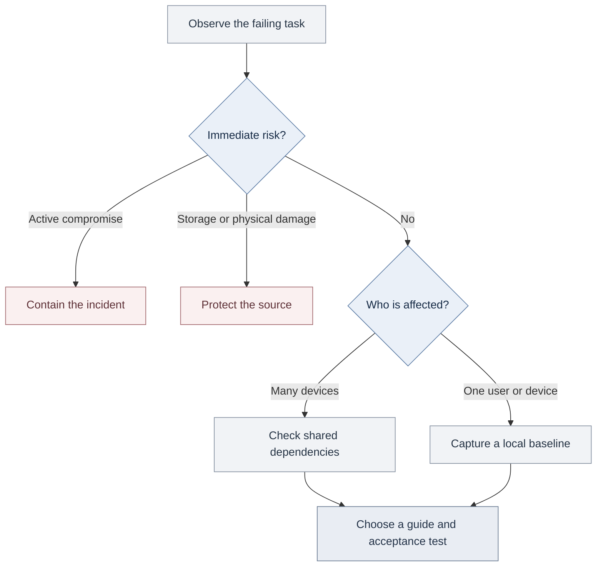

<a href="https://herbertofury.github.io/INTA/" title="Open INTA official download or service page" aria-label="Open INTA official download or service page" data-inta-brand="app-inta"></a> [INTA](https://github.com/Herbertofury/INTA/wiki) / [Decision desk](https://github.com/Herbertofury/INTA/wiki/Decision-Desk) · [Service map](https://github.com/Herbertofury/INTA/wiki/Service-Map) · [Playbooks](https://github.com/Herbertofury/INTA/wiki/Playbooks) · [Tools](https://github.com/Herbertofury/INTA/wiki/Tool-Directory) · [Methods](https://github.com/Herbertofury/INTA/wiki/Methods) · [Open hub](https://herbertofury.github.io/INTA/)

<a id="-start-here-triage-any-computer-problem"></a>

# [Start here: triage any computer problem](https://github.com/Herbertofury/INTA/wiki/Job-intake-triage)

Turn a vague symptom into a clear next action, a protected data set, and a useful service record.

**Getting started** · Starter · 10–20 min · 6 steps

[Tools and useful links](#working-kit) · [Quick answer](#quick-answer) · [Next action](#next-action) · [Specific fixes](#specific-fixes) · [Decision route](#decision-route) · [Tools](#toolkit) · [Procedure](#walkthrough) · [Verification](#acceptance) · [Sources](#sources) · [Interactive checklist](https://herbertofury.github.io/INTA/#job/intake-triage)

<a id="working-kit"></a>

## 🧰 Tools and links for this job

**[Open working view](https://herbertofury.github.io/INTA/#job/intake-triage)** · Keep the tool panel beside the instructions.

**First move:** Ask the user to show the failing task once. Record the exact error, last working time, affected users and whether important data has another copy.

| Use this for | Official tool + exact action |
| --- | --- |
| Identify the process involved in the failure. | **<a href="https://learn.microsoft.com/en-us/sysinternals/downloads/process-explorer" title="Open Process Explorer official download or service page" aria-label="Open Process Explorer official download or service page" data-inta-brand="process-explorer"></a> [Process Explorer](https://learn.microsoft.com/en-us/sysinternals/downloads/process-explorer)** · <a href="https://learn.microsoft.com/en-us/sysinternals/downloads/process-explorer" title="Open Process Explorer official download or service page" aria-label="Open Process Explorer official download or service page" data-inta-brand="process-explorer"></a> [Official page](https://learn.microsoft.com/en-us/sysinternals/downloads/process-explorer) · **<a href="https://www.microsoft.com/windows" title="Open Windows official download or service page" aria-label="Open Windows official download or service page" data-inta-brand="app-windows"></a> [Download Windows portable · ZIP](https://download.sysinternals.com/files/ProcessExplorer.zip)** |
| Check drive warnings before repair writes. | **<a href="https://crystalmark.info/en/download/" title="Open CrystalDiskInfo official download or service page" aria-label="Open CrystalDiskInfo official download or service page" data-inta-brand="crystaldiskinfo"></a> [CrystalDiskInfo](https://crystalmark.info/en/software/crystaldiskinfo/)** · <a href="https://crystalmark.info/en/download/" title="Open CrystalDiskInfo official download or service page" aria-label="Open CrystalDiskInfo official download or service page" data-inta-brand="crystaldiskinfo"></a> [Official page](https://crystalmark.info/en/software/crystaldiskinfo/) · **<a href="https://www.microsoft.com/windows" title="Open Windows official download or service page" aria-label="Open Windows official download or service page" data-inta-brand="app-windows"></a> [Get Windows ZIP · 9.9.5](https://sourceforge.net/projects/crystaldiskinfo/files/9.9.5/CrystalDiskInfo9_9_5.zip/download)** |
| Identifying the actual USB port, hub, device and negotiated connection when a printer, scanner or peripheral disconnects or runs slowly. | **<a href="https://www.uwe-sieber.de/usbtreeview_e.html" title="Open USB Device Tree Viewer official download or service page" aria-label="Open USB Device Tree Viewer official download or service page" data-inta-brand="usb-device-tree-view"></a> [USB Device Tree Viewer](https://www.uwe-sieber.de/usbtreeview_e.html)** · <a href="https://www.uwe-sieber.de/usbtreeview_e.html" title="Open USB Device Tree Viewer official download or service page" aria-label="Open USB Device Tree Viewer official download or service page" data-inta-brand="usb-device-tree-view"></a> [Official page](https://www.uwe-sieber.de/usbtreeview_e.html) · **<a href="https://www.microsoft.com/windows" title="Open Windows official download or service page" aria-label="Open Windows official download or service page" data-inta-brand="app-windows"></a> [Download Windows x64 portable · ZIP](https://www.uwe-sieber.de/files/UsbTreeView_x64.zip)** |
| Collecting battery and sleep evidence before changing hardware or power policy. | **<a href="https://learn.microsoft.com/en-us/windows-hardware/design/device-experiences/powercfg-command-line-options" title="Open powercfg official download or service page" aria-label="Open powercfg official download or service page" data-inta-brand="powercfg"></a> [powercfg](https://learn.microsoft.com/en-us/windows-hardware/design/device-experiences/powercfg-command-line-options)** · <a href="https://learn.microsoft.com/en-us/windows-hardware/design/device-experiences/powercfg-command-line-options" title="Open powercfg official download or service page" aria-label="Open powercfg official download or service page" data-inta-brand="powercfg"></a> [Official page](https://learn.microsoft.com/en-us/windows-hardware/design/device-experiences/powercfg-command-line-options) · **<a href="https://learn.microsoft.com/en-us/windows-hardware/design/device-experiences/powercfg-command-line-options" title="Open powercfg official download or service page" aria-label="Open powercfg official download or service page" data-inta-brand="powercfg"></a> [Open built-in battery and sleep diagnostics](https://learn.microsoft.com/en-us/windows-hardware/design/device-experiences/powercfg-command-line-options)** |
| Decode and transform evidence locally | **<a href="https://gchq.github.io/CyberChef/" title="Open CyberChef official download or service page" aria-label="Open CyberChef official download or service page" data-inta-brand="cyberchef"></a> [CyberChef](https://github.com/gchq/CyberChef)** · <a href="https://gchq.github.io/CyberChef/" title="Open CyberChef official download or service page" aria-label="Open CyberChef official download or service page" data-inta-brand="cyberchef"></a> [Official page](https://github.com/gchq/CyberChef) · **<a href="https://gchq.github.io/CyberChef/" title="Open CyberChef official download or service page" aria-label="Open CyberChef official download or service page" data-inta-brand="cyberchef"></a> [Open online service](https://gchq.github.io/CyberChef/)** |
| Develop a log or indicator extraction pattern with positive and negative cases. | **<a href="https://regex101.com/" title="Open regex101 official download or service page" aria-label="Open regex101 official download or service page" data-inta-brand="regex101"></a> [regex101](https://regex101.com/)** · <a href="https://regex101.com/" title="Open regex101 official download or service page" aria-label="Open regex101 official download or service page" data-inta-brand="regex101"></a> [Official page](https://regex101.com/) · **<a href="https://regex101.com/" title="Open regex101 official download or service page" aria-label="Open regex101 official download or service page" data-inta-brand="regex101"></a> [Open online service](https://regex101.com/)** |
| Document an office network or hand off a clear map of dependencies and ports. | **<a href="https://app.diagrams.net/" title="Open draw.io official download or service page" aria-label="Open draw.io official download or service page" data-inta-brand="drawio"></a> [draw.io](https://www.drawio.com/)** · <a href="https://app.diagrams.net/" title="Open draw.io official download or service page" aria-label="Open draw.io official download or service page" data-inta-brand="drawio"></a> [Official page](https://www.drawio.com/) · **<a href="https://app.diagrams.net/" title="Open draw.io official download or service page" aria-label="Open draw.io official download or service page" data-inta-brand="drawio"></a> [Open online service](https://app.diagrams.net/)** |
| Reproduce an API failure and compare status, headers and response content with the documented contract. | **<a href="https://hoppscotch.io/" title="Open Hoppscotch official download or service page" aria-label="Open Hoppscotch official download or service page" data-inta-brand="hoppscotch"></a> [Hoppscotch](https://hoppscotch.com/)** · <a href="https://hoppscotch.io/" title="Open Hoppscotch official download or service page" aria-label="Open Hoppscotch official download or service page" data-inta-brand="hoppscotch"></a> [Official page](https://hoppscotch.com/) · **<a href="https://hoppscotch.io/" title="Open Hoppscotch official download or service page" aria-label="Open Hoppscotch official download or service page" data-inta-brand="hoppscotch"></a> [Open online service](https://hoppscotch.io/)** |

### Case record

| Open the exact resource | What to do there |
| --- | --- |
| **[Intake and handoff sheet](https://github.com/Herbertofury/INTA/wiki/Technician-Handoff)** | Capture the symptom, permission, recovery plan and acceptance test. |

### First observations

| Open the exact resource | What to do there |
| --- | --- |
| **<a href="https://learn.microsoft.com/en-us/windows-server/administration/windows-commands/perfmon" title="Open Reliability Monitor official download or service page" aria-label="Open Reliability Monitor official download or service page" data-inta-brand="app-reliability-monitor"></a> [Reliability history command](https://learn.microsoft.com/en-us/windows-server/administration/windows-commands/perfmon)** | Open failure history with perfmon /rel. |

### Protect data

| Open the exact resource | What to do there |
| --- | --- |
| **<a href="https://www.microsoft.com/windows" title="Open Windows official download or service page" aria-label="Open Windows official download or service page" data-inta-brand="app-windows"></a> [Windows recovery choices](https://support.microsoft.com/en-us/windows/experience/backup-recovery/recovery-options-in-windows)** | Check which recovery action preserves files and applications. |

### Online working tools

| Open the exact resource | What to do there |
| --- | --- |
| **[Decode and document evidence](https://herbertofury.github.io/INTA/#online?task=decode-and-document)** | Use purpose-specific browser tools to understand a sample of evidence and leave a clear handoff. |

<a id="quick-answer"></a>

## ⚡ Quick answer

<a id="quick-start-a-repair"></a>

### 🧭 Start a repair

**Record the exact symptom, affected device and desired result before making changes.**

1. Confirm permission, the last working time and any recent change with the user.
2. Check for spreading compromise, failing storage and missing recovery access before normal troubleshooting.
3. Reproduce the problem, record a baseline and choose the matching guide with a clear success test.

**No extra download needed.** Follow the checklist below.

<a id="next-action"></a>

## 🧭 Match the symptom

| You see this | Do this next | You should get |
| --- | --- | --- |
| **The error appears in one app or account** | Repeat the same task in another approved account or app; record what changes. | The fault is scoped to an app, profile or wider device problem. |
| **Several users or devices fail together** | Compare one known-working device and the same service; use the office-outage route when the dependency is shared. | The ticket identifies the shared service and its recovery owner. |
| **The timing or cause is unclear** | Press Win+R, run perfmon /rel, select the failure time and open technical details. | A dated failure or recent change can be compared with the user’s timeline. |
| **A drive clicks, disappears or reports repeated I/O errors** | Stop ordinary repair and route to failing-drive recovery before scans or file-system repairs. | The source is preserved and the imaging or specialist decision is recorded. |

### ✅ Finish the job

- [ ] One exact reproduction and expected outcome are recorded.
- [ ] The next guide, responsible technician and recoverable data copy are identified.

**Change route when:** Active encryption or spreading compromise requires the incident route. · The next action would risk the only usable data copy.

### 🎯 Go straight to a specific fix

- **<a href="https://github.com/PowerShell/PowerShell/releases/latest" title="Open PowerShell official download or service page" aria-label="Open PowerShell official download or service page" data-inta-brand="powershell"></a> [Run a PowerShell first-response diagnostic and tool-launch kit](#fix-triage-powershell-first-response-toolkit)** — A technician needs a fast, repeatable <a href="https://www.microsoft.com/windows" title="Open Windows official download or service page" aria-label="Open Windows official download or service page" data-inta-brand="app-windows"></a> [Windows](https://www.microsoft.com/windows) baseline, common diagnostic windows, and trusted utilities without hunting through menus or downloading unknown scripts.
- **[Choose the correct model and architecture](#fix-triage-confirm-model-and-architecture)** — A driver or repair package says it is incompatible, or the device model is uncertain.
- **[Find the background program blocking an app](#fix-triage-isolate-background-conflict)** — An application fails in normal startup but works when optional background software is absent.
- **[Correct a bad clock before chasing sign-in errors](#fix-triage-clock-breaks-signin)** — Several secure sites or sign-ins fail and the displayed date or time is wrong.

> [!NOTE]
> **Start here.** Ask the user to show the exact failing task once. Record what they expected, what happened, and when it last worked.

<a id="decision-route"></a>

<a id="-choose-the-right-branch"></a>

## 🧭 Choose a route



**Route links:** [Continue this workflow](#walkthrough) · [Acceptance checks](#acceptance) · [Remove malware and browser hijackers](https://github.com/Herbertofury/INTA/wiki/Job-malware-removal) · [Diagnose a slow, freezing, or hitching PC](https://github.com/Herbertofury/INTA/wiki/Job-slow-pc) · [Rescue data from a failing or unreadable drive](https://github.com/Herbertofury/INTA/wiki/Job-failing-drive) · [Bring an office back after a power outage](https://github.com/Herbertofury/INTA/wiki/Job-outage-recovery) · [Close a repair with a clear client handoff](https://github.com/Herbertofury/INTA/wiki/Job-client-handoff)

| Checkpoint | What to carry forward |
| --- | --- |
| **Before changing anything** | Identify unique data and the working boundary. |
| **Keep during the job** | Exact error, time, scope, baseline, and failed tests. |
| **Before handing back** | A specific next guide and measurable acceptance test. |

<a id="toolkit"></a>

<a id="-build-the-right-toolkit"></a>

## Recommended tools

Select a tool for the next diagnostic or repair step. Check its platform, access and licensing requirements before use.

| Tool / official page + download | Use it for | Platform & access | Documentation |
| --- | --- | --- | --- |
| **<a href="https://learn.microsoft.com/en-us/sysinternals/downloads/process-explorer" title="Open Process Explorer official download or service page" aria-label="Open Process Explorer official download or service page" data-inta-brand="process-explorer"></a> [Process Explorer](https://learn.microsoft.com/en-us/sysinternals/downloads/process-explorer)** · <a href="https://learn.microsoft.com/en-us/sysinternals/downloads/process-explorer" title="Open Process Explorer official download or service page" aria-label="Open Process Explorer official download or service page" data-inta-brand="process-explorer"></a> [Official page](https://learn.microsoft.com/en-us/sysinternals/downloads/process-explorer) · **<a href="https://www.microsoft.com/windows" title="Open Windows official download or service page" aria-label="Open Windows official download or service page" data-inta-brand="app-windows"></a> [Download Windows portable · ZIP](https://download.sysinternals.com/files/ProcessExplorer.zip)** | Identify the process involved in the failure. | <a href="https://www.microsoft.com/windows" title="Open Windows official download or service page" aria-label="Open Windows official download or service page" data-inta-brand="app-windows"></a> [Windows](https://www.microsoft.com/windows); Free <a href="https://www.microsoft.com/" title="Open microsoft.com official download or service page" aria-label="Open microsoft.com official download or service page" data-inta-brand="site-www-microsoft-com"></a> [Microsoft](https://www.microsoft.com/) utility | <a href="https://learn.microsoft.com/en-us/sysinternals/downloads/process-explorer" title="Open Process Explorer official download or service page" aria-label="Open Process Explorer official download or service page" data-inta-brand="process-explorer"></a> [Open guide](https://learn.microsoft.com/en-us/sysinternals/downloads/process-explorer) |
| **<a href="https://crystalmark.info/en/download/" title="Open CrystalDiskInfo official download or service page" aria-label="Open CrystalDiskInfo official download or service page" data-inta-brand="crystaldiskinfo"></a> [CrystalDiskInfo](https://crystalmark.info/en/software/crystaldiskinfo/)** · <a href="https://crystalmark.info/en/download/" title="Open CrystalDiskInfo official download or service page" aria-label="Open CrystalDiskInfo official download or service page" data-inta-brand="crystaldiskinfo"></a> [Official page](https://crystalmark.info/en/software/crystaldiskinfo/) · **<a href="https://www.microsoft.com/windows" title="Open Windows official download or service page" aria-label="Open Windows official download or service page" data-inta-brand="app-windows"></a> [Get Windows ZIP · 9.9.5](https://sourceforge.net/projects/crystaldiskinfo/files/9.9.5/CrystalDiskInfo9_9_5.zip/download)** | Check drive warnings before repair writes. | <a href="https://www.microsoft.com/windows" title="Open Windows official download or service page" aria-label="Open Windows official download or service page" data-inta-brand="app-windows"></a> [Windows](https://www.microsoft.com/windows); Free / open source | <a href="https://crystalmark.info/en/download/" title="Open CrystalDiskInfo official download or service page" aria-label="Open CrystalDiskInfo official download or service page" data-inta-brand="crystaldiskinfo"></a> [Open guide](https://crystalmark.info/en/software/crystaldiskinfo/) |
| **<a href="https://learn.microsoft.com/en-us/sysinternals/downloads/sysinternals-suite" title="Open Microsoft Sysinternals Suite official download or service page" aria-label="Open Microsoft Sysinternals Suite official download or service page" data-inta-brand="sysinternals"></a> [Microsoft Sysinternals Suite](https://learn.microsoft.com/en-us/sysinternals/)** · <a href="https://learn.microsoft.com/en-us/sysinternals/downloads/sysinternals-suite" title="Open Microsoft Sysinternals Suite official download or service page" aria-label="Open Microsoft Sysinternals Suite official download or service page" data-inta-brand="sysinternals"></a> [Official page](https://learn.microsoft.com/en-us/sysinternals/) · **<a href="https://www.microsoft.com/windows" title="Open Windows official download or service page" aria-label="Open Windows official download or service page" data-inta-brand="app-windows"></a> [Download Windows portable · ZIP](https://download.sysinternals.com/files/SysinternalsSuite.zip)** | The core portable <a href="https://www.microsoft.com/windows" title="Open Windows official download or service page" aria-label="Open Windows official download or service page" data-inta-brand="app-windows"></a> [Windows](https://www.microsoft.com/windows) troubleshooting kit. | <a href="https://www.microsoft.com/windows" title="Open Windows official download or service page" aria-label="Open Windows official download or service page" data-inta-brand="app-windows"></a> [Windows](https://www.microsoft.com/windows); Free <a href="https://www.microsoft.com/" title="Open microsoft.com official download or service page" aria-label="Open microsoft.com official download or service page" data-inta-brand="site-www-microsoft-com"></a> [Microsoft](https://www.microsoft.com/) utilities | <a href="https://learn.microsoft.com/en-us/sysinternals/downloads/sysinternals-suite" title="Open Microsoft Sysinternals Suite official download or service page" aria-label="Open Microsoft Sysinternals Suite official download or service page" data-inta-brand="sysinternals"></a> [Open guide](https://learn.microsoft.com/en-us/sysinternals/downloads/) |
| **<a href="https://www.hwinfo.com/download/" title="Open HWiNFO official download or service page" aria-label="Open HWiNFO official download or service page" data-inta-brand="hwinfo"></a> [HWiNFO](https://www.hwinfo.com/)** · <a href="https://www.hwinfo.com/download/" title="Open HWiNFO official download or service page" aria-label="Open HWiNFO official download or service page" data-inta-brand="hwinfo"></a> [Official page](https://www.hwinfo.com/) · **<a href="https://www.microsoft.com/windows" title="Open Windows official download or service page" aria-label="Open Windows official download or service page" data-inta-brand="app-windows"></a> [Download Windows x64 EXE](https://www.hwinfo.com/files/hwi64_860.exe)** | Investigating temperatures, clocks, power and component identity. | <a href="https://www.microsoft.com/windows" title="Open Windows official download or service page" aria-label="Open Windows official download or service page" data-inta-brand="app-windows"></a> [Windows](https://www.microsoft.com/windows); Pro license for commercial use of 64/ARM64 editions | <a href="https://www.hwinfo.com/download/" title="Open HWiNFO official download or service page" aria-label="Open HWiNFO official download or service page" data-inta-brand="hwinfo"></a> [Open guide](https://www.hwinfo.com/licenses/) |
| **<a href="https://www.uwe-sieber.de/usbtreeview_e.html" title="Open USB Device Tree Viewer official download or service page" aria-label="Open USB Device Tree Viewer official download or service page" data-inta-brand="usb-device-tree-view"></a> [USB Device Tree Viewer](https://www.uwe-sieber.de/usbtreeview_e.html)** · <a href="https://www.uwe-sieber.de/usbtreeview_e.html" title="Open USB Device Tree Viewer official download or service page" aria-label="Open USB Device Tree Viewer official download or service page" data-inta-brand="usb-device-tree-view"></a> [Official page](https://www.uwe-sieber.de/usbtreeview_e.html) · **<a href="https://www.microsoft.com/windows" title="Open Windows official download or service page" aria-label="Open Windows official download or service page" data-inta-brand="app-windows"></a> [Download Windows x64 portable · ZIP](https://www.uwe-sieber.de/files/UsbTreeView_x64.zip)** | Identifying the actual USB port, hub, device and negotiated connection when a printer, scanner or peripheral disconnects or runs slowly. | <a href="https://www.microsoft.com/windows" title="Open Windows official download or service page" aria-label="Open Windows official download or service page" data-inta-brand="app-windows"></a> [Windows](https://www.microsoft.com/windows); Freeware; publisher explicitly permits use in commercial environments | <a href="https://www.uwe-sieber.de/usbtreeview_e.html" title="Open USB Device Tree Viewer official download or service page" aria-label="Open USB Device Tree Viewer official download or service page" data-inta-brand="usb-device-tree-view"></a> [Open guide](https://www.uwe-sieber.de/usbtreeview_e.html) |
| **<a href="https://learn.microsoft.com/en-us/windows-hardware/design/device-experiences/powercfg-command-line-options" title="Open powercfg official download or service page" aria-label="Open powercfg official download or service page" data-inta-brand="powercfg"></a> [powercfg](https://learn.microsoft.com/en-us/windows-hardware/design/device-experiences/powercfg-command-line-options)** · <a href="https://learn.microsoft.com/en-us/windows-hardware/design/device-experiences/powercfg-command-line-options" title="Open powercfg official download or service page" aria-label="Open powercfg official download or service page" data-inta-brand="powercfg"></a> [Official page](https://learn.microsoft.com/en-us/windows-hardware/design/device-experiences/powercfg-command-line-options) · **<a href="https://learn.microsoft.com/en-us/windows-hardware/design/device-experiences/powercfg-command-line-options" title="Open powercfg official download or service page" aria-label="Open powercfg official download or service page" data-inta-brand="powercfg"></a> [Open built-in battery and sleep diagnostics](https://learn.microsoft.com/en-us/windows-hardware/design/device-experiences/powercfg-command-line-options)** | Collecting battery and sleep evidence before changing hardware or power policy. | <a href="https://www.microsoft.com/windows" title="Open Windows official download or service page" aria-label="Open Windows official download or service page" data-inta-brand="app-windows"></a> [Windows](https://www.microsoft.com/windows); Included with <a href="https://www.microsoft.com/windows" title="Open Windows official download or service page" aria-label="Open Windows official download or service page" data-inta-brand="app-windows"></a> [Windows](https://www.microsoft.com/windows) | <a href="https://learn.microsoft.com/en-us/windows-hardware/design/device-experiences/powercfg-command-line-options" title="Open powercfg official download or service page" aria-label="Open powercfg official download or service page" data-inta-brand="powercfg"></a> [Open guide](https://learn.microsoft.com/en-us/windows-hardware/design/device-experiences/powercfg-command-line-options) |
| **<a href="https://gchq.github.io/CyberChef/" title="Open CyberChef official download or service page" aria-label="Open CyberChef official download or service page" data-inta-brand="cyberchef"></a> [CyberChef](https://github.com/gchq/CyberChef)** · <a href="https://gchq.github.io/CyberChef/" title="Open CyberChef official download or service page" aria-label="Open CyberChef official download or service page" data-inta-brand="cyberchef"></a> [Official page](https://github.com/gchq/CyberChef) · **<a href="https://gchq.github.io/CyberChef/" title="Open CyberChef official download or service page" aria-label="Open CyberChef official download or service page" data-inta-brand="cyberchef"></a> [Open online service](https://gchq.github.io/CyberChef/)** | Decode and transform evidence locally | Web browser; Free and open source; downloadable offline application. | <a href="https://gchq.github.io/CyberChef/" title="Open CyberChef official download or service page" aria-label="Open CyberChef official download or service page" data-inta-brand="cyberchef"></a> [Open guide](https://github.com/gchq/CyberChef) |
| **<a href="https://regex101.com/" title="Open regex101 official download or service page" aria-label="Open regex101 official download or service page" data-inta-brand="regex101"></a> [regex101](https://regex101.com/)** · <a href="https://regex101.com/" title="Open regex101 official download or service page" aria-label="Open regex101 official download or service page" data-inta-brand="regex101"></a> [Official page](https://regex101.com/) · **<a href="https://regex101.com/" title="Open regex101 official download or service page" aria-label="Open regex101 official download or service page" data-inta-brand="regex101"></a> [Open online service](https://regex101.com/)** | Develop a log or indicator extraction pattern with positive and negative cases. | Web browser; Free matching and unit tests; advanced Pro features and Enterprise hosting are separate. | <a href="https://regex101.com/" title="Open regex101 official download or service page" aria-label="Open regex101 official download or service page" data-inta-brand="regex101"></a> [Open guide](https://docs.regex101.com/) |
| **<a href="https://app.diagrams.net/" title="Open draw.io official download or service page" aria-label="Open draw.io official download or service page" data-inta-brand="drawio"></a> [draw.io](https://www.drawio.com/)** · <a href="https://app.diagrams.net/" title="Open draw.io official download or service page" aria-label="Open draw.io official download or service page" data-inta-brand="drawio"></a> [Official page](https://www.drawio.com/) · **<a href="https://app.diagrams.net/" title="Open draw.io official download or service page" aria-label="Open draw.io official download or service page" data-inta-brand="drawio"></a> [Open online service](https://app.diagrams.net/)** | Document an office network or hand off a clear map of dependencies and ports. | Web browser; Free browser editor; some third-party integrations have separate offerings. | <a href="https://app.diagrams.net/" title="Open draw.io official download or service page" aria-label="Open draw.io official download or service page" data-inta-brand="drawio"></a> [Open guide](https://www.drawio.com/docs/) |
| **<a href="https://hoppscotch.io/" title="Open Hoppscotch official download or service page" aria-label="Open Hoppscotch official download or service page" data-inta-brand="hoppscotch"></a> [Hoppscotch](https://hoppscotch.com/)** · <a href="https://hoppscotch.io/" title="Open Hoppscotch official download or service page" aria-label="Open Hoppscotch official download or service page" data-inta-brand="hoppscotch"></a> [Official page](https://hoppscotch.com/) · **<a href="https://hoppscotch.io/" title="Open Hoppscotch official download or service page" aria-label="Open Hoppscotch official download or service page" data-inta-brand="hoppscotch"></a> [Open online service](https://hoppscotch.io/)** | Reproduce an API failure and compare status, headers and response content with the documented contract. | Web browser; Free personal workspace; paid cloud plans add shared workspaces and organizational features. | <a href="https://hoppscotch.io/" title="Open Hoppscotch official download or service page" aria-label="Open Hoppscotch official download or service page" data-inta-brand="hoppscotch"></a> [Open guide](https://docs.hoppscotch.io/documentation/getting-started/introduction) |

<a id="walkthrough"></a>

<a id="-work-the-case"></a>

## Procedure

Work in order, record the result of each step, and change route when the evidence calls for it.

<a id="step-01"></a>

### 01 · Establish the working boundary

- [ ] Identify the device, operating system, asset label, contact, business impact, and maintenance window. Ask whether work is saved and whether the device contains the only copy of important data. Use the private ticket for identifying information; this public wiki stays generic.

<a id="step-02"></a>

### 02 · Choose the urgent branch

- [ ] Encryption spreading or a compromise alert goes to [ransomware response](https://github.com/Herbertofury/INTA/wiki/Job-ransomware-response). Clicking drives, vanishing volumes, repeated I/O errors, or a device dropped in liquid go to the failing-drive or hardware path before scans, repairs, or repeated boots. A widespread outage goes to the outage guide.

<a id="step-03"></a>

### 03 · Capture the smallest useful baseline

- [ ] Record the exact error text and time, OS build, recent changes, uptime, free space, and <a href="https://support.microsoft.com/en-us/windows/experience/system-configuration-tools-in-windows" title="Open Task Manager official download or service page" aria-label="Open Task Manager official download or service page" data-inta-brand="app-task-manager"></a> [Task Manager](https://support.microsoft.com/en-us/windows/experience/system-configuration-tools-in-windows) CPU/memory/disk usage during the symptom. On <a href="https://www.microsoft.com/windows" title="Open Windows official download or service page" aria-label="Open Windows official download or service page" data-inta-brand="app-windows"></a> [Windows](https://www.microsoft.com/windows), open <a href="https://learn.microsoft.com/en-us/windows-server/administration/windows-commands/perfmon" title="Open Reliability Monitor official download or service page" aria-label="Open Reliability Monitor official download or service page" data-inta-brand="app-reliability-monitor"></a> [Reliability Monitor](https://learn.microsoft.com/en-us/windows-server/administration/windows-commands/perfmon) from Run with the command below to correlate failures with changes; save evidence to the private service record.

**CMD or <a href="https://github.com/PowerShell/PowerShell/releases/latest" title="Open PowerShell official download or service page" aria-label="Open PowerShell official download or service page" data-inta-brand="powershell"></a> [PowerShell](https://learn.microsoft.com/en-us/powershell/) · Open <a href="https://learn.microsoft.com/en-us/windows-server/administration/windows-commands/perfmon" title="Open Reliability Monitor official download or service page" aria-label="Open Reliability Monitor official download or service page" data-inta-brand="app-reliability-monitor"></a> [Reliability Monitor](https://learn.microsoft.com/en-us/windows-server/administration/windows-commands/perfmon) and correlate the failure with recent changes.:**

```text
perfmon /rel
```

> **Before running:** Read-only diagnostic; opens a <a href="https://www.microsoft.com/windows" title="Open Windows official download or service page" aria-label="Open Windows official download or service page" data-inta-brand="app-windows"></a> [Windows](https://www.microsoft.com/windows) system utility.

**Official command reference:** <a href="https://www.microsoft.com/" title="Open microsoft.com official download or service page" aria-label="Open microsoft.com official download or service page" data-inta-brand="site-www-microsoft-com"></a> [Microsoft perfmon command](https://learn.microsoft.com/en-us/windows-server/administration/windows-commands/perfmon)

**Command legend:** <a href="https://www.microsoft.com/" title="Open microsoft.com official download or service page" aria-label="Open microsoft.com official download or service page" data-inta-brand="site-www-microsoft-com"></a> [Microsoft perfmon command](https://learn.microsoft.com/en-us/windows-server/administration/windows-commands/perfmon) · [Return to the step context](#step-03).

<a id="step-04"></a>

### 04 · Reproduce and narrow the scope

- [ ] Test whether the failure affects one user, one app, one device, or everyone. Compare with a working account or device where practical. Change one variable at a time and note whether it changes the symptom.

<a id="step-05"></a>

### 05 · Protect a rollback point

- [ ] Confirm a usable backup or export of the data that the next step may affect. Record the current configuration before changing it. A restore point is useful for some system changes but is not a replacement for a file backup.

<a id="step-06"></a>

### 06 · Pick one guide and define success

- [ ] Choose the closest job below and write a concrete acceptance test, such as opening the real accounting file, completing a print job, or restoring a document. Capture each change and result so another technician can resume without repeating failed work.

<a id="acceptance"></a>

<a id="-prove-the-result"></a>

## Verification

- [ ] The original symptom and business impact are recorded.
- [ ] The next guide matches observed evidence.
- [ ] A data-protection plan and a measurable acceptance test exist.

> [!WARNING]
> **Pause this route and escalate when:**
> - There is active encryption, physical damage, or storage failure.
> - The only copy of important data would be put at risk by the next action.

<a id="specific-fixes"></a>

## 🎯 Specific fixes

Choose the case that matches the evidence. Each case gives a first action, a short procedure and a result to prove.

<a id="fix-triage-powershell-first-response-toolkit"></a>

### Run a <a href="https://github.com/PowerShell/PowerShell/releases/latest" title="Open PowerShell official download or service page" aria-label="Open PowerShell official download or service page" data-inta-brand="powershell"></a> [PowerShell](https://learn.microsoft.com/en-us/powershell/) first-response diagnostic and tool-launch kit

**Use when:** A technician needs a fast, repeatable <a href="https://www.microsoft.com/windows" title="Open Windows official download or service page" aria-label="Open Windows official download or service page" data-inta-brand="app-windows"></a> [Windows](https://www.microsoft.com/windows) baseline, common diagnostic windows, and trusted utilities without hunting through menus or downloading unknown scripts.

**Start here:** Open <a href="https://github.com/microsoft/terminal/releases/latest" title="Open Windows Terminal official download or service page" aria-label="Open Windows Terminal official download or service page" data-inta-brand="windows-terminal"></a> [Windows Terminal](https://learn.microsoft.com/en-us/windows/terminal/) or <a href="https://github.com/PowerShell/PowerShell/releases/latest" title="Open PowerShell official download or service page" aria-label="Open PowerShell official download or service page" data-inta-brand="powershell"></a> [PowerShell](https://learn.microsoft.com/en-us/powershell/). Use a standard user session for read-only inventory; elevate only when the specific command requires it.

**<a href="https://learn.microsoft.com/en-us/sysinternals/downloads/sysinternals-suite" title="Open Microsoft Sysinternals Suite official download or service page" aria-label="Open Microsoft Sysinternals Suite official download or service page" data-inta-brand="sysinternals"></a> [Microsoft Sysinternals Suite](https://learn.microsoft.com/en-us/sysinternals/)** · <a href="https://learn.microsoft.com/en-us/sysinternals/downloads/sysinternals-suite" title="Open Microsoft Sysinternals Suite official download or service page" aria-label="Open Microsoft Sysinternals Suite official download or service page" data-inta-brand="sysinternals"></a> [Official page](https://learn.microsoft.com/en-us/sysinternals/) · **<a href="https://www.microsoft.com/windows" title="Open Windows official download or service page" aria-label="Open Windows official download or service page" data-inta-brand="app-windows"></a> [Download Windows portable · ZIP](https://download.sysinternals.com/files/SysinternalsSuite.zip)**

**<a href="https://learn.microsoft.com/en-us/sysinternals/downloads/process-explorer" title="Open Process Explorer official download or service page" aria-label="Open Process Explorer official download or service page" data-inta-brand="process-explorer"></a> [Process Explorer](https://learn.microsoft.com/en-us/sysinternals/downloads/process-explorer)** · <a href="https://learn.microsoft.com/en-us/sysinternals/downloads/process-explorer" title="Open Process Explorer official download or service page" aria-label="Open Process Explorer official download or service page" data-inta-brand="process-explorer"></a> [Official page](https://learn.microsoft.com/en-us/sysinternals/downloads/process-explorer) · **<a href="https://www.microsoft.com/windows" title="Open Windows official download or service page" aria-label="Open Windows official download or service page" data-inta-brand="app-windows"></a> [Download Windows portable · ZIP](https://download.sysinternals.com/files/ProcessExplorer.zip)**

**<a href="https://learn.microsoft.com/en-us/sysinternals/downloads/autoruns" title="Open Autoruns official download or service page" aria-label="Open Autoruns official download or service page" data-inta-brand="autoruns"></a> [Autoruns](https://learn.microsoft.com/en-us/sysinternals/downloads/autoruns)** · <a href="https://learn.microsoft.com/en-us/sysinternals/downloads/autoruns" title="Open Autoruns official download or service page" aria-label="Open Autoruns official download or service page" data-inta-brand="autoruns"></a> [Official page](https://learn.microsoft.com/en-us/sysinternals/downloads/autoruns) · **<a href="https://www.microsoft.com/windows" title="Open Windows official download or service page" aria-label="Open Windows official download or service page" data-inta-brand="app-windows"></a> [Download Windows portable · ZIP](https://download.sysinternals.com/files/Autoruns.zip)**

**<a href="https://crystalmark.info/en/download/" title="Open CrystalDiskInfo official download or service page" aria-label="Open CrystalDiskInfo official download or service page" data-inta-brand="crystaldiskinfo"></a> [CrystalDiskInfo](https://crystalmark.info/en/software/crystaldiskinfo/)** · <a href="https://crystalmark.info/en/download/" title="Open CrystalDiskInfo official download or service page" aria-label="Open CrystalDiskInfo official download or service page" data-inta-brand="crystaldiskinfo"></a> [Official page](https://crystalmark.info/en/software/crystaldiskinfo/) · **<a href="https://www.microsoft.com/windows" title="Open Windows official download or service page" aria-label="Open Windows official download or service page" data-inta-brand="app-windows"></a> [Get Windows ZIP · 9.9.5](https://sourceforge.net/projects/crystaldiskinfo/files/9.9.5/CrystalDiskInfo9_9_5.zip/download)**

**<a href="https://www.hwinfo.com/download/" title="Open HWiNFO official download or service page" aria-label="Open HWiNFO official download or service page" data-inta-brand="hwinfo"></a> [HWiNFO](https://www.hwinfo.com/)** · <a href="https://www.hwinfo.com/download/" title="Open HWiNFO official download or service page" aria-label="Open HWiNFO official download or service page" data-inta-brand="hwinfo"></a> [Official page](https://www.hwinfo.com/) · **<a href="https://www.microsoft.com/windows" title="Open Windows official download or service page" aria-label="Open Windows official download or service page" data-inta-brand="app-windows"></a> [Download Windows x64 EXE](https://www.hwinfo.com/files/hwi64_860.exe)**

**<a href="https://github.com/microsoft/PowerToys/releases/latest" title="Open Microsoft PowerToys official download or service page" aria-label="Open Microsoft PowerToys official download or service page" data-inta-brand="powertoys"></a> [Microsoft PowerToys](https://learn.microsoft.com/en-us/windows/powertoys/)** · <a href="https://github.com/microsoft/PowerToys/releases/latest" title="Open Microsoft PowerToys official download or service page" aria-label="Open Microsoft PowerToys official download or service page" data-inta-brand="powertoys"></a> [Official page](https://learn.microsoft.com/en-us/windows/powertoys/) · **<a href="https://www.microsoft.com/windows" title="Open Windows official download or service page" aria-label="Open Windows official download or service page" data-inta-brand="app-windows"></a> [Download Windows x64 setup · EXE](https://github.com/microsoft/PowerToys/releases/download/v0.102.3101/PowerToysUserSetup-0.102.3101.0-x64.exe)**

1. Collect a minimal OS, model, architecture, uptime, volume and network baseline. Review and sanitize it before attaching it to a private ticket.
2. Launch the built-in diagnostics that match the symptom: <a href="https://learn.microsoft.com/en-us/windows-server/administration/windows-commands/perfmon" title="Open Resource Monitor official download or service page" aria-label="Open Resource Monitor official download or service page" data-inta-brand="app-resource-monitor"></a> [Resource Monitor](https://learn.microsoft.com/en-us/windows-server/administration/windows-commands/perfmon), <a href="https://learn.microsoft.com/en-us/windows-server/administration/windows-commands/perfmon" title="Open Reliability Monitor official download or service page" aria-label="Open Reliability Monitor official download or service page" data-inta-brand="app-reliability-monitor"></a> [Reliability Monitor](https://learn.microsoft.com/en-us/windows-server/administration/windows-commands/perfmon), <a href="https://support.microsoft.com/en-us/windows/experience/system-configuration-tools-in-windows" title="Open Event Viewer official download or service page" aria-label="Open Event Viewer official download or service page" data-inta-brand="app-event-viewer"></a> [Event Viewer](https://support.microsoft.com/en-us/windows/experience/system-configuration-tools-in-windows), System Information and DirectX Diagnostic Tool.
3. For deeper work, acquire <a href="https://learn.microsoft.com/en-us/sysinternals/downloads/sysinternals-suite" title="Open Microsoft Sysinternals Suite official download or service page" aria-label="Open Microsoft Sysinternals Suite official download or service page" data-inta-brand="sysinternals"></a> [Microsoft Sysinternals Suite](https://learn.microsoft.com/en-us/sysinternals/) from its official publisher page or install the verified <a href="https://github.com/microsoft/PowerToys/releases/latest" title="Open Microsoft PowerToys official download or service page" aria-label="Open Microsoft PowerToys official download or service page" data-inta-brand="powertoys"></a> [Microsoft PowerToys](https://learn.microsoft.com/en-us/windows/powertoys/) package through <a href="https://github.com/microsoft/winget-cli/releases/latest" title="Open WinGet official download or service page" aria-label="Open WinGet official download or service page" data-inta-brand="winget"></a> [WinGet](https://learn.microsoft.com/en-us/windows/package-manager/winget/). Inspect package identity and publisher before installing.
4. Use dedicated hardware tools only when relevant. <a href="https://crystalmark.info/en/download/" title="Open CrystalDiskInfo official download or service page" aria-label="Open CrystalDiskInfo official download or service page" data-inta-brand="crystaldiskinfo"></a> [CrystalDiskInfo](https://crystalmark.info/en/software/crystaldiskinfo/) and <a href="https://www.hwinfo.com/download/" title="Open HWiNFO official download or service page" aria-label="Open HWiNFO official download or service page" data-inta-brand="hwinfo"></a> [HWiNFO](https://www.hwinfo.com/) have separate licensing, distribution and platform constraints; do not assume every freeware license permits commercial technician use.
5. Capture a narrow diagnostic trace, export only the relevant evidence, then verify the original customer workflow after any repair.

#### ⚡ Quick commands

**Collect a compact <a href="https://www.microsoft.com/windows" title="Open Windows official download or service page" aria-label="Open Windows official download or service page" data-inta-brand="app-windows"></a> [Windows](https://www.microsoft.com/windows) diagnostic baseline** · <a href="https://github.com/PowerShell/PowerShell/releases/latest" title="Open PowerShell official download or service page" aria-label="Open PowerShell official download or service page" data-inta-brand="powershell"></a> [PowerShell](https://learn.microsoft.com/en-us/powershell/)

Capture OS/build, manufacturer/model, uptime, free space, physical disks and active network configuration.

```powershell
Get-ComputerInfo | Select-Object CsName,WindowsProductName,WindowsVersion,OsBuildNumber,OsArchitecture,CsManufacturer,CsModel
Get-CimInstance Win32_OperatingSystem | Select-Object LastBootUpTime,TotalVisibleMemorySize,FreePhysicalMemory
Get-Volume | Select-Object DriveLetter,FileSystem,HealthStatus,SizeRemaining,Size
Get-PhysicalDisk | Format-Table FriendlyName,MediaType,HealthStatus,OperationalStatus,Size -AutoSize
Get-NetIPConfiguration
```

> **Before running:** Read-only inventory. Output can contain device names, serials, network addresses and organization details; review and redact before sharing.

**Official reference:** <a href="https://www.microsoft.com/" title="Open microsoft.com official download or service page" aria-label="Open microsoft.com official download or service page" data-inta-brand="site-www-microsoft-com"></a> [Microsoft Get-ComputerInfo](https://learn.microsoft.com/en-us/powershell/module/microsoft.powershell.management/get-computerinfo)

**Open the built-in <a href="https://www.microsoft.com/windows" title="Open Windows official download or service page" aria-label="Open Windows official download or service page" data-inta-brand="app-windows"></a> [Windows](https://www.microsoft.com/windows) diagnostic consoles** · <a href="https://github.com/PowerShell/PowerShell/releases/latest" title="Open PowerShell official download or service page" aria-label="Open PowerShell official download or service page" data-inta-brand="powershell"></a> [PowerShell](https://learn.microsoft.com/en-us/powershell/)

Launch common diagnostic utilities without installing third-party software.

```powershell
Start-Process resmon
Start-Process perfmon.exe -ArgumentList '/rel'
Start-Process msinfo32.exe
Start-Process eventvwr.msc
Start-Process dxdiag.exe
```

> **Before running:** Opens <a href="https://www.microsoft.com/windows" title="Open Windows official download or service page" aria-label="Open Windows official download or service page" data-inta-brand="app-windows"></a> [Windows](https://www.microsoft.com/windows) tools only. <a href="https://support.microsoft.com/en-us/windows/experience/system-configuration-tools-in-windows" title="Open Event Viewer official download or service page" aria-label="Open Event Viewer official download or service page" data-inta-brand="app-event-viewer"></a> [Event Viewer](https://support.microsoft.com/en-us/windows/experience/system-configuration-tools-in-windows) and diagnostic reports can expose usernames, hostnames, software and device details; retain exports privately.

**Official reference:** <a href="https://www.microsoft.com/" title="Open microsoft.com official download or service page" aria-label="Open microsoft.com official download or service page" data-inta-brand="site-www-microsoft-com"></a> <a href="https://learn.microsoft.com/en-us/troubleshoot/windows-server/support-tools/troubleshoot-issues-performance-monitor" title="Open Performance Monitor official download or service page" aria-label="Open Performance Monitor official download or service page" data-inta-brand="app-performance-monitor"></a> [Microsoft Performance Monitor](https://learn.microsoft.com/en-us/windows-server/administration/windows-commands/perfmon)

**Download, verify and launch the portable <a href="https://learn.microsoft.com/en-us/sysinternals/downloads/sysinternals-suite" title="Open Microsoft Sysinternals Suite official download or service page" aria-label="Open Microsoft Sysinternals Suite official download or service page" data-inta-brand="sysinternals"></a> [Sysinternals Suite](https://learn.microsoft.com/en-us/sysinternals/)** · <a href="https://github.com/PowerShell/PowerShell/releases/latest" title="Open PowerShell official download or service page" aria-label="Open PowerShell official download or service page" data-inta-brand="powershell"></a> [PowerShell](https://learn.microsoft.com/en-us/powershell/)

Download <a href="https://www.microsoft.com/" title="Open microsoft.com official download or service page" aria-label="Open microsoft.com official download or service page" data-inta-brand="site-www-microsoft-com"></a> [Microsoft](https://www.microsoft.com/)'s portable <a href="https://learn.microsoft.com/en-us/sysinternals/downloads/sysinternals-suite" title="Open Microsoft Sysinternals Suite official download or service page" aria-label="Open Microsoft Sysinternals Suite official download or service page" data-inta-brand="sysinternals"></a> [Sysinternals Suite](https://learn.microsoft.com/en-us/sysinternals/) into the local <a href="https://herbertofury.github.io/INTA/" title="Open INTA official download or service page" aria-label="Open INTA official download or service page" data-inta-brand="app-inta"></a> [INTA](https://herbertofury.github.io/INTA/) Toolbox, verify the <a href="https://learn.microsoft.com/en-us/sysinternals/downloads/process-explorer" title="Open Process Explorer official download or service page" aria-label="Open Process Explorer official download or service page" data-inta-brand="process-explorer"></a> [Process Explorer](https://learn.microsoft.com/en-us/sysinternals/downloads/process-explorer) Authenticode signature, then launch <a href="https://learn.microsoft.com/en-us/sysinternals/downloads/process-explorer" title="Open Process Explorer official download or service page" aria-label="Open Process Explorer official download or service page" data-inta-brand="process-explorer"></a> [Process Explorer](https://learn.microsoft.com/en-us/sysinternals/downloads/process-explorer).

```powershell
$toolbox = Join-Path $env:LOCALAPPDATA 'INTA Toolbox\SysinternalsSuite'
$zip = Join-Path $env:TEMP 'SysinternalsSuite.zip'
New-Item -ItemType Directory -Path $toolbox -Force | Out-Null
Invoke-WebRequest -Uri 'https://download.sysinternals.com/files/SysinternalsSuite.zip' -OutFile $zip
Expand-Archive -LiteralPath $zip -DestinationPath $toolbox -Force
$proc = Join-Path $toolbox 'procexp64.exe'
$signature = Get-AuthenticodeSignature -FilePath $proc
if ($signature.Status -ne 'Valid') { throw "Process Explorer signature is not valid: $($signature.Status)" }
$signature | Select-Object Status,@{N='Signer';E={$_.SignerCertificate.Subject}}
Start-Process -FilePath $proc
```

> **Before running:** Downloads and extracts a large <a href="https://www.microsoft.com/" title="Open microsoft.com official download or service page" aria-label="Open microsoft.com official download or service page" data-inta-brand="site-www-microsoft-com"></a> [Microsoft](https://www.microsoft.com/) utility suite into the current user's local <a href="https://herbertofury.github.io/INTA/" title="Open INTA official download or service page" aria-label="Open INTA official download or service page" data-inta-brand="app-inta"></a> [INTA](https://herbertofury.github.io/INTA/) Toolbox. The command launches <a href="https://learn.microsoft.com/en-us/sysinternals/downloads/process-explorer" title="Open Process Explorer official download or service page" aria-label="Open Process Explorer official download or service page" data-inta-brand="process-explorer"></a> [Process Explorer](https://learn.microsoft.com/en-us/sysinternals/downloads/process-explorer) only after <a href="https://www.microsoft.com/windows" title="Open Windows official download or service page" aria-label="Open Windows official download or service page" data-inta-brand="app-windows"></a> [Windows](https://www.microsoft.com/windows) reports a valid Authenticode signature. Review the publisher and use only the utility needed for the case; do not store traces or sensitive output in a shared toolbox folder.

**Official reference:** <a href="https://learn.microsoft.com/en-us/sysinternals/downloads/sysinternals-suite" title="Open Microsoft Sysinternals Suite official download or service page" aria-label="Open Microsoft Sysinternals Suite official download or service page" data-inta-brand="sysinternals"></a> [Microsoft Sysinternals Suite](https://learn.microsoft.com/en-us/sysinternals/downloads/sysinternals-suite)

**Install <a href="https://github.com/microsoft/PowerToys/releases/latest" title="Open Microsoft PowerToys official download or service page" aria-label="Open Microsoft PowerToys official download or service page" data-inta-brand="powertoys"></a> [Microsoft PowerToys](https://learn.microsoft.com/en-us/windows/powertoys/) interactively** · <a href="https://github.com/PowerShell/PowerShell/releases/latest" title="Open PowerShell official download or service page" aria-label="Open PowerShell official download or service page" data-inta-brand="powershell"></a> [PowerShell](https://learn.microsoft.com/en-us/powershell/)

Install <a href="https://www.microsoft.com/" title="Open microsoft.com official download or service page" aria-label="Open microsoft.com official download or service page" data-inta-brand="site-www-microsoft-com"></a> [Microsoft](https://www.microsoft.com/)'s utility collection through the documented <a href="https://github.com/microsoft/winget-cli/releases/latest" title="Open WinGet official download or service page" aria-label="Open WinGet official download or service page" data-inta-brand="winget"></a> [WinGet](https://learn.microsoft.com/en-us/windows/package-manager/winget/) package ID.

```powershell
winget show --id Microsoft.PowerToys --exact --source winget
winget install --id Microsoft.PowerToys --exact --source winget --interactive
```

> **Before running:** Requires <a href="https://github.com/microsoft/winget-cli/releases/latest" title="Open WinGet official download or service page" aria-label="Open WinGet official download or service page" data-inta-brand="winget"></a> [WinGet](https://learn.microsoft.com/en-us/windows/package-manager/winget/) and explicit user approval. Review package details and scope; do not use silent install on a customer endpoint without change authorization.

**Official reference:** <a href="https://github.com/microsoft/PowerToys/releases/latest" title="Open Microsoft PowerToys official download or service page" aria-label="Open Microsoft PowerToys official download or service page" data-inta-brand="powertoys"></a> [Microsoft PowerToys installation](https://learn.microsoft.com/en-us/windows/powertoys/install)

**Find trusted hardware-monitoring utilities** · <a href="https://github.com/PowerShell/PowerShell/releases/latest" title="Open PowerShell official download or service page" aria-label="Open PowerShell official download or service page" data-inta-brand="powershell"></a> [PowerShell](https://learn.microsoft.com/en-us/powershell/)

Search <a href="https://github.com/microsoft/winget-cli/releases/latest" title="Open WinGet official download or service page" aria-label="Open WinGet official download or service page" data-inta-brand="winget"></a> [WinGet](https://learn.microsoft.com/en-us/windows/package-manager/winget/) for <a href="https://crystalmark.info/en/download/" title="Open CrystalDiskInfo official download or service page" aria-label="Open CrystalDiskInfo official download or service page" data-inta-brand="crystaldiskinfo"></a> [CrystalDiskInfo](https://crystalmark.info/en/software/crystaldiskinfo/) and <a href="https://www.hwinfo.com/download/" title="Open HWiNFO official download or service page" aria-label="Open HWiNFO official download or service page" data-inta-brand="hwinfo"></a> [HWiNFO](https://www.hwinfo.com/), then inspect the exact package metadata before installing either tool.

```powershell
winget search --id CrystalDewWorld.CrystalDiskInfo --exact
winget show --id CrystalDewWorld.CrystalDiskInfo --exact --source winget
winget search --id REALiX.HWiNFO --exact
winget show --id REALiX.HWiNFO --exact --source winget
```

> **Before running:** Discovery only. Do not blindly install from an unverified source. <a href="https://www.hwinfo.com/download/" title="Open HWiNFO official download or service page" aria-label="Open HWiNFO official download or service page" data-inta-brand="hwinfo"></a> [HWiNFO](https://www.hwinfo.com/) commercial-use terms must be checked for technician/customer work; hardware monitoring may require elevation for full sensor access.

**Official reference:** <a href="https://www.microsoft.com/" title="Open microsoft.com official download or service page" aria-label="Open microsoft.com official download or service page" data-inta-brand="site-www-microsoft-com"></a> <a href="https://github.com/microsoft/winget-cli/releases/latest" title="Open WinGet official download or service page" aria-label="Open WinGet official download or service page" data-inta-brand="winget"></a> [Microsoft WinGet search](https://learn.microsoft.com/en-us/windows/package-manager/winget/search)


**Prove it worked:** The ticket contains a concise baseline, the exact diagnostic used, sanitized relevant evidence, and a verified result for the original user task.

**If this does not resolve it:** If the baseline indicates active compromise, failing storage, physical damage, encryption, or a wider outage, stop routine diagnostics and use the relevant incident or recovery playbook.

**Official evidence:** <a href="https://github.com/PowerShell/PowerShell/releases/latest" title="Open PowerShell official download or service page" aria-label="Open PowerShell official download or service page" data-inta-brand="powershell"></a> [Source 1](https://learn.microsoft.com/en-us/powershell/module/microsoft.powershell.management/get-computerinfo) · <a href="https://learn.microsoft.com/en-us/sysinternals/downloads/sysinternals-suite" title="Open Microsoft Sysinternals Suite official download or service page" aria-label="Open Microsoft Sysinternals Suite official download or service page" data-inta-brand="sysinternals"></a> [Source 2](https://learn.microsoft.com/en-us/sysinternals/downloads/sysinternals-suite) · <a href="https://github.com/microsoft/PowerToys/releases/latest" title="Open Microsoft PowerToys official download or service page" aria-label="Open Microsoft PowerToys official download or service page" data-inta-brand="powertoys"></a> [Source 3](https://learn.microsoft.com/en-us/windows/powertoys/install) · <a href="https://github.com/microsoft/winget-cli/releases/latest" title="Open WinGet official download or service page" aria-label="Open WinGet official download or service page" data-inta-brand="winget"></a> [Source 4](https://learn.microsoft.com/en-us/windows/package-manager/winget/install) · <a href="https://crystalmark.info/en/download/" title="Open CrystalDiskInfo official download or service page" aria-label="Open CrystalDiskInfo official download or service page" data-inta-brand="crystaldiskinfo"></a> [Source 5](https://crystalmark.info/en/software/crystaldiskinfo/) · <a href="https://www.hwinfo.com/download/" title="Open HWiNFO official download or service page" aria-label="Open HWiNFO official download or service page" data-inta-brand="hwinfo"></a> [Source 6](https://www.hwinfo.com/licenses/) · Reviewed 2026-11-26

[Back to specific fixes](#specific-fixes) · [Full procedure](#walkthrough)

<a id="fix-triage-confirm-model-and-architecture"></a>

### Choose the correct model and architecture

**Use when:** A driver or repair package says it is incompatible, or the device model is uncertain.

**Start here:** Open Settings > System > About and record the system type and <a href="https://www.microsoft.com/windows" title="Open Windows official download or service page" aria-label="Open Windows official download or service page" data-inta-brand="app-windows"></a> [Windows](https://www.microsoft.com/windows) version.

**<a href="https://support.microsoft.com/en-us/windows/hardware/drivers/update-drivers-through-device-manager-in-windows" title="Open Official OEM driver and firmware portals official download or service page" aria-label="Open Official OEM driver and firmware portals official download or service page" data-inta-brand="oem-drivers"></a> [Official OEM driver and firmware portals](https://support.microsoft.com/en-us/windows/hardware/drivers/update-drivers-through-device-manager-in-windows)** · <a href="https://support.microsoft.com/en-us/windows/hardware/drivers/update-drivers-through-device-manager-in-windows" title="Open Official OEM driver and firmware portals official download or service page" aria-label="Open Official OEM driver and firmware portals official download or service page" data-inta-brand="oem-drivers"></a> [Official page](https://support.microsoft.com/en-us/windows/hardware/drivers/update-drivers-through-device-manager-in-windows) · **<a href="https://support.microsoft.com/en-us/windows/hardware/drivers/update-drivers-through-device-manager-in-windows" title="Open Official OEM driver and firmware portals official download or service page" aria-label="Open Official OEM driver and firmware portals official download or service page" data-inta-brand="oem-drivers"></a> [Find the correct driver source](https://support.microsoft.com/en-us/windows/hardware/drivers/update-drivers-through-device-manager-in-windows)**

1. Run msinfo32 and read System Manufacturer, System Model and System Type; use the actual machine rather than a similar-looking product name.
2. Match the package to that model, <a href="https://www.microsoft.com/windows" title="Open Windows official download or service page" aria-label="Open Windows official download or service page" data-inta-brand="app-windows"></a> [Windows](https://www.microsoft.com/windows) version and processor architecture. An x64 application running under emulation does not make an x64 hardware driver suitable for an ARM device.
3. Keep the model/build record in the private ticket and choose the matching manufacturer download before retrying.

#### ⚡ Quick commands

**Collect device model and <a href="https://www.microsoft.com/windows" title="Open Windows official download or service page" aria-label="Open Windows official download or service page" data-inta-brand="app-windows"></a> [Windows](https://www.microsoft.com/windows) architecture** · <a href="https://github.com/PowerShell/PowerShell/releases/latest" title="Open PowerShell official download or service page" aria-label="Open PowerShell official download or service page" data-inta-brand="powershell"></a> [PowerShell](https://learn.microsoft.com/en-us/powershell/)

Capture the exact model, <a href="https://www.microsoft.com/windows" title="Open Windows official download or service page" aria-label="Open Windows official download or service page" data-inta-brand="app-windows"></a> [Windows](https://www.microsoft.com/windows) edition/build and architecture before selecting a driver or installer.

```powershell
Get-ComputerInfo | Select-Object CsManufacturer,CsModel,CsSystemType,WindowsProductName,WindowsVersion,OsBuildNumber,OsArchitecture
msinfo32
```

> **Before running:** Read-only diagnostic. Review output before sharing; redact device names, user names, IP addresses, serial numbers and other customer-identifying details.

**Official reference:** <a href="https://www.microsoft.com/" title="Open microsoft.com official download or service page" aria-label="Open microsoft.com official download or service page" data-inta-brand="site-www-microsoft-com"></a> [Microsoft Get-ComputerInfo](https://learn.microsoft.com/en-us/powershell/module/microsoft.powershell.management/get-computerinfo)


**Prove it worked:** The selected package explicitly supports the actual model and architecture and opens without the compatibility error.

**If this does not resolve it:** If no supported driver exists, use a supported class-driver/device path or escalate compatibility; do not force an unrelated INF.

**Official evidence:** <a href="https://support.microsoft.com/" title="Open support.microsoft.com official download or service page" aria-label="Open support.microsoft.com official download or service page" data-inta-brand="site-support-microsoft-com"></a> [Source 1](https://support.microsoft.com/en-us/windows/experience/find-information-about-your-windows-device) · <a href="https://support.microsoft.com/" title="Open support.microsoft.com official download or service page" aria-label="Open support.microsoft.com official download or service page" data-inta-brand="site-support-microsoft-com"></a> [Source 2](https://support.microsoft.com/en-us/windows/experience/platform-variants/windows-arm-based-pcs-faq) · Reviewed 2026-11-26

[Back to specific fixes](#specific-fixes) · [Full procedure](#walkthrough)

<a id="fix-triage-isolate-background-conflict"></a>

### Find the background program blocking an app

**Use when:** An application fails in normal startup but works when optional background software is absent.

**Start here:** Record the exact reproduction and the currently enabled startup items before changing them.

1. Use <a href="https://www.microsoft.com/" title="Open microsoft.com official download or service page" aria-label="Open microsoft.com official download or service page" data-inta-brand="site-www-microsoft-com"></a> [Microsoft](https://www.microsoft.com/)’s clean-boot procedure in an agreed service window: hide <a href="https://www.microsoft.com/" title="Open microsoft.com official download or service page" aria-label="Open microsoft.com official download or service page" data-inta-brand="site-www-microsoft-com"></a> [Microsoft](https://www.microsoft.com/) services and identify the optional services/startup items under test. Coordinate any managed security or remote-access dependency.
2. Retest the same application. If the failure disappears, re-enable a recorded subset at a time and restart to narrow the conflict.
3. Restore the normal configuration after the test; repair or update the identified conflicting product instead of leaving unrelated services disabled.

#### ⚡ Quick commands

**List startup commands and enabled services** · <a href="https://github.com/PowerShell/PowerShell/releases/latest" title="Open PowerShell official download or service page" aria-label="Open PowerShell official download or service page" data-inta-brand="powershell"></a> [PowerShell](https://learn.microsoft.com/en-us/powershell/)

Capture a baseline before a controlled clean-boot investigation.

```powershell
Get-CimInstance Win32_StartupCommand | Select-Object Name,Command,Location,User
Get-Service | Where-Object StartType -eq 'Automatic' | Sort-Object Status,Name | Format-Table Status,Name,DisplayName -AutoSize
```

> **Before running:** Read-only diagnostic. Review output before sharing; redact device names, user names, IP addresses, serial numbers and other customer-identifying details.

**Official reference:** <a href="https://www.microsoft.com/" title="Open microsoft.com official download or service page" aria-label="Open microsoft.com official download or service page" data-inta-brand="site-www-microsoft-com"></a> [Microsoft Get-CimInstance](https://learn.microsoft.com/en-us/powershell/module/cimcmdlets/get-ciminstance)


**Prove it worked:** A specific enabled item reproducibly changes the result, and normal startup is restored with the resolved configuration.

**If this does not resolve it:** If the same failure persists in the controlled startup state, stop disabling more software and move to the application’s own diagnostic route.

**Official evidence:** <a href="https://support.microsoft.com/" title="Open support.microsoft.com official download or service page" aria-label="Open support.microsoft.com official download or service page" data-inta-brand="site-support-microsoft-com"></a> [Source 1](https://support.microsoft.com/en-us/windows/experience/startup-boot/how-to-perform-a-clean-boot-in-windows) · Reviewed 2026-11-26

[Back to specific fixes](#specific-fixes) · [Full procedure](#walkthrough)

<a id="fix-triage-clock-breaks-signin"></a>

### Correct a bad clock before chasing sign-in errors

**Use when:** Several secure sites or sign-ins fail and the displayed date or time is wrong.

**Start here:** Compare the device’s date, time and time zone with a trusted current reference.

**<a href="https://github.com/PowerShell/PowerShell/releases/latest" title="Open PowerShell official download or service page" aria-label="Open PowerShell official download or service page" data-inta-brand="powershell"></a> [PowerShell](https://learn.microsoft.com/en-us/powershell/)** · <a href="https://github.com/PowerShell/PowerShell/releases/latest" title="Open PowerShell official download or service page" aria-label="Open PowerShell official download or service page" data-inta-brand="powershell"></a> [Official page](https://learn.microsoft.com/en-us/powershell/) · **<a href="https://www.microsoft.com/windows" title="Open Windows official download or service page" aria-label="Open Windows official download or service page" data-inta-brand="app-windows"></a> [Download Windows x64 portable · ZIP](https://github.com/PowerShell/PowerShell/releases/download/v7.7.0/PowerShell-7.7.0-win-x64.zip)**

1. Open Settings > Time & language > Date & time and distinguish an incorrect time zone from an incorrect clock.
2. On a managed domain PC, read w32tm /query /status to identify the existing synchronization source; restore the organization’s time path rather than choosing an arbitrary public server.
3. On an unmanaged PC, correct the supported automatic-time settings, synchronize, then reopen the affected sign-in or site.

#### ⚡ Quick commands

**Inspect current <a href="https://www.microsoft.com/windows" title="Open Windows official download or service page" aria-label="Open Windows official download or service page" data-inta-brand="app-windows"></a> [Windows](https://www.microsoft.com/windows) time synchronization** · <a href="https://github.com/PowerShell/PowerShell/releases/latest" title="Open PowerShell official download or service page" aria-label="Open PowerShell official download or service page" data-inta-brand="powershell"></a> [PowerShell](https://learn.microsoft.com/en-us/powershell/)

Read the configured time source and synchronization status before changing clock settings.

```powershell
w32tm /query /status
w32tm /query /source
```

> **Before running:** Read-only diagnostic. Review output before sharing; redact device names, user names, IP addresses, serial numbers and other customer-identifying details.

**Official reference:** <a href="https://www.microsoft.com/" title="Open microsoft.com official download or service page" aria-label="Open microsoft.com official download or service page" data-inta-brand="site-www-microsoft-com"></a> <a href="https://www.microsoft.com/windows" title="Open Windows official download or service page" aria-label="Open Windows official download or service page" data-inta-brand="app-windows"></a> [Microsoft Windows Time tools](https://learn.microsoft.com/en-us/windows-server/networking/windows-time-service/windows-time-service-tools-and-settings)


**Prove it worked:** The clock stays correct and the original authentication or certificate-date failure no longer occurs.

**If this does not resolve it:** If the clock resets after power loss, investigate firmware time/battery or management policy; do not bypass certificate warnings.

**Official evidence:** <a href="https://learn.microsoft.com/" title="Open learn.microsoft.com official download or service page" aria-label="Open learn.microsoft.com official download or service page" data-inta-brand="site-learn-microsoft-com"></a> [Source 1](https://learn.microsoft.com/en-us/windows-server/networking/windows-time-service/windows-time-service-tools-and-settings) · Reviewed 2026-11-26

[Back to specific fixes](#specific-fixes) · [Full procedure](#walkthrough)


<a id="-continue-with-the-evidence"></a>

## Related playbooks

| Next playbook | What it resolves |
| --- | --- |
| [Remove malware and browser hijackers](https://github.com/Herbertofury/INTA/wiki/Job-malware-removal) | A measured cleanup workflow for a single <a href="https://www.microsoft.com/windows" title="Open Windows official download or service page" aria-label="Open Windows official download or service page" data-inta-brand="app-windows"></a> [Windows](https://www.microsoft.com/windows) endpoint, with a separate path for a wider compromise. |
| [Diagnose a slow, freezing, or hitching PC](https://github.com/Herbertofury/INTA/wiki/Job-slow-pc) | Find the actual bottleneck and prove the improvement with the same workload. |
| [Rescue data from a failing or unreadable drive](https://github.com/Herbertofury/INTA/wiki/Job-failing-drive) | Preserve the source, create a recoverable image, and perform recovery on a copy. |
| [Bring an office back after a power outage](https://github.com/Herbertofury/INTA/wiki/Job-outage-recovery) | Restore dependencies in order and verify services before releasing the office back to work. |
| [Close a repair with a clear client handoff](https://github.com/Herbertofury/INTA/wiki/Job-client-handoff) | Turn completed technical work into proof the customer can use, with clean access and an actionable service record. |

<a id="sources"></a>

<a id="-source-trail"></a>

## Official sources

- <a href="https://www.microsoft.com/" title="Open microsoft.com official download or service page" aria-label="Open microsoft.com official download or service page" data-inta-brand="site-www-microsoft-com"></a> <a href="https://www.microsoft.com/windows" title="Open Windows official download or service page" aria-label="Open Windows official download or service page" data-inta-brand="app-windows"></a> [Microsoft: recovery options in Windows](https://support.microsoft.com/en-us/windows/experience/backup-recovery/recovery-options-in-windows)
- <a href="https://www.microsoft.com/" title="Open microsoft.com official download or service page" aria-label="Open microsoft.com official download or service page" data-inta-brand="site-www-microsoft-com"></a> <a href="https://learn.microsoft.com/en-us/sysinternals/downloads/sysinternals-suite" title="Open Microsoft Sysinternals Suite official download or service page" aria-label="Open Microsoft Sysinternals Suite official download or service page" data-inta-brand="sysinternals"></a> <a href="https://learn.microsoft.com/en-us/sysinternals/downloads/process-explorer" title="Open Process Explorer official download or service page" aria-label="Open Process Explorer official download or service page" data-inta-brand="process-explorer"></a> [Microsoft Sysinternals: Process Explorer](https://learn.microsoft.com/en-us/sysinternals/downloads/process-explorer/)

Reviewed **2026-11-26**. Timing is a planning range. A successful command is evidence about that operation; acceptance belongs to the user’s original task.


---

Editorial review: **2026-11-26** · [Review standard](https://github.com/Herbertofury/INTA/wiki/Knowledge-Standards) · [Suggest a correction](https://github.com/Herbertofury/INTA/issues/new/choose)
