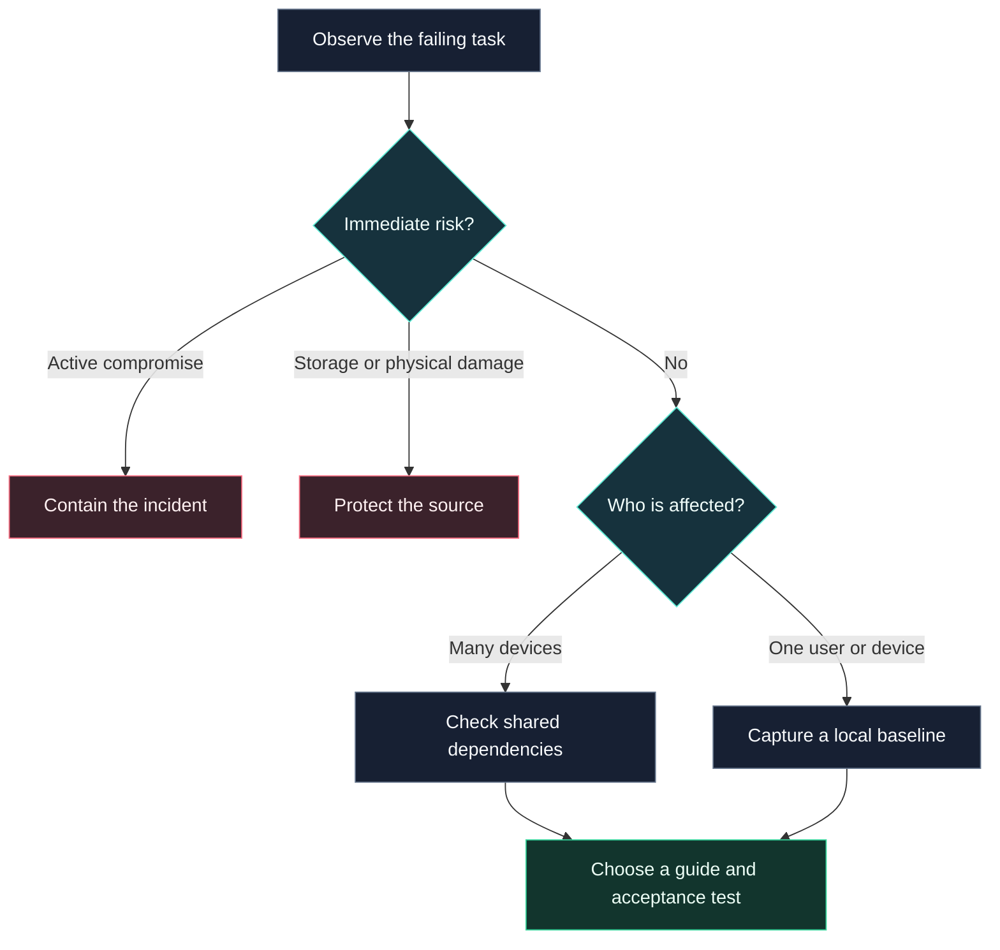

[🏠 Home](https://github.com/Herbertofury/INTA/wiki) · [🧭 Decision desk](https://github.com/Herbertofury/INTA/wiki/Decision-Desk) · [📚 Playbooks](https://github.com/Herbertofury/INTA/wiki/Playbooks) · [🧰 Tool directory](https://github.com/Herbertofury/INTA/wiki/Tool-Directory) · [✨ Open interactive hub](https://herbertofury.github.io/INTA/)

# 🧭 [Start here: triage any computer problem](https://github.com/Herbertofury/INTA/wiki/Job-intake-triage)

Turn a vague symptom into a clear next action, a protected data set, and a useful service record.

| Work area | Experience | Plan your time | Workflow |
| --- | --- | --- | --- |
| Getting started | Starter | 10–20 min | 6 steps + acceptance |

**[▶ Open the interactive checklist](https://herbertofury.github.io/INTA/#job/intake-triage)** · [Decision route](#decision-route) · [Toolkit](#toolkit) · [Walkthrough](#walkthrough) · [Acceptance](#acceptance) · [Sources](#sources)

> [!TIP]
> **Your starting move:** Ask the user to show the exact failing task once. Record what they expected, what happened, and when it last worked.

<a id="decision-route"></a>

## 🧭 Choose the right branch



**Diagram routes:** [Continue this workflow](#walkthrough) · [Acceptance checks](#acceptance) · [Remove malware and browser hijackers](https://github.com/Herbertofury/INTA/wiki/Job-malware-removal) · [Diagnose a slow, freezing, or hitching PC](https://github.com/Herbertofury/INTA/wiki/Job-slow-pc) · [Rescue data from a failing or unreadable drive](https://github.com/Herbertofury/INTA/wiki/Job-failing-drive) · [Bring an office back after a power outage](https://github.com/Herbertofury/INTA/wiki/Job-outage-recovery) · [Close a repair with a clear client handoff](https://github.com/Herbertofury/INTA/wiki/Job-client-handoff)

| Checkpoint | What to carry forward |
| --- | --- |
| **Before changing anything** | Identify unique data and the working boundary. |
| **Keep during the job** | Exact error, time, scope, baseline, and failed tests. |
| **Before handing back** | A specific next guide and measurable acceptance test. |

<a id="toolkit"></a>

## 🧰 Build the right toolkit

Choose the tools that answer the case’s next question. Opening a tool is a separate decision from changing the customer’s system.

| Tool / official download | Use it for | Platform & access | Documentation |
| --- | --- | --- | --- |
| [Microsoft Sysinternals Suite](https://learn.microsoft.com/en-us/sysinternals/downloads/sysinternals-suite) | The core portable [Windows](https://www.microsoft.com/windows) troubleshooting kit. | [Windows](https://www.microsoft.com/windows); Free Microsoft utilities | [Open guide](https://learn.microsoft.com/en-us/sysinternals/downloads/) |
| [CrystalDiskInfo](https://crystalmark.info/en/download/) | First-pass HDD and SSD health inspection in [Windows](https://www.microsoft.com/windows). | [Windows](https://www.microsoft.com/windows); Free / open source | [Open guide](https://crystalmark.info/en/software/crystaldiskinfo/) |
| [HWiNFO](https://www.hwinfo.com/download/) | Investigating temperatures, clocks, power and component identity. | [Windows](https://www.microsoft.com/windows); Pro license for commercial use of 64/ARM64 editions | [Open guide](https://www.hwinfo.com/licenses/) |

<a id="walkthrough"></a>

## 🪜 Work the case

Work in order, record the result of each step, and change route when the evidence calls for it.

<a id="step-01"></a>

### 01 · Establish the working boundary

- [ ] Identify the device, operating system, asset label, contact, business impact, and maintenance window. Ask whether work is saved and whether the device contains the only copy of important data. Use the private ticket for identifying information; this public wiki stays generic.

<a id="step-02"></a>

### 02 · Choose the urgent branch

- [ ] Encryption spreading or a compromise alert goes to [ransomware response](https://github.com/Herbertofury/INTA/wiki/Job-ransomware-response). Clicking drives, vanishing volumes, repeated I/O errors, or a device dropped in liquid go to the failing-drive or hardware path before scans, repairs, or repeated boots. A widespread outage goes to the outage guide.

<a id="step-03"></a>

### 03 · Capture the smallest useful baseline

- [ ] Record the exact error text and time, OS build, recent changes, uptime, free space, and [Task Manager](https://support.microsoft.com/en-us/windows/experience/system-configuration-tools-in-windows) CPU/memory/disk usage during the symptom. On [Windows](https://www.microsoft.com/windows), open [Reliability Monitor](https://learn.microsoft.com/en-us/windows-server/administration/windows-commands/perfmon) from Run with the command below to correlate failures with changes; save evidence to the private service record.

**Command for the environment described above:**

```text
perfmon /rel
```

**Command legend:** [Reliability Monitor](https://learn.microsoft.com/en-us/windows-server/administration/windows-commands/perfmon) · [Return to the step context](#step-03).

<a id="step-04"></a>

### 04 · Reproduce and narrow the scope

- [ ] Test whether the failure affects one user, one app, one device, or everyone. Compare with a working account or device where practical. Change one variable at a time and note whether it changes the symptom.

<a id="step-05"></a>

### 05 · Protect a rollback point

- [ ] Confirm a usable backup or export of the data that the next step may affect. Record the current configuration before changing it. A restore point is useful for some system changes but is not a replacement for a file backup.

<a id="step-06"></a>

### 06 · Pick one guide and define success

- [ ] Choose the closest job below and write a concrete acceptance test, such as opening the real accounting file, completing a print job, or restoring a document. Capture each change and result so another technician can resume without repeating failed work.

<a id="acceptance"></a>

## ✅ Prove the result

- [ ] The original symptom and business impact are recorded.
- [ ] The next guide matches observed evidence.
- [ ] A data-protection plan and a measurable acceptance test exist.

> [!WARNING]
> **Pause this route and escalate when:**
> - There is active encryption, physical damage, or storage failure.
> - The only copy of important data would be put at risk by the next action.

## 🔀 Continue with the evidence

| Next playbook | What it resolves |
| --- | --- |
| [Remove malware and browser hijackers](https://github.com/Herbertofury/INTA/wiki/Job-malware-removal) | A measured cleanup workflow for a single [Windows](https://www.microsoft.com/windows) endpoint, with a separate path for a wider compromise. |
| [Diagnose a slow, freezing, or hitching PC](https://github.com/Herbertofury/INTA/wiki/Job-slow-pc) | Find the actual bottleneck and prove the improvement with the same workload. |
| [Rescue data from a failing or unreadable drive](https://github.com/Herbertofury/INTA/wiki/Job-failing-drive) | Preserve the source, create a recoverable image, and perform recovery on a copy. |
| [Bring an office back after a power outage](https://github.com/Herbertofury/INTA/wiki/Job-outage-recovery) | Restore dependencies in order and verify services before releasing the office back to work. |
| [Close a repair with a clear client handoff](https://github.com/Herbertofury/INTA/wiki/Job-client-handoff) | Turn completed technical work into proof the customer can use, with clean access and an actionable service record. |

Found a reusable improvement? [Contribute the correction](https://github.com/Herbertofury/INTA/wiki/Contribute) and include the test that proved it.

<a id="sources"></a>

## 🔎 Source trail

<details>
<summary>Official references and editorial review</summary>

- [Microsoft: recovery options in Windows](https://support.microsoft.com/en-us/windows/experience/backup-recovery/recovery-options-in-windows)
- [Microsoft Sysinternals: Process Explorer](https://learn.microsoft.com/en-us/sysinternals/downloads/process-explorer/)

Reviewed **2026-11-26**. Timing is a planning range. A successful command is evidence about that operation; acceptance belongs to the user’s original task.

</details>

---

**Source review: 2026-11-26.** Guidance review and tool release versions are separate. [Report a correction](https://github.com/Herbertofury/INTA/issues/new/choose) · [How we maintain this guide](https://github.com/Herbertofury/INTA/wiki/Knowledge-Standards)
