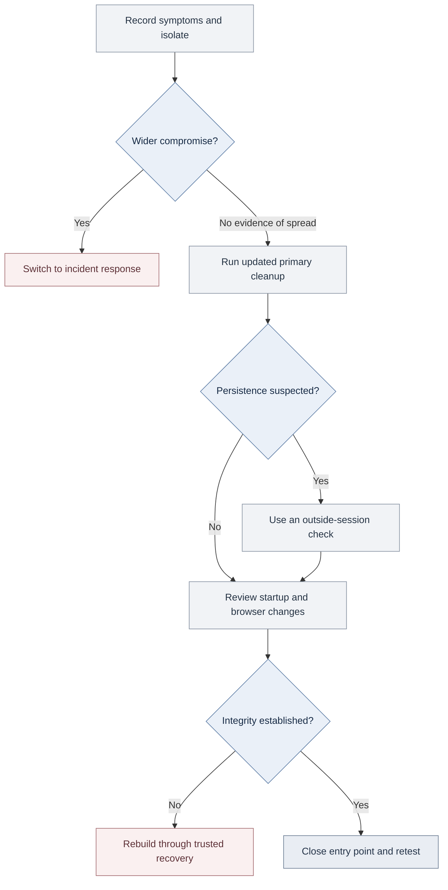

<a href="https://herbertofury.github.io/INTA/" title="Open INTA official download or service page" aria-label="Open INTA official download or service page" data-inta-brand="app-inta"></a> [INTA](https://github.com/Herbertofury/INTA/wiki) / [Decision desk](https://github.com/Herbertofury/INTA/wiki/Decision-Desk) · [Service map](https://github.com/Herbertofury/INTA/wiki/Service-Map) · [Playbooks](https://github.com/Herbertofury/INTA/wiki/Playbooks) · [Tools](https://github.com/Herbertofury/INTA/wiki/Tool-Directory) · [Methods](https://github.com/Herbertofury/INTA/wiki/Methods) · [Open hub](https://herbertofury.github.io/INTA/)

<a id="️-remove-malware-and-browser-hijackers"></a>
<a id="-remove-malware-and-browser-hijackers"></a>

# [Remove malware and browser hijackers](https://github.com/Herbertofury/INTA/wiki/Job-malware-removal)

A measured cleanup workflow for a single [Windows](https://www.microsoft.com/windows) endpoint, with a separate path for a wider compromise.

**Security** · Intermediate · 45–120 min plus scanning · 9 steps

[Tools and useful links](#working-kit) · [Quick answer](#quick-answer) · [Next action](#next-action) · [Specific fixes](#specific-fixes) · [Decision route](#decision-route) · [Tools](#toolkit) · [Procedure](#walkthrough) · [Verification](#acceptance) · [Sources](#sources) · [Interactive checklist](https://herbertofury.github.io/INTA/#job/malware-removal)

<a id="tool-choices"></a>

## 🧰 Choose the tool for this job

Choose by the task shown in the first column. Each option includes its acquisition route and access boundary.

| Need | Official tool + exact action | Why this choice / access |
| --- | --- | --- |
| **On-demand cleanup** | **<a href="https://www.malwarebytes.com/mwb-download" title="Open Malwarebytes official download or service page" aria-label="Open Malwarebytes official download or service page" data-inta-brand="malwarebytes"></a> [Malwarebytes](https://www.malwarebytes.com/)** · **[Download Windows installer · EXE](https://downloads.malwarebytes.com/file/mb-windows)** | Use an available Free Quick or Custom Scan for broad cleanup on an eligible personal device. **Access:** Free personal-use scans; business servicing rights differ. |
| **Adware and hijackers** | **<a href="https://www.malwarebytes.com/adwcleaner" title="Open Malwarebytes AdwCleaner official download or service page" aria-label="Open Malwarebytes AdwCleaner official download or service page" data-inta-brand="adwcleaner"></a> [Malwarebytes AdwCleaner](https://www.malwarebytes.com/adwcleaner)** · **[Download Windows portable cleaner · EXE](https://adwcleaner.malwarebytes.com/adwcleaner?channel=release)** | Target adware, unwanted software and browser hijackers, then review findings before quarantine. **Access:** Free for qualifying repair firms with ≤10 total staff; other business use needs rights. |
| **Personal PC protection** | **<a href="https://www.bitdefender.com/en-us/consumer/free-antivirus" title="Open Bitdefender Antivirus Free official download or service page" aria-label="Open Bitdefender Antivirus Free official download or service page" data-inta-brand="bitdefender-free"></a> [Bitdefender Antivirus Free](https://www.bitdefender.com/en-us/consumer/free-antivirus)** · **[Download Windows antivirus · EXE](https://download.bitdefender.com/windows/installer/en-us/bitdefender_avfree.exe)** | Choose it as the single ongoing antivirus on an eligible personal [Windows](https://www.microsoft.com/windows) PC. **Access:** Personal/non-commercial only; account required. |
| **Portable second opinion** | **<a href="https://learn.microsoft.com/en-us/defender-endpoint/safety-scanner-download" title="Open Microsoft Safety Scanner official download or service page" aria-label="Open Microsoft Safety Scanner official download or service page" data-inta-brand="safety-scanner"></a> [Microsoft Safety Scanner](https://learn.microsoft.com/en-us/defender-endpoint/safety-scanner-download)** · **[Download Windows x64 scanner · EXE](https://go.microsoft.com/fwlink/?LinkId=212732)** | Download a fresh standalone scanner for a logged on-demand check without replacing existing protection. **Access:** Free <a href="https://www.microsoft.com/" title="Open microsoft.com official download or service page" aria-label="Open microsoft.com official download or service page" data-inta-brand="site-www-microsoft-com"></a> [Microsoft](https://www.microsoft.com/) scanner; download expires after 10 days. |
| **Scan outside [Windows](https://www.microsoft.com/windows)** | **<a href="https://learn.microsoft.com/en-us/defender-endpoint/microsoft-defender-offline" title="Open Microsoft Defender Offline official download or service page" aria-label="Open Microsoft Defender Offline official download or service page" data-inta-brand="defender-offline"></a> [Microsoft Defender Offline](https://learn.microsoft.com/en-us/defender-endpoint/microsoft-defender-offline)** · **<a href="https://learn.microsoft.com/en-us/defender-endpoint/microsoft-defender-offline" title="Open Microsoft Defender Offline official download or service page" aria-label="Open Microsoft Defender Offline official download or service page" data-inta-brand="defender-offline"></a> [Run the built-in offline scan](https://learn.microsoft.com/en-us/defender-endpoint/microsoft-defender-offline)** | Use the built-in offline scan when persistence warrants it and the supported platform and recovery prerequisites are met. **Access:** Included with supported [Windows](https://www.microsoft.com/windows) |

**[Current selection evidence](https://github.com/Herbertofury/INTA/wiki/Current-Tool-Choices)**

<a id="working-kit"></a>

## 🧰 Tools and links for this job

**[Open working view](https://herbertofury.github.io/INTA/#job/malware-removal)** · Keep the tool panel beside the instructions.

**First move:** If encryption, privileged-account compromise or multiple affected devices are present, isolate and use the incident route. Otherwise record detections and keep one real-time protection product.

| Use this for | Official tool + exact action |
| --- | --- |
| Use an available Free Quick or Custom Scan for broad cleanup on an eligible personal device. | **<a href="https://www.malwarebytes.com/mwb-download" title="Open Malwarebytes official download or service page" aria-label="Open Malwarebytes official download or service page" data-inta-brand="malwarebytes"></a> [Malwarebytes](https://www.malwarebytes.com/)** · <a href="https://www.malwarebytes.com/mwb-download" title="Open Malwarebytes official download or service page" aria-label="Open Malwarebytes official download or service page" data-inta-brand="malwarebytes"></a> [Official page](https://www.malwarebytes.com/) · **[Download Windows installer · EXE](https://downloads.malwarebytes.com/file/mb-windows)** |
| Focused adware and browser-hijacker cleanup. | **<a href="https://www.malwarebytes.com/adwcleaner" title="Open Malwarebytes AdwCleaner official download or service page" aria-label="Open Malwarebytes AdwCleaner official download or service page" data-inta-brand="adwcleaner"></a> [Malwarebytes AdwCleaner](https://www.malwarebytes.com/adwcleaner)** · <a href="https://www.malwarebytes.com/adwcleaner" title="Open Malwarebytes AdwCleaner official download or service page" aria-label="Open Malwarebytes AdwCleaner official download or service page" data-inta-brand="adwcleaner"></a> [Official page](https://www.malwarebytes.com/adwcleaner) · **[Download Windows portable cleaner · EXE](https://adwcleaner.malwarebytes.com/adwcleaner?channel=release)** |
| Choose it as the single ongoing antivirus on an eligible personal [Windows](https://www.microsoft.com/windows) PC. | **<a href="https://www.bitdefender.com/en-us/consumer/free-antivirus" title="Open Bitdefender Antivirus Free official download or service page" aria-label="Open Bitdefender Antivirus Free official download or service page" data-inta-brand="bitdefender-free"></a> [Bitdefender Antivirus Free](https://www.bitdefender.com/en-us/consumer/free-antivirus)** · <a href="https://www.bitdefender.com/en-us/consumer/free-antivirus" title="Open Bitdefender Antivirus Free official download or service page" aria-label="Open Bitdefender Antivirus Free official download or service page" data-inta-brand="bitdefender-free"></a> [Official page](https://www.bitdefender.com/en-us/consumer/free-antivirus) · **[Download Windows antivirus · EXE](https://download.bitdefender.com/windows/installer/en-us/bitdefender_avfree.exe)** |
| Fresh on-demand scan and a readable result log. | **<a href="https://learn.microsoft.com/en-us/defender-endpoint/safety-scanner-download" title="Open Microsoft Safety Scanner official download or service page" aria-label="Open Microsoft Safety Scanner official download or service page" data-inta-brand="safety-scanner"></a> [Microsoft Safety Scanner](https://learn.microsoft.com/en-us/defender-endpoint/safety-scanner-download)** · <a href="https://learn.microsoft.com/en-us/defender-endpoint/safety-scanner-download" title="Open Microsoft Safety Scanner official download or service page" aria-label="Open Microsoft Safety Scanner official download or service page" data-inta-brand="safety-scanner"></a> [Official page](https://learn.microsoft.com/en-us/defender-endpoint/safety-scanner-download) · **[Download Windows x64 scanner · EXE](https://go.microsoft.com/fwlink/?LinkId=212732)** |
| Inspect evidence-backed startup persistence. | **<a href="https://learn.microsoft.com/en-us/sysinternals/downloads/autoruns" title="Open Autoruns official download or service page" aria-label="Open Autoruns official download or service page" data-inta-brand="autoruns"></a> [Autoruns](https://learn.microsoft.com/en-us/sysinternals/downloads/autoruns)** · <a href="https://learn.microsoft.com/en-us/sysinternals/downloads/autoruns" title="Open Autoruns official download or service page" aria-label="Open Autoruns official download or service page" data-inta-brand="autoruns"></a> [Official page](https://learn.microsoft.com/en-us/sysinternals/downloads/autoruns) · **[Download Windows portable · ZIP](https://download.sysinternals.com/files/Autoruns.zip)** |
| Offline scan when the documented platform and recovery requirements are met. | **<a href="https://learn.microsoft.com/en-us/defender-endpoint/microsoft-defender-offline" title="Open Microsoft Defender Offline official download or service page" aria-label="Open Microsoft Defender Offline official download or service page" data-inta-brand="defender-offline"></a> [Microsoft Defender Offline](https://learn.microsoft.com/en-us/defender-endpoint/microsoft-defender-offline)** · <a href="https://learn.microsoft.com/en-us/defender-endpoint/microsoft-defender-offline" title="Open Microsoft Defender Offline official download or service page" aria-label="Open Microsoft Defender Offline official download or service page" data-inta-brand="defender-offline"></a> [Official page](https://learn.microsoft.com/en-us/defender-endpoint/microsoft-defender-offline) · **<a href="https://learn.microsoft.com/en-us/defender-endpoint/microsoft-defender-offline" title="Open Microsoft Defender Offline official download or service page" aria-label="Open Microsoft Defender Offline official download or service page" data-inta-brand="defender-offline"></a> [Run the built-in offline scan](https://learn.microsoft.com/en-us/defender-endpoint/microsoft-defender-offline)** |
| Use existing endpoint telemetry for investigation; plan new deployment after active evidence-preservation needs are resolved. | **<a href="https://learn.microsoft.com/en-us/sysinternals/downloads/sysmon" title="Open Sysmon official download or service page" aria-label="Open Sysmon official download or service page" data-inta-brand="sysmon"></a> [Sysmon](https://learn.microsoft.com/en-us/sysinternals/downloads/sysmon)** · <a href="https://learn.microsoft.com/en-us/sysinternals/downloads/sysmon" title="Open Sysmon official download or service page" aria-label="Open Sysmon official download or service page" data-inta-brand="sysmon"></a> [Official page](https://learn.microsoft.com/en-us/sysinternals/downloads/sysmon) · **[Download Windows monitoring tools · ZIP](https://download.sysinternals.com/files/Sysmon.zip)** |
| File and URL reputation | **<a href="https://www.virustotal.com/gui/home/upload" title="Open VirusTotal official download or service page" aria-label="Open VirusTotal official download or service page" data-inta-brand="virustotal"></a> [VirusTotal](https://www.virustotal.com/)** · <a href="https://www.virustotal.com/gui/home/upload" title="Open VirusTotal official download or service page" aria-label="Open VirusTotal official download or service page" data-inta-brand="virustotal"></a> [Official page](https://www.virustotal.com/) · **<a href="https://www.virustotal.com/gui/home/upload" title="Open VirusTotal official download or service page" aria-label="Open VirusTotal official download or service page" data-inta-brand="virustotal"></a> [Open online service](https://www.virustotal.com/gui/home/upload)** |
| Independent multiscanner evidence | **<a href="https://metadefender.com/" title="Open OPSWAT MetaDefender Cloud official download or service page" aria-label="Open OPSWAT MetaDefender Cloud official download or service page" data-inta-brand="metadefender-cloud"></a> [OPSWAT MetaDefender Cloud](https://metadefender.com/product/community)** · <a href="https://metadefender.com/" title="Open OPSWAT MetaDefender Cloud official download or service page" aria-label="Open OPSWAT MetaDefender Cloud official download or service page" data-inta-brand="metadefender-cloud"></a> [Official page](https://metadefender.com/product/community) · **<a href="https://metadefender.com/" title="Open OPSWAT MetaDefender Cloud official download or service page" aria-label="Open OPSWAT MetaDefender Cloud official download or service page" data-inta-brand="metadefender-cloud"></a> [Open online service](https://metadefender.com/)** |
| Interactive behavior analysis | **<a href="https://app.any.run/" title="Open ANY.RUN official download or service page" aria-label="Open ANY.RUN official download or service page" data-inta-brand="anyrun"></a> [ANY.RUN](https://any.run/)** · <a href="https://app.any.run/" title="Open ANY.RUN official download or service page" aria-label="Open ANY.RUN official download or service page" data-inta-brand="anyrun"></a> [Official page](https://any.run/) · **<a href="https://app.any.run/" title="Open ANY.RUN official download or service page" aria-label="Open ANY.RUN official download or service page" data-inta-brand="anyrun"></a> [Open online service](https://app.any.run/)** |
| Sandbox behavior and reports | **<a href="https://tria.ge/" title="Open Recorded Future Triage official download or service page" aria-label="Open Recorded Future Triage official download or service page" data-inta-brand="triage"></a> [Recorded Future Triage](https://hatching.io/triage/)** · <a href="https://tria.ge/" title="Open Recorded Future Triage official download or service page" aria-label="Open Recorded Future Triage official download or service page" data-inta-brand="triage"></a> [Official page](https://hatching.io/triage/) · **<a href="https://tria.ge/" title="Open Recorded Future Triage official download or service page" aria-label="Open Recorded Future Triage official download or service page" data-inta-brand="triage"></a> [Open online service](https://tria.ge/)** |
| Redirects and page requests | **<a href="https://urlscan.io/" title="Open urlscan.io official download or service page" aria-label="Open urlscan.io official download or service page" data-inta-brand="urlscan"></a> [urlscan.io](https://urlscan.io/)** · <a href="https://urlscan.io/" title="Open urlscan.io official download or service page" aria-label="Open urlscan.io official download or service page" data-inta-brand="urlscan"></a> [Official page](https://urlscan.io/) · **<a href="https://urlscan.io/" title="Open urlscan.io official download or service page" aria-label="Open urlscan.io official download or service page" data-inta-brand="urlscan"></a> [Open online service](https://urlscan.io/)** |
| Confirm the Google classification behind a browser warning. | **<a href="https://transparencyreport.google.com/safe-browsing/search" title="Open Google Safe Browsing Site Status official download or service page" aria-label="Open Google Safe Browsing Site Status official download or service page" data-inta-brand="google-safe-browsing"></a> [Google Safe Browsing Site Status](https://safebrowsing.google.com/)** · <a href="https://transparencyreport.google.com/safe-browsing/search" title="Open Google Safe Browsing Site Status official download or service page" aria-label="Open Google Safe Browsing Site Status official download or service page" data-inta-brand="google-safe-browsing"></a> [Official page](https://safebrowsing.google.com/) · **<a href="https://transparencyreport.google.com/safe-browsing/search" title="Open Google Safe Browsing Site Status official download or service page" aria-label="Open Google Safe Browsing Site Status official download or service page" data-inta-brand="google-safe-browsing"></a> [Open online service](https://transparencyreport.google.com/safe-browsing/search)** |
| Investigate a possible brand-impersonation or phishing landing page. | **<a href="https://checkphish.bolster.ai/" title="Open CheckPhish official download or service page" aria-label="Open CheckPhish official download or service page" data-inta-brand="checkphish"></a> [CheckPhish](https://checkphish.bolster.ai/)** · <a href="https://checkphish.bolster.ai/" title="Open CheckPhish official download or service page" aria-label="Open CheckPhish official download or service page" data-inta-brand="checkphish"></a> [Official page](https://checkphish.bolster.ai/) · **<a href="https://checkphish.bolster.ai/" title="Open CheckPhish official download or service page" aria-label="Open CheckPhish official download or service page" data-inta-brand="checkphish"></a> [Open online service](https://checkphish.bolster.ai/)** |

### Run and verify

| Open the exact resource | What to do there |
| --- | --- |
| **<a href="https://learn.microsoft.com/en-us/defender-endpoint/safety-scanner-download" title="Open Microsoft Safety Scanner official download or service page" aria-label="Open Microsoft Safety Scanner official download or service page" data-inta-brand="safety-scanner"></a> [Safety Scanner results and expiry](https://learn.microsoft.com/en-us/defender-endpoint/safety-scanner-download)** | Read the completion result and %SYSTEMROOT%\debug\msert.log. |
| **<a href="https://www.malwarebytes.com/adwcleaner" title="Open Malwarebytes AdwCleaner official download or service page" aria-label="Open Malwarebytes AdwCleaner official download or service page" data-inta-brand="adwcleaner"></a> [AdwCleaner scan and review](https://help.malwarebytes.com/hc/en-us/articles/31589231147035-Scan-and-clean-a-device-with-AdwCleaner)** | Review detected items before cleanup and retain the report. |

### Escalation

| Open the exact resource | What to do there |
| --- | --- |
| **[Contain ransomware or a wider compromise](https://github.com/Herbertofury/INTA/wiki/Contain-ransomware)** | Use the incident route for active encryption, lateral spread or privileged-account compromise. |
| **<a href="https://learn.microsoft.com/en-us/defender-endpoint/microsoft-defender-offline" title="Open Microsoft Defender Offline official download or service page" aria-label="Open Microsoft Defender Offline official download or service page" data-inta-brand="defender-offline"></a> [Defender Offline requirements](https://learn.microsoft.com/en-us/defender-endpoint/microsoft-defender-offline)** | Check platform, primary antivirus, <a href="https://learn.microsoft.com/en-us/windows-hardware/manufacture/desktop/windows-recovery-environment--windows-re--technical-reference" title="Open Windows Recovery Environment official download or service page" aria-label="Open Windows Recovery Environment official download or service page" data-inta-brand="windows-recovery"></a> [WinRE](https://learn.microsoft.com/en-us/windows-hardware/manufacture/desktop/windows-recovery-environment--windows-re--technical-reference) and <a href="https://learn.microsoft.com/en-us/windows/security/operating-system-security/data-protection/bitlocker/" title="Open BitLocker official download or service page" aria-label="Open BitLocker official download or service page" data-inta-brand="app-bitlocker"></a> [BitLocker](https://learn.microsoft.com/en-us/windows/security/operating-system-security/data-protection/bitlocker/) preparation. |
| **<a href="https://support.microsoft.com/" title="Open support.microsoft.com official download or service page" aria-label="Open support.microsoft.com official download or service page" data-inta-brand="site-support-microsoft-com"></a> [Trusted reinstall procedure](https://support.microsoft.com/en-us/windows/deployment/install-upgrade/reinstall-windows-with-the-installation-media)** | Preserve required evidence and data before a clean installation. |

### Managed endpoint

| Open the exact resource | What to do there |
| --- | --- |
| **<a href="https://learn.microsoft.com/" title="Open learn.microsoft.com official download or service page" aria-label="Open learn.microsoft.com official download or service page" data-inta-brand="site-learn-microsoft-com"></a> [Managed protection troubleshooting](https://learn.microsoft.com/en-us/defender-endpoint/tamper-protection-troubleshoot)** | Resolve a reverting protected setting through its endpoint policy owner. |

### Online working tools

| Open the exact resource | What to do there |
| --- | --- |
| **[Check a suspicious file](https://herbertofury.github.io/INTA/#online?task=check-file)** | Start with an existing hash report, then choose static or behavioral analysis for the question that remains. |
| **[Inspect a suspicious link](https://herbertofury.github.io/INTA/#online?task=check-link)** | Combine reputation with redirects and page behavior without opening the destination on the customer’s workstation. |

<a id="quick-answer"></a>

## ⚡ Quick answer

<a id="quick-suspected-malware"></a>

### 🛡️ Remove viruses

**Disconnect a suspected compromised PC from the network before scanning; use the [incident guide](https://github.com/Herbertofury/INTA/wiki/Contain-ransomware) if encryption is spreading.**

1. Record the symptoms, isolate affected connections and keep a single approved real-time protector.
2. Choose an authorized on-demand scan: <a href="https://www.malwarebytes.com/mwb-download" title="Open Malwarebytes official download or service page" aria-label="Open Malwarebytes official download or service page" data-inta-brand="malwarebytes"></a> [Malwarebytes](https://www.malwarebytes.com/) Free Quick/Custom Scan on an eligible personal PC, <a href="https://www.malwarebytes.com/adwcleaner" title="Open Malwarebytes AdwCleaner official download or service page" aria-label="Open Malwarebytes AdwCleaner official download or service page" data-inta-brand="adwcleaner"></a> [AdwCleaner](https://www.malwarebytes.com/adwcleaner) for qualifying adware cleanup, or a fresh <a href="https://learn.microsoft.com/en-us/defender-endpoint/safety-scanner-download" title="Open Microsoft Safety Scanner official download or service page" aria-label="Open Microsoft Safety Scanner official download or service page" data-inta-brand="safety-scanner"></a> [Microsoft Safety Scanner](https://learn.microsoft.com/en-us/defender-endpoint/safety-scanner-download) Full scan.
3. Save the scan log, review remaining symptoms and persistence, then follow the guide’s cleanup or rebuild decision.

**<a href="https://learn.microsoft.com/en-us/defender-endpoint/safety-scanner-download" title="Open Microsoft Safety Scanner official download or service page" aria-label="Open Microsoft Safety Scanner official download or service page" data-inta-brand="safety-scanner"></a> [Microsoft Safety Scanner](https://learn.microsoft.com/en-us/defender-endpoint/safety-scanner-download)** · <a href="https://learn.microsoft.com/en-us/defender-endpoint/safety-scanner-download" title="Open Microsoft Safety Scanner official download or service page" aria-label="Open Microsoft Safety Scanner official download or service page" data-inta-brand="safety-scanner"></a> [Official page](https://learn.microsoft.com/en-us/defender-endpoint/safety-scanner-download) · **[Download Windows x64 scanner · EXE](https://go.microsoft.com/fwlink/?LinkId=212732)**

<a id="quick-check-file"></a>

### 🔎 Check a suspicious file

**Calculate the file hash locally and search for an existing report before sending file bytes to a service.**

1. Calculate the file hash locally and search for an existing report before sending file bytes to a service.
2. Compare detection names, report age, signer and behavior; choose a sandbox when you need to understand execution.
3. Record the exact hash and findings, then use the malware guide to verify the affected endpoint and choose cleanup or rebuild.

**<a href="https://www.virustotal.com/gui/home/upload" title="Open VirusTotal official download or service page" aria-label="Open VirusTotal official download or service page" data-inta-brand="virustotal"></a> [VirusTotal](https://www.virustotal.com/)** · <a href="https://www.virustotal.com/gui/home/upload" title="Open VirusTotal official download or service page" aria-label="Open VirusTotal official download or service page" data-inta-brand="virustotal"></a> [Official page](https://www.virustotal.com/) · **<a href="https://www.virustotal.com/gui/home/upload" title="Open VirusTotal official download or service page" aria-label="Open VirusTotal official download or service page" data-inta-brand="virustotal"></a> [Open online service](https://www.virustotal.com/gui/home/upload)**

<a id="quick-check-link"></a>

### 🔗 Inspect a suspicious link

**Copy the destination as text and search existing reports; inspect the hostname before following a link.**

1. Copy the destination as text and search existing reports; inspect the hostname before following a link.
2. For a new scan, choose a visibility mode suitable for the URL; use an existing report, hostname lookup or appropriate private workflow for a token-bearing link. Record any input redaction because it can change page behavior.
3. Compare redirects, page requests and reputation; follow the [incident guide](https://github.com/Herbertofury/INTA/wiki/Contain-ransomware) if someone entered credentials or downloaded a payload.

**<a href="https://urlscan.io/" title="Open urlscan.io official download or service page" aria-label="Open urlscan.io official download or service page" data-inta-brand="urlscan"></a> [urlscan.io](https://urlscan.io/)** · <a href="https://urlscan.io/" title="Open urlscan.io official download or service page" aria-label="Open urlscan.io official download or service page" data-inta-brand="urlscan"></a> [Official page](https://urlscan.io/) · **<a href="https://urlscan.io/" title="Open urlscan.io official download or service page" aria-label="Open urlscan.io official download or service page" data-inta-brand="urlscan"></a> [Open online service](https://urlscan.io/)**

<a id="next-action"></a>

## 🧭 Match the symptom

| You see this | Do this next | You should get |
| --- | --- | --- |
| **The installed protection reports a threat** | Update through an approved channel, run its full scan and quarantine identified detections; retain the report. | The run has a completion state and a recorded action for every detection. |
| **Adware, unwanted extensions or browser redirection dominate** | Run <a href="https://www.malwarebytes.com/adwcleaner" title="Open Malwarebytes AdwCleaner official download or service page" aria-label="Open Malwarebytes AdwCleaner official download or service page" data-inta-brand="adwcleaner"></a> [AdwCleaner](https://www.malwarebytes.com/adwcleaner), review its proposed changes and restore the intended browser extensions, search and notification settings. | The original browser task works and unwanted behavior does not return after restart. |
| **A second on-demand check is needed** | Download a fresh <a href="https://learn.microsoft.com/en-us/defender-endpoint/safety-scanner-download" title="Open Microsoft Safety Scanner official download or service page" aria-label="Open Microsoft Safety Scanner official download or service page" data-inta-brand="safety-scanner"></a> [Microsoft Safety Scanner](https://learn.microsoft.com/en-us/defender-endpoint/safety-scanner-download) from a clean PC, run a Full scan and read the detailed log. | Completed coverage, detections and unresolved items are recorded; a cancelled run is not marked clean. |
| **The same detection returns after reboot** | Inspect the relevant <a href="https://learn.microsoft.com/en-us/sysinternals/downloads/autoruns" title="Open Autoruns official download or service page" aria-label="Open Autoruns official download or service page" data-inta-brand="autoruns"></a> [Autoruns](https://learn.microsoft.com/en-us/sysinternals/downloads/autoruns) entry and documented offline-scan prerequisites; use the rebuild decision if integrity remains uncertain. | The persistence cause is explained or a clean recovery plan replaces repeated scanner loops. |

### ✅ Finish the job

- [ ] Protection is healthy after reboot and there are no unresolved detections.
- [ ] The original task and browser behavior remain correct.
- [ ] Compromised accounts and sessions have a separate documented resolution.

**Change route when:** Ransomware, lateral spread or privileged access is suspected. · Detections recur or scan coverage and system integrity cannot be established.

### 🎯 Go straight to a specific fix

- **[Stop website notification popups](#fix-malware-browser-notification-popups)** — Desktop alerts claim the PC is infected, but the alerts identify a browser or website sender.
- **[Undo an accidental allowed-threat decision](#fix-malware-allowed-threat-keeps-returning)** — A known detection was allowed earlier and the same item remains present.
- **[Find why the offline scan never runs](#fix-malware-offline-scan-does-not-start)** — The offline-scan request returns to [Windows](https://www.microsoft.com/windows) without a documented completed scan.
- **[Route a reverting antivirus setting to its policy owner](#fix-malware-managed-protection-change-reverts)** — A local antivirus setting appears to change but immediately reverts or has no effect on a managed endpoint.
- **[Online scanners disagree about a file](#fix-online-file-verdicts-disagree)** — One service flags a file while another calls it clean.
- **[A suspicious link was opened or credentials were entered](#fix-online-phishing-account-exposure)** — A user opened a questionable link, downloaded a file or entered a password.

> [!NOTE]
> **Start here.** Check for active encryption, credential theft, unusual administrator accounts, or more affected machines before treating this as a routine cleanup.

<a id="decision-route"></a>

<a id="-choose-the-right-branch"></a>

## 🧭 Choose a route



**Route links:** [Continue this workflow](#walkthrough) · [Acceptance checks](#acceptance) · [Contain ransomware or a wider compromise](https://github.com/Herbertofury/INTA/wiki/Job-ransomware-response) · [Build and refresh a technician rescue USB](https://github.com/Herbertofury/INTA/wiki/Job-boot-usb) · [Close a repair with a clear client handoff](https://github.com/Herbertofury/INTA/wiki/Job-client-handoff)

| Checkpoint | What to carry forward |
| --- | --- |
| **Before changing anything** | Record symptoms; decide whether this is a single-endpoint cleanup. |
| **Keep during the job** | Detection names, scan versions, quarantine, persistence, and account findings. |
| **Before handing back** | Healthy protection, stable settings, and tested original work. |

<a id="toolkit"></a>

<a id="-build-the-right-toolkit"></a>

## Recommended tools

Select a tool for the next diagnostic or repair step. Check its platform, access and licensing requirements before use.

| Tool / official page + download | Use it for | Platform & access | Documentation |
| --- | --- | --- | --- |
| **<a href="https://learn.microsoft.com/en-us/defender-endpoint/safety-scanner-download" title="Open Microsoft Safety Scanner official download or service page" aria-label="Open Microsoft Safety Scanner official download or service page" data-inta-brand="safety-scanner"></a> [Microsoft Safety Scanner](https://learn.microsoft.com/en-us/defender-endpoint/safety-scanner-download)** · <a href="https://learn.microsoft.com/en-us/defender-endpoint/safety-scanner-download" title="Open Microsoft Safety Scanner official download or service page" aria-label="Open Microsoft Safety Scanner official download or service page" data-inta-brand="safety-scanner"></a> [Official page](https://learn.microsoft.com/en-us/defender-endpoint/safety-scanner-download) · **[Download Windows x64 scanner · EXE](https://go.microsoft.com/fwlink/?LinkId=212732)** | Fresh on-demand scan and a readable result log. | [Windows](https://www.microsoft.com/windows); Free download | <a href="https://learn.microsoft.com/en-us/defender-endpoint/safety-scanner-download" title="Open Microsoft Safety Scanner official download or service page" aria-label="Open Microsoft Safety Scanner official download or service page" data-inta-brand="safety-scanner"></a> [Open guide](https://learn.microsoft.com/en-us/defender-endpoint/safety-scanner-download) |
| **<a href="https://www.malwarebytes.com/adwcleaner" title="Open Malwarebytes AdwCleaner official download or service page" aria-label="Open Malwarebytes AdwCleaner official download or service page" data-inta-brand="adwcleaner"></a> [Malwarebytes AdwCleaner](https://www.malwarebytes.com/adwcleaner)** · <a href="https://www.malwarebytes.com/adwcleaner" title="Open Malwarebytes AdwCleaner official download or service page" aria-label="Open Malwarebytes AdwCleaner official download or service page" data-inta-brand="adwcleaner"></a> [Official page](https://www.malwarebytes.com/adwcleaner) · **[Download Windows portable cleaner · EXE](https://adwcleaner.malwarebytes.com/adwcleaner?channel=release)** | Focused adware and browser-hijacker cleanup. | [Windows](https://www.microsoft.com/windows); Free for personal use and qualifying repair shops with at most 10 aggregate staff; other business rights differ | <a href="https://www.malwarebytes.com/adwcleaner" title="Open Malwarebytes AdwCleaner official download or service page" aria-label="Open Malwarebytes AdwCleaner official download or service page" data-inta-brand="adwcleaner"></a> [Open guide](https://help.malwarebytes.com/hc/en-us/articles/31589231147035-Scan-and-clean-a-device-with-AdwCleaner) |
| **<a href="https://learn.microsoft.com/en-us/sysinternals/downloads/autoruns" title="Open Autoruns official download or service page" aria-label="Open Autoruns official download or service page" data-inta-brand="autoruns"></a> [Autoruns](https://learn.microsoft.com/en-us/sysinternals/downloads/autoruns)** · <a href="https://learn.microsoft.com/en-us/sysinternals/downloads/autoruns" title="Open Autoruns official download or service page" aria-label="Open Autoruns official download or service page" data-inta-brand="autoruns"></a> [Official page](https://learn.microsoft.com/en-us/sysinternals/downloads/autoruns) · **[Download Windows portable · ZIP](https://download.sysinternals.com/files/Autoruns.zip)** | Inspect evidence-backed startup persistence. | [Windows](https://www.microsoft.com/windows); Free <a href="https://www.microsoft.com/" title="Open microsoft.com official download or service page" aria-label="Open microsoft.com official download or service page" data-inta-brand="site-www-microsoft-com"></a> [Microsoft](https://www.microsoft.com/) utility | <a href="https://learn.microsoft.com/en-us/sysinternals/downloads/autoruns" title="Open Autoruns official download or service page" aria-label="Open Autoruns official download or service page" data-inta-brand="autoruns"></a> [Open guide](https://learn.microsoft.com/en-us/sysinternals/downloads/autoruns) |
| **<a href="https://learn.microsoft.com/en-us/defender-endpoint/microsoft-defender-offline" title="Open Microsoft Defender Offline official download or service page" aria-label="Open Microsoft Defender Offline official download or service page" data-inta-brand="defender-offline"></a> [Microsoft Defender Offline](https://learn.microsoft.com/en-us/defender-endpoint/microsoft-defender-offline)** · <a href="https://learn.microsoft.com/en-us/defender-endpoint/microsoft-defender-offline" title="Open Microsoft Defender Offline official download or service page" aria-label="Open Microsoft Defender Offline official download or service page" data-inta-brand="defender-offline"></a> [Official page](https://learn.microsoft.com/en-us/defender-endpoint/microsoft-defender-offline) · **<a href="https://learn.microsoft.com/en-us/defender-endpoint/microsoft-defender-offline" title="Open Microsoft Defender Offline official download or service page" aria-label="Open Microsoft Defender Offline official download or service page" data-inta-brand="defender-offline"></a> [Run the built-in offline scan](https://learn.microsoft.com/en-us/defender-endpoint/microsoft-defender-offline)** | Offline scan when the documented platform and recovery requirements are met. | [Windows](https://www.microsoft.com/windows); Included with supported [Windows](https://www.microsoft.com/windows) | <a href="https://learn.microsoft.com/en-us/defender-endpoint/microsoft-defender-offline" title="Open Microsoft Defender Offline official download or service page" aria-label="Open Microsoft Defender Offline official download or service page" data-inta-brand="defender-offline"></a> [Open guide](https://learn.microsoft.com/en-us/defender-endpoint/microsoft-defender-offline) |
| **<a href="https://learn.microsoft.com/en-us/sysinternals/downloads/sysinternals-suite" title="Open Microsoft Sysinternals Suite official download or service page" aria-label="Open Microsoft Sysinternals Suite official download or service page" data-inta-brand="sysinternals"></a> [Microsoft Sysinternals Suite](https://learn.microsoft.com/en-us/sysinternals/)** · <a href="https://learn.microsoft.com/en-us/sysinternals/downloads/sysinternals-suite" title="Open Microsoft Sysinternals Suite official download or service page" aria-label="Open Microsoft Sysinternals Suite official download or service page" data-inta-brand="sysinternals"></a> [Official page](https://learn.microsoft.com/en-us/sysinternals/) · **[Download Windows portable · ZIP](https://download.sysinternals.com/files/SysinternalsSuite.zip)** | The core portable [Windows](https://www.microsoft.com/windows) troubleshooting kit. | [Windows](https://www.microsoft.com/windows); Free <a href="https://www.microsoft.com/" title="Open microsoft.com official download or service page" aria-label="Open microsoft.com official download or service page" data-inta-brand="site-www-microsoft-com"></a> [Microsoft](https://www.microsoft.com/) utilities | <a href="https://learn.microsoft.com/en-us/sysinternals/downloads/sysinternals-suite" title="Open Microsoft Sysinternals Suite official download or service page" aria-label="Open Microsoft Sysinternals Suite official download or service page" data-inta-brand="sysinternals"></a> [Open guide](https://learn.microsoft.com/en-us/sysinternals/downloads/) |
| **<a href="https://www.malwarebytes.com/mwb-download" title="Open Malwarebytes official download or service page" aria-label="Open Malwarebytes official download or service page" data-inta-brand="malwarebytes"></a> [Malwarebytes](https://www.malwarebytes.com/)** · <a href="https://www.malwarebytes.com/mwb-download" title="Open Malwarebytes official download or service page" aria-label="Open Malwarebytes official download or service page" data-inta-brand="malwarebytes"></a> [Official page](https://www.malwarebytes.com/) · **[Download Windows installer · EXE](https://downloads.malwarebytes.com/file/mb-windows)** | Use an available Free Quick or Custom Scan for broad cleanup on an eligible personal device. | [Windows](https://www.microsoft.com/windows), <a href="https://support.apple.com/macos" title="Open macOS official download or service page" aria-label="Open macOS official download or service page" data-inta-brand="app-macos"></a> [macOS](https://support.apple.com/macos); Free personal-use Quick/Custom scans; paid Threat Scan and real-time protection; servicing/business rights differ | <a href="https://www.malwarebytes.com/mwb-download" title="Open Malwarebytes official download or service page" aria-label="Open Malwarebytes official download or service page" data-inta-brand="malwarebytes"></a> [Open guide](https://help.malwarebytes.com/hc/en-us/articles/49849786059035-Free-vs-Paid-Malwarebytes-Security-features) |
| **<a href="https://learn.microsoft.com/en-us/sysinternals/downloads/sysmon" title="Open Sysmon official download or service page" aria-label="Open Sysmon official download or service page" data-inta-brand="sysmon"></a> [Sysmon](https://learn.microsoft.com/en-us/sysinternals/downloads/sysmon)** · <a href="https://learn.microsoft.com/en-us/sysinternals/downloads/sysmon" title="Open Sysmon official download or service page" aria-label="Open Sysmon official download or service page" data-inta-brand="sysmon"></a> [Official page](https://learn.microsoft.com/en-us/sysinternals/downloads/sysmon) · **[Download Windows monitoring tools · ZIP](https://download.sysinternals.com/files/Sysmon.zip)** | Use existing endpoint telemetry for investigation; plan new deployment after active evidence-preservation needs are resolved. | [Windows](https://www.microsoft.com/windows), [Windows Server](https://learn.microsoft.com/en-us/windows-server/); Free proprietary <a href="https://www.microsoft.com/" title="Open microsoft.com official download or service page" aria-label="Open microsoft.com official download or service page" data-inta-brand="site-www-microsoft-com"></a> [Microsoft](https://www.microsoft.com/) utility under <a href="https://learn.microsoft.com/en-us/sysinternals/downloads/sysinternals-suite" title="Open Microsoft Sysinternals Suite official download or service page" aria-label="Open Microsoft Sysinternals Suite official download or service page" data-inta-brand="sysinternals"></a> [Sysinternals](https://learn.microsoft.com/en-us/sysinternals/) terms; redistribution and commercial software hosting are restricted | <a href="https://learn.microsoft.com/en-us/sysinternals/downloads/sysmon" title="Open Sysmon official download or service page" aria-label="Open Sysmon official download or service page" data-inta-brand="sysmon"></a> [Open guide](https://learn.microsoft.com/en-us/sysinternals/downloads/sysmon) |
| **<a href="https://www.virustotal.com/gui/home/upload" title="Open VirusTotal official download or service page" aria-label="Open VirusTotal official download or service page" data-inta-brand="virustotal"></a> [VirusTotal](https://www.virustotal.com/)** · <a href="https://www.virustotal.com/gui/home/upload" title="Open VirusTotal official download or service page" aria-label="Open VirusTotal official download or service page" data-inta-brand="virustotal"></a> [Official page](https://www.virustotal.com/) · **<a href="https://www.virustotal.com/gui/home/upload" title="Open VirusTotal official download or service page" aria-label="Open VirusTotal official download or service page" data-inta-brand="virustotal"></a> [Open online service](https://www.virustotal.com/gui/home/upload)** | File and URL reputation | Web browser; Public web analysis; paid Google Threat Intelligence and separately entitled Private Scanning. Public API access has separate usage limits. | <a href="https://www.virustotal.com/gui/home/upload" title="Open VirusTotal official download or service page" aria-label="Open VirusTotal official download or service page" data-inta-brand="virustotal"></a> [Open guide](https://docs.virustotal.com/docs/how-it-works) |
| **<a href="https://metadefender.com/" title="Open OPSWAT MetaDefender Cloud official download or service page" aria-label="Open OPSWAT MetaDefender Cloud official download or service page" data-inta-brand="metadefender-cloud"></a> [OPSWAT MetaDefender Cloud](https://metadefender.com/product/community)** · <a href="https://metadefender.com/" title="Open OPSWAT MetaDefender Cloud official download or service page" aria-label="Open OPSWAT MetaDefender Cloud official download or service page" data-inta-brand="metadefender-cloud"></a> [Official page](https://metadefender.com/product/community) · **<a href="https://metadefender.com/" title="Open OPSWAT MetaDefender Cloud official download or service page" aria-label="Open OPSWAT MetaDefender Cloud official download or service page" data-inta-brand="metadefender-cloud"></a> [Open online service](https://metadefender.com/)** | Independent multiscanner evidence | Web browser; Free community access with quotas; paid plans add private scan and private processing options. | <a href="https://metadefender.com/" title="Open OPSWAT MetaDefender Cloud official download or service page" aria-label="Open OPSWAT MetaDefender Cloud official download or service page" data-inta-brand="metadefender-cloud"></a> [Open guide](https://www.opswat.com/docs/mdcloud/operation/homepage) |
| **<a href="https://app.any.run/" title="Open ANY.RUN official download or service page" aria-label="Open ANY.RUN official download or service page" data-inta-brand="anyrun"></a> [ANY.RUN](https://any.run/)** · <a href="https://app.any.run/" title="Open ANY.RUN official download or service page" aria-label="Open ANY.RUN official download or service page" data-inta-brand="anyrun"></a> [Official page](https://any.run/) · **<a href="https://app.any.run/" title="Open ANY.RUN official download or service page" aria-label="Open ANY.RUN official download or service page" data-inta-brand="anyrun"></a> [Open online service](https://app.any.run/)** | Interactive behavior analysis | Web browser; Free Community personal plan with restricted environments and runtime; paid Hunter and Enterprise plans add capabilities and private analyses. | <a href="https://app.any.run/" title="Open ANY.RUN official download or service page" aria-label="Open ANY.RUN official download or service page" data-inta-brand="anyrun"></a> [Open guide](https://any.run/plans/) |
| **<a href="https://tria.ge/" title="Open Recorded Future Triage official download or service page" aria-label="Open Recorded Future Triage official download or service page" data-inta-brand="triage"></a> [Recorded Future Triage](https://hatching.io/triage/)** · <a href="https://tria.ge/" title="Open Recorded Future Triage official download or service page" aria-label="Open Recorded Future Triage official download or service page" data-inta-brand="triage"></a> [Official page](https://hatching.io/triage/) · **<a href="https://tria.ge/" title="Open Recorded Future Triage official download or service page" aria-label="Open Recorded Future Triage official download or service page" data-inta-brand="triage"></a> [Open online service](https://tria.ge/)** | Sandbox behavior and reports | Web browser; Free public individual/researcher accounts for noncommercial use; private enterprise service is commercial. | <a href="https://tria.ge/" title="Open Recorded Future Triage official download or service page" aria-label="Open Recorded Future Triage official download or service page" data-inta-brand="triage"></a> [Open guide](https://sandbox.recordedfuture.com/docs/faq/) |
| **<a href="https://urlscan.io/" title="Open urlscan.io official download or service page" aria-label="Open urlscan.io official download or service page" data-inta-brand="urlscan"></a> [urlscan.io](https://urlscan.io/)** · <a href="https://urlscan.io/" title="Open urlscan.io official download or service page" aria-label="Open urlscan.io official download or service page" data-inta-brand="urlscan"></a> [Official page](https://urlscan.io/) · **<a href="https://urlscan.io/" title="Open urlscan.io official download or service page" aria-label="Open urlscan.io official download or service page" data-inta-brand="urlscan"></a> [Open online service](https://urlscan.io/)** | Redirects and page requests | Web browser; Free community service with quotas; paid plans add hunting, feeds and advanced capabilities. | <a href="https://urlscan.io/" title="Open urlscan.io official download or service page" aria-label="Open urlscan.io official download or service page" data-inta-brand="urlscan"></a> [Open guide](https://docs.urlscan.io/pages/faq) |
| **<a href="https://transparencyreport.google.com/safe-browsing/search" title="Open Google Safe Browsing Site Status official download or service page" aria-label="Open Google Safe Browsing Site Status official download or service page" data-inta-brand="google-safe-browsing"></a> [Google Safe Browsing Site Status](https://safebrowsing.google.com/)** · <a href="https://transparencyreport.google.com/safe-browsing/search" title="Open Google Safe Browsing Site Status official download or service page" aria-label="Open Google Safe Browsing Site Status official download or service page" data-inta-brand="google-safe-browsing"></a> [Official page](https://safebrowsing.google.com/) · **<a href="https://transparencyreport.google.com/safe-browsing/search" title="Open Google Safe Browsing Site Status official download or service page" aria-label="Open Google Safe Browsing Site Status official download or service page" data-inta-brand="google-safe-browsing"></a> [Open online service](https://transparencyreport.google.com/safe-browsing/search)** | Confirm the Google classification behind a browser warning. | Web browser; Free public Site Status lookup; API products have separate terms. | <a href="https://transparencyreport.google.com/safe-browsing/search" title="Open Google Safe Browsing Site Status official download or service page" aria-label="Open Google Safe Browsing Site Status official download or service page" data-inta-brand="google-safe-browsing"></a> [Open guide](https://safebrowsing.google.com/) |
| **<a href="https://checkphish.bolster.ai/" title="Open CheckPhish official download or service page" aria-label="Open CheckPhish official download or service page" data-inta-brand="checkphish"></a> [CheckPhish](https://checkphish.bolster.ai/)** · <a href="https://checkphish.bolster.ai/" title="Open CheckPhish official download or service page" aria-label="Open CheckPhish official download or service page" data-inta-brand="checkphish"></a> [Official page](https://checkphish.bolster.ai/) · **<a href="https://checkphish.bolster.ai/" title="Open CheckPhish official download or service page" aria-label="Open CheckPhish official download or service page" data-inta-brand="checkphish"></a> [Open online service](https://checkphish.bolster.ai/)** | Investigate a possible brand-impersonation or phishing landing page. | Web browser; Free initial URL scan; signup expands scans and API options; Bolster commercial plans are separate. | <a href="https://checkphish.bolster.ai/" title="Open CheckPhish official download or service page" aria-label="Open CheckPhish official download or service page" data-inta-brand="checkphish"></a> [Open guide](https://checkphish.bolster.ai/) |
| **<a href="https://www.loldrivers.io/" title="Open LOLDrivers official download or service page" aria-label="Open LOLDrivers official download or service page" data-inta-brand="loldrivers"></a> [LOLDrivers](https://www.loldrivers.io/)** · <a href="https://www.loldrivers.io/" title="Open LOLDrivers official download or service page" aria-label="Open LOLDrivers official download or service page" data-inta-brand="loldrivers"></a> [Official page](https://www.loldrivers.io/) · **<a href="https://www.loldrivers.io/" title="Open LOLDrivers official download or service page" aria-label="Open LOLDrivers official download or service page" data-inta-brand="loldrivers"></a> [Open online service](https://www.loldrivers.io/)** | Correlate an unexpected kernel driver or vulnerable-driver alert with an exact known sample. | Web browser; Free public catalog and detection references. | <a href="https://www.loldrivers.io/" title="Open LOLDrivers official download or service page" aria-label="Open LOLDrivers official download or service page" data-inta-brand="loldrivers"></a> [Open guide](https://www.loldrivers.io/) |
| **<a href="https://lolbas-project.github.io/" title="Open LOLBAS official download or service page" aria-label="Open LOLBAS official download or service page" data-inta-brand="lolbas"></a> [LOLBAS](https://lolbas-project.github.io/)** · <a href="https://lolbas-project.github.io/" title="Open LOLBAS official download or service page" aria-label="Open LOLBAS official download or service page" data-inta-brand="lolbas"></a> [Official page](https://lolbas-project.github.io/) · **<a href="https://lolbas-project.github.io/" title="Open LOLBAS official download or service page" aria-label="Open LOLBAS official download or service page" data-inta-brand="lolbas"></a> [Open online service](https://lolbas-project.github.io/)** | Interpret a suspicious signed-binary process or command in its surrounding incident context. | Web browser; Free, open-source reference website. | <a href="https://lolbas-project.github.io/" title="Open LOLBAS official download or service page" aria-label="Open LOLBAS official download or service page" data-inta-brand="lolbas"></a> [Open guide](https://lolbas-project.github.io/) |
| **<a href="https://d3fend.mitre.org/" title="Open MITRE D3FEND official download or service page" aria-label="Open MITRE D3FEND official download or service page" data-inta-brand="mitre-d3fend"></a> [MITRE D3FEND](https://d3fend.mitre.org/)** · <a href="https://d3fend.mitre.org/" title="Open MITRE D3FEND official download or service page" aria-label="Open MITRE D3FEND official download or service page" data-inta-brand="mitre-d3fend"></a> [Official page](https://d3fend.mitre.org/) · **<a href="https://d3fend.mitre.org/" title="Open MITRE D3FEND official download or service page" aria-label="Open MITRE D3FEND official download or service page" data-inta-brand="mitre-d3fend"></a> [Open online service](https://d3fend.mitre.org/)** | Turn an observed attack technique into concrete defensive countermeasure candidates. | Web browser; Free public knowledge graph and browser reference tools. | <a href="https://d3fend.mitre.org/" title="Open MITRE D3FEND official download or service page" aria-label="Open MITRE D3FEND official download or service page" data-inta-brand="mitre-d3fend"></a> [Open guide](https://d3fend.mitre.org/) |
| **<a href="https://securityresearch.google/magika/demo/magika-demo/" title="Open Google Magika Web Demo official download or service page" aria-label="Open Google Magika Web Demo official download or service page" data-inta-brand="magika-web"></a> [Google Magika Web Demo](https://securityresearch.google/magika/)** · <a href="https://securityresearch.google/magika/demo/magika-demo/" title="Open Google Magika Web Demo official download or service page" aria-label="Open Google Magika Web Demo official download or service page" data-inta-brand="magika-web"></a> [Official page](https://securityresearch.google/magika/) · **<a href="https://securityresearch.google/magika/demo/magika-demo/" title="Open Google Magika Web Demo official download or service page" aria-label="Open Google Magika Web Demo official download or service page" data-inta-brand="magika-web"></a> [Open online service](https://securityresearch.google/magika/demo/magika-demo/)** | Identify an unknown or mislabeled file before choosing the right inspection tool. | Web browser; Free, open-source web demo; separate CLI and language bindings are available. | <a href="https://securityresearch.google/magika/demo/magika-demo/" title="Open Google Magika Web Demo official download or service page" aria-label="Open Google Magika Web Demo official download or service page" data-inta-brand="magika-web"></a> [Open guide](https://securityresearch.google/magika/introduction/overview/) |
| **<a href="https://koodous.com/" title="Open Koodous official download or service page" aria-label="Open Koodous official download or service page" data-inta-brand="koodous"></a> [Koodous](https://koodous.com/)** · <a href="https://koodous.com/" title="Open Koodous official download or service page" aria-label="Open Koodous official download or service page" data-inta-brand="koodous"></a> [Official page](https://koodous.com/) · **<a href="https://koodous.com/" title="Open Koodous official download or service page" aria-label="Open Koodous official download or service page" data-inta-brand="koodous"></a> [Open online service](https://koodous.com/)** | Investigate a suspicious sideloaded <a href="https://source.android.com/docs/security/bulletin" title="Open source.android.com official download or service page" aria-label="Open source.android.com official download or service page" data-inta-brand="site-source-android-com"></a> [Android](https://source.android.com/docs/security/bulletin) app by its exact APK hash. | Web browser; Free web/API access has quotas; paid API plans add requests and downloads. | <a href="https://koodous.com/" title="Open Koodous official download or service page" aria-label="Open Koodous official download or service page" data-inta-brand="koodous"></a> [Open guide](https://koodous.com/about-us) |
| **<a href="https://www.phishtank.org/" title="Open PhishTank official download or service page" aria-label="Open PhishTank official download or service page" data-inta-brand="phishtank"></a> [PhishTank](https://www.phishtank.org/)** · <a href="https://www.phishtank.org/" title="Open PhishTank official download or service page" aria-label="Open PhishTank official download or service page" data-inta-brand="phishtank"></a> [Official page](https://www.phishtank.org/) · **<a href="https://www.phishtank.org/" title="Open PhishTank official download or service page" aria-label="Open PhishTank official download or service page" data-inta-brand="phishtank"></a> [Open online service](https://www.phishtank.org/)** | Check whether a suspicious URL has a community-verified phishing record. | Web browser; Free public website and data API; API request rates depend on identification and key usage. New account registration is currently disabled. | <a href="https://www.phishtank.org/" title="Open PhishTank official download or service page" aria-label="Open PhishTank official download or service page" data-inta-brand="phishtank"></a> [Open guide](https://www.phishtank.org/faq.php) |
| **<a href="https://phish.ly/" title="Open phish.ly official download or service page" aria-label="Open phish.ly official download or service page" data-inta-brand="phishly"></a> [phish.ly](https://phish.ly/)** · <a href="https://phish.ly/" title="Open phish.ly official download or service page" aria-label="Open phish.ly official download or service page" data-inta-brand="phishly"></a> [Official page](https://phish.ly/) · **<a href="https://phish.ly/" title="Open phish.ly official download or service page" aria-label="Open phish.ly official download or service page" data-inta-brand="phishly"></a> [Open online service](https://phish.ly/)** | Get a structured report for a suspicious email through the published forwarding workflow. | Web browser; Free hosted email-analysis workflow; the provider may throttle abuse. | <a href="https://phish.ly/" title="Open phish.ly official download or service page" aria-label="Open phish.ly official download or service page" data-inta-brand="phishly"></a> [Open guide](https://phish.ly/) |
| **<a href="https://www.bitdefender.com/en-us/consumer/free-antivirus" title="Open Bitdefender Antivirus Free official download or service page" aria-label="Open Bitdefender Antivirus Free official download or service page" data-inta-brand="bitdefender-free"></a> [Bitdefender Antivirus Free](https://www.bitdefender.com/en-us/consumer/free-antivirus)** · <a href="https://www.bitdefender.com/en-us/consumer/free-antivirus" title="Open Bitdefender Antivirus Free official download or service page" aria-label="Open Bitdefender Antivirus Free official download or service page" data-inta-brand="bitdefender-free"></a> [Official page](https://www.bitdefender.com/en-us/consumer/free-antivirus) · **[Download Windows antivirus · EXE](https://download.bitdefender.com/windows/installer/en-us/bitdefender_avfree.exe)** | Choose it as the single ongoing antivirus on an eligible personal [Windows](https://www.microsoft.com/windows) PC. | [Windows](https://www.microsoft.com/windows); Free for personal or non-commercial use; Bitdefender account required | <a href="https://www.bitdefender.com/en-us/consumer/free-antivirus" title="Open Bitdefender Antivirus Free official download or service page" aria-label="Open Bitdefender Antivirus Free official download or service page" data-inta-brand="bitdefender-free"></a> [Open guide](https://www.bitdefender.com/en-us/consumer/free-antivirus) |

<a id="walkthrough"></a>

<a id="-work-the-case"></a>

## Procedure

Work in order, record the result of each step, and change route when the evidence calls for it.

<a id="step-01"></a>

### 01 · Contain and preserve the story

- [ ] Disconnect the affected endpoint from ordinary network access if compromise is suspected. Record detection names, paths, timestamps, symptoms, and recent downloads. Use a clean device for account changes. If business systems or multiple endpoints are involved, switch to the [incident-response guide](https://github.com/Herbertofury/INTA/wiki/Job-ransomware-response).

<a id="step-choose-the-cleanup-incident-or-rebuild-path"></a>

### 02 · Choose the cleanup, incident or rebuild path

- [ ] Keep an isolated, understood browser or unwanted-software case on the routine-cleanup path. Move active encryption, privileged-account compromise or multiple affected devices to the incident owner. If detections recur, the entry point remains open or the trusted system baseline cannot be established, preserve the findings and prepare a clean rebuild; do not keep cycling scanners as a substitute for a recovery decision.

<a id="step-02"></a>

<a id="02--prepare-trustworthy-scanners"></a>

### 03 · Prepare trustworthy scanners

- [ ] Get tools from the official links on a clean computer and verify signatures where available. Keep one managed real-time antivirus product; use any second-opinion scanner as an on-demand tool. Download a fresh <a href="https://learn.microsoft.com/en-us/defender-endpoint/safety-scanner-download" title="Open Microsoft Safety Scanner official download or service page" aria-label="Open Microsoft Safety Scanner official download or service page" data-inta-brand="safety-scanner"></a> [Safety Scanner](https://learn.microsoft.com/en-us/defender-endpoint/safety-scanner-download) for the case because its package expires after 10 days.

<a id="step-03"></a>

<a id="03--run-the-primary-cleanup"></a>

### 04 · Run the primary cleanup

- [ ] Update the installed endpoint protection through a controlled connection or approved update channel, run its full scan, and preserve the results. Quarantine identified threats rather than manually deleting unfamiliar files. Reboot when the product requests it and record its post-reboot status.

**<a href="https://github.com/PowerShell/PowerShell/releases/latest" title="Open PowerShell official download or service page" aria-label="Open PowerShell official download or service page" data-inta-brand="powershell"></a> [PowerShell](https://learn.microsoft.com/en-us/powershell/) (Run as Administrator) · Start a <a href="https://www.microsoft.com/" title="Open microsoft.com official download or service page" aria-label="Open microsoft.com official download or service page" data-inta-brand="site-www-microsoft-com"></a> [Microsoft](https://www.microsoft.com/) Defender full scan after confirming <a href="https://learn.microsoft.com/en-us/defender-endpoint/microsoft-defender-antivirus-windows" title="Open Microsoft Defender Antivirus official download or service page" aria-label="Open Microsoft Defender Antivirus official download or service page" data-inta-brand="app-defender-antivirus"></a> [Defender Antivirus](https://learn.microsoft.com/en-us/defender-endpoint/microsoft-defender-antivirus-windows) is the active primary protection product and signatures are current.:**

```text
Start-MpScan -ScanType FullScan
```

> **Before running:** Starts a potentially lengthy scan; it does not replace containment or an [incident response](https://github.com/Herbertofury/INTA/wiki/Job-ransomware-response). Do not assume Defender cmdlets are usable when a third-party product owns primary antivirus. Record scan completion, scope and detections.

**Official command reference:** <a href="https://www.microsoft.com/" title="Open microsoft.com official download or service page" aria-label="Open microsoft.com official download or service page" data-inta-brand="site-www-microsoft-com"></a> [Microsoft Start-MpScan documentation](https://learn.microsoft.com/en-us/powershell/module/defender/start-mpscan)

**Command legend:** <a href="https://www.microsoft.com/" title="Open microsoft.com official download or service page" aria-label="Open microsoft.com official download or service page" data-inta-brand="site-www-microsoft-com"></a> [Microsoft Start-MpScan documentation](https://learn.microsoft.com/en-us/powershell/module/defender/start-mpscan) · [Return to the step context](#step-03).

<a id="step-04"></a>

<a id="04--use-an-offline-or-focused-second-check"></a>

### 05 · Use an offline or focused second check

- [ ] If persistence is suspected, save work, make the <a href="https://learn.microsoft.com/en-us/windows/security/operating-system-security/data-protection/bitlocker/" title="Open BitLocker official download or service page" aria-label="Open BitLocker official download or service page" data-inta-brand="app-bitlocker"></a> [BitLocker](https://learn.microsoft.com/en-us/windows/security/operating-system-security/data-protection/bitlocker/) recovery key available, and run <a href="https://learn.microsoft.com/en-us/defender-endpoint/microsoft-defender-offline" title="Open Microsoft Defender Offline official download or service page" aria-label="Open Microsoft Defender Offline official download or service page" data-inta-brand="defender-offline"></a> [Microsoft Defender Offline](https://learn.microsoft.com/en-us/defender-endpoint/microsoft-defender-offline) from <a href="https://support.microsoft.com/en-us/windows/security/windows-security/windows-security-app-overview" title="Open Windows Security official download or service page" aria-label="Open Windows Security official download or service page" data-inta-brand="app-windows-security"></a> [Windows Security](https://support.microsoft.com/en-us/windows/security/windows-security/windows-security-app-overview) > Virus & threat protection > Scan options on a supported system. For unwanted browser software, use <a href="https://www.malwarebytes.com/adwcleaner" title="Open Malwarebytes AdwCleaner official download or service page" aria-label="Open Malwarebytes AdwCleaner official download or service page" data-inta-brand="adwcleaner"></a> [AdwCleaner](https://www.malwarebytes.com/adwcleaner) and inspect proposed changes before applying them. Check the actual platform first: <a href="https://learn.microsoft.com/en-us/defender-endpoint/microsoft-defender-offline" title="Open Microsoft Defender Offline official download or service page" aria-label="Open Microsoft Defender Offline official download or service page" data-inta-brand="defender-offline"></a> [Microsoft Defender Offline](https://learn.microsoft.com/en-us/defender-endpoint/microsoft-defender-offline) does not support [Windows](https://www.microsoft.com/windows) on ARM or [Windows Server](https://learn.microsoft.com/en-us/windows-server/). Its update path requires <a href="https://learn.microsoft.com/en-us/defender-endpoint/microsoft-defender-antivirus-windows" title="Open Microsoft Defender Antivirus official download or service page" aria-label="Open Microsoft Defender Antivirus official download or service page" data-inta-brand="app-defender-antivirus"></a> [Microsoft Defender Antivirus](https://learn.microsoft.com/en-us/defender-endpoint/microsoft-defender-antivirus-windows) as the primary antivirus, and the recovery environment must be available. Follow the documented <a href="https://learn.microsoft.com/en-us/windows/security/operating-system-security/data-protection/bitlocker/" title="Open BitLocker official download or service page" aria-label="Open BitLocker official download or service page" data-inta-brand="app-bitlocker"></a> [BitLocker](https://learn.microsoft.com/en-us/windows/security/operating-system-security/data-protection/bitlocker/) preparation and verify protection is restored afterward.

<a id="step-reconcile-findings-with-scan-coverage"></a>

### 06 · Reconcile findings with scan coverage

- [ ] Perform [scan coverage reconciliation](https://github.com/Herbertofury/INTA/wiki/Job-malware-removal) for every run: record product and engine or intelligence version where exposed, scan mode, scope, start/end time, completion or cancellation, inaccessible areas, detections and disposition. Retain the product report; <a href="https://learn.microsoft.com/en-us/defender-endpoint/safety-scanner-download" title="Open Microsoft Safety Scanner official download or service page" aria-label="Open Microsoft Safety Scanner official download or service page" data-inta-brand="safety-scanner"></a> [Microsoft Safety Scanner](https://learn.microsoft.com/en-us/defender-endpoint/safety-scanner-download) writes detailed results to %SYSTEMROOT%\debug\msert.log. A timeout, blocked scan or unscanned location remains incomplete even when no threat is reported. Reconcile repeated detections with the specific path, item and action rather than declaring a clean result from the headline alone.

**<a href="https://github.com/PowerShell/PowerShell/releases/latest" title="Open PowerShell official download or service page" aria-label="Open PowerShell official download or service page" data-inta-brand="powershell"></a> [PowerShell](https://learn.microsoft.com/en-us/powershell/) · Read the protection state and recent Defender detections before choosing the next scan.:**

```text
Get-MpComputerStatus | Select-Object AMServiceEnabled,AntivirusEnabled,RealTimeProtectionEnabled,AntivirusSignatureVersion,AntivirusSignatureLastUpdated
Get-MpThreatDetection | Select-Object InitialDetectionTime,ThreatID,Resources
```

> **Before running:** Read-only diagnostic; requires the Defender <a href="https://github.com/PowerShell/PowerShell/releases/latest" title="Open PowerShell official download or service page" aria-label="Open PowerShell official download or service page" data-inta-brand="powershell"></a> [PowerShell](https://learn.microsoft.com/en-us/powershell/) module and appropriate permissions to see all results.

**Official command reference:** <a href="https://www.microsoft.com/" title="Open microsoft.com official download or service page" aria-label="Open microsoft.com official download or service page" data-inta-brand="site-www-microsoft-com"></a> <a href="https://github.com/PowerShell/PowerShell/releases/latest" title="Open PowerShell official download or service page" aria-label="Open PowerShell official download or service page" data-inta-brand="powershell"></a> [Microsoft Defender PowerShell documentation](https://learn.microsoft.com/en-us/powershell/module/defender/get-mpcomputerstatus)

**Command legend:** <a href="https://www.microsoft.com/" title="Open microsoft.com official download or service page" aria-label="Open microsoft.com official download or service page" data-inta-brand="site-www-microsoft-com"></a> <a href="https://github.com/PowerShell/PowerShell/releases/latest" title="Open PowerShell official download or service page" aria-label="Open PowerShell official download or service page" data-inta-brand="powershell"></a> [Microsoft Defender PowerShell documentation](https://learn.microsoft.com/en-us/powershell/module/defender/get-mpcomputerstatus) · [Return to the step context](#step-reconcile-findings-with-scan-coverage).

<a id="step-05"></a>

<a id="05--review-persistence-and-accounts"></a>

### 07 · Review persistence and accounts

- [ ] Use <a href="https://learn.microsoft.com/en-us/sysinternals/downloads/autoruns" title="Open Autoruns official download or service page" aria-label="Open Autoruns official download or service page" data-inta-brand="autoruns"></a> [Autoruns](https://learn.microsoft.com/en-us/sysinternals/downloads/autoruns) to inspect startup items and verify suspicious publishers, locations, and signatures. Review browser extensions, notification permissions, proxy settings, and unexpected remote-access agents. Disable only entries tied to evidence, retain an export, and avoid uploading client files to public scanners.

<a id="step-06"></a>

<a id="06--close-the-entry-point-and-retest"></a>

### 08 · Close the entry point and retest

- [ ] Patch the affected software, restore the intended browser/search settings, and remove unwanted software. From a known-clean device, rotate affected credentials and revoke suspect sessions as appropriate. If you cannot establish system integrity, rebuild from trusted media and restore validated data.

<a id="step-prepare-and-prove-a-trusted-rebuild-when-required"></a>

### 09 · Prepare and prove a trusted rebuild when required

- [ ] Use [clean rebuild acceptance](https://github.com/Herbertofury/INTA/wiki/Job-malware-removal) when system integrity cannot be established. Before any destructive installation, identify the exact target, preserve required evidence and usable data, obtain recovery material through the approved store, and agree on the data/application restoration scope. Create installation media from the official source on a known-clean device and follow the clean-install procedure. Reinstall applications from trusted sources, restore validated data deliberately, update the system and endpoint protection, and prove the original customer task. Document unresolved account exposure separately; a reinstalled endpoint does not reset stolen credentials or revoke cloud sessions. Use [Service Evidence](https://github.com/Herbertofury/INTA/wiki/Service-Evidence) for the before-wipe and return-to-service checks.

<a id="acceptance"></a>

<a id="-prove-the-result"></a>

## Verification

- [ ] The primary security product is healthy and updated after reboot.
- [ ] Follow-up scans and [persistence review](https://github.com/Herbertofury/INTA/wiki/Job-malware-removal) show no unresolved detections.
- [ ] The user can complete the original task and browser settings remain stable.
- [ ] Any account exposure has a documented response, not only a clean scan.
- [ ] Each scan has a completion state, scope, findings and explicit coverage limits; incomplete work is not recorded as clean.
- [ ] If rebuilt, the target, preserved data/evidence, trusted media, restored applications, endpoint health and customer task test are recorded.
- [ ] Reconnection and restored data have been assessed against the original entry point; credentials and cloud sessions have a separate resolution owner.

> [!WARNING]
> **Pause this route and escalate when:**
> - Ransomware, privileged account compromise, or lateral spread is suspected.
> - New detections reappear after cleanup or the trusted baseline cannot be established.

<a id="specific-fixes"></a>

## 🎯 Specific fixes

Choose the case that matches the evidence. Each case gives a first action, a short procedure and a result to prove.

<a id="fix-malware-browser-notification-popups"></a>

### Stop website notification popups

**Use when:** Desktop alerts claim the PC is infected, but the alerts identify a browser or website sender.

**Start here:** Record the sender and close the alert without opening its link.

1. In <a href="https://www.microsoft.com/edge" title="Open Microsoft Edge official download or service page" aria-label="Open Microsoft Edge official download or service page" data-inta-brand="app-microsoft-edge"></a> [Microsoft Edge](https://www.microsoft.com/edge) open Settings > Privacy, search, and services > Site permissions > All sites; choose the unwanted site and select See more.
2. Set that site’s Notifications permission to Block; inspect related extensions and recent downloads if the alerts began with an installation.
3. Retest with the browser restarted. Use the malware route if executable detections, persistence or other compromise evidence remains.

#### ⚡ Quick commands

**Open Edge site notification settings** · CMD or <a href="https://github.com/PowerShell/PowerShell/releases/latest" title="Open PowerShell official download or service page" aria-label="Open PowerShell official download or service page" data-inta-brand="powershell"></a> [PowerShell](https://learn.microsoft.com/en-us/powershell/)

Open the browser's site-permission page so the technician can revoke the exact unwanted notification permission.

```powershell
Start-Process 'msedge.exe' 'edge://settings/content/notifications'
```

> **Before running:** Opens a browser settings page; inspect the sender and revoke only the identified site permission. This does not scan or prove the endpoint is clean.

**Official reference:** <a href="https://www.microsoft.com/edge" title="Open Microsoft Edge official download or service page" aria-label="Open Microsoft Edge official download or service page" data-inta-brand="app-microsoft-edge"></a> [Microsoft Edge notification permissions](https://support.microsoft.com/en-us/edge/manage-website-notifications-in-microsoft-edge)


**Prove it worked:** The unwanted site can no longer send notifications and normal browsing still works.

**If this does not resolve it:** If the sender is not the browser, or alerts persist after permission removal, identify the actual installed application before removing anything.

**Official evidence:** <a href="https://support.microsoft.com/" title="Open support.microsoft.com official download or service page" aria-label="Open support.microsoft.com official download or service page" data-inta-brand="site-support-microsoft-com"></a> [Source 1](https://support.microsoft.com/en-us/edge/manage-website-notifications-in-microsoft-edge) · Reviewed 2026-11-26

[Back to specific fixes](#specific-fixes) · [Full procedure](#walkthrough)

<a id="fix-malware-allowed-threat-keeps-returning"></a>

### Undo an accidental allowed-threat decision

**Use when:** A known detection was allowed earlier and the same item remains present.

**Start here:** Open <a href="https://support.microsoft.com/en-us/windows/security/windows-security/windows-security-app-overview" title="Open Windows Security official download or service page" aria-label="Open Windows Security official download or service page" data-inta-brand="app-windows-security"></a> [Windows Security](https://support.microsoft.com/en-us/windows/security/windows-security/windows-security-app-overview) > Virus & threat protection and review the exact detection and its earlier disposition.

1. With the authorized administrator available, check Protection history and Allowed threats for the matching item; distinguish an allowed action from quarantine or a failed remediation.
2. For a confirmed accidental allowance, choose the supported Don’t allow action, update the active protection and rescan the affected scope.
3. Record the new disposition and whether the file or startup entry returns after restart.

#### ⚡ Quick commands

**Inspect Defender status and recent threat history** · <a href="https://github.com/PowerShell/PowerShell/releases/latest" title="Open PowerShell official download or service page" aria-label="Open PowerShell official download or service page" data-inta-brand="powershell"></a> [PowerShell](https://learn.microsoft.com/en-us/powershell/)

Review protection status and recent detections before changing an allowed-threat disposition.

```powershell
Get-MpComputerStatus | Select-Object AntivirusEnabled,RealTimeProtectionEnabled,AntivirusSignatureVersion,AntivirusSignatureLastUpdated
Get-MpThreatDetection | Select-Object InitialDetectionTime,ThreatID,ActionSuccess,Resources
```

> **Before running:** Read-only diagnostic. Review output before sharing; redact device names, user names, IP addresses, serial numbers and other customer-identifying details.

**Official reference:** <a href="https://www.microsoft.com/" title="Open microsoft.com official download or service page" aria-label="Open microsoft.com official download or service page" data-inta-brand="site-www-microsoft-com"></a> [Microsoft Get-MpThreatDetection](https://learn.microsoft.com/en-us/powershell/module/defender/get-mpthreatdetection)


**Prove it worked:** The unintended allowance is removed and the confirmed threat has a recorded remediation result.

**If this does not resolve it:** If policy controls the setting or the detection recurs, involve the managed protection owner and investigate the entry point rather than adding exclusions.

**Official evidence:** <a href="https://support.microsoft.com/" title="Open support.microsoft.com official download or service page" aria-label="Open support.microsoft.com official download or service page" data-inta-brand="site-support-microsoft-com"></a> [Source 1](https://support.microsoft.com/en-us/windows/security/windows-security/protection-history-in-the-windows-security-app) · Reviewed 2026-11-26

[Back to specific fixes](#specific-fixes) · [Full procedure](#walkthrough)

<a id="fix-malware-offline-scan-does-not-start"></a>

### Find why the offline scan never runs

**Use when:** The offline-scan request returns to [Windows](https://www.microsoft.com/windows) without a documented completed scan.

**Start here:** Check the device platform and the <a href="https://learn.microsoft.com/en-us/defender-endpoint/microsoft-defender-offline" title="Open Microsoft Defender Offline official download or service page" aria-label="Open Microsoft Defender Offline official download or service page" data-inta-brand="defender-offline"></a> [Microsoft Defender Offline](https://learn.microsoft.com/en-us/defender-endpoint/microsoft-defender-offline) prerequisites before requesting another restart.

**<a href="https://learn.microsoft.com/en-us/defender-endpoint/microsoft-defender-offline" title="Open Microsoft Defender Offline official download or service page" aria-label="Open Microsoft Defender Offline official download or service page" data-inta-brand="defender-offline"></a> [Microsoft Defender Offline](https://learn.microsoft.com/en-us/defender-endpoint/microsoft-defender-offline)** · <a href="https://learn.microsoft.com/en-us/defender-endpoint/microsoft-defender-offline" title="Open Microsoft Defender Offline official download or service page" aria-label="Open Microsoft Defender Offline official download or service page" data-inta-brand="defender-offline"></a> [Official page](https://learn.microsoft.com/en-us/defender-endpoint/microsoft-defender-offline) · **<a href="https://learn.microsoft.com/en-us/defender-endpoint/microsoft-defender-offline" title="Open Microsoft Defender Offline official download or service page" aria-label="Open Microsoft Defender Offline official download or service page" data-inta-brand="defender-offline"></a> [Run the built-in offline scan](https://learn.microsoft.com/en-us/defender-endpoint/microsoft-defender-offline)**

**<a href="https://learn.microsoft.com/en-us/windows-hardware/manufacture/desktop/windows-recovery-environment--windows-re--technical-reference" title="Open Windows Recovery Environment official download or service page" aria-label="Open Windows Recovery Environment official download or service page" data-inta-brand="windows-recovery"></a> [Windows Recovery Environment](https://learn.microsoft.com/en-us/windows-hardware/manufacture/desktop/windows-recovery-environment--windows-re--technical-reference)** · <a href="https://learn.microsoft.com/en-us/windows-hardware/manufacture/desktop/windows-recovery-environment--windows-re--technical-reference" title="Open Windows Recovery Environment official download or service page" aria-label="Open Windows Recovery Environment official download or service page" data-inta-brand="windows-recovery"></a> [Official page](https://learn.microsoft.com/en-us/windows-hardware/manufacture/desktop/windows-recovery-environment--windows-re--technical-reference) · **<a href="https://learn.microsoft.com/en-us/windows-hardware/manufacture/desktop/windows-recovery-environment--windows-re--technical-reference" title="Open Windows Recovery Environment official download or service page" aria-label="Open Windows Recovery Environment official download or service page" data-inta-brand="windows-recovery"></a> [Open recovery instructions](https://learn.microsoft.com/en-us/windows-hardware/manufacture/desktop/windows-recovery-environment--windows-re--technical-reference)**

1. Confirm the supported [Windows](https://www.microsoft.com/windows) edition/architecture, the required primary antivirus state and availability of the <a href="https://learn.microsoft.com/en-us/windows/security/operating-system-security/data-protection/bitlocker/" title="Open BitLocker official download or service page" aria-label="Open BitLocker official download or service page" data-inta-brand="app-bitlocker"></a> [BitLocker](https://learn.microsoft.com/en-us/windows/security/operating-system-security/data-protection/bitlocker/) recovery key.
2. Run reagentc /info from an elevated local [Windows](https://www.microsoft.com/windows) session to inspect recovery-environment status; do not publish recovery configuration or credentials.
3. Resolve the documented prerequisite with the device owner, then request the offline scan through <a href="https://support.microsoft.com/en-us/windows/security/windows-security/windows-security-app-overview" title="Open Windows Security official download or service page" aria-label="Open Windows Security official download or service page" data-inta-brand="app-windows-security"></a> [Windows Security](https://support.microsoft.com/en-us/windows/security/windows-security/windows-security-app-overview) and review the resulting protection history.

#### ⚡ Quick commands

**Check <a href="https://learn.microsoft.com/en-us/windows-hardware/manufacture/desktop/windows-recovery-environment--windows-re--technical-reference" title="Open Windows Recovery Environment official download or service page" aria-label="Open Windows Recovery Environment official download or service page" data-inta-brand="windows-recovery"></a> [Windows Recovery Environment](https://learn.microsoft.com/en-us/windows-hardware/manufacture/desktop/windows-recovery-environment--windows-re--technical-reference) prerequisites** · <a href="https://github.com/PowerShell/PowerShell/releases/latest" title="Open PowerShell official download or service page" aria-label="Open PowerShell official download or service page" data-inta-brand="powershell"></a> [PowerShell](https://learn.microsoft.com/en-us/powershell/) (Run as Administrator)

Inspect <a href="https://learn.microsoft.com/en-us/windows-hardware/manufacture/desktop/windows-recovery-environment--windows-re--technical-reference" title="Open Windows Recovery Environment official download or service page" aria-label="Open Windows Recovery Environment official download or service page" data-inta-brand="windows-recovery"></a> [WinRE](https://learn.microsoft.com/en-us/windows-hardware/manufacture/desktop/windows-recovery-environment--windows-re--technical-reference) registration and <a href="https://learn.microsoft.com/en-us/windows/security/operating-system-security/data-protection/bitlocker/" title="Open BitLocker official download or service page" aria-label="Open BitLocker official download or service page" data-inta-brand="app-bitlocker"></a> [BitLocker](https://learn.microsoft.com/en-us/windows/security/operating-system-security/data-protection/bitlocker/) protection state before requesting an offline restart.

```powershell
reagentc /info
Get-BitLockerVolume | Select-Object MountPoint,VolumeStatus,ProtectionStatus,EncryptionMethod
```

> **Before running:** Read-only inspection. Never expose or paste <a href="https://learn.microsoft.com/en-us/windows/security/operating-system-security/data-protection/bitlocker/" title="Open BitLocker official download or service page" aria-label="Open BitLocker official download or service page" data-inta-brand="app-bitlocker"></a> [BitLocker](https://learn.microsoft.com/en-us/windows/security/operating-system-security/data-protection/bitlocker/) recovery keys into a ticket, chat or external service. Confirm the recovery key is available through the approved secure process.

**Official reference:** <a href="https://www.microsoft.com/" title="Open microsoft.com official download or service page" aria-label="Open microsoft.com official download or service page" data-inta-brand="site-www-microsoft-com"></a> [Microsoft REAgentC command-line options](https://learn.microsoft.com/en-us/windows-hardware/manufacture/desktop/reagentc-command-line-options)


**Prove it worked:** The offline environment actually runs and a result can be tied to that scan attempt.

**If this does not resolve it:** Do not treat an ordinary reboot as a clean scan. Unsupported platforms or a broken recovery environment need the appropriate supported recovery route.

**Official evidence:** <a href="https://learn.microsoft.com/en-us/defender-endpoint/microsoft-defender-offline" title="Open Microsoft Defender Offline official download or service page" aria-label="Open Microsoft Defender Offline official download or service page" data-inta-brand="defender-offline"></a> [Source 1](https://learn.microsoft.com/en-us/defender-endpoint/microsoft-defender-offline) · <a href="https://learn.microsoft.com/" title="Open learn.microsoft.com official download or service page" aria-label="Open learn.microsoft.com official download or service page" data-inta-brand="site-learn-microsoft-com"></a> [Source 2](https://learn.microsoft.com/en-us/windows-hardware/manufacture/desktop/reagentc-command-line-options) · Reviewed 2026-11-26

[Back to specific fixes](#specific-fixes) · [Full procedure](#walkthrough)

<a id="fix-malware-managed-protection-change-reverts"></a>

### Route a reverting antivirus setting to its policy owner

**Use when:** A local antivirus setting appears to change but immediately reverts or has no effect on a managed endpoint.

**Start here:** Check the endpoint's management and tamper-protection state before retrying a local script or registry change.

**<a href="https://learn.microsoft.com/en-us/defender-business/mdb-overview" title="Open Microsoft Defender for Business official download or service page" aria-label="Open Microsoft Defender for Business official download or service page" data-inta-brand="defender-business"></a> [Microsoft Defender for Business](https://learn.microsoft.com/en-us/defender-business/mdb-overview)** · <a href="https://learn.microsoft.com/en-us/defender-business/mdb-overview" title="Open Microsoft Defender for Business official download or service page" aria-label="Open Microsoft Defender for Business official download or service page" data-inta-brand="defender-business"></a> [Official page](https://learn.microsoft.com/en-us/defender-business/mdb-overview) · **<a href="https://learn.microsoft.com/en-us/defender-business/mdb-overview" title="Open Microsoft Defender for Business official download or service page" aria-label="Open Microsoft Defender for Business official download or service page" data-inta-brand="defender-business"></a> [Open licensed device onboarding](https://learn.microsoft.com/en-us/defender-business/mdb-onboard-devices)**

1. Record the exact intended diagnostic change, observed result and policy owner.
2. <a href="https://www.microsoft.com/" title="Open microsoft.com official download or service page" aria-label="Open microsoft.com official download or service page" data-inta-brand="site-www-microsoft-com"></a> [Microsoft](https://www.microsoft.com/) documents that tamper-protected settings can ignore Group Policy changes even when they appear successful.
3. Have the authorized endpoint administrator use the supported troubleshooting mode for a necessary temporary diagnostic change; the device must be online.
4. Complete the diagnostic test and verify the policy-managed protection state afterward. Troubleshooting-mode changes are discarded when the mode expires.

**Prove it worked:** The administrator can explain the effective policy and the diagnostic result without leaving protection in an unintended state.

**If this does not resolve it:** If policy ownership or management access is unavailable, retain the evidence and escalate to that owner; repeated local toggles will not resolve the management boundary.

**Official evidence:** <a href="https://learn.microsoft.com/" title="Open learn.microsoft.com official download or service page" aria-label="Open learn.microsoft.com official download or service page" data-inta-brand="site-learn-microsoft-com"></a> [Source 1](https://learn.microsoft.com/en-us/defender-endpoint/tamper-protection-troubleshoot) · Reviewed 2026-11-26

[Back to specific fixes](#specific-fixes) · [Full procedure](#walkthrough)

<a id="fix-online-file-verdicts-disagree"></a>

### Online scanners disagree about a file

**Use when:** One service flags a file while another calls it clean.

**Start here:** Calculate the file hash locally and search for an existing report before sending file bytes to a service.

**<a href="https://www.virustotal.com/gui/home/upload" title="Open VirusTotal official download or service page" aria-label="Open VirusTotal official download or service page" data-inta-brand="virustotal"></a> [VirusTotal](https://www.virustotal.com/)** · <a href="https://www.virustotal.com/gui/home/upload" title="Open VirusTotal official download or service page" aria-label="Open VirusTotal official download or service page" data-inta-brand="virustotal"></a> [Official page](https://www.virustotal.com/) · **<a href="https://www.virustotal.com/gui/home/upload" title="Open VirusTotal official download or service page" aria-label="Open VirusTotal official download or service page" data-inta-brand="virustotal"></a> [Open online service](https://www.virustotal.com/gui/home/upload)**

**<a href="https://metadefender.com/" title="Open OPSWAT MetaDefender Cloud official download or service page" aria-label="Open OPSWAT MetaDefender Cloud official download or service page" data-inta-brand="metadefender-cloud"></a> [OPSWAT MetaDefender Cloud](https://metadefender.com/product/community)** · <a href="https://metadefender.com/" title="Open OPSWAT MetaDefender Cloud official download or service page" aria-label="Open OPSWAT MetaDefender Cloud official download or service page" data-inta-brand="metadefender-cloud"></a> [Official page](https://metadefender.com/product/community) · **<a href="https://metadefender.com/" title="Open OPSWAT MetaDefender Cloud official download or service page" aria-label="Open OPSWAT MetaDefender Cloud official download or service page" data-inta-brand="metadefender-cloud"></a> [Open online service](https://metadefender.com/)**

**<a href="https://app.any.run/" title="Open ANY.RUN official download or service page" aria-label="Open ANY.RUN official download or service page" data-inta-brand="anyrun"></a> [ANY.RUN](https://any.run/)** · <a href="https://app.any.run/" title="Open ANY.RUN official download or service page" aria-label="Open ANY.RUN official download or service page" data-inta-brand="anyrun"></a> [Official page](https://any.run/) · **<a href="https://app.any.run/" title="Open ANY.RUN official download or service page" aria-label="Open ANY.RUN official download or service page" data-inta-brand="anyrun"></a> [Open online service](https://app.any.run/)**

**<a href="https://tria.ge/" title="Open Recorded Future Triage official download or service page" aria-label="Open Recorded Future Triage official download or service page" data-inta-brand="triage"></a> [Recorded Future Triage](https://hatching.io/triage/)** · <a href="https://tria.ge/" title="Open Recorded Future Triage official download or service page" aria-label="Open Recorded Future Triage official download or service page" data-inta-brand="triage"></a> [Official page](https://hatching.io/triage/) · **<a href="https://tria.ge/" title="Open Recorded Future Triage official download or service page" aria-label="Open Recorded Future Triage official download or service page" data-inta-brand="triage"></a> [Open online service](https://tria.ge/)**

1. Calculate the file hash locally and search for an existing report before sending file bytes to a service.
2. Compare detection names, report age, signer and behavior; choose a sandbox when you need to understand execution.
3. Record the exact hash and findings, then use the malware guide to verify the affected endpoint and choose cleanup or rebuild.

**Prove it worked:** The case records the exact hash, report dates and the specific suspicious behavior or reason for the false-positive hypothesis.

**If this does not resolve it:** If provenance or behavior remains unresolved, preserve the evidence and continue endpoint incident triage before allowing execution.

**Official evidence:** <a href="https://www.virustotal.com/gui/home/upload" title="Open VirusTotal official download or service page" aria-label="Open VirusTotal official download or service page" data-inta-brand="virustotal"></a> [Source 1](https://docs.virustotal.com/docs/how-it-works) · <a href="https://metadefender.com/" title="Open OPSWAT MetaDefender Cloud official download or service page" aria-label="Open OPSWAT MetaDefender Cloud official download or service page" data-inta-brand="metadefender-cloud"></a> [Source 2](https://metadefender.com/product/community) · <a href="https://app.any.run/" title="Open ANY.RUN official download or service page" aria-label="Open ANY.RUN official download or service page" data-inta-brand="anyrun"></a> [Source 3](https://any.run/) · <a href="https://tria.ge/" title="Open Recorded Future Triage official download or service page" aria-label="Open Recorded Future Triage official download or service page" data-inta-brand="triage"></a> [Source 4](https://tria.ge/) · Reviewed 2026-11-26

[Back to specific fixes](#specific-fixes) · [Full procedure](#walkthrough)

<a id="fix-online-phishing-account-exposure"></a>

### A suspicious link was opened or credentials were entered

**Use when:** A user opened a questionable link, downloaded a file or entered a password.

**Start here:** Copy the destination as text and search existing reports; inspect the hostname before following a link.

**<a href="https://urlscan.io/" title="Open urlscan.io official download or service page" aria-label="Open urlscan.io official download or service page" data-inta-brand="urlscan"></a> [urlscan.io](https://urlscan.io/)** · <a href="https://urlscan.io/" title="Open urlscan.io official download or service page" aria-label="Open urlscan.io official download or service page" data-inta-brand="urlscan"></a> [Official page](https://urlscan.io/) · **<a href="https://urlscan.io/" title="Open urlscan.io official download or service page" aria-label="Open urlscan.io official download or service page" data-inta-brand="urlscan"></a> [Open online service](https://urlscan.io/)**

**<a href="https://transparencyreport.google.com/safe-browsing/search" title="Open Google Safe Browsing Site Status official download or service page" aria-label="Open Google Safe Browsing Site Status official download or service page" data-inta-brand="google-safe-browsing"></a> [Google Safe Browsing Site Status](https://safebrowsing.google.com/)** · <a href="https://transparencyreport.google.com/safe-browsing/search" title="Open Google Safe Browsing Site Status official download or service page" aria-label="Open Google Safe Browsing Site Status official download or service page" data-inta-brand="google-safe-browsing"></a> [Official page](https://safebrowsing.google.com/) · **<a href="https://transparencyreport.google.com/safe-browsing/search" title="Open Google Safe Browsing Site Status official download or service page" aria-label="Open Google Safe Browsing Site Status official download or service page" data-inta-brand="google-safe-browsing"></a> [Open online service](https://transparencyreport.google.com/safe-browsing/search)**

**<a href="https://checkphish.bolster.ai/" title="Open CheckPhish official download or service page" aria-label="Open CheckPhish official download or service page" data-inta-brand="checkphish"></a> [CheckPhish](https://checkphish.bolster.ai/)** · <a href="https://checkphish.bolster.ai/" title="Open CheckPhish official download or service page" aria-label="Open CheckPhish official download or service page" data-inta-brand="checkphish"></a> [Official page](https://checkphish.bolster.ai/) · **<a href="https://checkphish.bolster.ai/" title="Open CheckPhish official download or service page" aria-label="Open CheckPhish official download or service page" data-inta-brand="checkphish"></a> [Open online service](https://checkphish.bolster.ai/)**

1. Copy the destination as text and search existing reports; inspect the hostname before following a link.
2. For a new scan, choose a visibility mode suitable for the URL; use an existing report, hostname lookup or appropriate private workflow for a token-bearing link. Record any input redaction because it can change page behavior.
3. Compare redirects, page requests and reputation; follow the [incident guide](https://github.com/Herbertofury/INTA/wiki/Contain-ransomware) if someone entered credentials or downloaded a payload.

**Prove it worked:** The destination and user action are established, with a separate account/endpoint response based on what actually happened.

**If this does not resolve it:** An absent scan report does not close the case; follow the account owner’s recovery process and the broader [incident guide](https://github.com/Herbertofury/INTA/wiki/Contain-ransomware) when exposure is credible.

**Official evidence:** <a href="https://urlscan.io/" title="Open urlscan.io official download or service page" aria-label="Open urlscan.io official download or service page" data-inta-brand="urlscan"></a> [Source 1](https://docs.urlscan.io/pages/faq) · <a href="https://transparencyreport.google.com/safe-browsing/search" title="Open Google Safe Browsing Site Status official download or service page" aria-label="Open Google Safe Browsing Site Status official download or service page" data-inta-brand="google-safe-browsing"></a> [Source 2](https://safebrowsing.google.com/) · <a href="https://checkphish.bolster.ai/" title="Open CheckPhish official download or service page" aria-label="Open CheckPhish official download or service page" data-inta-brand="checkphish"></a> [Source 3](https://checkphish.bolster.ai/) · Reviewed 2026-11-26

[Back to specific fixes](#specific-fixes) · [Full procedure](#walkthrough)


<a id="-continue-with-the-evidence"></a>

## Related playbooks

| Next playbook | What it resolves |
| --- | --- |
| [Contain ransomware or a wider compromise](https://github.com/Herbertofury/INTA/wiki/Job-ransomware-response) | Stop spread, preserve useful evidence, and restore services through a clean recovery path. |
| [Build and refresh a technician rescue USB](https://github.com/Herbertofury/INTA/wiki/Job-boot-usb) | Keep verified recovery images, [Windows repair](https://github.com/Herbertofury/INTA/wiki/Job-windows-repair) media, and the <a href="https://herbertofury.github.io/INTA/" title="Open INTA official download or service page" aria-label="Open INTA official download or service page" data-inta-brand="app-inta"></a> [INTA](https://herbertofury.github.io/INTA/) knowledge hub ready for offline use. |
| [Close a repair with a clear client handoff](https://github.com/Herbertofury/INTA/wiki/Job-client-handoff) | Turn completed technical work into proof the customer can use, with clean access and an actionable service record. |

<a id="sources"></a>

<a id="-source-trail"></a>

## Official sources

- <a href="https://learn.microsoft.com/en-us/defender-endpoint/safety-scanner-download" title="Open Microsoft Safety Scanner official download or service page" aria-label="Open Microsoft Safety Scanner official download or service page" data-inta-brand="safety-scanner"></a> [Microsoft Safety Scanner](https://learn.microsoft.com/en-us/defender-endpoint/safety-scanner-download)
- <a href="https://learn.microsoft.com/en-us/defender-endpoint/microsoft-defender-offline" title="Open Microsoft Defender Offline official download or service page" aria-label="Open Microsoft Defender Offline official download or service page" data-inta-brand="defender-offline"></a> [Microsoft Defender Offline](https://learn.microsoft.com/en-us/defender-endpoint/microsoft-defender-offline)
- <a href="https://www.microsoft.com/" title="Open microsoft.com official download or service page" aria-label="Open microsoft.com official download or service page" data-inta-brand="site-www-microsoft-com"></a> <a href="https://learn.microsoft.com/en-us/sysinternals/downloads/sysinternals-suite" title="Open Microsoft Sysinternals Suite official download or service page" aria-label="Open Microsoft Sysinternals Suite official download or service page" data-inta-brand="sysinternals"></a> <a href="https://learn.microsoft.com/en-us/sysinternals/downloads/autoruns" title="Open Autoruns official download or service page" aria-label="Open Autoruns official download or service page" data-inta-brand="autoruns"></a> [Microsoft Sysinternals: Autoruns](https://learn.microsoft.com/en-us/sysinternals/downloads/autoruns)
- <a href="https://www.microsoft.com/" title="Open microsoft.com official download or service page" aria-label="Open microsoft.com official download or service page" data-inta-brand="site-www-microsoft-com"></a> [Microsoft: recovery options for suspected malware](https://support.microsoft.com/en-us/windows/experience/backup-recovery/recovery-options-in-windows)
- <a href="https://www.microsoft.com/" title="Open microsoft.com official download or service page" aria-label="Open microsoft.com official download or service page" data-inta-brand="site-www-microsoft-com"></a> [Microsoft: reinstall with installation media](https://support.microsoft.com/en-us/windows/deployment/install-upgrade/reinstall-windows-with-the-installation-media)
- <a href="https://www.cisa.gov/" title="Open cisa.gov official download or service page" aria-label="Open cisa.gov official download or service page" data-inta-brand="site-www-cisa-gov"></a> [CISA: #StopRansomware Guide, recovery checklist](https://www.cisa.gov/sites/default/files/2025-03/StopRansomware-Guide%20508.pdf)
- <a href="https://github.com/Herbertofury/Athena" title="Open Athena official download or service page" aria-label="Open Athena official download or service page" data-inta-brand="app-athena"></a> [ATHENA: findings, coverage and explicit resource ownership](https://github.com/Herbertofury/Athena/blob/7d529423b52d3cc6104ce7469eec358f5dc9b9ac/engineering/docs/windows-endpoint-security.md)
- <a href="https://herbertofury.github.io/INTA/" title="Open INTA official download or service page" aria-label="Open INTA official download or service page" data-inta-brand="app-inta"></a> [INTA: Service Evidence](https://github.com/Herbertofury/INTA/wiki/Service-Evidence)

Reviewed **2026-11-26**. Timing is a planning range. A successful command is evidence about that operation; acceptance belongs to the user’s original task.


---

Editorial review: **2026-11-26** · [Review standard](https://github.com/Herbertofury/INTA/wiki/Knowledge-Standards) · [Suggest a correction](https://github.com/Herbertofury/INTA/issues/new/choose)
