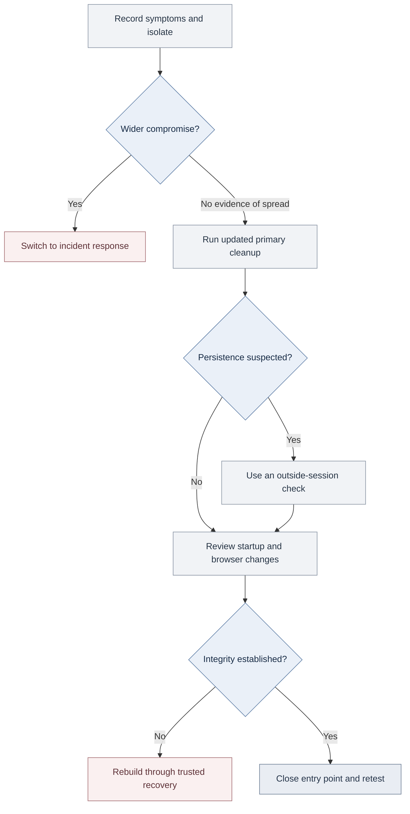

[INTA](https://github.com/Herbertofury/INTA/wiki) / [Decision desk](https://github.com/Herbertofury/INTA/wiki/Decision-Desk) · [Playbooks](https://github.com/Herbertofury/INTA/wiki/Playbooks) · [Tools](https://github.com/Herbertofury/INTA/wiki/Tool-Directory) · [Methods](https://github.com/Herbertofury/INTA/wiki/Methods) · [Open hub](https://herbertofury.github.io/INTA/)

# [Remove malware and browser hijackers](https://github.com/Herbertofury/INTA/wiki/Job-malware-removal)

A measured cleanup workflow for a single [Windows](https://www.microsoft.com/windows) endpoint, with a separate path for a wider compromise.

**Security** · Intermediate · 45–120 min plus scanning · 9 steps

[Quick answer](#quick-answer) · [Decision route](#decision-route) · [Tools](#toolkit) · [Procedure](#walkthrough) · [Verification](#acceptance) · [Sources](#sources) · [Interactive checklist](https://herbertofury.github.io/INTA/#job/malware-removal)

## ⚡ Quick answer

### 🛡️ Remove viruses

**Disconnect a suspected compromised PC from the network before scanning; use the incident guide if encryption is spreading.**

1. Record the symptoms and isolate affected connections; keep the existing real-time protection in place.
2. On a trusted PC, download a fresh [Microsoft Safety Scanner](https://learn.microsoft.com/en-us/defender-endpoint/safety-scanner-download); transfer it safely and run a Full scan.
3. Save the scan log, review remaining symptoms and persistence, then follow the guide’s cleanup or rebuild decision.

**[Microsoft Safety Scanner](https://learn.microsoft.com/en-us/defender-endpoint/safety-scanner-download)** · [Official page](https://learn.microsoft.com/en-us/defender-endpoint/safety-scanner-download) · **[Download Windows x64 scanner · EXE](https://go.microsoft.com/fwlink/?LinkId=212732)**

> [!NOTE]
> **Start here.** Check for active encryption, credential theft, unusual administrator accounts, or more affected machines before treating this as a routine cleanup.

## 🧭 Choose a route

View the decision map and escalation routes

**Route links:** [Continue this workflow](#walkthrough) · [Acceptance checks](#acceptance) · [Contain ransomware or a wider compromise](https://github.com/Herbertofury/INTA/wiki/Job-ransomware-response) · [Build and refresh a technician rescue USB](https://github.com/Herbertofury/INTA/wiki/Job-boot-usb) · [Close a repair with a clear client handoff](https://github.com/Herbertofury/INTA/wiki/Job-client-handoff)

| Checkpoint | What to carry forward |
| --- | --- |
| **Before changing anything** | Record symptoms; decide whether this is a single-endpoint cleanup. |
| **Keep during the job** | Detection names, scan versions, quarantine, persistence, and account findings. |
| **Before handing back** | Healthy protection, stable settings, and tested original work. |

## Recommended tools

Select a tool for the next diagnostic or repair step. Check its platform, access and licensing requirements before use.

| Tool / official page + download | Use it for | Platform & access | Documentation |
| --- | --- | --- | --- |
| **[Microsoft Defender Offline](https://learn.microsoft.com/en-us/defender-endpoint/microsoft-defender-offline)** · [Official page](https://learn.microsoft.com/en-us/defender-endpoint/microsoft-defender-offline) · **[Run the built-in offline scan](https://learn.microsoft.com/en-us/defender-endpoint/microsoft-defender-offline)** | Persistent malware that may interfere with an ordinary scan. | [Windows](https://www.microsoft.com/windows); Included with supported [Windows](https://www.microsoft.com/windows) | [Open guide](https://learn.microsoft.com/en-us/defender-endpoint/microsoft-defender-offline) |
| **[Microsoft Safety Scanner](https://learn.microsoft.com/en-us/defender-endpoint/safety-scanner-download)** · [Official page](https://learn.microsoft.com/en-us/defender-endpoint/safety-scanner-download) · **[Download Windows x64 scanner · EXE](https://go.microsoft.com/fwlink/?LinkId=212732)** | A fresh Microsoft second-opinion scan without installing another resident antivirus. | [Windows](https://www.microsoft.com/windows); Free download | [Open guide](https://learn.microsoft.com/en-us/defender-endpoint/safety-scanner-download) |
| **[Malwarebytes AdwCleaner](https://www.malwarebytes.com/adwcleaner)** · [Official page](https://www.malwarebytes.com/adwcleaner) · **[Download Windows cleaner · EXE](https://adwcleaner.malwarebytes.com/adwcleaner?channel=release)** | Unexpected browser redirects, pop-ups and bundled unwanted software. | [Windows](https://www.microsoft.com/windows); Free tool | [Open guide](https://help.malwarebytes.com/hc/en-us/articles/31589231147035-Scan-and-clean-a-device-with-AdwCleaner) |
| **[Microsoft Sysinternals Suite](https://learn.microsoft.com/en-us/sysinternals/)** · [Official page](https://learn.microsoft.com/en-us/sysinternals/) · **[Download Windows portable · ZIP](https://download.sysinternals.com/files/SysinternalsSuite.zip)** | The core portable [Windows](https://www.microsoft.com/windows) troubleshooting kit. | [Windows](https://www.microsoft.com/windows); Free Microsoft utilities | [Open guide](https://learn.microsoft.com/en-us/sysinternals/downloads/) |
| **[Malwarebytes](https://www.malwarebytes.com/)** · [Official page](https://www.malwarebytes.com/) · **[Download Windows EXE](https://downloads.malwarebytes.com/file/mb-windows)** | An additional malware assessment after the primary endpoint product. | [Windows](https://www.microsoft.com/windows), [macOS](https://support.apple.com/macos); Free scan options; paid protection and business products | [Open guide](https://www.malwarebytes.com/free-tools) |

## Procedure

Work in order, record the result of each step, and change route when the evidence calls for it.

### 01 · Contain and preserve the story

- [ ] Disconnect the affected endpoint from ordinary network access if compromise is suspected. Record detection names, paths, timestamps, symptoms, and recent downloads. Use a clean device for account changes. If business systems or multiple endpoints are involved, switch to the [incident-response guide](https://github.com/Herbertofury/INTA/wiki/Job-ransomware-response).

### 02 · Choose the cleanup, incident or rebuild path

- [ ] Keep an isolated, understood browser or unwanted-software case on the routine-cleanup path. Move active encryption, privileged-account compromise or multiple affected devices to the incident owner. If detections recur, the entry point remains open or the trusted system baseline cannot be established, preserve the findings and prepare a clean rebuild; do not keep cycling scanners as a substitute for a recovery decision.

### 03 · Prepare trustworthy scanners

- [ ] Get tools from the official links on a clean computer and verify signatures where available. Keep one managed real-time antivirus product; use any second-opinion scanner as an on-demand tool. Download a fresh [Safety Scanner](https://learn.microsoft.com/en-us/defender-endpoint/safety-scanner-download) for the case because its package expires after 10 days.

### 04 · Run the primary cleanup

- [ ] Update the installed endpoint protection through a controlled connection or approved update channel, run its full scan, and preserve the results. Quarantine identified threats rather than manually deleting unfamiliar files. Reboot when the product requests it and record its post-reboot status.

### 05 · Use an offline or focused second check

- [ ] If persistence is suspected, save work, make the [BitLocker](https://learn.microsoft.com/en-us/windows/security/operating-system-security/data-protection/bitlocker/) recovery key available, and run [Microsoft Defender Offline](https://learn.microsoft.com/en-us/defender-endpoint/microsoft-defender-offline) from [Windows Security](https://support.microsoft.com/en-us/windows/security/windows-security/windows-security-app-overview) > Virus & threat protection > Scan options on a supported system. For unwanted browser software, use [AdwCleaner](https://www.malwarebytes.com/adwcleaner) and inspect proposed changes before applying them. Check the actual platform first: [Microsoft Defender Offline](https://learn.microsoft.com/en-us/defender-endpoint/microsoft-defender-offline) does not support [Windows](https://www.microsoft.com/windows) on ARM or [Windows Server](https://learn.microsoft.com/en-us/windows-server/). Its update path requires [Microsoft Defender Antivirus](https://learn.microsoft.com/en-us/defender-endpoint/microsoft-defender-antivirus-windows) as the primary antivirus, and the recovery environment must be available. Follow the documented [BitLocker](https://learn.microsoft.com/en-us/windows/security/operating-system-security/data-protection/bitlocker/) preparation and verify protection is restored afterward.

### 06 · Reconcile findings with scan coverage

- [ ] Perform [scan coverage reconciliation](https://github.com/Herbertofury/INTA/wiki/Job-malware-removal) for every run: record product and engine or intelligence version where exposed, scan mode, scope, start/end time, completion or cancellation, inaccessible areas, detections and disposition. Retain the product report; [Microsoft Safety Scanner](https://learn.microsoft.com/en-us/defender-endpoint/safety-scanner-download) writes detailed results to %SYSTEMROOT%\debug\msert.log. A timeout, blocked scan or unscanned location remains incomplete even when no threat is reported. Reconcile repeated detections with the specific path, item and action rather than declaring a clean result from the headline alone.

### 07 · Review persistence and accounts

- [ ] Use [Autoruns](https://learn.microsoft.com/en-us/sysinternals/downloads/autoruns) to inspect startup items and verify suspicious publishers, locations, and signatures. Review browser extensions, notification permissions, proxy settings, and unexpected remote-access agents. Disable only entries tied to evidence, retain an export, and avoid uploading client files to public scanners.

### 08 · Close the entry point and retest

- [ ] Patch the affected software, restore the intended browser/search settings, and remove unwanted software. From a known-clean device, rotate affected credentials and revoke suspect sessions as appropriate. If you cannot establish system integrity, rebuild from trusted media and restore validated data.

### 09 · Prepare and prove a trusted rebuild when required

- [ ] Use [clean rebuild acceptance](https://github.com/Herbertofury/INTA/wiki/Job-malware-removal) when system integrity cannot be established. Before any destructive installation, identify the exact target, preserve required evidence and usable data, obtain recovery material through the approved store, and agree on the data/application restoration scope. Create installation media from the official source on a known-clean device and follow the clean-install procedure. Reinstall applications from trusted sources, restore validated data deliberately, update the system and endpoint protection, and prove the original customer task. Document unresolved account exposure separately; a reinstalled endpoint does not reset stolen credentials or revoke cloud sessions. Use [Service Evidence](https://github.com/Herbertofury/INTA/wiki/Service-Evidence) for the before-wipe and return-to-service checks.

## Verification

- [ ] The primary security product is healthy and updated after reboot.
- [ ] Follow-up scans and [persistence review](https://github.com/Herbertofury/INTA/wiki/Job-malware-removal) show no unresolved detections.
- [ ] The user can complete the original task and browser settings remain stable.
- [ ] Any account exposure has a documented response, not only a clean scan.
- [ ] Each scan has a completion state, scope, findings and explicit coverage limits; incomplete work is not recorded as clean.
- [ ] If rebuilt, the target, preserved data/evidence, trusted media, restored applications, endpoint health and customer task test are recorded.
- [ ] Reconnection and restored data have been assessed against the original entry point; credentials and cloud sessions have a separate resolution owner.

> [!WARNING]
> **Pause this route and escalate when:**
> - Ransomware, privileged account compromise, or lateral spread is suspected.
> - New detections reappear after cleanup or the trusted baseline cannot be established.

## Related playbooks

| Next playbook | What it resolves |
| --- | --- |
| [Contain ransomware or a wider compromise](https://github.com/Herbertofury/INTA/wiki/Job-ransomware-response) | Stop spread, preserve useful evidence, and restore services through a clean recovery path. |
| [Build and refresh a technician rescue USB](https://github.com/Herbertofury/INTA/wiki/Job-boot-usb) | Keep verified recovery images, [Windows repair](https://github.com/Herbertofury/INTA/wiki/Job-windows-repair) media, and the INTA knowledge hub ready for offline use. |
| [Close a repair with a clear client handoff](https://github.com/Herbertofury/INTA/wiki/Job-client-handoff) | Turn completed technical work into proof the customer can use, with clean access and an actionable service record. |

## Official sources

References and review notes

- [Microsoft Safety Scanner](https://learn.microsoft.com/en-us/defender-endpoint/safety-scanner-download)
- [Microsoft Defender Offline](https://learn.microsoft.com/en-us/defender-endpoint/microsoft-defender-offline)
- [Microsoft Sysinternals: Autoruns](https://learn.microsoft.com/en-us/sysinternals/downloads/autoruns)
- [Microsoft: recovery options for suspected malware](https://support.microsoft.com/en-us/windows/experience/backup-recovery/recovery-options-in-windows)
- [Microsoft: reinstall with installation media](https://support.microsoft.com/en-us/windows/deployment/install-upgrade/reinstall-windows-with-the-installation-media)
- [CISA: #StopRansomware Guide, recovery checklist](https://www.cisa.gov/sites/default/files/2025-03/StopRansomware-Guide%20508.pdf)
- [ATHENA: findings, coverage and explicit resource ownership](https://github.com/Herbertofury/Athena/blob/7d529423b52d3cc6104ce7469eec358f5dc9b9ac/engineering/docs/windows-endpoint-security.md)
- [INTA: Service Evidence](https://github.com/Herbertofury/INTA/wiki/Service-Evidence)

Reviewed **2026-11-26**. Timing is a planning range. A successful command is evidence about that operation; acceptance belongs to the user’s original task.

---

Editorial review: **2026-11-26** · [Review standard](https://github.com/Herbertofury/INTA/wiki/Knowledge-Standards) · [Suggest a correction](https://github.com/Herbertofury/INTA/issues/new/choose)
