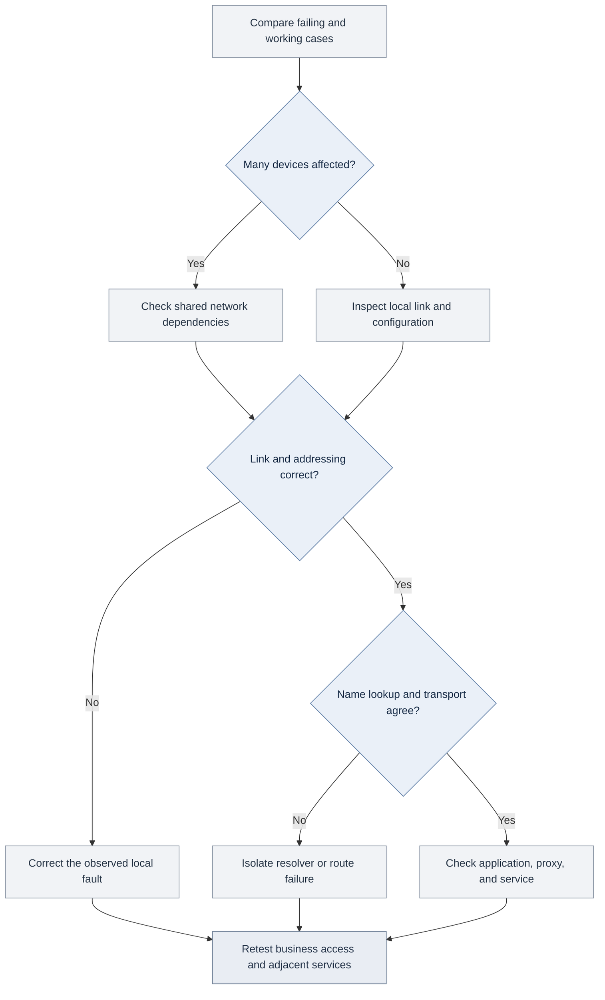

<a href="https://herbertofury.github.io/INTA/" title="Open INTA official download or service page" aria-label="Open INTA official download or service page" data-inta-brand="app-inta"></a> [INTA](https://github.com/Herbertofury/INTA/wiki) / [Decision desk](https://github.com/Herbertofury/INTA/wiki/Decision-Desk) · [Service map](https://github.com/Herbertofury/INTA/wiki/Service-Map) · [Playbooks](https://github.com/Herbertofury/INTA/wiki/Playbooks) · [Tools](https://github.com/Herbertofury/INTA/wiki/Tool-Directory) · [Methods](https://github.com/Herbertofury/INTA/wiki/Methods) · [Open hub](https://herbertofury.github.io/INTA/)

<a id="-fix-internet-dns-or-local-network-problems"></a>

# [Fix internet, DNS, or local-network problems](https://github.com/Herbertofury/INTA/wiki/Job-network-dns)

Locate the failing layer before resetting adapters or changing the whole network.

**Networking** · Intermediate · 15–60 min · 6 steps

[Tools and useful links](#working-kit) · [Quick answer](#quick-answer) · [Next action](#next-action) · [Specific fixes](#specific-fixes) · [Decision route](#decision-route) · [Tools](#toolkit) · [Procedure](#walkthrough) · [Verification](#acceptance) · [Sources](#sources) · [Interactive checklist](https://herbertofury.github.io/INTA/#job/network-dns)

<a id="tool-choices"></a>

## 🧰 Choose the tool for this job

Choose by the task shown in the first column. Each option includes its acquisition route and access boundary.

| Need | Official tool + exact action | Why this choice / access |
| --- | --- | --- |
| **Connection diagnostic** | **<a href="https://support.microsoft.com/en-us/support/get-help/windows-troubleshooters" title="Open Windows Get Help official download or service page" aria-label="Open Windows Get Help official download or service page" data-inta-brand="get-help"></a> [Windows Get Help](https://support.microsoft.com/en-us/support/get-help/about-get-help)** · **<a href="https://support.microsoft.com/en-us/support/get-help/windows-troubleshooters" title="Open Windows Get Help official download or service page" aria-label="Open Windows Get Help official download or service page" data-inta-brand="get-help"></a> [Open network troubleshooting](https://support.microsoft.com/en-us/windows/experience/connectivity-networking/fix-wi-fi-connection-issues-in-windows)** | Run the supported network diagnostic after checking link, address, gateway and DNS. **Access:** Included with supported <a href="https://www.microsoft.com/windows" title="Open Windows official download or service page" aria-label="Open Windows official download or service page" data-inta-brand="app-windows"></a> [Windows](https://www.microsoft.com/windows) |
| **DNS and port checks** | **<a href="https://github.com/PowerShell/PowerShell/releases/latest" title="Open PowerShell official download or service page" aria-label="Open PowerShell official download or service page" data-inta-brand="powershell"></a> [PowerShell](https://learn.microsoft.com/en-us/powershell/)** · **<a href="https://learn.microsoft.com/en-us/powershell/scripting/windows-powershell/starting-windows-powershell" title="Open Windows PowerShell 5.1 official download or service page" aria-label="Open Windows PowerShell 5.1 official download or service page" data-inta-brand="app-windows-powershell-51"></a> [Use Windows PowerShell 5.1](https://learn.microsoft.com/en-us/powershell/scripting/windows-powershell/starting-windows-powershell)** | Use existing commands to separate name resolution, routing and a required TCP service. **Access:** Included with supported <a href="https://www.microsoft.com/windows" title="Open Windows official download or service page" aria-label="Open Windows official download or service page" data-inta-brand="app-windows"></a> [Windows](https://www.microsoft.com/windows) |
| **HTTP and TLS check** | **<a href="https://curl.se/windows/" title="Open curl official download or service page" aria-label="Open curl official download or service page" data-inta-brand="curl"></a> [curl](https://curl.se/)** · **<a href="https://www.microsoft.com/windows" title="Open Windows official download or service page" aria-label="Open Windows official download or service page" data-inta-brand="app-windows"></a> <a href="https://curl.se/windows/" title="Open curl official download or service page" aria-label="Open curl official download or service page" data-inta-brand="curl"></a> [Use the Windows-included curl.exe](https://curl.se/windows/microsoft.html)** | Test the documented endpoint when ordinary connectivity works but an application request fails. **Access:** Included with supported <a href="https://www.microsoft.com/windows" title="Open Windows official download or service page" aria-label="Open Windows official download or service page" data-inta-brand="app-windows"></a> [Windows](https://www.microsoft.com/windows) |

**[Current selection evidence](https://github.com/Herbertofury/INTA/wiki/Current-Tool-Choices)**

<a id="working-kit"></a>

## 🧰 Tools and links for this job

**[Open working view](https://herbertofury.github.io/INTA/#job/network-dns)** · Keep the tool panel beside the instructions.

**First move:** Compare another device on the same network. Establish whether the fault affects this PC, one service, the VPN or the whole office.

| Use this for | Official tool + exact action |
| --- | --- |
| Run supported local connection diagnostics. | **<a href="https://support.microsoft.com/en-us/support/get-help/windows-troubleshooters" title="Open Windows Get Help official download or service page" aria-label="Open Windows Get Help official download or service page" data-inta-brand="get-help"></a> [Windows Get Help](https://support.microsoft.com/en-us/support/get-help/about-get-help)** · <a href="https://support.microsoft.com/en-us/support/get-help/windows-troubleshooters" title="Open Windows Get Help official download or service page" aria-label="Open Windows Get Help official download or service page" data-inta-brand="get-help"></a> [Official page](https://support.microsoft.com/en-us/support/get-help/about-get-help) · **<a href="https://support.microsoft.com/en-us/support/get-help/windows-troubleshooters" title="Open Windows Get Help official download or service page" aria-label="Open Windows Get Help official download or service page" data-inta-brand="get-help"></a> [Open network troubleshooting](https://support.microsoft.com/en-us/windows/experience/connectivity-networking/fix-wi-fi-connection-issues-in-windows)** |
| Read IP, DNS and connection results on the affected PC. | **<a href="https://github.com/PowerShell/PowerShell/releases/latest" title="Open PowerShell official download or service page" aria-label="Open PowerShell official download or service page" data-inta-brand="powershell"></a> [PowerShell](https://learn.microsoft.com/en-us/powershell/)** · <a href="https://github.com/PowerShell/PowerShell/releases/latest" title="Open PowerShell official download or service page" aria-label="Open PowerShell official download or service page" data-inta-brand="powershell"></a> [Official page](https://learn.microsoft.com/en-us/powershell/) · **<a href="https://learn.microsoft.com/en-us/powershell/scripting/windows-powershell/starting-windows-powershell" title="Open Windows PowerShell 5.1 official download or service page" aria-label="Open Windows PowerShell 5.1 official download or service page" data-inta-brand="app-windows-powershell-51"></a> [Use Windows PowerShell 5.1](https://learn.microsoft.com/en-us/powershell/scripting/windows-powershell/starting-windows-powershell)** |
| Capture only a scoped unresolved protocol failure. | **<a href="https://www.wireshark.org/download.html" title="Open Wireshark official download or service page" aria-label="Open Wireshark official download or service page" data-inta-brand="wireshark"></a> [Wireshark](https://www.wireshark.org/)** · <a href="https://www.wireshark.org/download.html" title="Open Wireshark official download or service page" aria-label="Open Wireshark official download or service page" data-inta-brand="wireshark"></a> [Official page](https://www.wireshark.org/) · **<a href="https://www.microsoft.com/windows" title="Open Windows official download or service page" aria-label="Open Windows official download or service page" data-inta-brand="app-windows"></a> [Download Windows x64 · EXE](https://2.na.dl.wireshark.org/win64/Wireshark-4.6.10-x64.exe)** |
| Separating DNS, TCP, TLS and HTTP failures when a web service or application endpoint is unreachable. | **<a href="https://curl.se/windows/" title="Open curl official download or service page" aria-label="Open curl official download or service page" data-inta-brand="curl"></a> [curl](https://curl.se/)** · <a href="https://curl.se/windows/" title="Open curl official download or service page" aria-label="Open curl official download or service page" data-inta-brand="curl"></a> [Official page](https://curl.se/) · **<a href="https://www.microsoft.com/windows" title="Open Windows official download or service page" aria-label="Open Windows official download or service page" data-inta-brand="app-windows"></a> <a href="https://curl.se/windows/" title="Open curl official download or service page" aria-label="Open curl official download or service page" data-inta-brand="curl"></a> [Use the Windows-included curl.exe](https://curl.se/windows/microsoft.html)** |
| Comparing a reproducible path problem from a <a href="https://www.kernel.org/" title="Open Linux official download or service page" aria-label="Open Linux official download or service page" data-inta-brand="app-linux"></a> [Linux](https://www.kernel.org/) or <a href="https://support.apple.com/macos" title="Open macOS official download or service page" aria-label="Open macOS official download or service page" data-inta-brand="app-macos"></a> [macOS](https://support.apple.com/macos) bench, or <a href="https://www.microsoft.com/windows" title="Open Windows official download or service page" aria-label="Open Windows official download or service page" data-inta-brand="app-windows"></a> [Windows](https://www.microsoft.com/windows) through WSL. | **<a href="https://github.com/traviscross/mtr" title="Open mtr official download or service page" aria-label="Open mtr official download or service page" data-inta-brand="mtr"></a> [mtr](https://www.bitwizard.nl/mtr/)** · <a href="https://github.com/traviscross/mtr" title="Open mtr official download or service page" aria-label="Open mtr official download or service page" data-inta-brand="mtr"></a> [Official page](https://www.bitwizard.nl/mtr/) · **<a href="https://www.kernel.org/" title="Open Linux official download or service page" aria-label="Open Linux official download or service page" data-inta-brand="app-linux"></a> [Install a Linux/WSL distribution package](https://github.com/traviscross/mtr#using-mtr-on-windows)** |
| Distinguish widespread scanning noise from an alert needing closer investigation. | **<a href="https://viz.greynoise.io/" title="Open GreyNoise Visualizer official download or service page" aria-label="Open GreyNoise Visualizer official download or service page" data-inta-brand="greynoise"></a> [GreyNoise Visualizer](https://www.greynoise.io/)** · <a href="https://viz.greynoise.io/" title="Open GreyNoise Visualizer official download or service page" aria-label="Open GreyNoise Visualizer official download or service page" data-inta-brand="greynoise"></a> [Official page](https://www.greynoise.io/) · **<a href="https://viz.greynoise.io/" title="Open GreyNoise Visualizer official download or service page" aria-label="Open GreyNoise Visualizer official download or service page" data-inta-brand="greynoise"></a> [Open online service](https://viz.greynoise.io/)** |
| Add report history and recency to a suspicious connection or mail-server IP. | **<a href="https://www.abuseipdb.com/" title="Open AbuseIPDB official download or service page" aria-label="Open AbuseIPDB official download or service page" data-inta-brand="abuseipdb"></a> [AbuseIPDB](https://www.abuseipdb.com/)** · <a href="https://www.abuseipdb.com/" title="Open AbuseIPDB official download or service page" aria-label="Open AbuseIPDB official download or service page" data-inta-brand="abuseipdb"></a> [Official page](https://www.abuseipdb.com/) · **<a href="https://www.abuseipdb.com/" title="Open AbuseIPDB official download or service page" aria-label="Open AbuseIPDB official download or service page" data-inta-brand="abuseipdb"></a> [Open online service](https://www.abuseipdb.com/)** |
| Trace a domain, certificate or exposed service across related infrastructure. | **<a href="https://platform.censys.io/" title="Open Censys Platform official download or service page" aria-label="Open Censys Platform official download or service page" data-inta-brand="censys"></a> [Censys Platform](https://censys.com/)** · <a href="https://platform.censys.io/" title="Open Censys Platform official download or service page" aria-label="Open Censys Platform official download or service page" data-inta-brand="censys"></a> [Official page](https://censys.com/) · **<a href="https://platform.censys.io/" title="Open Censys Platform official download or service page" aria-label="Open Censys Platform official download or service page" data-inta-brand="censys"></a> [Open online service](https://platform.censys.io/)** |
| Find unexpected public services on a known business IP. | **<a href="https://www.shodan.io/" title="Open Shodan official download or service page" aria-label="Open Shodan official download or service page" data-inta-brand="shodan"></a> [Shodan](https://www.shodan.io/)** · <a href="https://www.shodan.io/" title="Open Shodan official download or service page" aria-label="Open Shodan official download or service page" data-inta-brand="shodan"></a> [Official page](https://www.shodan.io/) · **<a href="https://www.shodan.io/" title="Open Shodan official download or service page" aria-label="Open Shodan official download or service page" data-inta-brand="shodan"></a> [Open online service](https://www.shodan.io/)** |
| Latency, loss and connection quality | **<a href="https://speed.cloudflare.com/" title="Open Cloudflare Speed Test official download or service page" aria-label="Open Cloudflare Speed Test official download or service page" data-inta-brand="cloudflare-speed"></a> [Cloudflare Speed Test](https://speed.cloudflare.com/)** · <a href="https://speed.cloudflare.com/" title="Open Cloudflare Speed Test official download or service page" aria-label="Open Cloudflare Speed Test official download or service page" data-inta-brand="cloudflare-speed"></a> [Official page](https://speed.cloudflare.com/) · **<a href="https://speed.cloudflare.com/" title="Open Cloudflare Speed Test official download or service page" aria-label="Open Cloudflare Speed Test official download or service page" data-inta-brand="cloudflare-speed"></a> [Open online service](https://speed.cloudflare.com/)** |
| Latency while the connection is busy | **<a href="https://www.waveform.com/tools/bufferbloat" title="Open Waveform Bufferbloat Test official download or service page" aria-label="Open Waveform Bufferbloat Test official download or service page" data-inta-brand="waveform-bufferbloat"></a> [Waveform Bufferbloat Test](https://www.waveform.com/tools/bufferbloat)** · <a href="https://www.waveform.com/tools/bufferbloat" title="Open Waveform Bufferbloat Test official download or service page" aria-label="Open Waveform Bufferbloat Test official download or service page" data-inta-brand="waveform-bufferbloat"></a> [Official page](https://www.waveform.com/tools/bufferbloat) · **<a href="https://www.waveform.com/tools/bufferbloat" title="Open Waveform Bufferbloat Test official download or service page" aria-label="Open Waveform Bufferbloat Test official download or service page" data-inta-brand="waveform-bufferbloat"></a> [Open online service](https://www.waveform.com/tools/bufferbloat)** |
| Separate a local problem from regional routing, DNS or CDN behavior. | **<a href="https://globalping.io/" title="Open Globalping official download or service page" aria-label="Open Globalping official download or service page" data-inta-brand="globalping"></a> [Globalping](https://globalping.io/)** · <a href="https://globalping.io/" title="Open Globalping official download or service page" aria-label="Open Globalping official download or service page" data-inta-brand="globalping"></a> [Official page](https://globalping.io/) · **<a href="https://globalping.io/" title="Open Globalping official download or service page" aria-label="Open Globalping official download or service page" data-inta-brand="globalping"></a> [Open online service](https://globalping.io/)** |
| Check whether an apparent local outage coincides with a regional or network-wide event. | **<a href="https://radar.cloudflare.com/" title="Open Cloudflare Radar official download or service page" aria-label="Open Cloudflare Radar official download or service page" data-inta-brand="cloudflare-radar"></a> [Cloudflare Radar](https://radar.cloudflare.com/)** · <a href="https://radar.cloudflare.com/" title="Open Cloudflare Radar official download or service page" aria-label="Open Cloudflare Radar official download or service page" data-inta-brand="cloudflare-radar"></a> [Official page](https://radar.cloudflare.com/) · **<a href="https://radar.cloudflare.com/" title="Open Cloudflare Radar official download or service page" aria-label="Open Cloudflare Radar official download or service page" data-inta-brand="cloudflare-radar"></a> [Open online service](https://radar.cloudflare.com/)** |

### First checks

| Open the exact resource | What to do there |
| --- | --- |
| **<a href="https://www.microsoft.com/windows" title="Open Windows official download or service page" aria-label="Open Windows official download or service page" data-inta-brand="app-windows"></a> [Windows network troubleshooting](https://support.microsoft.com/en-us/windows/experience/connectivity-networking/fix-wi-fi-connection-issues-in-windows)** | Work through local connection checks before a network reset. |

### Read-only diagnostics

| Open the exact resource | What to do there |
| --- | --- |
| **<a href="https://github.com/PowerShell/PowerShell/releases/latest" title="Open PowerShell official download or service page" aria-label="Open PowerShell official download or service page" data-inta-brand="powershell"></a> [Get-NetIPConfiguration](https://learn.microsoft.com/en-us/powershell/module/nettcpip/get-netipconfiguration)** | Read the active adapter, address, gateway and DNS servers. |
| **<a href="https://github.com/PowerShell/PowerShell/releases/latest" title="Open PowerShell official download or service page" aria-label="Open PowerShell official download or service page" data-inta-brand="powershell"></a> [Resolve-DnsName](https://learn.microsoft.com/en-us/powershell/module/dnsclient/resolve-dnsname)** | Test the actual failing service name. |
| **<a href="https://github.com/PowerShell/PowerShell/releases/latest" title="Open PowerShell official download or service page" aria-label="Open PowerShell official download or service page" data-inta-brand="powershell"></a> [Test-NetConnection](https://learn.microsoft.com/en-us/powershell/module/nettcpip/test-netconnection)** | Test the service’s documented TCP port. |

### Application connectivity

| Open the exact resource | What to do there |
| --- | --- |
| **<a href="https://learn.microsoft.com/en-us/windows-server/" title="Open Windows Server official download or service page" aria-label="Open Windows Server official download or service page" data-inta-brand="app-windows-server"></a> [Inspect a service proxy](https://learn.microsoft.com/en-us/windows-server/administration/windows-commands/netsh-winhttp)** | Read the WinHTTP configuration before changing a service connection path. |

### Recovery planning

| Open the exact resource | What to do there |
| --- | --- |
| **<a href="https://support.microsoft.com/" title="Open support.microsoft.com official download or service page" aria-label="Open support.microsoft.com official download or service page" data-inta-brand="site-support-microsoft-com"></a> [Network reset and adapter recovery](https://support.microsoft.com/en-us/windows/experience/connectivity-networking/fix-ethernet-connection-problems-in-windows)** | Prepare required drivers, VPN and virtual-switch recovery before a network reset. |

### Online working tools

| Open the exact resource | What to do there |
| --- | --- |
| **[Investigate an IP or domain](https://herbertofury.github.io/INTA/#online?task=check-ip)** | Use several dated sources to explain reputation, exposed services and ownership. |
| **[Find latency or an outage](https://herbertofury.github.io/INTA/#online?task=test-connection)** | Separate bandwidth, latency under load, local faults and regional reachability. |

<a id="quick-answer"></a>

## ⚡ Quick answer

<a id="quick-fix-internet"></a>

### 🌐 Fix internet

**Check whether one device, one connection or the whole office has lost access.**

1. Check the cable or Wi-Fi connection and compare another device on the same network.
2. In <a href="https://support.microsoft.com/en-us/support/get-help/windows-troubleshooters" title="Open Windows Get Help official download or service page" aria-label="Open Windows Get Help official download or service page" data-inta-brand="get-help"></a> [Windows Get Help](https://support.microsoft.com/en-us/support/get-help/about-get-help), search “connect to network and internet” and run [network diagnostics](https://github.com/Herbertofury/INTA/wiki/Job-network-dns).
3. Follow the relevant address, gateway or DNS branch, then retest the original site and business service.

**<a href="https://support.microsoft.com/en-us/support/get-help/windows-troubleshooters" title="Open Windows Get Help official download or service page" aria-label="Open Windows Get Help official download or service page" data-inta-brand="get-help"></a> [Windows Get Help](https://support.microsoft.com/en-us/support/get-help/about-get-help)** · <a href="https://support.microsoft.com/en-us/support/get-help/windows-troubleshooters" title="Open Windows Get Help official download or service page" aria-label="Open Windows Get Help official download or service page" data-inta-brand="get-help"></a> [Official page](https://support.microsoft.com/en-us/support/get-help/about-get-help) · **<a href="https://support.microsoft.com/en-us/support/get-help/windows-troubleshooters" title="Open Windows Get Help official download or service page" aria-label="Open Windows Get Help official download or service page" data-inta-brand="get-help"></a> [Open network troubleshooting](https://support.microsoft.com/en-us/windows/experience/connectivity-networking/fix-wi-fi-connection-issues-in-windows)**

<a id="quick-inspect-network-traffic"></a>

### 🌐 Inspect network traffic

**Use packet capture only after basic link, address, gateway and DNS checks have narrowed the fault.**

1. Get authorization and choose the smallest interface, host and time window that can reproduce the issue.
2. Capture the failing request in <a href="https://www.wireshark.org/download.html" title="Open Wireshark official download or service page" aria-label="Open Wireshark official download or service page" data-inta-brand="wireshark"></a> [Wireshark](https://www.wireshark.org/) and inspect the relevant DNS or connection exchange.
3. Apply one evidenced fix, repeat the request and store the capture only in the private case record.

**<a href="https://www.wireshark.org/download.html" title="Open Wireshark official download or service page" aria-label="Open Wireshark official download or service page" data-inta-brand="wireshark"></a> [Wireshark](https://www.wireshark.org/)** · <a href="https://www.wireshark.org/download.html" title="Open Wireshark official download or service page" aria-label="Open Wireshark official download or service page" data-inta-brand="wireshark"></a> [Official page](https://www.wireshark.org/) · **<a href="https://www.microsoft.com/windows" title="Open Windows official download or service page" aria-label="Open Windows official download or service page" data-inta-brand="app-windows"></a> [Download Windows x64 · EXE](https://2.na.dl.wireshark.org/win64/Wireshark-4.6.10-x64.exe)**

<a id="next-action"></a>

## 🧭 Match the symptom

| You see this | Do this next | You should get |
| --- | --- | --- |
| **Only this PC is disconnected** | Check cable/Wi-Fi state and run the Network and Internet diagnostic in <a href="https://support.microsoft.com/en-us/support/get-help/windows-troubleshooters" title="Open Windows Get Help official download or service page" aria-label="Open Windows Get Help official download or service page" data-inta-brand="get-help"></a> [Windows Get Help](https://support.microsoft.com/en-us/support/get-help/about-get-help). | The active link is identified and the diagnostic has a specific result. |
| **The PC has no usable gateway or a self-assigned IPv4 address** | Run Get-NetIPConfiguration; compare the active adapter with the approved DHCP/network configuration. | The PC receives the intended address, gateway and DNS rather than an invented static setting. |
| **IP connectivity works but a hostname fails** | Run Resolve-DnsName for that service name and compare the configured DNS server with a working client. | The correct answer resolves or the faulty DNS dependency is identified. |
| **The name resolves but the application cannot connect** | Run Test-NetConnection for the target’s documented TCP port and compare a working path; a successful TCP test still needs the app test. | The evidence distinguishes blocked transport from an application or authentication failure. |
| **Many devices or only VPN users fail** | Use the shared-network or managed-VPN owner and preserve adapter, route and DNS settings before disruptive changes. | The shared dependency has a scoped repair plan and owner. |

### ✅ Finish the job

- [ ] The original site, share or application works by its normal hostname.
- [ ] Required VPN and business connectivity still work after the change.

**Change route when:** The fault is a shared outage or managed-policy issue outside local authority. · The next action would reset production networking without a recovery path.

### 🎯 Go straight to a specific fix

- **[Fix a PC stuck on a self-assigned address](#fix-network-dhcp-self-assigned-address)** — A DHCP-configured adapter has a 169.254 address and cannot reach the normal gateway.
- **[Restore internal name resolution on VPN](#fix-network-internal-names-fail-on-vpn)** — Public websites work, but a company share or application name fails after VPN connection.
- **[Complete a captive Wi-Fi sign-in](#fix-network-captive-portal-signin)** — The PC associates with guest Wi-Fi but internet access is limited until the network’s sign-in step.
- **[Separate a blocked port from a DNS problem](#fix-network-name-resolves-but-port-fails)** — The expected hostname resolves, but one application cannot connect.
- **[Locate a throughput bottleneck](#fix-network-measure-lan-before-blaming-isp)** — Large transfers are slow, but browsing and connectivity checks pass.
- **[Explain why a service fails while the browser works](#fix-network-web-works-service-proxy-fails)** — Websites open, but an updater or <a href="https://www.microsoft.com/windows" title="Open Windows official download or service page" aria-label="Open Windows official download or service page" data-inta-brand="app-windows"></a> [Windows](https://www.microsoft.com/windows) service reports a proxy or connection error.
- **[Prepare a network reset without losing the return path](#fix-network-reset-breaks-vpn-or-virtual-switch)** — A network reset is being considered, or VPN and virtual-machine networking disappeared after one.
- **[Calls lag even though a speed test looks fast](#fix-online-loaded-latency)** — Video calls or games stall when other devices upload or download.

> [!NOTE]
> **Start here.** Determine whether the problem affects one app, one device, one network segment, or every device. Capture the working and failing cases.

<a id="decision-route"></a>

<a id="-choose-the-right-branch"></a>

## 🧭 Choose a route



**Route links:** [Continue this workflow](#walkthrough) · [Acceptance checks](#acceptance) · [Bring an office back after a power outage](https://github.com/Herbertofury/INTA/wiki/Job-outage-recovery) · [Repair a workstation’s domain trust relationship](https://github.com/Herbertofury/INTA/wiki/Job-ad-trust) · [Start and finish a clean remote-support session](https://github.com/Herbertofury/INTA/wiki/Job-remote-support) · <a href="https://support.microsoft.com/outlook" title="Open Outlook official download or service page" aria-label="Open Outlook official download or service page" data-inta-brand="app-outlook"></a> [Fix Outlook or email send/receive problems](https://github.com/Herbertofury/INTA/wiki/Job-outlook-email)

| Checkpoint | What to carry forward |
| --- | --- |
| **Before changing anything** | Record the current network settings and remote recovery path. |
| **Keep during the job** | Link, address, resolver, transport, and application comparisons. |
| **Before handing back** | The intended app, shares, printing, and remote access still work. |

<a id="toolkit"></a>

<a id="-build-the-right-toolkit"></a>

## Recommended tools

Select a tool for the next diagnostic or repair step. Check its platform, access and licensing requirements before use.

| Tool / official page + download | Use it for | Platform & access | Documentation |
| --- | --- | --- | --- |
| **<a href="https://support.microsoft.com/en-us/support/get-help/windows-troubleshooters" title="Open Windows Get Help official download or service page" aria-label="Open Windows Get Help official download or service page" data-inta-brand="get-help"></a> [Windows Get Help](https://support.microsoft.com/en-us/support/get-help/about-get-help)** · <a href="https://support.microsoft.com/en-us/support/get-help/windows-troubleshooters" title="Open Windows Get Help official download or service page" aria-label="Open Windows Get Help official download or service page" data-inta-brand="get-help"></a> [Official page](https://support.microsoft.com/en-us/support/get-help/about-get-help) · **<a href="https://support.microsoft.com/en-us/support/get-help/windows-troubleshooters" title="Open Windows Get Help official download or service page" aria-label="Open Windows Get Help official download or service page" data-inta-brand="get-help"></a> [Open network troubleshooting](https://support.microsoft.com/en-us/windows/experience/connectivity-networking/fix-wi-fi-connection-issues-in-windows)** | Run supported local connection diagnostics. | <a href="https://www.microsoft.com/windows" title="Open Windows official download or service page" aria-label="Open Windows official download or service page" data-inta-brand="app-windows"></a> [Windows](https://www.microsoft.com/windows); Included with supported <a href="https://www.microsoft.com/windows" title="Open Windows official download or service page" aria-label="Open Windows official download or service page" data-inta-brand="app-windows"></a> [Windows](https://www.microsoft.com/windows); assisted support availability depends on the account and support agreement. | <a href="https://support.microsoft.com/en-us/support/get-help/windows-troubleshooters" title="Open Windows Get Help official download or service page" aria-label="Open Windows Get Help official download or service page" data-inta-brand="get-help"></a> [Open guide](https://support.microsoft.com/en-us/support/get-help/windows-troubleshooters) |
| **<a href="https://github.com/PowerShell/PowerShell/releases/latest" title="Open PowerShell official download or service page" aria-label="Open PowerShell official download or service page" data-inta-brand="powershell"></a> [PowerShell](https://learn.microsoft.com/en-us/powershell/)** · <a href="https://github.com/PowerShell/PowerShell/releases/latest" title="Open PowerShell official download or service page" aria-label="Open PowerShell official download or service page" data-inta-brand="powershell"></a> [Official page](https://learn.microsoft.com/en-us/powershell/) · **<a href="https://learn.microsoft.com/en-us/powershell/scripting/windows-powershell/starting-windows-powershell" title="Open Windows PowerShell 5.1 official download or service page" aria-label="Open Windows PowerShell 5.1 official download or service page" data-inta-brand="app-windows-powershell-51"></a> [Use Windows PowerShell 5.1](https://learn.microsoft.com/en-us/powershell/scripting/windows-powershell/starting-windows-powershell)** | Read IP, DNS and connection results on the affected PC. | <a href="https://www.microsoft.com/windows" title="Open Windows official download or service page" aria-label="Open Windows official download or service page" data-inta-brand="app-windows"></a> [Windows](https://www.microsoft.com/windows), <a href="https://www.kernel.org/" title="Open Linux official download or service page" aria-label="Open Linux official download or service page" data-inta-brand="app-linux"></a> [Linux](https://www.kernel.org/), <a href="https://support.apple.com/macos" title="Open macOS official download or service page" aria-label="Open macOS official download or service page" data-inta-brand="app-macos"></a> [macOS](https://support.apple.com/macos); Free / open source | <a href="https://github.com/PowerShell/PowerShell/releases/latest" title="Open PowerShell official download or service page" aria-label="Open PowerShell official download or service page" data-inta-brand="powershell"></a> [Open guide](https://learn.microsoft.com/en-us/powershell/) |
| **<a href="https://www.wireshark.org/download.html" title="Open Wireshark official download or service page" aria-label="Open Wireshark official download or service page" data-inta-brand="wireshark"></a> [Wireshark](https://www.wireshark.org/)** · <a href="https://www.wireshark.org/download.html" title="Open Wireshark official download or service page" aria-label="Open Wireshark official download or service page" data-inta-brand="wireshark"></a> [Official page](https://www.wireshark.org/) · **<a href="https://www.microsoft.com/windows" title="Open Windows official download or service page" aria-label="Open Windows official download or service page" data-inta-brand="app-windows"></a> [Download Windows x64 · EXE](https://2.na.dl.wireshark.org/win64/Wireshark-4.6.10-x64.exe)** | Capture only a scoped unresolved protocol failure. | <a href="https://www.microsoft.com/windows" title="Open Windows official download or service page" aria-label="Open Windows official download or service page" data-inta-brand="app-windows"></a> [Windows](https://www.microsoft.com/windows), <a href="https://www.kernel.org/" title="Open Linux official download or service page" aria-label="Open Linux official download or service page" data-inta-brand="app-linux"></a> [Linux](https://www.kernel.org/), <a href="https://support.apple.com/macos" title="Open macOS official download or service page" aria-label="Open macOS official download or service page" data-inta-brand="app-macos"></a> [macOS](https://support.apple.com/macos); Free / open source | <a href="https://www.wireshark.org/download.html" title="Open Wireshark official download or service page" aria-label="Open Wireshark official download or service page" data-inta-brand="wireshark"></a> [Open guide](https://www.wireshark.org/docs/) |
| **<a href="https://downloads.es.net/pub/iperf/" title="Open iperf3 official download or service page" aria-label="Open iperf3 official download or service page" data-inta-brand="iperf3"></a> [iperf3](https://software.es.net/iperf/)** · <a href="https://downloads.es.net/pub/iperf/" title="Open iperf3 official download or service page" aria-label="Open iperf3 official download or service page" data-inta-brand="iperf3"></a> [Official page](https://software.es.net/iperf/) · **<a href="https://downloads.es.net/pub/iperf/" title="Open iperf3 official download or service page" aria-label="Open iperf3 official download or service page" data-inta-brand="iperf3"></a> [Download source · TAR.GZ](https://downloads.es.net/pub/iperf/iperf-3.22.1.tar.gz)** | Separating local network bandwidth limits from internet or application problems. | <a href="https://www.kernel.org/" title="Open Linux official download or service page" aria-label="Open Linux official download or service page" data-inta-brand="app-linux"></a> [Linux](https://www.kernel.org/), <a href="https://support.apple.com/macos" title="Open macOS official download or service page" aria-label="Open macOS official download or service page" data-inta-brand="app-macos"></a> [macOS](https://support.apple.com/macos), FreeBSD; Free / open source | <a href="https://downloads.es.net/pub/iperf/" title="Open iperf3 official download or service page" aria-label="Open iperf3 official download or service page" data-inta-brand="iperf3"></a> [Open guide](https://software.es.net/iperf/invoking.html) |
| **<a href="https://learn.microsoft.com/en-us/sysinternals/downloads/sysinternals-suite" title="Open Microsoft Sysinternals Suite official download or service page" aria-label="Open Microsoft Sysinternals Suite official download or service page" data-inta-brand="sysinternals"></a> [Microsoft Sysinternals Suite](https://learn.microsoft.com/en-us/sysinternals/)** · <a href="https://learn.microsoft.com/en-us/sysinternals/downloads/sysinternals-suite" title="Open Microsoft Sysinternals Suite official download or service page" aria-label="Open Microsoft Sysinternals Suite official download or service page" data-inta-brand="sysinternals"></a> [Official page](https://learn.microsoft.com/en-us/sysinternals/) · **<a href="https://www.microsoft.com/windows" title="Open Windows official download or service page" aria-label="Open Windows official download or service page" data-inta-brand="app-windows"></a> [Download Windows portable · ZIP](https://download.sysinternals.com/files/SysinternalsSuite.zip)** | The core portable <a href="https://www.microsoft.com/windows" title="Open Windows official download or service page" aria-label="Open Windows official download or service page" data-inta-brand="app-windows"></a> [Windows](https://www.microsoft.com/windows) troubleshooting kit. | <a href="https://www.microsoft.com/windows" title="Open Windows official download or service page" aria-label="Open Windows official download or service page" data-inta-brand="app-windows"></a> [Windows](https://www.microsoft.com/windows); Free <a href="https://www.microsoft.com/" title="Open microsoft.com official download or service page" aria-label="Open microsoft.com official download or service page" data-inta-brand="site-www-microsoft-com"></a> [Microsoft](https://www.microsoft.com/) utilities | <a href="https://learn.microsoft.com/en-us/sysinternals/downloads/sysinternals-suite" title="Open Microsoft Sysinternals Suite official download or service page" aria-label="Open Microsoft Sysinternals Suite official download or service page" data-inta-brand="sysinternals"></a> [Open guide](https://learn.microsoft.com/en-us/sysinternals/downloads/) |
| **<a href="https://curl.se/windows/" title="Open curl official download or service page" aria-label="Open curl official download or service page" data-inta-brand="curl"></a> [curl](https://curl.se/)** · <a href="https://curl.se/windows/" title="Open curl official download or service page" aria-label="Open curl official download or service page" data-inta-brand="curl"></a> [Official page](https://curl.se/) · **<a href="https://www.microsoft.com/windows" title="Open Windows official download or service page" aria-label="Open Windows official download or service page" data-inta-brand="app-windows"></a> <a href="https://curl.se/windows/" title="Open curl official download or service page" aria-label="Open curl official download or service page" data-inta-brand="curl"></a> [Use the Windows-included curl.exe](https://curl.se/windows/microsoft.html)** | Separating DNS, TCP, TLS and HTTP failures when a web service or application endpoint is unreachable. | <a href="https://www.microsoft.com/windows" title="Open Windows official download or service page" aria-label="Open Windows official download or service page" data-inta-brand="app-windows"></a> [Windows](https://www.microsoft.com/windows), <a href="https://support.apple.com/macos" title="Open macOS official download or service page" aria-label="Open macOS official download or service page" data-inta-brand="app-macos"></a> [macOS](https://support.apple.com/macos), <a href="https://www.kernel.org/" title="Open Linux official download or service page" aria-label="Open Linux official download or service page" data-inta-brand="app-linux"></a> [Linux](https://www.kernel.org/); Free and open source; the <a href="https://curl.se/windows/" title="Open curl official download or service page" aria-label="Open curl official download or service page" data-inta-brand="curl"></a> [curl](https://curl.se/) license permits commercial projects | <a href="https://curl.se/windows/" title="Open curl official download or service page" aria-label="Open curl official download or service page" data-inta-brand="curl"></a> [Open guide](https://curl.se/docs/manpage.html) |
| **<a href="https://github.com/traviscross/mtr" title="Open mtr official download or service page" aria-label="Open mtr official download or service page" data-inta-brand="mtr"></a> [mtr](https://www.bitwizard.nl/mtr/)** · <a href="https://github.com/traviscross/mtr" title="Open mtr official download or service page" aria-label="Open mtr official download or service page" data-inta-brand="mtr"></a> [Official page](https://www.bitwizard.nl/mtr/) · **<a href="https://www.kernel.org/" title="Open Linux official download or service page" aria-label="Open Linux official download or service page" data-inta-brand="app-linux"></a> [Install a Linux/WSL distribution package](https://github.com/traviscross/mtr#using-mtr-on-windows)** | Comparing a reproducible path problem from a <a href="https://www.kernel.org/" title="Open Linux official download or service page" aria-label="Open Linux official download or service page" data-inta-brand="app-linux"></a> [Linux](https://www.kernel.org/) or <a href="https://support.apple.com/macos" title="Open macOS official download or service page" aria-label="Open macOS official download or service page" data-inta-brand="app-macos"></a> [macOS](https://support.apple.com/macos) bench, or <a href="https://www.microsoft.com/windows" title="Open Windows official download or service page" aria-label="Open Windows official download or service page" data-inta-brand="app-windows"></a> [Windows](https://www.microsoft.com/windows) through WSL. | <a href="https://www.kernel.org/" title="Open Linux official download or service page" aria-label="Open Linux official download or service page" data-inta-brand="app-linux"></a> [Linux](https://www.kernel.org/), <a href="https://support.apple.com/macos" title="Open macOS official download or service page" aria-label="Open macOS official download or service page" data-inta-brand="app-macos"></a> [macOS](https://support.apple.com/macos), <a href="https://www.microsoft.com/windows" title="Open Windows official download or service page" aria-label="Open Windows official download or service page" data-inta-brand="app-windows"></a> [Windows](https://www.microsoft.com/windows) (WSL); Free and open source under GPL-2.0 | <a href="https://github.com/traviscross/mtr" title="Open mtr official download or service page" aria-label="Open mtr official download or service page" data-inta-brand="mtr"></a> [Open guide](https://github.com/traviscross/mtr) |
| **<a href="https://viz.greynoise.io/" title="Open GreyNoise Visualizer official download or service page" aria-label="Open GreyNoise Visualizer official download or service page" data-inta-brand="greynoise"></a> [GreyNoise Visualizer](https://www.greynoise.io/)** · <a href="https://viz.greynoise.io/" title="Open GreyNoise Visualizer official download or service page" aria-label="Open GreyNoise Visualizer official download or service page" data-inta-brand="greynoise"></a> [Official page](https://www.greynoise.io/) · **<a href="https://viz.greynoise.io/" title="Open GreyNoise Visualizer official download or service page" aria-label="Open GreyNoise Visualizer official download or service page" data-inta-brand="greynoise"></a> [Open online service](https://viz.greynoise.io/)** | Distinguish widespread scanning noise from an alert needing closer investigation. | Web browser; Free tier: 50 searches/week shared between the Visualizer and Community API; paid tiers expand access. | <a href="https://viz.greynoise.io/" title="Open GreyNoise Visualizer official download or service page" aria-label="Open GreyNoise Visualizer official download or service page" data-inta-brand="greynoise"></a> [Open guide](https://docs.greynoise.io/docs/getting-started) |
| **<a href="https://www.abuseipdb.com/" title="Open AbuseIPDB official download or service page" aria-label="Open AbuseIPDB official download or service page" data-inta-brand="abuseipdb"></a> [AbuseIPDB](https://www.abuseipdb.com/)** · <a href="https://www.abuseipdb.com/" title="Open AbuseIPDB official download or service page" aria-label="Open AbuseIPDB official download or service page" data-inta-brand="abuseipdb"></a> [Official page](https://www.abuseipdb.com/) · **<a href="https://www.abuseipdb.com/" title="Open AbuseIPDB official download or service page" aria-label="Open AbuseIPDB official download or service page" data-inta-brand="abuseipdb"></a> [Open online service](https://www.abuseipdb.com/)** | Add report history and recency to a suspicious connection or mail-server IP. | Web browser; Free web lookup; Individual API plan provides 1,000 checks/reports per day; larger plans are paid. | <a href="https://www.abuseipdb.com/" title="Open AbuseIPDB official download or service page" aria-label="Open AbuseIPDB official download or service page" data-inta-brand="abuseipdb"></a> [Open guide](https://docs.abuseipdb.com/) |
| **<a href="https://platform.censys.io/" title="Open Censys Platform official download or service page" aria-label="Open Censys Platform official download or service page" data-inta-brand="censys"></a> [Censys Platform](https://censys.com/)** · <a href="https://platform.censys.io/" title="Open Censys Platform official download or service page" aria-label="Open Censys Platform official download or service page" data-inta-brand="censys"></a> [Official page](https://censys.com/) · **<a href="https://platform.censys.io/" title="Open Censys Platform official download or service page" aria-label="Open Censys Platform official download or service page" data-inta-brand="censys"></a> [Open online service](https://platform.censys.io/)** | Trace a domain, certificate or exposed service across related infrastructure. | Web browser; Free: 100 credits/month plus five free daily actions; Starter subscriptions expand access. | <a href="https://platform.censys.io/" title="Open Censys Platform official download or service page" aria-label="Open Censys Platform official download or service page" data-inta-brand="censys"></a> [Open guide](https://docs.censys.com/docs/platform-quickstart-guide) |
| **<a href="https://www.shodan.io/" title="Open Shodan official download or service page" aria-label="Open Shodan official download or service page" data-inta-brand="shodan"></a> [Shodan](https://www.shodan.io/)** · <a href="https://www.shodan.io/" title="Open Shodan official download or service page" aria-label="Open Shodan official download or service page" data-inta-brand="shodan"></a> [Official page](https://www.shodan.io/) · **<a href="https://www.shodan.io/" title="Open Shodan official download or service page" aria-label="Open Shodan official download or service page" data-inta-brand="shodan"></a> [Open online service](https://www.shodan.io/)** | Find unexpected public services on a known business IP. | Web browser; Limited account access; membership and API subscriptions expand features. | <a href="https://www.shodan.io/" title="Open Shodan official download or service page" aria-label="Open Shodan official download or service page" data-inta-brand="shodan"></a> [Open guide](https://help.shodan.io/the-basics/what-is-shodan) |
| **<a href="https://speed.cloudflare.com/" title="Open Cloudflare Speed Test official download or service page" aria-label="Open Cloudflare Speed Test official download or service page" data-inta-brand="cloudflare-speed"></a> [Cloudflare Speed Test](https://speed.cloudflare.com/)** · <a href="https://speed.cloudflare.com/" title="Open Cloudflare Speed Test official download or service page" aria-label="Open Cloudflare Speed Test official download or service page" data-inta-brand="cloudflare-speed"></a> [Official page](https://speed.cloudflare.com/) · **<a href="https://speed.cloudflare.com/" title="Open Cloudflare Speed Test official download or service page" aria-label="Open Cloudflare Speed Test official download or service page" data-inta-brand="cloudflare-speed"></a> [Open online service](https://speed.cloudflare.com/)** | Latency, loss and connection quality | Web browser; Free browser test | <a href="https://speed.cloudflare.com/" title="Open Cloudflare Speed Test official download or service page" aria-label="Open Cloudflare Speed Test official download or service page" data-inta-brand="cloudflare-speed"></a> [Open guide](https://speed.cloudflare.com/) |
| **<a href="https://www.waveform.com/tools/bufferbloat" title="Open Waveform Bufferbloat Test official download or service page" aria-label="Open Waveform Bufferbloat Test official download or service page" data-inta-brand="waveform-bufferbloat"></a> [Waveform Bufferbloat Test](https://www.waveform.com/tools/bufferbloat)** · <a href="https://www.waveform.com/tools/bufferbloat" title="Open Waveform Bufferbloat Test official download or service page" aria-label="Open Waveform Bufferbloat Test official download or service page" data-inta-brand="waveform-bufferbloat"></a> [Official page](https://www.waveform.com/tools/bufferbloat) · **<a href="https://www.waveform.com/tools/bufferbloat" title="Open Waveform Bufferbloat Test official download or service page" aria-label="Open Waveform Bufferbloat Test official download or service page" data-inta-brand="waveform-bufferbloat"></a> [Open online service](https://www.waveform.com/tools/bufferbloat)** | Latency while the connection is busy | Web browser; Free browser test | <a href="https://www.waveform.com/tools/bufferbloat" title="Open Waveform Bufferbloat Test official download or service page" aria-label="Open Waveform Bufferbloat Test official download or service page" data-inta-brand="waveform-bufferbloat"></a> [Open guide](https://www.waveform.com/tools/bufferbloat) |
| **<a href="https://globalping.io/" title="Open Globalping official download or service page" aria-label="Open Globalping official download or service page" data-inta-brand="globalping"></a> [Globalping](https://globalping.io/)** · <a href="https://globalping.io/" title="Open Globalping official download or service page" aria-label="Open Globalping official download or service page" data-inta-brand="globalping"></a> [Official page](https://globalping.io/) · **<a href="https://globalping.io/" title="Open Globalping official download or service page" aria-label="Open Globalping official download or service page" data-inta-brand="globalping"></a> [Open online service](https://globalping.io/)** | Separate a local problem from regional routing, DNS or CDN behavior. | Web browser; Free quota; registration increases limits and credits fund extra tests | <a href="https://globalping.io/" title="Open Globalping official download or service page" aria-label="Open Globalping official download or service page" data-inta-brand="globalping"></a> [Open guide](https://globalping.io/credits) |
| **<a href="https://radar.cloudflare.com/" title="Open Cloudflare Radar official download or service page" aria-label="Open Cloudflare Radar official download or service page" data-inta-brand="cloudflare-radar"></a> [Cloudflare Radar](https://radar.cloudflare.com/)** · <a href="https://radar.cloudflare.com/" title="Open Cloudflare Radar official download or service page" aria-label="Open Cloudflare Radar official download or service page" data-inta-brand="cloudflare-radar"></a> [Official page](https://radar.cloudflare.com/) · **<a href="https://radar.cloudflare.com/" title="Open Cloudflare Radar official download or service page" aria-label="Open Cloudflare Radar official download or service page" data-inta-brand="cloudflare-radar"></a> [Open online service](https://radar.cloudflare.com/)** | Check whether an apparent local outage coincides with a regional or network-wide event. | Web browser; Public dashboard | <a href="https://radar.cloudflare.com/" title="Open Cloudflare Radar official download or service page" aria-label="Open Cloudflare Radar official download or service page" data-inta-brand="cloudflare-radar"></a> [Open guide](https://radar.cloudflare.com/) |

<a id="walkthrough"></a>

<a id="-work-the-case"></a>

## Procedure

Work in order, record the result of each step, and change route when the evidence calls for it.

<a id="step-01"></a>

### 01 · Check the physical and radio link

- [ ] Confirm power, cable, switch port, adapter link speed, Wi-Fi association, and signal. Try a known-good cable or port when the evidence points there. Record any recent router, VPN, adapter-driver, or firewall changes.

<a id="step-02"></a>

### 02 · Read the assigned configuration

- [ ] On <a href="https://www.microsoft.com/windows" title="Open Windows official download or service page" aria-label="Open Windows official download or service page" data-inta-brand="app-windows"></a> [Windows](https://www.microsoft.com/windows), run the command below in <a href="https://github.com/PowerShell/PowerShell/releases/latest" title="Open PowerShell official download or service page" aria-label="Open PowerShell official download or service page" data-inta-brand="powershell"></a> [PowerShell](https://learn.microsoft.com/en-us/powershell/). Check address, subnet, default route, DNS servers, and DHCP source. Compare with a working device on the same intended network. On a domain network, preserve the organization’s DNS design; replacing internal DNS with a public resolver can break domain services.

**<a href="https://github.com/PowerShell/PowerShell/releases/latest" title="Open PowerShell official download or service page" aria-label="Open PowerShell official download or service page" data-inta-brand="powershell"></a> [PowerShell](https://learn.microsoft.com/en-us/powershell/) · Check assigned addresses, gateways and DNS resolution before changing adapter or resolver settings.:**

```text
Get-NetIPConfiguration
Resolve-DnsName learn.microsoft.com
Test-NetConnection learn.microsoft.com -Port 443
```

> **Before running:** Read-only diagnostic. Do not flush, reset or replace DNS settings until the failing layer is identified.

**Official command reference:** <a href="https://www.microsoft.com/" title="Open microsoft.com official download or service page" aria-label="Open microsoft.com official download or service page" data-inta-brand="site-www-microsoft-com"></a> <a href="https://github.com/PowerShell/PowerShell/releases/latest" title="Open PowerShell official download or service page" aria-label="Open PowerShell official download or service page" data-inta-brand="powershell"></a> [Microsoft NetTCPIP PowerShell documentation](https://learn.microsoft.com/en-us/powershell/module/nettcpip/get-netipconfiguration)

**Command legend:** <a href="https://www.microsoft.com/" title="Open microsoft.com official download or service page" aria-label="Open microsoft.com official download or service page" data-inta-brand="site-www-microsoft-com"></a> <a href="https://github.com/PowerShell/PowerShell/releases/latest" title="Open PowerShell official download or service page" aria-label="Open PowerShell official download or service page" data-inta-brand="powershell"></a> [Microsoft NetTCPIP PowerShell documentation](https://learn.microsoft.com/en-us/powershell/module/nettcpip/get-netipconfiguration) · <a href="https://github.com/PowerShell/PowerShell/releases/latest" title="Open PowerShell official download or service page" aria-label="Open PowerShell official download or service page" data-inta-brand="powershell"></a> [PowerShell](https://learn.microsoft.com/en-us/powershell/) · [Return to the step context](#step-02).

<a id="step-03"></a>

### 03 · Test reachability and name resolution separately

- [ ] Test the observed gateway, then an approved external destination, then the failing hostname. Use the actual gateway from the previous step. An unsuccessful ping alone does not prove an outage because ICMP may be filtered; compare the application’s required TCP connection. The <a href="https://github.com/PowerShell/PowerShell/releases/latest" title="Open PowerShell official download or service page" aria-label="Open PowerShell official download or service page" data-inta-brand="powershell"></a> [PowerShell](https://learn.microsoft.com/en-us/powershell/) command uses a public baseline hostname; repeat it with the actual failing hostname.

**<a href="https://github.com/PowerShell/PowerShell/releases/latest" title="Open PowerShell official download or service page" aria-label="Open PowerShell official download or service page" data-inta-brand="powershell"></a> [PowerShell](https://learn.microsoft.com/en-us/powershell/) · Resolve the DNS name separately from testing a TCP connection to the target service.:**

```text
Resolve-DnsName learn.microsoft.com
```

> **Before running:** Read-only diagnostic. Use an organization-approved hostname and port; public name resolution alone does not prove internal DNS health.

**Official command reference:** <a href="https://www.microsoft.com/" title="Open microsoft.com official download or service page" aria-label="Open microsoft.com official download or service page" data-inta-brand="site-www-microsoft-com"></a> [Microsoft Resolve-DnsName documentation](https://learn.microsoft.com/en-us/powershell/module/dnsclient/resolve-dnsname)

**Command legend:** <a href="https://www.microsoft.com/" title="Open microsoft.com official download or service page" aria-label="Open microsoft.com official download or service page" data-inta-brand="site-www-microsoft-com"></a> [Microsoft Resolve-DnsName documentation](https://learn.microsoft.com/en-us/powershell/module/dnsclient/resolve-dnsname) · <a href="https://github.com/PowerShell/PowerShell/releases/latest" title="Open PowerShell official download or service page" aria-label="Open PowerShell official download or service page" data-inta-brand="powershell"></a> [PowerShell](https://learn.microsoft.com/en-us/powershell/) · [Return to the step context](#step-03).

<a id="step-04"></a>

### 04 · Narrow the application path

- [ ] Compare another browser or application and test with the approved VPN/proxy state. Check time, certificates, captive portal, and service-status information. Use a short, targeted <a href="https://www.wireshark.org/download.html" title="Open Wireshark official download or service page" aria-label="Open Wireshark official download or service page" data-inta-brand="wireshark"></a> [Wireshark](https://www.wireshark.org/) capture only when it can resolve a specific question, and keep the trace private.

<a id="step-05"></a>

### 05 · Repair only the identified layer

- [ ] Correct the proven DNS, DHCP, routing, adapter, or application configuration. Back up current settings before changes. Reserve network reset for cases that justify rebuilding adapters and settings; it may disrupt VPNs, virtual switches, and a remote-support session.

**CMD or <a href="https://github.com/PowerShell/PowerShell/releases/latest" title="Open PowerShell official download or service page" aria-label="Open PowerShell official download or service page" data-inta-brand="powershell"></a> [PowerShell](https://learn.microsoft.com/en-us/powershell/) · Clear the local DNS resolver cache when evidence indicates a stale or incorrect cached response on this <a href="https://www.microsoft.com/windows" title="Open Windows official download or service page" aria-label="Open Windows official download or service page" data-inta-brand="app-windows"></a> [Windows](https://www.microsoft.com/windows) client.:**

```text
ipconfig /flushdns
```

> **Before running:** Changes only the local resolver cache. It does not repair authoritative DNS, internal DNS records, routing or server-side problems; record the original failure and immediately repeat the exact lookup.

**Official command reference:** <a href="https://www.microsoft.com/" title="Open microsoft.com official download or service page" aria-label="Open microsoft.com official download or service page" data-inta-brand="site-www-microsoft-com"></a> [Microsoft ipconfig documentation](https://learn.microsoft.com/en-us/windows-server/administration/windows-commands/ipconfig)

**Command legend:** <a href="https://www.microsoft.com/" title="Open microsoft.com official download or service page" aria-label="Open microsoft.com official download or service page" data-inta-brand="site-www-microsoft-com"></a> [Microsoft ipconfig documentation](https://learn.microsoft.com/en-us/windows-server/administration/windows-commands/ipconfig) · [Return to the step context](#step-05).

<a id="step-06"></a>

### 06 · Retest the business workflow

- [ ] Check the original site or app, local shares, printers, domain sign-in, and any VPN. For throughput questions, compare like-for-like endpoints and use upstream <a href="https://downloads.es.net/pub/iperf/" title="Open iperf3 official download or service page" aria-label="Open iperf3 official download or service page" data-inta-brand="iperf3"></a> [iperf3](https://software.es.net/iperf/) on a supported <a href="https://www.kernel.org/" title="Open Linux official download or service page" aria-label="Open Linux official download or service page" data-inta-brand="app-linux"></a> [Linux](https://www.kernel.org/) or <a href="https://support.apple.com/macos" title="Open macOS official download or service page" aria-label="Open macOS official download or service page" data-inta-brand="app-macos"></a> [macOS](https://support.apple.com/macos) system rather than assuming a <a href="https://www.microsoft.com/windows" title="Open Windows official download or service page" aria-label="Open Windows official download or service page" data-inta-brand="app-windows"></a> [Windows](https://www.microsoft.com/windows) build is official.

<a id="acceptance"></a>

<a id="-prove-the-result"></a>

## Verification

- [ ] The failing application works using the intended network path.
- [ ] DNS, shares, printing, VPN, and [remote support](https://github.com/Herbertofury/INTA/wiki/Job-remote-support) still work.
- [ ] The change and its rollback are documented.

> [!WARNING]
> **Pause this route and escalate when:**
> - A remote-only network change would cut off the only recovery path.
> - The problem is a widespread outage or an active security incident.

<a id="specific-fixes"></a>

## 🎯 Specific fixes

Choose the case that matches the evidence. Each case gives a first action, a short procedure and a result to prove.

<a id="fix-network-dhcp-self-assigned-address"></a>

### Fix a PC stuck on a self-assigned address

**Use when:** A DHCP-configured adapter has a 169.254 address and cannot reach the normal gateway.

**Start here:** Run ipconfig /all and identify the affected adapter, DHCP state and lease information.

**<a href="https://github.com/PowerShell/PowerShell/releases/latest" title="Open PowerShell official download or service page" aria-label="Open PowerShell official download or service page" data-inta-brand="powershell"></a> [PowerShell](https://learn.microsoft.com/en-us/powershell/)** · <a href="https://github.com/PowerShell/PowerShell/releases/latest" title="Open PowerShell official download or service page" aria-label="Open PowerShell official download or service page" data-inta-brand="powershell"></a> [Official page](https://learn.microsoft.com/en-us/powershell/) · **<a href="https://learn.microsoft.com/en-us/powershell/scripting/windows-powershell/starting-windows-powershell" title="Open Windows PowerShell 5.1 official download or service page" aria-label="Open Windows PowerShell 5.1 official download or service page" data-inta-brand="app-windows-powershell-51"></a> [Use Windows PowerShell 5.1](https://learn.microsoft.com/en-us/powershell/scripting/windows-powershell/starting-windows-powershell)**

**<a href="https://support.microsoft.com/en-us/support/get-help/windows-troubleshooters" title="Open Windows Get Help official download or service page" aria-label="Open Windows Get Help official download or service page" data-inta-brand="get-help"></a> [Windows Get Help](https://support.microsoft.com/en-us/support/get-help/about-get-help)** · <a href="https://support.microsoft.com/en-us/support/get-help/windows-troubleshooters" title="Open Windows Get Help official download or service page" aria-label="Open Windows Get Help official download or service page" data-inta-brand="get-help"></a> [Official page](https://support.microsoft.com/en-us/support/get-help/about-get-help) · **<a href="https://support.microsoft.com/en-us/support/get-help/windows-troubleshooters" title="Open Windows Get Help official download or service page" aria-label="Open Windows Get Help official download or service page" data-inta-brand="get-help"></a> [Open network troubleshooting](https://support.microsoft.com/en-us/windows/experience/connectivity-networking/fix-wi-fi-connection-issues-in-windows)**

1. Check the actual cable/Wi-Fi association and compare one working device on the same intended network.
2. Inspect the DHCP Client service and its Admin/Operational event logs; distinguish one-PC failure from a VLAN, scope or server problem.
3. Restore the proven DHCP path, then renew only the affected adapter when a local or alternate access path is available.

#### ⚡ Quick commands

**Renew a DHCP lease after confirming the link and DHCP path** · <a href="https://github.com/PowerShell/PowerShell/releases/latest" title="Open PowerShell official download or service page" aria-label="Open PowerShell official download or service page" data-inta-brand="powershell"></a> [PowerShell](https://learn.microsoft.com/en-us/powershell/) (Run as Administrator)

Request a new DHCP lease when the adapter is connected and the network's DHCP service is expected to be available.

```powershell
ipconfig /release
ipconfig /renew
ipconfig /all
```

> **Before running:** Changes the active network lease and may briefly interrupt connectivity. Do not use on static-IP, VPN, server or managed network interfaces without confirming the configuration and maintenance impact.

**Official reference:** <a href="https://www.microsoft.com/" title="Open microsoft.com official download or service page" aria-label="Open microsoft.com official download or service page" data-inta-brand="site-www-microsoft-com"></a> [Microsoft ipconfig](https://learn.microsoft.com/en-us/windows-server/administration/windows-commands/ipconfig)


**Prove it worked:** The adapter receives the intended lease, gateway and DNS settings and reaches the required service.

**If this does not resolve it:** Do not invent a static address or release the adapter carrying the only remote session. Escalate shared lease failures to the network owner.

**Official evidence:** <a href="https://learn.microsoft.com/" title="Open learn.microsoft.com official download or service page" aria-label="Open learn.microsoft.com official download or service page" data-inta-brand="site-learn-microsoft-com"></a> [Source 1](https://learn.microsoft.com/en-us/troubleshoot/windows-server/networking/troubleshoot-problems-dhcp-client) · <a href="https://learn.microsoft.com/en-us/windows-server/" title="Open Windows Server official download or service page" aria-label="Open Windows Server official download or service page" data-inta-brand="app-windows-server"></a> [Source 2](https://learn.microsoft.com/en-us/windows-server/administration/windows-commands/ipconfig) · Reviewed 2026-11-26

[Back to specific fixes](#specific-fixes) · [Full procedure](#walkthrough)

<a id="fix-network-internal-names-fail-on-vpn"></a>

### Restore internal name resolution on VPN

**Use when:** Public websites work, but a company share or application name fails after VPN connection.

**Start here:** Compare the failing full hostname and DNS settings with a working approved client.

**<a href="https://github.com/PowerShell/PowerShell/releases/latest" title="Open PowerShell official download or service page" aria-label="Open PowerShell official download or service page" data-inta-brand="powershell"></a> [PowerShell](https://learn.microsoft.com/en-us/powershell/)** · <a href="https://github.com/PowerShell/PowerShell/releases/latest" title="Open PowerShell official download or service page" aria-label="Open PowerShell official download or service page" data-inta-brand="powershell"></a> [Official page](https://learn.microsoft.com/en-us/powershell/) · **<a href="https://learn.microsoft.com/en-us/powershell/scripting/windows-powershell/starting-windows-powershell" title="Open Windows PowerShell 5.1 official download or service page" aria-label="Open Windows PowerShell 5.1 official download or service page" data-inta-brand="app-windows-powershell-51"></a> [Use Windows PowerShell 5.1](https://learn.microsoft.com/en-us/powershell/scripting/windows-powershell/starting-windows-powershell)**

**<a href="https://www.wireshark.org/download.html" title="Open Wireshark official download or service page" aria-label="Open Wireshark official download or service page" data-inta-brand="wireshark"></a> [Wireshark](https://www.wireshark.org/)** · <a href="https://www.wireshark.org/download.html" title="Open Wireshark official download or service page" aria-label="Open Wireshark official download or service page" data-inta-brand="wireshark"></a> [Official page](https://www.wireshark.org/) · **<a href="https://www.microsoft.com/windows" title="Open Windows official download or service page" aria-label="Open Windows official download or service page" data-inta-brand="app-windows"></a> [Download Windows x64 · EXE](https://2.na.dl.wireshark.org/win64/Wireshark-4.6.10-x64.exe)**

1. Run Resolve-DnsName for the actual service name and note the answer or error and the configured resolver.
2. Check whether the approved VPN installed the intended DNS server, suffix and route to that server; distinguish a short-name problem from a full-name problem.
3. Correct the managed DNS/VPN setting through its owner and retest the original application, not only a DNS query.

#### ⚡ Quick commands

**Inspect VPN adapter DNS suffixes and resolver configuration** · <a href="https://github.com/PowerShell/PowerShell/releases/latest" title="Open PowerShell official download or service page" aria-label="Open PowerShell official download or service page" data-inta-brand="powershell"></a> [PowerShell](https://learn.microsoft.com/en-us/powershell/)

Compare VPN and physical adapter DNS settings and resolve an organization-approved internal hostname.

```powershell
Get-DnsClientServerAddress | Format-Table InterfaceAlias,AddressFamily,ServerAddresses -AutoSize
Get-DnsClient | Format-Table InterfaceAlias,ConnectionSpecificSuffix,RegisterThisConnectionsAddress -AutoSize
Resolve-DnsName intranet.example -ErrorAction Continue
```

> **Before running:** Read-only diagnostic. Review output before sharing; redact device names, user names, IP addresses, serial numbers and other customer-identifying details.

**Official reference:** <a href="https://www.microsoft.com/" title="Open microsoft.com official download or service page" aria-label="Open microsoft.com official download or service page" data-inta-brand="site-www-microsoft-com"></a> [Microsoft Get-DnsClientServerAddress](https://learn.microsoft.com/en-us/powershell/module/dnsclient/get-dnsclientserveraddress)


**Prove it worked:** The intended internal name resolves through the correct path and the user can access the service.

**If this does not resolve it:** Do not replace domain DNS with a public resolver or weaken the firewall to hide a missing route.

**Official evidence:** <a href="https://learn.microsoft.com/" title="Open learn.microsoft.com official download or service page" aria-label="Open learn.microsoft.com official download or service page" data-inta-brand="site-learn-microsoft-com"></a> [Source 1](https://learn.microsoft.com/en-us/troubleshoot/windows-client/networking/troubleshoot-dns-client-resolution-issues) · <a href="https://learn.microsoft.com/" title="Open learn.microsoft.com official download or service page" aria-label="Open learn.microsoft.com official download or service page" data-inta-brand="site-learn-microsoft-com"></a> [Source 2](https://learn.microsoft.com/en-us/troubleshoot/windows-client/networking/firewall-profile-not-switch-to-domain) · Reviewed 2026-11-26

[Back to specific fixes](#specific-fixes) · [Full procedure](#walkthrough)

<a id="fix-network-captive-portal-signin"></a>

### Complete a captive Wi-Fi sign-in

**Use when:** The PC associates with guest Wi-Fi but internet access is limited until the network’s sign-in step.

**Start here:** Confirm the exact network name with the venue or network owner.

**<a href="https://support.microsoft.com/en-us/support/get-help/windows-troubleshooters" title="Open Windows Get Help official download or service page" aria-label="Open Windows Get Help official download or service page" data-inta-brand="get-help"></a> [Windows Get Help](https://support.microsoft.com/en-us/support/get-help/about-get-help)** · <a href="https://support.microsoft.com/en-us/support/get-help/windows-troubleshooters" title="Open Windows Get Help official download or service page" aria-label="Open Windows Get Help official download or service page" data-inta-brand="get-help"></a> [Official page](https://support.microsoft.com/en-us/support/get-help/about-get-help) · **<a href="https://support.microsoft.com/en-us/support/get-help/windows-troubleshooters" title="Open Windows Get Help official download or service page" aria-label="Open Windows Get Help official download or service page" data-inta-brand="get-help"></a> [Open network troubleshooting](https://support.microsoft.com/en-us/windows/experience/connectivity-networking/fix-wi-fi-connection-issues-in-windows)**

1. Use the operating system’s network sign-in notification or the owner’s documented portal page and inspect the destination before entering information.
2. Complete the approved access terms or account step; do not dismiss a certificate warning or enter organization credentials into an unexpected page.
3. Recheck ordinary browsing and the required VPN/application after the portal releases access.

**Prove it worked:** The portal state completes and an ordinary secure site plus the intended service works.

**If this does not resolve it:** If the portal loops or the network identity is uncertain, involve the network owner; avoid broad proxy/VPN/security changes just to expose a page.

**Official evidence:** <a href="https://learn.microsoft.com/en-us/windows-server/" title="Open Windows Server official download or service page" aria-label="Open Windows Server official download or service page" data-inta-brand="app-windows-server"></a> [Source 1](https://learn.microsoft.com/en-us/windows-server/networking/ncsi/ncsi-overview) · <a href="https://support.microsoft.com/en-us/support/get-help/windows-troubleshooters" title="Open Windows Get Help official download or service page" aria-label="Open Windows Get Help official download or service page" data-inta-brand="get-help"></a> [Source 2](https://support.microsoft.com/en-us/windows/experience/connectivity-networking/fix-wi-fi-connection-issues-in-windows) · Reviewed 2026-11-26

[Back to specific fixes](#specific-fixes) · [Full procedure](#walkthrough)

<a id="fix-network-name-resolves-but-port-fails"></a>

### Separate a blocked port from a DNS problem

**Use when:** The expected hostname resolves, but one application cannot connect.

**Start here:** Identify the application’s documented destination and TCP port.

**<a href="https://github.com/PowerShell/PowerShell/releases/latest" title="Open PowerShell official download or service page" aria-label="Open PowerShell official download or service page" data-inta-brand="powershell"></a> [PowerShell](https://learn.microsoft.com/en-us/powershell/)** · <a href="https://github.com/PowerShell/PowerShell/releases/latest" title="Open PowerShell official download or service page" aria-label="Open PowerShell official download or service page" data-inta-brand="powershell"></a> [Official page](https://learn.microsoft.com/en-us/powershell/) · **<a href="https://learn.microsoft.com/en-us/powershell/scripting/windows-powershell/starting-windows-powershell" title="Open Windows PowerShell 5.1 official download or service page" aria-label="Open Windows PowerShell 5.1 official download or service page" data-inta-brand="app-windows-powershell-51"></a> [Use Windows PowerShell 5.1](https://learn.microsoft.com/en-us/powershell/scripting/windows-powershell/starting-windows-powershell)**

**<a href="https://learn.microsoft.com/en-us/sysinternals/downloads/tcpview" title="Open TCPView official download or service page" aria-label="Open TCPView official download or service page" data-inta-brand="tcpview"></a> [TCPView](https://learn.microsoft.com/en-us/sysinternals/downloads/tcpview)** · <a href="https://learn.microsoft.com/en-us/sysinternals/downloads/tcpview" title="Open TCPView official download or service page" aria-label="Open TCPView official download or service page" data-inta-brand="tcpview"></a> [Official page](https://learn.microsoft.com/en-us/sysinternals/downloads/tcpview) · **<a href="https://www.microsoft.com/windows" title="Open Windows official download or service page" aria-label="Open Windows official download or service page" data-inta-brand="app-windows"></a> [Download Windows portable · ZIP](https://download.sysinternals.com/files/TCPView.zip)**

1. Run Test-NetConnection with the actual ComputerName and Port values; record the chosen interface and TcpTestSucceeded result.
2. Compare the same test from an approved working client and the intended VPN/proxy state.
3. If TCP succeeds, test authentication, certificates and the application itself; if it fails, have the network/service owner inspect that specific path.

#### ⚡ Quick commands

**Test the exact service port** · <a href="https://github.com/PowerShell/PowerShell/releases/latest" title="Open PowerShell official download or service page" aria-label="Open PowerShell official download or service page" data-inta-brand="powershell"></a> [PowerShell](https://learn.microsoft.com/en-us/powershell/)

Test TCP reachability to the real service host and port after name resolution succeeds.

```powershell
Test-NetConnection -ComputerName server.example -Port 443 -InformationLevel Detailed
```

> **Before running:** Read-only network test. Replace the example host and port with the approved service endpoint; do not scan unrelated networks.

**Official reference:** <a href="https://www.microsoft.com/" title="Open microsoft.com official download or service page" aria-label="Open microsoft.com official download or service page" data-inta-brand="site-www-microsoft-com"></a> [Microsoft Test-NetConnection](https://learn.microsoft.com/en-us/powershell/module/nettcpip/test-netconnection)


**Prove it worked:** The evidence isolates transport reachability from application behavior without changing unrelated network settings.

**If this does not resolve it:** A successful ping does not prove the service port works, and a successful TCP handshake does not prove the application is healthy.

**Official evidence:** <a href="https://github.com/PowerShell/PowerShell/releases/latest" title="Open PowerShell official download or service page" aria-label="Open PowerShell official download or service page" data-inta-brand="powershell"></a> [Source 1](https://learn.microsoft.com/en-us/powershell/module/nettcpip/test-netconnection) · Reviewed 2026-11-26

[Back to specific fixes](#specific-fixes) · [Full procedure](#walkthrough)

<a id="fix-network-measure-lan-before-blaming-isp"></a>

### Locate a throughput bottleneck

**Use when:** Large transfers are slow, but browsing and connectivity checks pass.

**Start here:** Choose approved test endpoints and compare the same transfer over wired and wireless paths.

**<a href="https://downloads.es.net/pub/iperf/" title="Open iperf3 official download or service page" aria-label="Open iperf3 official download or service page" data-inta-brand="iperf3"></a> [iperf3](https://software.es.net/iperf/)** · <a href="https://downloads.es.net/pub/iperf/" title="Open iperf3 official download or service page" aria-label="Open iperf3 official download or service page" data-inta-brand="iperf3"></a> [Official page](https://software.es.net/iperf/) · **<a href="https://downloads.es.net/pub/iperf/" title="Open iperf3 official download or service page" aria-label="Open iperf3 official download or service page" data-inta-brand="iperf3"></a> [Download source · TAR.GZ](https://downloads.es.net/pub/iperf/iperf-3.22.1.tar.gz)**

1. Check the negotiated link and use a known-good cable/port when the observed link is below the device’s expected capability.
2. For a controlled LAN test, use <a href="https://downloads.es.net/pub/iperf/" title="Open iperf3 official download or service page" aria-label="Open iperf3 official download or service page" data-inta-brand="iperf3"></a> [iperf3](https://software.es.net/iperf/) on an upstream-supported <a href="https://www.kernel.org/" title="Open Linux official download or service page" aria-label="Open Linux official download or service page" data-inta-brand="app-linux"></a> [Linux](https://www.kernel.org/)/<a href="https://support.apple.com/macos" title="Open macOS official download or service page" aria-label="Open macOS official download or service page" data-inta-brand="app-macos"></a> [macOS](https://support.apple.com/macos)/FreeBSD endpoint pair with the server restricted to the approved test network.
3. Compare LAN results with the real file/application transfer before blaming the internet connection, storage or Wi-Fi.

**Prove it worked:** Like-for-like measurements show which path or endpoint introduces the bottleneck.

**If this does not resolve it:** Do not advertise an unverified third-party <a href="https://www.microsoft.com/windows" title="Open Windows official download or service page" aria-label="Open Windows official download or service page" data-inta-brand="app-windows"></a> [Windows](https://www.microsoft.com/windows) build as upstream <a href="https://downloads.es.net/pub/iperf/" title="Open iperf3 official download or service page" aria-label="Open iperf3 official download or service page" data-inta-brand="iperf3"></a> [iperf3](https://software.es.net/iperf/) or run an unrestricted public test server.

**Official evidence:** <a href="https://downloads.es.net/pub/iperf/" title="Open iperf3 official download or service page" aria-label="Open iperf3 official download or service page" data-inta-brand="iperf3"></a> [Source 1](https://software.es.net/iperf/) · <a href="https://downloads.es.net/pub/iperf/" title="Open iperf3 official download or service page" aria-label="Open iperf3 official download or service page" data-inta-brand="iperf3"></a> [Source 2](https://software.es.net/iperf/invoking.html) · Reviewed 2026-11-26

[Back to specific fixes](#specific-fixes) · [Full procedure](#walkthrough)

<a id="fix-network-web-works-service-proxy-fails"></a>

### Explain why a service fails while the browser works

**Use when:** Websites open, but an updater or <a href="https://www.microsoft.com/windows" title="Open Windows official download or service page" aria-label="Open Windows official download or service page" data-inta-brand="app-windows"></a> [Windows](https://www.microsoft.com/windows) service reports a proxy or connection error.

**Start here:** Record the failing application and destination, then compare its error with the same destination in the browser.

**<a href="https://github.com/PowerShell/PowerShell/releases/latest" title="Open PowerShell official download or service page" aria-label="Open PowerShell official download or service page" data-inta-brand="powershell"></a> [PowerShell](https://learn.microsoft.com/en-us/powershell/)** · <a href="https://github.com/PowerShell/PowerShell/releases/latest" title="Open PowerShell official download or service page" aria-label="Open PowerShell official download or service page" data-inta-brand="powershell"></a> [Official page](https://learn.microsoft.com/en-us/powershell/) · **<a href="https://learn.microsoft.com/en-us/powershell/scripting/windows-powershell/starting-windows-powershell" title="Open Windows PowerShell 5.1 official download or service page" aria-label="Open Windows PowerShell 5.1 official download or service page" data-inta-brand="app-windows-powershell-51"></a> [Use Windows PowerShell 5.1](https://learn.microsoft.com/en-us/powershell/scripting/windows-powershell/starting-windows-powershell)**

1. Run netsh winhttp show proxy to inspect the proxy configured for applications that use WinHTTP.
2. Compare that configuration with the required organizational proxy and the user browser configuration; these are not interchangeable proof of connectivity.
3. Capture netsh winhttp dump before an approved change. Apply the documented configuration for that specific application and network instead of blindly importing or resetting every proxy.
4. Repeat the original service operation and preserve its result, rather than accepting a successful browser page as proof.

**Prove it worked:** The failing service reaches its intended endpoint through the correct supported network configuration.

**If this does not resolve it:** If its configuration is correct, use the exact service log to investigate authentication, certificates or the destination path with the service owner.

**Official evidence:** <a href="https://learn.microsoft.com/en-us/windows-server/" title="Open Windows Server official download or service page" aria-label="Open Windows Server official download or service page" data-inta-brand="app-windows-server"></a> [Source 1](https://learn.microsoft.com/en-us/windows-server/administration/windows-commands/netsh-winhttp) · Reviewed 2026-11-26

[Back to specific fixes](#specific-fixes) · [Full procedure](#walkthrough)

<a id="fix-network-reset-breaks-vpn-or-virtual-switch"></a>

### Prepare a network reset without losing the return path

**Use when:** A network reset is being considered, or VPN and virtual-machine networking disappeared after one.

**Start here:** Save the current adapter/IP/DNS details and identify the VPN client and virtual switches before resetting anything.

**<a href="https://support.microsoft.com/en-us/support/get-help/windows-troubleshooters" title="Open Windows Get Help official download or service page" aria-label="Open Windows Get Help official download or service page" data-inta-brand="get-help"></a> [Windows Get Help](https://support.microsoft.com/en-us/support/get-help/about-get-help)** · <a href="https://support.microsoft.com/en-us/support/get-help/windows-troubleshooters" title="Open Windows Get Help official download or service page" aria-label="Open Windows Get Help official download or service page" data-inta-brand="get-help"></a> [Official page](https://support.microsoft.com/en-us/support/get-help/about-get-help) · **<a href="https://support.microsoft.com/en-us/support/get-help/windows-troubleshooters" title="Open Windows Get Help official download or service page" aria-label="Open Windows Get Help official download or service page" data-inta-brand="get-help"></a> [Open network troubleshooting](https://support.microsoft.com/en-us/windows/experience/connectivity-networking/fix-wi-fi-connection-issues-in-windows)**

**<a href="https://support.microsoft.com/en-us/windows/hardware/drivers/update-drivers-through-device-manager-in-windows" title="Open Official OEM driver and firmware portals official download or service page" aria-label="Open Official OEM driver and firmware portals official download or service page" data-inta-brand="oem-drivers"></a> [Official OEM driver and firmware portals](https://support.microsoft.com/en-us/windows/hardware/drivers/update-drivers-through-device-manager-in-windows)** · <a href="https://support.microsoft.com/en-us/windows/hardware/drivers/update-drivers-through-device-manager-in-windows" title="Open Official OEM driver and firmware portals official download or service page" aria-label="Open Official OEM driver and firmware portals official download or service page" data-inta-brand="oem-drivers"></a> [Official page](https://support.microsoft.com/en-us/windows/hardware/drivers/update-drivers-through-device-manager-in-windows) · **<a href="https://support.microsoft.com/en-us/windows/hardware/drivers/update-drivers-through-device-manager-in-windows" title="Open Official OEM driver and firmware portals official download or service page" aria-label="Open Official OEM driver and firmware portals official download or service page" data-inta-brand="oem-drivers"></a> [Find the correct driver source](https://support.microsoft.com/en-us/windows/hardware/drivers/update-drivers-through-device-manager-in-windows)**

1. Try the scoped cable, adapter and connection checks first. <a href="https://www.microsoft.com/" title="Open microsoft.com official download or service page" aria-label="Open microsoft.com official download or service page" data-inta-brand="site-www-microsoft-com"></a> [Microsoft](https://www.microsoft.com/) positions Network reset as a later troubleshooting step.
2. Keep the correct network driver and required VPN installer/configuration available; arrange local assistance if resetting would end the only support session.
3. If a reset is still needed, use Settings > Network & internet > Advanced network settings > Network reset and complete the restart.
4. Restore required VPN or virtualization components, check the resulting network profile, and test local networking plus the original remote/business task.

**Prove it worked:** The computer reconnects and required VPN, share and virtual-machine paths work after restart.

**If this does not resolve it:** If a specific adapter remains missing, use its supported driver or product repair route; repeating the same reset can erase useful configuration again.

**Official evidence:** <a href="https://support.microsoft.com/" title="Open support.microsoft.com official download or service page" aria-label="Open support.microsoft.com official download or service page" data-inta-brand="site-support-microsoft-com"></a> [Source 1](https://support.microsoft.com/en-us/windows/experience/connectivity-networking/fix-ethernet-connection-problems-in-windows) · Reviewed 2026-11-26

[Back to specific fixes](#specific-fixes) · [Full procedure](#walkthrough)

<a id="fix-online-loaded-latency"></a>

### Calls lag even though a speed test looks fast

**Use when:** Video calls or games stall when other devices upload or download.

**Start here:** Measure from one wired device and record idle latency, loaded latency, loss and the time of the symptom.

**<a href="https://speed.cloudflare.com/" title="Open Cloudflare Speed Test official download or service page" aria-label="Open Cloudflare Speed Test official download or service page" data-inta-brand="cloudflare-speed"></a> [Cloudflare Speed Test](https://speed.cloudflare.com/)** · <a href="https://speed.cloudflare.com/" title="Open Cloudflare Speed Test official download or service page" aria-label="Open Cloudflare Speed Test official download or service page" data-inta-brand="cloudflare-speed"></a> [Official page](https://speed.cloudflare.com/) · **<a href="https://speed.cloudflare.com/" title="Open Cloudflare Speed Test official download or service page" aria-label="Open Cloudflare Speed Test official download or service page" data-inta-brand="cloudflare-speed"></a> [Open online service](https://speed.cloudflare.com/)**

**<a href="https://www.waveform.com/tools/bufferbloat" title="Open Waveform Bufferbloat Test official download or service page" aria-label="Open Waveform Bufferbloat Test official download or service page" data-inta-brand="waveform-bufferbloat"></a> [Waveform Bufferbloat Test](https://www.waveform.com/tools/bufferbloat)** · <a href="https://www.waveform.com/tools/bufferbloat" title="Open Waveform Bufferbloat Test official download or service page" aria-label="Open Waveform Bufferbloat Test official download or service page" data-inta-brand="waveform-bufferbloat"></a> [Official page](https://www.waveform.com/tools/bufferbloat) · **<a href="https://www.waveform.com/tools/bufferbloat" title="Open Waveform Bufferbloat Test official download or service page" aria-label="Open Waveform Bufferbloat Test official download or service page" data-inta-brand="waveform-bufferbloat"></a> [Open online service](https://www.waveform.com/tools/bufferbloat)**

**<a href="https://globalping.io/" title="Open Globalping official download or service page" aria-label="Open Globalping official download or service page" data-inta-brand="globalping"></a> [Globalping](https://globalping.io/)** · <a href="https://globalping.io/" title="Open Globalping official download or service page" aria-label="Open Globalping official download or service page" data-inta-brand="globalping"></a> [Official page](https://globalping.io/) · **<a href="https://globalping.io/" title="Open Globalping official download or service page" aria-label="Open Globalping official download or service page" data-inta-brand="globalping"></a> [Open online service](https://globalping.io/)**

**<a href="https://radar.cloudflare.com/" title="Open Cloudflare Radar official download or service page" aria-label="Open Cloudflare Radar official download or service page" data-inta-brand="cloudflare-radar"></a> [Cloudflare Radar](https://radar.cloudflare.com/)** · <a href="https://radar.cloudflare.com/" title="Open Cloudflare Radar official download or service page" aria-label="Open Cloudflare Radar official download or service page" data-inta-brand="cloudflare-radar"></a> [Official page](https://radar.cloudflare.com/) · **<a href="https://radar.cloudflare.com/" title="Open Cloudflare Radar official download or service page" aria-label="Open Cloudflare Radar official download or service page" data-inta-brand="cloudflare-radar"></a> [Open online service](https://radar.cloudflare.com/)**

1. Measure from one wired device and record idle latency, loaded latency, loss and the time of the symptom.
2. Compare a second device or path, then use external vantage points and provider status to locate the failing boundary.
3. Retest the original call, stream or business application after the change; a download-speed result alone is not the completion test.

**Prove it worked:** The same workload shows usable latency while the connection is busy, with before/after conditions recorded.

**If this does not resolve it:** If one wired device still fails, compare the router and upstream path; if only Wi-Fi fails, continue radio and local congestion diagnosis.

**Official evidence:** <a href="https://speed.cloudflare.com/" title="Open Cloudflare Speed Test official download or service page" aria-label="Open Cloudflare Speed Test official download or service page" data-inta-brand="cloudflare-speed"></a> [Source 1](https://speed.cloudflare.com/) · <a href="https://www.waveform.com/tools/bufferbloat" title="Open Waveform Bufferbloat Test official download or service page" aria-label="Open Waveform Bufferbloat Test official download or service page" data-inta-brand="waveform-bufferbloat"></a> [Source 2](https://www.waveform.com/tools/bufferbloat) · <a href="https://globalping.io/" title="Open Globalping official download or service page" aria-label="Open Globalping official download or service page" data-inta-brand="globalping"></a> [Source 3](https://globalping.io/) · <a href="https://radar.cloudflare.com/" title="Open Cloudflare Radar official download or service page" aria-label="Open Cloudflare Radar official download or service page" data-inta-brand="cloudflare-radar"></a> [Source 4](https://radar.cloudflare.com/) · Reviewed 2026-11-26

[Back to specific fixes](#specific-fixes) · [Full procedure](#walkthrough)


<a id="-continue-with-the-evidence"></a>

## Related playbooks

| Next playbook | What it resolves |
| --- | --- |
| [Bring an office back after a power outage](https://github.com/Herbertofury/INTA/wiki/Job-outage-recovery) | Restore dependencies in order and verify services before releasing the office back to work. |
| [Repair a workstation’s domain trust relationship](https://github.com/Herbertofury/INTA/wiki/Job-ad-trust) | Check connectivity, time, and computer identity before repairing a member computer’s secure channel. |
| [Start and finish a clean remote-support session](https://github.com/Herbertofury/INTA/wiki/Job-remote-support) | Choose the right attended or managed tool and leave a clear, auditable handoff. |
| <a href="https://support.microsoft.com/outlook" title="Open Outlook official download or service page" aria-label="Open Outlook official download or service page" data-inta-brand="app-outlook"></a> [Fix Outlook or email send/receive problems](https://github.com/Herbertofury/INTA/wiki/Job-outlook-email) | Separate service, authentication, mailbox, network, and local-client faults. |

<a id="sources"></a>

<a id="-source-trail"></a>

## Official sources

- <a href="https://www.microsoft.com/" title="Open microsoft.com official download or service page" aria-label="Open microsoft.com official download or service page" data-inta-brand="site-www-microsoft-com"></a> [Microsoft: Wi-Fi connection troubleshooting](https://support.microsoft.com/en-us/windows/experience/connectivity-networking/fix-wi-fi-connection-issues-in-windows)
- <a href="https://www.microsoft.com/" title="Open microsoft.com official download or service page" aria-label="Open microsoft.com official download or service page" data-inta-brand="site-www-microsoft-com"></a> <a href="https://www.microsoft.com/windows" title="Open Windows official download or service page" aria-label="Open Windows official download or service page" data-inta-brand="app-windows"></a> [Microsoft: Windows troubleshooters](https://support.microsoft.com/en-us/support/get-help/windows-troubleshooters)
- <a href="https://downloads.es.net/pub/iperf/" title="Open iperf3 official download or service page" aria-label="Open iperf3 official download or service page" data-inta-brand="iperf3"></a> [ESnet: iperf3 supported platforms and documentation](https://software.es.net/iperf/)

Reviewed **2026-11-26**. Timing is a planning range. A successful command is evidence about that operation; acceptance belongs to the user’s original task.


---

Editorial review: **2026-11-26** · [Review standard](https://github.com/Herbertofury/INTA/wiki/Knowledge-Standards) · [Suggest a correction](https://github.com/Herbertofury/INTA/issues/new/choose)
