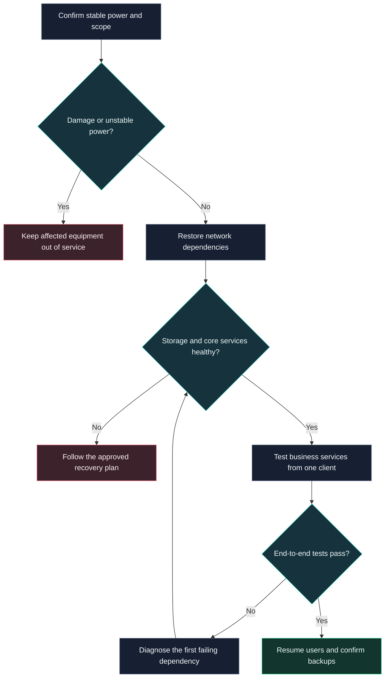

[🏠 Home](https://github.com/Herbertofury/INTA/wiki) · [🧭 Decision desk](https://github.com/Herbertofury/INTA/wiki/Decision-Desk) · [📚 Playbooks](https://github.com/Herbertofury/INTA/wiki/Playbooks) · [🧰 Tool directory](https://github.com/Herbertofury/INTA/wiki/Tool-Directory) · [✨ Open interactive hub](https://herbertofury.github.io/INTA/)

# 🔌 [Bring an office back after a power outage](https://github.com/Herbertofury/INTA/wiki/Job-outage-recovery)

Restore dependencies in order and verify services before releasing the office back to work.

| Work area | Experience | Plan your time | Workflow |
| --- | --- | --- | --- |
| Backup & continuity | Advanced | 30–120 min; infrastructure varies | 6 steps + acceptance |

**[▶ Open the interactive checklist](https://herbertofury.github.io/INTA/#job/outage-recovery)** · [Decision route](#decision-route) · [Toolkit](#toolkit) · [Walkthrough](#walkthrough) · [Acceptance](#acceptance) · [Sources](#sources)

> [!TIP]
> **Your starting move:** Confirm power is stable and establish which devices and services are down. Use the site’s private dependency diagram and recovery plan.

## 🧭 Choose the right branch

**Diagram routes:** [Continue this workflow](#walkthrough) · [Acceptance checks](#acceptance) · [Fix internet, DNS, or local-network problems](https://github.com/Herbertofury/INTA/wiki/Job-network-dns) · [Diagnose crashes, blue screens, and overheating](https://github.com/Herbertofury/INTA/wiki/Job-hardware-bsod) · [Prove a backup can actually restore](https://github.com/Herbertofury/INTA/wiki/Job-backup-restore) · [Close a repair with a clear client handoff](https://github.com/Herbertofury/INTA/wiki/Job-client-handoff)

| Checkpoint | What to carry forward |
| --- | --- |
| **Before changing anything** | Confirm stable power and use the private dependency plan. |
| **Keep during the job** | Alarms, startup order, outage timeline, and client-side service tests. |
| **Before handing back** | Business services, backup jobs, and remote management are healthy. |

## 🧰 Build the right toolkit

Choose the tools that answer the case’s next question. Opening a tool is a separate decision from changing the customer’s system.

| Tool / official download | Use it for | Platform & access | Documentation |
| --- | --- | --- | --- |
| [smartmontools](https://github.com/smartmontools/smartmontools/releases) | Reading SMART and NVMe health from a rescue environment or supported host OS. | [Linux](https://www.kernel.org/), [Windows](https://www.microsoft.com/windows), [macOS](https://support.apple.com/macos); Free / open source | [Open guide](https://github.com/smartmontools/smartmontools) |
| [Microsoft Sysinternals Suite](https://learn.microsoft.com/en-us/sysinternals/downloads/sysinternals-suite) | The core portable [Windows](https://www.microsoft.com/windows) troubleshooting kit. | [Windows](https://www.microsoft.com/windows); Free Microsoft utilities | [Open guide](https://learn.microsoft.com/en-us/sysinternals/downloads/) |

## 🪜 Work the case

Work in order, record the result of each step, and change route when the evidence calls for it.

### 01 · Check the physical environment

- [ ] Inspect UPS status, breakers, power strips, equipment alarms, and visible damage. Keep equipment with electrical damage, liquid exposure, or repeated power cycling out of service. Record the approximate outage and shutdown times from available logs.

### 02 · Restore the network foundation

- [ ] Bring up the internet handoff, firewall/router, switches, and wireless infrastructure in the site’s documented dependency order. Wait for each to reach a healthy state, then verify local link, addressing, routing, and name resolution before starting application tests.

### 03 · Recover storage and core services

- [ ] Check storage controllers and arrays for degraded state before normal workload resumes. Bring up required hypervisors, storage, identity/DNS/DHCP, and dependent services in their actual site order. Avoid repeated hard resets of a server performing recovery or consistency work.

### 04 · Validate applications from one workstation

- [ ] Use one known-good client to test domain sign-in, shared folders, printing, email, and each critical line-of-business application. An open server console or a successful ping does not prove the business service is healthy.

### 05 · Review shutdown and recovery evidence

- [ ] Inspect UPS logs and relevant event logs. Kernel-Power Event ID 41 indicates [Windows](https://www.microsoft.com/windows) did not shut down cleanly; it does not by itself identify the power supply or the original cause. Correlate the event with other evidence before replacing parts.

### 06 · Resume operations and verify backups

- [ ] Release workstations in a controlled order, confirm time synchronization and remote management, and check that backup jobs resume. Record any disk repairs, degraded components, interrupted transactions, and remaining follow-up with the designated service owner.

## ✅ Prove the result

- [ ] Network, identity, storage, and business applications pass end-to-end tests.
- [ ] No degraded storage or critical recovery alarm is left unassigned.
- [ ] Backups and remote access have resumed.
- [ ] Users can complete their actual work from a client workstation.

> [!WARNING]
> **Pause this route and escalate when:**
> - Power is unstable or equipment shows physical/electrical damage.
> - Storage is degraded, rebuilding, or producing new errors without an approved recovery plan.

## 🔀 Continue with the evidence

| Next playbook | What it resolves |
| --- | --- |
| [Fix internet, DNS, or local-network problems](https://github.com/Herbertofury/INTA/wiki/Job-network-dns) | Locate the failing layer before resetting adapters or changing the whole network. |
| [Diagnose crashes, blue screens, and overheating](https://github.com/Herbertofury/INTA/wiki/Job-hardware-bsod) | Correlate crash evidence with memory, storage, temperature, power, and driver changes. |
| [Prove a backup can actually restore](https://github.com/Herbertofury/INTA/wiki/Job-backup-restore) | Validate recovery credentials, data integrity, application usability, and recovery time. |
| [Close a repair with a clear client handoff](https://github.com/Herbertofury/INTA/wiki/Job-client-handoff) | Turn completed technical work into proof the customer can use, with clean access and an actionable service record. |

Found a reusable improvement? [Contribute the correction](https://github.com/Herbertofury/INTA/wiki/Contribute) and include the test that proved it.

## 🔎 Source trail

Official references and editorial review

- [Microsoft: interpreting Kernel-Power Event ID 41](https://learn.microsoft.com/en-us/troubleshoot/windows-client/performance/event-id-41-restart)
- [restic: repository consistency and integrity](https://restic.readthedocs.io/en/stable/045_working_with_repos.html)

Reviewed **2026-11-26**. Timing is a planning range. A successful command is evidence about that operation; acceptance belongs to the user’s original task.

---

**Source review: 2026-11-26.** Guidance review and tool release versions are separate. [Report a correction](https://github.com/Herbertofury/INTA/issues/new/choose) · [How we maintain this guide](https://github.com/Herbertofury/INTA/wiki/Knowledge-Standards)
