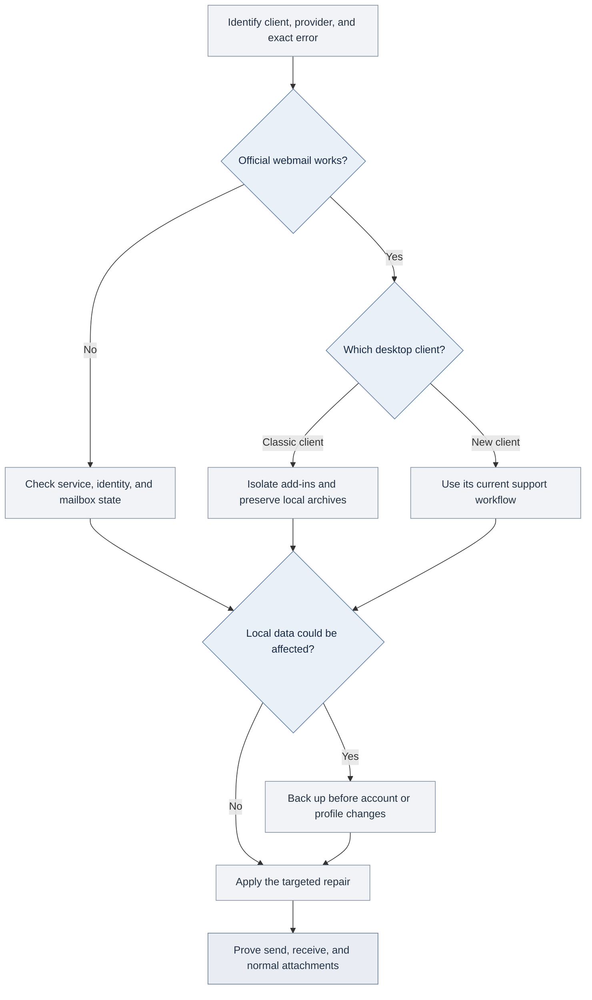

[INTA](https://github.com/Herbertofury/INTA/wiki) / [Decision desk](https://github.com/Herbertofury/INTA/wiki/Decision-Desk) · [Service map](https://github.com/Herbertofury/INTA/wiki/Service-Map) · [Playbooks](https://github.com/Herbertofury/INTA/wiki/Playbooks) · [Tools](https://github.com/Herbertofury/INTA/wiki/Tool-Directory) · [Methods](https://github.com/Herbertofury/INTA/wiki/Methods) · [Open hub](https://herbertofury.github.io/INTA/)

# [Fix Outlook or email send/receive problems](https://github.com/Herbertofury/INTA/wiki/Job-outlook-email)

Separate service, authentication, mailbox, network, and local-client faults.

**Identity & business systems** · Intermediate · 20–60 min · 6 steps

[Tools and useful links](#working-kit) · [Quick answer](#quick-answer) · [Next action](#next-action) · [Specific fixes](#specific-fixes) · [Decision route](#decision-route) · [Tools](#toolkit) · [Procedure](#walkthrough) · [Verification](#acceptance) · [Sources](#sources) · [Interactive checklist](https://herbertofury.github.io/INTA/#job/outlook-email)

## 🧰 Tools and links for this job

**[Open working view](https://herbertofury.github.io/INTA/#job/outlook-email)** · Keep the tool panel beside the instructions.

**First move:** Test the same account in webmail and identify classic [Outlook](https://support.microsoft.com/outlook) versus new [Outlook](https://support.microsoft.com/outlook) before changing a local profile.

| Use this for | Official tool + exact action |
| --- | --- |
| Choose a diagnostic for classic [Outlook](https://support.microsoft.com/outlook) only. | **[Windows Get Help](https://support.microsoft.com/en-us/support/get-help/about-get-help)** · [Official page](https://support.microsoft.com/en-us/support/get-help/about-get-help) · **[Choose a classic Outlook diagnostic](https://support.microsoft.com/en-us/support/get-help/classic-outlook-troubleshooters)** |
| Separating DNS, TCP, TLS and HTTP failures when a web service or application endpoint is unreachable. | **[curl](https://curl.se/)** · [Official page](https://curl.se/) · **[Use the Windows-included curl.exe](https://curl.se/windows/microsoft.html)** |

### Client repair

| Open the exact resource | What to do there |
| --- | --- |
| **[Classic Outlook diagnostics](https://support.microsoft.com/en-us/support/get-help/classic-outlook-troubleshooters)** | Choose startup, authentication or connectivity; not for new [Outlook](https://support.microsoft.com/outlook). |
| **[New and classic Outlook repair branches](https://support.microsoft.com/en-us/outlook/getstarted/outlook-for-windows-not-responding-hangs-freezes-or-stops-working)** | Use the tab matching the installed client. |

### Compatibility

| Open the exact resource | What to do there |
| --- | --- |
| **[New Outlook architecture and differences](https://learn.microsoft.com/en-us/microsoft-365-apps/outlook/administration/architecture-changes-new-outlook)** | Check the client’s supported behavior before applying a classic-only fix. |

## ⚡ Quick answer

### ✉️ Fix email

**Check webmail and identify whether the affected app is classic [Outlook](https://support.microsoft.com/outlook) or new [Outlook](https://support.microsoft.com/outlook) before changing a profile.**

1. Test sign-in and send/receive in webmail; record the exact error and whether other users are affected.
2. For classic [Outlook](https://support.microsoft.com/outlook), run the matching [Windows Get Help](https://support.microsoft.com/en-us/support/get-help/about-get-help) diagnostic; for new [Outlook](https://support.microsoft.com/outlook), use its supported troubleshooting branch.
3. Retest send, receive and the affected shared mailbox or calendar; preserve local-only mail before any profile rebuild.

**[Windows Get Help](https://support.microsoft.com/en-us/support/get-help/about-get-help)** · [Official page](https://support.microsoft.com/en-us/support/get-help/about-get-help) · **[Choose a classic Outlook diagnostic](https://support.microsoft.com/en-us/support/get-help/classic-outlook-troubleshooters)**

## 🧭 Match the symptom

| You see this | Do this next | You should get |
| --- | --- | --- |
| **Webmail also fails or several users are affected** | Capture the sign-in/send error and compare another affected account; involve the mail or identity service owner. | The fault is identified as service, account or policy scope rather than a local profile guess. |
| **Classic [Outlook](https://support.microsoft.com/outlook) will not start or repeatedly asks for credentials** | Open the matching classic [Outlook](https://support.microsoft.com/outlook) diagnostic in [Windows Get Help](https://support.microsoft.com/en-us/support/get-help/about-get-help) on the affected PC. | The test identifies a startup, authentication or connectivity finding. |
| **Only classic [Outlook](https://support.microsoft.com/outlook) fails and an add-in is suspected** | Press Win+R, run [outlook](https://support.microsoft.com/outlook).exe /safe and compare the same task; record enabled add-ins before changing one. | The safe-mode comparison establishes whether the add-in branch is relevant. |
| **New [Outlook](https://support.microsoft.com/outlook) is the affected client** | Preserve unsent work where possible; in [Task Manager](https://support.microsoft.com/en-us/windows/experience/system-configuration-tools-in-windows) select Microsoft [Outlook](https://support.microsoft.com/outlook) > End task, then reopen new [Outlook](https://support.microsoft.com/outlook) and repeat the failing task. If it still fails, follow Microsoft’s new-client reinstall branch after protecting local-only mail. | The supported new-client path restores the failing task or identifies its service dependency. |
| **A profile rebuild or data-file repair is proposed** | Identify PST/local-only mail and preserve it before changing the profile or file. | No unique mail is lost while the repaired client is tested. |

### ✅ Finish the job

- [ ] Send and receive succeed for the affected account.
- [ ] The affected calendar, shared mailbox or attachment workflow works.
- [ ] Local-only data is preserved and the actual client/version is recorded.

**Change route when:** Local-only mail lacks a protected copy. · The fault involves tenant policy, identity compromise or a wider service outage.

### 🎯 Go straight to a specific fix

- **[Bring classic Outlook back online](#fix-email-classic-outlook-working-offline)** — Messages stay in Outbox and the classic client shows Working Offline.
- **[Release a message stuck behind a large attachment](#fix-email-large-attachment-stuck-outbox)** — One classic [Outlook](https://support.microsoft.com/outlook) message remains in Outbox while sending is stalled.
- **[Move an active PST out of the sync bottleneck](#fix-email-pst-stalls-onedrive-sync)** — [OneDrive](https://www.microsoft.com/microsoft-365/onedrive/online-cloud-storage) stays on Processing changes or reports a file in use while [Outlook](https://support.microsoft.com/outlook) uses a PST in the sync folder.
- **[Find mail missing only from the local cache](#fix-email-old-messages-missing-offline)** — Older mail appears in webmail but is absent or unavailable offline in classic [Outlook](https://support.microsoft.com/outlook).

> [!NOTE]
> **Start here.** Identify the mail provider and whether the user is in classic [Outlook](https://support.microsoft.com/outlook), new [Outlook](https://support.microsoft.com/outlook), or a browser. Their repair paths differ.

## 🧭 Choose a route

**Route links:** [Continue this workflow](#walkthrough) · [Acceptance checks](#acceptance) · [Fix internet, DNS, or local-network problems](https://github.com/Herbertofury/INTA/wiki/Job-network-dns) · [Remove malware and browser hijackers](https://github.com/Herbertofury/INTA/wiki/Job-malware-removal) · [Prove a backup can actually restore](https://github.com/Herbertofury/INTA/wiki/Job-backup-restore)

| Checkpoint | What to carry forward |
| --- | --- |
| **Before changing anything** | Identify the client and protect mail that exists only on this device. |
| **Keep during the job** | Exact error, webmail comparison, rejected message, and account changes. |
| **Before handing back** | Two-way mail and the normal shared-mailbox/attachment task pass. |

## Recommended tools

Select a tool for the next diagnostic or repair step. Check its platform, access and licensing requirements before use.

| Tool / official page + download | Use it for | Platform & access | Documentation |
| --- | --- | --- | --- |
| **[Windows Get Help](https://support.microsoft.com/en-us/support/get-help/about-get-help)** · [Official page](https://support.microsoft.com/en-us/support/get-help/about-get-help) · **[Choose a classic Outlook diagnostic](https://support.microsoft.com/en-us/support/get-help/classic-outlook-troubleshooters)** | Choose a diagnostic for classic [Outlook](https://support.microsoft.com/outlook) only. | [Windows](https://www.microsoft.com/windows); Included with supported [Windows](https://www.microsoft.com/windows); assisted support availability depends on the account and support agreement. | [Open guide](https://support.microsoft.com/en-us/support/get-help/windows-troubleshooters) |
| **[Microsoft Sysinternals Suite](https://learn.microsoft.com/en-us/sysinternals/)** · [Official page](https://learn.microsoft.com/en-us/sysinternals/) · **[Download Windows portable · ZIP](https://download.sysinternals.com/files/SysinternalsSuite.zip)** | The core portable [Windows](https://www.microsoft.com/windows) troubleshooting kit. | [Windows](https://www.microsoft.com/windows); Free Microsoft utilities | [Open guide](https://learn.microsoft.com/en-us/sysinternals/downloads/) |
| **[curl](https://curl.se/)** · [Official page](https://curl.se/) · **[Use the Windows-included curl.exe](https://curl.se/windows/microsoft.html)** | Separating DNS, TCP, TLS and HTTP failures when a web service or application endpoint is unreachable. | [Windows](https://www.microsoft.com/windows), [macOS](https://support.apple.com/macos), [Linux](https://www.kernel.org/); Free and open source; the [curl](https://curl.se/) license permits commercial projects | [Open guide](https://curl.se/docs/manpage.html) |

## Procedure

Work in order, record the result of each step, and change route when the evidence calls for it.

### 01 · Locate the failing layer

- [ ] Check the provider’s service status and test the same mailbox in its official webmail. Record the exact send/receive error, whether one or all accounts are affected, mailbox quota, and a specific message that fails. Do not expose credentials or message contents in public notes.

### 02 · Verify identity and addressing

- [ ] Confirm the account is signed in through the intended provider and that password/MFA changes have completed. For manually configured mail, compare SMTP/IMAP hostnames, ports, and encryption with the provider’s current settings. An internal directory domain is not automatically the outbound email domain.

### 03 · Check the message and network path

- [ ] Inspect Outbox for a stuck or oversized message and verify whether attachment size, recipient address, or a provider rejection explains the failure. Compare a small test message through webmail. Check VPN/proxy and DNS only when the symptom points there.

### 04 · Use the correct client-specific repair

- [ ] For classic [Outlook](https://support.microsoft.com/outlook), a safe-mode launch can isolate add-in problems; disable only the implicated add-in after testing. New [Outlook](https://support.microsoft.com/outlook) uses a different architecture and does not use the classic safe-mode/profile repair workflow. Follow the current support path for the actual client.

### 05 · Preserve local-only data before rebuilding

- [ ] Before removing an account, recreating a classic profile, or repairing data files, identify local PST archives, POP mail, unsent items, and anything not present on the server. Make a verified backup and retain the old profile until the replacement is proven.

### 06 · Prove both directions

- [ ] Send a small message to a test recipient and receive a reply, then test the user’s normal attachment and shared-mailbox workflow. Record whether the final fix was service-side, account configuration, add-in, profile, or network, and remove only temporary diagnostic changes.

## Verification

- [ ] A sent message arrives and a reply returns.
- [ ] Local-only mail and archives remain accessible.
- [ ] The normal attachment/shared-mailbox workflow passes.

> [!WARNING]
> **Pause this route and escalate when:**
> - A proposed profile or account deletion would remove unbacked-up local mail.
> - There are signs of account takeover, unexpected rules, or malicious forwarding.

## 🎯 Specific fixes

Choose the case that matches the evidence. Each case gives a first action, a short procedure and a result to prove.

### Bring classic [Outlook](https://support.microsoft.com/outlook) back online

**Use when:** Messages stay in Outbox and the classic client shows Working Offline.

**Start here:** Check the status bar and whether Send/Receive > Work Offline is highlighted.

**[Windows Get Help](https://support.microsoft.com/en-us/support/get-help/about-get-help)** · [Official page](https://support.microsoft.com/en-us/support/get-help/about-get-help) · **[Choose a classic Outlook diagnostic](https://support.microsoft.com/en-us/support/get-help/classic-outlook-troubleshooters)**

1. Select Work Offline to return online, then confirm the status changes rather than repeatedly clicking without observing it.
2. Send/receive again and compare the account in webmail if the client still shows Disconnected.
3. Verify one agreed test message is sent and received and that queued mail is reconciled.

**Prove it worked:** The client shows a connected state and messages leave the Outbox normally.

**If this does not resolve it:** If webmail also fails or the client is new [Outlook](https://support.microsoft.com/outlook), use the appropriate account/service or new-client route instead of classic-only controls.

**Official evidence:** [Source 1](https://support.microsoft.com/en-us/outlook/getstarted/how-to-work-offline-in-outlook-for-windows) · Reviewed 2026-11-26

[Back to specific fixes](#specific-fixes) · [Full procedure](#walkthrough)

### Release a message stuck behind a large attachment

**Use when:** One classic [Outlook](https://support.microsoft.com/outlook) message remains in Outbox while sending is stalled.

**Start here:** Confirm the recipient and preserve the message text before changing the stuck item.

**[Windows Get Help](https://support.microsoft.com/en-us/support/get-help/about-get-help)** · [Official page](https://support.microsoft.com/en-us/support/get-help/about-get-help) · **[Choose a classic Outlook diagnostic](https://support.microsoft.com/en-us/support/get-help/classic-outlook-troubleshooters)**

1. Switch classic [Outlook](https://support.microsoft.com/outlook) to Work Offline and move the affected message to Drafts using Microsoft’s documented procedure.
2. Remove the oversized attachment and use an approved sharing link or a smaller permitted file; preserve unrelated queued messages.
3. Return online, send the corrected message and verify delivery through the normal account path.

**Prove it worked:** The corrected message leaves Outbox and the remaining queue resumes without duplicate or unintended sends.

**If this does not resolve it:** If the message remains locked, close/reopen the client as documented; do not delete the whole profile or mailbox to clear one item.

**Official evidence:** [Source 1](https://support.microsoft.com/en-us/outlook/outlook-email-stuck) · Reviewed 2026-11-26

[Back to specific fixes](#specific-fixes) · [Full procedure](#walkthrough)

### Move an active PST out of the sync bottleneck

**Use when:** [OneDrive](https://www.microsoft.com/microsoft-365/onedrive/online-cloud-storage) stays on Processing changes or reports a file in use while [Outlook](https://support.microsoft.com/outlook) uses a PST in the sync folder.

**Start here:** Identify the exact PST and protect a closed, usable backup before moving it.

**[Windows Get Help](https://support.microsoft.com/en-us/support/get-help/about-get-help)** · [Official page](https://support.microsoft.com/en-us/support/get-help/about-get-help) · **[Choose a classic Outlook diagnostic](https://support.microsoft.com/en-us/support/get-help/classic-outlook-troubleshooters)**

1. Close [Outlook](https://support.microsoft.com/outlook) and follow Microsoft’s PST relocation procedure to a suitable local location outside the active [OneDrive](https://www.microsoft.com/microsoft-365/onedrive/online-cloud-storage) sync path.
2. Reconnect the data file through [Outlook](https://support.microsoft.com/outlook)’s supported data-file controls and verify its folders and representative mail.
3. Resume normal [OneDrive](https://www.microsoft.com/microsoft-365/onedrive/online-cloud-storage) activity and configure a separate approved backup for the local mail file.

**Prove it worked:** [Outlook](https://support.microsoft.com/outlook) opens the intended mail data and the sync queue clears without treating synchronization as the only PST backup.

**If this does not resolve it:** If the PST contains unique mail or is damaged, preserve the original and use the data-file recovery path before further movement.

**Official evidence:** [Source 1](https://support.microsoft.com/en-us/onedrive/how-to-remove-an-outlook-pst-data-file-from-onedrive) · [Source 2](https://support.microsoft.com/en-us/onedrive/restrictions-and-limitations-in-onedrive-and-sharepoint) · Reviewed 2026-11-26

[Back to specific fixes](#specific-fixes) · [Full procedure](#walkthrough)

### Find mail missing only from the local cache

**Use when:** Older mail appears in webmail but is absent or unavailable offline in classic [Outlook](https://support.microsoft.com/outlook).

**Start here:** Confirm the same mailbox and folder in webmail before treating the messages as deleted.

**[Windows Get Help](https://support.microsoft.com/en-us/support/get-help/about-get-help)** · [Official page](https://support.microsoft.com/en-us/support/get-help/about-get-help) · **[Choose a classic Outlook diagnostic](https://support.microsoft.com/en-us/support/get-help/classic-outlook-troubleshooters)**

1. In classic [Outlook](https://support.microsoft.com/outlook) inspect File > Account Settings > Account Settings, select the Exchange/[Microsoft 365](https://www.microsoft.com/microsoft-365) account and check the offline-mail synchronization range.
2. Choose the approved range for the device and available storage, then allow synchronization to complete.
3. Search the same known older message and test offline access if that is required for the user’s work.

**Prove it worked:** The case distinguishes server-held mail from locally cached mail and proves the intended access mode.

**If this does not resolve it:** If messages are missing from the server too, investigate retention, archive, deletion or permissions rather than rebuilding the cache.

**Official evidence:** [Source 1](https://support.microsoft.com/en-us/outlook/getstarted/how-to-work-offline-in-outlook-for-windows) · Reviewed 2026-11-26

[Back to specific fixes](#specific-fixes) · [Full procedure](#walkthrough)

## Related playbooks

| Next playbook | What it resolves |
| --- | --- |
| [Fix internet, DNS, or local-network problems](https://github.com/Herbertofury/INTA/wiki/Job-network-dns) | Locate the failing layer before resetting adapters or changing the whole network. |
| [Remove malware and browser hijackers](https://github.com/Herbertofury/INTA/wiki/Job-malware-removal) | A measured cleanup workflow for a single [Windows](https://www.microsoft.com/windows) endpoint, with a separate path for a wider compromise. |
| [Prove a backup can actually restore](https://github.com/Herbertofury/INTA/wiki/Job-backup-restore) | Validate recovery credentials, data integrity, application usability, and recovery time. |

## Official sources

- [Microsoft: classic Outlook not responding](https://support.microsoft.com/en-us/outlook/classic-outlook-not-responding-stuck-at-processing-stopped-working-or-freezes)
- [Microsoft: architecture changes in new Outlook](https://learn.microsoft.com/en-us/microsoft-365-apps/outlook/administration/architecture-changes-new-outlook)

Reviewed **2026-11-26**. Timing is a planning range. A successful command is evidence about that operation; acceptance belongs to the user’s original task.

---

Editorial review: **2026-11-26** · [Review standard](https://github.com/Herbertofury/INTA/wiki/Knowledge-Standards) · [Suggest a correction](https://github.com/Herbertofury/INTA/issues/new/choose)
