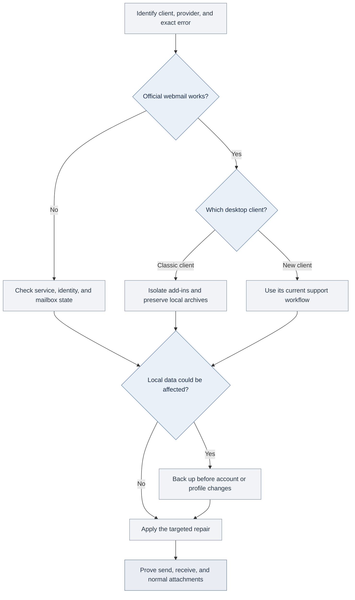

<a href="https://herbertofury.github.io/INTA/" title="Open INTA official download or service page" aria-label="Open INTA official download or service page" data-inta-brand="app-inta"></a> [INTA](https://github.com/Herbertofury/INTA/wiki) / [Decision desk](https://github.com/Herbertofury/INTA/wiki/Decision-Desk) · [Service map](https://github.com/Herbertofury/INTA/wiki/Service-Map) · [Playbooks](https://github.com/Herbertofury/INTA/wiki/Playbooks) · [Tools](https://github.com/Herbertofury/INTA/wiki/Tool-Directory) · [Methods](https://github.com/Herbertofury/INTA/wiki/Methods) · [Open hub](https://herbertofury.github.io/INTA/)

<a id="️-fix-outlook-or-email-sendreceive-problems"></a>
<a id="-fix-outlook-or-email-sendreceive-problems"></a>

# <a href="https://support.microsoft.com/outlook" title="Open Outlook official download or service page" aria-label="Open Outlook official download or service page" data-inta-brand="app-outlook"></a> [Fix Outlook or email send/receive problems](https://github.com/Herbertofury/INTA/wiki/Job-outlook-email)

Separate service, authentication, mailbox, network, and local-client faults.

**Identity & business systems** · Intermediate · 20–60 min · 6 steps

[Tools and useful links](#working-kit) · [Quick answer](#quick-answer) · [Next action](#next-action) · [Specific fixes](#specific-fixes) · [Decision route](#decision-route) · [Tools](#toolkit) · [Procedure](#walkthrough) · [Verification](#acceptance) · [Sources](#sources) · [Interactive checklist](https://herbertofury.github.io/INTA/#job/outlook-email)

<a id="tool-choices"></a>

## 🧰 Choose the tool for this job

Choose by the task shown in the first column. Each option includes its acquisition route and access boundary.

| Need | Official tool + exact action | Why this choice / access |
| --- | --- | --- |
| **Classic <a href="https://support.microsoft.com/outlook" title="Open Outlook official download or service page" aria-label="Open Outlook official download or service page" data-inta-brand="app-outlook"></a> [Outlook](https://support.microsoft.com/outlook) diagnostic** | **<a href="https://support.microsoft.com/en-us/support/get-help/windows-troubleshooters" title="Open Windows Get Help official download or service page" aria-label="Open Windows Get Help official download or service page" data-inta-brand="get-help"></a> [Windows Get Help](https://support.microsoft.com/en-us/support/get-help/about-get-help)** · **<a href="https://support.microsoft.com/outlook" title="Open Outlook official download or service page" aria-label="Open Outlook official download or service page" data-inta-brand="app-outlook"></a> [Choose a classic Outlook diagnostic](https://support.microsoft.com/en-us/support/get-help/classic-outlook-troubleshooters)** | Choose the matching classic <a href="https://support.microsoft.com/outlook" title="Open Outlook official download or service page" aria-label="Open Outlook official download or service page" data-inta-brand="app-outlook"></a> [Outlook](https://support.microsoft.com/outlook) test after comparing webmail; new <a href="https://support.microsoft.com/outlook" title="Open Outlook official download or service page" aria-label="Open Outlook official download or service page" data-inta-brand="app-outlook"></a> [Outlook](https://support.microsoft.com/outlook) uses its separate branch. **Access:** Included diagnostics; email service licensing is separate. |

**[Current selection evidence](https://github.com/Herbertofury/INTA/wiki/Current-Tool-Choices)**

<a id="working-kit"></a>

## 🧰 Tools and links for this job

**[Open working view](https://herbertofury.github.io/INTA/#job/outlook-email)** · Keep the tool panel beside the instructions.

**First move:** Test the same account in webmail and identify classic <a href="https://support.microsoft.com/outlook" title="Open Outlook official download or service page" aria-label="Open Outlook official download or service page" data-inta-brand="app-outlook"></a> [Outlook](https://support.microsoft.com/outlook) versus new <a href="https://support.microsoft.com/outlook" title="Open Outlook official download or service page" aria-label="Open Outlook official download or service page" data-inta-brand="app-outlook"></a> [Outlook](https://support.microsoft.com/outlook) before changing a local profile.

| Use this for | Official tool + exact action |
| --- | --- |
| Choose a diagnostic for classic <a href="https://support.microsoft.com/outlook" title="Open Outlook official download or service page" aria-label="Open Outlook official download or service page" data-inta-brand="app-outlook"></a> [Outlook](https://support.microsoft.com/outlook) only. | **<a href="https://support.microsoft.com/en-us/support/get-help/windows-troubleshooters" title="Open Windows Get Help official download or service page" aria-label="Open Windows Get Help official download or service page" data-inta-brand="get-help"></a> [Windows Get Help](https://support.microsoft.com/en-us/support/get-help/about-get-help)** · <a href="https://support.microsoft.com/en-us/support/get-help/windows-troubleshooters" title="Open Windows Get Help official download or service page" aria-label="Open Windows Get Help official download or service page" data-inta-brand="get-help"></a> [Official page](https://support.microsoft.com/en-us/support/get-help/about-get-help) · **<a href="https://support.microsoft.com/outlook" title="Open Outlook official download or service page" aria-label="Open Outlook official download or service page" data-inta-brand="app-outlook"></a> [Choose a classic Outlook diagnostic](https://support.microsoft.com/en-us/support/get-help/classic-outlook-troubleshooters)** |
| Separating DNS, TCP, TLS and HTTP failures when a web service or application endpoint is unreachable. | **<a href="https://curl.se/windows/" title="Open curl official download or service page" aria-label="Open curl official download or service page" data-inta-brand="curl"></a> [curl](https://curl.se/)** · <a href="https://curl.se/windows/" title="Open curl official download or service page" aria-label="Open curl official download or service page" data-inta-brand="curl"></a> [Official page](https://curl.se/) · **<a href="https://www.microsoft.com/windows" title="Open Windows official download or service page" aria-label="Open Windows official download or service page" data-inta-brand="app-windows"></a> <a href="https://curl.se/windows/" title="Open curl official download or service page" aria-label="Open curl official download or service page" data-inta-brand="curl"></a> [Use the Windows-included curl.exe](https://curl.se/windows/microsoft.html)** |
| DNS, mail and header checks | **<a href="https://toolbox.googleapps.com/apps/main/" title="Open Google Admin Toolbox official download or service page" aria-label="Open Google Admin Toolbox official download or service page" data-inta-brand="google-admin-toolbox"></a> [Google Admin Toolbox](https://toolbox.googleapps.com/apps/main/)** · <a href="https://toolbox.googleapps.com/apps/main/" title="Open Google Admin Toolbox official download or service page" aria-label="Open Google Admin Toolbox official download or service page" data-inta-brand="google-admin-toolbox"></a> [Official page](https://toolbox.googleapps.com/apps/main/) · **<a href="https://toolbox.googleapps.com/apps/main/" title="Open Google Admin Toolbox official download or service page" aria-label="Open Google Admin Toolbox official download or service page" data-inta-brand="google-admin-toolbox"></a> [Open online service](https://toolbox.googleapps.com/apps/main/)** |
| Mail routing and authentication | **<a href="https://mxtoolbox.com/SuperTool.aspx" title="Open MXToolbox SuperTool official download or service page" aria-label="Open MXToolbox SuperTool official download or service page" data-inta-brand="mxtoolbox"></a> [MXToolbox SuperTool](https://mxtoolbox.com/)** · <a href="https://mxtoolbox.com/SuperTool.aspx" title="Open MXToolbox SuperTool official download or service page" aria-label="Open MXToolbox SuperTool official download or service page" data-inta-brand="mxtoolbox"></a> [Official page](https://mxtoolbox.com/) · **<a href="https://mxtoolbox.com/SuperTool.aspx" title="Open MXToolbox SuperTool official download or service page" aria-label="Open MXToolbox SuperTool official download or service page" data-inta-brand="mxtoolbox"></a> [Open online service](https://mxtoolbox.com/SuperTool.aspx)** |
| Explain why passing SPF or DKIM still fails DMARC alignment. | **<a href="https://www.learndmarc.com/" title="Open LearnDMARC official download or service page" aria-label="Open LearnDMARC official download or service page" data-inta-brand="learndmarc"></a> [LearnDMARC](https://www.learndmarc.com/)** · <a href="https://www.learndmarc.com/" title="Open LearnDMARC official download or service page" aria-label="Open LearnDMARC official download or service page" data-inta-brand="learndmarc"></a> [Official page](https://www.learndmarc.com/) · **<a href="https://www.learndmarc.com/" title="Open LearnDMARC official download or service page" aria-label="Open LearnDMARC official download or service page" data-inta-brand="learndmarc"></a> [Open online service](https://www.learndmarc.com/)** |
| Find the failed step in a <a href="https://www.microsoft.com/" title="Open microsoft.com official download or service page" aria-label="Open microsoft.com official download or service page" data-inta-brand="site-www-microsoft-com"></a> [Microsoft](https://www.microsoft.com/) cloud or Exchange connectivity workflow. | **<a href="https://testconnectivity.microsoft.com/" title="Open Microsoft Remote Connectivity Analyzer official download or service page" aria-label="Open Microsoft Remote Connectivity Analyzer official download or service page" data-inta-brand="microsoft-remote-connectivity"></a> [Microsoft Remote Connectivity Analyzer](https://testconnectivity.microsoft.com/)** · <a href="https://testconnectivity.microsoft.com/" title="Open Microsoft Remote Connectivity Analyzer official download or service page" aria-label="Open Microsoft Remote Connectivity Analyzer official download or service page" data-inta-brand="microsoft-remote-connectivity"></a> [Official page](https://testconnectivity.microsoft.com/) · **<a href="https://testconnectivity.microsoft.com/" title="Open Microsoft Remote Connectivity Analyzer official download or service page" aria-label="Open Microsoft Remote Connectivity Analyzer official download or service page" data-inta-brand="microsoft-remote-connectivity"></a> [Open online service](https://testconnectivity.microsoft.com/)** |

### Client repair

| Open the exact resource | What to do there |
| --- | --- |
| **<a href="https://support.microsoft.com/outlook" title="Open Outlook official download or service page" aria-label="Open Outlook official download or service page" data-inta-brand="app-outlook"></a> [Classic Outlook diagnostics](https://support.microsoft.com/en-us/support/get-help/classic-outlook-troubleshooters)** | Choose startup, authentication or connectivity; not for new <a href="https://support.microsoft.com/outlook" title="Open Outlook official download or service page" aria-label="Open Outlook official download or service page" data-inta-brand="app-outlook"></a> [Outlook](https://support.microsoft.com/outlook). |
| **<a href="https://support.microsoft.com/outlook" title="Open Outlook official download or service page" aria-label="Open Outlook official download or service page" data-inta-brand="app-outlook"></a> [New and classic Outlook repair branches](https://support.microsoft.com/en-us/outlook/getstarted/outlook-for-windows-not-responding-hangs-freezes-or-stops-working)** | Use the tab matching the installed client. |

### Compatibility

| Open the exact resource | What to do there |
| --- | --- |
| **<a href="https://support.microsoft.com/outlook" title="Open Outlook official download or service page" aria-label="Open Outlook official download or service page" data-inta-brand="app-outlook"></a> [New Outlook architecture and differences](https://learn.microsoft.com/en-us/microsoft-365-apps/outlook/administration/architecture-changes-new-outlook)** | Check the client’s supported behavior before applying a classic-only fix. |

### Search and sync

| Open the exact resource | What to do there |
| --- | --- |
| **<a href="https://support.microsoft.com/outlook" title="Open Outlook official download or service page" aria-label="Open Outlook official download or service page" data-inta-brand="app-outlook"></a> [New and classic Outlook search](https://support.microsoft.com/en-us/outlook/troubleshooting-outlook-search-issues)** | Use the client-specific scope or indexing branch for a known missing result. |

### Account connection

| Open the exact resource | What to do there |
| --- | --- |
| **<a href="https://mail.google.com/" title="Open Gmail official download or service page" aria-label="Open Gmail official download or service page" data-inta-brand="web-gmail"></a> [Gmail supported client sign-in](https://support.google.com/mail/answer/7126229?hl=en)** | Use the supported Google authorization route; personal <a href="https://mail.google.com/" title="Open Gmail official download or service page" aria-label="Open Gmail official download or service page" data-inta-brand="web-gmail"></a> [Gmail](https://mail.google.com/) no longer has an Enable IMAP switch. |

### Send and receive

| Open the exact resource | What to do there |
| --- | --- |
| **<a href="https://support.microsoft.com/outlook" title="Open Outlook official download or service page" aria-label="Open Outlook official download or service page" data-inta-brand="app-outlook"></a> [Outlook.com mailbox and cloud quotas](https://support.microsoft.com/en-us/outlook/storage-limits-in-outlook-com)** | Inspect both account storage limits when webmail stops sending or receiving. |

### Online working tools

| Open the exact resource | What to do there |
| --- | --- |
| **[Diagnose email and DNS](https://herbertofury.github.io/INTA/#online?task=fix-email)** | Separate DNS, sender authentication and service availability before changing a mailbox. |

<a id="quick-answer"></a>

## ⚡ Quick answer

<a id="quick-fix-email"></a>

### ✉️ Fix email

**Check webmail and identify whether the affected app is classic <a href="https://support.microsoft.com/outlook" title="Open Outlook official download or service page" aria-label="Open Outlook official download or service page" data-inta-brand="app-outlook"></a> [Outlook](https://support.microsoft.com/outlook) or new <a href="https://support.microsoft.com/outlook" title="Open Outlook official download or service page" aria-label="Open Outlook official download or service page" data-inta-brand="app-outlook"></a> [Outlook](https://support.microsoft.com/outlook) before changing a profile.**

1. Test sign-in and send/receive in webmail; record the exact error and whether other users are affected.
2. For classic <a href="https://support.microsoft.com/outlook" title="Open Outlook official download or service page" aria-label="Open Outlook official download or service page" data-inta-brand="app-outlook"></a> [Outlook](https://support.microsoft.com/outlook), run the matching <a href="https://support.microsoft.com/en-us/support/get-help/windows-troubleshooters" title="Open Windows Get Help official download or service page" aria-label="Open Windows Get Help official download or service page" data-inta-brand="get-help"></a> [Windows Get Help](https://support.microsoft.com/en-us/support/get-help/about-get-help) diagnostic; for new <a href="https://support.microsoft.com/outlook" title="Open Outlook official download or service page" aria-label="Open Outlook official download or service page" data-inta-brand="app-outlook"></a> [Outlook](https://support.microsoft.com/outlook), use its supported troubleshooting branch.
3. Retest send, receive and the affected shared mailbox or calendar; preserve local-only mail before any profile rebuild.

**<a href="https://support.microsoft.com/en-us/support/get-help/windows-troubleshooters" title="Open Windows Get Help official download or service page" aria-label="Open Windows Get Help official download or service page" data-inta-brand="get-help"></a> [Windows Get Help](https://support.microsoft.com/en-us/support/get-help/about-get-help)** · <a href="https://support.microsoft.com/en-us/support/get-help/windows-troubleshooters" title="Open Windows Get Help official download or service page" aria-label="Open Windows Get Help official download or service page" data-inta-brand="get-help"></a> [Official page](https://support.microsoft.com/en-us/support/get-help/about-get-help) · **<a href="https://support.microsoft.com/outlook" title="Open Outlook official download or service page" aria-label="Open Outlook official download or service page" data-inta-brand="app-outlook"></a> [Choose a classic Outlook diagnostic](https://support.microsoft.com/en-us/support/get-help/classic-outlook-troubleshooters)**

<a id="next-action"></a>

## 🧭 Match the symptom

| You see this | Do this next | You should get |
| --- | --- | --- |
| **Webmail also fails or several users are affected** | Capture the sign-in/send error and compare another affected account; involve the mail or identity service owner. | The fault is identified as service, account or policy scope rather than a local profile guess. |
| **Classic <a href="https://support.microsoft.com/outlook" title="Open Outlook official download or service page" aria-label="Open Outlook official download or service page" data-inta-brand="app-outlook"></a> [Outlook](https://support.microsoft.com/outlook) will not start or repeatedly asks for credentials** | Open the matching classic <a href="https://support.microsoft.com/outlook" title="Open Outlook official download or service page" aria-label="Open Outlook official download or service page" data-inta-brand="app-outlook"></a> [Outlook](https://support.microsoft.com/outlook) diagnostic in <a href="https://support.microsoft.com/en-us/support/get-help/windows-troubleshooters" title="Open Windows Get Help official download or service page" aria-label="Open Windows Get Help official download or service page" data-inta-brand="get-help"></a> [Windows Get Help](https://support.microsoft.com/en-us/support/get-help/about-get-help) on the affected PC. | The test identifies a startup, authentication or connectivity finding. |
| **Only classic <a href="https://support.microsoft.com/outlook" title="Open Outlook official download or service page" aria-label="Open Outlook official download or service page" data-inta-brand="app-outlook"></a> [Outlook](https://support.microsoft.com/outlook) fails and an add-in is suspected** | Press Win+R, run <a href="https://support.microsoft.com/outlook" title="Open Outlook official download or service page" aria-label="Open Outlook official download or service page" data-inta-brand="app-outlook"></a> [outlook](https://support.microsoft.com/outlook).exe /safe and compare the same task; record enabled add-ins before changing one. | The safe-mode comparison establishes whether the add-in branch is relevant. |
| **New <a href="https://support.microsoft.com/outlook" title="Open Outlook official download or service page" aria-label="Open Outlook official download or service page" data-inta-brand="app-outlook"></a> [Outlook](https://support.microsoft.com/outlook) is the affected client** | Preserve unsent work where possible; in <a href="https://support.microsoft.com/en-us/windows/experience/system-configuration-tools-in-windows" title="Open Task Manager official download or service page" aria-label="Open Task Manager official download or service page" data-inta-brand="app-task-manager"></a> [Task Manager](https://support.microsoft.com/en-us/windows/experience/system-configuration-tools-in-windows) select <a href="https://www.microsoft.com/" title="Open microsoft.com official download or service page" aria-label="Open microsoft.com official download or service page" data-inta-brand="site-www-microsoft-com"></a> [Microsoft](https://www.microsoft.com/) <a href="https://support.microsoft.com/outlook" title="Open Outlook official download or service page" aria-label="Open Outlook official download or service page" data-inta-brand="app-outlook"></a> [Outlook](https://support.microsoft.com/outlook) > End task, then reopen new <a href="https://support.microsoft.com/outlook" title="Open Outlook official download or service page" aria-label="Open Outlook official download or service page" data-inta-brand="app-outlook"></a> [Outlook](https://support.microsoft.com/outlook) and repeat the failing task. If it still fails, follow <a href="https://www.microsoft.com/" title="Open microsoft.com official download or service page" aria-label="Open microsoft.com official download or service page" data-inta-brand="site-www-microsoft-com"></a> [Microsoft](https://www.microsoft.com/)’s new-client reinstall branch after protecting local-only mail. | The supported new-client path restores the failing task or identifies its service dependency. |
| **A profile rebuild or data-file repair is proposed** | Identify PST/local-only mail and preserve it before changing the profile or file. | No unique mail is lost while the repaired client is tested. |

### ✅ Finish the job

- [ ] Send and receive succeed for the affected account.
- [ ] The affected calendar, shared mailbox or attachment workflow works.
- [ ] Local-only data is preserved and the actual client/version is recorded.

**Change route when:** Local-only mail lacks a protected copy. · The fault involves tenant policy, identity compromise or a wider service outage.

### 🎯 Go straight to a specific fix

- **<a href="https://support.microsoft.com/outlook" title="Open Outlook official download or service page" aria-label="Open Outlook official download or service page" data-inta-brand="app-outlook"></a> [Bring classic Outlook back online](#fix-email-classic-outlook-working-offline)** — Messages stay in Outbox and the classic client shows Working Offline.
- **[Release a message stuck behind a large attachment](#fix-email-large-attachment-stuck-outbox)** — One classic <a href="https://support.microsoft.com/outlook" title="Open Outlook official download or service page" aria-label="Open Outlook official download or service page" data-inta-brand="app-outlook"></a> [Outlook](https://support.microsoft.com/outlook) message remains in Outbox while sending is stalled.
- **[Move an active PST out of the sync bottleneck](#fix-email-pst-stalls-onedrive-sync)** — <a href="https://www.microsoft.com/microsoft-365/onedrive/online-cloud-storage" title="Open OneDrive official download or service page" aria-label="Open OneDrive official download or service page" data-inta-brand="app-onedrive"></a> [OneDrive](https://www.microsoft.com/microsoft-365/onedrive/online-cloud-storage) stays on Processing changes or reports a file in use while <a href="https://support.microsoft.com/outlook" title="Open Outlook official download or service page" aria-label="Open Outlook official download or service page" data-inta-brand="app-outlook"></a> [Outlook](https://support.microsoft.com/outlook) uses a PST in the sync folder.
- **[Find mail missing only from the local cache](#fix-email-old-messages-missing-offline)** — Older mail appears in webmail but is absent or unavailable offline in classic <a href="https://support.microsoft.com/outlook" title="Open Outlook official download or service page" aria-label="Open Outlook official download or service page" data-inta-brand="app-outlook"></a> [Outlook](https://support.microsoft.com/outlook).
- **[Fix missing search results in the right mail client](#fix-email-search-client-specific-diagnosis)** — A known message exists in its folder but search cannot find it.
- **<a href="https://mail.google.com/" title="Open Gmail official download or service page" aria-label="Open Gmail official download or service page" data-inta-brand="web-gmail"></a> [Reconnect Gmail with the supported sign-in flow](#fix-email-gmail-rejects-old-password-signin)** — The password works on the website but an email client repeatedly reports incorrect credentials.
- **[Restore mail stopped by a cloud-storage quota](#fix-email-cloud-quota-blocks-outlook-com)** — <a href="https://support.microsoft.com/outlook" title="Open Outlook official download or service page" aria-label="Open Outlook official download or service page" data-inta-brand="app-outlook"></a> [Outlook](https://support.microsoft.com/outlook).com cannot send or receive, despite an apparently small mailbox or free space on the PC.
- **[Mail reaches spam or fails authentication](#fix-online-email-authentication)** — A message is rejected or delivered to spam while basic mailbox access works.

> [!NOTE]
> **Start here.** Identify the mail provider and whether the user is in classic <a href="https://support.microsoft.com/outlook" title="Open Outlook official download or service page" aria-label="Open Outlook official download or service page" data-inta-brand="app-outlook"></a> [Outlook](https://support.microsoft.com/outlook), new <a href="https://support.microsoft.com/outlook" title="Open Outlook official download or service page" aria-label="Open Outlook official download or service page" data-inta-brand="app-outlook"></a> [Outlook](https://support.microsoft.com/outlook), or a browser. Their repair paths differ.

<a id="decision-route"></a>

<a id="-choose-the-right-branch"></a>

## 🧭 Choose a route



**Route links:** [Continue this workflow](#walkthrough) · [Acceptance checks](#acceptance) · [Fix internet, DNS, or local-network problems](https://github.com/Herbertofury/INTA/wiki/Job-network-dns) · [Remove malware and browser hijackers](https://github.com/Herbertofury/INTA/wiki/Job-malware-removal) · [Prove a backup can actually restore](https://github.com/Herbertofury/INTA/wiki/Job-backup-restore)

| Checkpoint | What to carry forward |
| --- | --- |
| **Before changing anything** | Identify the client and protect mail that exists only on this device. |
| **Keep during the job** | Exact error, webmail comparison, rejected message, and account changes. |
| **Before handing back** | Two-way mail and the normal shared-mailbox/attachment task pass. |

<a id="toolkit"></a>

<a id="-build-the-right-toolkit"></a>

## Recommended tools

Select a tool for the next diagnostic or repair step. Check its platform, access and licensing requirements before use.

| Tool / official page + download | Use it for | Platform & access | Documentation |
| --- | --- | --- | --- |
| **<a href="https://support.microsoft.com/en-us/support/get-help/windows-troubleshooters" title="Open Windows Get Help official download or service page" aria-label="Open Windows Get Help official download or service page" data-inta-brand="get-help"></a> [Windows Get Help](https://support.microsoft.com/en-us/support/get-help/about-get-help)** · <a href="https://support.microsoft.com/en-us/support/get-help/windows-troubleshooters" title="Open Windows Get Help official download or service page" aria-label="Open Windows Get Help official download or service page" data-inta-brand="get-help"></a> [Official page](https://support.microsoft.com/en-us/support/get-help/about-get-help) · **<a href="https://support.microsoft.com/outlook" title="Open Outlook official download or service page" aria-label="Open Outlook official download or service page" data-inta-brand="app-outlook"></a> [Choose a classic Outlook diagnostic](https://support.microsoft.com/en-us/support/get-help/classic-outlook-troubleshooters)** | Choose a diagnostic for classic <a href="https://support.microsoft.com/outlook" title="Open Outlook official download or service page" aria-label="Open Outlook official download or service page" data-inta-brand="app-outlook"></a> [Outlook](https://support.microsoft.com/outlook) only. | <a href="https://www.microsoft.com/windows" title="Open Windows official download or service page" aria-label="Open Windows official download or service page" data-inta-brand="app-windows"></a> [Windows](https://www.microsoft.com/windows); Included with supported <a href="https://www.microsoft.com/windows" title="Open Windows official download or service page" aria-label="Open Windows official download or service page" data-inta-brand="app-windows"></a> [Windows](https://www.microsoft.com/windows); assisted support availability depends on the account and support agreement. | <a href="https://support.microsoft.com/en-us/support/get-help/windows-troubleshooters" title="Open Windows Get Help official download or service page" aria-label="Open Windows Get Help official download or service page" data-inta-brand="get-help"></a> [Open guide](https://support.microsoft.com/en-us/support/get-help/windows-troubleshooters) |
| **<a href="https://learn.microsoft.com/en-us/sysinternals/downloads/sysinternals-suite" title="Open Microsoft Sysinternals Suite official download or service page" aria-label="Open Microsoft Sysinternals Suite official download or service page" data-inta-brand="sysinternals"></a> [Microsoft Sysinternals Suite](https://learn.microsoft.com/en-us/sysinternals/)** · <a href="https://learn.microsoft.com/en-us/sysinternals/downloads/sysinternals-suite" title="Open Microsoft Sysinternals Suite official download or service page" aria-label="Open Microsoft Sysinternals Suite official download or service page" data-inta-brand="sysinternals"></a> [Official page](https://learn.microsoft.com/en-us/sysinternals/) · **<a href="https://www.microsoft.com/windows" title="Open Windows official download or service page" aria-label="Open Windows official download or service page" data-inta-brand="app-windows"></a> [Download Windows portable · ZIP](https://download.sysinternals.com/files/SysinternalsSuite.zip)** | The core portable <a href="https://www.microsoft.com/windows" title="Open Windows official download or service page" aria-label="Open Windows official download or service page" data-inta-brand="app-windows"></a> [Windows](https://www.microsoft.com/windows) troubleshooting kit. | <a href="https://www.microsoft.com/windows" title="Open Windows official download or service page" aria-label="Open Windows official download or service page" data-inta-brand="app-windows"></a> [Windows](https://www.microsoft.com/windows); Free <a href="https://www.microsoft.com/" title="Open microsoft.com official download or service page" aria-label="Open microsoft.com official download or service page" data-inta-brand="site-www-microsoft-com"></a> [Microsoft](https://www.microsoft.com/) utilities | <a href="https://learn.microsoft.com/en-us/sysinternals/downloads/sysinternals-suite" title="Open Microsoft Sysinternals Suite official download or service page" aria-label="Open Microsoft Sysinternals Suite official download or service page" data-inta-brand="sysinternals"></a> [Open guide](https://learn.microsoft.com/en-us/sysinternals/downloads/) |
| **<a href="https://curl.se/windows/" title="Open curl official download or service page" aria-label="Open curl official download or service page" data-inta-brand="curl"></a> [curl](https://curl.se/)** · <a href="https://curl.se/windows/" title="Open curl official download or service page" aria-label="Open curl official download or service page" data-inta-brand="curl"></a> [Official page](https://curl.se/) · **<a href="https://www.microsoft.com/windows" title="Open Windows official download or service page" aria-label="Open Windows official download or service page" data-inta-brand="app-windows"></a> <a href="https://curl.se/windows/" title="Open curl official download or service page" aria-label="Open curl official download or service page" data-inta-brand="curl"></a> [Use the Windows-included curl.exe](https://curl.se/windows/microsoft.html)** | Separating DNS, TCP, TLS and HTTP failures when a web service or application endpoint is unreachable. | <a href="https://www.microsoft.com/windows" title="Open Windows official download or service page" aria-label="Open Windows official download or service page" data-inta-brand="app-windows"></a> [Windows](https://www.microsoft.com/windows), <a href="https://support.apple.com/macos" title="Open macOS official download or service page" aria-label="Open macOS official download or service page" data-inta-brand="app-macos"></a> [macOS](https://support.apple.com/macos), <a href="https://www.kernel.org/" title="Open Linux official download or service page" aria-label="Open Linux official download or service page" data-inta-brand="app-linux"></a> [Linux](https://www.kernel.org/); Free and open source; the <a href="https://curl.se/windows/" title="Open curl official download or service page" aria-label="Open curl official download or service page" data-inta-brand="curl"></a> [curl](https://curl.se/) license permits commercial projects | <a href="https://curl.se/windows/" title="Open curl official download or service page" aria-label="Open curl official download or service page" data-inta-brand="curl"></a> [Open guide](https://curl.se/docs/manpage.html) |
| **<a href="https://toolbox.googleapps.com/apps/main/" title="Open Google Admin Toolbox official download or service page" aria-label="Open Google Admin Toolbox official download or service page" data-inta-brand="google-admin-toolbox"></a> [Google Admin Toolbox](https://toolbox.googleapps.com/apps/main/)** · <a href="https://toolbox.googleapps.com/apps/main/" title="Open Google Admin Toolbox official download or service page" aria-label="Open Google Admin Toolbox official download or service page" data-inta-brand="google-admin-toolbox"></a> [Official page](https://toolbox.googleapps.com/apps/main/) · **<a href="https://toolbox.googleapps.com/apps/main/" title="Open Google Admin Toolbox official download or service page" aria-label="Open Google Admin Toolbox official download or service page" data-inta-brand="google-admin-toolbox"></a> [Open online service](https://toolbox.googleapps.com/apps/main/)** | DNS, mail and header checks | Web browser; Public diagnostic tools | <a href="https://toolbox.googleapps.com/apps/main/" title="Open Google Admin Toolbox official download or service page" aria-label="Open Google Admin Toolbox official download or service page" data-inta-brand="google-admin-toolbox"></a> [Open guide](https://knowledge.workspace.google.com/admin/support/troubleshooting/google-workspace-diagnostic-tools) |
| **<a href="https://mxtoolbox.com/SuperTool.aspx" title="Open MXToolbox SuperTool official download or service page" aria-label="Open MXToolbox SuperTool official download or service page" data-inta-brand="mxtoolbox"></a> [MXToolbox SuperTool](https://mxtoolbox.com/)** · <a href="https://mxtoolbox.com/SuperTool.aspx" title="Open MXToolbox SuperTool official download or service page" aria-label="Open MXToolbox SuperTool official download or service page" data-inta-brand="mxtoolbox"></a> [Official page](https://mxtoolbox.com/) · **<a href="https://mxtoolbox.com/SuperTool.aspx" title="Open MXToolbox SuperTool official download or service page" aria-label="Open MXToolbox SuperTool official download or service page" data-inta-brand="mxtoolbox"></a> [Open online service](https://mxtoolbox.com/SuperTool.aspx)** | Mail routing and authentication | Web browser; Public lookups; monitoring and API plans are separate | <a href="https://mxtoolbox.com/SuperTool.aspx" title="Open MXToolbox SuperTool official download or service page" aria-label="Open MXToolbox SuperTool official download or service page" data-inta-brand="mxtoolbox"></a> [Open guide](https://mxtoolbox.com/SuperTool.aspx) |
| **<a href="https://www.learndmarc.com/" title="Open LearnDMARC official download or service page" aria-label="Open LearnDMARC official download or service page" data-inta-brand="learndmarc"></a> [LearnDMARC](https://www.learndmarc.com/)** · <a href="https://www.learndmarc.com/" title="Open LearnDMARC official download or service page" aria-label="Open LearnDMARC official download or service page" data-inta-brand="learndmarc"></a> [Official page](https://www.learndmarc.com/) · **<a href="https://www.learndmarc.com/" title="Open LearnDMARC official download or service page" aria-label="Open LearnDMARC official download or service page" data-inta-brand="learndmarc"></a> [Open online service](https://www.learndmarc.com/)** | Explain why passing SPF or DKIM still fails DMARC alignment. | Web browser; Free visual tool from URIports | <a href="https://www.learndmarc.com/" title="Open LearnDMARC official download or service page" aria-label="Open LearnDMARC official download or service page" data-inta-brand="learndmarc"></a> [Open guide](https://www.uriports.com/dmarc) |
| **<a href="https://testconnectivity.microsoft.com/" title="Open Microsoft Remote Connectivity Analyzer official download or service page" aria-label="Open Microsoft Remote Connectivity Analyzer official download or service page" data-inta-brand="microsoft-remote-connectivity"></a> [Microsoft Remote Connectivity Analyzer](https://testconnectivity.microsoft.com/)** · <a href="https://testconnectivity.microsoft.com/" title="Open Microsoft Remote Connectivity Analyzer official download or service page" aria-label="Open Microsoft Remote Connectivity Analyzer official download or service page" data-inta-brand="microsoft-remote-connectivity"></a> [Official page](https://testconnectivity.microsoft.com/) · **<a href="https://testconnectivity.microsoft.com/" title="Open Microsoft Remote Connectivity Analyzer official download or service page" aria-label="Open Microsoft Remote Connectivity Analyzer official download or service page" data-inta-brand="microsoft-remote-connectivity"></a> [Open online service](https://testconnectivity.microsoft.com/)** | Find the failed step in a <a href="https://www.microsoft.com/" title="Open microsoft.com official download or service page" aria-label="Open microsoft.com official download or service page" data-inta-brand="site-www-microsoft-com"></a> [Microsoft](https://www.microsoft.com/) cloud or Exchange connectivity workflow. | Web browser; Free diagnostic service; tested service subscriptions remain separate | <a href="https://testconnectivity.microsoft.com/" title="Open Microsoft Remote Connectivity Analyzer official download or service page" aria-label="Open Microsoft Remote Connectivity Analyzer official download or service page" data-inta-brand="microsoft-remote-connectivity"></a> [Open guide](https://learn.microsoft.com/en-us/connectivity-analyzer/exchange-remote-connectivity-analyzer-tool) |

<a id="walkthrough"></a>

<a id="-work-the-case"></a>

## Procedure

Work in order, record the result of each step, and change route when the evidence calls for it.

<a id="step-01"></a>

### 01 · Locate the failing layer

- [ ] Check the provider’s service status and test the same mailbox in its official webmail. Record the exact send/receive error, whether one or all accounts are affected, mailbox quota, and a specific message that fails. Do not expose credentials or message contents in public notes.

<a id="step-02"></a>

### 02 · Verify identity and addressing

- [ ] Confirm the account is signed in through the intended provider and that password/MFA changes have completed. For manually configured mail, compare SMTP/IMAP hostnames, ports, and encryption with the provider’s current settings. An internal directory domain is not automatically the outbound email domain.

<a id="step-03"></a>

### 03 · Check the message and network path

- [ ] Inspect Outbox for a stuck or oversized message and verify whether attachment size, recipient address, or a provider rejection explains the failure. Compare a small test message through webmail. Check VPN/proxy and DNS only when the symptom points there.

**<a href="https://github.com/PowerShell/PowerShell/releases/latest" title="Open PowerShell official download or service page" aria-label="Open PowerShell official download or service page" data-inta-brand="powershell"></a> [PowerShell](https://learn.microsoft.com/en-us/powershell/) · Check HTTPS reachability to <a href="https://support.microsoft.com/outlook" title="Open Outlook official download or service page" aria-label="Open Outlook official download or service page" data-inta-brand="app-outlook"></a> [Outlook](https://support.microsoft.com/outlook) and whether the desktop process is running before rebuilding profiles.:**

```text
Test-NetConnection outlook.office365.com -Port 443
Get-Process OUTLOOK -ErrorAction SilentlyContinue | Select-Object ProcessName,Id,StartTime
```

> **Before running:** Read-only diagnostic. A successful TCP test does not prove mailbox authentication, service health or profile correctness.

**Official command reference:** <a href="https://www.microsoft.com/" title="Open microsoft.com official download or service page" aria-label="Open microsoft.com official download or service page" data-inta-brand="site-www-microsoft-com"></a> [Microsoft Test-NetConnection documentation](https://learn.microsoft.com/en-us/powershell/module/nettcpip/test-netconnection)

**Command legend:** <a href="https://www.microsoft.com/" title="Open microsoft.com official download or service page" aria-label="Open microsoft.com official download or service page" data-inta-brand="site-www-microsoft-com"></a> [Microsoft Test-NetConnection documentation](https://learn.microsoft.com/en-us/powershell/module/nettcpip/test-netconnection) · [Return to the step context](#step-03).

<a id="step-04"></a>

### 04 · Use the correct client-specific repair

- [ ] For classic <a href="https://support.microsoft.com/outlook" title="Open Outlook official download or service page" aria-label="Open Outlook official download or service page" data-inta-brand="app-outlook"></a> [Outlook](https://support.microsoft.com/outlook), a safe-mode launch can isolate add-in problems; disable only the implicated add-in after testing. New <a href="https://support.microsoft.com/outlook" title="Open Outlook official download or service page" aria-label="Open Outlook official download or service page" data-inta-brand="app-outlook"></a> [Outlook](https://support.microsoft.com/outlook) uses a different architecture and does not use the classic safe-mode/profile repair workflow. Follow the current support path for the actual client.

<a id="step-05"></a>

### 05 · Preserve local-only data before rebuilding

- [ ] Before removing an account, recreating a classic profile, or repairing data files, identify local PST archives, POP mail, unsent items, and anything not present on the server. Make a verified backup and retain the old profile until the replacement is proven.

<a id="step-06"></a>

### 06 · Prove both directions

- [ ] Send a small message to a test recipient and receive a reply, then test the user’s normal attachment and shared-mailbox workflow. Record whether the final fix was service-side, account configuration, add-in, profile, or network, and remove only temporary diagnostic changes.

<a id="acceptance"></a>

<a id="-prove-the-result"></a>

## Verification

- [ ] A sent message arrives and a reply returns.
- [ ] Local-only mail and archives remain accessible.
- [ ] The normal attachment/shared-mailbox workflow passes.

> [!WARNING]
> **Pause this route and escalate when:**
> - A proposed profile or account deletion would remove unbacked-up local mail.
> - There are signs of account takeover, unexpected rules, or malicious forwarding.

<a id="specific-fixes"></a>

## 🎯 Specific fixes

Choose the case that matches the evidence. Each case gives a first action, a short procedure and a result to prove.

<a id="fix-email-classic-outlook-working-offline"></a>

### Bring classic <a href="https://support.microsoft.com/outlook" title="Open Outlook official download or service page" aria-label="Open Outlook official download or service page" data-inta-brand="app-outlook"></a> [Outlook](https://support.microsoft.com/outlook) back online

**Use when:** Messages stay in Outbox and the classic client shows Working Offline.

**Start here:** Check the status bar and whether Send/Receive > Work Offline is highlighted.

**<a href="https://support.microsoft.com/en-us/support/get-help/windows-troubleshooters" title="Open Windows Get Help official download or service page" aria-label="Open Windows Get Help official download or service page" data-inta-brand="get-help"></a> [Windows Get Help](https://support.microsoft.com/en-us/support/get-help/about-get-help)** · <a href="https://support.microsoft.com/en-us/support/get-help/windows-troubleshooters" title="Open Windows Get Help official download or service page" aria-label="Open Windows Get Help official download or service page" data-inta-brand="get-help"></a> [Official page](https://support.microsoft.com/en-us/support/get-help/about-get-help) · **<a href="https://support.microsoft.com/outlook" title="Open Outlook official download or service page" aria-label="Open Outlook official download or service page" data-inta-brand="app-outlook"></a> [Choose a classic Outlook diagnostic](https://support.microsoft.com/en-us/support/get-help/classic-outlook-troubleshooters)**

1. Select Work Offline to return online, then confirm the status changes rather than repeatedly clicking without observing it.
2. Send/receive again and compare the account in webmail if the client still shows Disconnected.
3. Verify one agreed test message is sent and received and that queued mail is reconciled.

#### ⚡ Quick commands

**Inspect <a href="https://support.microsoft.com/outlook" title="Open Outlook official download or service page" aria-label="Open Outlook official download or service page" data-inta-brand="app-outlook"></a> [Outlook](https://support.microsoft.com/outlook) process and <a href="https://www.microsoft.com/microsoft-365" title="Open Microsoft 365 official download or service page" aria-label="Open Microsoft 365 official download or service page" data-inta-brand="app-microsoft365"></a> [Microsoft 365](https://www.microsoft.com/microsoft-365) HTTPS reachability** · <a href="https://github.com/PowerShell/PowerShell/releases/latest" title="Open PowerShell official download or service page" aria-label="Open PowerShell official download or service page" data-inta-brand="powershell"></a> [PowerShell](https://learn.microsoft.com/en-us/powershell/)

Separate a local <a href="https://support.microsoft.com/outlook" title="Open Outlook official download or service page" aria-label="Open Outlook official download or service page" data-inta-brand="app-outlook"></a> [Outlook](https://support.microsoft.com/outlook) process issue from a basic outbound HTTPS connectivity issue.

```powershell
Get-Process OUTLOOK -ErrorAction SilentlyContinue | Select-Object ProcessName,Id,StartTime
Test-NetConnection outlook.office365.com -Port 443
```

> **Before running:** Read-only diagnostic. Review output before sharing; redact device names, user names, IP addresses, serial numbers and other customer-identifying details.

**Official reference:** <a href="https://www.microsoft.com/" title="Open microsoft.com official download or service page" aria-label="Open microsoft.com official download or service page" data-inta-brand="site-www-microsoft-com"></a> [Microsoft Test-NetConnection](https://learn.microsoft.com/en-us/powershell/module/nettcpip/test-netconnection)


**Prove it worked:** The client shows a connected state and messages leave the Outbox normally.

**If this does not resolve it:** If webmail also fails or the client is new <a href="https://support.microsoft.com/outlook" title="Open Outlook official download or service page" aria-label="Open Outlook official download or service page" data-inta-brand="app-outlook"></a> [Outlook](https://support.microsoft.com/outlook), use the appropriate account/service or new-client route instead of classic-only controls.

**Official evidence:** <a href="https://support.microsoft.com/" title="Open support.microsoft.com official download or service page" aria-label="Open support.microsoft.com official download or service page" data-inta-brand="site-support-microsoft-com"></a> [Source 1](https://support.microsoft.com/en-us/outlook/getstarted/how-to-work-offline-in-outlook-for-windows) · Reviewed 2026-11-26

[Back to specific fixes](#specific-fixes) · [Full procedure](#walkthrough)

<a id="fix-email-large-attachment-stuck-outbox"></a>

### Release a message stuck behind a large attachment

**Use when:** One classic <a href="https://support.microsoft.com/outlook" title="Open Outlook official download or service page" aria-label="Open Outlook official download or service page" data-inta-brand="app-outlook"></a> [Outlook](https://support.microsoft.com/outlook) message remains in Outbox while sending is stalled.

**Start here:** Confirm the recipient and preserve the message text before changing the stuck item.

**<a href="https://support.microsoft.com/en-us/support/get-help/windows-troubleshooters" title="Open Windows Get Help official download or service page" aria-label="Open Windows Get Help official download or service page" data-inta-brand="get-help"></a> [Windows Get Help](https://support.microsoft.com/en-us/support/get-help/about-get-help)** · <a href="https://support.microsoft.com/en-us/support/get-help/windows-troubleshooters" title="Open Windows Get Help official download or service page" aria-label="Open Windows Get Help official download or service page" data-inta-brand="get-help"></a> [Official page](https://support.microsoft.com/en-us/support/get-help/about-get-help) · **<a href="https://support.microsoft.com/outlook" title="Open Outlook official download or service page" aria-label="Open Outlook official download or service page" data-inta-brand="app-outlook"></a> [Choose a classic Outlook diagnostic](https://support.microsoft.com/en-us/support/get-help/classic-outlook-troubleshooters)**

1. Switch classic <a href="https://support.microsoft.com/outlook" title="Open Outlook official download or service page" aria-label="Open Outlook official download or service page" data-inta-brand="app-outlook"></a> [Outlook](https://support.microsoft.com/outlook) to Work Offline and move the affected message to Drafts using <a href="https://www.microsoft.com/" title="Open microsoft.com official download or service page" aria-label="Open microsoft.com official download or service page" data-inta-brand="site-www-microsoft-com"></a> [Microsoft](https://www.microsoft.com/)’s documented procedure.
2. Remove the oversized attachment and use an approved sharing link or a smaller permitted file; preserve unrelated queued messages.
3. Return online, send the corrected message and verify delivery through the normal account path.

**Prove it worked:** The corrected message leaves Outbox and the remaining queue resumes without duplicate or unintended sends.

**If this does not resolve it:** If the message remains locked, close/reopen the client as documented; do not delete the whole profile or mailbox to clear one item.

**Official evidence:** <a href="https://support.microsoft.com/" title="Open support.microsoft.com official download or service page" aria-label="Open support.microsoft.com official download or service page" data-inta-brand="site-support-microsoft-com"></a> [Source 1](https://support.microsoft.com/en-us/outlook/outlook-email-stuck) · Reviewed 2026-11-26

[Back to specific fixes](#specific-fixes) · [Full procedure](#walkthrough)

<a id="fix-email-pst-stalls-onedrive-sync"></a>

### Move an active PST out of the sync bottleneck

**Use when:** <a href="https://www.microsoft.com/microsoft-365/onedrive/online-cloud-storage" title="Open OneDrive official download or service page" aria-label="Open OneDrive official download or service page" data-inta-brand="app-onedrive"></a> [OneDrive](https://www.microsoft.com/microsoft-365/onedrive/online-cloud-storage) stays on Processing changes or reports a file in use while <a href="https://support.microsoft.com/outlook" title="Open Outlook official download or service page" aria-label="Open Outlook official download or service page" data-inta-brand="app-outlook"></a> [Outlook](https://support.microsoft.com/outlook) uses a PST in the sync folder.

**Start here:** Identify the exact PST and protect a closed, usable backup before moving it.

**<a href="https://support.microsoft.com/en-us/support/get-help/windows-troubleshooters" title="Open Windows Get Help official download or service page" aria-label="Open Windows Get Help official download or service page" data-inta-brand="get-help"></a> [Windows Get Help](https://support.microsoft.com/en-us/support/get-help/about-get-help)** · <a href="https://support.microsoft.com/en-us/support/get-help/windows-troubleshooters" title="Open Windows Get Help official download or service page" aria-label="Open Windows Get Help official download or service page" data-inta-brand="get-help"></a> [Official page](https://support.microsoft.com/en-us/support/get-help/about-get-help) · **<a href="https://support.microsoft.com/outlook" title="Open Outlook official download or service page" aria-label="Open Outlook official download or service page" data-inta-brand="app-outlook"></a> [Choose a classic Outlook diagnostic](https://support.microsoft.com/en-us/support/get-help/classic-outlook-troubleshooters)**

1. Close <a href="https://support.microsoft.com/outlook" title="Open Outlook official download or service page" aria-label="Open Outlook official download or service page" data-inta-brand="app-outlook"></a> [Outlook](https://support.microsoft.com/outlook) and follow <a href="https://www.microsoft.com/" title="Open microsoft.com official download or service page" aria-label="Open microsoft.com official download or service page" data-inta-brand="site-www-microsoft-com"></a> [Microsoft](https://www.microsoft.com/)’s PST relocation procedure to a suitable local location outside the active <a href="https://www.microsoft.com/microsoft-365/onedrive/online-cloud-storage" title="Open OneDrive official download or service page" aria-label="Open OneDrive official download or service page" data-inta-brand="app-onedrive"></a> [OneDrive](https://www.microsoft.com/microsoft-365/onedrive/online-cloud-storage) sync path.
2. Reconnect the data file through <a href="https://support.microsoft.com/outlook" title="Open Outlook official download or service page" aria-label="Open Outlook official download or service page" data-inta-brand="app-outlook"></a> [Outlook](https://support.microsoft.com/outlook)’s supported data-file controls and verify its folders and representative mail.
3. Resume normal <a href="https://www.microsoft.com/microsoft-365/onedrive/online-cloud-storage" title="Open OneDrive official download or service page" aria-label="Open OneDrive official download or service page" data-inta-brand="app-onedrive"></a> [OneDrive](https://www.microsoft.com/microsoft-365/onedrive/online-cloud-storage) activity and configure a separate approved backup for the local mail file.

**Prove it worked:** <a href="https://support.microsoft.com/outlook" title="Open Outlook official download or service page" aria-label="Open Outlook official download or service page" data-inta-brand="app-outlook"></a> [Outlook](https://support.microsoft.com/outlook) opens the intended mail data and the sync queue clears without treating synchronization as the only PST backup.

**If this does not resolve it:** If the PST contains unique mail or is damaged, preserve the original and use the data-file recovery path before further movement.

**Official evidence:** <a href="https://support.microsoft.com/" title="Open support.microsoft.com official download or service page" aria-label="Open support.microsoft.com official download or service page" data-inta-brand="site-support-microsoft-com"></a> [Source 1](https://support.microsoft.com/en-us/onedrive/how-to-remove-an-outlook-pst-data-file-from-onedrive) · <a href="https://support.microsoft.com/" title="Open support.microsoft.com official download or service page" aria-label="Open support.microsoft.com official download or service page" data-inta-brand="site-support-microsoft-com"></a> [Source 2](https://support.microsoft.com/en-us/onedrive/restrictions-and-limitations-in-onedrive-and-sharepoint) · Reviewed 2026-11-26

[Back to specific fixes](#specific-fixes) · [Full procedure](#walkthrough)

<a id="fix-email-old-messages-missing-offline"></a>

### Find mail missing only from the local cache

**Use when:** Older mail appears in webmail but is absent or unavailable offline in classic <a href="https://support.microsoft.com/outlook" title="Open Outlook official download or service page" aria-label="Open Outlook official download or service page" data-inta-brand="app-outlook"></a> [Outlook](https://support.microsoft.com/outlook).

**Start here:** Confirm the same mailbox and folder in webmail before treating the messages as deleted.

**<a href="https://support.microsoft.com/en-us/support/get-help/windows-troubleshooters" title="Open Windows Get Help official download or service page" aria-label="Open Windows Get Help official download or service page" data-inta-brand="get-help"></a> [Windows Get Help](https://support.microsoft.com/en-us/support/get-help/about-get-help)** · <a href="https://support.microsoft.com/en-us/support/get-help/windows-troubleshooters" title="Open Windows Get Help official download or service page" aria-label="Open Windows Get Help official download or service page" data-inta-brand="get-help"></a> [Official page](https://support.microsoft.com/en-us/support/get-help/about-get-help) · **<a href="https://support.microsoft.com/outlook" title="Open Outlook official download or service page" aria-label="Open Outlook official download or service page" data-inta-brand="app-outlook"></a> [Choose a classic Outlook diagnostic](https://support.microsoft.com/en-us/support/get-help/classic-outlook-troubleshooters)**

1. In classic <a href="https://support.microsoft.com/outlook" title="Open Outlook official download or service page" aria-label="Open Outlook official download or service page" data-inta-brand="app-outlook"></a> [Outlook](https://support.microsoft.com/outlook) inspect File > Account Settings > Account Settings, select the Exchange/<a href="https://www.microsoft.com/microsoft-365" title="Open Microsoft 365 official download or service page" aria-label="Open Microsoft 365 official download or service page" data-inta-brand="app-microsoft365"></a> [Microsoft 365](https://www.microsoft.com/microsoft-365) account and check the offline-mail synchronization range.
2. Choose the approved range for the device and available storage, then allow synchronization to complete.
3. Search the same known older message and test offline access if that is required for the user’s work.

**Prove it worked:** The case distinguishes server-held mail from locally cached mail and proves the intended access mode.

**If this does not resolve it:** If messages are missing from the server too, investigate retention, archive, deletion or permissions rather than rebuilding the cache.

**Official evidence:** <a href="https://support.microsoft.com/" title="Open support.microsoft.com official download or service page" aria-label="Open support.microsoft.com official download or service page" data-inta-brand="site-support-microsoft-com"></a> [Source 1](https://support.microsoft.com/en-us/outlook/getstarted/how-to-work-offline-in-outlook-for-windows) · Reviewed 2026-11-26

[Back to specific fixes](#specific-fixes) · [Full procedure](#walkthrough)

<a id="fix-email-search-client-specific-diagnosis"></a>

### Fix missing search results in the right mail client

**Use when:** A known message exists in its folder but search cannot find it.

**Start here:** Identify new or classic <a href="https://support.microsoft.com/outlook" title="Open Outlook official download or service page" aria-label="Open Outlook official download or service page" data-inta-brand="app-outlook"></a> [Outlook](https://support.microsoft.com/outlook) and repeat the search in the correct account and folder.

**<a href="https://support.microsoft.com/en-us/support/get-help/windows-troubleshooters" title="Open Windows Get Help official download or service page" aria-label="Open Windows Get Help official download or service page" data-inta-brand="get-help"></a> [Windows Get Help](https://support.microsoft.com/en-us/support/get-help/about-get-help)** · <a href="https://support.microsoft.com/en-us/support/get-help/windows-troubleshooters" title="Open Windows Get Help official download or service page" aria-label="Open Windows Get Help official download or service page" data-inta-brand="get-help"></a> [Official page](https://support.microsoft.com/en-us/support/get-help/about-get-help) · **<a href="https://support.microsoft.com/outlook" title="Open Outlook official download or service page" aria-label="Open Outlook official download or service page" data-inta-brand="app-outlook"></a> [Choose a classic Outlook diagnostic](https://support.microsoft.com/en-us/support/get-help/classic-outlook-troubleshooters)**

1. For new <a href="https://support.microsoft.com/outlook" title="Open Outlook official download or service page" aria-label="Open Outlook official download or service page" data-inta-brand="app-outlook"></a> [Outlook](https://support.microsoft.com/outlook), inspect Settings > General > Search and narrow the query by sender or date; search each account separately instead of assuming a combined search.
2. For classic <a href="https://support.microsoft.com/outlook" title="Open Outlook official download or service page" aria-label="Open Outlook official download or service page" data-inta-brand="app-outlook"></a> [Outlook](https://support.microsoft.com/outlook), select the search box and open Search Tools > Indexing Status. Record remaining items, wait briefly and see whether that count decreases.
3. If classic indexing is stalled, check the selected search locations and <a href="https://www.microsoft.com/windows" title="Open Windows official download or service page" aria-label="Open Windows official download or service page" data-inta-brand="app-windows"></a> [Windows](https://www.microsoft.com/windows) Search service using the matching official branch. Rebuild the index only after those checks.
4. Test the same known message again and compare with webmail to separate mailbox content from a local search problem.

**Prove it worked:** The known message is found in the intended account and scope; classic indexing completes or demonstrably progresses.

**If this does not resolve it:** If webmail also lacks the message, investigate delivery or retention; another local index rebuild cannot restore absent server content.

**Official evidence:** <a href="https://support.microsoft.com/" title="Open support.microsoft.com official download or service page" aria-label="Open support.microsoft.com official download or service page" data-inta-brand="site-support-microsoft-com"></a> [Source 1](https://support.microsoft.com/en-us/outlook/troubleshooting-outlook-search-issues) · Reviewed 2026-11-26

[Back to specific fixes](#specific-fixes) · [Full procedure](#walkthrough)

<a id="fix-email-gmail-rejects-old-password-signin"></a>

### Reconnect <a href="https://mail.google.com/" title="Open Gmail official download or service page" aria-label="Open Gmail official download or service page" data-inta-brand="web-gmail"></a> [Gmail](https://mail.google.com/) with the supported sign-in flow

**Use when:** The password works on the website but an email client repeatedly reports incorrect credentials.

**Start here:** Confirm whether the account is personal <a href="https://mail.google.com/" title="Open Gmail official download or service page" aria-label="Open Gmail official download or service page" data-inta-brand="web-gmail"></a> [Gmail](https://mail.google.com/) or managed <a href="https://workspace.google.com/" title="Open Google Workspace official download or service page" aria-label="Open Google Workspace official download or service page" data-inta-brand="web-google-workspace"></a> [Google Workspace](https://workspace.google.com/), and update the email client before changing account settings.

1. Choose the Google account type and use Sign in with Google in the supported client. Complete the consent and verification flow for the intended account.
2. For personal <a href="https://mail.google.com/" title="Open Gmail official download or service page" aria-label="Open Gmail official download or service page" data-inta-brand="web-gmail"></a> [Gmail](https://mail.google.com/), do not hunt for an Enable IMAP switch: Google documents that IMAP is always enabled for these accounts.
3. For <a href="https://workspace.google.com/" title="Open Google Workspace official download or service page" aria-label="Open Google Workspace official download or service page" data-inta-brand="web-google-workspace"></a> [Google Workspace](https://workspace.google.com/), have the administrator verify IMAP and application access policy. An allowed account and OAuth-capable client are separate requirements.
4. Preserve local-only messages and folders before removing a broken profile. Test incoming mail, outgoing mail and a folder change after reconnecting.

**Prove it worked:** The client stays connected through the supported authorization flow and a fresh send/receive test succeeds.

**If this does not resolve it:** If the organization blocks the application or consent fails, resolve that policy with its administrator; repeated password resets do not correct an application-policy denial.

**Official evidence:** <a href="https://support.google.com/" title="Open support.google.com official download or service page" aria-label="Open support.google.com official download or service page" data-inta-brand="site-support-google-com"></a> [Source 1](https://support.google.com/mail/answer/7126229?hl=en) · <a href="https://knowledge.workspace.google.com/" title="Open knowledge.workspace.google.com official download or service page" aria-label="Open knowledge.workspace.google.com official download or service page" data-inta-brand="site-knowledge-workspace-google-com"></a> [Source 2](https://knowledge.workspace.google.com/admin/sync/set-up-gmail-with-a-third-party-email-client) · Reviewed 2026-11-26

[Back to specific fixes](#specific-fixes) · [Full procedure](#walkthrough)

<a id="fix-email-cloud-quota-blocks-outlook-com"></a>

### Restore mail stopped by a cloud-storage quota

**Use when:** <a href="https://support.microsoft.com/outlook" title="Open Outlook official download or service page" aria-label="Open Outlook official download or service page" data-inta-brand="app-outlook"></a> [Outlook](https://support.microsoft.com/outlook).com cannot send or receive, despite an apparently small mailbox or free space on the PC.

**Start here:** Open <a href="https://support.microsoft.com/outlook" title="Open Outlook official download or service page" aria-label="Open Outlook official download or service page" data-inta-brand="app-outlook"></a> [Outlook](https://support.microsoft.com/outlook).com Settings > Account > Storage and read both the mailbox and <a href="https://www.microsoft.com/" title="Open microsoft.com official download or service page" aria-label="Open microsoft.com official download or service page" data-inta-brand="site-www-microsoft-com"></a> [Microsoft](https://www.microsoft.com/) cloud-storage state.

1. Distinguish email storage from the account cloud allowance. Exceeding either can block <a href="https://support.microsoft.com/outlook" title="Open Outlook official download or service page" aria-label="Open Outlook official download or service page" data-inta-brand="app-outlook"></a> [Outlook](https://support.microsoft.com/outlook).com mail.
2. With the owner, preserve needed content and remove unwanted items from the account that is actually full, or choose the appropriate storage plan. Empty Deleted Items only after its contents have been reviewed.
3. Refresh the account storage display and send a new message in both directions after the account is under quota.
4. Ask senders to resend messages rejected during the full-storage period; those messages do not automatically arrive after space is freed.

**Prove it worked:** The account is below the relevant limit and a new two-way mail test succeeds.

**If this does not resolve it:** If storage is healthy but webmail still fails, check the account/service error before repairing the desktop client.

**Official evidence:** <a href="https://support.microsoft.com/" title="Open support.microsoft.com official download or service page" aria-label="Open support.microsoft.com official download or service page" data-inta-brand="site-support-microsoft-com"></a> [Source 1](https://support.microsoft.com/en-us/outlook/storage-limits-in-outlook-com) · Reviewed 2026-11-26

[Back to specific fixes](#specific-fixes) · [Full procedure](#walkthrough)

<a id="fix-online-email-authentication"></a>

### Mail reaches spam or fails authentication

**Use when:** A message is rejected or delivered to spam while basic mailbox access works.

**Start here:** Check the domain’s MX and TXT records, the full delivery error and the provider’s service status.

**<a href="https://toolbox.googleapps.com/apps/main/" title="Open Google Admin Toolbox official download or service page" aria-label="Open Google Admin Toolbox official download or service page" data-inta-brand="google-admin-toolbox"></a> [Google Admin Toolbox](https://toolbox.googleapps.com/apps/main/)** · <a href="https://toolbox.googleapps.com/apps/main/" title="Open Google Admin Toolbox official download or service page" aria-label="Open Google Admin Toolbox official download or service page" data-inta-brand="google-admin-toolbox"></a> [Official page](https://toolbox.googleapps.com/apps/main/) · **<a href="https://toolbox.googleapps.com/apps/main/" title="Open Google Admin Toolbox official download or service page" aria-label="Open Google Admin Toolbox official download or service page" data-inta-brand="google-admin-toolbox"></a> [Open online service](https://toolbox.googleapps.com/apps/main/)**

**<a href="https://mxtoolbox.com/SuperTool.aspx" title="Open MXToolbox SuperTool official download or service page" aria-label="Open MXToolbox SuperTool official download or service page" data-inta-brand="mxtoolbox"></a> [MXToolbox SuperTool](https://mxtoolbox.com/)** · <a href="https://mxtoolbox.com/SuperTool.aspx" title="Open MXToolbox SuperTool official download or service page" aria-label="Open MXToolbox SuperTool official download or service page" data-inta-brand="mxtoolbox"></a> [Official page](https://mxtoolbox.com/) · **<a href="https://mxtoolbox.com/SuperTool.aspx" title="Open MXToolbox SuperTool official download or service page" aria-label="Open MXToolbox SuperTool official download or service page" data-inta-brand="mxtoolbox"></a> [Open online service](https://mxtoolbox.com/SuperTool.aspx)**

**<a href="https://www.learndmarc.com/" title="Open LearnDMARC official download or service page" aria-label="Open LearnDMARC official download or service page" data-inta-brand="learndmarc"></a> [LearnDMARC](https://www.learndmarc.com/)** · <a href="https://www.learndmarc.com/" title="Open LearnDMARC official download or service page" aria-label="Open LearnDMARC official download or service page" data-inta-brand="learndmarc"></a> [Official page](https://www.learndmarc.com/) · **<a href="https://www.learndmarc.com/" title="Open LearnDMARC official download or service page" aria-label="Open LearnDMARC official download or service page" data-inta-brand="learndmarc"></a> [Open online service](https://www.learndmarc.com/)**

**<a href="https://testconnectivity.microsoft.com/" title="Open Microsoft Remote Connectivity Analyzer official download or service page" aria-label="Open Microsoft Remote Connectivity Analyzer official download or service page" data-inta-brand="microsoft-remote-connectivity"></a> [Microsoft Remote Connectivity Analyzer](https://testconnectivity.microsoft.com/)** · <a href="https://testconnectivity.microsoft.com/" title="Open Microsoft Remote Connectivity Analyzer official download or service page" aria-label="Open Microsoft Remote Connectivity Analyzer official download or service page" data-inta-brand="microsoft-remote-connectivity"></a> [Official page](https://testconnectivity.microsoft.com/) · **<a href="https://testconnectivity.microsoft.com/" title="Open Microsoft Remote Connectivity Analyzer official download or service page" aria-label="Open Microsoft Remote Connectivity Analyzer official download or service page" data-inta-brand="microsoft-remote-connectivity"></a> [Open online service](https://testconnectivity.microsoft.com/)**

1. Check the domain’s MX and TXT records, the full delivery error and the provider’s service status.
2. Inspect SPF, DKIM and DMARC alignment, and use message-header analysis or a non-sensitive test message when needed.
3. After one targeted correction, send and receive the same test and record the resulting authentication and delivery evidence.

**Prove it worked:** A repeat sample reaches the intended mailbox and its headers show the expected authenticated sending path.

**If this does not resolve it:** If public DNS and alignment are correct, retain the exact SMTP response and escalate to the sending or receiving provider.

**Official evidence:** <a href="https://toolbox.googleapps.com/apps/main/" title="Open Google Admin Toolbox official download or service page" aria-label="Open Google Admin Toolbox official download or service page" data-inta-brand="google-admin-toolbox"></a> [Source 1](https://toolbox.googleapps.com/apps/main/) · <a href="https://mxtoolbox.com/SuperTool.aspx" title="Open MXToolbox SuperTool official download or service page" aria-label="Open MXToolbox SuperTool official download or service page" data-inta-brand="mxtoolbox"></a> [Source 2](https://mxtoolbox.com/SuperTool.aspx) · <a href="https://www.learndmarc.com/" title="Open LearnDMARC official download or service page" aria-label="Open LearnDMARC official download or service page" data-inta-brand="learndmarc"></a> [Source 3](https://www.learndmarc.com/) · <a href="https://testconnectivity.microsoft.com/" title="Open Microsoft Remote Connectivity Analyzer official download or service page" aria-label="Open Microsoft Remote Connectivity Analyzer official download or service page" data-inta-brand="microsoft-remote-connectivity"></a> [Source 4](https://testconnectivity.microsoft.com/) · Reviewed 2026-11-26

[Back to specific fixes](#specific-fixes) · [Full procedure](#walkthrough)


<a id="-continue-with-the-evidence"></a>

## Related playbooks

| Next playbook | What it resolves |
| --- | --- |
| [Fix internet, DNS, or local-network problems](https://github.com/Herbertofury/INTA/wiki/Job-network-dns) | Locate the failing layer before resetting adapters or changing the whole network. |
| [Remove malware and browser hijackers](https://github.com/Herbertofury/INTA/wiki/Job-malware-removal) | A measured cleanup workflow for a single <a href="https://www.microsoft.com/windows" title="Open Windows official download or service page" aria-label="Open Windows official download or service page" data-inta-brand="app-windows"></a> [Windows](https://www.microsoft.com/windows) endpoint, with a separate path for a wider compromise. |
| [Prove a backup can actually restore](https://github.com/Herbertofury/INTA/wiki/Job-backup-restore) | Validate recovery credentials, data integrity, application usability, and recovery time. |

<a id="sources"></a>

<a id="-source-trail"></a>

## Official sources

- <a href="https://www.microsoft.com/" title="Open microsoft.com official download or service page" aria-label="Open microsoft.com official download or service page" data-inta-brand="site-www-microsoft-com"></a> <a href="https://support.microsoft.com/outlook" title="Open Outlook official download or service page" aria-label="Open Outlook official download or service page" data-inta-brand="app-outlook"></a> [Microsoft: classic Outlook not responding](https://support.microsoft.com/en-us/outlook/classic-outlook-not-responding-stuck-at-processing-stopped-working-or-freezes)
- <a href="https://www.microsoft.com/" title="Open microsoft.com official download or service page" aria-label="Open microsoft.com official download or service page" data-inta-brand="site-www-microsoft-com"></a> <a href="https://support.microsoft.com/outlook" title="Open Outlook official download or service page" aria-label="Open Outlook official download or service page" data-inta-brand="app-outlook"></a> [Microsoft: architecture changes in new Outlook](https://learn.microsoft.com/en-us/microsoft-365-apps/outlook/administration/architecture-changes-new-outlook)

Reviewed **2026-11-26**. Timing is a planning range. A successful command is evidence about that operation; acceptance belongs to the user’s original task.


---

Editorial review: **2026-11-26** · [Review standard](https://github.com/Herbertofury/INTA/wiki/Knowledge-Standards) · [Suggest a correction](https://github.com/Herbertofury/INTA/issues/new/choose)
